[arXiv 3D 目录](../) · [论文阅读主页](../../) · [日报目录](../../date/) · [周报目录](../../week/) · [月报目录](../../month/)

# 2026-10-14 · arXiv 3D 论文

> 今日 arXiv 中与现有 3D 关注方向相关的论文。每篇提供一句话理解、论文参考图和原文链接。

## 今日论文

| 论文 | 方向 | 一句话介绍 |
| --- | --- | --- |
| [DeSpatial: The devil of Agentic Spatial Reasoning Lies in 3D Itself](https://arxiv.org/abs/2610.20990) | 3D 重建 | 针对3D感知不一致导致推理失效，将任务解耦。通过分割与深度协同优化及跨视角实例融合，构建统一且对齐重力的三维场景供后续推理使用。 |
| [Line-Augmented cuVSLAM: Robust Visual Odometry in Low-Texture Environments](https://arxiv.org/abs/2610.20958) | 3D 重建 | 针对低纹理环境点特征易失效问题，为视觉SLAM引入线特征。利用普吕克坐标将线误差融入位姿求解与束调整，自适应补偿点特征缺失。 |
| [Orbia: Do Generated Videos Form a Consistent 3D World?](https://arxiv.org/abs/2610.20693) | 3D 世界模型 | 针对生成视频缺乏三维一致性评估，构建Orbia基准。通过受控探索与重访，从输入保持、内容持久与三维自洽三维度量化模型场景构建能力。 |
| [GeoThinker-$F$: Endogenous Predictive World Representations for Fast Spatial Intelligence](https://arxiv.org/abs/2610.20592) | 3D 世界模型 | 针对大模型依赖外部3D编码器致高延迟，将感知内化。通过两阶段训练使隐状态自预测几何先验，消除外部编码依赖，实现高效空间推理。 |
| [Feed-Forward Multi-View Feature Coding for 3D Gaussian Splatting](https://arxiv.org/abs/2610.20590) | 3D 重建 | 针对前馈3DGS压缩冗余问题，提出多视角特征编码框架。端到端将图像压缩为紧凑特征流，接收端直接预测高斯属性，大幅降低码率并提速。 |
| [PhySGA: A Physics-Space Grounded Agentic Framework for Generalizable and Interactive 3D Composition](https://arxiv.org/abs/2610.20560) | 3D 生成 / 3D 场景 | 针对3D组合缺乏物理常识的问题，构建物理驱动的Agent框架。组装智能体负责规划，仿真反馈智能体负责动力学微调，实现复杂物体交互组装。 |
| [KinoGen: Customizable Humanoid Loco-Manipulation References via Kinematically Grounded Video Generation](https://arxiv.org/abs/2610.20552) | 3D 动画 | 针对人形机器人运动生成依赖代理模型的问题，引入运动学约束。通过校准渲染引导视频生成并拟合模型，直接在构型空间输出定制操作参考序列。 |
| [Tiered-Resolution Volumetric Mapping for Real-Time Simultaneous Planning and Mapping on Natural Outdoor Environments](https://arxiv.org/abs/2610.20476) | 3D 重建 | 针对体素建图高分辨率算力开销大问题，提出分层分辨率机制。规划路径邻域用精细体素，外围用粗糙体素，利用路径规划反馈动态分配网格，兼顾效率。 |
| [Where Should the Gaussians Go? Reusable Label-Aware Allocation for Budget-Constrained Gaussian Splatting of Cinematic CT](https://arxiv.org/abs/2610.20397) | 3D 重建 | 针对医学3D高斯分配需逐场景优化耗时问题，提出标签感知分配方法。将CT与标注映射为空间密度，按预算直接采样初始位置，免去逐病例优化。 |
| [InfiniSplat v2: Analyzing and Improving Feed-Forward 3DGS from Any Views](https://arxiv.org/abs/2610.20341) | 3D 重建 | 针对前馈3DGS大视角渲染质量下降问题，改进网络架构与训练。解耦几何与属性预测并固定几何分支，引入真实位姿对齐与大角度监督提升效果。 |
| [GLoD-LVSM: Learning Geometry-Grounded Continuous-LoD Scene Representations for Large View Synthesis Models](https://arxiv.org/abs/2610.20254) | 3D 重建 | 针对视角合成模型特征冗余开销大的问题，提出几何锚定的连续多细节表示。通过连续场初始化锚点并几何引导压缩，实现按需渲染与显存优化。 |
| [PAWA: Panoramic Action-conditioned World Modeling for Multiple Agents](https://arxiv.org/abs/2610.20240) | 3D 世界模型 | 针对多人3D世界模型缺乏同步观测数据的问题，构建配套数据集。采用双塔网络联合预测玩家视角与环境全景，利用交叉注意力对齐多智能体共享状态。 |
| [DreamHMR: From Video Generation to Human Motion Modeling via Structural Focusing](https://arxiv.org/abs/2610.20124) | 3D 重建 | 针对遮挡下人体网格重建难题，将视频生成先验适配至几何任务。通过全局表征转移对齐人体表面，再结合局部证据精细恢复被遮挡的肢体与细节。 |
| [Feasibility of a Patient-Specific Digital Twin for Ventriculoperitoneal Shunt Trajectory Planning](https://arxiv.org/abs/2610.20074) | 3D 重建 | 针对脑室分流术导管易阻塞问题，构建患者特异性数字孪生。基于CT重建解剖结构并搜索安全约束下的最优置管轨迹，输出指导手术的入点与深度参数。 |
| [Why 3D Reconstruction Breaks Down on Under-Ice AUV Video, and How to Predict It](https://arxiv.org/abs/2610.19993) | 3D 重建 | 针对冰下AUV视频三维重建失效问题，测试主流算法证实源于基深比过小。据此提出快速检测系统，数分钟内即可预警此类数据采集瓶颈，避免无效计算。 |
| [OmniPoser: Flexible Human Motion Recovery in the Wild with Masked Flow Matching](https://arxiv.org/abs/2610.19857) | 3D 动画 | 针对稀疏传感器运动恢复配置固定及推理慢的问题，提出通用框架。通过跨模态掩码兼容异构输入，结合条件流匹配实现单步ODE推理，满足实时需求。 |
| [VisibilitySplat: Ray-Traced Occlusion for Relighting with 3D Gaussian Splatting](https://arxiv.org/abs/2610.19847) | 3D 重建 / 3D 纹理 | 针对3D高斯重光照缺乏显式遮挡的问题，引入稀疏可见性查询模块。利用BVH加速射线投射计算透光率，配合物理着色实现高质量材质分解与重打光。 |
| [LiFi: LiDAR Generation from Multi-View Images via Geometric and Semantic Collaborative Guidance](https://arxiv.org/abs/2610.19786) | 3D 生成 | 针对多视角图像生成激光点云对齐不足的问题，提出LiFi框架。利用几何重建与语义交互双分支引导潜在扩散过程，生成高保真且结构对齐的三维点云。 |
| [Q-MAGIC: Quad-only Mesh Autoregressive Generation via Singularity-Aware Circular Relative Offset Tokenization](https://arxiv.org/abs/2610.19777) | 3D 生成 | 针对自回归生成四边形网格拓扑约束难的问题，提出新架构。采用奇异点感知序列化与相对偏移编码，训练Transformer逐词元预测高质量四边网格。 |
| [HyperLoop: Hyperspectral-Assisted Loop Closure Detection in 3D-SLAM for Planetary Exploration](https://arxiv.org/abs/2610.19742) | 3D 重建 | 针对行星地貌重复导致SLAM回环混淆的问题，将高光谱引入闭环检测。提取材质光谱特征辅助可见光，提升相似环境下的定位鲁棒性。 |
| [A Diagnostic Study of World-Space Human Recovery Under High Camera Dynamics](https://arxiv.org/abs/2610.19729) | 3D 重建 | 针对快速运镜下单目人体重建漂移问题，诊断主因为相机与人体估计尺度失配。提出闭式校正统一尺度，无需重训即可消除漂移，输出稳定世界位姿。 |
| [SceneAE: Scene Generation and Reconstruction in Queryable 3D-Anchored Latent Space](https://arxiv.org/abs/2610.19708) | 3D 场景 / 3D 重建 | 探索将三维结构直接作为视频模型的潜在空间。构建位置与隐特征结合的三维锚定潜变量，解耦几何与内容生成，提升场景重建质量与相机控制灵活性。 |
| [MicroSDF: Microfacet-Driven Hybrid Neural SDFs for Mixed-Reflectance Surface Reconstruction](https://arxiv.org/abs/2610.19681) | 3D 重建 | 针对混合反射表面重建失真问题，提出微表面驱动的神经隐式框架。引入法线约束与双支路渲染模型，自适应融合高光与漫反射，实现高保真几何重建。 |
| [Remember, Revisit, Revise: Scaffold Memory for Long-Horizon 3D Geometry](https://arxiv.org/abs/2610.19674) | 3D 重建 | 针对长序列三维重建误差累积且流式模型无法修正的问题，引入可修订外部记忆机制。关联空间与观测特征，支持历史状态核验与回溯修正。 |
| [MagicGarment: Benchmarking Single-Image Standalone 3D Garment Reconstruction](https://arxiv.org/abs/2610.19623) | 3D 重建 | 针对单图独立重建服装网格困难且缺乏基准的问题，构建多类别数据集与评估协议。通过语义条件化与路由微调技术，提升单视角三维服装网格质量。 |
| [Dungeon and Visibility World Generator](https://arxiv.org/abs/2610.19523) | 3D 场景 | 针对机器人探索算法缺乏可控三维测试环境的问题，开发开源生成框架。支持多种拓扑配置与参数化构建，内置视距查询引擎，提供可复现评估平台。 |
| [Spectral World Renderer: Unified 3D Hyperspectral Unmixing](https://arxiv.org/abs/2610.19520) | 3D 场景 / 3D 纹理 | 针对三维场景缺乏材质真值且解混依赖后期的问题，构建光谱渲染器。在表示层直接解码材质丰度，单次渲染输出光谱与材质分布，并提供标注数据集。 |
| [Holi-Spatial 360: Generative Reconstruction from Sparse Panoramas for Spatial Rendering and Intelligence](https://arxiv.org/abs/2610.19502) | 3D 重建 / 3D 场景 | 针对稀疏全景图重建约束不足的问题，提出对应关系引导的几何优化方法。构建连贯三维高斯记忆并补全外观，自动化生成多房间数据集支撑空间智能。 |
| [From Failures to Learnable Worlds: Policy-Conditioned Environment Generation for Navigation Agents](https://arxiv.org/abs/2610.19420) | 3D 场景 | 针对仿真环境生成未针对智能体弱点的问题，提出弱点引导学习框架。利用大模型从失败轨迹提炼有效弱点，据此定向生成特定训练环境提升策略适应力。 |

## 3D 生成

### PhySGA: A Physics-Space Grounded Agentic Framework for Generalizable and Interactive 3D Composition

**方向：** 3D 生成 / 3D 场景

针对3D组合缺乏物理常识的问题，构建物理驱动的Agent框架。组装智能体负责规划，仿真反馈智能体负责动力学微调，实现复杂物体交互组装。

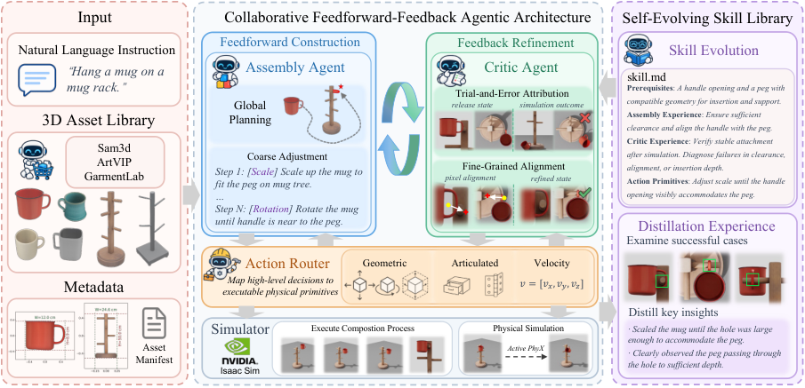

**来源：** [arXiv 摘要](https://arxiv.org/abs/2610.20560) · [PDF](https://arxiv.org/pdf/2610.20560)

### LiFi: LiDAR Generation from Multi-View Images via Geometric and Semantic Collaborative Guidance

**方向：** 3D 生成

针对多视角图像生成激光点云对齐不足的问题，提出LiFi框架。利用几何重建与语义交互双分支引导潜在扩散过程，生成高保真且结构对齐的三维点云。

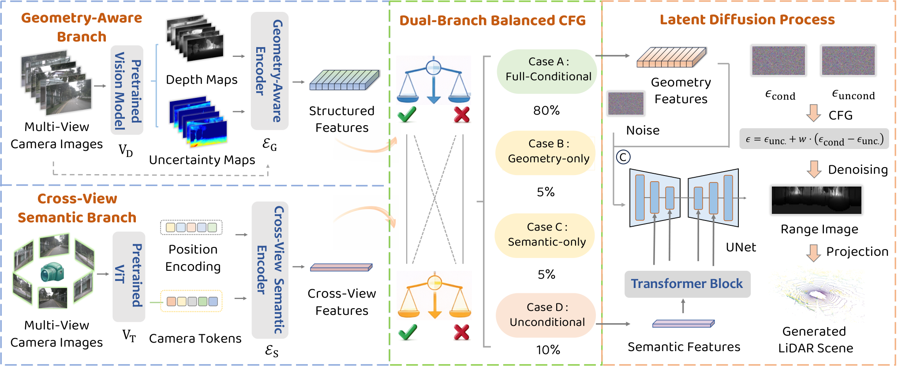

**来源：** [arXiv 摘要](https://arxiv.org/abs/2610.19786) · [PDF](https://arxiv.org/pdf/2610.19786)

### Q-MAGIC: Quad-only Mesh Autoregressive Generation via Singularity-Aware Circular Relative Offset Tokenization

**方向：** 3D 生成

针对自回归生成四边形网格拓扑约束难的问题，提出新架构。采用奇异点感知序列化与相对偏移编码，训练Transformer逐词元预测高质量四边网格。

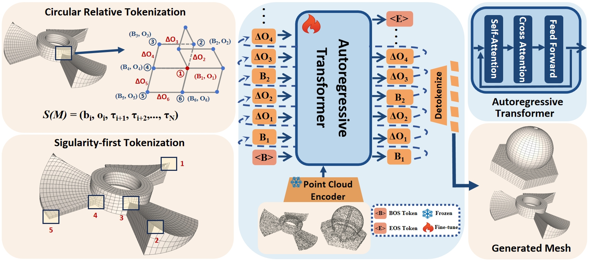

**来源：** [arXiv 摘要](https://arxiv.org/abs/2610.19777) · [PDF](https://arxiv.org/pdf/2610.19777)

## 3D 场景

### PhySGA: A Physics-Space Grounded Agentic Framework for Generalizable and Interactive 3D Composition

**方向：** 3D 生成 / 3D 场景

针对3D组合缺乏物理常识的问题，构建物理驱动的Agent框架。组装智能体负责规划，仿真反馈智能体负责动力学微调，实现复杂物体交互组装。

**来源：** [arXiv 摘要](https://arxiv.org/abs/2610.20560) · [PDF](https://arxiv.org/pdf/2610.20560)

### SceneAE: Scene Generation and Reconstruction in Queryable 3D-Anchored Latent Space

**方向：** 3D 场景 / 3D 重建

探索将三维结构直接作为视频模型的潜在空间。构建位置与隐特征结合的三维锚定潜变量，解耦几何与内容生成，提升场景重建质量与相机控制灵活性。

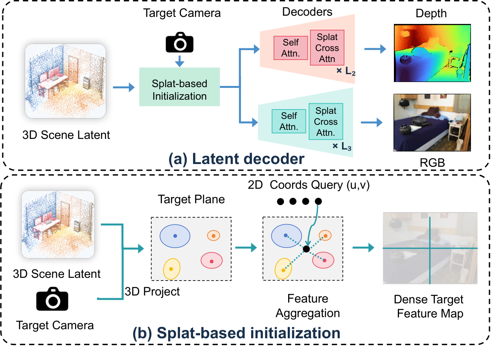

**来源：** [arXiv 摘要](https://arxiv.org/abs/2610.19708) · [PDF](https://arxiv.org/pdf/2610.19708)

### Dungeon and Visibility World Generator

**方向：** 3D 场景

针对机器人探索算法缺乏可控三维测试环境的问题，开发开源生成框架。支持多种拓扑配置与参数化构建，内置视距查询引擎，提供可复现评估平台。

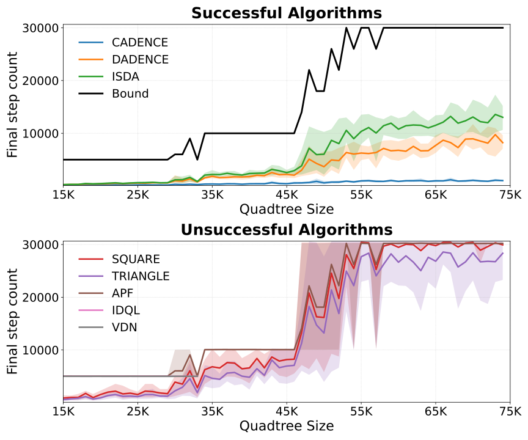

**来源：** [arXiv 摘要](https://arxiv.org/abs/2610.19523) · [PDF](https://arxiv.org/pdf/2610.19523)

### Spectral World Renderer: Unified 3D Hyperspectral Unmixing

**方向：** 3D 场景 / 3D 纹理

针对三维场景缺乏材质真值且解混依赖后期的问题，构建光谱渲染器。在表示层直接解码材质丰度，单次渲染输出光谱与材质分布，并提供标注数据集。

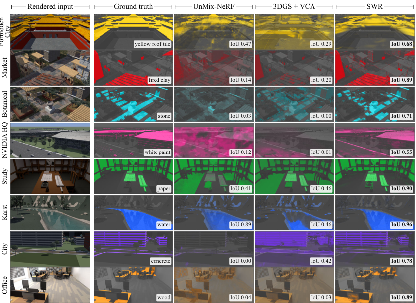

**来源：** [arXiv 摘要](https://arxiv.org/abs/2610.19520) · [PDF](https://arxiv.org/pdf/2610.19520)

### Holi-Spatial 360: Generative Reconstruction from Sparse Panoramas for Spatial Rendering and Intelligence

**方向：** 3D 重建 / 3D 场景

针对稀疏全景图重建约束不足的问题，提出对应关系引导的几何优化方法。构建连贯三维高斯记忆并补全外观，自动化生成多房间数据集支撑空间智能。

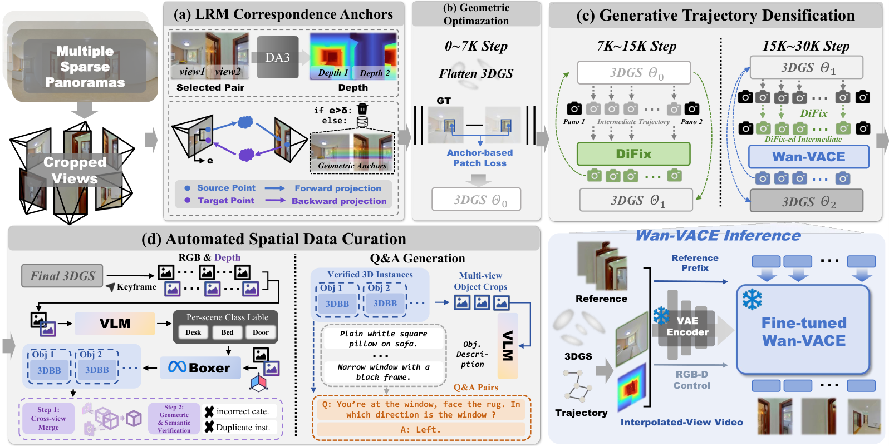

**来源：** [arXiv 摘要](https://arxiv.org/abs/2610.19502) · [PDF](https://arxiv.org/pdf/2610.19502)

### From Failures to Learnable Worlds: Policy-Conditioned Environment Generation for Navigation Agents

**方向：** 3D 场景

针对仿真环境生成未针对智能体弱点的问题，提出弱点引导学习框架。利用大模型从失败轨迹提炼有效弱点，据此定向生成特定训练环境提升策略适应力。

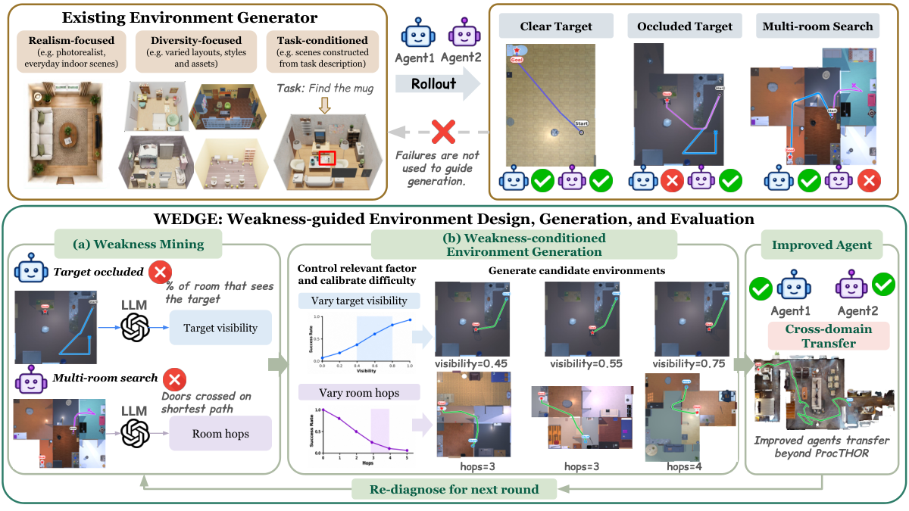

**来源：** [arXiv 摘要](https://arxiv.org/abs/2610.19420) · [PDF](https://arxiv.org/pdf/2610.19420)

## 3D 重建

### DeSpatial: The devil of Agentic Spatial Reasoning Lies in 3D Itself

**方向：** 3D 重建

针对3D感知不一致导致推理失效，将任务解耦。通过分割与深度协同优化及跨视角实例融合，构建统一且对齐重力的三维场景供后续推理使用。

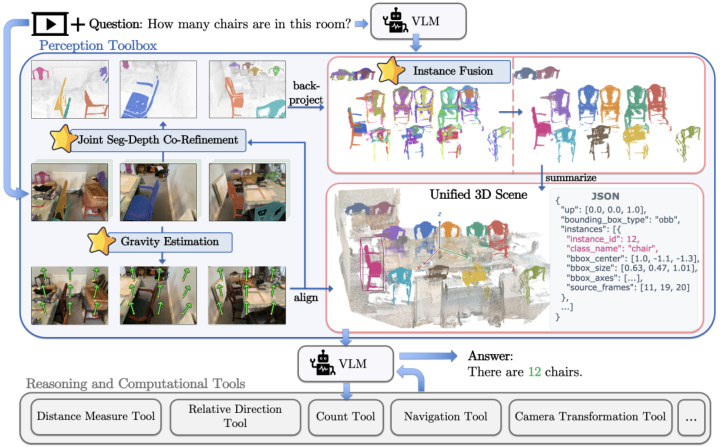

**来源：** [arXiv 摘要](https://arxiv.org/abs/2610.20990) · [PDF](https://arxiv.org/pdf/2610.20990)

### Line-Augmented cuVSLAM: Robust Visual Odometry in Low-Texture Environments

**方向：** 3D 重建

针对低纹理环境点特征易失效问题，为视觉SLAM引入线特征。利用普吕克坐标将线误差融入位姿求解与束调整，自适应补偿点特征缺失。

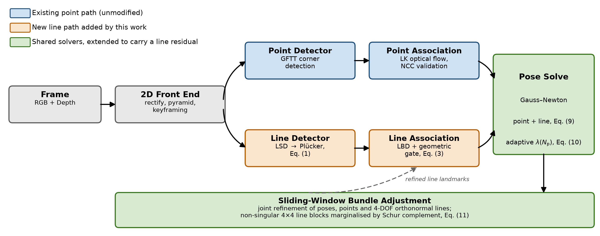

**来源：** [arXiv 摘要](https://arxiv.org/abs/2610.20958) · [PDF](https://arxiv.org/pdf/2610.20958)

### Feed-Forward Multi-View Feature Coding for 3D Gaussian Splatting

**方向：** 3D 重建

针对前馈3DGS压缩冗余问题，提出多视角特征编码框架。端到端将图像压缩为紧凑特征流，接收端直接预测高斯属性，大幅降低码率并提速。

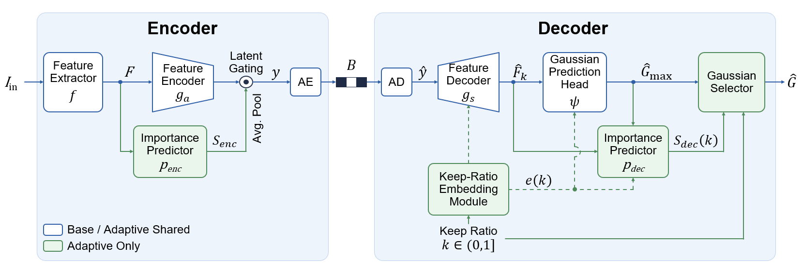

**来源：** [arXiv 摘要](https://arxiv.org/abs/2610.20590) · [PDF](https://arxiv.org/pdf/2610.20590)

### Tiered-Resolution Volumetric Mapping for Real-Time Simultaneous Planning and Mapping on Natural Outdoor Environments

**方向：** 3D 重建

针对体素建图高分辨率算力开销大问题，提出分层分辨率机制。规划路径邻域用精细体素，外围用粗糙体素，利用路径规划反馈动态分配网格，兼顾效率。

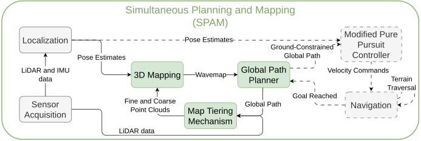

**来源：** [arXiv 摘要](https://arxiv.org/abs/2610.20476) · [PDF](https://arxiv.org/pdf/2610.20476)

### Where Should the Gaussians Go? Reusable Label-Aware Allocation for Budget-Constrained Gaussian Splatting of Cinematic CT

**方向：** 3D 重建

针对医学3D高斯分配需逐场景优化耗时问题，提出标签感知分配方法。将CT与标注映射为空间密度，按预算直接采样初始位置，免去逐病例优化。

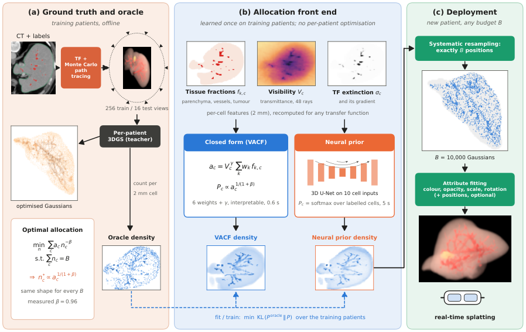

**来源：** [arXiv 摘要](https://arxiv.org/abs/2610.20397) · [PDF](https://arxiv.org/pdf/2610.20397)

### InfiniSplat v2: Analyzing and Improving Feed-Forward 3DGS from Any Views

**方向：** 3D 重建

针对前馈3DGS大视角渲染质量下降问题，改进网络架构与训练。解耦几何与属性预测并固定几何分支，引入真实位姿对齐与大角度监督提升效果。

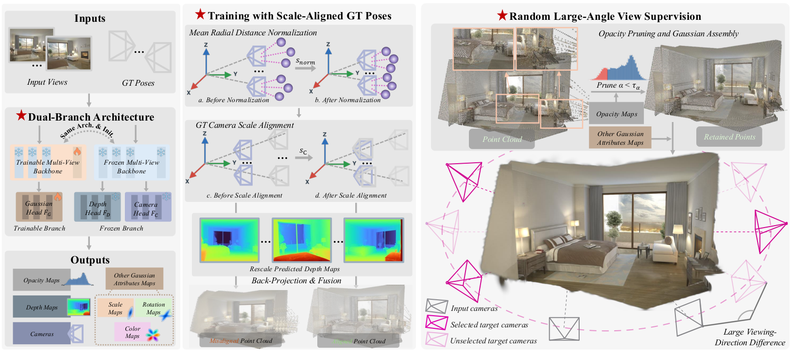

**来源：** [arXiv 摘要](https://arxiv.org/abs/2610.20341) · [PDF](https://arxiv.org/pdf/2610.20341)

### GLoD-LVSM: Learning Geometry-Grounded Continuous-LoD Scene Representations for Large View Synthesis Models

**方向：** 3D 重建

针对视角合成模型特征冗余开销大的问题，提出几何锚定的连续多细节表示。通过连续场初始化锚点并几何引导压缩，实现按需渲染与显存优化。

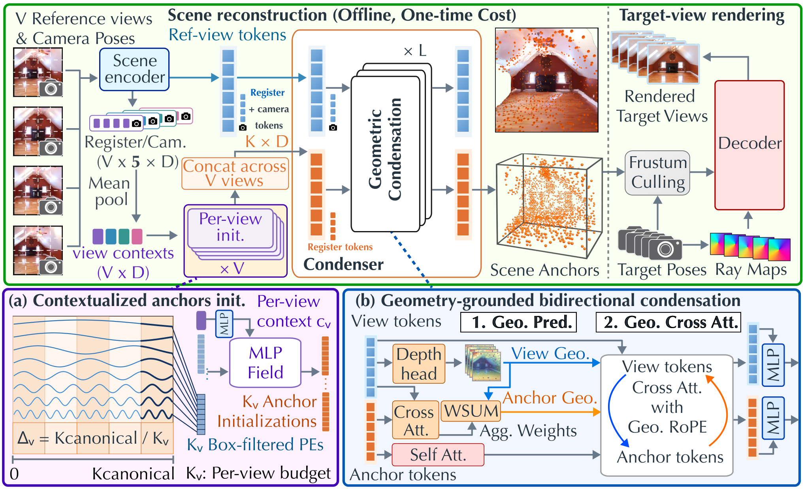

**来源：** [arXiv 摘要](https://arxiv.org/abs/2610.20254) · [PDF](https://arxiv.org/pdf/2610.20254)

### DreamHMR: From Video Generation to Human Motion Modeling via Structural Focusing

**方向：** 3D 重建

针对遮挡下人体网格重建难题，将视频生成先验适配至几何任务。通过全局表征转移对齐人体表面，再结合局部证据精细恢复被遮挡的肢体与细节。

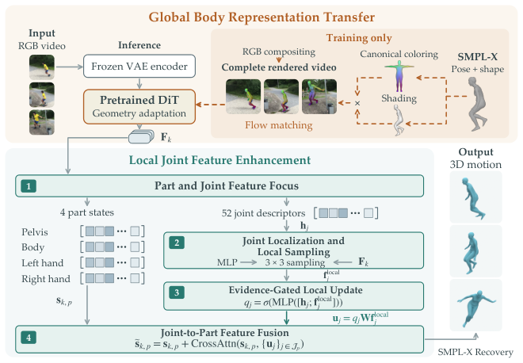

**来源：** [arXiv 摘要](https://arxiv.org/abs/2610.20124) · [PDF](https://arxiv.org/pdf/2610.20124)

### Feasibility of a Patient-Specific Digital Twin for Ventriculoperitoneal Shunt Trajectory Planning

**方向：** 3D 重建

针对脑室分流术导管易阻塞问题，构建患者特异性数字孪生。基于CT重建解剖结构并搜索安全约束下的最优置管轨迹，输出指导手术的入点与深度参数。

**来源：** [arXiv 摘要](https://arxiv.org/abs/2610.20074) · [PDF](https://arxiv.org/pdf/2610.20074)

### Why 3D Reconstruction Breaks Down on Under-Ice AUV Video, and How to Predict It

**方向：** 3D 重建

针对冰下AUV视频三维重建失效问题，测试主流算法证实源于基深比过小。据此提出快速检测系统，数分钟内即可预警此类数据采集瓶颈，避免无效计算。

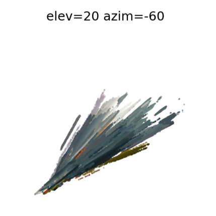

**来源：** [arXiv 摘要](https://arxiv.org/abs/2610.19993) · [PDF](https://arxiv.org/pdf/2610.19993)

### VisibilitySplat: Ray-Traced Occlusion for Relighting with 3D Gaussian Splatting

**方向：** 3D 重建 / 3D 纹理

针对3D高斯重光照缺乏显式遮挡的问题，引入稀疏可见性查询模块。利用BVH加速射线投射计算透光率，配合物理着色实现高质量材质分解与重打光。

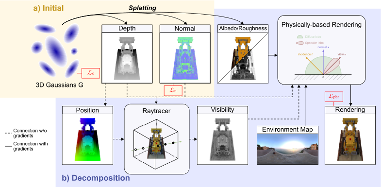

**来源：** [arXiv 摘要](https://arxiv.org/abs/2610.19847) · [PDF](https://arxiv.org/pdf/2610.19847)

### HyperLoop: Hyperspectral-Assisted Loop Closure Detection in 3D-SLAM for Planetary Exploration

**方向：** 3D 重建

针对行星地貌重复导致SLAM回环混淆的问题，将高光谱引入闭环检测。提取材质光谱特征辅助可见光，提升相似环境下的定位鲁棒性。

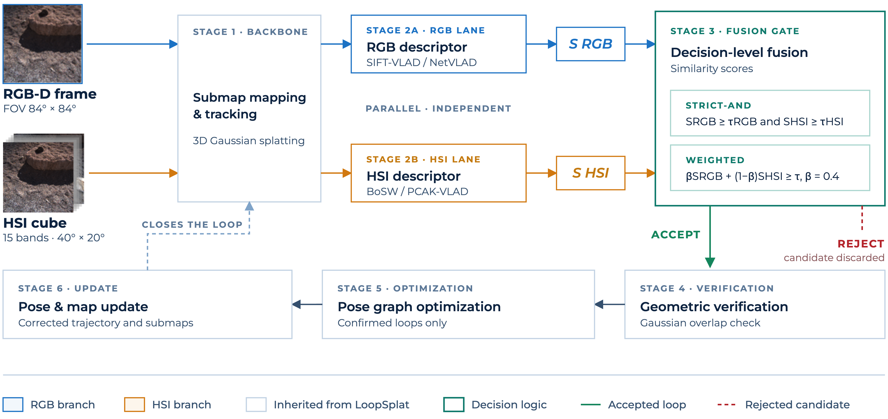

**来源：** [arXiv 摘要](https://arxiv.org/abs/2610.19742) · [PDF](https://arxiv.org/pdf/2610.19742)

### A Diagnostic Study of World-Space Human Recovery Under High Camera Dynamics

**方向：** 3D 重建

针对快速运镜下单目人体重建漂移问题，诊断主因为相机与人体估计尺度失配。提出闭式校正统一尺度，无需重训即可消除漂移，输出稳定世界位姿。

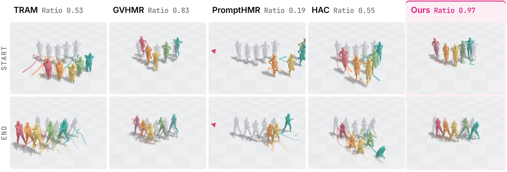

**来源：** [arXiv 摘要](https://arxiv.org/abs/2610.19729) · [PDF](https://arxiv.org/pdf/2610.19729)

### SceneAE: Scene Generation and Reconstruction in Queryable 3D-Anchored Latent Space

**方向：** 3D 场景 / 3D 重建

探索将三维结构直接作为视频模型的潜在空间。构建位置与隐特征结合的三维锚定潜变量，解耦几何与内容生成，提升场景重建质量与相机控制灵活性。

**来源：** [arXiv 摘要](https://arxiv.org/abs/2610.19708) · [PDF](https://arxiv.org/pdf/2610.19708)

### MicroSDF: Microfacet-Driven Hybrid Neural SDFs for Mixed-Reflectance Surface Reconstruction

**方向：** 3D 重建

针对混合反射表面重建失真问题，提出微表面驱动的神经隐式框架。引入法线约束与双支路渲染模型，自适应融合高光与漫反射，实现高保真几何重建。

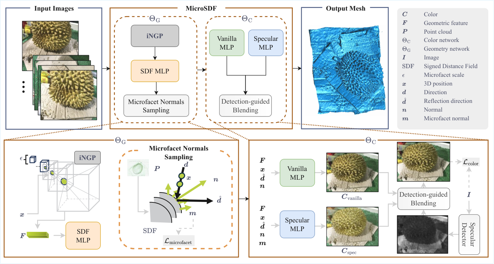

**来源：** [arXiv 摘要](https://arxiv.org/abs/2610.19681) · [PDF](https://arxiv.org/pdf/2610.19681)

### Remember, Revisit, Revise: Scaffold Memory for Long-Horizon 3D Geometry

**方向：** 3D 重建

针对长序列三维重建误差累积且流式模型无法修正的问题，引入可修订外部记忆机制。关联空间与观测特征，支持历史状态核验与回溯修正。

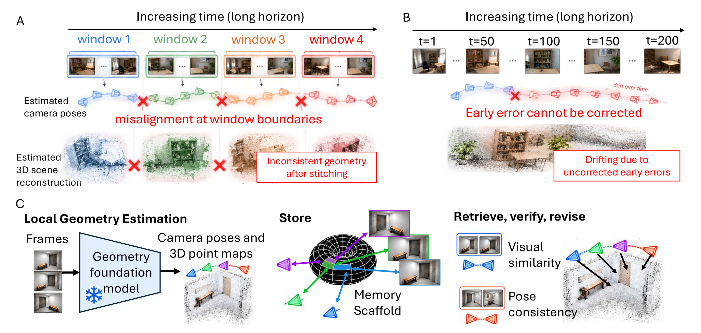

**来源：** [arXiv 摘要](https://arxiv.org/abs/2610.19674) · [PDF](https://arxiv.org/pdf/2610.19674)

### MagicGarment: Benchmarking Single-Image Standalone 3D Garment Reconstruction

**方向：** 3D 重建

针对单图独立重建服装网格困难且缺乏基准的问题，构建多类别数据集与评估协议。通过语义条件化与路由微调技术，提升单视角三维服装网格质量。

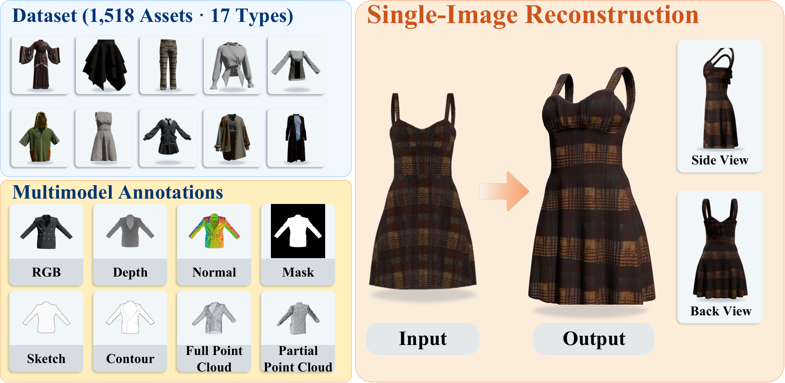

**来源：** [arXiv 摘要](https://arxiv.org/abs/2610.19623) · [PDF](https://arxiv.org/pdf/2610.19623)

### Holi-Spatial 360: Generative Reconstruction from Sparse Panoramas for Spatial Rendering and Intelligence

**方向：** 3D 重建 / 3D 场景

针对稀疏全景图重建约束不足的问题，提出对应关系引导的几何优化方法。构建连贯三维高斯记忆并补全外观，自动化生成多房间数据集支撑空间智能。

**来源：** [arXiv 摘要](https://arxiv.org/abs/2610.19502) · [PDF](https://arxiv.org/pdf/2610.19502)

## 3D 世界模型

### Orbia: Do Generated Videos Form a Consistent 3D World?

**方向：** 3D 世界模型

针对生成视频缺乏三维一致性评估，构建Orbia基准。通过受控探索与重访，从输入保持、内容持久与三维自洽三维度量化模型场景构建能力。

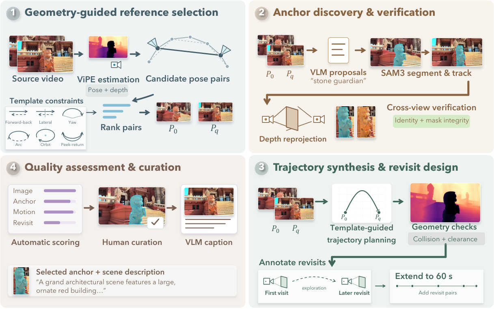

**来源：** [arXiv 摘要](https://arxiv.org/abs/2610.20693) · [PDF](https://arxiv.org/pdf/2610.20693)

### GeoThinker-$F$: Endogenous Predictive World Representations for Fast Spatial Intelligence

**方向：** 3D 世界模型

针对大模型依赖外部3D编码器致高延迟，将感知内化。通过两阶段训练使隐状态自预测几何先验，消除外部编码依赖，实现高效空间推理。

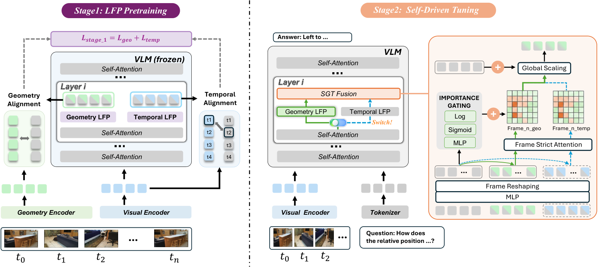

**来源：** [arXiv 摘要](https://arxiv.org/abs/2610.20592) · [PDF](https://arxiv.org/pdf/2610.20592)

### PAWA: Panoramic Action-conditioned World Modeling for Multiple Agents

**方向：** 3D 世界模型

针对多人3D世界模型缺乏同步观测数据的问题，构建配套数据集。采用双塔网络联合预测玩家视角与环境全景，利用交叉注意力对齐多智能体共享状态。

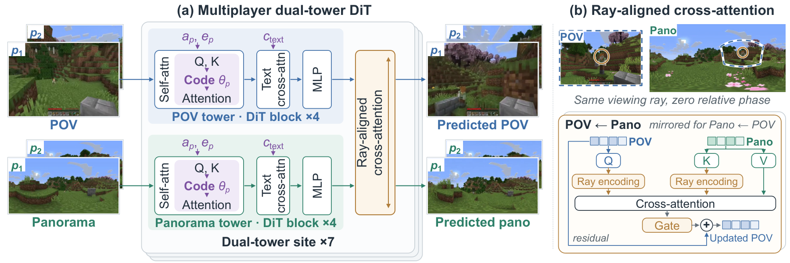

**来源：** [arXiv 摘要](https://arxiv.org/abs/2610.20240) · [PDF](https://arxiv.org/pdf/2610.20240)

## 3D 纹理

### VisibilitySplat: Ray-Traced Occlusion for Relighting with 3D Gaussian Splatting

**方向：** 3D 重建 / 3D 纹理

针对3D高斯重光照缺乏显式遮挡的问题，引入稀疏可见性查询模块。利用BVH加速射线投射计算透光率，配合物理着色实现高质量材质分解与重打光。

**来源：** [arXiv 摘要](https://arxiv.org/abs/2610.19847) · [PDF](https://arxiv.org/pdf/2610.19847)

### Spectral World Renderer: Unified 3D Hyperspectral Unmixing

**方向：** 3D 场景 / 3D 纹理

针对三维场景缺乏材质真值且解混依赖后期的问题，构建光谱渲染器。在表示层直接解码材质丰度，单次渲染输出光谱与材质分布，并提供标注数据集。

**来源：** [arXiv 摘要](https://arxiv.org/abs/2610.19520) · [PDF](https://arxiv.org/pdf/2610.19520)

## 3D 动画

### KinoGen: Customizable Humanoid Loco-Manipulation References via Kinematically Grounded Video Generation

**方向：** 3D 动画

针对人形机器人运动生成依赖代理模型的问题，引入运动学约束。通过校准渲染引导视频生成并拟合模型，直接在构型空间输出定制操作参考序列。

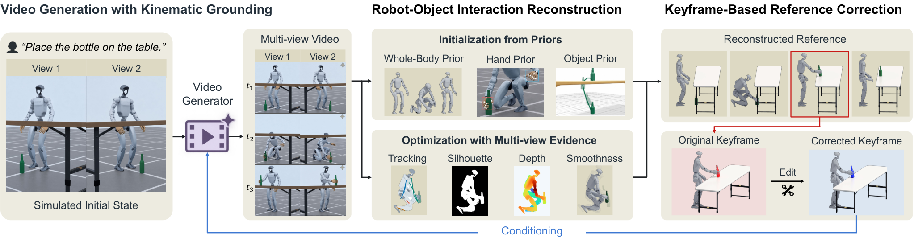

**来源：** [arXiv 摘要](https://arxiv.org/abs/2610.20552) · [PDF](https://arxiv.org/pdf/2610.20552)

### OmniPoser: Flexible Human Motion Recovery in the Wild with Masked Flow Matching

**方向：** 3D 动画

针对稀疏传感器运动恢复配置固定及推理慢的问题，提出通用框架。通过跨模态掩码兼容异构输入，结合条件流匹配实现单步ODE推理，满足实时需求。

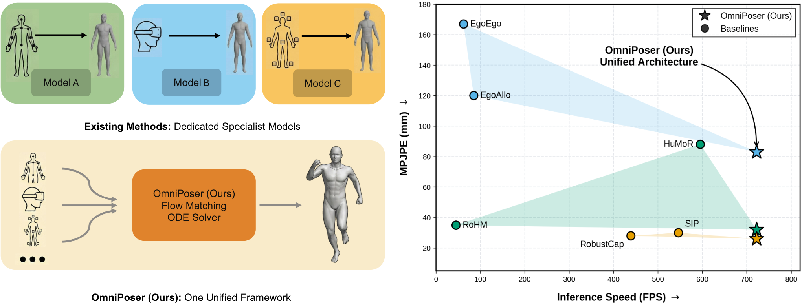

**来源：** [arXiv 摘要](https://arxiv.org/abs/2610.19857) · [PDF](https://arxiv.org/pdf/2610.19857)
