[arXiv 3D 目录](../) · [论文阅读主页](../../) · [日报目录](../../date/) · [周报目录](../../week/) · [月报目录](../../month/)

# 2026-10-22 · arXiv 3D 论文

> 今日 arXiv 中与现有 3D 关注方向相关的论文。每篇提供一句话理解、论文参考图和原文链接。

## 今日论文

| 论文 | 方向 | 一句话介绍 |
| --- | --- | --- |
| [PixGR: Pixel-Space Generative Decoding for Fast Feed-Forward 3D Reconstruction](https://arxiv.org/abs/2610.31908) | 3D 重建 | PixGR将像素空间流匹配生成解码融入前馈3D高斯重建，实现亚秒级稀疏视角三维重建。 |
| [WorldMirror: Agentic Real-to-Sim Generation of Interactive Worlds from In-the-Wild Robot Demonstrations](https://arxiv.org/abs/2610.31834) | 3D 重建 / 3D 世界模型 | 提出WorldMirror智能体框架，将真实机器人演示转化为可交互的仿真数字孪生世界。 |
| [StackGen3D: Stable 3D Block Stack Generation from Multiview Silhouettes](https://arxiv.org/abs/2610.31803) | 3D 生成 | 提出物理信息图神经网络与条件流匹配模型，从三视角轮廓生成物理稳定的3D积木堆叠结构。 |
| [See What I Need, Dream What I Want: A Navigation Foundation Model on a Self-Constructed Representation Space](https://arxiv.org/abs/2610.31762) | 3D 世界模型 | 提出导航基础模型RepresentNav，用自构建表征空间和想象未来场景机制刷新多项导航基准。 |
| [AudioLift: Audio-Driven Single Image to Full-Head Gaussian Avatar via Multi-view Video Generation](https://arxiv.org/abs/2610.31747) | 3D 生成 / 3D 动画 / 3D 重建 | 提出AudioLift两阶段框架，从单张肖像图生成音频驱动的完整头部高斯3D说话虚拟形象，支持夸张表情与配饰 |
| [A Unified Framework for Image-to-3D Part Generation via Variable Granularity](https://arxiv.org/abs/2610.31671) | 3D 生成 | 提出FlexPart统一图像到3D部件生成框架，单一模型支持多粒度几何条件，提升部件质量与一致性。 |
| [BrickWright: Agentic Creation of Physically Feasible Brick Builds](https://arxiv.org/abs/2610.31651) | 3D 生成 | 提出BrickWright框架，引导智能体通过代码生成物理可行且符合提示的乐高积木搭建，物理有效率达100%。 |
| [Gate3DGen: A Pre-processing Model that Selectively Purifies Real-World Images for 3D Generation](https://arxiv.org/abs/2610.31649) | 3D 生成 | 提出Gate3DGen选择性预处理模型，净化真实退化图像以提升单图3D生成质量 |
| [OmniRay: Camera-Agnostic Monocular 3D Reconstruction with Composite Ray Fields](https://arxiv.org/abs/2610.31645) | 3D 重建 | 提出OmniRay，用复合光线场实现相机无关的单目3D重建，无需相机参数即可处理鱼眼与全景图像。 |
| [HiP3R: Hierarchical Pose Graphs for Long-Horizon 3D Reconstruction](https://arxiv.org/abs/2610.31635) | 3D 重建 | 提出层次化位姿图方法HiP3R，先优化块级Sim(3)全局布局，再估计帧级共享SE(3)位姿，实现长视频全局一致的3D重建。 |
| [F2G-Pose: Geometry-Aware Foundation Feature Lifting for Direct RGB-D Category-Level Object Pose Estimation](https://arxiv.org/abs/2610.31623) | 3D 重建 | 提出F2G-Pose：将基础模型特征提升至点云，单次前向直接估计类别级物体位姿、尺寸与形状。 |
| [Squaring-the-Sphere: Distortion-Free and Seamless Panorama Generation via CubeAtlas](https://arxiv.org/abs/2610.31565) | 3D 生成 | 提出CubeAtlas立方体展开表示与布局感知稀疏注意力，让扩散模型单次生成无畸变、无缝的360度全景图。 |
| [MVLoMa: Multi-View Local Feature Matching with Any Geometry Foundation Model](https://arxiv.org/abs/2610.31321) | 3D 重建 | 提出MVLoMa，把局部特征匹配从图像对扩展到星状多视图，融合跨视图几何上下文一次前向完成匹配。 |
| [Stream4D: Streaming 4D Reconstruction with Training-free Motion Decoupling via Causal KV-Cache Attention](https://arxiv.org/abs/2610.31320) | 3D 重建 | 提出Stream4D，利用因果KV缓存中的运动线索免训练解耦动静区域，实现动态场景的流式4D重建。 |
| [PiHand: Latent Hand-Object Interaction Priors for Physics-Based Policy Learning](https://arxiv.org/abs/2610.31299) | 3D 动画 | 提出PiHand框架，将专家策略蒸馏为手-物体交互先验，实现泛化到未见物体的灵巧操作策略学习。 |
| [RecallGS: Geometry-Grounded Recall for Online Semantic Gaussian Splatting](https://arxiv.org/abs/2610.31293) | 3D 重建 | 提出免训练的RecallGS，通过检索历史观测恢复几何-语义信息，实现高效在线语义3D高斯泼溅。 |
| [WildDepth-v2: A Synchronized RGB--LiDAR--Radar Dataset and Benchmark for Metric Depth, Motion, and Tracking of Wildlife](https://arxiv.org/abs/2610.31123) | 3D 重建 | 发布首个含4D成像雷达的RGB-LiDAR-雷达同步野生动物数据集与基准，实现度量深度、运动估计与三维跟踪。 |
| [DRAFT: Decoding and Reconstructing 3D Room Layouts from fMRI and Camera Trajectories](https://arxiv.org/abs/2610.31108) | 3D 重建 | 首次仅凭观看室内漫游者的fMRI脑信号与已知相机轨迹，重建未见房间的3D度量布局。 |
| [GraphCAD: Geometry-Aware Diffusion on Edge-Adjacency Graphs for CAD Generation](https://arxiv.org/abs/2610.30974) | 3D 生成 | 提出GraphCAD：基于边邻接图的几何感知扩散框架，生成复杂高保真CAD模型。 |
| [H-2DGS: Height-Field Gaussian Splatting for Sharp and Deformable Neurosurgical Surface Reconstruction](https://arxiv.org/abs/2610.30910) | 3D 重建 | 提出H-2DGS高度场二维高斯泼溅方法，实现神经手术脑皮层清晰、可变形的三维表面重建。 |
| [DeXplicit: Making Physical State Explicit in Dexterous Manipulation World Models](https://arxiv.org/abs/2610.30781) | 3D 世界模型 | 提出灵巧操作世界模型DeXplicit，先在度量3D空间显式预测物体运动与形变，再渲染未来场景视频，精度与速度显著提升。 |
| [AgentDreamer: Agentic 3D Motion Reasoning for Text-Controllable Physics Simulation](https://arxiv.org/abs/2610.30679) | 3D 动画 / 3D 世界模型 | 提出AgentDreamer框架，由智能体将文本指令推理为3D运动先验，实现文本可控的物理仿真 |
| [GSHeadRelight: Fast Relightability for 3D Gaussian Head Synthesis](https://arxiv.org/abs/2610.30619) | 3D 生成 / 3D 纹理 | 基于生成式3D高斯与线性神经辐射传输光照模型，仅用野外图像实现快速高保真的3D人像重光照。 |

## 3D 生成

### StackGen3D: Stable 3D Block Stack Generation from Multiview Silhouettes

**方向：** 3D 生成

提出物理信息图神经网络与条件流匹配模型，从三视角轮廓生成物理稳定的3D积木堆叠结构。

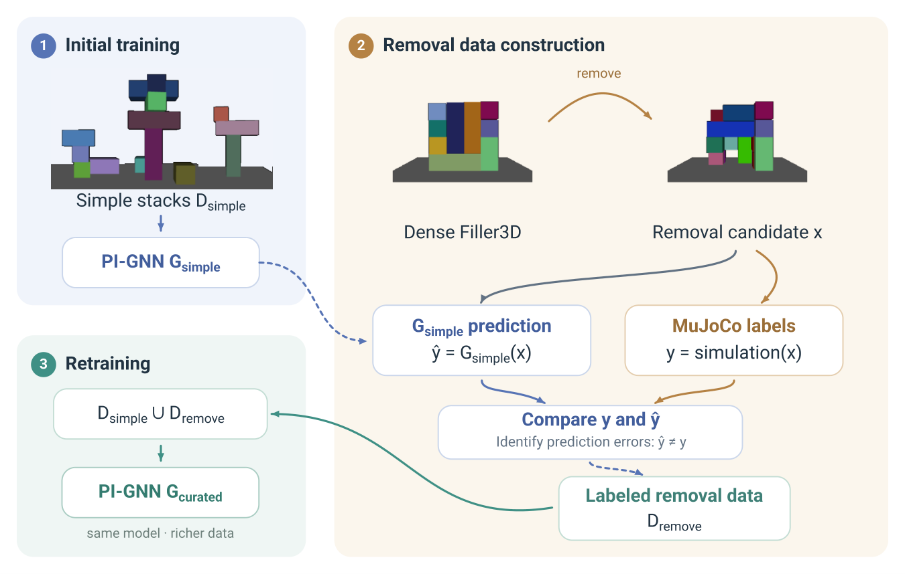

**来源：** [arXiv 摘要](https://arxiv.org/abs/2610.31803) · [PDF](https://arxiv.org/pdf/2610.31803)

### AudioLift: Audio-Driven Single Image to Full-Head Gaussian Avatar via Multi-view Video Generation

**方向：** 3D 生成 / 3D 动画 / 3D 重建

提出AudioLift两阶段框架，从单张肖像图生成音频驱动的完整头部高斯3D说话虚拟形象，支持夸张表情与配饰

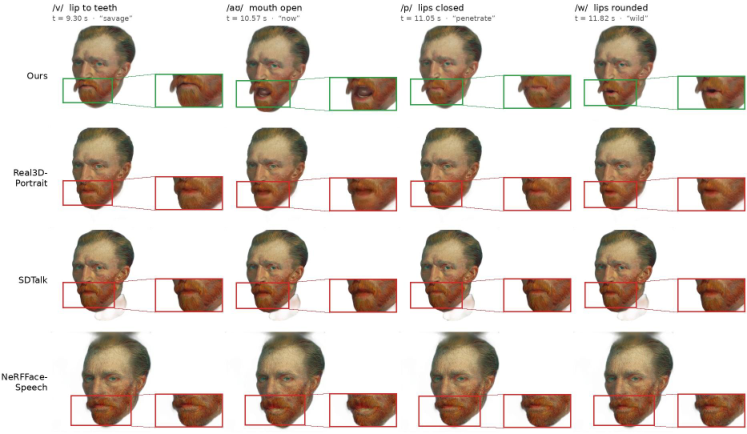

**来源：** [arXiv 摘要](https://arxiv.org/abs/2610.31747) · [PDF](https://arxiv.org/pdf/2610.31747)

### A Unified Framework for Image-to-3D Part Generation via Variable Granularity

**方向：** 3D 生成

提出FlexPart统一图像到3D部件生成框架，单一模型支持多粒度几何条件，提升部件质量与一致性。

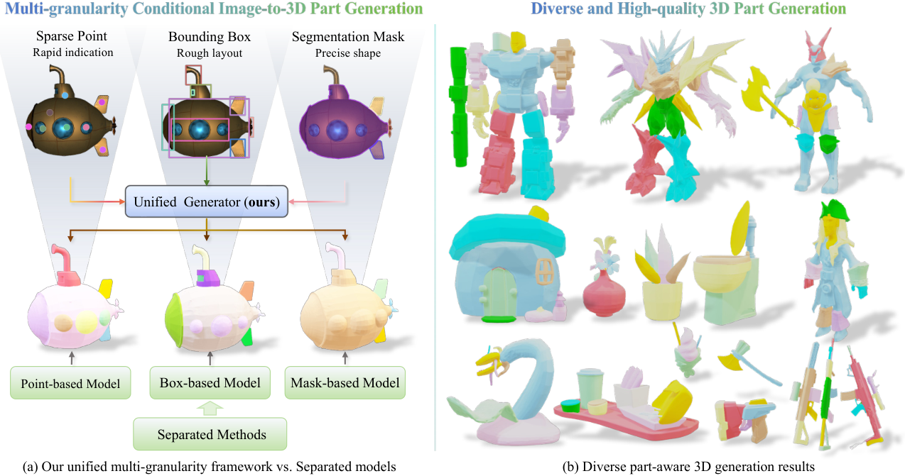

**来源：** [arXiv 摘要](https://arxiv.org/abs/2610.31671) · [PDF](https://arxiv.org/pdf/2610.31671)

### BrickWright: Agentic Creation of Physically Feasible Brick Builds

**方向：** 3D 生成

提出BrickWright框架，引导智能体通过代码生成物理可行且符合提示的乐高积木搭建，物理有效率达100%。

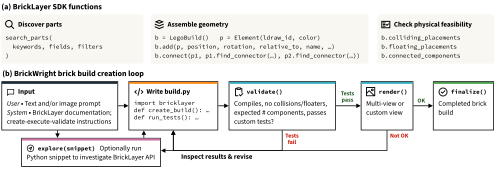

**来源：** [arXiv 摘要](https://arxiv.org/abs/2610.31651) · [PDF](https://arxiv.org/pdf/2610.31651)

### Gate3DGen: A Pre-processing Model that Selectively Purifies Real-World Images for 3D Generation

**方向：** 3D 生成

提出Gate3DGen选择性预处理模型，净化真实退化图像以提升单图3D生成质量

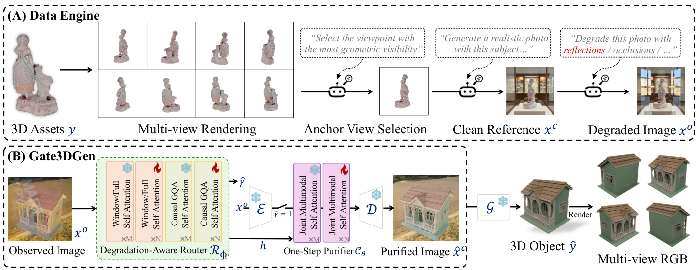

**来源：** [arXiv 摘要](https://arxiv.org/abs/2610.31649) · [PDF](https://arxiv.org/pdf/2610.31649)

### Squaring-the-Sphere: Distortion-Free and Seamless Panorama Generation via CubeAtlas

**方向：** 3D 生成

提出CubeAtlas立方体展开表示与布局感知稀疏注意力，让扩散模型单次生成无畸变、无缝的360度全景图。

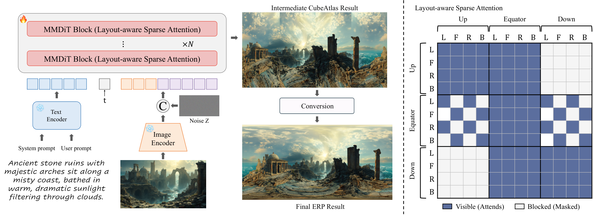

**来源：** [arXiv 摘要](https://arxiv.org/abs/2610.31565) · [PDF](https://arxiv.org/pdf/2610.31565)

### GraphCAD: Geometry-Aware Diffusion on Edge-Adjacency Graphs for CAD Generation

**方向：** 3D 生成

提出GraphCAD：基于边邻接图的几何感知扩散框架，生成复杂高保真CAD模型。

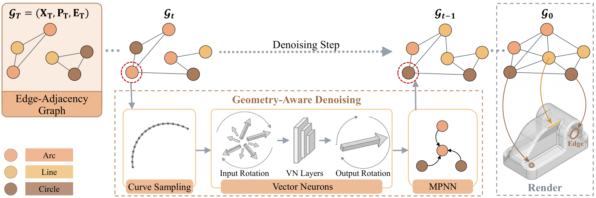

**来源：** [arXiv 摘要](https://arxiv.org/abs/2610.30974) · [PDF](https://arxiv.org/pdf/2610.30974)

### GSHeadRelight: Fast Relightability for 3D Gaussian Head Synthesis

**方向：** 3D 生成 / 3D 纹理

基于生成式3D高斯与线性神经辐射传输光照模型，仅用野外图像实现快速高保真的3D人像重光照。

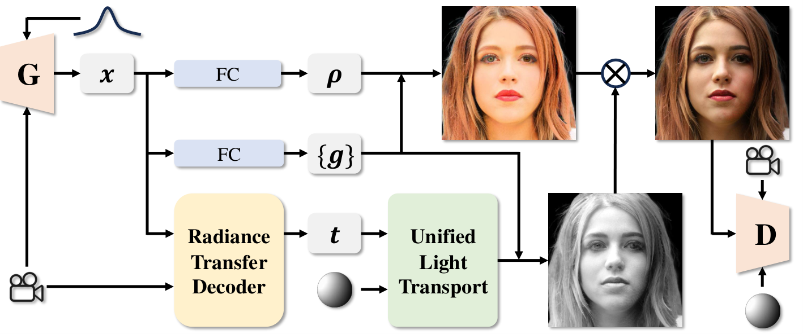

**来源：** [arXiv 摘要](https://arxiv.org/abs/2610.30619) · [PDF](https://arxiv.org/pdf/2610.30619)

## 3D 重建

### PixGR: Pixel-Space Generative Decoding for Fast Feed-Forward 3D Reconstruction

**方向：** 3D 重建

PixGR将像素空间流匹配生成解码融入前馈3D高斯重建，实现亚秒级稀疏视角三维重建。

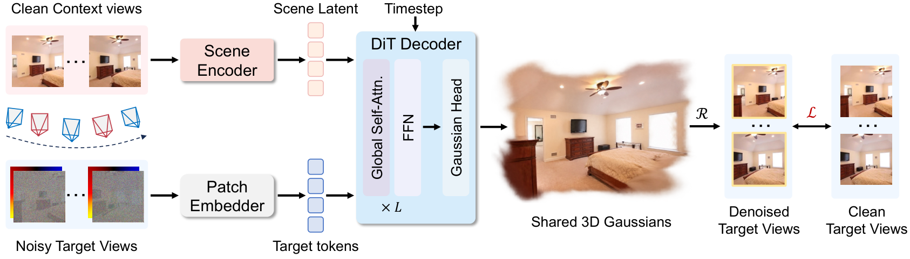

**来源：** [arXiv 摘要](https://arxiv.org/abs/2610.31908) · [PDF](https://arxiv.org/pdf/2610.31908)

### WorldMirror: Agentic Real-to-Sim Generation of Interactive Worlds from In-the-Wild Robot Demonstrations

**方向：** 3D 重建 / 3D 世界模型

提出WorldMirror智能体框架，将真实机器人演示转化为可交互的仿真数字孪生世界。

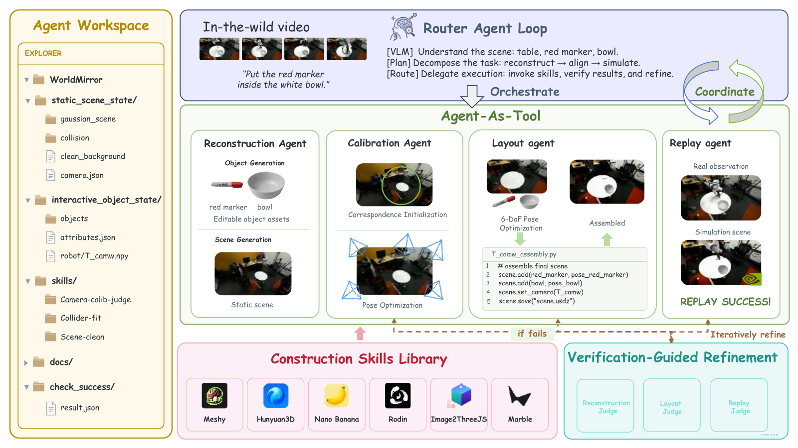

**来源：** [arXiv 摘要](https://arxiv.org/abs/2610.31834) · [PDF](https://arxiv.org/pdf/2610.31834)

### AudioLift: Audio-Driven Single Image to Full-Head Gaussian Avatar via Multi-view Video Generation

**方向：** 3D 生成 / 3D 动画 / 3D 重建

提出AudioLift两阶段框架，从单张肖像图生成音频驱动的完整头部高斯3D说话虚拟形象，支持夸张表情与配饰

**来源：** [arXiv 摘要](https://arxiv.org/abs/2610.31747) · [PDF](https://arxiv.org/pdf/2610.31747)

### OmniRay: Camera-Agnostic Monocular 3D Reconstruction with Composite Ray Fields

**方向：** 3D 重建

提出OmniRay，用复合光线场实现相机无关的单目3D重建，无需相机参数即可处理鱼眼与全景图像。

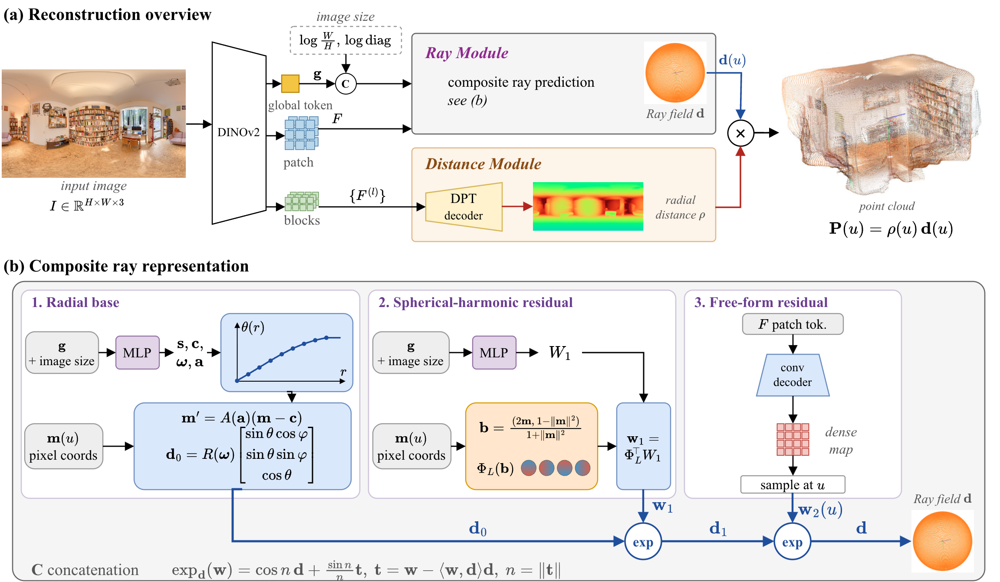

**来源：** [arXiv 摘要](https://arxiv.org/abs/2610.31645) · [PDF](https://arxiv.org/pdf/2610.31645)

### HiP3R: Hierarchical Pose Graphs for Long-Horizon 3D Reconstruction

**方向：** 3D 重建

提出层次化位姿图方法HiP3R，先优化块级Sim(3)全局布局，再估计帧级共享SE(3)位姿，实现长视频全局一致的3D重建。

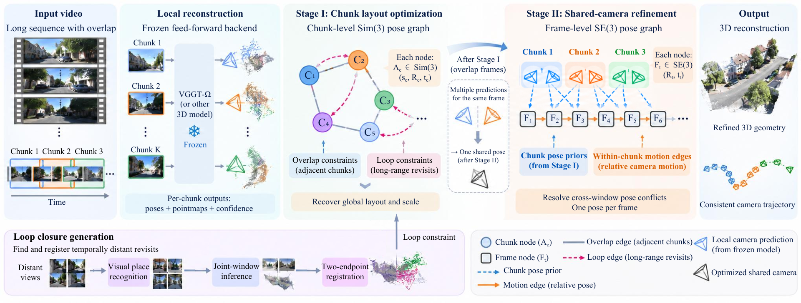

**来源：** [arXiv 摘要](https://arxiv.org/abs/2610.31635) · [PDF](https://arxiv.org/pdf/2610.31635)

### F2G-Pose: Geometry-Aware Foundation Feature Lifting for Direct RGB-D Category-Level Object Pose Estimation

**方向：** 3D 重建

提出F2G-Pose：将基础模型特征提升至点云，单次前向直接估计类别级物体位姿、尺寸与形状。

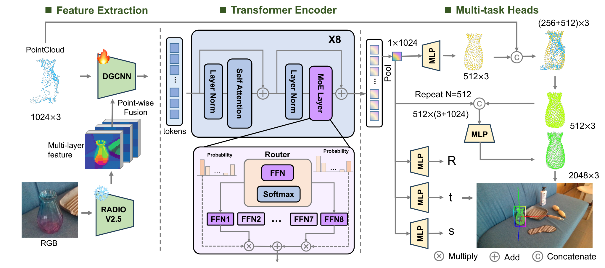

**来源：** [arXiv 摘要](https://arxiv.org/abs/2610.31623) · [PDF](https://arxiv.org/pdf/2610.31623)

### MVLoMa: Multi-View Local Feature Matching with Any Geometry Foundation Model

**方向：** 3D 重建

提出MVLoMa，把局部特征匹配从图像对扩展到星状多视图，融合跨视图几何上下文一次前向完成匹配。

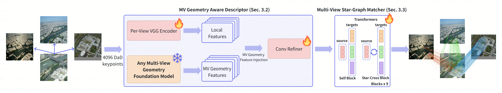

**来源：** [arXiv 摘要](https://arxiv.org/abs/2610.31321) · [PDF](https://arxiv.org/pdf/2610.31321)

### Stream4D: Streaming 4D Reconstruction with Training-free Motion Decoupling via Causal KV-Cache Attention

**方向：** 3D 重建

提出Stream4D，利用因果KV缓存中的运动线索免训练解耦动静区域，实现动态场景的流式4D重建。

**来源：** [arXiv 摘要](https://arxiv.org/abs/2610.31320) · [PDF](https://arxiv.org/pdf/2610.31320)

### RecallGS: Geometry-Grounded Recall for Online Semantic Gaussian Splatting

**方向：** 3D 重建

提出免训练的RecallGS，通过检索历史观测恢复几何-语义信息，实现高效在线语义3D高斯泼溅。

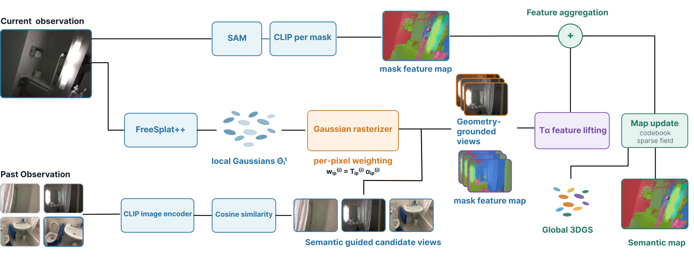

**来源：** [arXiv 摘要](https://arxiv.org/abs/2610.31293) · [PDF](https://arxiv.org/pdf/2610.31293)

### WildDepth-v2: A Synchronized RGB--LiDAR--Radar Dataset and Benchmark for Metric Depth, Motion, and Tracking of Wildlife

**方向：** 3D 重建

发布首个含4D成像雷达的RGB-LiDAR-雷达同步野生动物数据集与基准，实现度量深度、运动估计与三维跟踪。

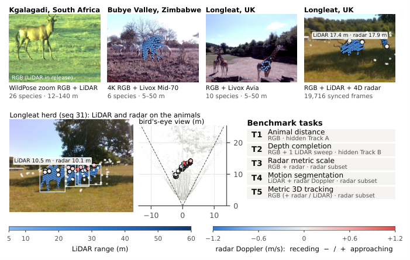

**来源：** [arXiv 摘要](https://arxiv.org/abs/2610.31123) · [PDF](https://arxiv.org/pdf/2610.31123)

### DRAFT: Decoding and Reconstructing 3D Room Layouts from fMRI and Camera Trajectories

**方向：** 3D 重建

首次仅凭观看室内漫游者的fMRI脑信号与已知相机轨迹，重建未见房间的3D度量布局。

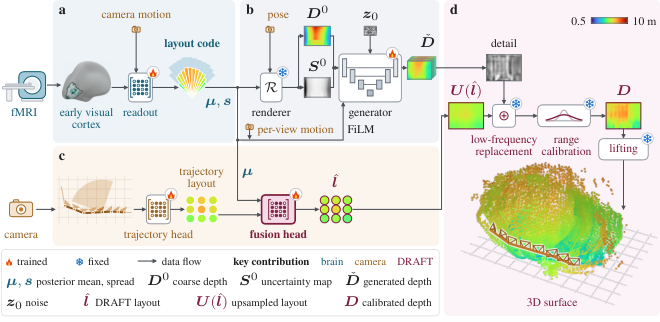

**来源：** [arXiv 摘要](https://arxiv.org/abs/2610.31108) · [PDF](https://arxiv.org/pdf/2610.31108)

### H-2DGS: Height-Field Gaussian Splatting for Sharp and Deformable Neurosurgical Surface Reconstruction

**方向：** 3D 重建

提出H-2DGS高度场二维高斯泼溅方法，实现神经手术脑皮层清晰、可变形的三维表面重建。

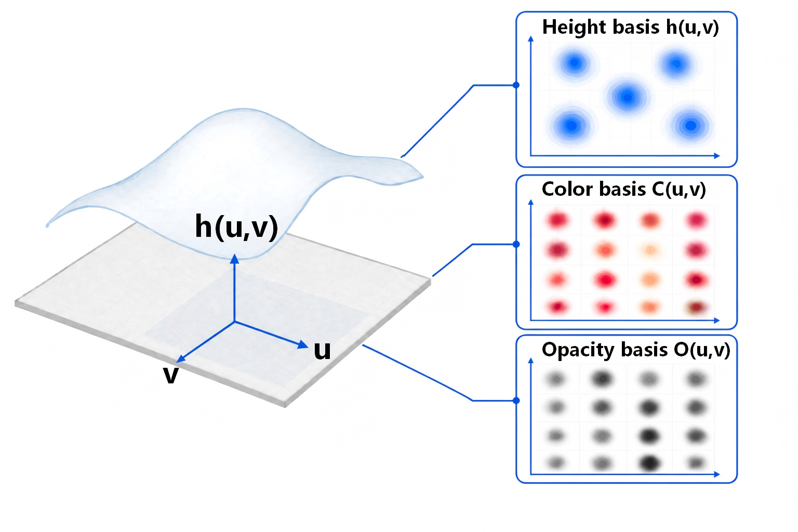

**来源：** [arXiv 摘要](https://arxiv.org/abs/2610.30910) · [PDF](https://arxiv.org/pdf/2610.30910)

## 3D 世界模型

### WorldMirror: Agentic Real-to-Sim Generation of Interactive Worlds from In-the-Wild Robot Demonstrations

**方向：** 3D 重建 / 3D 世界模型

提出WorldMirror智能体框架，将真实机器人演示转化为可交互的仿真数字孪生世界。

**来源：** [arXiv 摘要](https://arxiv.org/abs/2610.31834) · [PDF](https://arxiv.org/pdf/2610.31834)

### See What I Need, Dream What I Want: A Navigation Foundation Model on a Self-Constructed Representation Space

**方向：** 3D 世界模型

提出导航基础模型RepresentNav，用自构建表征空间和想象未来场景机制刷新多项导航基准。

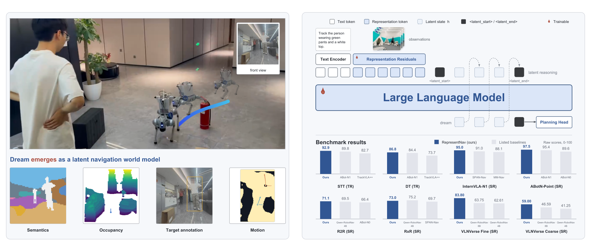

**来源：** [arXiv 摘要](https://arxiv.org/abs/2610.31762) · [PDF](https://arxiv.org/pdf/2610.31762)

### DeXplicit: Making Physical State Explicit in Dexterous Manipulation World Models

**方向：** 3D 世界模型

提出灵巧操作世界模型DeXplicit，先在度量3D空间显式预测物体运动与形变，再渲染未来场景视频，精度与速度显著提升。

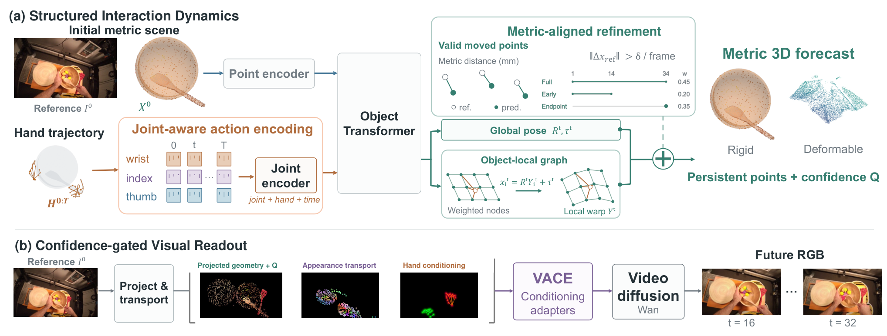

**来源：** [arXiv 摘要](https://arxiv.org/abs/2610.30781) · [PDF](https://arxiv.org/pdf/2610.30781)

### AgentDreamer: Agentic 3D Motion Reasoning for Text-Controllable Physics Simulation

**方向：** 3D 动画 / 3D 世界模型

提出AgentDreamer框架，由智能体将文本指令推理为3D运动先验，实现文本可控的物理仿真

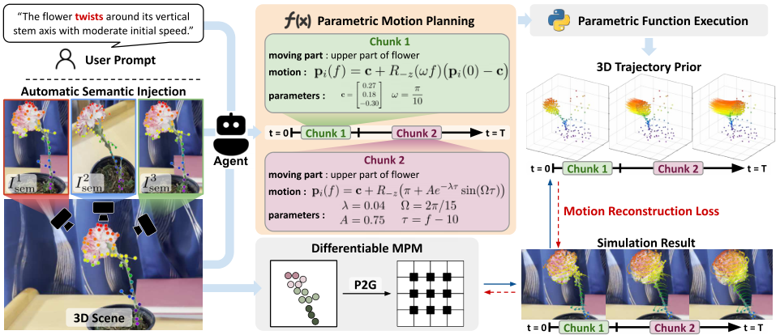

**来源：** [arXiv 摘要](https://arxiv.org/abs/2610.30679) · [PDF](https://arxiv.org/pdf/2610.30679)

## 3D 纹理

### GSHeadRelight: Fast Relightability for 3D Gaussian Head Synthesis

**方向：** 3D 生成 / 3D 纹理

基于生成式3D高斯与线性神经辐射传输光照模型，仅用野外图像实现快速高保真的3D人像重光照。

**来源：** [arXiv 摘要](https://arxiv.org/abs/2610.30619) · [PDF](https://arxiv.org/pdf/2610.30619)

## 3D 动画

### AudioLift: Audio-Driven Single Image to Full-Head Gaussian Avatar via Multi-view Video Generation

**方向：** 3D 生成 / 3D 动画 / 3D 重建

提出AudioLift两阶段框架，从单张肖像图生成音频驱动的完整头部高斯3D说话虚拟形象，支持夸张表情与配饰

**来源：** [arXiv 摘要](https://arxiv.org/abs/2610.31747) · [PDF](https://arxiv.org/pdf/2610.31747)

### PiHand: Latent Hand-Object Interaction Priors for Physics-Based Policy Learning

**方向：** 3D 动画

提出PiHand框架，将专家策略蒸馏为手-物体交互先验，实现泛化到未见物体的灵巧操作策略学习。

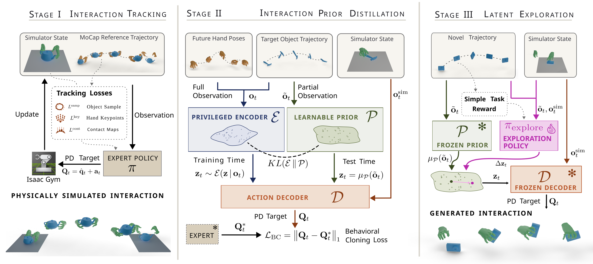

**来源：** [arXiv 摘要](https://arxiv.org/abs/2610.31299) · [PDF](https://arxiv.org/pdf/2610.31299)

### AgentDreamer: Agentic 3D Motion Reasoning for Text-Controllable Physics Simulation

**方向：** 3D 动画 / 3D 世界模型

提出AgentDreamer框架，由智能体将文本指令推理为3D运动先验，实现文本可控的物理仿真

**来源：** [arXiv 摘要](https://arxiv.org/abs/2610.30679) · [PDF](https://arxiv.org/pdf/2610.30679)
