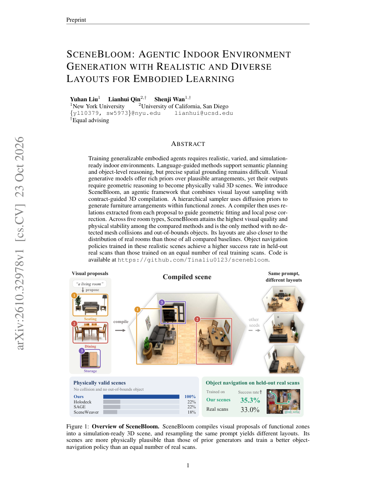
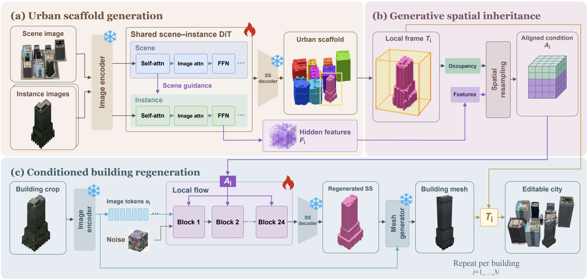
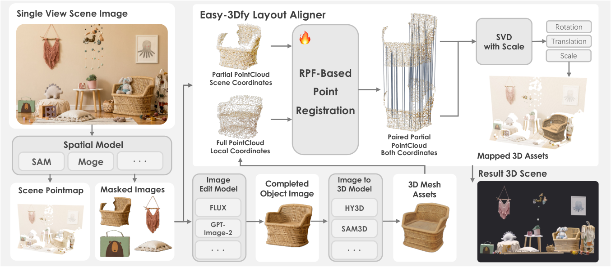
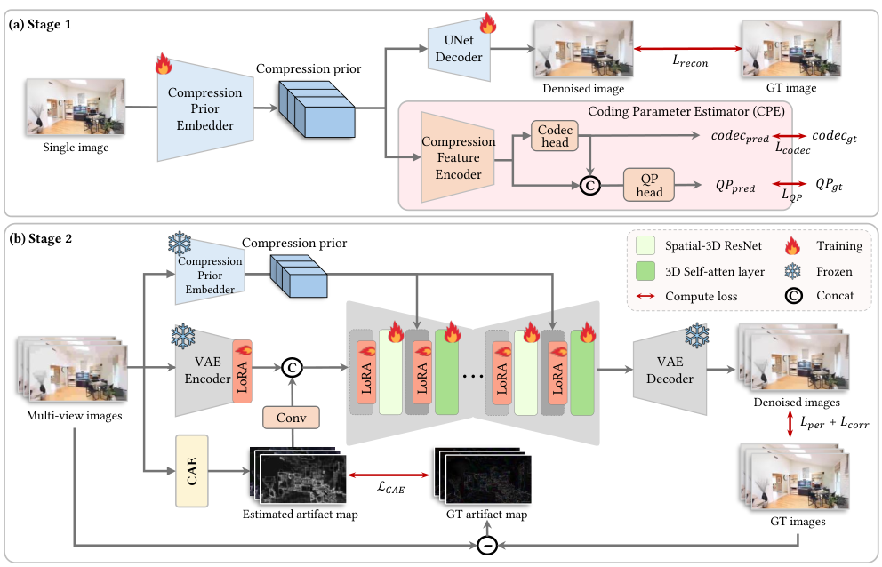
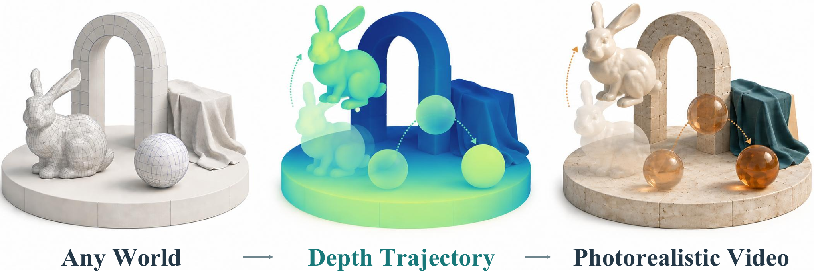
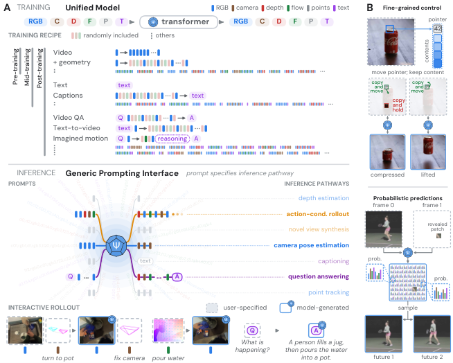
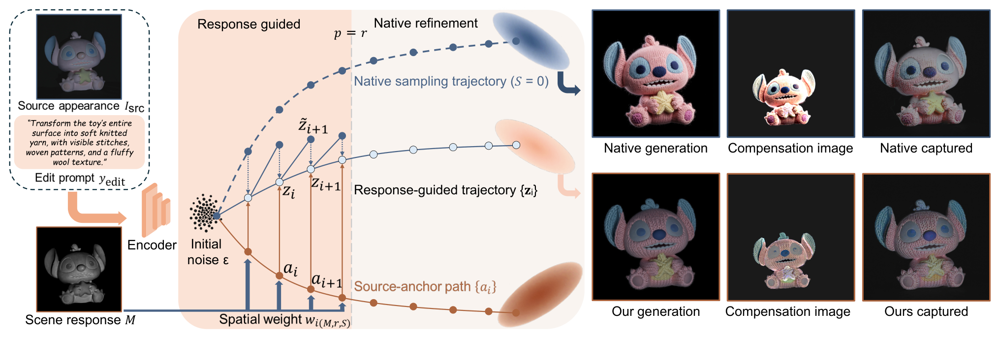
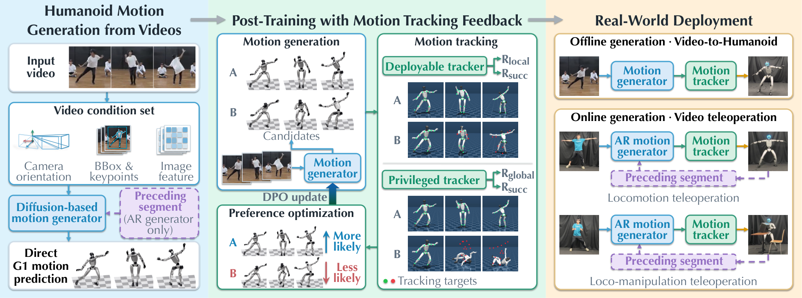
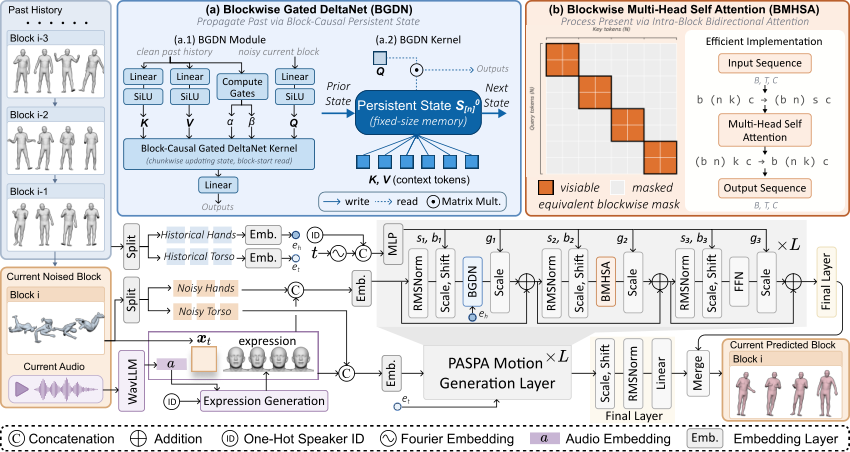
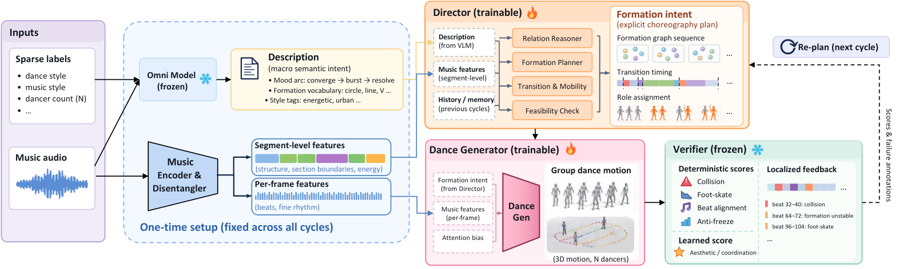

[arXiv 3D 目录](../) · [论文阅读主页](../../) · [日报目录](../../date/) · [周报目录](../../week/) · [月报目录](../../month/)

# 2026-10-23 · arXiv 3D 论文

> 今日 arXiv 中与现有 3D 关注方向相关的论文。每篇提供一句话理解、论文参考图和原文链接。

## 今日论文

| 论文 | 方向 | 一句话介绍 |
| --- | --- | --- |
| [SceneBloom: Agentic Indoor Environment Generation with Realistic and Diverse Layouts for Embodied Learning](https://arxiv.org/abs/2610.32978) | 3D 生成 / 3D 场景 | 提出SceneBloom智能体框架，结合扩散布局采样与几何编译，生成真实多样且物理有效的室内3D场景用于具身学习。 |
| [ViT-H: Generative Video-To-Humanoid Control with Motion Tracking Feedback](https://arxiv.org/abs/2610.32966) | 3D 动画 | 提出ViT-H框架：用扩散模型从人类视频直接生成人形机器人参考动作，并用跟踪反馈优化其可执行性 |
| [CompMVR: Compression-Aware Multi-View Restoration Using Diffusion Models for Geometrically Consistent 3D Reconstruction](https://arxiv.org/abs/2610.32800) | 3D 重建 | 提出压缩感知的多视角扩散恢复框架CompMVR，修复压缩伪影并保持跨视角几何一致性，提升3D重建质量 |
| [SREdit: Scene Response Guided Appearance Editing for Projection Mapping](https://arxiv.org/abs/2610.32792) | 3D 纹理 | 提出SREdit框架，利用场景响应图引导投影映射中的物体外观编辑，提升投影质量与还原保真度 |
| [CityLift: Compositional 3D Urban Generation from a Single Image](https://arxiv.org/abs/2610.32728) | 3D 生成 / 3D 场景 | 提出CityLift框架，从单张城市图像联合建模建筑几何与空间布局，生成可编辑的组合式3D城市场景。 |
| [UniWorld: A Unified World Model for Real-Time Visual World Simulation](https://arxiv.org/abs/2610.32381) | 3D 世界模型 | 提出统一世界模型UniWorld，将深度轨迹与参考外观整合到共享视频生成模型中，实现实时连续视觉世界仿真。 |
| [Past as State, Present as Attention: Persistent-State Blockwise Flow Matching for Long-Horizon Co-Speech Motion Generation](https://arxiv.org/abs/2610.32373) | 3D 动画 | 提出PASPA，用块间持久状态压缩历史动作、块内注意力建模当前片段，实现长时程语音驱动动作生成 |
| [ChoreoStudio: Planning What, When, and Who in Music-Driven Group Choreography](https://arxiv.org/abs/2610.32325) | 3D 动画 | 提出ChoreoStudio框架，为音乐驱动群舞生成显式规划队形变换的内容、时机与执行者。 |
| [Easy-3Dfy: Object-Level Geometric Composition for Single-Image 3D Scene Construction](https://arxiv.org/abs/2610.32250) | 3D 生成 / 3D 场景 / 3D 重建 | 提出Easy-3Dfy组合式工作流，解耦3D物体生成与场景布局估计，通过对齐器建立几何对应，实现高质量单图像3D场景构建。 |
| [$Ψ$-0.6: Adaptive Streams of Thought in a Unified Vision-Language World Model](https://arxiv.org/abs/2610.32177) | 3D 世界模型 | 提出Ψ-0.6统一视觉-语言世界模型，以自适应思维流组合感知、语言、几何与模拟实现灵活物理推理 |

## 3D 生成

### SceneBloom: Agentic Indoor Environment Generation with Realistic and Diverse Layouts for Embodied Learning

**方向：** 3D 生成 / 3D 场景

提出SceneBloom智能体框架，结合扩散布局采样与几何编译，生成真实多样且物理有效的室内3D场景用于具身学习。

**来源：** [arXiv 摘要](https://arxiv.org/abs/2610.32978) · [PDF](https://arxiv.org/pdf/2610.32978)

### CityLift: Compositional 3D Urban Generation from a Single Image

**方向：** 3D 生成 / 3D 场景

提出CityLift框架，从单张城市图像联合建模建筑几何与空间布局，生成可编辑的组合式3D城市场景。

**来源：** [arXiv 摘要](https://arxiv.org/abs/2610.32728) · [PDF](https://arxiv.org/pdf/2610.32728)

### Easy-3Dfy: Object-Level Geometric Composition for Single-Image 3D Scene Construction

**方向：** 3D 生成 / 3D 场景 / 3D 重建

提出Easy-3Dfy组合式工作流，解耦3D物体生成与场景布局估计，通过对齐器建立几何对应，实现高质量单图像3D场景构建。

**来源：** [arXiv 摘要](https://arxiv.org/abs/2610.32250) · [PDF](https://arxiv.org/pdf/2610.32250)

## 3D 场景

### SceneBloom: Agentic Indoor Environment Generation with Realistic and Diverse Layouts for Embodied Learning

**方向：** 3D 生成 / 3D 场景

提出SceneBloom智能体框架，结合扩散布局采样与几何编译，生成真实多样且物理有效的室内3D场景用于具身学习。

**来源：** [arXiv 摘要](https://arxiv.org/abs/2610.32978) · [PDF](https://arxiv.org/pdf/2610.32978)

### CityLift: Compositional 3D Urban Generation from a Single Image

**方向：** 3D 生成 / 3D 场景

提出CityLift框架，从单张城市图像联合建模建筑几何与空间布局，生成可编辑的组合式3D城市场景。

**来源：** [arXiv 摘要](https://arxiv.org/abs/2610.32728) · [PDF](https://arxiv.org/pdf/2610.32728)

### Easy-3Dfy: Object-Level Geometric Composition for Single-Image 3D Scene Construction

**方向：** 3D 生成 / 3D 场景 / 3D 重建

提出Easy-3Dfy组合式工作流，解耦3D物体生成与场景布局估计，通过对齐器建立几何对应，实现高质量单图像3D场景构建。

**来源：** [arXiv 摘要](https://arxiv.org/abs/2610.32250) · [PDF](https://arxiv.org/pdf/2610.32250)

## 3D 重建

### CompMVR: Compression-Aware Multi-View Restoration Using Diffusion Models for Geometrically Consistent 3D Reconstruction

**方向：** 3D 重建

提出压缩感知的多视角扩散恢复框架CompMVR，修复压缩伪影并保持跨视角几何一致性，提升3D重建质量

**来源：** [arXiv 摘要](https://arxiv.org/abs/2610.32800) · [PDF](https://arxiv.org/pdf/2610.32800)

### Easy-3Dfy: Object-Level Geometric Composition for Single-Image 3D Scene Construction

**方向：** 3D 生成 / 3D 场景 / 3D 重建

提出Easy-3Dfy组合式工作流，解耦3D物体生成与场景布局估计，通过对齐器建立几何对应，实现高质量单图像3D场景构建。

**来源：** [arXiv 摘要](https://arxiv.org/abs/2610.32250) · [PDF](https://arxiv.org/pdf/2610.32250)

## 3D 世界模型

### UniWorld: A Unified World Model for Real-Time Visual World Simulation

**方向：** 3D 世界模型

提出统一世界模型UniWorld，将深度轨迹与参考外观整合到共享视频生成模型中，实现实时连续视觉世界仿真。

**来源：** [arXiv 摘要](https://arxiv.org/abs/2610.32381) · [PDF](https://arxiv.org/pdf/2610.32381)

### $Ψ$-0.6: Adaptive Streams of Thought in a Unified Vision-Language World Model

**方向：** 3D 世界模型

提出Ψ-0.6统一视觉-语言世界模型，以自适应思维流组合感知、语言、几何与模拟实现灵活物理推理

**来源：** [arXiv 摘要](https://arxiv.org/abs/2610.32177) · [PDF](https://arxiv.org/pdf/2610.32177)

## 3D 纹理

### SREdit: Scene Response Guided Appearance Editing for Projection Mapping

**方向：** 3D 纹理

提出SREdit框架，利用场景响应图引导投影映射中的物体外观编辑，提升投影质量与还原保真度

**来源：** [arXiv 摘要](https://arxiv.org/abs/2610.32792) · [PDF](https://arxiv.org/pdf/2610.32792)

## 3D 动画

### ViT-H: Generative Video-To-Humanoid Control with Motion Tracking Feedback

**方向：** 3D 动画

提出ViT-H框架：用扩散模型从人类视频直接生成人形机器人参考动作，并用跟踪反馈优化其可执行性

**来源：** [arXiv 摘要](https://arxiv.org/abs/2610.32966) · [PDF](https://arxiv.org/pdf/2610.32966)

### Past as State, Present as Attention: Persistent-State Blockwise Flow Matching for Long-Horizon Co-Speech Motion Generation

**方向：** 3D 动画

提出PASPA，用块间持久状态压缩历史动作、块内注意力建模当前片段，实现长时程语音驱动动作生成

**来源：** [arXiv 摘要](https://arxiv.org/abs/2610.32373) · [PDF](https://arxiv.org/pdf/2610.32373)

### ChoreoStudio: Planning What, When, and Who in Music-Driven Group Choreography

**方向：** 3D 动画

提出ChoreoStudio框架，为音乐驱动群舞生成显式规划队形变换的内容、时机与执行者。

**来源：** [arXiv 摘要](https://arxiv.org/abs/2610.32325) · [PDF](https://arxiv.org/pdf/2610.32325)
