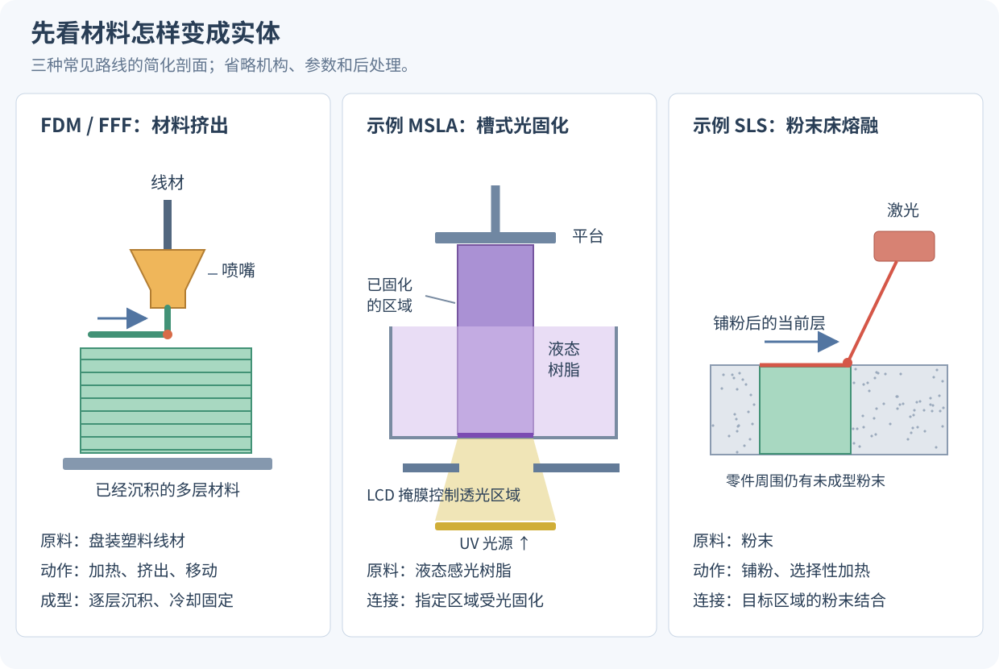
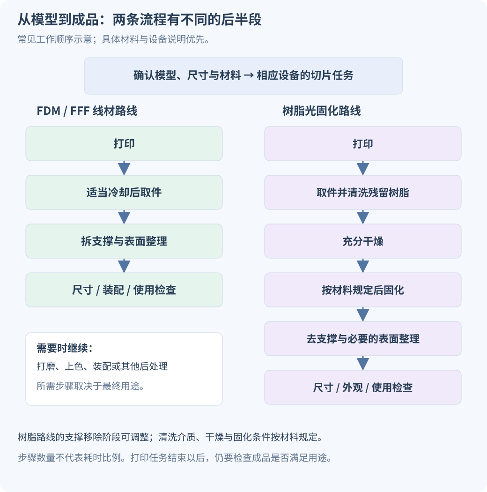

# 3D 打印怎么分类：从 FDM、树脂光固化到工业打印的新手入门

初次接触 3D 打印，先理解两条常见路线就够了：**FDM／FFF 把加热后的塑料线材挤出来，按路径逐层堆积；树脂光固化则让液态感光树脂在指定区域受光固化。** 此外还有粉末床熔融、材料喷射、粘结剂喷射等工艺，广泛用于专业制造。

这些名称容易混在一起，是因为它们并不都在回答同一个问题。**PLA、树脂和金属说的是材料；FDM、SLA、SLS 等主要说的是成型方式；手办、功能零件和建筑模型说的是用途。** 本文先把这几个分类维度分开，再解释常见技术怎样工作、做什么比较合适，以及打印完成后还要做什么。

本文面向从未使用过 3D 打印机的新手，不要求先理解建模或机械设计。重点是建立判断方法，不做具体机型和价格推荐。

## 一、3D 打印在做什么：把数字形状变成实体

3D 打印通常从数字三维模型出发，按计算好的区域逐步增加材料，形成实体，也叫**增材制造（Additive Manufacturing）**。常见设备把模型沿高度分成许多层，再按照每一层的形状进行成型。

例如，一个有孔的支架，模型规定外部形状、孔的位置和厚度；打印工艺决定这些形状怎样由材料形成。打印机接收的还包括运动、挤出、曝光或其他成型控制数据，而不只是屏幕上那张三维预览图。

这里有三个新手会反复遇到的词：

- **切片**：把模型和打印设置转换成设备可执行的分层任务。不同工艺得到的内容不同，可以是运动与挤出指令，也可以包含曝光图像等。
- **支撑**：为了完成某些悬空区域、连接或工艺需求，临时增加的结构。打印后可能需要移除，接触处也可能留下痕迹。
- **后处理**：取件以后继续清粉、清洗、固化、拆支撑、打磨、上色或加工。具体步骤由材料和工艺决定。

打印出来的物体也不一定处处实心。壁厚、内部填充、中空结构和排出通道，都是需要根据用途与工艺设计的内容。实体的内部结构会影响材料用量、强度、清理和使用结果。

## 二、先分清：你是在按工艺、材料，还是用途分类

| 分类维度 | 它回答什么问题 | 常见说法 |
| --- | --- | --- |
| 按成型工艺 | 材料怎样形成并连接成零件 | 材料挤出、槽式光固化、粉末床熔融等 |
| 按材料 | 最后用什么材料做成 | PLA、PETG、感光树脂、尼龙、金属等 |
| 按用途 | 成品要拿来做什么 | 展示模型、功能原型、夹具、手办、终端零件等 |
| 按设备运动结构 | 喷头与平台怎样移动 | CoreXY、Delta 等 |
| 按颜色与材料配置 | 一次任务怎样处理不同颜色或材料 | 单色、多色、多材料等 |

因此，**“金属打印”不是与 FDM、SLA 完全同层级的一种独立工艺。** 金属可以通过不同路线制造；尼龙也可以以不同形态参与不同工艺。同样，“多色”描述一种能力，不能仅靠它判断打印原理。

CoreXY 等名称则主要描述设备的运动结构。在常见线材打印机中，运动结构改变了喷头与平台的实现方式，但它仍然可以使用材料挤出这一成型原理。

### 七个常见工艺大类

下面采用增材制造领域常见的七类框架。先看中文名称与“怎样成型”，英文仅用于之后查询资料；暂时不需要记住全部缩写。官方制造资料也使用这类分类组织不同技术。[美国能源部技术资料，表 6.A.1](https://www.energy.gov/documents/advanced-manufacturing-technology-assessment-additive-manufacturingpdf)、[NIOSH 的七类工艺说明](https://www.cdc.gov/niosh/bulletin/2019/additive-manufacturing.html)

| 工艺大类 | 材料怎样成型 | 常见名称或例子 |
| --- | --- | --- |
| **材料挤出** Material Extrusion | 材料通过喷嘴或孔口按位置挤出，再固定成型 | 线材 FDM／FFF；也有颗粒、浆料等路线 |
| **槽式光固化** Vat Photopolymerization | 槽内感光液体在指定区域受光固化 | 激光 SLA、DLP、MSLA／LCD |
| **粉末床熔融** Powder Bed Fusion | 先铺粉，再用热能选择性连接指定区域 | 聚合物 SLS、MJF；金属激光粉末床熔融等 |
| **材料喷射** Material Jetting | 把构成零件的材料以液滴形式选择性沉积 | 感光材料或蜡等喷射路线 |
| **粘结剂喷射** Binder Jetting | 向粉末中选择性喷入粘结剂，把粉末结合起来 | 砂型、某些金属或其他粉末路线 |
| **定向能量沉积** Directed Energy Deposition | 输送材料的同时，用集中的热能熔化并沉积 | 金属粉末／丝材的增材、补材与修复 |
| **片材层压** Sheet Lamination | 把片材结合、按形状处理并逐层形成物体 | 纸张、金属片等片材路线 |

后四类先认识它们的工作方式即可。下面重点解释新手更容易在设备介绍、教程和代打印服务中遇到的前几条路线。

*图 1：本文绘制的简化剖面图。分别表示线材挤出、掩膜式光固化和激光粉末床路线；省略了机构和参数，不是所有同类设备的固定结构。图中的颗粒、层高与光路均未按真实比例绘制。*

## 三、FDM／FFF：把塑料线材加热，按路径挤出

### 它怎样工作

常见线材打印机把盘装线材送入加热部件，材料软化或熔融后从喷嘴挤出。喷头相对平台移动，沉积出每一层的轮廓与内部路径；完成一层后改变相对高度，再继续下一层。

**FDM** 展开为 Fused Deposition Modeling，**FFF** 展开为 Fused Filament Fabrication。在新手讨论中，这两个名称通常指同类的线材熔融挤出路线。严格的大类名称是材料挤出，它的范围又比线材打印更广。[Prusa：打印机类型与原理](https://help.prusa3d.com/article/types-of-printers-and-their-differences_112464)

### 它常用什么材料

先认识下面几种线材，就能读懂很多入门讨论。材料名称只提供起点，同名产品的配方和性能也会有差别。

| 材料 | 新手可先怎样理解 | 仍需确认什么 |
| --- | --- | --- |
| **PLA** | 常用于模型、外形样件与入门练习 | 使用环境的温度、受力与实际耐久要求 |
| **PETG** | 常用于外壳、支架等需要一定韧性的物件 | 拉丝、吸湿、配合尺寸与具体打印条件 |
| **TPU** | 一类可做柔性件的材料，如护套或缓冲部件 | 材料软硬程度、送丝兼容性与设置 |
| **ABS／ASA** | 常见工程类线材；ASA 也常用于考虑户外耐候的物件 | 设备与环境条件、翘曲、排放和具体材料指标 |

这不是从好到坏的排名。需要柔性时，硬度更高未必合适；需要在热环境使用时，室温外观看起来正常也不足以判断是否可用。[Prusa：线材材料指南](https://help.prusa3d.com/filament-material-guide)

### 为什么它适合很多日常物件

收纳件、支架、外壳和结构原型，往往需要可控制的尺寸、一定体积和便于修改的设计。线材路线便于把数字模型反复修改后再打印，材料选择也比较多。

要同时接受它的工艺特点：表面可能看得到层纹；很小的细节会受喷嘴、挤出宽度与运动等因素限制；悬空部位可能需要支撑；不同摆放方向会改变层间连接与受力表现。

**填充率** 主要控制某些内部区域如何填充，不能单独代表强度。壁厚、外壳层数、方向、材料和连接质量都会影响结果；把填充调到 100%，也不会自动修好不合理的结构。

### 新手看设备时要看什么

先看目标物体能否放入有效成型空间、所需材料是否受支持、打印环境与后处理是否合适。喷嘴直径、层高和运动结构有各自含义，不能仅凭“最高速度”判断最终表面、尺寸与稳定性。

喷嘴与热床等部件可能处于高温，打印过程也可能产生颗粒和挥发物。使用时需要按设备与材料说明安排通风、设备放置和操作方式。[NIOSH：3D 打印的使用环节与风险控制](https://www.cdc.gov/niosh/bulletin/2024/safe-3d-printing.html)

## 四、树脂光固化：把液体中指定的区域固化

### 它怎样工作

设备中有感光树脂，光照使指定区域发生聚合反应，逐步形成固体。曝光、平台运动和材料补充等过程配合，产生下一层。

它并不是把液态树脂简单加热后冷却成型。与线材路线相比，树脂光固化使用的材料体系、成型控制和取件后的处理都不同。

### SLA、DLP、MSLA／LCD 怎样区分

这些名称常被统称为“树脂打印”或“光固化打印”。具体看光怎样选择每一层的区域：

| 常见路线 | 怎样选择曝光区域 | 阅读产品说明时的重点 |
| --- | --- | --- |
| **激光 SLA**，立体光刻的一种实现 | 用激光按指定路径扫描 | 需要区分具体激光系统与其他光固化系统 |
| **DLP**，Digital Light Processing | 用数字投影系统形成一层的曝光图案 | 投影范围与成像特征影响可实现的细节 |
| **MSLA**，Masked Stereolithography；常见 LCD 路线 | 用 LCD 等掩膜控制哪些区域透过光 | 常见结构由光源提供光，LCD 控制透光图案 |

“SLA”有时也被厂商或讨论者用作光固化路线的宽泛称呼，因此最好继续确认实际光学实现。DLP 与 MSLA 都可以对一层的区域曝光，但不能仅靠这些名字断言哪种设备一定更快或更精细。[Prusa 对激光、投影与掩膜光固化的说明](https://blog.prusa3d.com/introducing-original-prusa-sl1-open-source-sla-3d-printer-by-josef-prusa_8844/)

### 它为什么常见于精细模型

小尺寸表情、雕刻纹样和细小表面结构，通常是树脂光固化的重要应用方向。对于手办、桌游小模型、首饰或其他精细样件，可以重点了解这条路线。

但要把**细节能力、尺寸准确性和机械性能**分开。表面细致，不自动代表卡扣耐用；普通展示树脂和韧性、耐热、柔性等专用树脂也可能有很大差别。

“ABS-like／类 ABS 树脂”通常是在描述期望的性能风格，不能据此把它当作与 ABS 线材相同的化学材料。判断功能件仍要看具体材料数据、后处理条件与实际测试。[Prusa：树脂类型与使用说明](https://help.prusa3d.com/article/resins_1977)

### 打印结束后，通常还要清洗和后固化

零件表面可能残留未固化树脂。通常需要按材料规定清洗、干燥，并进行后固化，才能获得对应的表面状态与性能。支撑移除可以安排在适合该材料和几何的阶段，具体顺序和条件要遵循相关说明。[Formlabs：清洗未固化树脂](https://formlabs.com/support/Using-Form-Wash/)、[清洗、干燥与后固化说明](https://formlabs.com/support/3d-printing-post-processing-faqs/)

所以，新手要考虑的工作空间和耗材，包括取件、清洗、干燥、固化与清理。**“打印完成”与“成品已经可用”是不同的时间点。**

未固化树脂与清洗介质需要规范处理：避免直接接触皮肤，按材料安全数据表选择防护，安排有效通风，并妥善收集废液和污染物；具体清洗介质与废弃物的处置遵循材料说明和当地要求。[NIOSH：桌面树脂打印各环节的防护](https://stacks.cdc.gov/view/cdc/255485/cdc_255485_DS1.pdf)

## 五、粉末床熔融：先铺粉，再让指定区域结合

### 聚合物 SLS：粉末材料中的选择性激光烧结

**SLS（Selective Laser Sintering，选择性激光烧结）** 在这里主要指常见的聚合物粉末路线，例如尼龙材料。设备铺一层粉，用激光对指定区域进行处理，再铺下一层，逐步形成零件。

周围未成型粉末可以承托零件，因此常见聚合物 SLS 一般不需要像线材和树脂打印那样额外生成、再拆除同类支撑结构。它可以用于复杂结构与功能性塑料零件。[EOS：聚合物 SLS 的成型方式与支撑特点](https://www.eos.info/polymer-solutions/polymer-printers)

不过，仍然要考虑摆放、热过程、壁厚与清粉。零件需要冷却、从粉末中取出并清理；封闭空腔如果没有合适通道，内部粉末可能难以移除。“不用额外支撑”不等于所有几何都不受约束。

### MJF：同属粉末床路线，但形成区域的方式不同

**MJF（Multi Jet Fusion，多射流熔融）** 会在粉末上按区域施加相关助剂，再配合热能使目标区域结合。它和 SLS 都可以用于聚合物粉末零件，但选择和处理区域的方式不同。[HP：MJF 与 SLS 的原理比较](https://www.hp.com/us-en/printers/3d-printers/learning-center/mjf-vs-sls.html)

名称里出现 “Jet”，也不表示它就等同于七类中的“材料喷射”或“粘结剂喷射”。分类要看最终怎样形成和结合零件材料，不能只看商品名称里的一个单词。

### 金属粉末床：材料与后续工序又不同

金属也可以采用粉末床路线，例如激光粉末床熔融。它涉及金属粉末、热过程及相应设备条件，零件可能还要去除支撑、热处理或机械加工，不能直接照搬聚合物 SLS 的支撑结论。[EOS：金属打印后的清粉与后处理](https://www.eos.info/metal-solutions/metal-periphery)

“金属 3D 打印”还可能通过粘结剂喷射、定向能量沉积等其他路线实现。它们的材料状态、成型中间件与后处理都不同。新手若需要金属件，先了解服务方提供的具体工艺、材料和交付状态，比只问“是不是金属打印”更有用。[NIST：增材制造技术分类入口](https://www.nist.gov/additive-manufacturing/research-areas/technologies)

## 六、剩下四类：先记住最主要的区别

**材料喷射**喷的是构成零件的材料液滴，后续以适合材料的方式固化或固定。一些设备能处理多材料或颜色，但具体能力需要看系统。

**粘结剂喷射**则先有粉末，再把粘结剂喷到目标区域。取出的中间件未必已经达到最终使用状态；金属路线常还需脱脂、烧结等，其他材料又可能采用不同后处理。

**定向能量沉积**在供料时同步施加集中热能，常用于金属增材、补材与修复。它与“先铺好整层粉末，再扫描”的粉末床方式有明显不同。

**片材层压**使用片材的连接和形状处理形成物体。它说明增材制造的原料不只限于线材、液体或粉末。[美国能源部：不同原料形态及工艺说明](https://www.energy.gov/documents/advanced-manufacturing-technology-assessment-additive-manufacturingpdf)

你不必在第一次学习时掌握全部设备结构。先能回答“起始材料是什么、怎样送到指定位置、靠什么形成连接”，就能避免把不同技术混成一类。

## 七、怎样按自己的用途理解这些路线

先写下成品需要满足什么条件，再考虑技术名称。下面是学习与样件验证的起点，不是确定的优劣排名。

| 目标 | 可以优先了解的路线 | 应重点看什么 |
| --- | --- | --- |
| 收纳盒、支架、外壳、尺寸原型 | FDM／FFF | 尺寸、轮廓、材料、方向、支撑与装配 |
| 小尺寸手办、纹样、精细展示模型 | 树脂光固化 | 小特征、表面、支撑痕迹、清洗与固化 |
| 复杂尼龙结构、专业功能样件 | 聚合物 SLS／MJF | 材料指标、壁厚、清粉、表面与一致性 |
| 有明确金属材料需求的零件 | 进一步确认具体金属工艺 | 成品状态、后加工、尺寸与性能验证 |
| 柔性护套、缓冲或弹性结构 | 先确认材料及对应工艺 | 硬度、变形恢复、尺寸与长期使用 |

例如，打印一个角色，可能有两种很不同的目标：**展示手办**更看重细节、上色与表面；**可动玩具**还要考虑真实关节、配合间隙、强度与反复使用。选同一种打印技术，也不意味着两个目标可以直接使用同一份模型。

“越精细越好”“越硬越好”“全彩就不用后处理”等判断都不充分。显示精细纹样、长期承重、耐热、耐候、可装配与颜色表现，是不同要求，需要分别验证。

### 总成本不只是原料价格

需要考虑支撑与废料、失败重打、清洗和后固化、打磨和上色、耗材维护，以及人的操作时间。粉末与金属路线还可能涉及额外专业处理。比较两条路线时，应比较达到同一个目标成品所需的完整流程。

新手可以先查看样件或体验一次从模型到成品的完整过程，再判断自己是否需要设备、适合哪类工艺。本文不根据未经统一测试的宣传参数给出具体产品排名。

## 八、从模型到成品：第一次实践会经过哪些步骤

### 第一步：取得模型，并确认尺寸与结构

模型可以来自自己建模、合适授权的下载、扫描或生成。无论来源是什么，都要确认实际尺寸、实体边界、壁厚、细小特征、装配关系，以及内部材料是否能清理。

一个在游戏中看起来正常的单层披风表面，未必已经具备可制造厚度；法线贴图上的花纹，也不会自动成为实体几何。这正是数字显示模型与打印模型之间需要检查的差别。

### 第二步：选择工艺、材料与摆放方式

打印方向会影响表面台阶、支撑位置、受力与后处理。必要时分件打印再装配，既可能改善成型，也会新增切缝与连接问题。

如果零件要互相插接，不要默认模型上完全相同的尺寸，打印后就能顺利配合。尺寸偏差、材料与表面都会产生影响，间隙通常需要结合具体设备和工艺试打验证。

### 第三步：切片，并检查实际成型计划

切片器使用相应设备与材料配置，生成任务。FDM／FFF 通常规划运动、挤出、外壳和填充；树脂路线通常还规划曝光图案、时间与平台运动。输出文件与配置具有设备相关性，不能默认任何机器都能直接使用同一份切片任务。

预览时检查：哪里开始成型，支撑是否合理，细小区域是否被保留，内部是否可清理。模型预览正常，只说明数字形状被显示出来；切片预览才能进一步看到设备计划怎样制造它。

### 第四步：打印、后处理与检查

不同工艺的后半段会很不一样：

*图 2：本文绘制的常见流程。拆支撑的时机、清洗介质、干燥与固化条件，需要按具体材料调整；图中的步骤数量不表示时间或难度相同。*

检查成品时，不只看有没有完成打印，还要看尺寸、细节、裂纹、残留材料、装配与实际使用表现。第一次实践可以先用简单、容易检查的模型，逐步理解一个设置改变会带来什么结果。

## 九、几个参数与说法，怎样读才不容易误会

| 看到的说法 | 正确的理解方向 |
| --- | --- |
| 层高越小，所有细节就越好 | 层高主要涉及分层方向，平面细节还受光学、喷嘴、材料和设置等影响 |
| 屏幕 8K／12K／更高分辨率 | 还要结合曝光面积、像素尺寸、光学与树脂，不能单独换算成成品精度 |
| FDM 一定不适合模型，树脂一定不适合功能件 | 是常见用途倾向，不是绝对限制；要看细节要求、材料与工艺 |
| 金属色／含金属粉的线材 | 不自动等于最终获得致密金属零件；需确认材料体系与后处理 |
| SLS 不用支撑，所以随便设计 | 仍需考虑尺寸、热过程、壁厚、摆放和清粉 |
| 机器停下就可以直接使用 | 后处理和验收可能仍未完成，尤其要注意树脂残留与对应材料流程 |

如果需要继续学习，建议按实际任务推进：先认识工艺，再了解材料；做一次切片与打印，观察支撑和表面；最后再学分件、连接、尺寸补偿与更复杂几何。

站内可以继续阅读 [《游戏、Rigging 与 3D 打印：同一个模型该怎样分件？》](https://jinjianzhao.github.io/daily-papers/knowledge/article.html?slug=game-rigging-3d-print-parts)，了解为什么打印手办、游戏角色与可动实体的分件要求不同。
