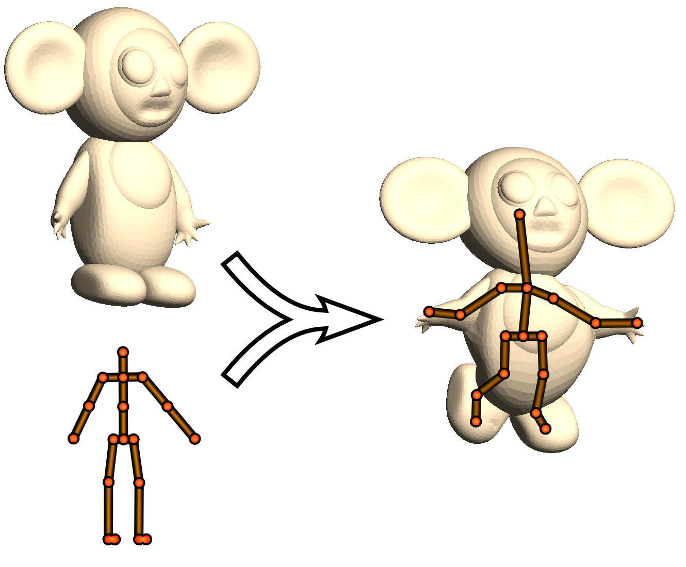
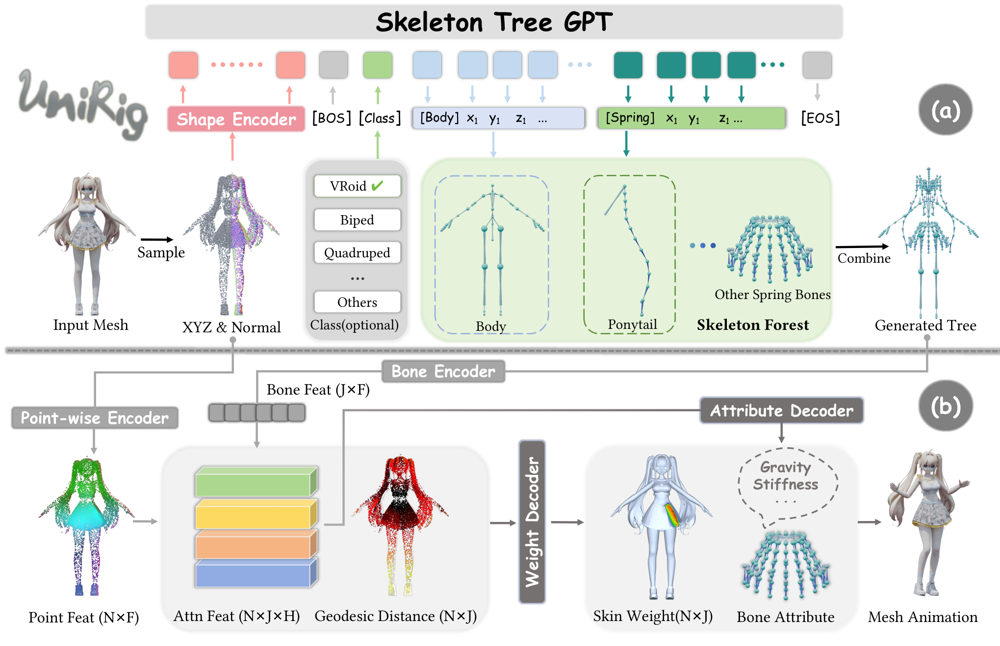

# 从静态模型到可动角色：3D 绑骨入门与自动绑骨方法

一张角色的 3D 网格有形状，却还不知道“胳膊应该绕哪里转”“转动肩膀时袖子该怎么跟着走”。**绑骨（rigging）**解决的正是静态形状和可控运动之间的接口问题：为模型建立可操作的骨架，并规定骨骼运动怎样带动表面。本文先讲手工工作流里这些东西各司何职，再用 Pinocchio、RigNet 和 UniRig 理解自动绑骨的三条经典路线。

## 第一部分：3D 建模中的“绑骨”究竟绑了什么

### 一个角色从网格到动作，需要哪些东西

先想象我们拿到一个双臂自然下垂的人形网格。网格是顶点与面组成的表面；它能被渲染，却不自带“肩”“肘”这样的运动语义。让它抬右手，通常要经过下列链条：

```text
静态网格 + 绑定姿态
       ↓
摆放关节，连接成有父子关系的骨架
       ↓
给每个网格顶点分配受哪些骨骼影响、各占多少的蒙皮权重
       ↓
为某一帧设置骨骼姿态：旋转肩、肘等关节
       ↓
计算骨骼的世界变换 → 按权重更新网格顶点 → 渲染抬手姿态
```

日常把以上流程笼统称为“绑骨”，但研究论文中的 **automatic rigging** 通常强调两项可复用的资产构建：**骨架结构**与**蒙皮绑定**。给定现成骨架去生成一段挥手动作，是运动生成；从视频中估计人当前的姿态，是姿态估计；把人的动作移到另一个角色，是动作重定向。它们都用到骨架，却没有自动解决“这个新模型该如何建骨架、每个顶点该绑到哪里”的问题。

### 骨架：位置之外，还要有层级

动画骨架可以看作一棵树。关节是树节点，连接相邻关节的骨骼是树边；某个节点记录相对于父节点的位置和旋转。以抬手为例，可简化成“躯干 → 右肩 → 右肘 → 右腕”。把右肩转起来，整条右臂的关节都会随父节点移动；只转右肘，前臂和手动，上臂基本不动。父子关系因此直接决定动画师能如何控制角色，并非把几个点随便连起来即可。[RigNet 论文](https://arxiv.org/abs/2005.00559)也强调，面向动画的骨架由预期的活动方式决定，不总等同于几何学中提取的中心线。

**绑定姿态**（rest/bind pose）是定义骨架和网格相对关系的初始姿态，常见如 T-pose、A-pose。动画帧里的“右肩旋转 60°”并非直接对原始世界坐标里的整片网格旋转，而是先由关节层级算出肩、肘、腕在当前帧相对于绑定姿态的变换，再把变换作用于受影响的顶点。

### 蒙皮权重：谁带动哪一块表面

骨架有了，网格也不会自动随之运动。还要给每个顶点 $v_i$ 一组权重 $w_{ij}$：第 $j$ 根骨骼对顶点 $i$ 的影响有多大。通常权重非负，且同一顶点的权重和为 1。肱骨中段可几乎全归上臂骨控制；肘部附近需要上臂和前臂共同影响，才能在弯肘时形成连续过渡。权重分错的直观结果，是抬手时胸口被拉走、袖子不跟着前臂走，或者肘部塌陷。

最常见的执行方式是**线性混合蒙皮**（linear blend skinning，LBS）：

\[
\tilde v_i(t)=\sum_j w_{ij}\,G_j(t)\,G_j(0)^{-1}\,\tilde v_i(0).
\]

这里 $v_i(0)$ 是绑定姿态的顶点，$G_j(0)^{-1}$ 先把它变换到第 $j$ 根骨骼的绑定坐标系，$G_j(t)$ 再送往当前帧，最后按 $w_{ij}$ 混合；波浪线表示齐次坐标。**蒙皮权重预测**就是估计式中的 $w_{ij}$，而**动画**提供每帧的 $G_j(t)$。两者是不同任务。LBS 快且易实现，但大幅扭转时可能出现体积损失等伪影，因而实践里还会采用双四元数蒙皮、修正形变或人工调权；后文的自动绑骨论文主要处理的是骨架与权重，不等于解决了所有形变质量问题。[Pinocchio 原论文](https://people.csail.mit.edu/ibaran/papers/2007-SIGGRAPH-Pinocchio.pdf)、[RigNet 原论文](https://arxiv.org/abs/2005.00559)

### 用“抬右手”走一遍

1. **建模**：先得到静态角色的网格。只有这一步，抬手仍没有可控接口。
2. **放关节并定层级**：在肩、肘、腕摆放关节，把它们连成“躯干 → 肩 → 肘 → 腕”。这一步决定旋转轴和运动链。
3. **绑定皮肤**：给右臂顶点分配上臂、前臂、手等骨骼的权重；检查肩窝和肘弯这些混合区。
4. **设置姿态**：动画师给肩关节旋转值，可能还给肘关节弯曲值。使用 **FK（前向运动学）**时，沿层级从父到子计算各关节位置；使用 **IK（逆向运动学）**时，动画师指定“手到头顶附近”，求解器反求肩和肘的旋转。FK/IK 是控制已有骨架的方法，不是自动生成骨架的方法。
5. **产生画面**：每帧更新骨骼变换，蒙皮公式将右臂网格带到新位置。如果骨架错位或权重错配，动作目标即使正确，画面仍会出错。

到这里可以记住一个最小区分：**骨架定义“在哪里、怎样转”；蒙皮定义“转了以后表面怎样跟”；动画定义“这一帧转多少”。**

## 第二部分：AI 如何自动给新角色绑骨

自动绑骨的用户侧输入通常是**一个静态 3D 模型**，目标是产出可编辑的骨架和蒙皮权重。不同方法对额外条件的要求不同：有的先要一套通用骨架模板，有的仅靠训练过的模型和输入网格预测。可沿“结构从哪里来”看成一张小地图：

| 路线 | 代表 | 用户/算法输入 | 骨架怎样得到 | 蒙皮怎样得到 | 关键边界 |
| --- | --- | --- | --- | --- | --- |
| 模板嵌入与几何优化 | Pinocchio（2007） | 网格 + 预选通用骨架 | 在角色体内搜索并优化模板关节位置 | 骨骼附近的热扩散权重 | 模板拓扑已预先给定，形状与模板不匹配会困难 |
| 分模块学习结构与权重 | RigNet（2020） | 静态角色网格 | 学关节位置，再学连边并整理成树 | 学每个顶点对骨骼的权重 | 依赖带真值骨架、权重的训练资产；面向可关节化角色 |
| 骨架树序列生成 + 条件蒙皮 | UniRig（2025） | 静态模型；可选类别条件 | 把骨架树编码为 token，按序生成 | 在生成骨架与几何之间做骨—点交互，预测权重 | 更灵活的骨架结构，但采样结果仍需检查；骨架错误会传给蒙皮 |

表格里的“AI”不应被理解为仅指 Transformer。Pinocchio 不是如今的深度生成模型，但它用学习过的代价函数权重辅助几何搜索，是理解问题分解的传统自动化基线；RigNet 是神经预测；UniRig 用到读者熟悉的自回归 Transformer。三者的真正共同目标是交付**可驱动的 3D 资产**，而不是生成动作本身。

### 范式一：给定模板，把它“塞进”模型——Pinocchio

Baran 与 Popović 的 [Pinocchio（SIGGRAPH 2007）](https://people.csail.mit.edu/ibaran/papers/2007-SIGGRAPH-Pinocchio.pdf)从一个静态网格和一个**通用骨架模板**开始。它不是从零决定“该有几个关节、谁是谁的父节点”，而是把已有结构按角色比例放进模型体内。论文先离散化内部空间，构造可能的关节位置和连线路径；在这些候选上搜索较合适的模板嵌入，再做连续位置优化。代价函数考虑关节是否位于体内、骨骼比例与方向是否合理等因素，部分代价权重由样例学习。然后它依据骨骼与表面的邻近关系，用热扩散式平滑生成蒙皮权重。论文还演示了把已有运动套用到绑定后的角色上，但那是绑定之后的应用阶段。



*图 1：左边是输入的静态角色和预设通用骨架，右边是骨架被放入角色后的结果。图源：Baran & Popović，[Automatic Rigging and Animation of 3D Characters](https://people.csail.mit.edu/ibaran/papers/2007-SIGGRAPH-Pinocchio.pdf)，Fig. 1。它展示的是“模板嵌入”，不是凭空生成新的骨架拓扑。*

这一路线的优势是无需大规模 3D 资产监督来学习整个骨架结构；已知角色大体符合某类模板时，结构先验很强。边界也很清楚：模型要与选定骨架的姿态、朝向和比例大致匹配；模板没有翅膀或多条尾巴时，几何优化也很难给出恰当的新拓扑。原论文还要求输入网格围成连通体。[Pinocchio 原论文，第 1–3 节](https://people.csail.mit.edu/ibaran/papers/2007-SIGGRAPH-Pinocchio.pdf)

### 范式二：从网格直接学“关节—连边—权重”——RigNet

[RigNet（SIGGRAPH 2020）](https://arxiv.org/abs/2005.00559)把静态 3D 角色网格直接送入神经网络，训练数据是带艺术家骨架和蒙皮权重的角色模型。它把复杂任务拆成三个有因果顺序的预测：

1. **关节定位**：网格图网络从顶点与邻接关系提取特征，让表面顶点朝潜在关节位置“投票”，再聚类得到关节候选。为什么不能直接连骨骼？因为关节数量和位置还不知道。
2. **骨架连接**：对候选关节对估计是否该由骨骼连接，并确定根节点；借助最小生成树等结构步骤生成无环的层级。为什么单独处理这一步？关节位置正确，不代表“右肩连右肘，而不是连左腕”的拓扑也正确。
3. **蒙皮预测**：有了骨架之后，再让网络结合网格形状与顶点到骨骼的内在距离，预测每个顶点的骨骼权重。权重依赖预测的骨架，所以前一步若漏掉肘关节，后一步无法凭空给肘部绑定一个不存在的骨骼。

RigNet 的关键转变，是让网络从已绑定的模型中学习动画师常放关节、常分配权重的模式，不再依赖一套固定骨架模板。因此，不同角色可以有不同关节数和拓扑。但这不是“任意网格都保证可绑”：论文面向可关节化角色，训练与测试假设大体一致的直立、朝前取向；结果是可编辑的预测绑定，重要资产仍要实际摆姿态检查肩、肘、尾巴等部位。[RigNet 原论文，第 3、6、7 节](https://arxiv.org/html/2005.00559)

### 范式三：把骨架树当作序列生成——UniRig

[UniRig（SIGGRAPH 2025）](https://arxiv.org/abs/2504.12451)进一步面对角色结构种类多的问题，例如二足、四足、动漫角色或带次级骨骼的复杂模型。它仍有**骨架预测 → 蒙皮预测**两个阶段；“统一”并不意味着只用一个网络一步吐出所有东西。其差异在第一阶段：把骨架层级设计成可序列化的 **Skeleton Tree Tokenization**，由形状编码器读入模型几何，类似 GPT 的自回归模型一个 token 接一个 token 地生成关节位置与树结构。这里生成的是**骨架表示**，不是生成 3D 网格本体，也不是生成动作视频。

第二阶段已知模型几何和生成的骨架，通过**骨—点交叉注意力**让网格点与骨骼信息交互，输出逐顶点权重。训练依赖大量已有绑定资产；论文构建了 Rig-XL 等数据，并利用已有骨架、蒙皮作为监督，还讨论了骨架等价性与变形约束，以免仅靠编号或单一骨架标注误判合理结果。推理时则先生成骨架，再估计权重，最终仍要用动作驱动和实际变形来检查资产是否好用。[UniRig 原论文，第 3–6 节](https://arxiv.org/html/2504.12451)



*图 2：上半部把输入形状编码后，自回归生成骨架树；下半部在骨骼和网格点之间做交互，预测每点蒙皮权重。图源：Jia-Peng Zhang 等，[One Model to Rig Them All: Diverse Skeleton Rigging with UniRig](https://arxiv.org/abs/2504.12451)，Fig. 5。*

对懂 Transformer 的读者，可以把它类比为“先把结构化目标写成一串合法 token，再做条件 next-token prediction”。但类比到此为止：一个骨架 token 的物理意义是关节位置或层级关系，生成完还要恢复可编辑的树；皮肤权重也并非自然由 next-token loss 给出，而要由独立的骨—点模块计算。官方实现还明确提醒：若生成骨架遗漏尾巴或翅膀等骨骼，后续蒙皮效果可能明显变差；这正是两阶段误差传递的实际边界。[UniRig 官方实现说明](https://github.com/VAST-AI-Research/UniRig)

### 读论文时用什么标准判断“会不会自动绑骨”

只看演示视频里的角色会动，很容易误判。更可靠的是直接问：**用户给了什么？模型又产出了什么？**

- 如果输入是静态网格，输出包含新建骨架与每顶点权重，它覆盖了完整自动绑骨。
- 如果已给定骨架，只预测蒙皮权重，它解决的是自动蒙皮这一子问题；例如 RigNet 原论文讨论的 NeuroSkinning（2019）属于这一路线，不应写成自动生成骨架。[RigNet，Related Work](https://arxiv.org/html/2005.00559)
- 如果输入图像或视频，输出“人目前的 3D 关节姿态”，那是姿态估计；它没有为新角色创建可编辑的绑定资产。
- 如果输入已有绑定角色与一段动作，输出是新动作或姿态，这是动作生成/重定向。它通常**消耗** rig，而不**产生** rig。

最后，自动绑骨的好坏不能只凭关节位置误差判断。还要看骨架父子关系是否合理、权重是否造成穿帮、同一资产能否被实际动作反复驱动，以及绑定结果是否便于动画师修改。读 Pinocchio、RigNet、UniRig 时，沿着“**输入条件 → 骨架从哪里来 → 权重从哪里来 → 用什么动作检验**”这四个问题走，就不容易把不同研究任务混在一起。

## 参考资料

1. Ilya Baran and Jovan Popović. [Automatic Rigging and Animation of 3D Characters](https://people.csail.mit.edu/ibaran/papers/2007-SIGGRAPH-Pinocchio.pdf). ACM SIGGRAPH, 2007.
2. Zhan Xu et al. [RigNet: Neural Rigging for Articulated Characters](https://arxiv.org/abs/2005.00559). ACM TOG / SIGGRAPH, 2020；[作者项目页](https://zhan-xu.github.io/rig-net/)。
3. Jia-Peng Zhang et al. [One Model to Rig Them All: Diverse Skeleton Rigging with UniRig](https://arxiv.org/abs/2504.12451). ACM TOG / SIGGRAPH, 2025；[官方实现](https://github.com/VAST-AI-Research/UniRig)。

## QA

暂无问答。
