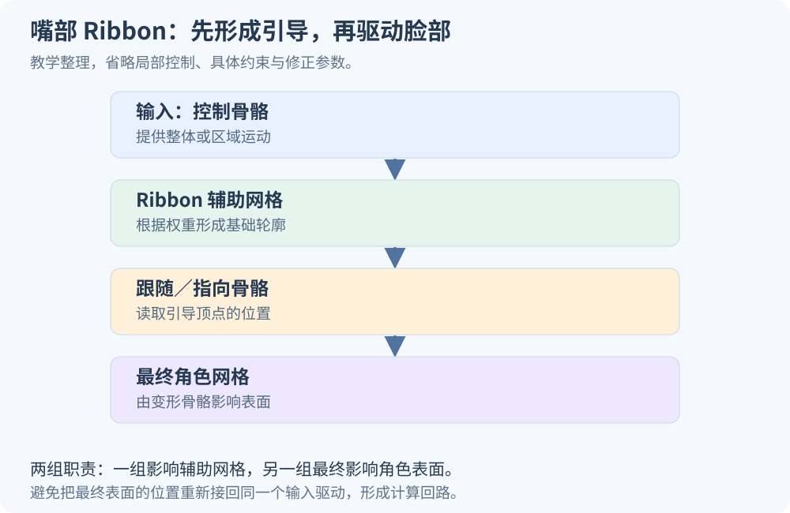
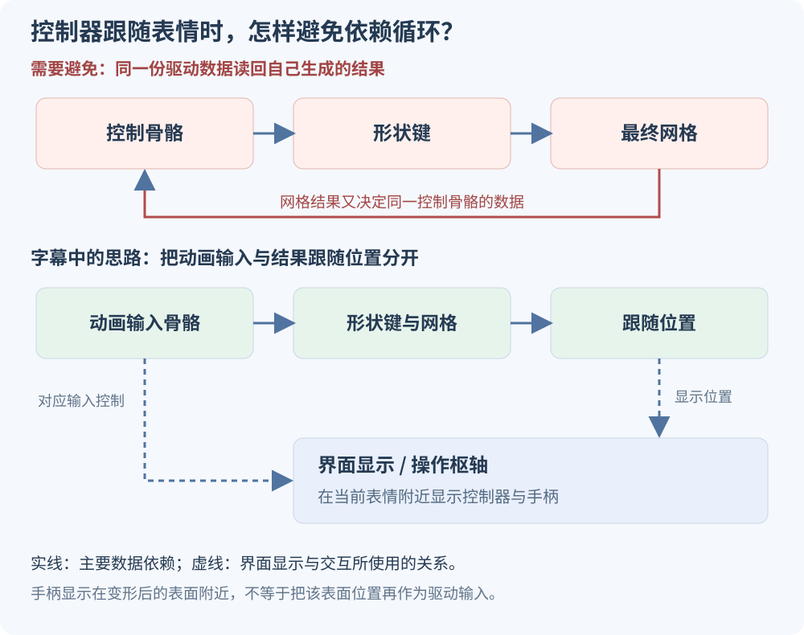

# Blender 大会 2025：风格化角色面部绑定，原字幕分块与逐段解读

这场演讲由 **Rik Schutte** 介绍 Blender Studio 角色 **Storm** 的面部绑定：嘴与眼睑怎样通过 Ribbon 辅助网格和骨骼变形，眉毛与脸颊怎样使用形状键，修正形状、格笼和控制界面又怎样配合。

本文把你提供的 **831 条中文字幕，按原顺序切分为 21 块**，覆盖 **00:04.099—49:30.320**，包括现场问答。每块先放一个默认收起的原字幕折叠块，后面紧接对应解读。**字幕文字逐条保留，没有删减口头语、合并改写或静默修正误译。** 时间戳用于回到你提供的字幕版本；字幕空白区间没有补写内容。

这里的“原文”指用户提供的中文转写／翻译文本，不是另外取得的英文逐字稿。原文件名为《Blender 大会2025——风格化角色的面部绑定（简校中字）.zh.auto.json》。疑似误译和缺少画面才能确认的细节，分别在解读中注明。

- [大会官方演讲页面：Facial Rigging for Stylized Character Animation](https://conference.blender.org/2025/presentations/4069/)
- [Blender 官方演讲视频](https://www.youtube.com/watch?v=_Ov0pFIOpug)
- [下载完整中文时间轴文本](assets/transcript.txt)

**读法：** 可以先只读展开在页面上的解读，遇到需要核对的地方，再打开同一块的原字幕。基础概念可结合 [Facial Rig 是什么](https://jinjianzhao.github.io/daily-papers/knowledge/article.html?slug=facial-rig-fundamentals) 与 [五类经典面部动画技术](https://jinjianzhao.github.io/daily-papers/knowledge/article.html?slug=stylized-facial-animation-methods) 阅读。

## 01｜00:04—03:05　开场：这是一套服务于动画师的具体方案

:::collapse id="transcript-01" title="展开原字幕 01｜00:04—03:05｜第 1—52 条"

<strong>00:04.099—00:04.499</strong>　好的

<strong>00:05.619—00:06.719</strong>　下午好

<strong>00:06.719—00:14.600</strong>　大家欢迎来到关于风格化角色动画面部绑定的专题讲座

<strong>00:14.800—00:17.580</strong>　我在顶部括号里写道

<strong>00:17.580—00:21.000</strong>　一种非常特殊的面部绑定方式

<strong>00:21.000—00:26.610</strong>　因为面部绑定是一个多维度的课题

<strong>00:26.610—00:30.160</strong>　关于如何进行面部绑定存在许多不同的理论流派

<strong>00:30.160—00:33.680</strong>　同时面部绑定也有多种应用场景

<strong>00:35.740—00:41.290</strong>　为电影、VR或实时绑定做准备

<strong>00:42.810—00:46.830</strong>　尤其是当它来自非专业背景时

<strong>00:46.830—00:49.739</strong>　我其实更傲慢

<strong>00:49.739—00:50.239</strong>　动画师

<strong>00:50.239—00:55.759</strong>　我从使用绑定工具的角度出发

<strong>00:55.759—00:59.500</strong>　并好奇它是如何制作的

<strong>00:59.500—01:05.170</strong>　以及我们如何在Blender中运用一些绑定技术

<strong>01:05.930—01:08.150</strong>　当然绑定系统

<strong>01:08.150—01:11.930</strong>　面部绑定可以包含多种不同功能

<strong>01:13.250—01:14.180</strong>　骨骼

<strong>01:14.340—01:15.440</strong>　形状键

<strong>01:15.440—01:20.340</strong>　甚至见过完全用几何体制作的面部绑定

<strong>01:20.340—01:21.160</strong>　节点

<strong>01:21.160—01:22.320</strong>　非常令人兴奋

<strong>01:22.320—01:27.420</strong>　我认为会议上有许多关于节点绑定的演讲

<strong>01:27.420—01:30.530</strong>　我也非常期待参加

<strong>01:30.810—01:31.510</strong>　除此之外

<strong>01:31.510—01:38.479</strong>　我将介绍Blender工作室目前正在开发的角色

<strong>01:38.479—01:39.359</strong>　名为风暴

<strong>01:40.519—01:41.799</strong>　它的面部绑定系统

<strong>01:41.799—01:43.980</strong>　这是我制作的

<strong>01:45.540—01:50.870</strong>　我将展示我选择实现的一些解决方案

<strong>01:52.630—01:54.070</strong>　面部绑定技术

<strong>01:54.070—01:59.110</strong>　这种特定的面部绑定方式非常传统

<strong>01:59.110—02:00.120</strong>　我可以说

<strong>02:00.120—02:02.560</strong>　以及我是如何达到这个阶段的

<strong>02:02.560—02:07.320</strong>　我会简要谈谈我的背景

<strong>02:07.320—02:10.840</strong>　以及我是如何走到这一步的

<strong>02:10.840—02:15.110</strong>　为了简要总结本次讲座内容

<strong>02:15.350—02:16.810</strong>　做一个背景介绍

<strong>02:16.810—02:17.630</strong>　我是谁

<strong>02:17.630—02:20.590</strong>　我是如何走到今天的

<strong>02:21.700—02:25.540</strong>　简要概述面部绑定的不同方法

<strong>02:26.740—02:28.740</strong>　介绍工作室的角色资产

<strong>02:28.740—02:33.530</strong>　风暴并谈谈相关工具和工作流程

<strong>02:33.930—02:39.970</strong>　接下来我们将深入Blender展示绑定及其面部功能

<strong>02:40.280—02:44.240</strong>　并讨论控制部件

<strong>02:44.240—02:47.570</strong>　最后谈谈下一步计划

<strong>02:48.250—02:49.090</strong>　好的

<strong>02:49.090—02:52.770</strong>　那我们开始吧

<strong>02:57.260—02:59.300</strong>　来吧，大家准备好了

<strong>02:59.300—02:59.940</strong>　没关系

<strong>02:59.940—03:03.780</strong>　让我再试一次

<strong>03:05.020—03:05.820</strong>　好的

:::

### 解读

**这一段规定了讲座的范围：讲者从动画师使用绑定的需求出发，介绍 Storm 的一套具体方案。** 他承认电影、VR、实时角色等应用的要求不同，因此后面的选择应放回这个角色与制作目标中理解。

Facial Rig 的任务，是把动画师操作的控制量转换成脸部形状变化。骨骼、形状键、几何节点都能参与这个过程；控制器则负责把底层操作组织成可使用的界面。

字幕把角色名译为“风暴”，下文统一写 **Storm**，方便检索。演讲人与角色名已由 [大会官方页面](https://conference.blender.org/2025/presentations/4069/) 核对：讲者是 Blender Studio 的 **Rik Schutte**。开场的“我其实更傲慢”等句子存在明显转写问题，原字幕照录，解读不据此判断讲者的态度或专业背景。

## 02｜03:05—06:13　工作背景：从使用绑定到探索绑定

:::collapse id="transcript-02" title="展开原字幕 02｜03:05—06:13｜第 53—104 条"

<strong>03:05.820—03:12.460</strong>　我在动画行业作为动画师工作已经超过十年了

<strong>03:12.460—03:15.600</strong>　我开始参与《小吸血鬼》项目

<strong>03:15.600—03:17.780</strong>　那是在2015年

<strong>03:17.780—03:22.160</strong>　这是首部荷兰动画制作

<strong>03:22.160—03:27.460</strong>　我们非常自豪地完成了首部3D动画电影

<strong>03:28.700—03:29.840</strong>　预算有限

<strong>03:30.640—03:33.920</strong>　之后我又参与了几个欧洲项目

<strong>03:33.920—03:36.020</strong>　2017年后

<strong>03:36.020—03:38.430</strong>　我加入了索尼影像工作室

<strong>03:38.430—03:41.150</strong>　开始参与《小食》项目

<strong>03:41.150—03:43.270</strong>　《蜘蛛侠：平行宇宙》

<strong>03:44.350—03:48.260</strong>　在索尼的那段时光非常

<strong>03:48.620—03:51.360</strong>　我学到了他们的制作流程

<strong>03:51.360—03:53.180</strong>　关于他们如何塑造角色

<strong>03:53.180—03:55.360</strong>　特别是在《蜘蛛侠》项目

<strong>03:55.360—03:58.209</strong>　我是该片首位被聘的动画师

<strong>03:58.209—04:05.360</strong>　这意味着前期制作仍在进行中

<strong>04:05.360—04:08.090</strong>　因此进行了大量绑定测试

<strong>04:08.090—04:11.810</strong>　向绑定部门反馈绑定效果

<strong>04:11.810—04:16.890</strong>　为角色准备生产就绪

<strong>04:16.890—04:18.910</strong>　这非常

<strong>04:19.980—04:20.520</strong>　是的

<strong>04:20.520—04:23.220</strong>　在这方面是重要学习经历

<strong>04:23.220—04:28.560</strong>　2020年疫情爆发后

<strong>04:28.560—04:32.100</strong>　我和家人搬回荷兰老家

<strong>04:32.100—04:40.000</strong>　但我仍想在高质量动画环境中工作

<strong>04:40.000—04:43.240</strong>　荷兰本地选择不多但有Blender

<strong>04:43.240—04:48.670</strong>　Blender工作室正是我发现的高质量目标

<strong>04:51.030—04:54.800</strong>　追求高质量动画

<strong>04:54.800—05:00.750</strong>　同时注重工具开发创新

<strong>05:00.750—05:01.890</strong>　这是一次

<strong>05:04.250—05:06.140</strong>　绝佳的转型

<strong>05:06.140—05:08.760</strong>　但我从未接触过Blender

<strong>05:08.760—05:13.470</strong>　我一生都在使用Autodesk Maya

<strong>05:13.470—05:15.610</strong>　于是我开始参与《精灵惊魂》项目

<strong>05:15.610—05:18.930</strong>　同时我还担任Enum学校讲师

<strong>05:18.930—05:20.990</strong>　教授面部动画课程

<strong>05:20.990—05:22.160</strong>　所以

<strong>05:24.370—05:28.270</strong>　整个过程中涉及大量面部动画

<strong>05:28.270—05:33.100</strong>　从这些项目到加入Blender

<strong>05:33.140—05:35.320</strong>　最让我印象深刻的是

<strong>05:35.320—05:39.480</strong>　所有风格化动画大量使用形状键

<strong>05:39.480—05:40.680</strong>　混合形状

<strong>05:40.680—05:43.039</strong>　嗯

<strong>05:43.679—05:45.519</strong>　当我加入Blender时

<strong>05:45.519—05:49.199</strong>　这是Blender绑定系统的独特之处

<strong>05:49.199—05:50.599</strong>　称为「弯曲骨骼」

<strong>05:50.599—05:55.810</strong>　这是我之前不习惯的事情

<strong>05:55.810—05:58.750</strong>　但我想要去探索

<strong>06:00.600—06:07.960</strong>　索尼工作后开始学习面部绑定

<strong>06:07.960—06:10.680</strong>　同时也进行动画制作

<strong>06:10.680—06:13.119</strong>　在亚当学校学习面部课程

:::

### 解读

**这段背景解释了他为什么重视“动画师摆姿势是否方便”。** 按字幕叙述，他曾参与高质量动画项目，在前期反复测试角色并向绑定部门反馈；后来进入 Blender 的工作环境，开始探索自己不熟悉的工具。

这里有两个重要术语。**Shape Keys / Blendshapes** 保存预制的顶点形状变化；**Bendy Bones** 是 Blender 的弯曲骨骼机制，可以用分段的骨骼变形得到平滑弯曲。讲者在背景中提到 Bendy Bones，不等于后面 Storm 的所有面部功能都由它实现。

字幕中“所有风格化动画大量使用形状键”应按讲者所接触项目的经验理解。这段没有提供行业统计，不能据此推出每个风格化角色都以形状键为主。片名和学校名也有译名混乱，技术解读不依赖这些未经逐项核实的名称。

## 03｜06:15—08:56　技术选择：从形状键走向混合系统

:::collapse id="transcript-03" title="展开原字幕 03｜06:15—08:56｜第 105—144 条"

<strong>06:15.079—06:21.550</strong>　所以我们先简要概述几种不同的绑定方式

<strong>06:21.550—06:23.210</strong>　这归结于

<strong>06:23.210—06:26.290</strong>　没有绝对好或坏的绑定方法

<strong>06:26.290—06:27.810</strong>　存在面部绑定技术

<strong>06:27.810—06:29.610</strong>　关键在于目的

<strong>06:29.610—06:32.010</strong>　我们试图实现什么

<strong>06:32.010—06:37.170</strong>　而在《汪汪队》电影中当你看到那只狗

<strong>06:37.170—06:41.230</strong>　采用的是非常曲线导向的工作流程

<strong>06:41.230—06:43.350</strong>　嗯是的

<strong>06:43.350—06:46.150</strong>　服务于与使用其他方法完全不同的目的

<strong>06:46.150—06:47.260</strong>　例如

<strong>06:47.260—06:53.060</strong>　对于非常写实的角色可能需要更复杂的

<strong>06:54.700—06:56.140</strong>　成为工作流程的重要部分

<strong>06:58.060—07:00.310</strong>　对我来说

<strong>07:00.310—07:00.770</strong>　这确实

<strong>07:01.890—07:02.570</strong>　呃

<strong>07:02.570—07:03.510</strong>　在这段时期

<strong>07:03.510—07:07.859</strong>　我感觉自己想要建立一套工作流程

<strong>07:07.859—07:12.980</strong>　以形状键为基础构建面部绑定

<strong>07:12.980—07:18.420</strong>　因为我参与过一些面部绑定课程

<strong>07:18.420—07:25.549</strong>　形状键是绑定过程的重要组成部分

<strong>07:25.749—07:33.090</strong>　主要因为形状键非常适合大型工作室的艺术指导

<strong>07:35.870—07:40.310</strong>　因此我逐渐成为形状键的倡导者

<strong>07:40.310—07:42.550</strong>　并制作了这张完整图表

<strong>07:42.550—07:50.700</strong>　或展示哪些形状键以及如何构建面部绑定

<strong>07:50.700—07:55.840</strong>　很快我发现仅使用形状键

<strong>07:55.840—07:57.780</strong>　存在其局限性

<strong>07:57.780—08:03.620</strong>　与多位绑定师交流后

<strong>08:03.620—08:05.540</strong>　行业建模师

<strong>08:05.540—08:08.140</strong>　我注意到

<strong>08:08.140—08:13.860</strong>　从未存在仅使用一种类型的

<strong>08:13.860—08:16.310</strong>　嗯绑定方式

<strong>08:16.310—08:19.330</strong>　形状键是系统的一部分

<strong>08:19.330—08:21.770</strong>　通常为混合系统

<strong>08:21.770—08:29.150</strong>　结合曲线、骨骼和形状键

<strong>08:30.390—08:32.810</strong>　因此我需要调整策略

<strong>08:32.810—08:39.780</strong>　并希望将其应用到新角色中

<strong>08:39.780—08:43.719</strong>　同时使用形状键

<strong>08:43.719—08:51.010</strong>　还结合骨骼变形器和其他变形器

<strong>08:51.010—08:56.300</strong>　接下来我将展示制作过程的简短视频

:::

### 解读

**他的技术选择经历了一次变化：从主要依赖形状键，转为组合形状键、骨骼与其他变形机制。**

形状键适合保存美术认可的具体形状。例如，目标微笑中的嘴唇厚度、嘴角弧度、脸颊体积都可以直接保存在顶点坐标里。它有利于艺术指导：最终希望出现的形状，可以被明确制作和审阅。

但一个目标形状只覆盖它预先定义的变化。动画师如果还要旋转嘴角、把一侧嘴唇推到新的位置、做很不对称的极端姿态，只依靠已有形状的组合可能不够灵活。骨骼与变形器可以补充这些连续的局部操作。

因此，他开始按部位和动作需求分配机制。后面的嘴与眼睑主要介绍 Ribbon 引导与骨骼，眉毛与脸颊则更侧重形状键；修正形状再补足特定姿态下的外观。字幕中对其他影片绑定方式的描述，是讲者的例子，不应当作对该影片完整内部系统的还原。

## 04｜08:56—13:06　Storm 的目标：快速摆姿势、保持设计、允许润色

:::collapse id="transcript-04" title="展开原字幕 04｜08:56—13:06｜第 145—197 条"

<strong>08:56.540—08:59.040</strong>　展示风暴角色的设计过程

<strong>08:59.040—09:03.260</strong>　概念与设计由维维安·洛科夫斯基完成

<strong>09:03.260—09:05.850</strong>　建模由朱利安·卡斯帕负责

<strong>09:05.850—09:07.050</strong>　材质由西蒙·托马斯处理

<strong>09:07.050—09:11.810</strong>　身体绑定由德米特里·扎迪完成

<strong>09:13.300—09:15.900</strong>　所以没有

<strong>09:17.820—09:19.140</strong>　所以我们没有音频

<strong>09:21.540—09:22.900</strong>　等等

<strong>09:25.340—09:27.140</strong>　这仅仅

<strong>09:36.440—09:37.480</strong>　我必须自己唱出来

<strong>09:37.480—09:37.640</strong>　然而

<strong>09:39.600—09:40.720</strong>　不

<strong>09:41.200—09:42.849</strong>　这有点令人难过

<strong>09:43.169—09:43.569</strong>　嗯

<strong>09:43.569—09:45.789</strong>　下面有非常酷的音乐

<strong>09:45.789—09:46.969</strong>　好的

<strong>09:50.440—09:52.040</strong>　我们来聊聊这个

<strong>09:52.040—09:53.760</strong>　概念建模

<strong>09:53.760—09:57.240</strong>　然后最终是角色

<strong>10:44.700—10:47.900</strong>　我完全投入其中

<strong>10:52.340—10:53.940</strong>　好的

<strong>10:57.780—10:58.260</strong>　所以

<strong>11:00.420—11:02.020</strong>　是的

<strong>11:02.740—11:04.580</strong>　目前几乎完成

<strong>11:05.980—11:07.580</strong>　仍在进行中

<strong>11:08.590—11:15.130</strong>　其主要目的是作为概念验证

<strong>11:15.130—11:22.000</strong>　这些绑定方法基于形状键

<strong>11:22.440—11:27.660</strong>　嗯，这些方法已实现并测试在Blender管线中

<strong>11:27.660—11:34.580</strong>　开发者还开发了一些额外工具

<strong>11:35.440—11:36.260</strong>　是的

<strong>11:36.260—11:37.680</strong>　形状键管理

<strong>11:37.680—11:43.140</strong>　添加了摇杆操作符以适应工作流程

<strong>11:43.140—11:43.980</strong>　对我来说

<strong>11:43.980—11:48.860</strong>　这也是学习面部绑定的额外机会

<strong>11:49.350—11:50.010</strong>　现在

<strong>11:50.010—11:50.550</strong>　风暴

<strong>11:50.550—11:52.410</strong>　面部绑定设置

<strong>11:52.410—11:56.230</strong>　我想实现几个目标和几个

<strong>11:58.240—12:02.600</strong>　属性，结合骨骼和骨骼

<strong>12:03.600—12:04.670</strong>　流苏引导

<strong>12:04.670—12:09.310</strong>　我们逐一介绍每个功能和形状键

<strong>12:10.750—12:14.560</strong>　我想要整体视角

<strong>12:14.560—12:15.000</strong>　这里就是

<strong>12:15.000—12:18.420</strong>　我想从动画角度设计这个绑定

<strong>12:18.420—12:21.410</strong>　希望快速直观地调整姿势

<strong>12:21.410—12:26.410</strong>　尤其是为风格化角色动画和设计

<strong>12:26.410—12:29.770</strong>　保持模型一致性非常重要

<strong>12:29.770—12:33.590</strong>　我花在调整姿势上的时间越少

<strong>12:33.590—12:39.329</strong>　就能投入更多时间思考动作和表演本身

<strong>12:40.929—12:45.830</strong>　同时还需要精细控制进行润色

<strong>12:47.930—12:51.910</strong>　但最终并非如此，因为现在这是一个定制绑定

<strong>12:51.910—12:58.790</strong>　但设置应部分可生成并适用于大制作

<strong>12:59.950—13:06.510</strong>　实时高效且易于动画

:::

### 解读

**Storm 同时承担角色资产与工作流程验证的作用。** 讲者希望用这个角色检验形状键相关工具及其与骨骼的组合，而不仅是展示一张表情完成图。

他的目标包含几项需要同时考虑的条件：动画师能够快速摆出主体姿势；角色在夸张时仍保持设计特征；需要时可以进入局部润色；结构具有一定可生成性；使用时响应足够及时。

“保持模型一致性”可以具体理解为：角色张嘴、抬眉、眯眼时，嘴唇厚度、眼睛结构和面部比例仍然符合角色设计。它不要求所有顶点都少动，也不排斥夸张。

这段的设计展示视频中，有些时间区间没有字幕。本文保留现有字幕与时间间隔，不把缺少文字的画面补写成具体建模步骤。讲者此时也把资产称作进行中的概念验证，不能把这一阶段的目标直接当作量化性能结论。

## 05｜13:10—14:59　工具：Pose Shape Keys、权重绘制与自动化

:::collapse id="transcript-05" title="展开原字幕 05｜13:10—14:59｜第 198—243 条"

<strong>13:10.680—13:15.280</strong>　我们来谈谈工具和工作流程

<strong>13:16.319—13:17.099</strong>　亲吻

<strong>13:17.099—13:17.599</strong>　哦

<strong>13:17.599—13:17.719</strong>　是的

<strong>13:17.719—13:18.459</strong>　我记下来了

<strong>13:18.459—13:20.370</strong>　我不得不亲吻

<strong>13:20.370—13:21.710</strong>　不是乐队

<strong>13:21.710—13:22.950</strong>　其实讲的是

<strong>13:22.950—13:23.570</strong>　保持简单

<strong>13:23.570—13:23.850</strong>　愚蠢的

<strong>13:25.330—13:27.730</strong>　尽量用直接的方法解决问题

<strong>13:27.730—13:32.700</strong>　其中还涉及一点几何节点

<strong>13:32.700—13:34.060</strong>　但非常简洁

<strong>13:34.060—13:36.710</strong>　也因为我对几何节点不熟悉

<strong>13:36.710—13:39.830</strong>　同时几何节点的发展也有波动

<strong>13:39.830—13:42.270</strong>　我想成为

<strong>13:42.610—13:43.150</strong>　是的

<strong>13:43.150—13:46.160</strong>　相当直接

<strong>13:46.480—13:48.420</strong>　我经常使用的插件

<strong>13:48.420—13:48.720</strong>　这个

<strong>13:48.720—13:51.940</strong>　我非常高兴能和大家分享

<strong>13:51.940—13:56.460</strong>　这是由Demeter制作的形变键插件

<strong>13:57.710—13:59.150</strong>　这是一个插件

<strong>14:01.150—14:04.120</strong>　你从创建一个动作开始

<strong>14:04.120—14:05.520</strong>　我稍后会演示

<strong>14:05.520—14:07.349</strong>　让我别多说了

<strong>14:07.349—14:08.049</strong>　呃

<strong>14:08.049—14:09.129</strong>　易权重插件

<strong>14:09.129—14:10.249</strong>　同样由Demeter制作

<strong>14:10.249—14:11.229</strong>　谢谢新手

<strong>14:11.229—14:12.089</strong>　你太棒了

<strong>14:12.089—14:13.150</strong>　呃

<strong>14:13.150—14:14.950</strong>　只是生活质量提升

<strong>14:14.950—14:17.589</strong>　对权重绘制的改进

<strong>14:17.789—14:22.789</strong>　还有一些几何节点实现自动化

<strong>14:22.789—14:26.280</strong>　为眉毛和脸颊链接形状键

<strong>14:26.280—14:27.640</strong>　在此基础上

<strong>14:27.640—14:30.200</strong>　我做了一些草稿Python脚本

<strong>14:30.200—14:31.640</strong>　只是为了自动化

<strong>14:31.640—14:37.700</strong>　开发者接手的部分更新

<strong>14:37.700—14:42.720</strong>　并作为形状键操作符正确实现

<strong>14:44.070—14:44.630</strong>　是的

<strong>14:44.630—14:47.430</strong>　模块没问题

<strong>14:47.430—14:50.910</strong>　这里有一段视频，我想简要展示形变键插件

<strong>14:50.910—14:51.350</strong>　插件

<strong>14:51.350—14:59.920</strong>　这是创建额外矫正形状的重要部分和帮助

:::

### 解读

**这一段介绍的是制作工具怎样减少重复操作。** “KISS”被字幕拆成了“亲吻”“愚蠢”等词，在这里应理解为保持方案简单、直接的设计原则。

几个工具分别处理不同问题：**Pose Shape Keys** 辅助制作和管理姿态相关的修正形状；**Easy Weight** 辅助蒙皮权重绘制；几何节点用于一些形状连接与拆分工作；Python 脚本则帮助批量更新重复数据。它们之间不需要统一成同一种变形方法。

一个重要区别是：**制作工具与角色运行时的变形机制可以不同。** 你可以在制作阶段用脚本生成几十个形状键，动画时仍由 Blender 原生形状键与驱动器计算。脚本方便生成数据，并不意味着最终每一帧都要重新执行一遍制作过程。

“后置形状键”“形变键插件”等字幕用词，后文按具体上下文解释。插件名称与用途可参照 [Pose Shape Keys 官方页面](https://extensions.blender.org/add-ons/pose-shape-keys/)。

## 06｜14:59—17:43　修正形状：从姿态网格建立形状键与驱动

:::collapse id="transcript-06" title="展开原字幕 06｜14:59—17:43｜第 244—287 条"

<strong>14:59.920—15:01.600</strong>　这里看到的是

<strong>15:02.680—15:06.000</strong>　这一秒有点快

<strong>15:06.680—15:08.160</strong>　我创建了一个新动作

<strong>15:08.160—15:16.460</strong>　眉毛向下移动，右侧显示的动作名称

<strong>15:16.460—15:17.240</strong>　让我

<strong>15:17.240—15:17.720</strong>　啊

<strong>15:17.720—15:19.500</strong>　这不太好

<strong>15:20.820—15:23.040</strong>　等一下

<strong>15:26.880—15:31.040</strong>　好的，现在在右侧

<strong>15:32.540—15:33.260</strong>　是的

<strong>15:33.260—15:34.240</strong>　这就是动作

<strong>15:34.240—15:35.020</strong>　创建这个动作

<strong>15:36.020—15:40.819</strong>　这两个主要的眉毛控件都有键

<strong>15:40.819—15:42.699</strong>　在右侧形状键旁边

<strong>15:42.699—15:47.859</strong>　这里有后置形状键和新建后置形状键

<strong>15:48.620—15:51.340</strong>　像这样你就可以分配动作

<strong>15:52.139—15:59.299</strong>　它会自动检测正确动作并发送后置

<strong>15:59.299—16:01.290</strong>　它已经在正确帧上了

<strong>16:01.520—16:03.160</strong>　在覆盖网格时

<strong>16:03.160—16:07.940</strong>　会生成当前姿态的网格副本

<strong>16:07.940—16:10.420</strong>　然后你可以添加调整

<strong>16:11.620—16:13.340</strong>　再次调整

<strong>16:13.340—16:15.920</strong>　这个矫正只是演示

<strong>16:15.920—16:18.460</strong>　形状不够优雅

<strong>16:18.460—16:20.760</strong>　但通过这些调整

<strong>16:20.760—16:26.130</strong>　我可以返回后置形状键添加新目标形状

<strong>16:26.130—16:32.620</strong>　这里会生成Blender原生形状键

<strong>16:33.740—16:35.580</strong>　我只需要一个形状键

<strong>16:35.580—16:41.010</strong>　能同时使用面部左右两侧

<strong>16:41.010—16:45.460</strong>　需要标准化实际形状

<strong>16:45.460—16:51.140</strong>　然后会生成两个独立形状键

<strong>16:51.140—16:51.740</strong>　现在

<strong>16:51.740—16:54.990</strong>　这里跳过了部分内容

<strong>16:56.560—16:57.600</strong>　你看到的

<strong>16:57.600—17:00.639</strong>　我觉得非常实用

<strong>17:00.639—17:05.840</strong>　这些小箭头其实是自动初始化驱动器

<strong>17:05.840—17:12.130</strong>　系统会分析目标形状的动作

<strong>17:12.130—17:16.690</strong>　自动分配驱动器

<strong>17:16.690—17:25.480</strong>　同时正确处理左右侧后缀

<strong>17:25.680—17:26.960</strong>　可以看到这里

<strong>17:26.960—17:31.990</strong>　会检测这些控制器的位置

<strong>17:31.990—17:34.670</strong>　现在我们上下移动

<strong>17:35.989—17:40.229</strong>　矫正已被实际触发

<strong>17:41.869—17:43.669</strong>　由后置形状键激活

:::

### 解读

**演示的关键，是先保存某个姿态下“希望最终看到的网格”，再从中建立修正形状及其驱动。**

按字幕可以整理出如下工作链：记录一个 Action 与帧上的眉毛姿态；复制该姿态下已经变形的网格；修改副本，做出满意的最终外观；把结果转回实际使用的形状键；按左右遮罩或后缀分别建立通道；让相应控制器自动触发修正。

为什么要保存姿态后的网格？假设骨骼已经把眉毛移到某处，但局部体积不理想。你希望保存的是“这个姿态应该长什么样”，而不是把骨骼运动再执行一次。生成修正时，需要处理基础变形与目标形状之间的差异，以及它们所在的坐标空间。

用一个**教学表达式**说明这个关系：在同一坐标空间中，设当前基础变形结果为 $\mathbf P$，希望得到的结果为 $\mathbf S$，则修正残差为 $\Delta=\mathbf S-\mathbf P$。实际原生形状键常在骨骼变形之前求值，因此还需要工具做相应转换；不能直接把姿态后的残差塞进基础网格就默认正确。

插件的公开说明也强调保存最终雕刻形状并在基础绑定修改后重新应用，前提包括拓扑保持不变。自动生成驱动器仍需检查激活范围、左右对应和组合姿态。[Pose Shape Keys 官方说明](https://extensions.blender.org/add-ons/pose-shape-keys/)

## 07｜17:44—19:34　嘴部基础：Ribbon 引导与三曲线原理

:::collapse id="transcript-07" title="展开原字幕 07｜17:44—19:34｜第 288—316 条"

<strong>17:44.510—17:47.390</strong>　说到嘴部

<strong>17:48.390—17:48.910</strong>　呃

<strong>17:48.910—17:51.850</strong>　嘴部基于变形骨骼

<strong>17:51.850—17:52.710</strong>　比如下颌

<strong>17:54.230—17:56.639</strong>　使用唇部引导线

<strong>17:56.639—18:00.239</strong>　这里我原本想完全用形状键

<strong>18:00.239—18:04.150</strong>　但发现不足

<strong>18:04.150—18:04.850</strong>　它

<strong>18:04.850—18:06.650</strong>　缺乏很多

<strong>18:07.820—18:08.340</strong>　是的

<strong>18:08.340—18:09.260</strong>　比如灵活性

<strong>18:09.260—18:13.100</strong>　基本上和唇部引导线

<strong>18:13.100—18:16.630</strong>　我成功制作了唇部拉链

<strong>18:16.630—18:20.390</strong>　在唇部丝带引导上方的贴合空间

<strong>18:20.390—18:26.150</strong>　用波浪形造型器添加部件

<strong>18:27.270—18:30.780</strong>　同时增加了部分口型压缩效果

<strong>18:31.140—18:32.560</strong>　牙齿和舌头控制部件

<strong>18:32.560—18:37.120</strong>　这些操作在进入口腔前相当直接

<strong>18:37.120—18:40.210</strong>　我想运用一点原理性设计

<strong>18:42.410—18:48.839</strong>　关于如何处理口腔和眼部的重量分布理论

<strong>18:48.839—18:51.319</strong>　采用三曲线原理

<strong>18:52.130—18:59.109</strong>　呈足球形状，四角有明显锐利下落

<strong>18:59.109—19:04.910</strong>　中间及左右两侧各有独立下落

<strong>19:04.910—19:07.010</strong>　并且相互重叠

<strong>19:07.010—19:14.080</strong>　以线性方式保持角部清晰锐利

<strong>19:14.080—19:19.920</strong>　仅通过重量分布就能维持非常干净的形状

<strong>19:19.920—19:29.360</strong>　这一原理同时应用于口腔和眼睛，并添加相应控制

<strong>19:29.360—19:33.380</strong>　已经可以看到运作效果

<strong>19:33.380—19:34.580</strong>　嗯

:::

### 解读

**嘴部的主体形状，使用骨骼与 Ribbon 引导；形状键负责补充特定外观。** 讲者明确说过，他原先想只用形状键，但希望获得更多可操作的自由度。

Ribbon 在这里可以先理解为一层用于计算的辅助网格：动画师改变少量控制量，辅助网格形成有组织的轮廓变化，更多嘴唇骨骼再跟随它。它自身通常不是最终渲染出来的嘴唇表面。第 19 块的现场问答会进一步确认它的实际对象类型。

字幕中的“三曲线原理”涉及嘴或眼睛轮廓的控制分布：中部与两侧有不同的影响范围，重叠部分保持平滑过渡，角部又保留清楚的收束。这里谈的是形状与权重的设计原则，不能直接解释成“场景里必须创建三条 Blender Curve 对象”。作者的 [课程总览](https://studio.blender.org/training/facial-rigging/) 也将 three curve principle 与 Ribbon Guide Mesh 分别介绍。

仅凭这份字幕，无法准确还原各影响函数的曲线形状、权重数值和控制点数量。能够确认的因果关系是：**先让较少控制形成干净的基础轮廓，再提供局部控制与修正。**

## 08｜19:35—22:23　嘴部层级：整体、局部、微调与嘴角修正

:::collapse id="transcript-08" title="展开原字幕 08｜19:35—22:23｜第 317—360 条"

<strong>19:35.060—19:39.140</strong>　现在我们将深入Blender软件

<strong>19:40.420—19:43.260</strong>　观察角色模型

<strong>19:45.720—19:48.510</strong>　口腔绑定系统本身

<strong>19:48.790—19:51.570</strong>　当我张开嘴巴时

<strong>19:51.570—19:52.930</strong>　已经可以看到效果

<strong>19:52.930—19:56.080</strong>　保持足球形状特征

<strong>19:56.080—20:03.200</strong>　能够维持非常流畅的曲线

<strong>20:05.600—20:06.440</strong>　让我再调整一下

<strong>20:08.440—20:09.960</strong>　就是这样

<strong>20:11.340—20:14.620</strong>　现在看到的是丝带引导线

<strong>20:15.540—20:19.180</strong>　同时开启骨骼显示

<strong>20:20.500—20:21.900</strong>　这个引导线

<strong>20:21.900—20:22.880</strong>　光线稍弱

<strong>20:22.880—20:24.200</strong>　但

<strong>20:27.780—20:29.120</strong>　正在运用该原理

<strong>20:29.120—20:30.720</strong>　如果我上下移动这个

<strong>20:30.720—20:35.980</strong>　所有骨骼指向独立顶点组

<strong>20:35.980—20:42.090</strong>　仅包含单个顶点和角部

<strong>20:42.090—20:44.830</strong>　通过三曲线原理

<strong>20:44.830—20:48.530</strong>　一开始就获得非常整洁的形状

<strong>20:48.530—20:52.890</strong>　这是我们设置的基础

<strong>20:54.090—21:00.509</strong>　随后将权重重新分配到更小骨骼

<strong>21:00.509—21:05.165</strong>　可以使用更多局部骨骼直到

<strong>21:07.160—21:12.840</strong>　实际每边循环骨骼

<strong>21:12.840—21:16.690</strong>　这些骨骼实际上不连接曲线

<strong>21:16.690—21:22.450</strong>　而是直接移动网格本身

<strong>21:22.450—21:23.909</strong>　就在这里

<strong>21:23.909—21:26.600</strong>　对于全局控制

<strong>21:26.600—21:30.100</strong>　可移动上下唇整体

<strong>21:30.100—21:33.580</strong>　甚至能整体移动嘴巴

<strong>21:33.580—21:41.170</strong>　唇部周围可缩放到局部和微小骨骼

<strong>21:41.170—21:41.850</strong>　嗯

<strong>21:43.770—21:50.080</strong>　所有这些都是延伸至丝带的两段骨骼

<strong>21:50.080—21:51.100</strong>　将要引导的指南

<strong>21:51.100—21:51.940</strong>　这就是

<strong>21:51.940—21:56.310</strong>　嘴巴的主要形状定义器

<strong>21:56.310—21:59.950</strong>　此外如果我移动这个对角点

<strong>21:59.950—22:04.640</strong>　现在你会看到它正在创建形变

<strong>22:04.640—22:07.600</strong>　这些由修正形状键激活的形变

<strong>22:07.600—22:13.070</strong>　因此进出移动会生成自然形变

<strong>22:13.070—22:14.090</strong>　作为动画师

<strong>22:14.090—22:17.830</strong>　大多数时候无需担心

<strong>22:17.830—22:19.400</strong>　他们需要关注的

<strong>22:20.760—22:23.660</strong>　在此基础上的人体皮肤形变

:::

### 解读

**这里把嘴部控制分为整体、局部和微调几层。** 整体控制改变上下唇或整个嘴的位置；较小控制改变局部；更细的骨骼允许继续修整轮廓。动画师可以按工作需要逐步进入这些层级。

根据这段以及后面的问答，可以把主要数据流理解为：

*教学整理图：概括字幕中明确描述的依赖方向；实际资产还包含局部控制、约束和修正。图中省略了具体约束参数。*

这里有两次不同的影响关系：控制骨骼影响 Ribbon 辅助网格；面部的变形骨骼最终影响角色网格。两组骨骼的职责不同，不能因为都叫“骨骼”就认为它们是同一组。

字幕还指出，一部分局部骨骼直接修改最终网格，不继续连接引导轮廓。这使动画师可以在基础嘴形之外添加小范围调整。嘴角移动时触发的修正形状，进一步负责折叠、体积或皮肤外观。它们共同形成最终形状，原始骨骼运动本身并不自动生成所有细节。

## 09｜22:23—24:34　嘴唇闭合、牙齿形变与唇卷

:::collapse id="transcript-09" title="展开原字幕 09｜22:23—24:34｜第 361—394 条"

<strong>22:23.660—22:28.720</strong>　这里有唇部闭合器，我们可以

<strong>22:29.800—22:32.480</strong>　这也是一个相对简单的设置

<strong>22:32.480—22:34.990</strong>　它使用了

<strong>22:34.990—22:38.950</strong>　贴片的上下顶点

<strong>22:38.950—22:49.989</strong>　并混合到嘴唇中间的原始点

<strong>22:51.390—22:52.970</strong>　需要注意的是

<strong>22:52.970—22:57.870</strong>　这不是五分钟内完成角色绑定教程

<strong>22:57.870—22:59.950</strong>　其实只是简要说明

<strong>22:59.950—23:02.760</strong>　我正试图简要介绍这些功能

<strong>23:02.760—23:07.300</strong>　计划在工作室制作完整的面部绑定课程

<strong>23:07.300—23:08.840</strong>　在工作室Blender中

<strong>23:08.840—23:10.210</strong>　官网

<strong>23:10.530—23:11.370</strong>　但目前

<strong>23:11.370—23:11.610</strong>　是的

<strong>23:11.610—23:16.450</strong>　这只是简要概述其工作原理

<strong>23:18.690—23:22.890</strong>　除了嘴巴还有

<strong>23:25.320—23:25.920</strong>　是的

<strong>23:25.920—23:26.960</strong>　就是这样

<strong>23:26.960—23:30.150</strong>　现在我们拉出这些

<strong>23:30.390—23:32.130</strong>　牙齿控制

<strong>23:32.130—23:40.340</strong>　它们可能还附带不可见的额外骨骼

<strong>23:40.340—23:43.580</strong>　但也带有晶格形变

<strong>23:43.580—23:47.770</strong>　以便操控和形变牙齿

<strong>23:51.339—23:54.339</strong>　嘴巴基底

<strong>23:54.339—23:56.019</strong>　正如我说的，这是贴片引导

<strong>23:56.019—24:00.360</strong>　在此基础上闭合嘴巴

<strong>24:07.920—24:08.740</strong>　在此基础上

<strong>24:08.740—24:12.660</strong>　你会看到后续形状键形变器在起作用

<strong>24:12.660—24:15.990</strong>　其中已烘焙体积保留

<strong>24:16.710—24:19.470</strong>　此外

<strong>24:21.199—24:22.670</strong>　嗯

<strong>24:22.670—24:25.370</strong>　唇卷功能也已实现

<strong>24:25.370—24:31.350</strong>　这些都是主贴片结构上的额外形状键

<strong>24:33.880—24:34.740</strong>　好的

:::

### 解读

**Lip Zipper 是控制上下唇如何靠拢与闭合，不是控制整个下颌的另一种名字。** 下颌可以已经张开，而局部嘴唇仍被拉到一起；也可以让一侧先闭合，另一侧仍然打开。

字幕把它概括为：使用上下对应位置，并向中间位置混合。一个便于理解的**教学模型**是：同一空间中的上唇点 $\mathbf U$ 与下唇点 $\mathbf L$，取闭合位置 $\mathbf C=(\mathbf U+\mathbf L)/2$；闭合程度 $z\in[0,1]$ 时，让二者分别向 $\mathbf C$ 插值。$z=0$ 保留原位置，$z=1$ 到达同一位置。

这只是说明“闭合插值”的输入与输出，不声称作者使用了这个精确公式。真实嘴唇还要考虑厚度、闭合线位置、左右传播、口腔遮挡等。字幕随后提到的体积保留修正，就是为了让闭合后的外观更合适。

牙齿还使用格笼变形，唇卷则有额外形状键。风格化表情里，嘴唇、牙齿与口腔内件需要协调；仅改变脸皮不能保证牙齿不会露出或穿插。讲者也明确说这只是功能概览，没有交付可以完整复现绑定的所有参数。

## 10｜24:34—26:19　眼睑结构：固定骨长、跟踪约束与局部控制

:::collapse id="transcript-10" title="展开原字幕 10｜24:34—26:19｜第 395—427 条"

<strong>24:34.740—24:37.040</strong>　现在谈谈眼睛

<strong>24:37.650—24:39.510</strong>　与嘴巴设置类似

<strong>24:39.510—24:42.170</strong>　采用三曲线原理

<strong>24:43.330—24:50.370</strong>　有自动眨眼功能，让动画师只需一个控制

<strong>24:50.370—24:54.110</strong>　使用眨眼并控制眨眼高度

<strong>24:55.940—24:58.220</strong>　有一些眼睑跟随控制器

<strong>24:58.220—24:59.820</strong>　高光控制

<strong>24:59.820—25:00.700</strong>　好的

<strong>25:00.700—25:04.220</strong>　所以切换到

<strong>25:05.200—25:06.560</strong>　这里的眼睛

<strong>25:06.560—25:08.160</strong>　好的

<strong>25:09.090—25:12.290</strong>　所以我进入线框模式

<strong>25:12.290—25:18.340</strong>　你会看到与嘴巴设置类似的结构

<strong>25:19.340—25:22.630</strong>　这些骨骼并非拉伸骨骼

<strong>25:22.630—25:27.170</strong>　这些骨骼实际上使用了阻尼轨迹约束

<strong>25:27.170—25:28.850</strong>　这允许我们

<strong>25:28.850—25:30.530</strong>　当我上下移动时

<strong>25:30.530—25:34.520</strong>　这些骨骼保持相同长度

<strong>25:34.520—25:36.700</strong>　无论我如何移动这些骨骼

<strong>25:36.700—25:40.909</strong>　你可以看到这里正在拉伸的带状物

<strong>25:40.909—25:44.389</strong>　但由于骨骼具有

<strong>25:45.630—25:46.730</strong>　固定长度

<strong>25:46.730—25:50.070</strong>　它们不会远离眼睛

<strong>25:50.390—25:52.430</strong>　这是主骨骼

<strong>25:52.430—25:55.990</strong>　然后还有这些小骨骼可以

<strong>25:56.950—25:59.150</strong>　更精细地操控局部区域

<strong>25:59.150—26:03.130</strong>　并包含旋转、缩放和位移控制

<strong>26:03.130—26:05.730</strong>　平移和缩放

<strong>26:05.970—26:10.210</strong>　这就是我想要的灵活性

<strong>26:10.210—26:11.270</strong>　超越仅使用形状

<strong>26:11.270—26:13.930</strong>　钥匙和眼睛特别

<strong>26:15.650—26:16.740</strong>　是的

<strong>26:16.940—26:19.940</strong>　应设置骨骼

:::

### 解读

**眼睑沿用类似的引导思路，但为了贴近眼球，对骨骼运动增加了不同限制。** 字幕明确提到 Damped Track，中文可写作阻尼跟踪约束。

这个约束使物体或骨骼的一根轴指向目标，主要改变朝向。它本身不是一个让骨骼按目标距离伸长的约束。[Blender 官方说明](https://docs.blender.org/manual/en/latest/animation/constraints/tracking/damped_track.html)

为什么这与眼睑有关？在一个理想化模型中，如果骨骼根部位于球心附近，骨骼保持固定长度而方向变化，其端点就会沿近似球面移动。这可以帮助眼睑围绕眼球运动，而不是随着目标远近任意拉长。

这个解释依赖根部位置、骨长和后续变形等条件，**单独加一个 Damped Track 并不能保证完整眼睑自动贴合任意眼球**。讲者仍保留小骨骼的平移、旋转和缩放，让动画师在基础结果上调整局部形状。

## 11｜26:21—28:25　眼部表演：视线、自动眨眼、眨眼高度与高光

:::collapse id="transcript-11" title="展开原字幕 11｜26:21—28:25｜第 428—462 条"

<strong>26:21.229—26:23.069</strong>　当我们转动眼球时

<strong>26:23.069—26:25.729</strong>　存在自动跟随

<strong>26:25.729—26:27.509</strong>　并且可以

<strong>26:27.509—26:28.949</strong>　我想就在这里

<strong>26:28.949—26:29.269</strong>　不

<strong>26:29.269—26:30.270</strong>　不是

<strong>26:31.550—26:34.950</strong>　就在自动眨眼这里

<strong>26:34.950—26:36.510</strong>　有一个自动眨眼

<strong>26:36.510—26:40.190</strong>　只是一个上下滑块

<strong>26:40.190—26:45.240</strong>　还能决定眨眼高度

<strong>26:46.280—26:47.400</strong>　所以

<strong>26:49.400—26:51.080</strong>　当你移动眼球时

<strong>26:51.080—26:54.680</strong>　当然当眨眼功能开启时

<strong>26:55.460—26:57.900</strong>　当我以某种方式定位眼球时

<strong>26:58.340—27:03.790</strong>　技术上仍应保持中间点眨眼

<strong>27:03.790—27:07.410</strong>　现在自动眨眼的工作方式与唇部闭合不同

<strong>27:07.410—27:11.840</strong>　因为自动眨眼实际上使用了独立的

<strong>27:15.680—27:18.160</strong>　让我展示一下

<strong>27:19.200—27:19.860</strong>　找到了

<strong>27:19.860—27:21.460</strong>　这样有点难看清楚

<strong>27:21.460—27:22.800</strong>　但

<strong>27:24.600—27:29.600</strong>　它基本上使用上唇到下唇的混合形状

<strong>27:29.600—27:35.370</strong>　人物所指向的方向

<strong>27:36.530—27:37.650</strong>　所以

<strong>27:41.160—27:42.740</strong>　在使用眨眼高度时

<strong>27:42.740—27:53.440</strong>　你会看到这些形状键从下眼睑到上眼睑被激活

<strong>27:54.800—27:56.800</strong>　然后是高光控制

<strong>27:58.360—28:00.330</strong>　可以缩放上下调整

<strong>28:00.330—28:05.100</strong>　对于眼睛这里有一个眼睛目标

<strong>28:05.100—28:06.600</strong>　操作起来相当直观

<strong>28:06.600—28:09.600</strong>　但也可以缩放眼睛

<strong>28:09.600—28:14.580</strong>　并使用此包裹修改器保持圆形

<strong>28:14.580—28:17.650</strong>　球形体积

<strong>28:19.530—28:20.810</strong>　并向内向外移动

<strong>28:20.810—28:25.610</strong>　需要调整瞳孔本身

:::

### 解读

**这一段把眼睛的几个控制目标分开了：视线、眼睑跟随、眨眼程度、眨眼高度，以及高光与瞳孔的美术控制。**

视线控制回答眼球看向哪里；眼睑跟随让眼睑对眼球方向作一定响应；眨眼程度决定开合；眨眼高度决定上下眼睑大致在哪里相遇。把这些合成一个“闭眼”值，会失去很多表演控制。

字幕说自动眨眼与嘴唇闭合的实现不同，并提到上下眼睑相关形状键。但这一段夹杂“上唇到下唇”等明显与眼部语境不符的词。这里按“上下眼睑的形状变化”理解，**不把字幕补成一套未经确认的精确混合公式**。

高光控制则是额外的美术自由度：动画师能调整观众看到的高光位置或大小。字幕不足以判断这个控制具体使用灯光、材质还是独立几何，不据此指定实现。眼睛缩放时提到的包裹修改器，也只按“帮助保持形状的附加机制”解释，不擅自认定其完整节点结构。

## 12｜28:30—30:21　眉毛与脸颊：预制形状加局部骨骼

:::collapse id="transcript-12" title="展开原字幕 12｜28:30—30:21｜第 463—493 条"

<strong>28:30.560—28:33.280</strong>　接下来是脸颊和眉毛部分

<strong>28:34.280—28:34.880</strong>　正如我之前提到的

<strong>28:34.880—28:37.110</strong>　像丝带引导线

<strong>28:38.270—28:40.390</strong>　是嘴巴和眼睛的重要功能

<strong>28:40.390—28:42.110</strong>　对于脸颊和眉毛

<strong>28:42.110—28:47.440</strong>　我采用了更传统的经典形状键方法

<strong>28:47.440—28:49.400</strong>　基于非常灵活的设计

<strong>28:49.400—28:54.220</strong>　但使用了带有几何节点的链接形状键

<strong>28:54.220—28:58.460</strong>　在此基础上还有次要骨骼变形

<strong>28:59.900—29:03.570</strong>　用于微调小幅度调整

<strong>29:03.570—29:06.810</strong>　希望这样

<strong>29:08.170—29:15.080</strong>　现在让我们看看眉毛部分并进入

<strong>29:15.080—29:17.380</strong>　希望如此

<strong>29:17.380—29:19.960</strong>　我们只需稍微调整

<strong>29:19.960—29:23.510</strong>　仅提供一点上下文

<strong>29:23.510—29:27.179</strong>　关于浏览器在每个方向的设置

<strong>29:27.179—29:29.179</strong>　每个方向都有独立的形状键

<strong>29:29.179—29:34.060</strong>　上下移动时会有相应偏移

<strong>29:34.060—29:39.020</strong>　还有内收外展并开启这个

<strong>29:39.530—29:44.290</strong>　在此基础上还有一些额外旋转

<strong>29:44.290—29:46.880</strong>　这些是主要创建的形状

<strong>29:46.880—29:48.800</strong>　基于这些主要形状

<strong>29:48.800—29:51.600</strong>　这些主要形状

<strong>29:51.600—29:55.300</strong>　是局部形状的基础

<strong>29:55.300—30:00.020</strong>　基本分为更小的形状

<strong>30:00.020—30:03.070</strong>　可以移动内侧和外侧部分

<strong>30:05.190—30:07.870</strong>　此外还有局部骨骼

<strong>30:07.870—30:09.050</strong>　实际上是变形骨骼

<strong>30:09.050—30:11.240</strong>　用于精细调整

<strong>30:11.240—30:17.130</strong>　微调眉毛小区域以获得完整范围的形状

<strong>30:17.130—30:21.170</strong>　用于彻底调整和优化形状

:::

### 解读

**眉毛与脸颊的主体实现，换成了预制形状键，再叠加局部骨骼。** 这说明同一个角色可以按部位选择不同的机制。

对眉毛而言，抬起、压低、内收、外展等方向，各自可以有一张设计好的目标形状。这允许美术分别设计不同方向的轮廓：向下时更平直，向上时弧度更明显，而不要求它们是同一个形状的正负缩放。

之后把一个较大范围的形状拆成内侧、中部、外侧等局部变化。动画师可以先整体抬眉，再只修一边内眉。最后的局部骨骼还能平移、旋转、缩放小区域，补充预制形状之外的自由度。

字幕反复出现的“浏览器”“浏览设置”，在这一段按 **brow / brows，即眉毛** 理解。这样才能与上下文的内眉、外眉和眉弓形变对应；它并不是在介绍网页浏览器。

## 13｜30:21—33:50　形状制作：临时骨架、包裹、拆分与镜像更新

:::collapse id="transcript-13" title="展开原字幕 13｜30:21—33:50｜第 494—552 条"

<strong>30:21.170—30:24.360</strong>　现在这里是如何设置的

<strong>30:24.360—30:26.440</strong>　我们看到骨架结构

<strong>30:26.440—30:28.640</strong>　对于每个部分

<strong>30:30.040—30:32.840</strong>　X Y轴正负方向

<strong>30:32.969—30:35.330</strong>　使用独立形状

<strong>30:35.850—30:39.970</strong>　原因在于头骨的复杂性

<strong>30:41.170—30:45.650</strong>　我想为每个形状设计独立的权重

<strong>30:45.650—30:50.270</strong>　因此这部分不需要雕刻操作

<strong>30:50.270—30:58.040</strong>　这完全是在将形状引导至预设目标位置

<strong>30:58.040—31:00.560</strong>　仅使用权重绘制

<strong>31:00.560—31:01.600</strong>　其中一个例子是

<strong>31:01.600—31:02.120</strong>　例如

<strong>31:02.120—31:08.110</strong>　我真正想创建平直线条的下部路径

<strong>31:08.110—31:12.610</strong>　然后向上时形成更明显的弧度

<strong>31:13.770—31:17.290</strong>　这些形状还使用了

<strong>31:18.780—31:20.639</strong>　你可以看到

<strong>31:20.639—31:25.079</strong>　这些形状还应用了收缩包裹修改器

<strong>31:25.079—31:31.300</strong>　并利用基础头骨保持颅腔体积

<strong>31:31.300—31:34.700</strong>　因此你会看到沿着头骨的轻微滑动效果

<strong>31:34.700—31:36.380</strong>　产生这种效果

<strong>31:37.549—31:39.429</strong>　现在这些是主要形状

<strong>31:39.429—31:45.250</strong>　随后将导出到左侧

<strong>31:45.250—31:47.250</strong>　仅导出左侧部分

<strong>31:47.250—31:50.150</strong>　这里我们可以进行细微调整

<strong>31:50.150—31:52.409</strong>　在形状键上进行调整

<strong>31:52.649—31:55.900</strong>　在此基础上进行细节清理

<strong>31:56.180—32:03.500</strong>　这些形状将作为主体添加到角色模型

<strong>32:04.700—32:06.660</strong>　但要获取局部形状

<strong>32:06.660—32:09.970</strong>　我们进入这个部分

<strong>32:09.970—32:12.090</strong>　正在分割权重

<strong>32:12.090—32:14.690</strong>　通过开关分配权重

<strong>32:15.010—32:15.410</strong>　现在

<strong>32:15.410—32:16.310</strong>　什么是这个开关

<strong>32:16.310—32:19.850</strong>　它包含所有独立方向

<strong>32:21.910—32:26.760</strong>　并将权重分配到内骨

<strong>32:26.760—32:29.540</strong>　中骨和外层局部骨

<strong>32:29.540—32:31.570</strong>　如你所见

<strong>32:31.890—32:37.960</strong>　系统自动将局部权重分配到各部分

<strong>32:37.960—32:42.860</strong>　这些使用了几何体

<strong>32:42.860—32:45.380</strong>　非常简单的几何体系统

<strong>32:45.380—32:51.760</strong>　实时更新开关的形变效果

<strong>32:51.760—32:56.040</strong>　这就是我们将其拆分为小块导出的原因

<strong>32:56.040—32:57.400</strong>　内部

<strong>32:58.010—33:01.170</strong>　该部分已被形变

<strong>33:01.170—33:05.800</strong>　这些形状随后重新导出或

<strong>33:05.800—33:08.790</strong>　添加到骨骼系统

<strong>33:08.790—33:09.970</strong>　现在我使用

<strong>33:09.970—33:10.750</strong>　正如之前所说

<strong>33:10.750—33:13.070</strong>　从一开始就使用

<strong>33:13.070—33:20.190</strong>　我最初使用自定义Python脚本自动更新这些数据

<strong>33:20.390—33:24.050</strong>　但Shakey系统新增了操作符

<strong>33:24.050—33:29.960</strong>　可从选中对象更新并支持翻转

<strong>33:29.960—33:32.220</strong>　我认为目前

<strong>33:33.270—33:36.390</strong>　有一个补丁可以更新镜像版本

<strong>33:36.390—33:40.630</strong>　这非常重要因为我们只制作单侧

<strong>33:40.830—33:43.370</strong>　但当角色对称时

<strong>33:43.370—33:48.160</strong>　你应该能够自动为双方进行更新

<strong>33:48.160—33:50.060</strong>　这就是技术上的实现方式

<strong>33:50.060—33:50.320</strong>　是的

:::

### 解读

**这些形状键也可以通过临时绑定制作，不必每一张都从零手工雕刻。** 字幕描述了临时骨架、方向相关的权重、头骨表面的包裹，以及导出、拆分、镜像与更新。

把过程拆开，会更容易理解：先用临时骨架生成主要方向上的目标形状；让它沿头骨附近移动，减少直接离开颅骨的外观；需要时清理形状；再用不同区域的权重遮罩，把主要形状拆成局部目标，最后更新到角色使用的形状键中。

一个**教学表达式**是：给定某个方向的整体位移 $\Delta\mathbf v_i$，局部区域的遮罩权重为 $m_j(i)$，则可以构造局部位移 $\Delta\mathbf v_i^{(j)}=m_j(i)\Delta\mathbf v_i$。若希望把所有局部都设为同一强度后重建整体，还需要检查遮罩之和及过渡，不能默认随便切几块就自然一致。

这里的遮罩权重主要回答“哪一片表面应用多少形状变化”，与形状键运行时的激活系数是两类数据。临时骨架可以用于生成数据，最终资产则使用烘焙后的形状键。字幕提到的镜像更新，也是减少对称角色重复工作的制作功能，不代表之后动画必须保持左右对称。

## 14｜33:50—36:11　操作设计：分离方向，并把脸颊结果烘焙成形状键

:::collapse id="transcript-14" title="展开原字幕 14｜33:50—36:11｜第 553—594 条"

<strong>33:50.320—33:53.680</strong>　就像浏览设置一样

<strong>33:53.680—33:59.360</strong>　同样重要的是浏览以及嘴角部分

<strong>33:59.360—34:03.610</strong>　我已分离并锁定Z轴

<strong>34:03.610—34:06.560</strong>　这样动画师可以轻松上下移动

<strong>34:06.560—34:11.360</strong>　但Z方向并未激活

<strong>34:11.360—34:12.380</strong>　快速切换离开

<strong>34:12.380—34:12.860</strong>　模型

<strong>34:12.860—34:15.020</strong>　嘴巴部分也是如此

<strong>34:15.260—34:17.160</strong>　我可以轻松拖动它

<strong>34:17.160—34:24.470</strong>　它会保持在指定方向内无需使用C因子

<strong>34:24.470—34:27.770</strong>　但有时确实需要前后移动

<strong>34:27.770—34:31.010</strong>　这是通过独立骨骼实现的

<strong>34:31.010—34:32.750</strong>　我们能够进行移动

<strong>34:32.750—34:39.220</strong>　并激活该物体的Y轴方向

<strong>34:40.460—34:42.890</strong>　实际浏览部分的

<strong>34:42.890—34:47.690</strong>　这是我工作中经常采用的优化方案

<strong>34:47.690—34:48.050</strong>　索尼

<strong>34:48.050—34:54.040</strong>　这能让动画师操作更可靠

<strong>34:54.040—34:59.120</strong>　能快速摆出这样的姿势

<strong>34:59.960—35:00.420</strong>　好的

<strong>35:00.420—35:01.480</strong>　同样地

<strong>35:01.480—35:03.600</strong>　我不再详细讲解

<strong>35:03.600—35:06.520</strong>　这也是

<strong>35:08.050—35:11.029</strong>　你可以看到脸颊的设置方式

<strong>35:11.029—35:12.669</strong>　这是一个临时骨架

<strong>35:12.669—35:16.709</strong>　这些形状最终不会包含在绑定中

<strong>35:16.709—35:19.700</strong>　因为它们会被烘焙为形状键

<strong>35:19.700—35:22.260</strong>　这是一个临时骨架设置

<strong>35:22.260—35:29.300</strong>　我们使用相同开关将形状分配到局部形状

<strong>35:29.700—35:30.740</strong>　让我们看看效果

<strong>35:31.740—35:32.820</strong>　我现在移动这个

<strong>35:34.140—35:37.860</strong>　可以看到部分形状

<strong>35:39.480—35:40.220</strong>　例如

<strong>35:40.220—35:41.020</strong>　向内收缩

<strong>35:41.020—35:44.080</strong>　我想增强这个褶皱效果

<strong>35:44.080—35:50.210</strong>　这也是通过独立形状实现的

<strong>35:50.210—35:51.770</strong>　在此基础上

<strong>35:51.770—35:56.490</strong>　我还添加了旋转和缩放功能

<strong>35:57.500—36:00.529</strong>　我们稍后会讲到这一点

<strong>36:01.409—36:02.849</strong>　默认情况下

<strong>36:02.849—36:09.049</strong>　形状键仅通过位置激活

<strong>36:09.750—36:11.190</strong>　好的

:::

### 解读

**这一段同时解决控制界面的误操作，以及脸颊目标形状的制作。**

先看界面：动画师通常需要在脸部表面附近拖动控制器。如果一个常用控制器随手一拖就离开表面，会增加摆姿势的负担。讲者把主要操作方向与前后方向分开，让常用动作更可靠，需要深度变化时再使用独立控制。

字幕在这里对 X、Y、Z 的表述有混乱。骨骼局部轴和世界轴也可能不同，因此本文只保留“分离常用平面运动与深度运动”这个设计意图，不把字幕中的轴字母写成可以直接照抄的配置。

脸颊同样用临时骨架生成目标、拆分局部影响，再烘焙为形状键。它可以包含某个方向专门设计的褶皱，同时保留额外旋转和缩放操作。默认由位置激活形状键，并不表示旋转与缩放没有作用；它们可能走其他变形路径，下一段会继续展示。

## 15｜36:13—38:53　附加变形器：格笼与形状键怎样配合

:::collapse id="transcript-15" title="展开原字幕 15｜36:13—38:53｜第 595—643 条"

<strong>36:13.580—36:14.020</strong>　好的

<strong>36:14.020—36:16.580</strong>　进入附加变形器

<strong>36:17.940—36:19.980</strong>　有全局面部变形器

<strong>36:19.980—36:22.340</strong>　我们添加了挤压和拉伸效果

<strong>36:23.060—36:26.340</strong>　并在其上添加了附加晶格

<strong>36:29.120—36:34.179</strong>　所以如果我来到主模型这里

<strong>36:35.259—36:37.459</strong>　有几个姿势可供选择

<strong>36:40.140—36:42.020</strong>　所以这里有

<strong>36:44.220—36:45.340</strong>　等等，等等

<strong>36:45.340—36:46.920</strong>　是的

<strong>36:47.560—36:52.740</strong>　这里具备仅发布面部上半部分的功能

<strong>36:52.740—36:53.940</strong>　在下半部分

<strong>36:53.940—36:57.820</strong>　并且两者都有一个压扁控制

<strong>36:57.820—36:58.480</strong>　也就是说

<strong>37:00.000—37:02.360</strong>　这样在动画时会增加一些肉感

<strong>37:02.360—37:05.480</strong>　如果你想添加这个效果

<strong>37:07.580—37:08.520</strong>　对于嘴巴部分

<strong>37:08.520—37:12.840</strong>　我忘了说向上向下移动时也有类似效果

<strong>37:12.840—37:13.660</strong>　其实只是

<strong>37:15.100—37:16.520</strong>　没错

<strong>37:19.580—37:21.620</strong>　为动画师提供可操作的空间

<strong>37:21.620—37:24.870</strong>　但你可以随时开关这个功能

<strong>37:24.870—37:29.030</strong>　根据是否需要在动画中添加

<strong>37:29.030—37:30.390</strong>　或者不需要

<strong>37:31.599—37:33.339</strong>　我们现在看到的是

<strong>37:33.339—37:36.950</strong>　针对下颌或脸颊鼓起控制

<strong>37:36.950—37:42.120</strong>　在某一轴向上实际使用了形状键

<strong>37:42.520—37:43.920</strong>　这就是形状

<strong>37:43.920—37:46.560</strong>　让我闭合嘴巴这里

<strong>37:46.560—37:52.490</strong>　但在另一轴向则由晶格控制

<strong>37:52.890—37:56.290</strong>　因此我们可以结合晶格变形器

<strong>37:57.850—38:01.950</strong>　但针对特定方向使用形状键

<strong>38:01.950—38:06.110</strong>　同样的原理适用于脸颊部分

<strong>38:06.110—38:08.390</strong>　其主要

<strong>38:08.390—38:13.060</strong>　主要形状由形状键生成

<strong>38:13.060—38:14.900</strong>　但当我开始旋转时

<strong>38:14.900—38:17.820</strong>　实际使用晶格来形变

<strong>38:17.900—38:19.580</strong>　以及这种设置方式

<strong>38:19.580—38:22.260</strong>　但不会深入技术细节

<strong>38:22.260—38:29.269</strong>　面部绑定课程会详细讲解

<strong>38:30.140—38:30.800</strong>　所以是的

<strong>38:30.800—38:31.980</strong>　这里有上半部分

<strong>38:31.980—38:33.260</strong>　所以下半部分

<strong>38:33.260—38:34.680</strong>　你知道的

<strong>38:34.680—38:35.780</strong>　总是这个问题

<strong>38:35.780—38:39.420</strong>　角色需要多少挤压和拉伸

<strong>38:39.420—38:45.610</strong>　这非常取决于你正在制作的动画风格

<strong>38:45.610—38:48.510</strong>　我尽量保持相对可控

<strong>38:48.510—38:53.610</strong>　但仍保留相当大的灵活性

:::

### 解读

**格笼为预制形状补充大范围与旋转类变形。** 讲者展示面部上下区域的压缩拉伸，也说明某些控制方向使用形状键，而另一些方向或旋转使用格笼。

Lattice（格笼；字幕中也译“晶格”）通过较少控制点的变化，计算较多表面顶点的变化。它适合把一片脸颊或一段面部作为整体调整；形状键则适合保存特定方向上已经设计好的外观。

所以，一个控制器的平移与旋转可以接入不同机制。你拖动它时，预制脸颊形状被激活；旋转它时，格笼进一步改变周围形状。这是控制器输入与底层实现的分工，并不是两套互相排斥的绑定。

压缩拉伸的范围还受角色风格约束。讲者希望保留灵活性，也给动画师开关某些附加效果的能力。字幕没有给出通用的“好看程度”数值或体积误差，所以这里应理解为制作中的控制选择。

## 16｜38:58—42:26　Override Transform：控制位置与依赖循环

:::collapse id="transcript-16" title="展开原字幕 16｜38:58—42:26｜第 644—699 条"

<strong>38:58.200—39:00.080</strong>　对于控制部件

<strong>39:01.680—39:05.960</strong>　有一个叫覆盖变换的功能

<strong>39:07.930—39:10.890</strong>　控制组合会涉及这一点

<strong>39:10.890—39:14.660</strong>　简单解释其工作原理

<strong>39:15.300—39:20.780</strong>　如果我们观察一个形状键，且该形状键由艺术家制作

<strong>39:21.360—39:24.319</strong>　显然会生成相应的网格模型

<strong>39:24.319—39:26.039</strong>　但这个网格要形成

<strong>39:26.039—39:32.039</strong>　你希望控制部件或骨骼跟随网格，无论是通过顶点

<strong>39:32.039—39:33.020</strong>　约束

<strong>39:34.690—39:37.470</strong>　但一旦要使用该骨骼

<strong>39:37.470—39:40.190</strong>　同时再次驱动形状键

<strong>39:40.190—39:43.040</strong>　会陷入依赖循环

<strong>39:43.400—39:44.140</strong>　嗯

<strong>39:44.140—39:49.590</strong>　目前在Blender中的解决方案是使用覆盖变换

<strong>39:49.590—39:53.050</strong>　使用一个未连接到网格的独立骨骼

<strong>39:53.050—39:53.720</strong>　但

<strong>39:53.720—39:55.500</strong>　它使用视觉位置

<strong>39:55.500—40:03.230</strong>　并使用实际连接到网格的骨骼的视觉覆盖

<strong>40:03.230—40:08.930</strong>　这基本打破了依赖循环

<strong>40:08.930—40:15.130</strong>　有一些更新正在进行，让我看看能否演示

<strong>40:16.520—40:16.960</strong>　所以

<strong>40:16.960—40:17.560</strong>　例如

<strong>40:17.560—40:20.200</strong>　如果我移动眉毛上下

<strong>40:25.280—40:31.480</strong>　在骨骼属性标签中存在覆盖变换

<strong>40:31.680—40:33.960</strong>　如果关闭效果手柄

<strong>40:33.960—40:39.620</strong>　你会发现形状键不会更新手柄

<strong>40:40.500—40:40.960</strong>　位置

<strong>40:40.960—40:42.180</strong>　更新后的位置

<strong>40:42.180—40:46.780</strong>　这是一个新功能

<strong>40:47.210—40:54.960</strong>　允许我们在骨骼所在位置绘制手柄

<strong>40:54.960—41:01.200</strong>　此外还有一个临时切换，作用是如果关闭旋转

<strong>41:01.200—41:02.510</strong>　例如

<strong>41:02.750—41:06.400</strong>　会从原始位置实际旋转

<strong>41:06.680—41:08.360</strong>　但使用时间切换，再次

<strong>41:08.360—41:10.760</strong>　我认为命名仍在完善中

<strong>41:12.520—41:17.260</strong>　开启后内部会使用魔法

<strong>41:17.260—41:22.100</strong>　现在我可以实际从

<strong>41:23.459—41:26.739</strong>　从骨骼的局部位置旋转

<strong>41:27.429—41:29.189</strong>　并这样操作

<strong>41:29.189—41:30.689</strong>　我知道在发生什么

<strong>41:30.689—41:35.970</strong>　因为底层这个骨骼实际上让我试试这个

<strong>41:36.490—41:36.930</strong>　是的

<strong>41:36.930—41:39.990</strong>　它实际上在局部空间旋转

<strong>41:39.990—41:41.870</strong>　即使关闭这个

<strong>41:41.870—41:45.190</strong>　你会看到原始位置实际在这里

<strong>41:45.190—41:48.970</strong>　这样可以结合视觉变换

<strong>41:48.970—41:54.050</strong>　作为由形状键驱动骨骼的局部变换

<strong>41:54.730—42:00.250</strong>　这在结合形状键与形变时非常实用

<strong>42:00.250—42:02.220</strong>　骨骼的位置

<strong>42:02.220—42:07.680</strong>　无论面部形变程度或添加额外形状键

<strong>42:07.680—42:13.470</strong>　它们始终随网格自身形变同步

<strong>42:14.550—42:16.430</strong>　这很棒

<strong>42:16.940—42:18.100</strong>　克里斯托夫

<strong>42:18.100—42:21.080</strong>　你现在在场吗

<strong>42:21.440—42:24.900</strong>　他不在但克里斯托夫实现了这一切

<strong>42:24.900—42:26.840</strong>　他太厉害了

:::

### 解读

**这是整场讲座最需要区分“用于计算的骨骼”和“显示给动画师的操作位置”的部分。**

如果形状键改变脸部网格，骨骼又必须跟随这个网格，而同一根骨骼的位置再反过来驱动该形状键，就形成依赖循环：计算任意一方之前都需要另一方的结果。

字幕中的方案，把提供动画输入的骨骼与负责跟随变形结果的位置分开。动画输入继续驱动形状键；界面借用跟随位置来显示控制形状和操作手柄，让动画师看起来仍在当前眉毛或脸颊位置操作。

*教学整理图：红色部分是应避免的数据回路；下方把输入驱动与结果显示分开。图中的界面箭头表示显示或交互所使用的位置，不把结果位置重新作为形状键的驱动输入。*

Blender 5.0 的官方说明把相关新增选项列为 **Affect Gizmo** 与 **Use As Pivot**：前者让操作手柄使用 Override Transform 骨骼的位置，后者让旋转使用该骨骼原点作为枢轴。[官方版本说明](https://developer.blender.org/docs/release_notes/5.0/animation_rigging/)

这能帮助理解字幕中的“临时切换”等模糊词，但仅凭字幕无法逐项确认当时演示构建中的全部标签。还要区分“手柄画到哪里”和“动画数据具体怎样插值”：界面便利并不会自动消除后者的所有问题，第 18 块会保留讲者谈到的取舍。

## 17｜42:35—44:26　当时的下一步：发布、课程、生成与毛发

:::collapse id="transcript-17" title="展开原字幕 17｜42:35—44:26｜第 700—722 条"

<strong>42:35.480—42:35.880</strong>　好的

<strong>42:38.280—42:43.660</strong>　现在风暴角色资产的下一步计划是什么

<strong>42:43.660—42:46.460</strong>　这将在Blender 5.0版本中发布

<strong>42:46.460—42:51.290</strong>　因为它在11月新增了覆盖变换的功能更新

<strong>42:53.250—42:56.140</strong>　此外这就是我之前说的

<strong>42:56.740—43:01.860</strong>　此外计划制作一个关于Studio Blender工作室的面部绑定课程

<strong>43:01.860—43:03.920</strong>　详细讲解这些步骤

<strong>43:03.920—43:13.660</strong>　同时还会编写这些功能的完整文档

<strong>43:14.020—43:18.100</strong>　其实我最想参与的工作

<strong>43:18.100—43:22.500</strong>　实际上是关于这个设置的绑定生成

<strong>43:22.500—43:28.950</strong>　我认为这些指针骨骼和眼部设置可以自动化生成

<strong>43:28.950—43:33.370</strong>　这样能轻松扩展到更大规模的制作

<strong>43:33.370—43:37.570</strong>　并且角色可以部分自动化

<strong>43:37.570—43:40.130</strong>　比如面部绑定

<strong>43:41.520—43:47.380</strong>　还有基于动画输入的几何毛发模拟技术

<strong>43:47.380—43:51.080</strong>　目前毛发是可以被动画化的

<strong>43:51.080—43:56.690</strong>　可以通过简单的FK骨骼来操控毛发

<strong>43:57.010—44:00.760</strong>　但卢卡斯

<strong>44:04.520—44:11.040</strong>　他将在本次会议中做关于毛发模拟进展的演讲

<strong>44:11.040—44:19.100</strong>　目标是结合或实现基于动画输入的毛发模拟

<strong>44:19.100—44:21.960</strong>　这会非常酷

<strong>44:23.000—44:24.720</strong>　这就是演讲内容

<strong>44:24.720—44:26.840</strong>　谢谢大家

:::

### 解读

**这里应按演讲发生时的计划来读。** 他计划随 Blender 5.0 发布 Storm，补充课程与文档，并探索部分绑定结构的自动生成；毛发方面则希望结合动画控制与模拟。

自动生成的目标可以具体分成两类：根据角色结构建立重复的指向骨骼、眼部约束等关系；以及自动管理左右、局部拆分和更新。它仍需要角色拓扑、控制点与美术目标等输入。字幕不支持“任意头部输入后都能自动完成高质量绑定”的结论。

**后续资料核对：** Blender Studio 在 **2025 年 11 月 18 日**发布了 Storm 的发布说明；官方也已有 Advanced Facial Rigging 课程页面。这些是后来资料，和折叠块中的当时计划分开阅读。[Storm 发布说明](https://studio.blender.org/blog/storm-has-been-released/)、[课程入口](https://studio.blender.org/training/facial-rigging/)

## 18｜44:38—46:13　现场提问：动作约束与旋转插值的取舍

:::collapse id="transcript-18" title="展开原字幕 18｜44:38—46:13｜第 723—763 条"

<strong>44:38.120—44:41.120</strong>　还有问题可以继续提问

<strong>44:41.530—44:42.230</strong>　请记住

<strong>44:42.230—44:43.150</strong>　我是一名动画师

<strong>44:43.150—44:44.610</strong>　请继续

<strong>44:44.610—44:45.470</strong>　是的

<strong>44:45.470—44:49.260</strong>　关于动作约束的问题

<strong>44:49.260—44:52.460</strong>　是否有未提及的特定原因

<strong>44:52.460—44:53.960</strong>　设置中额外的约束条件

<strong>44:53.960—44:55.100</strong>　是否包含在内

<strong>44:55.100—44:58.050</strong>　我一直在思考这个问题

<strong>44:58.050—45:02.520</strong>　这只是我的经验不足

<strong>45:03.720—45:06.960</strong>　在使用动作约束方面的经验

<strong>45:06.960—45:08.069</strong>　嗯

<strong>45:09.469—45:09.989</strong>　是的

<strong>45:09.989—45:12.489</strong>　我会重复问题到麦克风前

<strong>45:12.489—45:12.949</strong>　谢谢

<strong>45:13.949—45:18.080</strong>　问题是关于动作约束的

<strong>45:18.080—45:19.840</strong>　为什么没有

<strong>45:19.840—45:23.310</strong>　这并未被包含在这个绑定中

<strong>45:23.310—45:25.870</strong>　嗯是的

<strong>45:25.870—45:30.680</strong>　我没有足够的经验给出专业回答

<strong>45:30.680—45:34.600</strong>　但对我来说目前不需要

<strong>45:34.600—45:41.149</strong>　通过无需动作约束的绑定灵活性已经足够

<strong>45:41.149—45:42.979</strong>　所以是的

<strong>45:42.979—45:46.779</strong>　接下来第二个问题关于覆盖的

<strong>45:46.779—45:47.479</strong>　嗯

<strong>45:47.479—45:49.879</strong>　临时切换的旋转设置

<strong>45:49.879—45:51.510</strong>　我觉得是的

<strong>45:53.310—45:53.630</strong>　是的

<strong>45:53.630—45:54.390</strong>　这是个好问题

<strong>45:54.390—45:55.330</strong>　这就是权衡取舍

<strong>45:55.330—45:58.790</strong>　我必须说因为它使用了

<strong>45:59.230—45:59.650</strong>　是的

<strong>45:59.650—46:01.110</strong>　它使用的是

<strong>46:01.110—46:03.310</strong>　其局部位置的值

<strong>46:03.310—46:05.860</strong>　最终会得到插值结果

<strong>46:05.860—46:08.920</strong>　这同时包含旋转和位移

<strong>46:08.920—46:10.880</strong>　所以没错

<strong>46:10.880—46:11.560</strong>　这就是权衡取舍

<strong>46:11.560—46:12.100</strong>　当然

<strong>46:12.100—46:13.230</strong>　是的

:::

### 解读

**现场提问保留了方案的边界与取舍。** 关于为什么没有使用 Action Constraint（动作约束），讲者的回答是自己的经验与当前需要：现有结构已经能提供足够灵活性。

因此，这段不能推出动作约束有缺陷，也不能推出它不适合面部绑定。前面制作修正时记录了一个 **Action**，也不等于最终用了 **Action Constraint**；一个是保存动画数据的数据块，另一个是用动作数据约束变换的具体机制。

另一个问题涉及覆盖变换与旋转的插值。讲者承认，因为操作最终涉及局部数值，会出现同时包含旋转与位移的插值结果。这说明方便的可视化枢轴，与跨帧动画的数值行为，需要分别检查。

字幕缺少该问题完整清晰的措辞与具体动画曲线，因此本文不把它扩展成某种确定的插值缺陷。实际验证时，应播放几个关键帧之间的运动，而不只查看关键帧端点是否好看。

## 19｜46:13—47:04　现场提问：Ribbon 到底是哪种对象

:::collapse id="transcript-19" title="展开原字幕 19｜46:13—47:04｜第 764—783 条"

<strong>46:13.510—46:14.130</strong>　还有其他人吗

<strong>46:14.130—46:14.870</strong>　是的

<strong>46:14.870—46:16.790</strong>　这和骨骼绑定有关

<strong>46:16.790—46:19.390</strong>　只是要知道这是什么类型的物体

<strong>46:19.390—46:20.370</strong>　是的它

<strong>46:20.370—46:22.590</strong>　你知道的

<strong>46:22.590—46:24.810</strong>　我直接使用了

<strong>46:24.810—46:28.810</strong>　以及实际网格的一条边环并复制

<strong>46:28.810—46:29.950</strong>　比如提取了那个

<strong>46:29.950—46:32.770</strong>　所以我得到了嘴唇的精确位置

<strong>46:32.770—46:36.370</strong>　并作为卷曲引导

<strong>46:36.370—46:38.670</strong>　这并非复杂的曲线

<strong>46:38.670—46:41.450</strong>　只是加权几何体

<strong>46:41.450—46:44.750</strong>　并且被用作类似

<strong>46:48.000—46:52.140</strong>　基于顶点组的位置约束

<strong>46:52.140—46:54.800</strong>　只需选择单个顶点

<strong>46:54.800—47:00.450</strong>　这将成为各个骨骼的定位点

<strong>47:00.450—47:01.070</strong>　是的

<strong>47:01.070—47:02.870</strong>　这方面相对简单

<strong>47:02.870—47:04.460</strong>　是的

:::

### 解读

**这一问直接确认 Ribbon 的对象类型：它是从嘴唇边环提取、复制出来的加权几何，不是一条必须使用 Curve 数据类型的复杂曲线。**

讲者描述了单个顶点组成的顶点组，以及用这些位置作为各骨骼的定位目标。这样，辅助网格先被少量控制骨骼变形；多个顶点位置又为更细的骨骼提供目标。

它的价值是组织相邻控制之间的变化：动画师改变基础控制时，附近的目标位置一起有规律地变化，面部变形骨骼由此得到较干净的初始轮廓。然后仍可加入局部微调。

这也解释了一个容易混淆的词：绑定讨论中的“曲线形状”可以指可见轮廓，并不总指 Blender 的 Curve 对象。作者的 [Ribbon mesh 课程简介](https://studio.blender.org/training/facial-rigging/ribbon-mesh/) 也明确称它为引导嘴唇骨骼的网格。

## 20｜47:04—48:15　现场提问：为什么分 Global、Local、Micro

:::collapse id="transcript-20" title="展开原字幕 20｜47:04—48:15｜第 784—810 条"

<strong>47:04.480—47:04.800</strong>　是的

<strong>47:06.400—47:08.640</strong>　我还看到你有多个

<strong>47:08.640—47:11.240</strong>　比如手机组的时刻

<strong>47:11.240—47:13.220</strong>　比如全局局部微调

<strong>47:13.330—47:15.460</strong>　这取决于你的想法

<strong>47:17.340—47:17.640</strong>　好的

<strong>47:17.640—47:20.190</strong>　这部分是关于

<strong>47:20.190—47:20.870</strong>　是的

<strong>47:20.870—47:23.550</strong>　问题在于骨骼组

<strong>47:23.550—47:26.710</strong>　为何为特定骨骼组使用特定名称

<strong>47:26.710—47:29.200</strong>　以及这并非最终方案

<strong>47:30.440—47:34.300</strong>　这主要是

<strong>47:35.020—47:38.340</strong>　我认为这是一个初始设置，作为动画师

<strong>47:38.340—47:45.540</strong>　我喜欢先建立全局控制，再启用局部控制，最后进入微调控制

<strong>47:45.540—47:46.080</strong>　换句话说

<strong>47:46.080—47:51.790</strong>　这更多是动画流程而非绑定

<strong>47:51.910—47:52.570</strong>　是的

<strong>47:52.570—47:53.290</strong>　分布

<strong>47:53.290—47:54.950</strong>　所以啊

<strong>47:55.950—47:57.870</strong>　这个

<strong>48:00.130—48:00.730</strong>　是的

<strong>48:00.730—48:02.550</strong>　问题大概是

<strong>48:02.550—48:04.530</strong>　有一个ltc骨骼组

<strong>48:04.530—48:07.580</strong>　ltc代表什么，应该是晶格吧

<strong>48:07.580—48:12.340</strong>　连接到骨骼的晶格是独立的组

<strong>48:12.340—48:14.500</strong>　只是为了我自己理清思路

<strong>48:14.820—48:15.400</strong>　还有其他人吗

:::

### 解读

**Global、Local、Micro 等分组，首先服务于动画师的操作顺序。** 讲者习惯先确定整体姿势，再进入局部，最后微调。因此，把这些控制分组，可以让动画师逐步显示与选择当前需要的控制器。

这和底层变形机制是两个维度。Global 组里可以有驱动形状键的控制器，Local 组里可以有直接影响网格的骨骼；仅凭组名看不出完整的数据依赖。字幕中的 “ltc” 在问答里被解释为 Lattice 相关分组，也只是这套资产的组织命名。

如果自己设计绑定，可以检查一个具体使用流程：能否用很少操作先得到一个可读的主体表情，再只打开必要的局部控制来改一边嘴角或一段眉毛。把所有控制一次性堆在界面上，通常不能替代这种使用层次。

## 21｜48:15—49:30　现场提问：Ribbon 怎样避免依赖循环

:::collapse id="transcript-21" title="展开原字幕 21｜48:15—49:30｜第 811—831 条"

<strong>48:15.400—48:15.700</strong>　是的

<strong>48:17.180—48:18.510</strong>　说到这个

<strong>48:19.150—48:24.250</strong>　如何让断裂本身被带状物变形

<strong>48:24.250—48:28.090</strong>　但本身没有铅笔工具

<strong>48:29.850—48:30.970</strong>　嗯

<strong>48:32.340—48:32.860</strong>　是的

<strong>48:36.220—48:38.340</strong>　这怎么可能实现

<strong>48:40.790—48:41.570</strong>　让我看看

<strong>48:41.570—48:42.030</strong>　让我想想

<strong>48:42.030—48:44.390</strong>　如果我可以先重复问题

<strong>48:44.390—48:46.170</strong>　同时我思考这个问题

<strong>48:46.170—48:49.380</strong>　问题是带状物如何

<strong>48:49.380—48:54.390</strong>　被绑定系统变形

<strong>48:54.390—48:58.090</strong>　但它也在变形网格本身

<strong>48:58.090—49:01.430</strong>　如何避免产生依赖循环

<strong>49:02.750—49:07.620</strong>　引导带状物的骨骼没有连接

<strong>49:07.620—49:12.279</strong>　它们不在网格变形骨骼的同一层级

<strong>49:12.279—49:16.660</strong>　控制骨骼仅变形带状物

<strong>49:16.660—49:24.260</strong>　这就是分离两者避免依赖循环的方法

<strong>49:27.620—49:28.720</strong>　好的，总之

<strong>49:28.720—49:30.320</strong>　感谢大家的参与

:::

### 解读

**最后一问补足了 Ribbon 数据流为什么没有循环。** 讲者说，负责引导 Ribbon 的骨骼，与让最终网格变形的骨骼并不处在同一个会互相回传的层级关系中；控制骨骼只变形 Ribbon。

用符号概括：输入控制为 $u$，Ribbon 网格为 $R=f(u)$，跟随它的变形骨骼为 $B=g(R)$，最终脸部为 $V=h(B)$。只要这些阶段保持单向依赖，就可以按顺序计算。若再让 $u$ 依赖 $V$ 的当前结果，就要重新检查是否形成循环。

“不同层级”在这里应理解为职责与依赖关系的分离。只把骨骼放到另一个显示分组，并不会自动改变它实际读取谁、驱动谁。

读完这一段，可以把整场讲座连起来：**主体控制提供干净的基础轮廓，局部控制补充自由度，形状键保存目标与修正，格笼提供附加形变，界面组织则让这些能力便于动画师使用。** 每一层都有明确职责，并且要让计算依赖保持可执行的方向。
