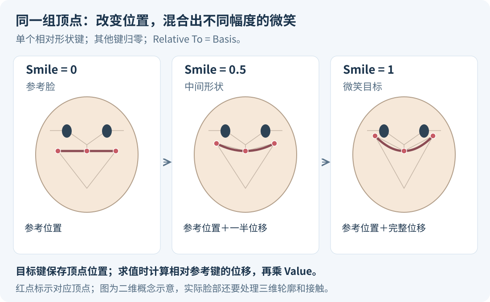
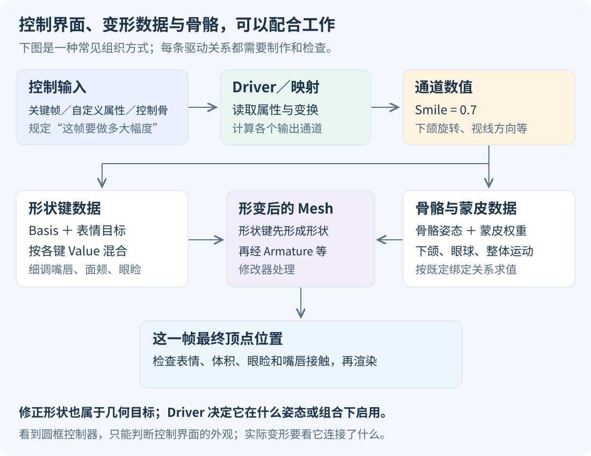

# Blender Shape Keys／Blendshape：用形状键做表情，怎样接入面部绑定

在面部动画语境里，“Blender Shape”很可能指的是 <strong>Shape Keys（形状键）</strong>，也常称为 <strong>Blendshapes（混合形状）或 Morph Targets（形变目标）</strong>。它让制作者先做出微笑、闭眼等目标形状，再用数值控制这些形状的影响程度。Blender 官方将面部表情和骨骼形变修正列为它的典型用途。[Shape Keys 官方介绍](https://docs.blender.org/manual/en/5.0/animation/shape_keys/introduction.html)

<strong>它是面部绑定可使用的一种变形方式。</strong>单靠形状键也能做表情；如果角色还有下颌、眼球等骨骼，则可以把形状键、骨骼、控制器和驱动关系组合成完整的 Facial Rig。下面以一张普通角色脸为例，讲清它保存什么、怎样制作、怎样播放以及怎样与骨骼配合。

本文按 Blender 的相对形状键工作方式展开，界面术语参考 Blender 5.0 官方手册；不同版本的图标和菜单名称可能略有差异。资料核对日期：2026 年 11 月 7 日。

## 一、先分清三个名字：Shape Key、骨骼、自定义 Shape

<div style="overflow-x:auto">

| 看到的术语 | 保存或控制什么 | 改变脸的方式 |
| --- | --- | --- |
| Shape Key／Blendshape | 一组与参考形状对应的目标顶点位置 | 按影响值混合目标与参考之间的位移 |
| Bone＋Skinning，骨骼与蒙皮 | 骨骼变换，以及顶点受各骨骼影响的权重 | 移动或旋转骨骼，使网格跟随变形 |
| Bone Custom Shape，骨骼自定义显示形状 | 骨骼在视窗中显示成什么图形 | 主要提供可见、可选的控制界面；实际作用取决于绑定关系 |

</div>

最后一种经常显示成方框、圆圈或箭头。它的外观属于视窗显示设置，不能仅凭“看到一个圆形控制框”，判断里面采用的是骨骼蒙皮还是形状键。[Bone Custom Shape 官方说明](https://docs.blender.org/manual/en/5.0/animation/armatures/bones/properties/display.html)

所以，在讨论做表情的方法时，先问具体对象：是在雕刻一个 `Smile` 目标形状，还是在移动一根变形骨骼，或者只是给控制骨换了显示图案。本文重点讲第一种，并说明它怎样由控制骨驱动。

## 二、原理：同一批顶点，保存不同的位置

### Basis 是参考脸

Mesh 是由顶点、边、面构成的网格。一个顶点有自己的编号与三维坐标，连接关系决定哪些顶点形成表面。

创建形状键后，列表中的 <strong>Basis</strong> 通常作为参考形状。制作 `Smile` 时，保留原来的顶点对应关系，移动嘴角、嘴唇与面颊，得到微笑目标。形状键保存顶点位置；相对混合时，再计算它与参考键之间的位置差。[形状键面板与 Relative To](https://docs.blender.org/manual/en/5.0/animation/shape_keys/shape_keys_panel.html)

这里没有要求先建立骨骼。输入可以只有参考网格、目标形状与一个影响值，输出就是变形后的顶点位置。

### Value 控制形变幅度

先只启用一个 `Smile`，并让它的 `Relative To` 指向 Basis：

```text
当前顶点位置 = Basis 顶点位置
             + Value ×（Smile 目标位置 − Basis 顶点位置）
```

例如，一个顶点在 Basis 中是 `(0, 0, 0)`，在 Smile 中是 `(2, 0, 1)`，当 Value 为 `0.5` 时，混合结果是 `(1, 0, 0.5)`。这是自拟坐标示例，使用模型本地坐标单位，不代表毫米或屏幕像素。



*图 1：相对 Basis 的单个微笑目标示意。三个阶段使用同一组对应顶点，改变的是位置；实际角色还要同时调整面颊、唇缘等区域。*

Value 为 0 时，这个键不贡献相对位移；为 1 时贡献完整目标位移；中间值贡献相应比例。Blender 也允许设置范围并进行小于 0 或大于 1 的外推。<strong>0–1 是常见控制范围，不是概率。</strong>[相对形状键与外推](https://docs.blender.org/manual/en/5.0/animation/shape_keys/introduction.html)

### 多个键可以同时起作用

在各键都相对 Basis、没有额外顶点组限制的简单情况下，可以理解为：

```text
最终形状 = Basis
         + Smile 的权重 × Smile 的相对位移
         + Blink 的权重 × Blink 的相对位移
         + 其他键的相对位移贡献
```

因此 `Smile = 0.8`、`Blink = 0.7` 可以同时成立，权重之和不需要等于 1。它们控制不同的形变贡献；如果多个键都移动同一区域，那里的位移会相加，组合效果需要单独检查。

还要区分两类“权重”：蒙皮权重表示某个顶点跟随哪根骨骼；Shape Key 的 Value 表示当前形状键贡献多少。它们属于不同的数据。

## 三、实际操作：先做出第一个 Smile

下面先做最简单的相对形状键，不加控制骨，也不接面捕。

1. <strong>选择头部 Mesh。</strong>先确认正在操作需要变形的脸部网格，而不是 Armature 或眼球对象。
2. <strong>打开对象数据属性中的 Shape Keys。</strong>网格对象通常对应绿色三角形图标；面板位置为 `Object Data → Shape Keys`。
3. <strong>添加 Basis，再添加一个目标键。</strong>首次添加建立参考键，再添加得到 `Key 1`，把它改名为 `Smile`，并确认采用 Relative 模式。
4. <strong>选择 Smile，进入 Edit Mode。</strong>在这个键上移动嘴角、嘴唇与面颊顶点，做出想要的微笑。先用移动、比例编辑等保留顶点对应关系的操作练习。
5. <strong>返回 Object Mode。</strong>其他形状键值保持为 0，拖动 Smile 的 Value，依次看 0、0.25、0.5、0.75、1。
6. <strong>从侧面和三分之四视角检查。</strong>看嘴角是否被拉薄、嘴唇是否穿插，面颊轮廓是否合理，再回到 Smile 修改。
7. <strong>归零并保存。</strong>确认 Value 回到 0 后能回到预期参考状态，再继续制作下一个键。

这条流程依据官方的相对形状键工作方式，移动哪些顶点、幅度多少则由角色设计决定。[官方创建与编辑流程](https://docs.blender.org/manual/en/5.0/animation/shape_keys/workflow.html)

<strong>建模工具作用在哪个键上，取决于当前选中的键。</strong>制作微笑时应确认 Smile 处于选中状态，避免误改 Basis。列表中的固定显示、禁用、锁定与编辑模式显示选项，也可能影响看到的结果；排查时先把它们还原到清楚可控的状态。[面板显示与锁定选项](https://docs.blender.org/manual/en/5.0/animation/shape_keys/shape_keys_panel.html)

### 普通新键与“从混合生成”有什么区别

普通新增键从 Basis 复制；`New Shape from Mix`，或某些版本中的组合形状命令，会使用当前混合后的形状。后者适合特定制作流程，但要明确当前已经有哪些键参与了形变。

例如，已有一个 Smile 开着，再从当前混合建立一个新键，这个新键可能包含微笑。之后把两个键同时打开，嘴角就可能出现重复贡献。[新增形状与从混合生成的区别](https://docs.blender.org/manual/en/5.0/animation/shape_keys/workflow.html)

## 四、做一套基础表情：先少量、可组合

第一次可以从下面这组练习开始。名称是本文的命名示例，不是 Blender 规定的通道集合；`L／R` 按角色自身的左右约定。

<div style="overflow-x:auto">

| 键名示例 | 制作目标 | 重点检查 |
| --- | --- | --- |
| Smile_L／Smile_R | 左右嘴角分别形成微笑 | 嘴角、唇缘、面颊是否一起合理变化 |
| Blink_L／Blink_R | 左右眼分别闭合 | 眼睑包裹眼球、上下睑接触与中间过程 |
| BrowUp | 抬眉 | 眉弓与额头体积，是否牵扯眼睑 |
| MouthPucker | 嘟嘴／收拢嘴唇 | 嘴唇厚度、前后轮廓与嘴角 |
| JawOpen，可选 | 用形状键制作张嘴 | 若已有下颌骨开口，先明确各自负责的运动 |

</div>

左右分开后可以做偏侧微笑、单眼眨眼等不对称表情。基础版本可以借助对称与镜像功能制作，再根据角色需要修饰。镜像结果仍依赖网格的对称性、拓扑与所选操作，不能只靠给键名加 `_L／_R` 自动建立对应关系。[形状键镜像与对象对应要求](https://docs.blender.org/manual/en/5.0/animation/shape_keys/shape_keys_panel.html)

### 闭眼为什么特别需要检查中间值

闭眼目标为 1 时贴合，不代表 0.5 时也贴合。简单的顶点位置混合产生的是直接的位置过渡，眼睑运动却需要包裹立体眼球；中途可能进入眼球，或者失去厚度。

先检查 0.25、0.5、0.75，再决定调整目标、增加受控的中间修正，或引入眼睑骨骼等辅助方式。这里的四分之一档位是本文提供的检查步骤，不是软件要求。

嘴唇同样如此：只把嘴角拉开，往往不足以完成有说服力的笑。形状制作还要关心上下唇接触、唇厚、面颊体积和侧面轮廓。

## 五、让表情动起来：Shape Key 与关键帧各做什么

<strong>Shape Key 定义一种形状；动画关键帧定义某一时刻的参数值。</strong>两者共同工作，才得到随时间变化的表情。

例如，Smile 已经制作好，可以在它的 Value 属性上插入这组教学关键帧：

<div style="overflow-x:auto">

| 帧 | Smile 的 Value | 这一时刻的状态 |
| --- | --- | --- |
| 1 | 0 | 参考状态 |
| 12 | 0.7 | 形成一定幅度的微笑 |
| 24 | 0 | 返回参考状态 |

</div>

在指定帧设置数值，通过 Value 的右键菜单插入关键帧，再播放检查。中间时刻的权重由动画曲线插值决定；在 Graph Editor 中可以调整节奏与过渡。上面的时间安排只是操作示例，不规定一个微笑应该持续多久。

完成之后，几何部分仍只有 Basis、Smile 等形状数据；动画部分保存的是 Smile 值如何随时间变化。把所有时间关键帧删除，目标形状也仍然存在；把 Value 固定在 0.7，表情也可以一直保持在那里。[形状键的动画控制](https://docs.blender.org/manual/en/5.0/animation/shape_keys/shape_keys_panel.html)

在本文使用的 Relative 模式中，主要给各键的 Value 做动画。Absolute 模式则按 Evaluation Time 在一系列形状之间推进，适合另一类顺序形变任务，初学面部混合时先使用 Relative 更直接。[Relative 与 Absolute 的区别](https://docs.blender.org/manual/en/5.0/animation/shape_keys/introduction.html)

## 六、接入控制器：为什么拖动一个框，脸就会笑

动画师可以直接使用 Shape Keys 面板，也可以使用面前的控制框、骨骼或自定义属性。控制界面与目标形状之间，需要建立明确的映射。



*图 2：一种常见的混合面部绑定组织方式。控制骨可以驱动形状键，也可以驱动变形骨；实际 Rig 应明确每条连接及其坐标空间。*

### Driver 把一个属性换算成另一个属性

Driver，驱动关系，可以读取指定属性、对象或骨骼变换，再计算被驱动属性的值。例如，可以让控制对象的 `smile` 属性直接决定头部 `Smile` 键的 Value。[Driver 的变量与表达式](https://docs.blender.org/manual/en/5.0/animation/drivers/drivers_panel.html)

一个容易理解的练习是：

1. 创建一个 Empty，作为控制对象，并为它添加名为 `smile` 的自定义数值属性，设定 0–1 的使用范围。
2. 在头部 `Smile` 的 Value 上添加 Driver。
3. 给 Driver 添加名为 `s` 的输入变量，类型用 `Single Property`，目标选择这个 Empty，RNA 路径为 `["smile"]`。
4. 使用表达式 `s`，让形状值等于输入属性值；检查变量与 Driver 的当前结果。
5. 调整 Empty 的 `smile` 属性，观察脸部变化。之后需要动画时，给控制属性做关键帧。

这只是一个控制通道。一个属性可以同时驱动多个形状键，例如同时控制左右嘴角，再按需要给两边不同的幅度。

### 控制骨怎样参与

把 Driver 的输入改成某根骨骼的位移或旋转，也可以驱动 Shape Key。这时要确认骨骼名称、变换通道、零点、方向和坐标空间。以骨骼沿某轴移动为例，可以把“中性位置”和“最大微笑位置”分别映射到 0 和 1。

<strong>控制骨可以只负责提供输入。</strong>它不一定直接蒙皮到脸上。将其显示为一个方便操作的圆框，改变的是控制界面；从圆框到微笑形状的实际联系，来自 Driver 等绑定关系。[骨骼变换驱动形状键的官方示例](https://docs.blender.org/manual/en/5.0/animation/drivers/workflow_examples.html)

如果移动控制骨后整张脸跟着平移，先检查它是否意外参与了蒙皮或父子变换。若拖动后完全没反应，则检查驱动变量是否读到了正确对象、骨骼、属性与坐标空间。

## 七、与骨骼混合：分别安排下颌、眼球与软组织

一套可供参考的分工是：

- 头部骨骼控制整体朝向。
- 下颌骨负责主要的下颌开合，下排牙齿随下颌运动。
- 眼球骨骼控制视线方向。
- Shape Keys 控制嘴角、唇形、面颊、眼睑和眉部的特定形状。
- 必要的修正形状处理某些姿态或组合下的体积与接触问题。

这是组织方案，不是所有角色都必须采用的结构。风格化角色也可以主要使用形状键，或者主要使用骨骼，再由少量形状键补足细节。

### 避免重复表达同一段运动

如果下颌骨已经让嘴张开，而 `JawOpen` 形状又保存了完整张嘴位移，两者同时启用时可能产生重复开口。制作前应决定：由骨骼负责主要开合，形状键只补充唇部与轮廓，还是主要由形状键负责。

在常见的 Blender Mesh 流程里，形状键先形成网格形状，Armature 等修改器再对其求值。制作骨骼姿态相关的修正时，要在正确的变形显示与坐标空间下编辑。官方修正示例特别说明了 Armature 修改器的编辑模式显示与笼形编辑设置。[姿态修正的制作上下文](https://docs.blender.org/manual/en/5.0/animation/drivers/workflow_examples.html)

### 为什么完整表情相加后，有时会变难看

假设 Smile 单独很好、JawOpen 单独也很好，同时启用后嘴角却塌了。这说明两个单独制作的变化在共享区域没有形成合适的组合。

可以先减小各目标对无关区域的影响，再为组合状态制作 Corrective Shape（修正形状），并由相关控制量触发。比如 `SmileJawFix` 只在微笑和张嘴同时较强时逐渐出现。触发权重可以先尝试两输入的乘积等教学规则，但最终要依角色组合测试确定。

<strong>修正应补上当前组合所缺的那部分形变。</strong>若直接保存一个完整的“微笑＋张嘴”目标，再叠加到已经启用的 Smile 与 JawOpen 上，容易重复计入原有运动。从当前混合生成一个键，也不自动等于已经得到正确的修正差值；需要明确参考形状、现有形变和目标结果。

## 八、制作前后，哪些检查最重要

### 先稳定拓扑和顶点对应

一组形状键需要知道“目标中的哪个顶点，对应参考中的哪个顶点”。两个独立模型即使长得一样、顶点数量也一样，顶点顺序不同仍可能产生错误对应。

实际制作中，先确定主要拓扑，再批量做表情。后续若要改拓扑，应采用能一致处理全部形状的流程，或重新建立形状对应并检查所有键。普通重拓扑、重建网格等操作可能使现有表情资产需要重做。[官方拓扑与形状键工作说明](https://docs.blender.org/manual/en/5.0/animation/shape_keys/workflow.html)

### 单独看、混合看、运动中看

<div style="overflow-x:auto">

| 检查方式 | 具体看什么 |
| --- | --- |
| 所有键归零 | 参考脸是否正确，有没有误改 Basis |
| 每键从 0 到 1 | 中间状态与极端形状，尤其闭眼与唇部接触 |
| 左右分别启用 | 是否左右颠倒，是否误带另一侧 |
| 两键或多键混合 | 共享区域是否重复变形、塌陷或穿插 |
| 加入眼球和牙齿 | 眼睑、嘴唇与内部几何的接触关系 |
| 加入头部、下颌与视线动作 | 骨骼和形状键是否协调，驱动是否读对空间 |
| 播放动画 | 节奏、曲线变化和过渡是否符合目标表演 |

</div>

“键的名字正确”“Value 能从 0 拖到 1”只验证了接口的一部分。真正的制作验收，还要看该角色的形状、接触与动作是否成立。

## 九、第一次学习，可以这样安排

先拿一张拓扑稳定的脸，只做 <strong>Basis、Smile、Blink_L、Blink_R</strong>，不急着凑很多通道。先直接拖 Value 看见形变，再给 Smile 与 Blink 做少量关键帧，理解形状和时间的分工。

之后增加一个 Empty 的 `smile` 属性，通过 Driver 驱动 Smile。等这条连接确认无误，再把输入换成面部控制骨，理解“控制骨提供数值、形状键执行目标形变”的过程。

最后再引入下颌与眼球骨骼，检查张嘴、微笑、眨眼的组合，并按需要制作修正。ARKit 等外部输入也可以通过映射来驱动形状键，但通道名称和数值本身不会自动替你雕刻角色表情，仍需准备角色自己的目标形状与映射规则。

如果想进一步理解整体组成，可接着看[Facial Rig 的五个组成部分](https://jinjianzhao.github.io/daily-papers/knowledge/article.html?slug=facial-rig-fundamentals)；比较其他表情技术，可看[风格化角色的经典面部动画方法](https://jinjianzhao.github.io/daily-papers/knowledge/article.html?slug=stylized-facial-animation-methods)。
