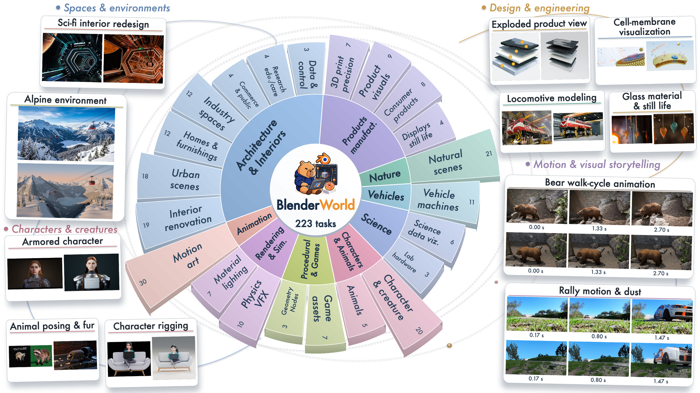

# BlenderWorld：怎样检验一个智能体是否真的会用 Blender 做 3D

> 原论文：[BlenderWorld: Benchmarking Visual Agents for 3D Creation from Real-World References](https://github.com/QwenLM/BlenderWorld/blob/main/docs/BlenderWorld__Benchmarking_Visual_Agents_for_3D_Creation_from_Real_World_References.pdf)，Fang 等，2026 年 10 月 16 日。项目与公开数据：[QwenLM/BlenderWorld](https://github.com/QwenLM/BlenderWorld)。本文依据论文正文、图 1—7 和附录 B—E。

## 先抓住这篇论文在研究什么

假设用户给智能体一张客厅照片、一份写有尺寸和材料要求的文件，并说：“按照片重建这个房间，保留书架的位置，交付可编辑的 Blender 工程和渲染图。”智能体需要读懂这些材料，调用 Blender 建模、摆放物体、设置材质和相机、反复看渲染结果，最后交出能继续修改的 `.blend` 文件。只有一张看起来相似的图片，不能证明它真的建出了可编辑的 3D 场景。

**BlenderWorld 是用来考这种完整工作流程的基准，不是一个把图片直接变成 3D 的生成模型。**论文的主要产物是任务集、提交格式、评价协议和一组被测智能体的结果。被测者可以用不同的语言模型和工具链；BlenderWorld 负责提出任务并检查交付物。[论文 §3.1、§4]

它所说的“视觉智能体”可以理解为：一个会读图和读文字的模型，加上它能调用的文件、代码、Blender 和图像查看工具。模型并非一次前向计算就吐出最终网格，而是在多轮交互中决定下一步要做什么。



*图 1（论文原图）：中心是任务类别；周围示例里，参考材料在左侧或上方，GPT-6-Astra 的输出在右侧或下方。它展示了室内、产品、角色、动画等不同类型的交付目标；示例图片不代表每类任务都已解决。图片来源：[论文图 1](https://github.com/QwenLM/BlenderWorld/blob/main/docs/BlenderWorld__Benchmarking_Visual_Agents_for_3D_Creation_from_Real_World_References.pdf)。*

## 从输入到交付：智能体实际在做什么

一项任务的输入可以写成三部分：自然语言要求、可选的图片或视频参考、可选的 Markdown／YAML／JSON 规格文件。图片的作用也不总相同：有的任务要求尽量重现其中的形状和空间关系；有的要求保留一部分并修改；还有的只借用风格或布局做新设计。[论文 §3.1—§3.2]

智能体从一个 Blender 工作区出发，可以写并执行 Blender Python、导入资产、查询场景中的物体、调整几何和材质、渲染并查看结果，再继续修改。最后应交付**可编辑 Blender 工程**，以及题目要求的图片、视频或其他文件。论文用一个简短公式描述这一过程：当前观察和任务输入决定下一次动作；Blender 执行动作后，工作区状态发生变化。这是“观察—操作—再观察”的智能体工作流，而非某个固定的 3D 网络架构。[论文 §3.1；附录 D.2]

比如参考图里有一个书架，从指定相机看起来位置正确，只满足了部分要求。如果换一个视角发现书架其实是一块贴图平面，或者 `.blend` 里的尺寸与规格文件不符，交付质量就不同。这也解释了为什么评价需要同时看渲染图和工程内部。

## 223 道题怎样组成

BlenderWorld 有 **223 项任务**，覆盖 **9 个大类、22 个子类、16 种应用场景**。其中 78 项只有文字要求（可能另带规格文件），130 项有图片加文字，15 项有视频加文字；59 项另带规格文件。任务涉及室内和建筑、产品制造、自然环境、角色动物、动画、科学可视化等。[论文 §3.3、图 1、图 3；附录 A]

这不是“223 张图片配 223 个标准 3D 答案”。设计一个展台或重建一个房间，可能有多种合理建法，数据集因此把用户需求拆成**任务专属验收条件**。全文共 **2,651 条二值条件**，每题 6—22 条，平均 11.9 条。例如，一条检查书架布局，一条检查材料，另一条检查是否交付可编辑工程；还会标记该条件应从渲染图还是工程内部查证，并赋予重要程度 1、2 或 3。[论文 §3.2—§3.3；附录 B]

构建任务时，作者先设计应用场景和参考资料，再写生产需求，检查图片、文字、规格和交付要求是否一致，随后生成验收条件并经过独立审查和试评后冻结。这里的验收条件是 benchmark 的一部分，**在被测智能体制作时不开放**；否则智能体可能只针对检查项投机。[论文图 2、§3.2、§5.1]

## 怎么评分：一张好看的图为何不够


*图 2（论文原图 4）：任务交给智能体制作，评价阶段另行读取交付物、选择 8 个视角渲染，分别检查任务条件和整体视觉质量，最后合成分数。左侧是被测智能体的制作阶段；中间和右侧是 benchmark 的评价阶段。图片来源：[论文图 4](https://github.com/QwenLM/BlenderWorld/blob/main/docs/BlenderWorld__Benchmarking_Visual_Agents_for_3D_Creation_from_Real_World_References.pdf)。*

评价分两条线。第一条是**任务条件**：针对每条“必须有”“必须达到某尺寸”等条件，判通过或失败。负责视觉条件的视觉语言模型（VLM）查看图像；负责工程内部条件的工具型评审智能体打开场景、查询物体或文件。评价器还会从交付的 `.blend` 工程中选择 **8 个与任务相关的视角**重新渲染，以免只相信作者提交的“最佳机位”；原本导出的图片和视频帧也仍是证据。[论文 §4.1]

第二条是**整体视觉质量**：从场景忠实度、物理合理性、风格颜色、真实感、空间布局、比例尺度、光照材质、完整性这 8 个维度，各打 1—10 分。它补足二值条件无法描述的连续观感，例如“物体都在，但比例和质感仍很别扭”。[论文 §4.1；附录 C]

每题的计算方式可以记成：

```text
条件分 = 100 × 通过条件的重要性权重之和 / 全部条件权重之和
观感分 = 10 × 八项视觉维度的平均分
总分   = 0.5 × 条件分 + 0.5 × 观感分
```

全榜单是 223 道题总分的平均；缺失 `.blend` 或评价失败的任务记 0，仍在分母里。“Perfect”另指**一道题的所有二值条件都通过**，它与总分 100 不是同一个指标。[论文 §4.2、§5.1]

## 结果到底说明了什么

论文在相同 223 道题上比较 **13 个智能体系统**，每个系统每题运行一次。总体平均分前三为 GPT-6-Astra **79.9**、Opus-5 **73.0**、GPT-5.6-Sol **67.7**。但是第一名也只有 **42.2%** 的题达到 Perfect，即每条任务条件均通过；第二名是 **25.6%**。这表明“平均得分看起来不错”和“整项生产需求完全交付”之间仍有明显差距。[论文表 2、§5.2]

另一个有用观察是：多看几次渲染图，不一定就会修好模型。论文统计了智能体的工具调用，DeepSeek-V4.1-Flash 平均每题查看图像 **31.3 次**，GPT-6-Astra 为 **15.0 次**，但后者的多模态任务平均分更高（**80.7** 对 **65.5**）。这是相关性观察，**不能单凭次数证明哪一种规划策略更好**；它说明查看结果与识别、定位、修正缺陷是不同能力。[论文图 6、§5.3.2]

失败案例更能体现考点。一个任务要求田里的两个人，智能体把人物照片贴到朝向相机的平面上：正面渲染看得到人，侧面却几乎消失。另一个任务要求人物躺在草地上并与远处塔形成透视关系：投影对齐了，人物身体却悬空。此类例子说明，只有单视图“看着对”并不等于多视角的 3D 结构或接触关系正确。[论文图 7；附录 E.8、图 15]

## 读这个榜单时保留三点判断

首先，**分数属于完整系统**。论文中 GPT-6-Astra 和 GPT-5.6-Sol 使用 Codex，其余系统使用 Claude Code；工具调用、推理设置和模型一起影响结果。因此，表 2 适合比较论文所搭建的这些智能体配置，不能直接当成“只换底座模型”的因果实验。[论文 §5.1；附录 D.1]

其次，**评审本身带有模型判断**。论文用 150 对作品、三位人工评审者检验自动评审的一致性；排除 3 对没有多数意见的作品后，所用 GPT-5.6-terra 评审的总体分数与人工多数偏好一致率为 **82.99%**。对于平均分差低于 10 的 70 对作品，一致率降到 **68.57%**。因而大差距更容易解释，单次小分差不宜被看作精确能力差。[论文附录 E.1、表 6]

最后，它测的是**按真实需求制作、检验并交付 Blender 工程的能力**。如果你在做 3D 智能体，可以按“读参考资料 → 建场景 → 自检工程与多视角 → 修正 → 交付”的链条定位失败；如果你在做单张图像到网格的生成模型，本文的榜单不会直接给出那个子模型的独立质量分数。论文未来工作还计划加强交互式检查、确定性几何度量、专业人员参与和重复运行；这些尚不是当前结果的已实现部分。[论文 §6—§7]

## QA

暂无问答。
