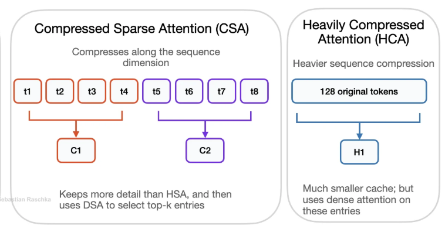

# LLM 长上下文工程：CSA、HCA 与分块 KV 缓存压缩

这篇文章回答一个很具体的工程问题：当上下文从几千 token 变成几十万甚至一百万 token 时，为什么不能继续把每个历史 token 的 Key、Value 都原样放进 KV cache，并让每个新 token 访问全部历史？我们从标准注意力的瓶颈出发，再解释 DeepSeek-V4 报告中的 **CSA（Compressed Sparse Attention，压缩稀疏注意力）** 和 **HCA（Heavily Compressed Attention，高度压缩注意力）**。

读者可以先记住一句话：**CSA 是“先把历史分块压缩，再挑少数相关块做注意力”；HCA 是“把更大的历史块压成更少条目，然后对这些条目做较稠密的注意力”。** 两条路径都保留一个小的局部窗口，用来避免压缩丢掉最近 token 的细节。

## 1. 先回到普通 LLM 的 KV cache

在 decoder-only Transformer 中，第 `t` 个 token 的查询向量会和它之前的 Key 做相似度计算，再对 Value 加权求和。因果注意力可以写成：

```text
Attention(q_t, K_≤t, V_≤t)
```

推理时，历史 token 不会改变，所以每层已经算过的 Key 和 Value 可以保存起来，下一步直接复用，这就是 **KV cache**。它避免了每生成一个 token 都重新计算整段历史，但也带来两个成本：

1. **存储成本**：每一层都要保存历史 token 的 KV，缓存大小随上下文长度近似线性增长。
2. **读取和计算成本**：标准全注意力让新查询扫描全部历史 KV；上下文越长，预填充和逐 token 解码越昂贵。

这和训练时常说的“注意力矩阵是平方复杂度”不是同一件事。训练时整段序列同时计算，确实会涉及很大的两两交互；自回归解码有 KV cache 后，每一步通常是一个查询对历史 KV 的读取，但历史变长仍会让每一步的读取量增长。超长上下文下，显存容量、内存带宽、跨设备通信和缓存恢复时间都会成为瓶颈。

## 2. 什么是分块压缩

假设历史有 `n` 个 token。普通缓存是：

```text
token 1, token 2, token 3, ..., token n
  K/V     K/V     K/V             K/V
```

分块压缩先沿**序列维度**把相邻 token 分成块，每 `m` 个 token 产生一个压缩条目：

```text
[token 1 ... token m]       -> compressed KV 1
[token m+1 ... token 2m]    -> compressed KV 2
...
```

如果不考虑边界，缓存条目数从 `n` 变为约 `n/m`。压缩条目不是简单地把 token 的向量做算术平均；在 DeepSeek-V4 的 CSA 中，模型先产生候选 KV 表示和压缩权重，再用归一化权重聚合一个块（相邻块之间还存在特定的重叠构造）。因此每个压缩条目是一个**可学习的摘要**，而不是固定规则的池化结果。

压缩一定会损失信息。工程上的目标不是声称“一个向量等于原来的所有 token”，而是让模型学会把长程检索所需的内容保留下来，同时用局部窗口保留不能被压缩的细节。



*图 1：用户提供的 CSA/HCA 参考示意图，原始来源为[微信公众号文章](https://mp.weixin.qq.com/s/kHHRtqJyQsX1MZyp6AT9JQ)。这是帮助理解“沿序列分块并压缩缓存”的参考图，不是 DeepSeek-V4 论文的官方插图；图中 HCA 的标签也不能被改写成 SCA。*

## 3. CSA：压缩后再做稀疏选择

### 3.1 它解决什么问题

CSA 的全称是 **Compressed Sparse Attention**。它把每 `m` 个 token 的 KV 压缩成一个条目，然后不让当前查询读取所有压缩条目，而是先用一个轻量的索引器估计相关性，只选择 top-k 个压缩条目进入核心注意力。

因此 CSA 有两个减少量：

- **序列压缩**：`n` 个历史位置变成约 `n/m` 个压缩位置；
- **稀疏读取**：每个查询只对其中 top-k 个压缩位置做核心注意力。

论文的结构描述可以概括为：

```text
历史隐藏状态 ──按块学习压缩──> 压缩 KV ───────────┐
                         └──> 压缩索引 Key ──┐  │
当前查询 ───────────────────────────────> 索引器 ──> Top-k 块 ──> 核心注意力
最近 token ───────────────────────────────────────────> 局部窗口分支 ──> 合并输出
```

### 3.2 查询时缓存怎样被读取

一次解码可以按下面的顺序理解：

1. 当前 token 的隐藏状态生成查询，同时生成用于索引的低维查询表示。
2. 查询和历史的压缩索引 KV 做轻量打分。
3. 对满足因果约束的历史压缩块取 top-k。
4. 核心注意力只读取这些压缩 KV；论文描述这里采用共享 KV 的 MQA 形式，多个 query head 共享压缩的 key/value 条目。
5. 另外读取一个小的滑动窗口，把最近 token 的细粒度信息补回来。
6. 将稀疏的长程结果和局部窗口结果合并，得到当前层输出。

这里的 top-k 不是在原始 token 上挑 k 个位置，而是在**压缩块**上挑选。索引器的任务类似“先做便宜的目录检索”，核心注意力才是“对找到的候选内容进行更完整的阅读”。

### 3.3 CSA 的取舍

CSA 主要节省长程缓存读取和核心注意力 FLOPs，但它也增加了索引器、top-k 选择和相关内核的实现成本。若索引器漏掉了真正有用的块，模型就可能无法访问那段信息；如果 `m` 太大，单个压缩条目承载的信息过多，细节损失会增大；如果 `m` 太小，压缩收益又不明显。局部窗口与因果边界因此不是可有可无的补丁，而是混合设计的一部分。

## 4. HCA：更激进的压缩，但保留稠密读取

### 4.1 HCA 和 CSA 的差别

**HCA（Heavily Compressed Attention）**使用更大的压缩率 `m'`，把更多 token 合并成一个缓存条目。DeepSeek-V4 论文明确说明，HCA 的压缩比 CSA 更激进，而且**不使用稀疏注意力选择器**：压缩后得到的条目会被相对稠密地读取。

可以用下面的对比来记忆：

| 路径 | 缓存怎样变小 | 查询怎样访问 | 更像在解决什么问题 |
| --- | --- | --- | --- |
| CSA | 每 `m` 个 token 变成一个条目 | 对压缩条目先 top-k，再做核心注意力 | 长历史中只找少数相关区域 |
| HCA | 每 `m'` 个 token 变成一个条目，且 `m'` 更大 | 对很少的压缩条目做较稠密注意力 | 让全局摘要足够小且读取稳定 |

HCA 并不等于“把整段文本平均成一个向量”。它仍然通过可学习的投影和权重形成压缩条目，只是压缩得更重；同时仍有滑动窗口处理局部依赖。

### 4.2 为什么要把 CSA 和 HCA 混合

不同注意力层不一定适合相同的压缩率。CSA 更擅长从长历史中进行选择性检索，HCA 则用极少的条目提供低成本的广域信息。DeepSeek-V4 的配置是在后续 Transformer 层中**交错使用 CSA 层和 HCA 层**；每类层内部又有滑动窗口分支。把它们概念上分工，可以这样记：

```text
最近 token           -> CSA/HCA 层的滑动窗口，保留细节
CSA 层的长程历史     -> 压缩缓存 + top-k 稀疏检索
HCA 层的长程历史     -> 更强压缩 + 对压缩条目稠密聚合
```

这是不同层的分工，不是一个层里按距离切出“CSA 区域”和“HCA 区域”。它也不应被理解成所有长上下文 LLM 都必须采用的标准模板。

## 5. “SCA”到底是什么

用户问题中写了“CSA 和 SCA”，但用户提供的图片标签是 **CSA / HCA**，DeepSeek-V4 论文对应章节也写的是 **Compressed Sparse Attention（CSA）** 和 **Heavily Compressed Attention（HCA）**。在本文使用的这些资料中，我没有核到一个可以直接等同于 HCA 或 CSA 的标准 “SCA” 方法缩写。

因此本文不擅自把 SCA 定义成某个新算法。如果你看到另一篇资料使用 SCA，需要以那篇资料自己的全称、公式和实现为准，再判断它是否只是笔误、另一种方法，或某个作者自己的缩写。不能因为字母相近，就把 SCA、CSA、HCA 当成同一个模块。

## 6. 从写入到读取：一个压缩缓存的完整生命周期

把缓存压缩放进真实推理流程，可以分为四个时刻：

### 6.1 预填充（prefill）

模型一次处理用户输入的长提示词。普通注意力会为每个 token 生成 KV；压缩注意力还要按块计算压缩条目和索引条目。块边界、因果掩码和尾部不完整块必须保持一致，否则预填充得到的缓存与后续解码不匹配。

### 6.2 增量解码（decode）

每生成一个 token，系统更新最近窗口，并把已经满足条件的新 token 归入压缩块。当前查询先访问合法的历史压缩块，再访问局部窗口。CSA 需要额外运行索引器和 top-k；HCA 主要做更小缓存上的稠密聚合。

### 6.3 缓存的组织

一个实现通常至少需要管理三类状态：

- 压缩后的全局 KV（CSA 的可索引条目或 HCA 的强压缩条目）；
- 尚未凑满一个压缩块的尾部 token；
- 最近若干 token 的滑动窗口 KV。

这些状态不能混成一个无边界的数组。每层注意力、每个序列和每个 batch 项都要知道块的时间范围，top-k 只能选择当前查询之前的块，以满足因果性。

### 6.4 训练和推理的一致性

如果训练时每个位置看到的是一种压缩边界、窗口大小或选择规则，而推理时换成另一套规则，模型可能在训练中没有学会如何使用真实缓存。因此压缩率、块边界、局部窗口、索引选择和位置编码处理都需要在训练与推理间保持约定一致。论文还描述了 RMSNorm、部分 RoPE、attention sink 等配套细节；这些属于该混合注意力实现的组成部分，不能只实现一个“平均池化”就声称复现 CSA/HCA。

## 7. 工程收益和代价

### 收益

- 压缩缓存条目更少，长上下文下显存和内存带宽压力下降；
- CSA 的 top-k 读取减少长程核心注意力的计算量；
- HCA 提供很小的全局摘要，避免所有层都保留完整历史；
- 局部窗口让最近的精细依赖不必经过重压缩。

### 代价

- 压缩会丢失信息，尤其是需要精确复制、定位或跨很远距离引用时；
- 索引器、top-k 和压缩操作需要额外计算与高效 kernel；
- 块边界、尾部缓存、位置编码和因果掩码增加状态管理复杂度；
- 训练阶段必须让模型适应压缩表示，不能只在推理时临时加一层缓存压缩；
- 速度收益依赖硬件和实现。理论上缓存条目减少，不代表端到端延迟必然按同样比例下降。

DeepSeek-V4 论文在其效率讨论中，以 BF16、GQA8、head dimension 128 的配置作为基线，报告百万 token 场景下，结合混合 CSA/HCA 与低精度存储等设计，KV cache 大小约为该基线的 **2%**。这个数字属于论文给定模型、配置和比较口径下的结果，不应直接外推到任意 LLM 或任意硬件。

## 8. 一张心智图

最后可以把这套工程方案压缩成五句话：

1. 普通 KV cache 保存每个历史 token，长上下文时存储和读取都变贵。
2. 分块压缩把连续 token 变成较少的可学习摘要条目。
3. CSA 在压缩后用索引器挑 top-k，重点读取少数可能相关的远程块。
4. HCA 压得更狠，不做同样的稀疏选择，而是在极小的压缩缓存上做稠密聚合。
5. 两者都要配合局部窗口、因果边界和训练/推理一致性，才是完整的可用系统。

## 参考资料

- [DeepSeek-V4: Towards Highly Efficient Million-Token Context Intelligence（arXiv 页面）](https://arxiv.org/abs/2606.19348)
- [DeepSeek-V4 HTML 正文，Hybrid Attention with CSA and HCA](https://arxiv.org/html/2606.19348)
- [DeepSeek-V4-Pro 官方推理实现目录（论文脚注链接）](https://huggingface.co/deepseek-ai/DeepSeek-V4-Pro/tree/main/inference)
- [用户提供的 CSA/HCA 参考图原始来源：微信公众号文章](https://mp.weixin.qq.com/s/kHHRtqJyQsX1MZyp6AT9JQ)

## QA

暂无问答。
