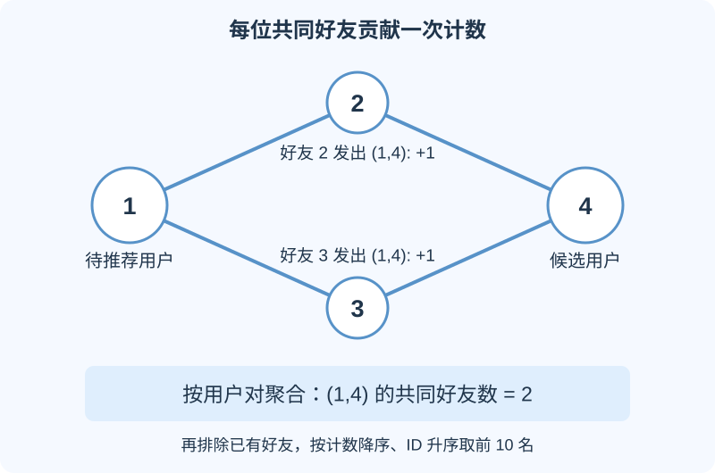
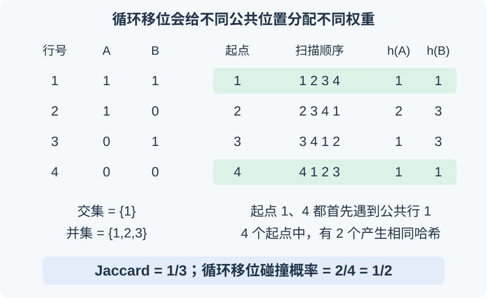

# CSE 547 HW1 题解：Spark 好友推荐、Apriori 与 MinHash

这份作业训练三种能力：把图上的计数任务拆成并行操作；从共同出现的数据中提取规则；判断一种随机采样是否保留了需要的概率性质。本文从具体输入输出讲起，再给出算法、证明与可复现实现。题目依据 [UW CSE 547 Spring 2024 Homework 1](https://courses.cs.washington.edu/courses/cse547/24sp/homeworks/hw1.html)，解法和运行结果为本文独立推导与计算。

<div style="overflow-x:auto">

| 题目 | 要解决的问题 | 核心方法 |
| --- | --- | --- |
| Q1 好友推荐 | 给每个用户找出共同好友最多的非好友 | 以共同好友为中心产生计数，按用户对聚合 |
| Q2 关联规则 | 找出经常一起出现的商品，评价规则强弱 | 条件概率、Apriori 剪枝 |
| Q3 MinHash | 少看一些行会丢失多少信息，循环移位能否替代随机排列 | 无放回抽样、概率上界、反例 |

</div>

前置知识只需要集合、条件概率、循环和字典。第一次接触 Spark，可先阅读本站的 [Spark 入门](../../article.html?slug=apache-spark-introduction)与[分布式计算导论](../../article.html?slug=distributed-computing-introduction)。

## 一、Q1：怎样把共同好友推荐写成 Spark 程序

### 1. 先确定输入、得分与排序

输入每行是一个用户的邻接表，例如 `1<TAB>2,3` 表示用户 1 的好友是 2 和 3。设用户 $u$ 的好友集合为 $N(u)$，候选用户 $v$ 的得分定义为：

\[
c(u,v)=|N(u)\cap N(v)|.
\]

要推荐的是：与 $u$ 不同、尚未成为好友、至少有一个共同好友的用户。按得分从大到小排；同分时按用户的**整数 ID** 从小到大排，最多取 10 人。候选少于 10 人时全部输出，没有候选时输出空列表。

例如，候选 8 有 3 位共同好友，候选 20 有 2 位，候选 100 也有 2 位，则结果是 `8,20,100`。排序键可以写成 `(-共同好友数, 用户ID)`。

直接为所有用户对求集合交集，会先产生大量完全没有共同好友的组合。更合适的生成方向是：**先找一个共同好友，再枚举它连接的两个用户。**

### 2. 以共同好友为中心产生记录

假设用户 $w$ 的好友列表中有 $a,b$，那么 $w$ 就是 $a,b$ 的一位共同好友。为无序用户对 $(\min(a,b),\max(a,b))$ 发出一个计数 1。每位共同好友都这样做，累加后就得到这对用户的共同好友数。



图中的用户 2 和 3 都连接用户 1 与 4，各发出一条 `(1,4): +1`，聚合得到 2。这个过程只需要各用户自己的邻接表，适合在不同分区上同时执行。

**还需要标记已有好友。** 已是好友的两个用户也可能有共同好友，不能因为得分高就再次推荐。为每个用户对保存两个独立量：

```text
key   = (较小的用户ID, 较大的用户ID)
value = (是否已有好友关系, 共同好友计数)
```

已有边产生 `(1,0)`；共同好友产生 `(0,1)`。合并时第一个量取最大值，第二个量求和。这样，无论记录到达的先后顺序如何，已有好友都能被识别。

```python
from itertools import combinations

def emit_records(row):
    user, friends = row
    # friends 已经去重、排序，并移除了 user 自身
    for friend in friends:
        if user < friend:
            yield (user, friend), (1, 0)
    for a, b in combinations(friends, 2):
        yield (a, b), (0, 1)

def merge_stats(a, b):
    return max(a[0], b[0]), a[1] + b[1]

pair_stats = rows.flatMap(emit_records).reduceByKey(merge_stats)
valid_pairs = pair_stats.filter(
    lambda row: row[1][0] == 0 and row[1][1] > 0
)
```

无向边在输入中有两条邻接记录，所以用 `user < friend` 只发出一次边标记。共同好友计数则按中心用户发出一次；邻接表去重保证一个中心不会重复贡献。

### 3. 聚合、恢复方向、取前 10 名

接下来的数据变化是：

```text
无序候选对 (a,b)，共同好友数 c
    ↓ 为两个用户各产生一条候选
(a, (b,c)) 和 (b, (a,c))
    ↓ 按用户合并候选，每次只保留前 10 名
每个用户的推荐列表
    ↓ 与所有输入用户做左连接
包括空推荐列表在内的完整输出
```

这里使用 `combineByKey` 维护每个用户的前 10 名，避免先把某个用户的全部候选汇总到一个大列表。每次增加候选或合并两个列表后，都按同一个排序键保留前 10 名。

为什么中途丢掉第 11 名及以后仍然正确？某候选如果在一个局部列表排第 11，已经有 10 个候选比它更优；这些候选在最终结果中仍然存在，因此它无法进入全局前 10。这个结论依赖统一、确定的排序规则，包括同分时的 ID 顺序。

`reduceByKey` 可先在分区内部合并计数，再把同一键的数据送到一起；这种跨分区交换就是 shuffle。`combineByKey` 则允许合并过程中维护自定义的中间状态。[Spark RDD 编程指南](https://spark.apache.org/docs/latest/rdd-programming-guide.html)

### 4. 正确性与开销

对于任意不同用户 $a,b$，每个 $w\in N(a)\cap N(b)$ 恰好发出一次这对用户的计数，其他用户不会发出。因此计数之和恰好等于共同好友数。边标记排除已有好友，恢复双向候选后再按规定排序，得到的就是题目要求的结果。

设用户 $w$ 的度数，即好友数，为 $d_w$。主要中间记录数量为：

\[
\sum_w \binom{d_w}{2}+|E|,
\]

其中 $|E|$ 是无向边数。这也解释了高连接度用户为何会成为开销来源：其好友数量增加时，好友对的数量按平方增长。本文数据有 49,995 个用户、330,798 条无向边，产生 11,454,543 条共同好友计数记录。

### 5. 原始数据的结果

完整实现会为所有输入用户生成输出。下面列出作业要求查看的 10 个用户；列表里的顺序已经包含同分时的 ID 排序。结果由原始课程数据运行得到，并与独立的邻居遍历计数核对。

<div style="overflow-x:auto">

| 用户 | 推荐用户，按输出顺序 |
| --- | --- |
| 924 | 439, 2409, 6995, 11860, 15416, 43748, 45881 |
| 8941 | 8943, 8944, 8940 |
| 8942 | 8939, 8940, 8943, 8944 |
| 9019 | 9022, 317, 9023 |
| 9020 | 9021, 9016, 9017, 9022, 317, 9023 |
| 9021 | 9020, 9016, 9017, 9022, 317, 9023 |
| 9022 | 9019, 9020, 9021, 317, 9016, 9017, 9023 |
| 9990 | 13134, 13478, 13877, 34299, 34485, 34642, 37941 |
| 9992 | 9987, 9989, 35667, 9991 |
| 9993 | 9991, 13134, 13478, 13877, 34299, 34485, 34642, 37941 |

</div>

以用户 9992 为例，前两位各有 4 个共同好友，35667 有 3 个，9991 有 2 个。因此 35667 会排在 ID 更小的 9991 前面。

程序也复现了用户 11 的校验列表：

```text
27552,7785,27573,27574,27589,27590,27600,27617,27620,27667
```

如需用几句话描述 pipeline：读取并清洗邻接表；以每个用户为中心发出好友对计数，同时发出已有边标记；按用户对聚合并过滤已有好友；恢复双向候选，按用户取前 10 名，再补齐空列表。

## 二、Q2(a–c)：怎样判断一条关联规则是否有意义

### 1. 把符号对应到实际计数

一个浏览会话是一条记录，其中出现过的商品构成一个集合。商品在同一会话内重复出现，也只计一次。设总会话数为 $N$，包含商品集合 $X$ 的会话数为 $\operatorname{supp}(X)$。

\[
S(X)=\frac{\operatorname{supp}(X)}{N}
\]

是出现比例。对规则 $A\to B$，$A$、$B$ 表示两个商品集合；在概率公式中也表示“会话包含该集合”的事件。$A\cap B$ 表示两个事件同时发生，对应会话包含全部商品 $A\cup B$。

为简化推导，记：

\[
a=P(A),\quad b=P(B),\quad p=P(A\cap B),\quad a,b>0.
\]

题目给出的三个指标可改写为：

\[
\operatorname{conf}(A\to B)=\frac{p}{a},
\]

\[
\operatorname{lift}(A\to B)=\frac{p}{ab},
\]

\[
\operatorname{conv}(A\to B)
=\frac{1-b}{1-p/a}
=\frac{a(1-b)}{a-p}.
\]

它们分别关注：有 $A$ 时出现 $B$ 的比例；该比例是 $B$ 基础出现率的多少倍；在独立假设下预期出现的规则失败次数，是实际失败次数的多少倍。

### 2. Q2(a)：confidence 为什么会被热门商品影响

假设 $B$ 在 90% 的会话里出现，且 $A$ 与 $B$ 独立。此时：

\[
P(B\mid A)=P(B)=0.9.
\]

confidence 达到 90%，但知道 $A$ 并没有增加对 $B$ 的预测信息：无论有没有 $A$，$B$ 本来就很常见。

lift 明确除以这个基础出现率；conviction 则用基础失败率 $1-b$ 校正实际失败率。独立时：

\[
\operatorname{lift}=1,\qquad
\operatorname{conv}=1\quad (b<1).
\]

因此，这两个指标都把 $B$ 本身的流行程度纳入比较。它们仍然只是数据中的关联度量；强关联本身不能推出商品间的因果关系。

### 3. Q2(b)：只有 lift 对称

交换 $A$ 和 $B$ 后，交集概率 $p$ 不变，但条件概率的分母会变。

<div style="overflow-x:auto">

| 指标 | 是否对称 | 原因 |
| --- | --- | --- |
| confidence | 否 | $p/a$ 与 $p/b$ 通常不同 |
| lift | 是 | $p/(ab)=p/(ba)$ |
| conviction | 否 | 基础失败率与实际失败率都有方向 |

</div>

给一个可直接核算的反例：100 个会话中，50 个含 $A$，25 个含 $B$，20 个同时含两者。于是 $a=0.5,b=0.25,p=0.2$，得到：

\[
\operatorname{conf}(A\to B)=0.4,\qquad
\operatorname{conf}(B\to A)=0.8;
\]

\[
\operatorname{lift}(A\to B)
=\operatorname{lift}(B\to A)=1.6;
\]

\[
\operatorname{conv}(A\to B)=\frac{0.75}{0.6}=1.25,
\]

\[
\operatorname{conv}(B\to A)=\frac{0.5}{0.2}=2.5.
\]

这同时给出了两个不对称指标的反例，以及 lift 对称性的代数证明。

### 4. Q2(c)：完美蕴含是否总能达到指标最大值

完美蕴含指 $P(B\mid A)=1$，即所有含 $A$ 的会话都含 $B$。题目问的是：**每一条这样的规则，是否都能达到该指标在合法概率分布上的最大值。**

**confidence：满足。** 概率的上限是 1，所有完美蕴含的 confidence 都等于 1。

**lift：不满足。** 完美蕴含下：

\[
\operatorname{lift}(A\to B)=\frac{1}{b}.
\]

$b$ 不同时，完美规则的 lift 可以是 2、10、100，且当 $b$ 趋近于 0 时没有有限的统一上界。例如 $a=p=0.1,b=0.5$ 的完美规则 lift 为 2，而 $a=b=p=0.01$ 的完美规则 lift 为 100；后者可以由两种总是一起出现的不同商品构成。前者显然没有达到所有规则中最大的值。

这里有一个容易混淆的条件：**若固定同一个后件 $B$，完美规则确实达到该条件下 lift 的上限 $1/b$。** 本题讨论所有完美规则的共同性质，后件出现率可以变化，因此答案仍为不满足。

**conviction：满足，保留题目要求考虑的无穷大。** 完美蕴含且 $b<1$ 时：

\[
\operatorname{conv}(A\to B)=\frac{1-b}{0}=+\infty.
\]

这就是其扩展取值范围的最大值。若 $b=1$，会得到 $0/0$，按题目约定忽略；不能把“正数除以 0”的情况也一并删除。

<div style="overflow-x:auto">

| 指标 | 所有有定义的完美蕴含都达到最大值？ |
| --- | --- |
| confidence | 是，最大值为 1 |
| lift | 否，取值还受后件出现率影响 |
| conviction | 是，取扩展值 $+\infty$；按约定忽略 $0/0$ |

</div>

## 三、Q2(d–e)：Apriori 怎样找频繁二项集和三项集

### 1. 支持度阈值是出现 100 次

本题中，频繁集合的条件是 $\operatorname{supp}(X)\ge100$。这里的 100 是会话数，不是百分比；规则的方向也不影响整个商品集合的支持度。

Apriori 的关键性质是：

\[
X\subseteq Y
\quad\Longrightarrow\quad
\operatorname{supp}(Y)\le\operatorname{supp}(X).
\]

因为每个包含 $Y$ 的会话必然包含 $X$。因此，若某个子集连 100 次都没有出现，更大的集合也达不到 100 次。我们可以先检验小集合，尽早删除不可能合格的大集合。

### 2. 三轮统计，每轮具体保留什么

**第一轮：找频繁单项 $L_1$。** 对每个会话先去重，然后统计各商品出现于多少个会话，只保留至少出现 100 次的商品。后续在每个会话中删除其他商品，因为包含它们的二项或三项集都不会频繁。

**第二轮：找频繁二项 $L_2$。** 每个过滤后的会话枚举所有无序二项组合，统一按商品 ID 排序后计数。只保留计数至少 100 的二项集。

**第三轮：产生三项候选 $C_3$，再找频繁三项 $L_3$。** 如果 `(a,b)` 和 `(a,c)` 都在 $L_2$，可以连接成候选 `(a,b,c)`；还必须检查 `(b,c)` 也在 $L_2$。三个二项子集全部频繁，才保留这个候选并扫描会话统计它。

例如，`(a,b)` 出现 200 次、`(a,c)` 出现 150 次，但 `(b,c)` 只出现 20 次，则 `(a,b,c)` 至多出现 20 次，可以直接删除。

候选生成的核心实现如下，商品顺序已经统一为字典序：

```python
from collections import defaultdict
from itertools import combinations

tails = defaultdict(list)
for a, b in sorted(L2):
    tails[a].append(b)

C3 = {
    (a, b, c)
    for a, values in tails.items()
    for b, c in combinations(values, 2)
    if (b, c) in L2
}
```

连接步骤保证每个排序后的三项集只有一个表示；子集检查保证不漏掉频繁三项集，同时删除部分不可能频繁的候选。通过检查的候选仍可能不频繁，所以第三轮的实际计数必不可少。

### 3. 从集合计数变成有方向的规则

频繁二项集 $\{X,Y\}$ 产生两个方向：

\[
\operatorname{conf}(X\to Y)
=\frac{\operatorname{supp}(\{X,Y\})}{\operatorname{supp}(\{X\})}.
\]

反向规则使用 $Y$ 的单项支持度作为分母。**同一对商品的联合计数相同，两个方向的 confidence 可以不同。**

频繁三项集 $\{X,Y,Z\}$ 则产生三个“两项推出一项”的规则，例如：

\[
\operatorname{conf}(\{X,Y\}\to Z)
=\frac{\operatorname{supp}(\{X,Y,Z\})}
{\operatorname{supp}(\{X,Y\})}.
\]

这里分母是二项集的支持度，不能换成任意一个单项的支持度，也不能换成全部会话数。

按 confidence 降序排序；相等时，按左侧商品 ID 的字典序排序，三项规则的左侧先把两个 ID 排好，再逐项比较。实现使用 `Fraction(分子, 分母)` 比较精确分数，最后再转成小数展示，避免四舍五入改变同分关系。代码对题目未进一步约定的完全同分情况，额外按右侧商品 ID 排序，保证输出确定。

### 4. 原始浏览数据的实际结果

本文在课程的 31,101 条会话上运行得到：

<div style="overflow-x:auto">

| 统计量 | 数量 |
| --- | ---: |
| 频繁单项 $|L_1|$ | 647 |
| 频繁二项 $|L_2|$ | 1,334 |
| 剪枝后的三项候选 $|C_3|$ | 7,068 |
| 频繁三项 $|L_3|$ | 233 |

</div>

**Q2(d)：联合支持度最高的五个二项集。** 下表的两个商品合起来构成一个无序集合。

<div style="overflow-x:auto">

| 商品 1 | 商品 2 | 支持度 |
| --- | --- | ---: |
| DAI62779 | ELE17451 | 1592 |
| FRO40251 | SNA80324 | 1412 |
| DAI75645 | FRO40251 | 1254 |
| FRO40251 | GRO85051 | 1213 |
| DAI62779 | GRO73461 | 1139 |

</div>

**Q2(d)：confidence 最高的五条单项规则。**

<div style="overflow-x:auto">

| 左侧 | 右侧 | 计数比与 confidence |
| --- | --- | --- |
| DAI93865 | FRO40251 | 208/208 = 1.000000 |
| GRO85051 | FRO40251 | 1213/1214 = 0.999176 |
| GRO38636 | FRO40251 | 106/107 = 0.990654 |
| ELE12951 | FRO40251 | 105/106 = 0.990566 |
| DAI88079 | FRO40251 | 446/452 = 0.986726 |

</div>

可见，支持度最大的集合和 confidence 最高的规则是两种不同的排名。第一条规则的联合支持度只有 208，但在所有出现 DAI93865 的会话中都出现了 FRO40251，所以 confidence 为 1。

**Q2(e)：联合支持度最高的五个三项集。** 每行三个商品合起来构成一个无序集合。

<div style="overflow-x:auto">

| 商品 1 | 商品 2 | 商品 3 | 支持度 |
| --- | --- | --- | ---: |
| DAI75645 | FRO40251 | SNA80324 | 550 |
| DAI62779 | FRO40251 | SNA80324 | 476 |
| FRO40251 | GRO85051 | SNA80324 | 471 |
| DAI62779 | ELE92920 | SNA18336 | 432 |
| DAI62779 | DAI75645 | SNA80324 | 421 |

</div>

**Q2(e)：confidence 最高的五条两项规则。** 下表左侧两列共同构成前件。这五条规则全部为 1，展示顺序由左侧的字典序决定。

<div style="overflow-x:auto">

| 左侧商品 1 | 左侧商品 2 | 右侧商品 | 计数比 |
| --- | --- | --- | --- |
| DAI23334 | ELE92920 | DAI62779 | 143/143 |
| DAI31081 | GRO85051 | FRO40251 | 102/102 |
| DAI55911 | GRO85051 | FRO40251 | 133/133 |
| DAI62779 | DAI88079 | FRO40251 | 117/117 |
| DAI75645 | GRO85051 | FRO40251 | 395/395 |

</div>

## 四、Q3(a)：少看一些行，什么时候会得不到 MinHash

### 1. MinHash 的输入与“没找到”的含义

把一个集合表示成长度为 $n$ 的 0/1 列：第 $i$ 行为 1，表示集合包含元素 $i$。一次标准 MinHash 随机排列所有行，记录这列最先遇到的 1 所在的行。不同集合使用同一个排列。

如果这一列共有 $m$ 个 1，而我们只均匀、无放回地抽取 $k$ 行，就可能一个 1 都没看到。这时记录为空，即题目中的“don't know”。**两列都记录为空，只说明它们都没有在这些行中被命中，不能据此认为它们相似。**

### 2. 先写出精确概率

共有 $\binom{n}{k}$ 个等可能的行子集。完全没看到 1，要求抽到的 $k$ 行全部来自 $n-m$ 个 0，因此：

\[
P(\mathrm{DK})=\frac{\binom{n-m}{k}}{\binom{n}{k}}.
\]

若 $k>n-m$，这种抽样不可能发生，概率直接为 0。

为了得到题目要求的指数 $m$，当 $m\le n-k$ 时把同一个概率改写成：

\[
P(\mathrm{DK})
=\frac{\binom{n-k}{m}}{\binom{n}{m}}
=\prod_{i=0}^{m-1}\frac{n-k-i}{n-i}.
\]

第一种表达数的是“抽出的 $k$ 行全是 0”；第二种表达数的是“全部 $m$ 个 1 都落在未抽出的 $n-k$ 行”。展开组合数即可验证二者相等。

### 3. 逐项放大，得到上界

每一个因子都满足：

\[
\frac{n-k-i}{n-i}
=1-\frac{k}{n-i}
\le1-\frac{k}{n}
=\frac{n-k}{n}.
\]

将 $m$ 个非负因子相乘，得到：

\[
\boxed{P(\mathrm{DK})\le
\left(\frac{n-k}{n}\right)^m}.
\]

先前单独处理的 $m>n-k$ 情况概率为 0，同样满足这个上界。注意这里是**无放回抽样的精确概率**与它的上界；直接写成 $(1-m/n)^k$ 会把独立重复抽样的表达式混进来。

## 五、Q3(b)：怎样选择采样行数 k

希望失败概率至多为 $e^{-10}$，约为 $0.0000454$。由上一问和 $1-x\le e^{-x}$：

\[
P(\mathrm{DK})
\le\left(1-\frac{k}{n}\right)^m
\le e^{-km/n}.
\]

使这个上界至多为 $e^{-10}$，只需要：

\[
\frac{km}{n}\ge10.
\]

因此题目所求的简单近似是：

\[
\boxed{k\approx\frac{10n}{m}}.
\]

若直接按这条指数上界构造保证，可以向上取整为 $k=\lceil10n/m\rceil$，前提是它落在合法范围 $0\le k\le n$。题设的 $m$ 很大、$k\ll n$ 正是使用这个近似的情形。若参数不满足这些条件，可取 $k=n$ 保证命中，或直接使用精确概率搜索最小整数。

例如，$n=10^6,m=10^3$ 时得到 $k=10^4$：只检查约 1% 的行，就能把单列失败概率的上界压到 $e^{-10}$。

**这里要区分“足够用”和“精确最小”。** 我们求解的是概率上界，所以 $\lceil10n/m\rceil$ 是一个充分选择；它未必是精确超几何概率对应的最小整数。若直接求解上一问的幂函数上界，会得到稍紧的充分条件：

\[
k\ge n\left(1-e^{-10/m}\right).
\]

当 $m$ 很大时，$1-e^{-10/m}\approx10/m$，仍然得到同一个简单近似。这些都是单列的失败概率；若要同时控制很多列至少一列失败的概率，还需要额外处理多列的联合保证。

## 六、Q3(c)：循环移位为什么不能替代随机排列

### 1. 标准 MinHash 为什么能估计 Jaccard

集合 $A,B$ 的 Jaccard 相似度是：

\[
J(A,B)=\frac{|A\cap B|}{|A\cup B|}.
\]

在均匀随机的完整排列下，$A\cup B$ 中每个元素成为“并集中最早出现的元素”的概率相同。两列的 MinHash 相同，恰好发生在这个最早元素属于交集时，因此：

\[
P(h(A)=h(B))=\frac{|A\cap B|}{|A\cup B|}.
\]

题目把随机性限制成“选一个起始行，沿固定行序循环扫描”。起点虽然均匀随机，但并集中的元素成为第一个被遇到的元素时，概率会受到前面连续空行数量的影响。原来的等概率论证因此失效。

### 2. 一个四行、两列的完整反例

令 $A=\{1,2\}$、$B=\{1,3\}$，对应的 0/1 矩阵如下：

<div style="overflow-x:auto">

| 行号 | A | B |
| --- | ---: | ---: |
| 1 | 1 | 1 |
| 2 | 1 | 0 |
| 3 | 0 | 1 |
| 4 | 0 | 0 |

</div>

交集为 $\{1\}$，并集为 $\{1,2,3\}$，所以 $J=1/3$。对四种起点逐一列出：

<div style="overflow-x:auto">

| 起点 | 扫描顺序 | A 首次命中的行 | B 首次命中的行 |
| --- | --- | ---: | ---: |
| 1 | 1,2,3,4 | 1 | 1 |
| 2 | 2,3,4,1 | 2 | 3 |
| 3 | 3,4,1,2 | 1 | 3 |
| 4 | 4,1,2,3 | 1 | 1 |

</div>

只有起点 1 和 4 命中同一行，故：

\[
\boxed{P_{\mathrm{cyclic}}(h(A)=h(B))
=\frac24=\frac12\ne\frac13=J(A,B)}.
\]



第 4 行虽然不属于任何一个集合，但从它开始扫描也会首先遇到公共行 1，使行 1 获得两种起点。完整随机排列中，每个并集元素首先出现的概率仍是 $1/3$；循环移位却给它们分配了不同的概率权重。

这里的哈希值记录的是**首先命中的行**，不是扫描之后再取集合里原本最小的行号。这个定义差异也会影响反例的计算。

## 七、下载代码与复现结果

从[课程原始数据包](https://courses.cs.washington.edu/courses/cse547/24sp/homeworks/hw1-bundle.zip)解压后，会得到 `hw1-bundle/q1/data/` 和 `hw1-bundle/q2/data/`。

本文提供[本次运行的完整结果与验证摘要](assets/results.json)，以及三个完整文件：

- [friend_recommend.py：PySpark 好友推荐](assets/friend_recommend.py)，为所有输入用户输出推荐，并可额外生成指定用户的计数摘要。
- [apriori.py：频繁集合与规则排序](assets/apriori.py)，仅依赖 Python 标准库，保留精确分数供核查。
- [lsh_check.py：有限枚举检查](assets/lsh_check.py)，枚举小规模抽样验证上界，并检查四行反例。枚举用于核查，通用证明见正文。

在 Python 3.10、Java 17 和 PySpark 3.5.3 环境中运行好友推荐。把下载的脚本和解压后的 `hw1-bundle` 放在同一个工作目录，输出目录 `friends-output` 需要尚不存在：

```bash
spark-submit --master 'local[4]' --driver-memory 8g \
  friend_recommend.py \
  hw1-bundle/q1/data/soc-LiveJournal1Adj.txt \
  friends-output --summary friends-results.json
```

Spark 输出的是包含多个 `part-*` 文件的目录；程序为全部 49,995 个输入用户产生一行。单机的 `local[4]` 会运行 Spark 的分区任务，但本文没有把这次单机执行当作多机性能实验。

Apriori 和概率枚举不需要 Spark：

```bash
python apriori.py hw1-bundle/q2/data/browsing.txt \
  --support 100 --output apriori-results.json
python lsh_check.py
```

验证包括：课程给出的单项和二项数量；用户 11 的推荐校验；指定用户与独立邻居计数的比较；70 个随机小图上的集合交集核查；50 组小型会话上的穷举集合核查；以及 $n\le12$ 的 818 组抽样参数检查。三项候选数 7,068 对应本文采用的连接与全子集剪枝方式。

三道题共同要求把每一步的含义写清楚：好友推荐中的一个计数代表一位共同好友；规则 confidence 的分母是前件出现次数；MinHash 的概率依赖具体抽样方式。先确定这些量，再写并行代码、推导上界或构造反例，解法就能逐步核查。
