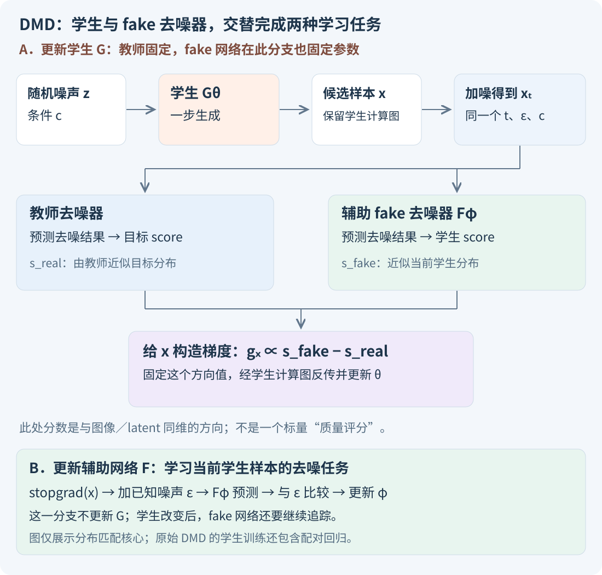
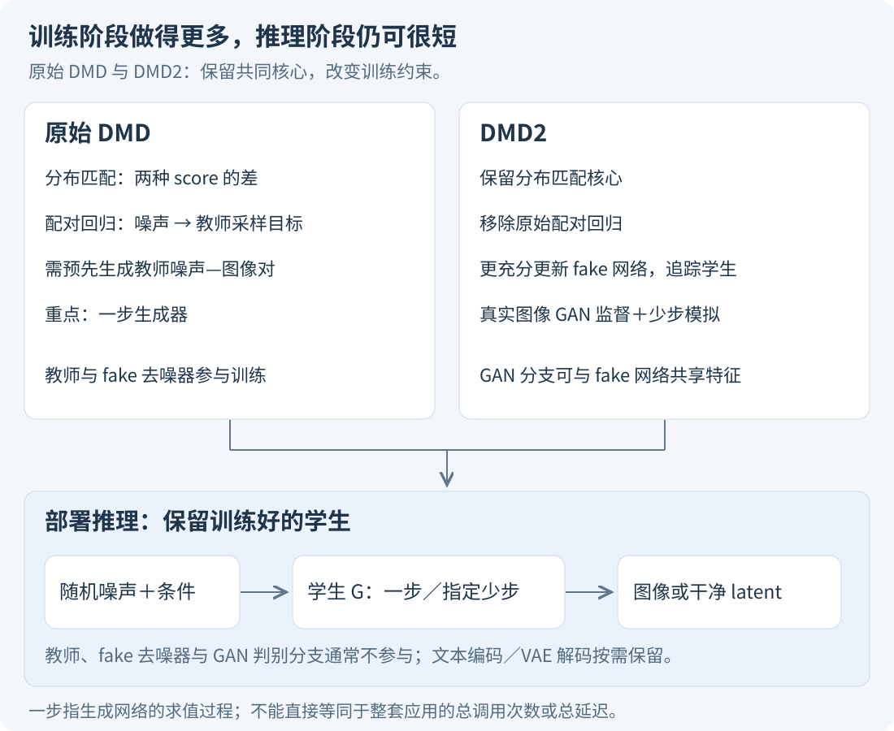

# Diffusion 蒸馏与 DMD：怎样把多步扩散变成一步或少步生成

<strong>扩散蒸馏的主要目标，是训练一个新的生成器，让它用更少的网络求值完成生成。</strong>学生可以沿用教师的大部分结构和初始权重；压缩的是生成过程的步数，不一定是参数量。

<strong>DMD 是 Distribution Matching Distillation，分布匹配蒸馏。</strong>它的核心训练目标是让学生生成的样本分布接近目标分布。为此，冻结的教师扩散网络估计目标分布的 score，另一个可训练扩散网络估计学生当前分布的 score，两者的差提供学生的更新方向。原始 DMD 还使用配对回归损失来稳定训练；DMD2 则进一步改变训练方式，支持一步与少步生成。

本文先解释任务和完整训练流程，再给出必要公式。主要依据 DMD（CVPR 2024）、DMD2（2024 年论文，实验表注明版本），并对照 Progressive Distillation 与 Consistency Models。示意图、简化推导和伪代码用于教学，没有在本文中重新训练这些模型。

## 一、为什么需要蒸馏：一次生成要反复调用网络

以文生图为例，常规采样可以写成：

```text
随机噪声 + 文字条件
    → 去噪网络求值 → 更新带噪状态
    → 再次求值 → 再次更新
    → …… → 图像或图像 latent
```

每一步都可能调用相同的大网络，只是输入状态与时间不同。若训练后得到的学生能直接输出干净样本，就可以改成：

```text
随机噪声 + 文字条件 → 学生生成器 → 图像或图像 latent
```

例如，从 40 次网络求值减少到 1 次，是一个说明目标的假设例子，不能直接声称端到端延迟必然缩短 40 倍。文本编码、VAE 解码、数据搬运等仍有开销；某些采样器每一步求值多次，CFG（无分类器引导）也会影响实际求值数量。

因此要分清三个量：<strong>采样步数、网络求值次数（NFE）、端到端运行时间。</strong>同时，直接把原模型的采样设置改为一步，与训练一个适用于一步的学生，是不同操作。

### 学生可以与教师差不多大

原始 DMD 的一步生成器从预训练扩散去噪器初始化，使用相应的网络结构；它并不要求把一个大网络换成很小的网络。一步模型学的是“噪声到完整样本”的快速映射。[DMD 原论文，第 3.1 节](https://openaccess.thecvf.com/content/CVPR2024/papers/Yin_One-step_Diffusion_with_Distribution_Matching_Distillation_CVPR_2024_paper.pdf)

在 latent diffusion 中，学生输出可能是干净 latent，还需要 VAE 解码成像素图。“一步”通常针对生成去噪网络，不意味着整套应用只发生一次神经网络前向。

## 二、扩散蒸馏有几种不同的学习目标

<div style="overflow-x:auto">

| 思路 | 学生要学会什么 | 训练时怎么规定“学对了” |
| --- | --- | --- |
| 配对输出回归 | 给定噪声与条件，输出接近教师对应结果 | 比较学生输出与教师预先生成的目标图／特征 |
| Progressive Distillation，渐进蒸馏 | 用一步完成教师两步的更新效果 | 分阶段训练，逐次缩短所需采样步数 |
| Consistency Distillation，一致性蒸馏 | 同一 probability-flow ODE 轨迹上的不同带噪状态，映射到相同端点 | 约束沿教师轨迹关联状态的预测保持一致 |
| DMD 的分布匹配项 | 整体生成分布接近目标分布 | 使用目标 score 与当前学生 score 的差来更新生成器 |

</div>

渐进蒸馏可以反复把步数减半；一致性模型也可以通过独立训练获得，而不只来自蒸馏。表中只抽取它们各自的核心约束，不表示这些方法的后续版本只使用一种损失。[Progressive Distillation](https://arxiv.org/abs/2202.00512)、[Consistency Models](https://proceedings.mlr.press/v202/song23a.html)

如果只更换数值求解器或采样时间表而不更新模型参数，属于采样加速的另一条路线。本文讨论的是会训练学生参数的蒸馏。

## 三、DMD 匹配“分布”，到底放松了什么

假设给定同一个提示词，多步教师能够生成不同构图、姿态、背景的图像。学生也应保留相应的生成能力。

### 配对回归规定同一个输入对应什么输出

先让教师用噪声 $z$ 和条件 $c$ 多步生成目标 $y$，再要求学生 $G_\theta(z,c)$ 接近 $y$。这里不仅规定总体应生成什么，也规定这份噪声应对应哪个结果。

### 分布匹配允许噪声与结果的对应关系改变

分布匹配项主要要求：在相同条件下，反复采样学生，所得结果的分布与目标接近。它允许学生对同一个噪声给出另一张合理图像，不要求逐个复刻教师的采样终点。

<strong>这不等于原始 DMD 完全没有配对约束。</strong>原始方法实际组合了分布匹配与配对回归。讨论“无需逐样本对应”时，应该明确指分布匹配这一部分；DMD2 才进一步去除了原始配对回归。[DMD，第 3.2–3.3 节](https://arxiv.org/html/2311.18828v3#S3.SS2)、[DMD2 作者项目说明](https://tianweiy.github.io/dmd2/)

条件 $c$ 也很重要。文生图需要匹配给定文字下的生成行为；仅让所有提示词混在一起的边缘图像分布接近，不能保证文字对应正确。

## 四、三个网络，各自接收什么、输出什么

设学生一次生成：

\[
x=G_\theta(z,c).
\]

$z$ 是随机初始噪声，$c$ 是文字或类别条件，$\theta$ 是学生参数，$x$ 是图像或干净 latent。图像任务中，它通常可以表示成 $B\times C\times H\times W$ 的张量：$B$ 是批量大小，$C$ 是通道数，$H,W$ 是空间尺寸；具体数值取决于工作空间。

<div style="overflow-x:auto">

| 角色 | 输入 | 输出与用途 | 参数是否更新 |
| --- | --- | --- | --- |
| 学生生成器 $G_\theta$ | 初始噪声 $z$、条件 $c$ | 一步生成 $x$ | 更新，目标是快速生成 |
| 教师／real-score 网络 | 带噪样本 $x_t$、噪声级别 $t$、条件 $c$ | 估计目标分布的去噪结果或 score | 冻结 |
| fake-score 辅助网络 $F_\phi$ | 同一个 $x_t,t,c$ | 估计当前学生分布的去噪结果或 score | 更新，持续追踪学生 |

</div>

这里的 real／fake 是论文的角色命名。<strong>real score 是教师给出的估计，不是能够精确读取真实概率密度的工具；fake 网络也不是输出“真假分数”的二分类器。</strong>它是用学生生成的数据训练的扩散去噪网络。[DMD 的 score 参数化](https://arxiv.org/html/2311.18828v3#S3.SS2)



*图 1：DMD 分布匹配核心的训练流程。辅助网络分支使用停止梯度的学生样本；学生分支把两个 score 的差作为更新信号。原始 DMD 还要加入配对回归，见第七节。*

### 为什么要估计学生自己的分布

学生生成能力不断变化，早期可能反复生成类似结构，后期又可能产生另一类偏差。辅助网络学习的是当前学生样本经过加噪后的分布，而不是教师的原始训练数据。

仅用目标分布方向，不能完整表达分布之间的差异。DMD 还要计入学生分布对应的项，才能得到其 KL 目标所需的 score 差。这个设计有助于约束整体分布，但不能保证所有模式都被覆盖；原始方法仍会遇到稳定性与模式遗漏问题，因此加入了额外回归。

## 五、完整走一轮：先生成，再加噪，分别更新

### 1. 学生先生成一个候选样本

采样 $z,c$，计算 $x=G_\theta(z,c)$。当前结果可能还不好，但它准确反映当前学生生成器会产生什么。

### 2. 给学生样本加一个已知强度的噪声

\[
x_t=\alpha_t x+\sigma_t\epsilon,
\qquad \epsilon\sim\mathcal N(0,I).
\]

$t$ 表示所选噪声级别，$\alpha_t$ 控制保留的信号，$\sigma_t$ 控制注入的噪声。这里的 $t$ 是训练监督所用的随机噪声级别，<strong>不是要求一步学生在推理时把这些 $t$ 都跑一遍。</strong>

教师本来就是在带噪样本上训练的；适当加噪也让两种分布的比较更可处理。低噪声和高噪声提供不同监督尺度，实际采用哪些时间段和权重要遵循具体实现。

### 3. 更新 fake-score 网络

使用停止梯度的 $x$ 构造带噪样本，让 $F_\phi$ 学会去噪。例如，在噪声预测参数化下：

\[
\mathcal L_{\mathrm{fake}}
=\mathbb E\left[
\lambda_t\|\epsilon_\phi(x_t,t,c)-\epsilon\|_2^2
\right].
\]

$\epsilon$ 是刚刚注入的已知噪声，$\lambda_t$ 是训练权重。更新的是辅助网络参数 $\phi$；这一步不把去噪损失反向传给学生。若模型预测的是干净样本，则使用相应的去噪目标与权重，不能直接照抄噪声预测公式。

### 4. 用两个 score 的差更新学生

对学生生成的带噪样本，分别调用冻结教师与当前辅助网络，转换成统一定义的 score，形成学生更新方向。教师始终保持固定；更新学生时，辅助网络参数也保持固定。

### 5. 继续交替，辅助网络持续追踪

学生变化会改变 fake 分布，辅助网络就必须继续学习；辅助网络的估计又影响学生的更新。两个优化过程的步数比例、学习率与批次安排是训练设计的一部分。

这一轮的关键是两种监督任务分开：<strong>辅助网络学习“如何对当前学生样本去噪”；学生学习“如何让生成分布接近目标”。</strong>它们的损失和参数更新对象不同。[DMD 原论文，第 3 节](https://openaccess.thecvf.com/content/CVPR2024/papers/Yin_One-step_Diffusion_with_Distribution_Matching_Distillation_CVPR_2024_paper.pdf)

## 六、score 差为什么能训练生成器

### Score 是与输入同维的方向，不是一个质量分数

对带噪分布 $p_t$，score 定义为：

\[
s(x_t,t,c)=\nabla_{x_t}\log p_t(x_t\mid c).
\]

它表示输入在当前位置改变时，对数概率密度如何变化，输出与 $x_t$ 具有对应的维度。对于高斯加噪和噪声预测模型，合适的参数化下可写为：

\[
s_{\mathrm{real}}\approx-\frac{\epsilon_T}{\sigma_t},
\qquad
s_{\mathrm{fake}}\approx-\frac{\epsilon_\phi}{\sigma_t}.
\]

两个预测都在<strong>同一个 $x_t,t,c$ 与同一套噪声约定</strong>下计算。$\epsilon_T$ 是教师预测，$\epsilon_\phi$ 是辅助网络预测。若输出的是干净样本，或使用其他参数化，先按模型的噪声约定转换成兼容表示。

### 理想目标是 reverse KL，反向 Kullback–Leibler 散度

记学生样本加噪后的条件分布为 $q_{\theta,t}$，目标加噪分布为 $p_t$，分布匹配可用下式理解：

\[
\mathcal L_{\mathrm{DM}}
=\mathbb E_{t,c}
\left[\operatorname{KL}
\left(q_{\theta,t}(\cdot\mid c)\|p_t(\cdot\mid c)\right)\right].
\]

这里的顺序是<strong>学生分布在前，目标分布在后</strong>。KL 同时涉及学生的对数密度与目标的对数密度，而不是只要求提高目标密度；这也解释了为什么梯度中会出现两种 score。实际训练不需要显式求出所有图像的概率密度，也通常不直接算出这个 KL 的标量值，而是近似获得参数梯度。

在统一列向量记法、同一噪声过程下，DMD 的梯度结构可写为：

\[
\nabla_\theta\mathcal L_{\mathrm{DM}}
\approx\mathbb E\left[
J_{G_\theta}^{\mathsf T}
\,w_t\alpha_t
\left(s_{\mathrm{fake}}-s_{\mathrm{real}}\right)
\right].
\]

$J_{G_\theta}$ 是生成结果对学生参数的雅可比；$w_t$ 是噪声级别相关的权重，用于调整训练信号尺度。式子强调梯度结构；实践中还有 score 估计误差、归一化、引导和采样策略，不能把实现中的代理损失数值当成精确 KL。[DMD 的推导与梯度式，第 3.2 节及附录 F](https://arxiv.org/html/2311.18828v3#S3.SS2)

<strong>上式写的是供梯度下降使用的梯度。</strong>学生参数按减去梯度更新，所以解释样本的移动趋势时，对应 $s_{\mathrm{real}}-s_{\mathrm{fake}}$。把“梯度”和“下降方向”混写，是很常见的符号错误。

### 用一个一维例子核对方向

这是本文的教学推导：假设目标为 $p=\mathcal N(0,1)$，学生为 $q=\mathcal N(m,1)$，则 $s_p(x)=-x$、$s_q(x)=-(x-m)$，两者相减 $s_q-s_p=m$。对应 KL 为 $m^2/2$，对 $m$ 的梯度也是 $m$。当 $m>0$ 时，梯度下降会减小 $m$，符合分布向目标移动的要求。

这个例子核对了方向，不代表高维图像训练一定容易或不会坍塌。

### 反向传播时，别把 score 网络的雅可比也算进去

DMD 先构造需要施加给生成结果的梯度，再通过学生反向传播。一个教学用的代理写法是：

```text
x = G(z, c)                         # 保留学生的计算图
xt = alpha * stopgrad(x) + sigma * eps

在不记录梯度的模式下：
    eps_real = Teacher(xt, t, c)
    eps_fake = FakeDenoiser(xt, t, c)
    g = w * alpha / sigma * (eps_real - eps_fake)

L_proxy = batch_mean(inner_product(x, stopgrad(g)))
反向传播 L_proxy，更新 G
```

`stopgrad` 表示只使用数值，不沿该路径求导；`inner_product` 是对每个样本的元素乘积求和。这个代理量对 $x$ 的梯度是 $g$，但它的数值不是 KL。这里只展示分布匹配分支，省略了时间权重细节、数值保护、CFG 和原始 DMD 的回归分支，不能当成完整训练脚本。

## 七、原始 DMD 与 DMD2 的区别

### 原始 DMD：分布匹配＋配对回归

原始 DMD 还预先收集 $(z,c,y)$：用教师从 $z,c$ 多步采样得到 $y$，再训练学生输出接近 $y$。其学生目标由分布匹配与回归项组合，回归距离采用 LPIPS 等感知距离设计。

它帮助稳定训练、保留生成结构与模式，但要付出教师配对数据生成成本，也会保留部分输入与输出的对应约束。原论文的消融表明，直接去掉回归会出现训练不稳定和多样性退化。[DMD 的回归目标与消融](https://arxiv.org/html/2311.18828v3#S3.SS3)

### DMD2：先解决去掉回归后的不稳定

DMD2 认为，一个关键问题是 fake-score 网络跟不上不断变化的学生分布，造成学生梯度偏差。因此去掉配对回归的同时，让辅助网络更充分地更新。论文采用的一个主要设置是<strong>每更新学生 1 次，更新 fake-score 网络 5 次</strong>。这是论文的训练设置，不是所有模型通用的比例。

### 加入真实图像与 GAN 目标

DMD2 还引入真假判别分支，用真实图像与生成样本训练 GAN 目标，给学生提供教师 score 以外的真实数据监督。其实现可以在 fake 去噪网络特征上增加分类分支，不必理解为额外复制一整个独立的大扩散模型。

因此，“DMD2 不再需要教师生成的大规模噪声—图像配对数据”，<strong>不等于整个方法无需数据</strong>。带 GAN 目标的设置仍使用真实图像。[DMD2，第 4.1–4.3 节](https://arxiv.org/html/2405.14867v1#S4)

### 少步版本还要解决训练与推理输入不同

一步学生从噪声直接生成。少步版本会把前一步输出按时间表重新加噪，再作为下一步输入。如果训练时只给学生看加噪真实图像，推理时它却看到自己前一步产生的图像，输入分布会不一致。

DMD2 训练时模拟学生自己的少步生成过程，让后续步骤接触实际会收到的输入。它不仅是把一步模型重复调用几次，还针对少步的状态与训练方式作了安排。[DMD2，第 4.4–4.5 节](https://arxiv.org/html/2405.14867v1#S4.SS4)

<div style="overflow-x:auto">

| 问题 | 原始 DMD | DMD2 |
| --- | --- | --- |
| 分布匹配梯度 | 两种 score 的差 | 保留这个核心 |
| 教师采样配对回归 | 使用 | 去掉该回归依赖 |
| fake-score 追踪 | 交替训练 | 强调两时间尺度更新 |
| 额外真实数据判别 | 原始目标中没有这一 GAN 项 | 加入 GAN 监督 |
| 一步／少步 | 原论文重点为一步 | 明确扩展少步，并模拟推理输入 |

</div>



*图 2：训练阶段与推理阶段分开看。DMD2 增加的训练能力不意味着部署时同时运行教师、fake 网络和判别器；文生图常规的文本编码、latent 解码仍按系统需要保留。*

## 八、实际效果怎么判断：看质量，也看多样性和成本

下面摘取 <strong>DMD2 的 arXiv v1 表 1，ImageNet-64×64 类别条件生成</strong>中的几行；论文对 ImageNet 生成 50,000 张图像，使用 EDM 的评测代码计算 FID。它们是论文报告，不是本文复现。FID 用特征统计比较生成样本与真实样本，较低通常更好，但不能单独保证每一张图、每个类别或文字细节都正确。

<div style="overflow-x:auto">

| 方法／采样方式 | 论文列出的前向次数 | FID，越低越好 |
| --- | --- | --- |
| DMD | 1 | 2.62 |
| DMD2 | 1 | 1.51 |
| EDM 教师，ODE 采样 | 511 | 2.32 |
| EDM 教师，SDE 采样 | 511 | 1.36 |

</div>

这些结果支持：DMD2 在该设置下用一步取得了很强的分布指标。它优于这里列出的 ODE 教师结果，但没有优于同表 SDE 教师的 FID。<strong>“学生超过教师”需要同时说明采样方式、指标与设置，不能推广成所有条件下都更好。</strong>[DMD2 arXiv v1，表 1](https://arxiv.org/pdf/2405.14867v1)

做文生图或视频蒸馏时，还应分别观察：提示词对应、细节、不同种子的变化、长尾概念和复杂组合；视频还要检查跨帧连续性。成本则分训练与部署：教师调用、辅助网络训练、真实数据、显存与配对数据生成，都可能使训练较重，而推理仍然很快。

也不要把 ImageNet 小图结果直接当成高分辨率文生图或视频结果。论文为什么扩展到少步，正是因为更复杂的生成任务会带来不同取舍。

## 九、读代码和论文时，按这几个问题检查

1. <strong>学生到底输出什么？</strong>像素、干净 latent、噪声预测，还是经过预条件化的结果？一步与少步如何输入时间？
2. <strong>两个 score 是否在同一空间、同一噪声级别比较？</strong>尤其注意噪声预测、干净样本预测等参数化转换以及 CFG 设置。
3. <strong>辅助网络用谁的数据训练？</strong>应辨认学生样本分支，以及停止学生梯度的位置。
4. <strong>更新学生时，梯度流向哪里？</strong>不要把训练 fake 去噪器与给学生施加分布梯度混成一个普通 MSE。
5. <strong>有没有配对回归、GAN 或其他附加目标？</strong>“DMD loss”一项，不能代表整个系统只有这一项。
6. <strong>推理时保留哪些模块？</strong>确认权重、调度、步数、引导方式和解码流程，不只看训练网络总数。
7. <strong>声称更快或更好时，比较口径是什么？</strong>检查 NFE、实测延迟、分辨率、硬件、batch size 与质量指标。

作者的 [DMD2 官方代码](https://github.com/tianweiy/DMD2)提供实现入口；复现应固定代码版本与模型配置，伪代码不能替代这些具体设置。

如果第一次理解 DMD，可以先记住一条完整流程：<strong>学生生成样本→加噪→教师估计目标 score、辅助网络估计学生 score→用差值更新学生；辅助网络则不断在学生样本上重新学习。</strong>原始 DMD 在此基础上增加配对回归，DMD2 再处理稳定性、真实数据监督与少步输入问题。

## 十、继续阅读

- [DMD：One-step Diffusion with Distribution Matching Distillation，CVPR 2024](https://openaccess.thecvf.com/content/CVPR2024/html/Yin_One-step_Diffusion_with_Distribution_Matching_Distillation_CVPR_2024_paper.html)：重点读方法第 3 节、消融与梯度推导。
- [DMD2：Improved Distribution Matching Distillation for Fast Image Synthesis](https://arxiv.org/abs/2405.14867)：重点读 fake-score 追踪、GAN 监督与少步模拟。
- [Progressive Distillation，ICLR 2022](https://arxiv.org/abs/2202.00512)：理解逐次把教师两步压成学生一步的路线。
- [Consistency Models，ICML 2023](https://proceedings.mlr.press/v202/song23a.html)：理解沿 ODE 轨迹映射到同一端点的约束。
- [本站：从朗之万动力学到 SDE](https://jinjianzhao.github.io/daily-papers/knowledge/article.html?slug=diffusion-langevin-sde)：补充 score、噪声过程与 ODE／SDE 的基础。
