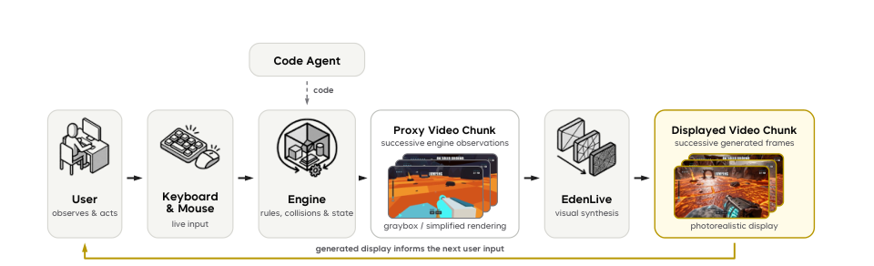
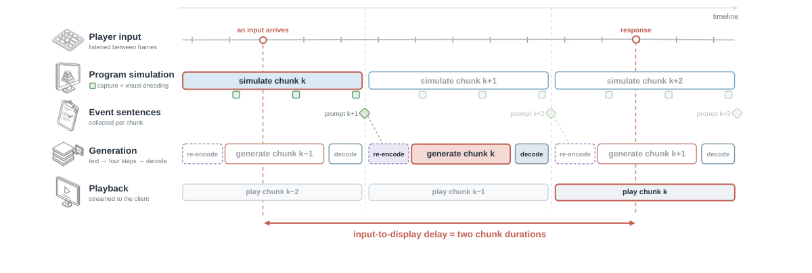

# EdenLive：把可交互世界实时渲染成视频

**读完应抓住的一句话：** EdenLive 让程序负责“游戏世界发生了什么”，让视频生成模型负责“这些事看起来是什么样”。玩家操作先改变程序中的状态；程序输出简化的参考视频；EdenLive 再按照参考视频的布局和运动，结合目标首帧与文字要求，逐段生成供玩家观看的画面。

本文依据 VAST 的 [《EdenLive: Real-Time Generative Rendering from Any Visual Reference》技术报告](https://assets.vast-eden.ai/assets/edenlive/EdenLive-tech-report.pdf)（2026 年 10 月）。文中“报告称”“实验显示”指这份报告给出的结果；为了帮助理解而举的比方不等于论文的额外实验结论。

## 1. 任务是什么：输入、输出、谁负责世界状态

想象一个只有方块和简单材质的游戏。程序已经能正确处理键盘、碰撞、血量和胜负，却没有精细的美术。EdenLive 接收三类输入：

1. **参考视频** `r₁:ₙ`：程序按当前世界状态渲染的粗糙画面，也可以是已经录好的普通视频。它告诉模型物体在哪里、镜头怎么移动、动作和事件何时发生。
2. **目标首帧** `y`：与参考视频开头视角对齐、展示期望外观的一张图。它给角色身份、材质和风格一个视觉锚点。
3. **文字条件** `p`：场景和风格说明；交互游戏中还可以追加程序刚刚发生的事件描述。

输出是与参考视频时间对应、外观更精细或风格不同的**视频帧流**。报告在第 3.1 节将其写为 `x̂₁:ₙ = R(r₁:ₙ, y, p)`。它不是一个直接接收玩家按键、独自推断碰撞和血量的模型：状态转移由上游程序执行，EdenLive 从参考画面和事件文字得到可见约束。数字、血条等需要精确的界面内容可以直接从程序状态绘制并叠加到生成视频上（第 3.2 节）。

*图 1：原论文图 2。用户输入驱动游戏引擎更新规则与状态，引擎输出简化视频片段，EdenLive 将它渲染成显示视频；用户看到结果后继续操作。图源：[EdenLive 技术报告](https://assets.vast-eden.ai/assets/edenlive/EdenLive-tech-report.pdf)，第 7 页。*

## 2. 先理解常见视频生成范式，以及直播为什么困难

一个常见的视频生成起点是**潜空间视频扩散 / flow matching**：先用视频 VAE 把一段视频压缩成时空 latent；在训练时给 latent 加噪，让视频 Transformer 学会沿去噪方向恢复视频；推理时从噪声逐步生成 latent，最后解码成像素。文本、首帧或结构条件引导生成什么内容。这里的 flow matching 可以粗略理解为“学习从噪声状态走向目标视频状态的速度场”，它仍通常需要若干次模型前向计算。

如果整段视频都已给定，模型可以让各帧双向互相参考。这适合离线重渲染：既能看过去，也能看未来。但交互直播不能预先知道玩家下一秒会按什么键。模型必须**因果地**生成：当前片段只能用已经到达的参考片段、目标首帧、文字和有限的过去生成记录。还要在播放完上一段之前，准备好下一段。于是问题同时变成：**参考输入的外观可能很粗糙，怎样只取其结构？片段怎样持续生成而不越积越慢？系统怎样把程序和模型接起来并保持可交互的延迟？**

## 3. EdenLive 的方法链路

### 3.1 先准备“粗图—精图”配对，再用普通视频补数据

训练需要同一时刻的粗参考和目标视频。作者从真实与游戏渲染视频做“精到粗”的变换，也从灰盒游戏代理视频做“粗到精”的合成，形成配对片段；再加入未配对的公开视频。报告第 4.1 节说明，配对视频要筛空间和时间是否对齐、粗精差异是否达到预期、运动是否稳定；未配对视频要筛画质、运动强度和语义适用性。这里没有必要假设每一对都完美：筛选正是为了减少错误对应对模型的污染。

未配对视频为什么也能用？后面的特征编码器会把普通视频自身转成参考特征。于是同一个视频可以一边充当目标，一边在经过外观扰动后充当“自配对参考”。配对样本教跨域转换，更多普通视频则扩充生成数据（第 4.3.1 节）。

### 3.2 用共享视觉特征传递布局，压低粗参考的外观泄漏

直接把灰盒视频的像素喂给生成器，模型可能把灰色方块、简陋贴图一起复制进输出。EdenLive 用预训练的 **DINOv3 ViT-L/16** 初始化视觉编码器，将参考帧和对应的目标帧映射为按空间位置排列的 patch 特征，并继续训练编码器：

- 对齐同一位置的参考与目标特征，使共同布局容易被读取；
- 用跨样本对比学习保留区分不同内容的能力；
- 用域对抗训练降低特征中“这是灰盒还是精图”的线索。

这些目标共同塑造一个偏向共享结构、弱化来源外观的条件空间。编码器随后冻结；生成器训练和推理时，逐帧从参考视频提取特征。由于视频 VAE 在时间上压缩，报告每隔一个压缩步长取一帧参考，把特征网格缩放到 latent 帧的空间尺寸，再**沿通道维拼到 DiT 输入**，新增输入通道的投影以零初始化。这种注入不增加注意力 token 长度（第 4.2—4.3 节）。

注意分工：编码器逐帧工作，不单独推断完整时间运动；生成器仍要从连续参考特征及历史画面中建模时间关系。共享特征也不是精确的对象身份表，作者在局限性中明确说参考物体与目标身份的对应仍是隐式的。

### 3.3 从双向生成器变成逐段、少步的因果生成器

作者从 **Wan2.2-TI2V-5B** 和 **Wan2.1-I2V-14B** 两个预训练 latent 视频扩散 Transformer 出发，先训练接收参考特征、目标首帧和文字的生成器；训练目标采用 flow matching（第 4.3 节）。长时间直播还需要两次转换：

**第一步，教模型按片段看历史。** 把 latent 序列切成 chunk，修改注意力可见范围，使当前块里的 noisy token 可看当前块与之前的干净历史，不能看未来块。训练时用真实历史，能高效并行；推理时则只能依赖自己此前生成的历史。这一步称 teacher-forcing SFT。

**第二步，用模型自己的生成历史再训练。** 作者让学生模型真实地逐块生成，并把预测出的块放入有上限的注意力缓存；随后回放这些状态，借助冻结的双向“真实”评分模型和学习的“生成”评分模型构造分布匹配蒸馏的更新方向。直觉上，学生先体验“我此前已经生成成这样了”，再学习如何让下一块更接近目标分布，缓解训练时只看真实历史、上线时却看自己历史的差异。报告采用 Self Forcing / Self-Gradient Forcing 一类的做法，并非简单把完整长视频一次性反向传播（第 4.3.2 节）。

上线时每块只进行 **4 步去噪**，不使用 classifier-free guidance。缓存由一个永久保留的开头片段（attention sink）和最近历史的滚动窗口组成，因此上下文不会随播放时间无限增长。报告还处理了缓存滚动后 RoPE 时间位置可能超出训练范围的问题：按当前缓存槽位重新赋予时间索引（第 4.4.1 节）。这能控制成本，但也意味着很早以前的细节不一定可从缓存找回。

### 3.4 程序模拟、参考编码与视频生成并行

模型算得快还不等于玩家感到响应快。EdenLive 的服务系统在生成块 `k−1` 时，就让程序**提前模拟并编码**块 `k` 的参考画面；等模型需要生成 `k`，这批特征已经准备好。每块生成后解码为视频帧，通过 WebRTC 送给用户，用户的键盘和鼠标事件再回到程序。事件文字在对应块的程序模拟结束后追加到提示词中（第 4.4.2 节）。

*图 2：原论文图 4。横向是时间，程序模拟下一块与模型生成上一块重叠；红色输入到显示结果约跨两个 chunk。图源：[EdenLive 技术报告](https://assets.vast-eden.ai/assets/edenlive/EdenLive-tech-report.pdf)，第 13 页。*

这张图也说明了一个常被“实时 FPS”掩盖的事实：玩家的动作通常要到**约两个片段时长之后**才出现在显示画面中，另加网络传输时间。片段越短，响应可更快，但 GPU 并行性下降，且固定播放时长要做更多次自回归生成，漂移风险上升。论文选 **每块 3 个 latent 帧**作为取舍，并采用更轻的 LightTAE 解码器、编译和 CUDA Graph 等服务优化（第 4.4 节）。

## 4. 实验究竟支持什么结论

报告比较了约 5 秒的短片段、约 30 秒的长片段，并对视觉编码器单独做消融。最容易记住的三条证据是：

| 问题 | 报告中的证据 | 应如何读 |
| --- | --- | --- |
| 编码器微调是否有用？ | 在独立粗—精图片对上，粗输入生成的 DreamSim 距离从 **0.5134 降到 0.3675**，CLIP-T 从 **0.2214 升到 0.3061**；精输入重建的 DreamSim 反而变差（表 4）。 | 有利于跨外观的结构迁移；同时牺牲了一部分直接复制精图细节的能力。 |
| 长视频效果如何？ | 在其约 30 秒评测中，14B 在镜头旋转误差、首帧主体与背景一致性、文字匹配等多项指标优于列出的自回归基线；5B 的 DOVER-Technical 最高（表 1）。 | 不能概括为所有指标、所有场景都第一；对比方法的可用条件接口也不完全相同。 |
| “实时”如何测得？ | 单张 H100 上，5B 在 **1280 × 704** 达到 **29.80 FPS**，在 **832 × 480** 达到 **73.52 FPS**；8 张 H100 上 14B 在 832 × 480 达到 **26.76 FPS**（表 2）。 | 这是预热后，从模型侧条件处理到 RGB 帧进入 CPU 内存的吞吐；不含代理画面渲染、视频文件编码和网络传输。 |

报告还给出 5B、单张 H100、1280 × 704 下的首帧延迟约 **1.16 秒**、片段间隔 P95 约 **392 毫秒**（表 3）。因此“超过 24 FPS”说的是特定配置下的模型侧平均吞吐，不等于所有硬件上每次按键都能在 1/24 秒内看到反馈。论文提到 RTX 5090 上经进一步优化可实时推理，但这里没有把它外推成任意消费级显卡的性能保证。

## 5. 贡献与边界

EdenLive 的关键贡献不是让一个视频模型学会所有游戏规则，而是把**可执行的状态更新**与**可学习的视觉渲染**接在一个通用参考视频接口上；再用共享视觉特征处理粗糙代理到精细画面的外观落差，用少步、逐段生成和流水线部署让该接口具备实时使用的可能。报告展示的游戏、录制视频重渲染、风格转换和具身数据增强，都是同一“参考视频 + 目标首帧 + 文字”接口的应用（第 6 节）。

作者在第 7 节给出的三项局限也直接来自这种设计：对象与目标身份没有显式一一绑定；有限缓存缺少长期精细外观记忆，遮挡很久或重返场景时可能难以恢复细节；编码器只提供一种学到的特征层次，用户还不能精确指定参考中的哪些细节必须保留。论文的指标与案例证明了这套系统在所测条件下的可行性，仍需区分模型吞吐、端到端交互延迟和长期世界一致性。

**资料：** [技术报告 PDF](https://assets.vast-eden.ai/assets/edenlive/EdenLive-tech-report.pdf) · [项目页](https://vast-eden.ai/?p=edenlive) · [代码](https://github.com/VAST-AI-Research/EdenLive) · [权重](https://huggingface.co/VAST-AI/EdenLive)。以上方法和数字均以技术报告为准。

## QA

暂无问答。
