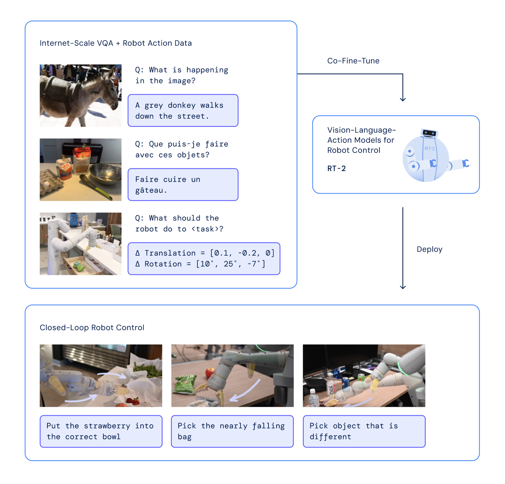

# 具身智能入门：让模型在真实世界里行动

大语言模型处理的是 token：读入上下文，预测接下来该输出什么。机器人面对的问题多了一层——它的输出会改变周围的物理世界，而变化又会成为下一次输入。让智能体通过身体与环境持续交互，并把这种交互用于完成任务，就是理解“具身智能”的一个好起点。

想象一句指令：“把桌上的杯子放进水槽。”机器人并不是生成一句“我已完成”。它要找到杯子和水槽，判断手臂当前姿态，伸手、抓取、移动、放开，并在杯子滑动或抓空时及时调整。任务成功由真实世界的结果决定。

## 先抓住一条主线：闭环

可以把一次执行写成下面的循环：

```text
任务目标 g + 当前观察 o_t + 机器人自身状态 s_t
                    ↓
              策略 π 选择动作 a_t
                    ↓
            控制器驱动电机执行
                    ↓
        物体与机器人运动，产生新观察
                    ↺
```

这里的**观察**可以是相机图像、深度、触觉等；**自身状态**（proprioception，本体感觉）包括关节角度、关节速度、夹爪开合等；**目标**可以来自语言、目标图像或预设任务；**动作**可能是末端执行器下一步要移动的位姿、关节目标值，或一小段连续动作序列。策略常记作 `a_t = π(o_t, s_t, g)`：它把当前信息映射到接下来该做什么。

这个式子并不意味着所有机器人只用一张图、一个 Transformer 就能运行。真实系统还需要相机标定、碰撞与安全约束、运动学、低层控制和通信。策略输出“夹爪向杯子靠近”一类命令，电机控制器才负责在硬件上追踪命令。策略与控制器的边界随系统设计而变，但**高层做决策、低层执行并反馈**这层区分很有用。

如果只看第一张图就一路执行到底，杯子稍微移动就可能抓空。闭环的关键是执行一部分、重新看环境，再修正后续动作。动作也可以一次预测好几步，称为 **action chunk**（动作块）；[ALOHA/ACT](https://tonyzhaozh.github.io/aloha/) 就用预测动作块的方式做模仿学习。但即使预测了一段动作，完整任务仍要继续获取新的观察；预测一段不等于整个任务开环完成。

## 一个任务里，模型究竟在学什么？

以“把杯子放入水槽”为例，任务通常跨过几个层次：

| 层次 | 需要回答的问题 | 典型输入与输出 |
| --- | --- | --- |
| 任务理解 | “放进水槽”要求什么结果？ | 语言指令 → 目标或子目标 |
| 感知与状态估计 | 杯子、水槽、夹爪在哪里？当前是否抓牢？ | 图像、机器人状态 → 可用于决策的信息 |
| 策略 / 规划 | 下一步朝哪里移动、何时夹紧？ | 目标与当前信息 → 动作或动作序列 |
| 控制与执行 | 如何让实际机械臂追上目标？ | 动作目标 → 电机指令与物理运动 |
| 反馈与恢复 | 抓偏后怎么办？是否完成？ | 新观察与任务结果 → 调整或停止 |

这种拆分是理解系统的地图，不是所有系统必须显式实现的五个独立模块。传统机器人系统可能把物体检测、抓取规划、运动规划、控制分开；学习式策略则可能把感知到动作的若干步骤放进同一网络。无论怎样组织，最终都要面对物理动作与反馈。

具身任务也不只是一只机械臂抓东西。移动机器人需要在空间中导航、避障；双臂机器人要协调接触与抓取；四足或人形机器人还涉及平衡和全身运动。它们共享闭环框架，但**动作空间、时间尺度与失败方式并不相同**。因此，“会识别杯子”与“能稳定抓住杯子”，中间隔着运动、接触、误差和安全问题。

## 机器人从哪里学会动作？

### 模仿学习：先看人怎么做

最容易理解的路线是收集示范轨迹：操作者在每个时刻看到什么、机器人处于什么状态、执行了什么动作。训练时让策略在相似输入下预测示范动作，这通常叫**行为克隆**。它像监督学习，但标签不是“这张图是什么”，而是“此时该怎么动”。[RT-1 官方项目](https://robotics-transformer1.github.io/) 就描述了把图像序列与自然语言任务描述输入模型，再让模型输出机器人每一步的动作；[ALOHA/ACT](https://tonyzhaozh.github.io/aloha/) 展示了通过遥操作收集真实示范并学习动作块。

模仿学习的困难在于：训练数据往往只包含示范者走过的状态。机器人稍微抓偏，就会来到示范中很少出现的局面；此时一个小错可能引出更多错误。这叫**分布偏移**或误差累积。增加多样化示范、加入纠错片段、重新收集机器人自己遇到的状态，都是缓解方向，但不能把问题变成纯粹的“多背几个答案”。

### 强化学习：让结果反过来指导动作

另一条路线是给任务设定奖励，例如杯子进入水槽得分、碰撞扣分，让策略通过试错提高累计回报。它不一定有每一步的“标准动作”标签，因此探索、奖励设计与样本效率都很重要。在真实机器上反复试错可能慢、贵且有安全风险，所以许多工作先在仿真环境里训练，再迁移到实机；也有系统把示范学习与强化学习结合起来，而不是二选一。

**仿真到真实（sim-to-real）**的核心障碍不是把模型文件复制到机器人那么简单：仿真的材质、摩擦、碰撞、光照、相机噪声和真实世界有差异。训练中改变这些因素、用真实数据微调或做在线适应，都试图让策略不要依赖某个仿真世界特有的细节。是否迁移成功，仍需在真实硬件上测试。

### 数据规模与跨机器人学习

机器人数据比互联网文字难获得：每条轨迹都涉及物理执行，还可能需要人工遥操作、复位和安全看护。不同机器人的相机位置、手臂结构与动作维度也不一致。[Open X-Embodiment](https://robotics-transformer-x.github.io/) 聚合了多种机器人的数据并研究跨机器人策略，说明“扩大数据”还伴随“如何统一不同身体的输入与动作”的问题。跨机器人训练是研究方向，不意味着任意机器人拿到同一个模型就能无适配直接工作。

## VLA 在这张地图的什么位置？

**VLA（Vision-Language-Action，视觉—语言—动作模型）**通常指让模型同时处理视觉观察和语言任务，并输出机器人动作的路线。它把读者熟悉的视觉—语言模型（VLM）往物理执行延伸：VLM 可以回答“图里哪只是杯子”，VLA 还要回答“下一步机器人怎么动”。[RT-2 官方项目](https://robotics-transformer2.github.io/) 就把视觉—语言预训练与机器人动作学习联系起来。



*图：RT-2 官方项目中的示意图，用来观察视觉、语言与机器人动作如何进入同一个任务链。来源：[RT-2 项目页](https://robotics-transformer2.github.io/)。*

把模型叫作 VLA，并不能自动说明它用什么动作表示、如何训练、是否有动作块、是否使用扩散或 flow matching，也不能保证它在陌生机器人上可靠。读一篇 VLA 论文时，先问四件事会更有帮助：输入的相机和机器人状态是什么？输出动作处于什么坐标系、覆盖多长时间？动作数据从哪里来？实际执行时怎样重新观察与纠错？π 系列、RT-2 等方法在这些细节上各有设计。

## 如何判断一个具身方法“真的有用”？

最直接的是看**任务成功率**，但数字必须带着测试条件读：成功的定义是什么，测试了多少次，物体和场景是否在训练中出现过，机器人硬件是否相同，有没有人为干预或复位？一次漂亮视频只能说明一次执行，不等于稳定成功。还应关注完成时间、碰撞、安全、不同物体与环境的泛化，以及失败后能否恢复。

一个适合入门者的阅读顺序是：先确认任务和机器人；再画出观察 → 策略 → 动作 → 新观察的回路；然后区分示范数据、仿真数据和真实试错；最后再看网络结构与指标。这样不会把“模型很大”误当作“能完成真实任务”的充分理由。

## 延伸阅读

- [RT-1: Robotics Transformer for Real-World Control at Scale](https://robotics-transformer1.github.io/)：图像、语言到逐步动作的早期例子。
- [RT-2: Vision-Language-Action Models](https://robotics-transformer2.github.io/)：VLA 与视觉—语言知识迁移的例子；上图出自该项目。
- [ALOHA / Action Chunking with Transformers](https://tonyzhaozh.github.io/aloha/)：遥操作示范与动作块。
- [Diffusion Policy](https://diffusion-policy.cs.columbia.edu/)：连续机器人动作可以如何由扩散式策略生成。
- [Open X-Embodiment](https://robotics-transformer-x.github.io/)：跨机器人数据与策略训练。

## QA

暂无问答。
