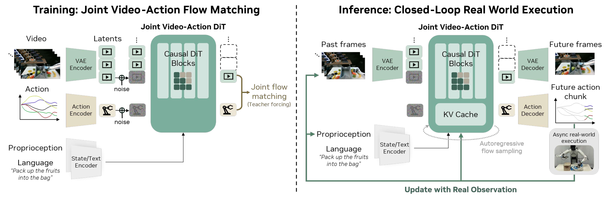

# 世界动作模型 WAM：让机器人把“接下来会怎样”与“现在怎么做”一起学

给机器人一句“把水果装进袋子”，它看到桌面后不仅要识别水果和袋子，还要决定机械臂接下来如何移动、接触和放下。**World Action Model（WAM，世界动作模型）**研究的正是这两件事之间的连接：让模型学习环境未来会怎样变化，同时学习与这种变化相对应的可执行动作。这里以 [DreamZero](https://arxiv.org/abs/2602.15922) 为主例，再用 [Fast-WAM](https://arxiv.org/abs/2603.16666) 说明一个重要边界：训练时学习预测未来，并不意味着每次执行前都必须把未来画面完整生成出来。

## 先看机器人真实的闭环

一个机器人不是只回答一次问题。它反复进行“观察 → 预测/决策 → 执行一小段动作 → 再观察”。观察可以是相机画面，也可以包括关节位置、夹爪状态等**本体感知**；动作则是能直接送给机器人控制接口的关节、末端执行器或夹爪命令。只生成一段漂亮的“机器人已经拿起水果”的视频，不等于知道该向电机发送什么命令；只从当前图片直接回归动作，也可能没有学好“接触后水果会怎么动”这类物理过程。

可以把三种相关思路放在一起看：

| 思路 | 典型学习目标 | 部署时还缺什么 |
| --- | --- | --- |
| VLA（视觉—语言—动作） | 从观察和指令直接预测动作 | 不一定显式预测动作后的世界变化；但这不是说所有 VLA 都完全没有物理知识 |
| 只预测未来的世界模型 | 预测后续图像或抽象状态 | 还需要规划、搜索或“未来变化 → 动作”的转换，才能控制机器人 |
| WAM | 让世界预测与动作预测建立联系 | 仍要解决动作是否可执行、推理是否够快、执行中如何根据新观察纠错 |

这张表说的是**学习与执行接口**，不是互斥的模型门派。WAM 也可以吸收 VLA 的语言条件和动作生成方式。DreamZero 作者在论文中把 WAM 定义为：利用未来状态的建模能力来帮助预测动作；视频是他们使用的世界表示，而不是 WAM 永远只能使用视频。[来源：DreamZero，第 2.2、3.1 节](https://arxiv.org/html/2602.15922v1)

## 从“看到未来”到“做出动作”

最容易理解的 WAM 范式是：给当前画面、指令和机器人状态，模型一边想象未来几帧会发生什么，一边给出与这些画面对应的动作。这里的“想象”不是先由人手工画出轨迹，而是模型从带视频与动作的机器人数据里学到两者的对应关系。

用概率语言写，目标大致是联合预测 `p(未来观察, 未来动作 | 已有观察, 指令, 机器人状态)`。它可以被理解为两步概念分解：先预测“水果将如何从桌面进入袋子”，再问“怎样的动作能造成这段变化”。后一问叫**逆动力学**（inverse dynamics）：已知状态变化，反推产生变化的动作。请注意，这只是帮助理解的分解；DreamZero 实际训练的是一个**端到端的联合模型**，并非部署两个独立网络顺次运行。[来源：DreamZero，公式 (1) 与第 3.1 节](https://arxiv.org/html/2602.15922v1)

这条思路的吸引力在于视频的监督更密：一次操作的每段画面都在展示物体如何移动、接触、遮挡与变形，而不只留下最终成败标签。动作标签仍很重要，但视觉未来可以帮助模型把“指令语义”接到“物理变化”，再接到机器人命令。**这是一种研究假设与已观察到的经验结果，不是保证所有 WAM 一定优于 VLA 的定理。**

## DreamZero：联合生成未来画面和动作

DreamZero（Seonghyeon Ye 等，2026）从预训练的视频扩散模型出发，加入机器人状态与动作的编码、解码模块。输入包括过去/当前相机画面、语言指令和本体感知；输出是未来视频片段及与之对齐的动作片段。视频先压缩为潜变量（latent），以降低直接处理像素的计算量；主干是自回归的 Diffusion Transformer（DiT），这里的“自回归”指**按时间片段依次处理视频与动作**，并不是把每个像素或每个动作维度都当成 LLM token 逐个生成。[来源：DreamZero，图 4 与第 3.1 节](https://arxiv.org/html/2602.15922v1)

*图：左侧训练时联合学习视频和动作的去噪；右侧部署时生成未来视频与动作片段，执行动作后用真实新观察更新上下文。原图来自 [DreamZero 论文图 4](https://arxiv.org/html/2602.15922v1#S2.F4)。*

训练时，每个视频—动作片段都先加噪声；模型学习把带噪的视觉潜变量与动作共同推向真实片段。论文使用 **flow matching** 目标：给定噪声与真值之间的一个中间状态，预测通向真值的变化方向。前面的片段在训练中提供干净的上下文（teacher forcing），当前片段则是要恢复的目标。于是视频预测和动作预测共享同一段历史与指令，而不是两个完全分离的任务。[来源：DreamZero，第 3.1 节、公式 (2)–(3)](https://arxiv.org/html/2602.15922v1)

执行时，机器人先观察真实场景，模型生成一段未来视频及动作，然后机器人执行动作片段；新相机画面到来后，下一轮使用**真实观察**更新上下文，而不是一直把上轮想象的画面当事实。这一步很关键：如果水果滑出了夹爪，下一轮能看到偏差并重新预测。论文还用异步推理、缓存与加速版采样缓解视频扩散推理慢的问题，报告 14B 模型达到约 **7 Hz** 的动作片段生成频率；这是其特定模型与系统配置的报告值，不是 WAM 这个概念自带的速度。[来源：DreamZero，摘要、第 3.2、6 节](https://arxiv.org/html/2602.15922v1)

论文报告，在 AgiBot G1 的陌生物体和环境评测中，DreamZero 的平均**任务进度**为 62.2%，所比较的最佳预训练 VLA 为 27.4%；在其定义的未见任务集合上为 39.5% 与 16.3%。这里的“任务进度”不是“任务成功率”，这些数字也不能外推为所有机器人和任务上的统一优势。论文讨论中同样指出：视频预测错了，动作可能会忠实执行一个错误的视觉未来；长时记忆和高精度装配仍是限制。[来源：DreamZero，第 5.1、6 节](https://arxiv.org/html/2602.15922v1)

## Fast-WAM：训练时预测未来，推理时不一定生成未来

看到 DreamZero，容易以为 WAM 的必要条件是“每次行动前都生成视频”。Fast-WAM（Tianyuan Yuan 等，2026）专门检验这件事。它在训练中保留未来视频的共同训练目标，让模型通过预测未来学习有用的世界表示；到了部署时，视频主干只用当前观察做一次前向计算，给动作分支提供潜在世界表示，**跳过显式生成未来帧**。动作分支仍需生成动作片段，因此“跳过视频去噪”不等于整个策略只做一次前向计算。作者还构造联合生成、先视频后动作和不做视频共同训练等对照变体，试图区分“训练时学世界”与“推理时看未来”各自的作用。[来源：Fast-WAM，摘要及第 3 节](https://arxiv.org/html/2603.16666v2)

论文在自己的仿真与真实任务设置中发现：取消测试时的视频生成，表现仍可与部分“先想象再执行”变体竞争；去掉训练时的视频目标，性能下降更明显。作者报告约 190 ms 的推理延迟。**这说明显式想象未来不是所有 WAM 的必要部署形态**；但不能据此断言未来预测永远没有测试时价值，尤其在数据量、分布外任务和模型结构变化时，取舍可能改变。[来源：Fast-WAM，摘要、第 3–4 节](https://arxiv.org/html/2603.16666v2)

## 应该如何记住 WAM

可以用一句话抓住主线：**WAM 让“世界会怎样变化”的学习进入机器人动作策略；至于执行时是否显式生成未来、用视频还是其他状态表示、由一个模型联合生成还是分模块完成，是具体方法的设计选择。**

读论文时不妨依次问四件事：预测的“世界”究竟是像素视频、潜在状态还是 3D 表示？动作是和未来共同生成，还是由另一个模块从未来反推？训练时哪些数据有动作标签、哪些只有视频？真实机器人执行后，模型如何用新观察纠正此前的预测？这四个问题通常比只看模型名称更能看清它的工作方式。

## 主要资料

- Seonghyeon Ye 等，[*World Action Models are Zero-shot Policies*（DreamZero，arXiv:2602.15922v1）](https://arxiv.org/html/2602.15922v1)；[官方项目页](https://dreamzero0.github.io/)。
- Tianyuan Yuan 等，[*Fast-WAM: Do World Action Models Need Test-time Future Imagination?*（arXiv:2603.16666v2）](https://arxiv.org/html/2603.16666v2)。

## QA

暂无问答。
