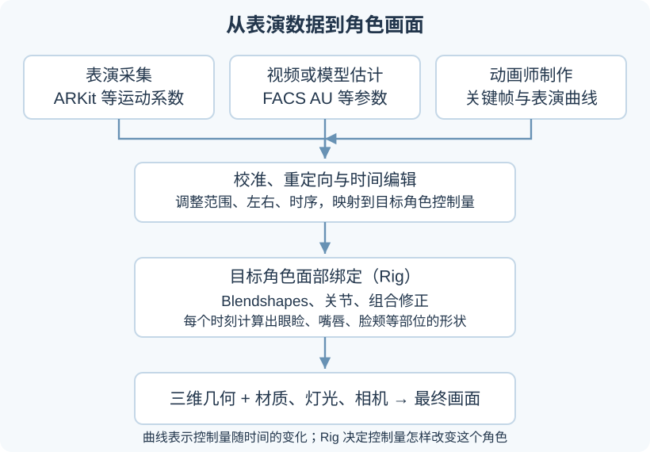
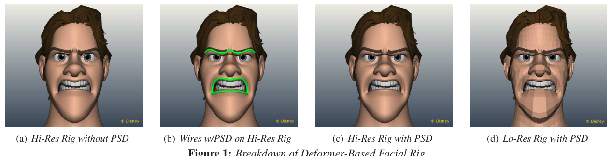
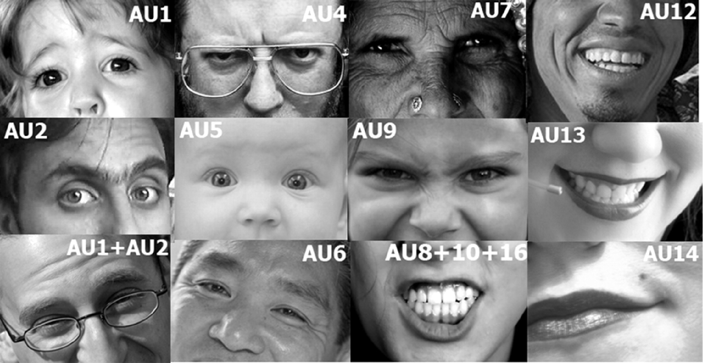
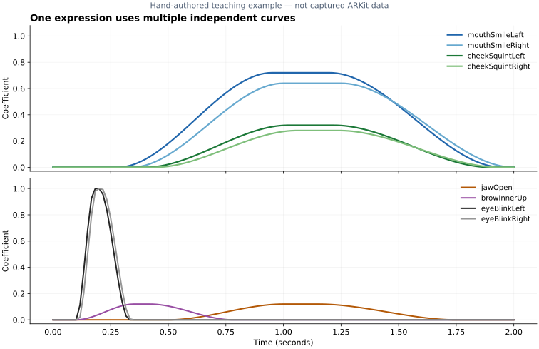

# 3D 角色面部表情：ARKit 52、FACS 与动画曲线

漂亮的面部表情，需要同时做好**角色形状、面部绑定和随时间变化的表演**。ARKit 52、FACS 和动画曲线分别提供不同层次的信息；把这些信息接到适合该角色的变形系统上，才会得到可用的面部动画。

这篇讲义分两部分：先讲一个 3D 角色怎样做出自然、清楚且符合其风格的表情，再解释这些参数是什么、怎样采集和编辑、怎样驱动角色。读者只需知道三维网格由顶点组成，以及动画由连续的画面构成。

## 一、先分清：面部模型、控制量与动画曲线

假设我们要让一个角色从平静过渡到微笑。至少需要准备三样东西：

1. **可以正确变形的脸。** 包括面部网格，以及眼球、眼睑、嘴唇、牙齿等相互配合的结构。
2. **控制量到形状的对应关系。** 例如“左嘴角上提”取值从 0 增至 1 时，哪些顶点沿什么方向移动、下颌怎样转动。这个系统属于面部绑定，英文常叫 facial rig。
3. **控制量随时间的变化。** 嘴角什么时候开始上提，幅度多大，眼周是否跟随，表情何时保持、何时收回。

例如，一个时刻可以有：

```text
mouthSmileLeft  = 0.70
mouthSmileRight = 0.60
cheekSquintLeft = 0.30
jawOpen        = 0.10
```

这些数字描述这个时刻的部分面部运动。角色最终长什么样，还取决于它自己的面部绑定；要得到一段动画，还需要其他时刻的数值。



图中的三类输入可以择一使用，也可以在制作中组合。动作采集负责提供运动信息，动画师可以进一步修改；重定向负责把来源参数变成目标角色能使用的控制量。

## 二、漂亮的表情，具体要做好什么

这里的“漂亮”包含三个可以分别检查的目标：**形状有吸引力，动作连贯，表演符合角色与情境**。写实人脸需要重视组织运动和接触关系；风格化角色还需要考虑夸张后的轮廓、五官比例与辨识度。下面是制作上的检查方法。

### 1. 先把每个关键形状做对

微笑时，嘴角移动会伴随嘴唇、面颊和眼周形状变化；张嘴时，下颌、下排牙齿和口腔结构需要保持合理关系。若基础形状有问题，即使动画曲线非常平滑，错误也会一直存在。

制作时先固定相机和灯光，检查平静、轻笑、大笑、闭眼、张嘴、抿嘴等姿态。正面看嘴角和眼睑，侧面看嘴唇厚度、下巴运动与面部轮廓。常见需要修正的情况包括：

- 闭眼后眼睑仍露出缝隙，或穿进眼球。
- 微笑把嘴唇拉成薄片，嘴角附近形成尖锐折痕。
- 下颌张开时，下排牙齿与下巴运动脱节。
- 嘴唇闭合后发生明显穿插，或上下唇完全失去厚度。
- 只有嘴在动，面颊、眼周和眉部始终维持同一个状态。

先用简单的灰色材质看几何，能减少皮肤纹理和高光对判断的干扰；再换回最终材质，检查表情在实际镜头中是否成立。

### 2. 单独好看的形状，组合后还要检查

一个角色的“张嘴”形状和“微笑”形状可能分别都很好，但同时启用时，嘴角会过度拉伸或口唇穿插。这需要专门的组合修正：检测当前控制量的组合，再补充一段针对该组合雕刻的形变。

常见的两类修正是：

- **中间形状（in-between）**：为同一通道的中间强度制作更合适的形状，例如专门雕刻 0.5 强度的半笑，而不是只在平静与全笑之间线性插值。OpenUSD 的 blend shape schema 就支持这种表达。[OpenUSD 文档](https://openusd.org/release/api/_usd_skel__schemas.html)
- **组合或姿态修正**：针对张嘴加微笑、眯眼加转动眼球等组合，恢复体积、接触与轮廓。修正的触发方式取决于具体绑定。



图源：[Disney《A Deformer-Based Approach to Facial Rigging》Figure 1](https://media.disneyanimation.com/uploads/production/publication_asset/97/asset/facial.pdf)。从左到右展示未加 PSD 修正的高分辨率结果、带修正的控制曲线、修正后的高分辨率结果，以及对应低分辨率结果。PSD 是 pose space deformation，即根据控制姿态插值修正形变。此图说明细部与轮廓需要专门设计；它展示的绑定并非 ARKit 52 绑定。

### 3. 把动作安排成一段表演

一张微笑的静帧成立，还不足以说明微笑动画成立。可以逐段检查：

**开始。** 角色为什么改变表情？是认出某人后笑、说话过程中笑，还是努力维持礼貌？原因不同，注视、眉部和嘴角的先后关系也可能不同。

**发展与保持。** 哪个部位先动，幅度怎样增加，是否出现短暂保持？持续的微笑也可以有细小变化，但变化应服务于动作和情境。

**收回。** 表情如何回落，是否接着说话、移开视线或恢复平静？把全部控制量在同一帧归零，通常会显得突然。

左右差异可以表现角色习惯和动作意图；它应来自设计或表演。对所有通道任意加入噪声，容易造成不稳定的嘴角、眼睑和面部轮廓。

### 4. 眼睛、口型和渲染需要一起配合

注视方向由眼球朝向决定，眨眼由眼睑运动决定，二者需要协调。说话又会改变唇形、唇部接触和下颌位置，因此笑着说话需要同时处理表情与口型。

在最后的镜头中，还要检查眼部高光、皮肤明暗、牙齿亮度与皱纹细节。写实角色可能需要随表情变化的细节贴图；风格化角色则可能用更简洁的形状和材质。制作顺序可以从大轮廓、接触关系和主要时序开始，再处理这些细节。

## 三、面部绑定怎样把几个数字变成一张脸

### 1. Blendshape 保存的是形状变化

Blendshape 常被称为混合形状或形变目标；在 Blender 中，对应的常用工具是 Shape Keys。最基础的做法是：

1. 准备一张平静状态的网格。
2. 保持顶点对应关系，复制并修改这张网格，做出嘴角上提、眼睑闭合等形状。
3. 给每个形状一个权重，用权重决定它贡献多少形变。

设有 $N$ 个顶点，平静状态的位置为 $V_0\in\mathbb{R}^{N\times3}$；第 $i$ 个目标形状为 $V_i$，相对位移为 $\Delta V_i=V_i-V_0$。一个基础线性模型是：

\[
V_{\mathrm{linear}}(t)=V_0+\sum_{i=1}^{K}c_i(t)\Delta V_i.
\]

其中 $c_i(t)$ 就是时刻 $t$ 的第 $i$ 个形状权重。计算之后得到的仍是三维顶点位置，渲染器再根据几何、材质、灯光和相机产生画面。

Blender 的相对 Shape Key 也可以理解为目标形状与参考形状的差值；参考形状通常是 Basis，权重决定差值的贡献。[Blender Shape Keys 文档](https://docs.blender.org/manual/en/4.4/animation/shape_keys/shape_keys_panel.html)

### 2. 关节与修正形变承担不同任务

眼球朝向、下颌开合常由关节或其他变形器控制。嘴唇轮廓、眼睑包裹和面颊形状则可能结合 blendshape、蒙皮与专门的修正。具体分工由角色绑定决定。

更一般地，可以写成：

\[
V(t)=D_{\phi}\bigl(c(t),\theta(t)\bigr).
\]

- $c(t)$：面部形变或控制器参数。
- $\theta(t)$：眼球、下颌等关节的姿态参数。
- $\phi$：这个角色固定的几何、目标形状、绑定关系和修正规则。
- $D_{\phi}$：把这些控制量转换成网格形状的过程。

这个表达式也说明了为什么同一组数字在两张脸上效果不同：两者的 $\phi$ 不同。传统绑定可以由美术与程序直接构造；如果使用学习得到的形变模型，它的网络也可以承担 $D_{\phi}$ 的一部分。

## 四、ARKit 52 到底是什么

### 1. 一组带名称的面部运动系数

ARKit 的 `ARFaceAnchor.blendShapes` 提供一个字典：键是面部运动名称，值表示当前运动相对平静状态的程度。Apple 文档定义其范围为 0 到 1，分别对应平静与该运动的最大程度。[Apple 系数说明](https://developer.apple.com/documentation/arkit/arfaceanchor/blendshapes)

例如：

```json
{
  "eyeBlinkLeft": 0.05,
  "eyeBlinkRight": 0.04,
  "mouthSmileLeft": 0.70,
  "mouthSmileRight": 0.62,
  "jawOpen": 0.12
}
```

这只是五个通道的示意值。`mouthSmileLeft = 0.70` 表示对应运动的强度，不表示“70% 概率在高兴”。多个通道可以同时非零，也没有总和必须为 1 的要求。

**52 指常用这组运动通道的数量。** 它们不等于 52 种情绪，也不包含任意角色的全部精细表演。Apple 允许应用只使用其中一部分通道；目标角色也可以有更多内部控制器。

### 2. 52 个通道覆盖哪些部位

依据 [Apple 的 BlendShapeLocation 定义](https://developer.apple.com/documentation/arkit/arfaceanchor/blendshapelocation)，可以按部位整理为：

<div style="overflow-x:auto">

| 部位 | 数量 | 控制内容 |
| --- | ---: | --- |
| 眼部 | 14 | 左右眼各有闭眼、四类视线方向、眯眼、睁大 |
| 眉部 | 5 | 两侧压眉、眉内侧抬起、两侧外眉抬起 |
| 面颊 | 3 | 鼓腮、两侧眼下及面颊上提 |
| 鼻部 | 2 | 两侧鼻翼附近上提 |
| 下颌 | 4 | 张开、前伸、向左、向右 |
| 嘴唇与嘴角 | 23 | 微笑、嘴角下拉、抿压、卷唇、撅嘴等 |
| 舌头 | 1 | 吐舌 |
| 合计 | 52 | 一组固定名称的面部运动参数 |

</div>

完整名称已核对并放在[可下载的 52 通道列表](assets/arkit52-names.json)中。`Left`、`Right` 以被跟踪者自身左右为准；正面观看、镜像预览和目标骨架的轴向可能不同，接入时应逐侧测试。

头部整体转动和位置属于另一类运动。某些软件会把头部、眼球旋转也导出为动画曲线，文件里的通道总数因此可能超过 52；读取文件时要核对其字段定义。例如 Unreal 的 AR 面部枚举还列出了头部和眼球旋转通道。[Unreal 通道定义](https://dev.epicgames.com/documentation/unreal-engine/API/Runtime/AugmentedReality/EARFaceBlendShape)

### 3. 三组最容易混淆的控制量

**`jawOpen` 与 `mouthClose`。** 前者描述下颌张开，后者描述独立于下颌位置的嘴唇闭合。下颌位置和唇部接触是两个控制问题，所以这两个量不必互补，也不能简单设成一个等于 1 减另一个。Apple 文档特别说明，`mouthClose` 需要与其他系数组合成合理姿态。[Apple mouthClose 定义](https://developer.apple.com/documentation/arkit/arfaceanchor/blendshapelocation/mouthclose)

**微笑与面颊上提。** 对应通道分别是 `mouthSmileLeft`、`mouthSmileRight`，以及 `cheekSquintLeft`、`cheekSquintRight`。前一组主要描述嘴角上提，后一组描述眼下和面颊上提。只改变嘴角的效果，与同时改变眼周和面颊的效果不同；是否组合以及组合多少，要结合该次表演。

**`mouthFunnel` 与 `mouthPucker`。** 两者都涉及嘴唇收拢，但标准动作的唇形和闭合状态不同。目标形状应分别制作，再检查与张嘴等通道组合时的表现。

### 4. 收到 52 个数字之后还要做什么

即使目标角色的形状也叫这些名称，采集结果通常仍需要校准与调整。一个基本过程是：

```text
演员的视频与跟踪数据
    ↓ 获取面部运动系数与头部姿态
检查平静基线、可用范围、左右与缺失帧
    ↓ 按目标角色重定向
形状权重、下颌与眼球控制、组合修正
    ↓ 编辑幅度、节奏与接触关系
可用的角色表演
```

重定向可以从逐通道映射起步，但精细角色经常需要非线性缩放或多通道组合。例如，演员较小的嘴角运动可以映射成风格化角色更明显的微笑；前提是目标形状和组合已经检查过。

一个通道叫 `mouthSmileLeft`，只是建立了动作语义上的对应。它没有自动决定这个角色的唇厚、嘴角路径、牙齿露出多少，也没有替角色制作目标形状。

## 五、FACS 与所谓“FACS 系数”是什么

### 1. FACS 描述可观察的面部动作

FACS 全称 Facial Action Coding System，通常译作面部动作编码系统。它把可见的面部运动拆成动作单元，英文为 Action Unit，简称 AU。动作单元依据面部运动及其解剖基础定义；它与一个具体模型的网格顶点或软件控制器是不同层次的描述。[Paul Ekman Group 的 FACS 说明](https://www.paulekman.com/facial-action-coding-system/)

几个与动画制作关系密切的例子是：

<div style="overflow-x:auto">

| 动作单元 | 观察到的动作 |
| --- | --- |
| AU1 | 眉毛内侧抬起 |
| AU2 | 眉毛外侧抬起 |
| AU4 | 眉部下压并向内收拢 |
| AU5 | 上眼睑抬起 |
| AU6 | 面颊上提，影响眼周形状 |
| AU7 | 眼睑收紧 |
| AU12 | 嘴角向上、向外牵拉 |
| AU15 | 嘴角向下牵拉 |
| AU25 | 嘴唇分开 |
| AU26 | 下颌下落 |

</div>



图源：[OpenFace Action Units 文档](https://github.com/TadasBaltrusaitis/OpenFace/wiki/Action-Units)。可以对比图中的 AU6 与 AU12：两者涉及不同部位。图中展示的是动作及组合的局部示意。

FACS 可以帮助描述“哪里动了、怎样动、动得多强”。从这些动作解释情绪，还需要结合情境与个体差异。例如，AU6 与 AU12 的组合可用于描述某类微笑的外观，但仅凭这个组合不足以判断一个人的主观感受。[FACS 与情绪解释的区别](https://www.paulekman.com/facial-action-coding-system/)

### 2. 数值范围取决于提供系数的系统

在计算机视觉或动画项目里，“FACS 系数”通常指某组 AU 的强度数值。它不是一份在所有软件中维度、范围、顺序都相同的向量。

例如，OpenFace 区分两个输出：

- `AU12_c`：该动作是否出现，取 0 或 1。
- `AU12_r`：动作强度估计，范围为 0 到 5。

因此，`AU12_r = 3` 和 `mouthSmileLeft = 0.6` 的范围与含义都不同。把前者除以 5，可以得到数值归一化的起点，但还需要校准它与具体目标形状之间的关系。[OpenFace 输出格式](https://github.com/TadasBaltrusaitis/OpenFace/wiki/Output-Format)

使用一份 AU 数据前，至少确认：有哪些 AU、数值表示出现与否还是强度、是否区分左右、采用什么强度范围，以及这些数值怎样驱动目标角色。

### 3. FACS 与 ARKit 52 的对应是近似的

可以先理解为：FACS 从可观察的动作单元描述面部运动，ARKit 提供适合跟踪与角色驱动的带名称运动参数。某些动作很接近，但拆分方式和覆盖范围不同。

<div style="overflow-x:auto">

| FACS 动作 | 可参考的 ARKit 通道 | 映射时仍需处理 |
| --- | --- | --- |
| AU1 内眉抬起 | browInnerUp | 强度范围与眉形 |
| AU2 外眉抬起 | browOuterUpLeft、Right | 左右拆分 |
| AU6 面颊上提 | cheekSquintLeft、Right | 眼周及面颊的具体形变 |
| AU12 嘴角牵拉 | mouthSmileLeft、Right | 方向、幅度、左右差异 |
| AU26 下颌下落 | jawOpen | 关节角度与嘴唇配合 |

</div>

这张表用于建立动作含义上的联系，不是一份经过标定的数值换算表。不同 AU 估计器还可能只输出一个子集；没有左右信息的数据，也无法凭通道名称自动恢复左右表演。Py-Feat 的 AU 参考同样明确把 ARKit 对应关系标为近似关系。[Py-Feat AU 参考](https://py-feat.org/pages/au_reference/)

## 六、面部动画曲线究竟记录什么

### 1. 一个控制量对应一条随时间变化的函数

固定一个控制量，例如左嘴角上提，就可以写成：

\[
c_{\mathrm{smileL}}(t)=f(t).
\]

横轴是时间或帧号，纵轴是这个控制量的数值。这就是动画曲线。曲线也可以记录下颌角度、眼球旋转、控制器位置，甚至材质参数；不同曲线的单位可以不同。

在 Blender 中，这种函数曲线叫 F-Curve。关键帧给出若干时刻的值，插值方法负责计算关键帧之间的值。[Blender F-Curve 介绍](https://docs.blender.org/manual/id/dev/editors/graph_editor/fcurves/introduction.html)

因此，ARKit 系数或 AU 强度一旦连续记录，就可以成为多条动画曲线；动画师手工设置关键帧，也可以产生这样的曲线。

### 2. 一段动画是一张时间与通道的数值表

若有 $T$ 个采样时刻、$K$ 个通道，可以把数据排成：

\[
C\in\mathbb{R}^{T\times K}.
\]

第 $t$ 行是一帧的全部控制量，第 $i$ 列是一个控制量的时间序列。不同时间长度、帧率、插值方式会影响最终播放结果，因此导出时需要保留时间信息与通道名称。

下面是本文手工制作的两秒教学示例。它使用 ARKit 的通道名称，但数值由本文设计，用于说明多条曲线怎样配合，不是采集数据或通用的微笑参数。



上图中，左右嘴角的起动时间和幅度略有不同；面颊上提稍晚，幅度也更小。下图中的眨眼是短时变化，眉内侧的小幅动作先出现再回落，下颌只轻微张开。这是一种示例安排，其他情境可以采用不同的节奏。

完整采样数据可下载为 [smile-curve-example.csv](assets/smile-curve-example.csv)：60 Hz 采样，时间从 0 到 2 秒，共 121 行、8 个运动通道。

### 3. 同样的峰值，曲线不同，表演也不同

假设嘴角最后都到 0.7，可以通过很短的时间突然到达，也可以缓慢增加，或者先略有抬起、保持片刻、再继续。几何峰值相同，观众看到的动作过程会不同。

编辑曲线时，可以分别调整开始时刻、增长速度、峰值、保持时间、回落速度与左右差异。曲线的斜率决定数值变化有多快；突然改变斜率，可能使动作速度出现不自然的变化。

平滑也需要按动作区分。过强的低通滤波会增加延迟、压低短时峰值，眨眼可能因此变慢或闭合不足。处理采集噪声时，应同时检查保留下来的动作幅度与时序。

### 4. 注意“空间曲线”和“时间曲线”的区别

有些面部绑定会用沿眉毛、嘴唇分布的三维曲线控制几何。这类曲线表示空间中的轮廓；F-Curve 表示某个数值随时间的变化。

前面的 Disney 例图中，脸上的绿色线条属于空间控制曲线。它们的控制点位置又可以由动画师设置关键帧，于是这些位置值各自具有时间曲线。两种曲线可以同时存在，承担不同任务。

## 七、完整走一遍：让一个角色从平静过渡到微笑

下面是一套可以逐步验证的制作流程。它是一种入门实践安排，具体镜头与风格可以调整。

### 第一步：准备角色的基础面部资产

检查眼球、眼睑、嘴唇、口腔、上下牙齿与下颌的关系，保留适合变形的面部拓扑。生成或扫描得到的静态头部，可能还需要重拓扑、补充口腔与拆分部件，才能适合动画。

### 第二步：制作一小组可用控制，再逐步扩展

可以先准备左右眨眼、左右微笑、左右面颊上提、张嘴、嘴唇闭合和眉内侧抬起这 9 个控制。逐个检查 0、0.5、1 附近的形状，再检查张嘴加微笑、微笑加眯眼等组合，补充必要的中间形状与修正。

如果目标是对接完整 ARKit 采集，再逐步补齐需要支持的通道。内部绑定可以比接口更复杂；接口中的一个数值，也可以控制多个关节与形状。

### 第三步：提供一段输入表演

可以手工设置关键帧，也可以采集演员，或从视频估计 AU。先用一个清楚、幅度适中的动作验证链路，再增加说话、快速转头、遮挡等情况。

本文 CSV 是单纯的控制量示例；要驱动它，目标角色还需要有对应控制。仅加载这份 CSV 不会自动产生一张脸。

### 第四步：校准并映射到目标角色

确认左右与时间单位，查看平静时的偏置、动作可用范围和缺失帧。再调整输入到目标控制器的幅度关系。头部姿态、眼球朝向和面部形变要分别核对，避免同一运动在两个地方重复施加。

### 第五步：编辑曲线与修正组合

保留主要表演，修掉明显跟踪跳变；调整嘴角、眼周、眉部的配合；检查眨眼完整闭合，以及说话时需要的唇部接触。发现局部轮廓问题时，回到绑定修正，而不是只靠压低全部动画幅度。

### 第六步：放进最终镜头检查

在正常速度下看动作意图和节奏，再逐帧看接触、穿插与变形。检查正面和侧面，并在实际灯光与材质下确认眼部、牙齿和面部细节。保留一些组合姿态作为回归检查，便于后续修改角色或绑定时发现变化。

一个有用的交付目标是：平静姿态稳定、单项动作清楚、常用组合不破形、眨眼与唇部接触可靠，同一段曲线在相同资产上可以稳定重放。

## 八、把三种表示放在一起看

<div style="overflow-x:auto">

| 表示 | 它提供的信息 | 接到角色前需要补足 |
| --- | --- | --- |
| ARKit 52 | 固定名称的面部运动通道与数值 | 目标形状、校准、重定向与修正 |
| FACS / AU 强度 | 可观察面部动作的描述及强度 | AU 输出规范、左右信息、到目标绑定的映射 |
| 面部动画曲线 | 某个控制量随时间的变化 | 控制量的语义、单位与实际变形规则 |
| 角色面部绑定 | 这些控制量怎样改变角色几何 | 需要一段输入表演，并与镜头和渲染配合 |

</div>

**制作漂亮面部表情的关键，是把动作描述、角色形状和时间表演连接起来。** ARKit 或 AU 能提供运动信息；绑定决定每个时刻的形状；动画曲线决定形状怎样发生变化；美术与动画编辑让这些结果符合角色与镜头。
