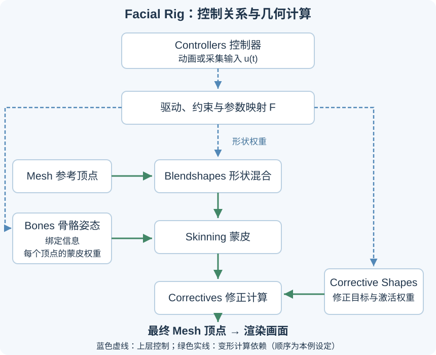
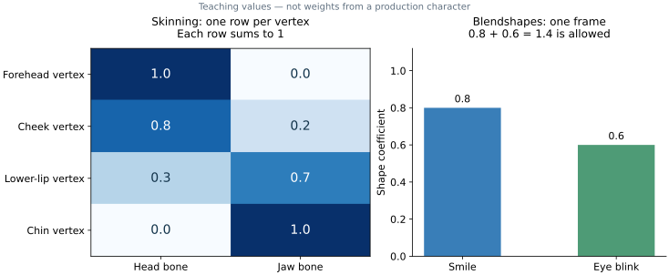
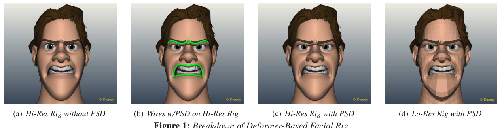

# Facial Rig 是什么：从 Mesh 到骨骼、形状键、控制器与修正形变

**Facial Rig（面部绑定系统）是一套把控制量转换成角色面部形状的系统。** 它规定：改变一个“张嘴”“微笑”或“闭眼”的控制量时，骨骼怎样运动、哪些顶点怎样变化、组合动作出现问题时怎样修正。

它通常包含面部几何、骨骼与蒙皮、形变目标、控制器，以及连接这些部分的驱动和约束。不同角色可以采用不同组合：有的主要使用骨骼，有的主要使用 Blendshapes，有的结合多种变形方式。

这篇讲义逐项解释用户最常遇到的五组概念，再用“张嘴并微笑”走完一次计算过程。前一篇[面部表情、ARKit 52、FACS 与动画曲线](../../article.html?slug=facial-expression-arkit-facs)讨论运动数据与表演；这里专门解释这些数据怎样改变一张具体的脸。

## 一、先看输入、输出和五个组成部分

假设一帧输入是：

```text
jawOpenControl = 0.6
smileControl   = 0.8
```

Rig 根据预先建立的规则，把它们转换成下颌姿态、嘴角形变和组合修正，最终输出这一帧的网格顶点位置。材质、灯光和相机再把变形后的模型渲染成画面。

<div style="overflow-x:auto">

| 概念 | 保存或规定什么 | 在面部动画中的作用 |
| --- | --- | --- |
| Mesh | 顶点位置与连接关系 | 提供实际被变形的表面 |
| Bones + Skinning | 骨骼变换，以及顶点对骨骼的影响权重 | 让面部随下颌、眼球等姿态变化 |
| Blendshapes / Shape Keys | 相对参考形状的目标变形 | 精确制作嘴角、眼睑、面颊等形状 |
| Controllers | 动画师或采集系统操作的接口及映射 | 把少量操作转换成内部控制量 |
| Corrective Shapes | 特定姿态下额外需要的修正形变 | 改善体积、接触、折痕和组合形状 |

</div>



图中的计算顺序是一种常见的组织示意。实际系统可以把修正安排在蒙皮前或后，也可以使用更多变形器；制作时必须明确每个模块使用的坐标空间和输入状态。

## 二、Mesh：最终会变形的三维表面

### 1. 顶点、边、面与拓扑

Mesh 即三维网格。每个顶点有三维坐标，边连接顶点，面由若干顶点围成。所有连接关系合起来称为拓扑。

如果面部有 $N$ 个顶点，可以把位置排成：

\[
V\in\mathbb{R}^{N\times3}.
\]

每一行是一个顶点的 $x,y,z$ 坐标。动画播放时，Rig 主要改变这些坐标；常规固定拓扑的面部绑定中，顶点编号和面连接关系保持不变。

“这是一张脸”来自整张网格的形状。网格本身并没有自动保存“怎样微笑”的规则，还需要为它建立可控的变形方式。

### 2. 为什么嘴唇、眼睑附近需要合适的连接结构

眼睑需要围绕眼球闭合，嘴唇需要张开、接触与改变轮廓。顶点与边的分布会影响这些动作能否被平滑地表示，也影响局部折痕、厚度和轮廓。

因此，一个静态渲染很好看的头部，在做表情时仍可能需要调整拓扑。单纯增加顶点数量，也不会自动生成合适的嘴角运动或闭眼形状。

面部资产还可能分成多个 Mesh：头部、眼球、上下牙齿、舌头等。这些部分可以属于同一个 Rig，同时使用不同的绑定方式。例如，下排牙齿可以刚性跟随下颌，嘴唇则需要更细致的变形。

### 3. Mesh 与材质、贴图的关系

Mesh 提供形状；UV、颜色贴图、法线和材质等影响表面怎样显示。面部动作可以进一步驱动皱纹或材质参数，但基础的口型、闭眼与下颌运动首先要在几何和绑定中成立。

后文的 **Skinning（蒙皮）指几何随骨骼变形的计算**，与给脸贴一张皮肤颜色图片是不同的操作。

## 三、Bones + Skinning：骨骼怎样带动顶点

### 1. Bones 提供有层级关系的变换

骨骼或关节定义局部坐标、旋转中心、位置与层级关系。头部、下颌、眼球可以有各自的变换；下颌相对头部转动，眼球相对眼眶转动。

不同软件对 Bone 与 Joint 的组织方式有差异，这里关注其共同作用：提供控制几何运动的空间变换。视窗中的线段或骨骼图标只是显示方式；哪些顶点跟随它们，需要由绑定关系规定。

一些骨骼用于实际变形，另一些用于控制、约束或中间计算。看见一个可拖动的骨骼形状，并不能据此判断它是否直接影响网格。

### 2. Skinning 规定每个顶点跟随骨骼的程度

例如，一个下唇顶点可以受头部和下颌两者影响：

```text
头部骨骼权重：0.3
下颌骨骼权重：0.7
```

下颌转动时，这个顶点会混合两根骨骼提供的运动。另一个更接近下巴的顶点，可以主要跟随下颌；额头顶点则可以主要跟随头部。

这些数值叫蒙皮权重。通常在绑定阶段制作，通过权重绘制等工具调整。以常见的非负归一化设定为例，对每个顶点 $v$：

\[
w_{vj}\ge0,\qquad \sum_{j=1}^{J}w_{vj}=1.
\]

$w_{vj}$ 表示第 $j$ 根骨骼对顶点 $v$ 的影响程度。Blender 的 Armature Modifier 可以通过与骨骼同名的 Vertex Groups 保存相应顶点的权重。[Blender 蒙皮文档](https://docs.blender.org/manual/en/latest/modeling/modifiers/deform/armature.html)

### 3. 一条线性混合蒙皮公式

为方便说明，采用列向量，并假设参考网格与骨骼变换已经表达在同一个坐标空间中。常见的 Linear Blend Skinning，简称 LBS，可写成：

\[
\widetilde v'(t)
=\sum_{j=1}^{J}w_{vj}\,T_j(t)B_j^{-1}\widetilde v.
\]

- $\widetilde v$：参考顶点的齐次坐标，即在三维坐标后增加一个 1。
- $B_j$：第 $j$ 根骨骼在绑定姿态中的全局变换。
- $T_j(t)$：它在当前姿态中的全局变换。
- $T_j(t)B_j^{-1}$：从绑定状态到当前状态的变化。

**绑定姿态（bind pose）是建立骨骼与网格关系时的参考姿态。** 如果当前姿态恰好等于绑定姿态，则 $T_j=B_j$，每项变换都变成恒等变换，网格保持原状。不能把参考网格又完整乘一次绑定姿态，否则容易发生重复变换。

真实文件还可能包含 Mesh 到骨架空间的绑定变换。不同库也可能采用行向量，导致矩阵书写顺序不同；实现时需要统一约定。[OpenUSD 蒙皮与坐标空间说明](https://openusd.org/23.05/api/_usd_skel__intro.html)

### 4. 蒙皮能做什么，还需要补什么

骨骼和蒙皮适合组织下颌开合、眼球转向以及区域性的运动。但仅依赖少量骨骼，很难精确规定唇缘、眼睑包裹和某些细小折痕；权重混合也可能出现体积损失。

实际制作可以增加变形控制、采用其他蒙皮方法，或结合后面的目标形状与修正形变。具体选择取决于角色需求和运行预算。

## 四、Blendshapes / Shape Keys：直接规定想要的形状

### 1. 参考形状与目标形状

Blendshape 也常叫 morph target。在 Blender 中，常用的对应工具是 Shape Keys；这里主要讲相对 Shape Keys。

制作一个微笑目标的过程可以是：保留参考脸的顶点数量与对应关系，移动嘴角、嘴唇和面颊顶点，得到一张符合该角色设计的微笑形状。

设参考位置为 $V_0$，微笑目标为 $V_s$，则它的位移是：

\[
\Delta V_s=V_s-V_0.
\]

微笑权重为 $c$ 时，基础混合结果为：

\[
V=V_0+c\Delta V_s.
\]

$c=0$ 得到参考形状，$c=1$ 得到目标形状；中间值产生中间形变。Blender 的参考键通常叫 Basis；其相对键还可以指定其他参考键。[Blender Shape Keys 定义](https://docs.blender.org/manual/en/4.4/animation/shape_keys/shape_keys_panel.html)

### 2. 多个目标可以同时作用

如果有多个目标形状，一个基础表达式是：

\[
V=V_0+\sum_{i=1}^{K}c_i\Delta V_i.
\]

例如微笑权重为 0.8、闭眼权重为 0.6，可以同时作用于参考脸。这些权重表示形变贡献，通常**没有总和必须为 1 的要求**。单个通道允许的范围，也取决于绑定与软件设置。

形状目标需要有明确的顶点对应关系。两张 Mesh 即使顶点数相同，如果编号或连接关系不对应，也不能直接按编号相减来得到正确的表情形变。

### 3. Shape Key 与关键帧是两种不同的数据

Shape Key 保存一种几何形状。动画关键帧保存某个时刻的参数值。例如：

```text
Shape Key：Smile，规定微笑时顶点怎样移动。
关键帧：第 1 帧 Smile = 0，第 20 帧 Smile = 0.8。
```

前者决定“这个角色怎样变形”，后者决定“这个变形何时、以多大幅度出现”。没有给权重设置动画时，一个 Shape Key 也可以一直保持固定值。

### 4. 两种“权重”不要混用



图中是教学数值。左侧每行对应一个顶点，表示它跟随头部与下颌的程度；每行和为 1。右侧是某一帧的两个形状权重，0.8 与 0.6 可以同时存在，总和为 1.4。

<div style="overflow-x:auto">

| 比较项 | 蒙皮权重 | Blendshape 权重 |
| --- | --- | --- |
| 下标对应什么 | 顶点与骨骼 | 目标形状 |
| 常见数据形状 | $N\times J$ | 单帧 $K$，序列 $T\times K$ |
| 通常何时制作 | 绑定时定义，基础设定通常固定 | 随动画或采集结果逐帧变化 |
| 本文示例的归一化 | 每个顶点的骨骼权重和为 1 | 各形状权重无需总和为 1 |

</div>

其中 $N$ 是顶点数，$J$ 是骨骼数，$K$ 是形状数，$T$ 是采样帧数。

## 五、Controllers：把动画操作转换成内部参数

### 1. 控制器是可操作的接口

Controllers 可以显示成滑块、面板、场景中的曲线图标，或者特定用途的控制骨骼。动画师操作它们，Rig 再计算对应的骨骼姿态和形状权重。

例如，一个 `Smile` 控制器可以同时驱动左右嘴角、面颊，以及需要的局部修正。一个 `JawOpen` 控制器可以同时改变下颌骨骼角度和唇部形状。

因此，控制器与骨骼、Blendshape 之间可以是一对多，也可以多对一。控制器的显示图形是否像骨骼，与它实际控制什么是两个问题。

### 2. Drivers 和 Constraints 建立关系

**Driver（驱动关系）**根据一个或多个输入属性计算另一个属性。以本文的教学规则为例：

```text
下颌角度      = 20° × jawOpenControl
左侧微笑权重  = smileControl
右侧微笑权重  = 0.9 × smileControl
```

这些比例是人为设计的示例，实际角色可以使用其他幅度和非线性函数。Blender 的驱动系统支持变量、表达式和函数映射。[Blender Drivers 文档](https://docs.blender.org/manual/en/latest/animation/drivers/drivers_panel.html)

**Constraint（约束）**规定空间关系，例如眼球朝向一个注视目标，或者一个物体跟随另一物体的位置。约束与驱动一起，让动画师能够操作较少的接口，而不用逐帧调整大量底层属性。

控制器与驱动规则通常组成依赖关系：先求输入控制，再求骨骼和形状参数，最后求网格。实现时需要避免循环依赖和同一运动的重复施加。

### 3. 控制器本身不决定动画发生的时间

一个控制器可以保持固定值，也可以被关键帧、程序或动作采集数据改变。当它随时间变化，就有了对应的动画曲线。

可以把单帧关系写成：

\[
(\theta,c,q)=F(u),
\]

其中 $u$ 是动画师操作的控制量，$\theta$ 是骨骼姿态，$c$ 是普通形状权重，$q$ 是修正形状权重。Rig 中的映射 $F$ 决定这些量怎样关联；动画则提供随时间变化的 $u(t)$。

## 六、Corrective Shapes：修正特定姿态下的变形

### 1. 为什么需要专门的修正

“张嘴”与“微笑”单独启用时可能都很好，但组合后嘴角被拉得过薄，或嘴唇穿进牙齿。基础蒙皮与形状相加只会执行已经规定的变化，不会自动判断这个组合是否符合角色设计。

Corrective Shape 就是在指定姿态附近，额外补充的形状修正。它可以恢复体积、调整轮廓、改善唇部接触，或修复局部折痕。



图源：[Disney《A Deformer-Based Approach to Facial Rigging》Figure 1](https://media.disneyanimation.com/uploads/production/publication_asset/97/asset/facial.pdf)。左侧展示未加 PSD 的结果，第三幅展示加入修正后的高分辨率结果。PSD 即 pose space deformation，根据控制姿态插值形变修正；图中还展示了空间控制曲线与低分辨率版本。

### 2. 修正保存的是需要补上的差值

在一个指定的组合姿态中，先得到基础结果 $V_{\mathrm{base}}$，再雕刻理想结果 $V_{\mathrm{desired}}$。若二者在相同的变形状态与坐标空间中，可以求差：

\[
\Delta C=V_{\mathrm{desired}}-V_{\mathrm{base}}.
\]

这个差值就是该参考姿态下需要补上的几何变化。它和普通 Blendshape 在数据形式上都可以表现为顶点位移；主要区别在于制作目的与触发条件。

如果把修正放在蒙皮之前计算，就需要把差值转换到对应的输入空间。有些制作工具会做反向形变或 unpose。直接把已经蒙皮后的完整网格再作为普通参考形状叠加，容易把骨骼运动也重复加进去。

### 3. 谁决定修正何时生效

假设张嘴控制为 $a$，微笑控制为 $s$。一个简单的教学激活函数是：

\[
q(a,s)=as,\qquad a,s\in[0,1].
\]

若任一控制量为 0，则该组合修正为 0；两者都为 1 时完全启用。输入 $a=0.6,s=0.8$ 时，$q=0.48$。

实际制作可以使用更细致的区间、曲线或多个姿态插值，而不是固定使用乘法。还需要为不同强度检查修正是否过大、轮廓是否连续。

**Corrective Shape 是几何数据；Driver 或姿态求解规则决定它何时起作用。** 单独雕刻一个修正目标，并不会自动建立触发关系。

### 4. 中间形状与组合修正各解决什么

中间形状可以为某个通道的 0.5 强度提供专门目标，改善它从 0 到 1 的变化过程。组合修正则处理多个控制共同启用后的问题，例如张嘴加微笑。

两者都可以让形变更符合设计，但触发条件不同。OpenUSD 支持为 Blendshape 定义特定权重位置的 in-between 形状。[OpenUSD Blendshape 文档](https://openusd.org/release/api/_usd_skel__schemas.html)

## 七、完整例子：张嘴并微笑的一帧怎样生成

下面是一种便于理解的混合绑定结构。其具体顺序是本例的选择，实际系统可采用不同的变形图。

### 第一步：读取控制量

```text
a = jawOpenControl = 0.6
s = smileControl   = 0.8
```

这些值可以来自动画师设置，也可以来自经过映射的采集数据。

### 第二步：求出内部参数

依据上一节的示例规则：

```text
下颌转动：12°
左侧微笑权重：0.8
右侧微笑权重：0.72
张嘴与微笑组合修正权重：0.48
```

四个数承担不同任务。骨骼角度使用角度单位；形状权重决定目标形变的贡献。实际计算时要统一角度与弧度的使用。

### 第三步：求普通形变与蒙皮

先根据微笑目标移动参考顶点，再根据下颌姿态和每个顶点的蒙皮权重计算位置。下颌影响大的点移动较多，主要跟随头部的点保持相对稳定。

### 第四步：求组合修正

本例选择在蒙皮结果上应用已经为相应状态构建的修正过程，调整嘴角体积与唇部接触。为明确各步骤，可以写成：

```text
V1 = BlendShapes(参考网格, 普通形状权重)
V2 = Skinning(V1, 骨骼姿态, 蒙皮权重, 绑定信息)
V3 = ApplyCorrectives(V2, 当前控制姿态)
```

这里的 `ApplyCorrectives` 包含修正目标、激活规则和空间处理。它不是对任意姿态都直接加上同一个世界坐标位移。

### 第五步：更新其他面部部件并渲染

眼球、牙齿与舌头按照各自绑定更新，再把最终几何交给渲染器。后续每一帧重复这个过程，输入控制量随时间变化，就得到连续动画。

**这一帧的表情来自控制量与既有绑定共同计算。** 只拿到两个数字，并不足以确定一张具体角色脸的顶点位置。

## 八、怎样检查一个面部 Rig 是否已经能用

可以按依赖顺序检查，每一步出现问题时先修对应的数据与关系。

1. **参考网格与部件。** 平静姿态稳定，眼球、眼睑、唇部、口腔和牙齿的关系清楚。
2. **骨骼与绑定姿态。** 单独转动下颌和眼球，确认旋转中心、坐标空间和父子关系正确。
3. **蒙皮。** 确认需要移动的区域能够跟随；检查权重过渡、体积与误受影响的顶点。
4. **普通形状。** 分别检查嘴角、闭眼、抿嘴等目标的低、中、高强度，保持顶点对应关系。
5. **控制器与映射。** 逐个操作接口，确认影响范围、方向、幅度及左右一致性。
6. **常用组合。** 检查张嘴加微笑、眯眼加转动眼球等姿态，制作需要的修正并建立驱动。
7. **时间变化。** 连续拖动控制器或播放测试动画，检查突跳、穿插、接触与回到参考姿态的稳定性。

这套检查比只展示一张表情截图更能说明 Rig 是否可用。静帧检查形状，连续变化检查控制规则与插值，组合姿态检查模块之间的配合。

## 九、它与 ARKit 52、FACS 和动画曲线的关系

ARKit 52 或 AU 数据可以成为 Rig 的输入。目标角色仍需要自己的形状、骨骼、蒙皮和映射关系。同一个输入通道，在目标 Rig 内可以分解成多个骨骼与形状操作。

动画曲线记录控制量怎样随时间变化；Rig 规定这些值怎样变成几何。制作 Rig 与制作一段表演是可以区分的工作：先建立可控角色，再为它制作或重定向动作。

从工程组织上，可以把一个 Facial Rig 理解成三部分：**可变形资产、控制到变形的规则，以及给动画师或外部数据使用的接口。** Mesh 是被改变的表面；Bones、Skinning 与 Blendshapes 执行主要变形；Controllers 组织操作；Corrective Shapes 补足特定姿态的几何需求。
