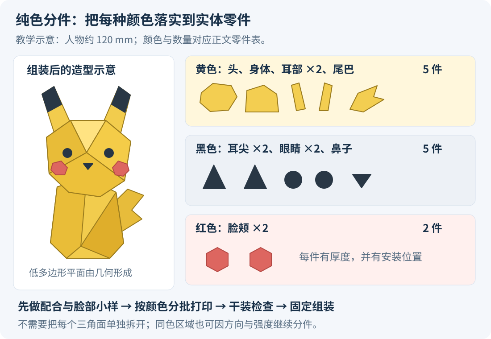
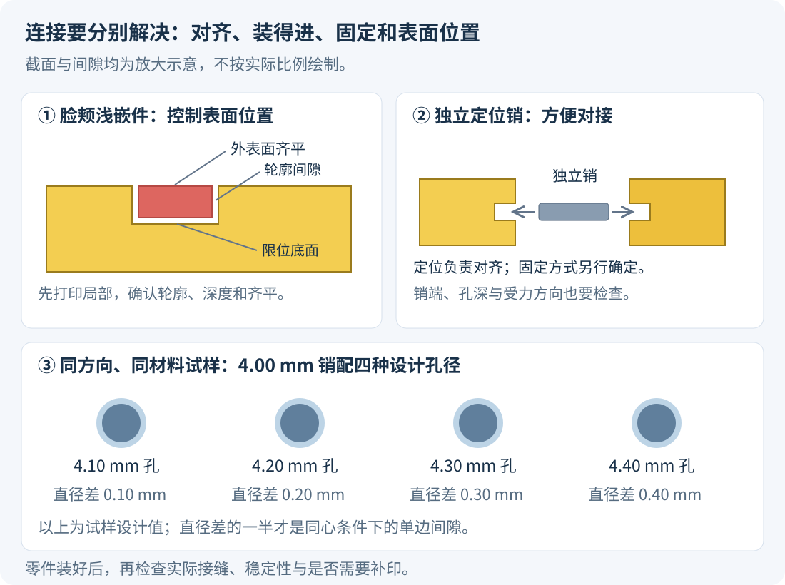

# 用 FDM 做纯色分件的 Low-poly 卡通角色：从模型、配色到打印组装

像宝可梦这类轮廓鲜明、色块清楚的卡通角色，可以采用这样一条制作路线：<strong>把角色设计成若干有厚度的纯色零件，分别用对应颜色的线材打印，再定位组装。</strong>一台普通单喷头 FDM 打印机也能做：这一批打印黄色，换线后打印黑色，最后打印红色。需要自动换色的设备，是另一种可选方案。

这里的 Low-poly 指有意保留的几何平面与转折。目标是让造型、色块和接缝都服务于成品外观。本文以<strong>约 120 mm 高、静态展示、三种颜色的低多边形卡通小兽</strong>作教学例子，讲完整流程；它不是某个现成模型的实测打印记录。参数是试打起点，具体设备和材料仍需验证。资料核对日期：2026 年 11 月 6 日。

## 一、先确定：整件换色，还是分颜色打印后组装

| 路线 | 实际怎么做 | 适合什么情况 | 主要工作 |
| --- | --- | --- | --- |
| 纯色分件、分别打印 | 每个零件只用一种线材；同色件同批打印 | 大色块、适合拆件、想控制接触面和朝向 | 设计分件、定位与配合，最后组装 |
| 整件多色 FDM | 切片时指定区域颜色，打印时切换材料或喷头 | 色区难拆、希望减少手工组装 | 准备颜色区域，检查换色、清料与表面效果 |
| 混合做法 | 大部位单色拆件，小图案用多色、贴花或少量补色 | 眼睛、嘴等特别小，独立成件不方便 | 把最难拆的细节单独解决 |

本文的主线是第一种。它把颜色的选择落实到实体零件上，也让耳朵、尾巴等部位可以单独选择打印方向。代价是前期要认真设计接缝和连接。

整件多色打印能减少部分装配工作，但具体耗材和时间要看切片结果。以单喷嘴换线系统为例，换色时需要排出残留材料，反复换色会产生相应清料；多喷头系统的情况又不同。不能只比较模型本体重量，就认定哪条路线一定更省。[Bambu Lab 官方打印说明中的清料定义](https://csm.bblcdn.com/hub/eff78da43720461787dc8bbe5fa0372d.pdf)

## 二、先定尺寸、颜色和零件表

### 把目标写清楚

这个例子先约定：人物含耳朵、不含底座总高约 120 mm；用黄色、黑色、红色三种 PLA；静态站立；保留低多边形平面；尽量用材料原色完成外观。

120 mm 是学习与桌面展示的起步建议，不是打印门槛。尺寸更小时，眼睛、耳尖和定位结构会更难处理。可以先选头部略大、站立稳定、尾巴较粗的造型，减少极薄尖端和大幅悬空的动作。

PLA 可以作为室内展示件的起点，原因是较容易打印、能处理小模型；其耐热性和韧性也要结合使用条件考虑。长期受热或反复掰动的用途，应重新选材和设计。[Prusa 的 PLA 材料说明](https://help.prusa3d.com/article/pla_2062)

### 三种颜色，可以对应十二个零件

颜色数量与零件数量不同。同一种颜色的区域，可能分布在多个位置；同一块很大的颜色区域，也可能为了打印方向继续拆开。

| 编号 | 部位 | 颜色 | 数量 | 连接思路 |
| --- | --- | --- | --- | --- |
| Y01 | 头 | 黄色 | 1 | 与身体用定位结构连接 |
| Y02 | 身体，包含简化的手脚 | 黄色 | 1 | 脚底提供稳定落地面 |
| Y03-L／R | 两只耳朵的主体 | 黄色 | 2 | 耳根插入头部，耳尖连接黑色件 |
| Y04 | 尾巴 | 黄色 | 1 | 尾根加粗，插入身体后部 |
| B01-L／R | 两个耳尖 | 黑色 | 2 | 接缝沿黑黄分界 |
| B02-L／R | 两只眼睛 | 黑色 | 2 | 做有厚度的嵌件，放进眼窝 |
| B03 | 鼻子 | 黑色 | 1 | 做短定位柱或浅嵌件 |
| R01-L／R | 两块脸颊 | 红色 | 2 | 嵌入脸部的浅凹位 |

合计黄色 5 件、黑色 5 件、红色 2 件，共 12 件。底座和眼睛白色高光暂不计入；若增加白色高光，需要再决定独立小件、贴花或补色哪种更容易实现。

*图 1：原创卡通小兽与零件分组示意，展示“三种颜色、十二个零件、三批单色打印”的关系。不是可直接切片的三维模型，也不是具体宝可梦造型的结构图。*

实际工作中，先画出类似的编号表，再建模，会更容易发现漏掉的连接处。零件数多了以后，左／右标识、颜色和装配顺序都应保留下来。

## 三、准备模型：现成可打印文件、普通模型、自己建模怎么处理

### 已经为分件打印设计好的模型

优先检查是否提供独立零件、装配图、推荐尺寸、打印方向和连接说明。把所有文件导入后，核对是否缺件、比例是否一致，再做连接试样。

下载页写着“Low-poly”只说明造型风格，不能替代这些检查。同一个风格模型可能面向游戏、渲染或实体制造，准备程度不同。

### 普通游戏模型或 AI 生成模型

先检查：

- 颜色来自独立几何、材质分组，还是一张贴图？
- 眼睛是有厚度的物体，还是仅画在脸上？
- 耳朵、身体等是否只是相互穿插？内部有没有重复表面？
- 模型是否存在开口、薄片、悬浮小块或自相交？
- 从侧面、背面看，形状是否也合理？

贴图中画出的红脸颊，不能直接作为红色塑料块导出；需要根据它的形状，重新建立有厚度的红色嵌件与接收它的凹位。AI 生成的外形可以作建模起点，但仍要完成这些制造结构。

### 从头做一个低多边形模型

可以从低段数球体、多边形柱体等基础几何出发，先调整头身比例、耳朵、尾巴与站立轮廓，再处理五官和连接。这样更容易主动控制平面位置和接缝。

Blender 的 Decimate 修改器可以减少顶点／面数，但需要检查结果是否破坏眼窝、薄部位和预定接缝。它适合辅助简化，不应以固定面数作为成品质量标准。[Blender 4.2：Decimate](https://docs.blender.org/manual/en/4.2/modeling/modifiers/generate/decimate.html)

### Low-poly 的平面要存在于实际几何里

Shade Flat／Shade Smooth 改变视口与渲染中的法线显示方式。打印机主要根据导出的实体表面生成路径，屏幕上的明暗效果不会自动变成新的折面。要获得有棱有面的实体，模型本身就要有对应的平面和转折。[Blender 4.2：平滑与平面着色](https://docs.blender.org/manual/en/4.2/modeling/meshes/editing/face/shading.html)

反过来，一块黄色零件上的不同平面，在实际照明下也会自然呈现不同明暗。通常可以让整块保持同一种塑料颜色，而不用把每个三角面都拆成不同颜色。

## 四、分件：让颜色边界成为合理接缝

### 先选接缝位置，再决定切法

优先考虑黑黄耳尖分界、红色脸颊外缘、头颈连接、尾根等本来就存在形状或颜色变化的地方。大面积黄色脸部中间若横穿一条装配缝，外观会更难控制。

但颜色边界不是唯一约束。接缝还需要满足：两侧能单独打印，连接处有足够空间，装配时能插进去，最终有支承。比如一条很薄的黑色嘴线，即使颜色独立，也未必适合做成可拿取、可安装的小零件。

### 三种常见结构

<strong>第一种是主体对接：</strong>头与身体、黄色耳部与黑色耳尖，各自具有封闭切面，通过定位柱或独立销连接。

<strong>第二种是浅槽嵌件：</strong>在黄色脸部做一个与红色脸颊轮廓对应的浅凹位，红件带有厚度，装入后其外表面达到设计位置。眼睛、鼻子也可以采用类似方法。

<strong>第三种是背面安装：</strong>某些眼睛可以从头部内部放入，使背后的限位部分更大。不过这要求先保留内部安装通路、安排先后顺序；若头已封闭，就无法从内部安装。第一次制作可先选外侧可安装的浅嵌件。

### 在 Blender 中，几个操作分别做什么

| 操作 | 输入与结果 | 之后还要做什么 |
| --- | --- | --- |
| Separate → By Material | 按已经分配的面材质拆成独立对象 | 检查是否只是开口表面，补足体积和连接 |
| Boolean → Difference | 用一个实体从另一个实体中减去体积 | 例如生成眼窝、脸颊槽、定位孔；检查布尔结果 |
| Boolean → Union | 合并相互重叠的实体体积 | 例如把同色定位柱并入主体；清理不合适的内部表面 |
| Boolean → Intersect | 保留两个实体共同占据的部分 | 例如用轮廓体从角色表面区域提取色块实体 |
| 切片软件 Cut | 沿切面拆开模型，可配连接结构 | 适合头身等切割；曲线色块往往还需建模软件处理 |

Blender 的按材质分离依据面上已指定的材质；如果整张贴图都只挂在同一个材质上，它不会自动把贴图里每种颜色变成实体。[Separate 官方说明](https://docs.blender.org/manual/en/4.2/modeling/meshes/editing/mesh/separate.html)

布尔的并、差、交用于几何体积运算，可靠结果依赖输入网格质量。[Boolean 官方说明](https://docs.blender.org/manual/en/4.2/modeling/modifiers/generate/booleans.html) PrusaSlicer 的 Cut 则支持平面切割、插接和独立定位销等功能，适合处理一部分制造切分。[Cut 工具](https://help.prusa3d.com/article/cut-tool_1779)

### 颜色嵌件的具体制作顺序

以红脸颊为例：先确定红色区域的可见轮廓；根据轮廓建立有厚度的红色实体；在头部建立对应凹位；给凹位与嵌件之间安排经试打确认的间隙；加限位台阶或底面，控制最终装入深度。

红件的背面可以相对简单，但外表面要跟随预定脸部折面。先看正面边界，再看侧面是否意外凸出或下陷。若想要凸起的脸颊，也应明确设计凸起量，而非靠组装时猜位置。

每个最终零件都要有可解释的实体体积。通常不需要手工把头部掏成薄壳：封闭实体导入切片软件后，可由外壳和稀疏填充构成内部。需要从内部装眼睛等特殊结构时，再有目的地设计腔体和开口。

## 五、设计连接：先能定位，再确认能装配

### 第一次可以用定位结构配合胶接

头身连接可用有方向性的定位柱，或两侧开孔配独立定位销；耳尖可用较短的插接结构；脸颊与眼睛则用凹位限位。定位结构帮助对齐，固定方式再根据接触面积与材料选择。

圆柱允许转动；D 形或其他非对称截面可以帮助确定朝向。细长耳朵和尾根需要考虑受力，避免把支承全部交给很细的销。卡扣涉及弹性和反复变形，第一次的静态展示件可以先采用较容易试装的定位＋胶接方案。

*图 2：连接截面与试样尺寸为教学示例。定位、固定和控制表面齐平分别需要结构安排；实际配合需按材料、机器、方向和参数试打。*

### 一组容易理解的孔销试样

下面是<strong>自拟试样尺寸，不是统一推荐公差</strong>：设计一个直径 4.00 mm 的销，配四个不同孔径的孔，观察实际装配效果。

| 设计孔径 | 设计销径 | 直径差 | 假设同心时的单边间隙 |
| --- | --- | --- | --- |
| 4.10 mm | 4.00 mm | 0.10 mm | 0.05 mm |
| 4.20 mm | 4.00 mm | 0.20 mm | 0.10 mm |
| 4.30 mm | 4.00 mm | 0.30 mm | 0.15 mm |
| 4.40 mm | 4.00 mm | 0.40 mm | 0.20 mm |

试样要尽量复现最终零件的孔深、方向、线材和切片设置；一个很短的孔试装顺利，不能完全代表很深的孔。黑、黄两种线材也可各打印对应试样，确认换色后配合仍然合适。Prusa 建模指南同样指出，装配间隙受方向、几何、校准和材料等因素影响，需要迭代。[配合与试打原则](https://help.prusa3d.com/article/modeling-with-3d-printing-in-mind_164135)

有些切片软件的“Tolerance”按单边、整体尺寸或不同方向分别定义。上表明确给的是设计孔销尺寸，不能直接把其中某个数字抄进任何同名参数。

### 小嵌件也要单独测试

圆销能装进去，不代表红脸颊一定能齐平。另打印一个包含真实脸部凹位的局部样件，验证轮廓间隙、深度、底面和外观。盲孔、盲槽还应给装配和少量胶留出合理空间，避免底部提前顶住。

入槽边缘或销端可做小导入倒角，帮助定位。切面贴热床打印时，首层可能向外扩展，形成“象脚”，导致局部装不进去；先检查首层和设备对应的补偿设置，再决定修改全部孔径。[象脚补偿的原理](https://help.prusa3d.com/article/elephant-foot-compensation_114487)

## 六、确定每个零件的打印朝向

同一个角色上的部件可以采用不同朝向。分件的价值之一，就是让外观、支撑和强度分别得到处理。

| 部件 | 可以先尝试的摆放 | 要看哪一面 |
| --- | --- | --- |
| 头部 | 以颈部切面落地，或选隐藏的平面落地 | 脸部是否需要支撑，头顶斜面是否有明显台阶 |
| 身体 | 以稳定脚底／隐藏切面落地 | 底部是否平整、四肢下方是否悬空 |
| 耳朵 | 有合适平面时侧放或拆分 | 耳根强度、可见面纹理和支撑接触 |
| 尾巴 | 选择较大且较隐藏的接触面 | 尾根受力方向、长条是否翘起或不稳 |
| 眼睛、脸颊、耳尖 | 利用背面或合适的平面放置 | 正面效果、边缘象脚、细小件是否能稳定附着 |

这张表给出候选方向，最终应看实际几何与切片预览。向上的面可能有顶面走线；贴板面可能留下打印板纹理；接触支撑的面通常需要修整。给同一张脸上的成对零件安排一致方向，有助于保持表面观感一致。

细长耳朵若竖起来打印，要考虑根部的层间受力；平放又可能改变表面效果和支撑需求。选方向时，应把强度、外观和成型稳定性一起比较，而不只看“支撑用得最少”。

Low-poly 的设计折面可以保留，FDM 在斜面上形成的分层台阶仍然存在。降低层高可能改善台阶，但不会自动消除所有层纹。若采用磨砂外观线材，可以先打一个包含几个角度平面的色样，观察实际明暗与纹理。

## 七、切片：用保守的试打参数开始

### 一套试样配置怎样写

对于上面的约 120 mm 展示件，可以先从已验证的 PLA 配置出发，再尝试下面这组<strong>教学起步设置</strong>。它不是任何厂商对成品效果的保证。

| 项目 | 起步建议 | 调整时看什么 |
| --- | --- | --- |
| 喷嘴 | 0.4 mm | 小五官的轮廓能否被路径保留；必要时再比较小喷嘴 |
| 层高 | 0.20 mm 试结构；外观样件比较 0.15 mm 左右 | 斜面台阶、打印时间；具体用设备已有档位 |
| 外墙 | 3 圈起步 | 耳根、销、槽周围的局部路径是否足够 |
| 稀疏填充 | 约 10%–15% 起步 | 顶面是否有足够支承，局部强度是否满足 |
| 顶／底实心层 | 0.20 mm 层高时先看 5 层，即名义约 1.0 mm | 顶部是否封好；层高变化后重新核对厚度 |
| 温度、速度、冷却 | 对应打印机、喷嘴和线材的已验证配置 | 首层、角部、细小件过热、拉丝和表面一致性 |
| 支撑 | 按实际悬空区域安排，尽量避开重要外表面 | 接触位置、可拆除性；必要时重新分件或换方向 |
| 接缝 | 尽量安排在背面、隐藏处或合适棱线 | 正面是否出现一列凸点，接缝是否影响装配 |

其中 0.15／0.20 mm 也属于 Prusa 入门教程建议认识的层高档位；墙圈数和填充比例则是本文提供的试打选择。[PrusaSlicer 入门层高](https://help.prusa3d.com/article/first-print-with-prusaslicer-3-0-0_1079761)

<strong>每圈外墙的实际宽度由线宽和切片算法决定。</strong>不要把“3 圈墙”一律换算为喷嘴直径乘三。顶层层数也要随层高一起考虑：例如保持 5 层、从 0.20 mm 改到 0.10 mm 后，名义顶层厚度就由 1.0 mm 变成 0.5 mm。[外墙、线宽与实心顶底层说明](https://help.prusa3d.com/article/layers-and-perimeters_1748)

随机接缝会把接缝痕迹分散到表面。对有清楚折面的角色，可以优先比较把接缝安排到隐藏位置的方案，必要时用接缝绘制工具控制。[接缝位置](https://help.prusa3d.com/article/seam-position_151069)

### 一定要检查路径预览

切片后逐层看：两只眼睛有没有被保留；耳尖是否变成少量很不稳定的走线；孔槽有没有被封住；外墙是否连续；支撑是否挡住装配面；小件是否有足够首层面积。

如果一个细节在预览中已经消失，应调整模型尺寸、细节形状、线宽策略或喷嘴配置，再切片。仅靠增加填充，通常解决不了外部轮廓本身太细的问题。

## 八、按颜色分批打印，控制表面一致性

### 普通单喷头的安排

先打印配合小样和一个脸部局部样件。结构确认后，黄色一批打印头、身体、耳部和尾巴；黑色一批打印耳尖、眼睛和鼻子；红色一批打印脸颊。每批开始前确认实际线材和温度配置匹配，换线后按设备流程清理前一种颜色残留。

同一盘中的零件仍要分别安排朝向。一个黄色小件失败，可以只补印该件，不用把整个角色重新打印。特别小的黑色件可保留编号和备用件，减少取件后混淆或丢失。

“同色放同一盘”不要求一次完整打印一个零件再打印下一个。默认按层打印即可。若启用逐件打印，需要核对喷头、横梁和已完成零件的碰撞空间，遵循设备与切片软件的限制。[逐件打印与碰撞检查](https://help.prusa3d.com/article/sequential-printing_124589)

### 颜色和表面都要看实物

同为黄色的不同线材，色相、透明度和光泽可能不同。需要统一外观的部件，尽量用同一款、同一批材料；至少先打印色样比较。片状浅色嵌件还要在实际背衬上看是否透出底色，必要时调整厚度或材料。

喷嘴温度、外墙速度和打印方向变化，也可能改变表面观感。确认一件外观样件后，把对应配置保存下来，再批量做其他部件。

## 九、修整和组装：先试装，再固定

按编号整理取下的零件，去除支撑、裙边和连接处毛边；等零件冷却后再测量和试装。先装头身，再验证耳部与尾巴，最后确认眼睛和脸颊的位置。

<strong>试装时应能用合理力度定位，且接缝和外表面达到设计位置。</strong>遇到卡住，先判断是入口毛边、首层外扩、孔径问题，还是槽底提前顶住。薄耳朵和小销应避免强行压入；必要时修局部或补印，保留已经确认的间隙记录。

需要胶接时，选明确适用于实际材料的胶，先在废件试粘；按产品要求用量、通风和固化。某些胶可能留下表面痕迹或白化，尽量让胶留在内部接触面。定位柱帮助对齐，充分的接触面积与固定方式负责保持连接。

原色成品可以把打磨限制在隐藏面、支撑点和配合位置。大面积磨可见面会改变线材光泽，也可能磨钝原本想保留的棱线。若仍有明显缝隙，应先回查切面、翘曲或配合设计，再决定是否需要补土和局部补色。

最后从正面、侧面和背面检查：左右五官位置是否一致；颜色边界是否干净；耳尖是否歪；尾巴是否可靠；脚底与底座是否稳定；小件是否松动。拍照时保留正常光照下的近照，便于判断接缝与层纹。

## 十、常见失败，应该先改哪里

| 看到的现象 | 先检查 | 常用修正方向 |
| --- | --- | --- |
| 模型里有红脸颊，导出后没有红色零件 | 红色是否只来自贴图 | 建立有厚度的红色几何与对应凹位 |
| 分材质后只得到薄面 | 对象是否封闭、有没有背面和侧壁 | 补成实体，再检查切片；重做连接 |
| 眼睛或嘴在切片里消失 | 最终尺寸、线宽和路径生成结果 | 加粗／简化细节，比较小喷嘴或混合做法 |
| 孔销卡住，尤其底边卡 | 首层外扩、毛边、方向和实际孔径 | 校准首层、检查补偿，再调整局部配合 |
| 脸颊装进去却不齐平 | 槽深、限位面、胶和边缘干涉 | 修改局部结构，打印脸部样件复查 |
| 头身有缝 | 对接面是否平、是否翘曲、销是否顶底 | 修正落地面、支承和定位深度 |
| 正面很多凸点 | 接缝位置、拉丝、外墙路径 | 调整接缝和材料配置，比较外观小样 |
| 耳根、尾根折断 | 截面、受力和打印方向 | 加粗／加接触面，换方向或连接结构 |
| 屏幕很有折面感，实物却不同 | 明暗来自几何还是显示法线 | 确认实际平面几何，再比较材料与照明 |

## 十一、把这次成功的流程保存下来

保留原始建模文件、组装状态模型、按编号导出的零件、颜色／材料清单、装配说明、切片项目和试样记录。普通 STL 主要记录表面三角形几何；切片项目保存为 3MF 有利于保留模型与设置，但不同软件之间仍应核对兼容性和导入结果。[3MF 项目说明](https://help.prusa3d.com/article/saving-projects-as-3mf_1773)

下次改尺寸时，重新检查最小细节、连接和间隙。模型整体缩小后，原本可拿取的眼睛、可装配的定位销也会一起缩小；保留参数化尺寸或独立连接结构，可以更容易地针对新尺寸调整。

第一次实践可以按下面的顺序完成：

1. 选一个约 12 cm、站姿稳定、三至四种大色块的 Low-poly 角色，确认整体轮廓。
2. 列零件表，把耳尖、眼睛、脸颊等颜色区域做成可打印实体，并准备连接。
3. 打孔销试样和脸部局部样件，确认配合与色块外观。
4. 根据外观和强度分别安排零件朝向，切片并逐层检查。
5. 按颜色批量打印，先试装，再固定，最后验收边界、层纹与稳定性。
6. 保存成功配置和装配记录，再考虑更多颜色、更小细节或其他姿势。

关于不同工艺的精度与上色，可接着看[手办打印参数与涂装](https://jinjianzhao.github.io/daily-papers/knowledge/article.html?slug=figurine-printing-precision-and-painting)；关于分件与模型用途，可看[打印分件与装配的基本概念](https://jinjianzhao.github.io/daily-papers/knowledge/article.html?slug=game-rigging-3d-print-parts)。
