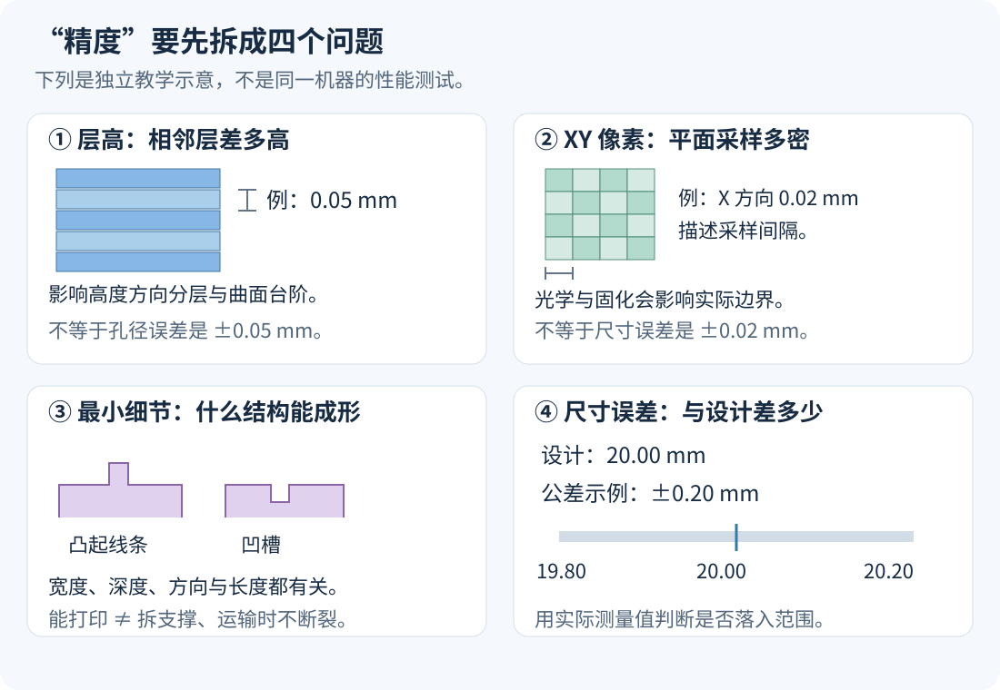
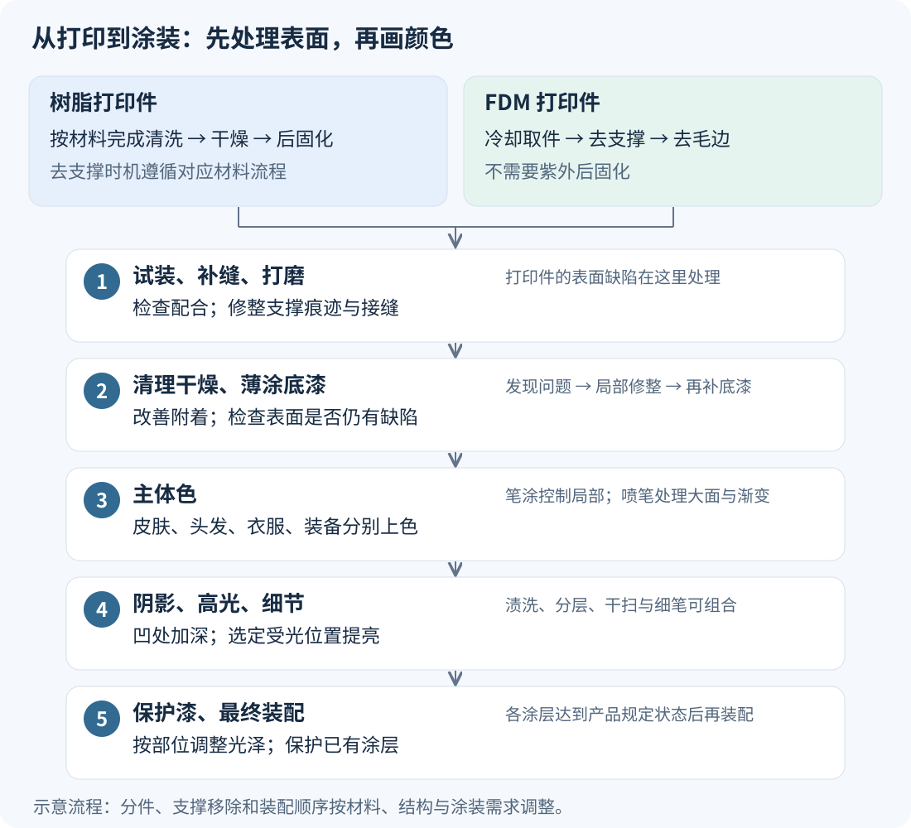

# 玩具与手办怎么 3D 打印：常见工艺、毫米级参数与上色流程

做一个摆在桌上的精细角色、一个可以活动的玩具、一个很大的场景底座，选的打印方式可能不同。<strong>精细展示件通常优先考虑树脂光固化；较大的底座、道具和试样可考虑 FDM；需要反复活动的部件可考察尼龙 SLS／MJF。</strong>这是一种按需求选工艺的思路，不是市场占有率排名，也不是说一种工艺只能做一种东西。

本文把“打印得有多细”“尺寸有多准”“最后如何变成彩色成品”分开讲。数值均以毫米为主：<strong>1 mm = 1000 μm；50 μm = 0.05 mm；20 μm = 0.02 mm。</strong>文中注明了设备／材料的数值属于具体实例，不应当套用到同类所有机器。资料核对日期：2026 年 11 月 6 日。

如果还没有接触过 3D 打印，可先看[工艺分类入门](https://jinjianzhao.github.io/daily-papers/knowledge/article.html?slug=3d-printing-types-for-beginners)。这一篇集中回答手办制作中的具体参数与操作问题。

## 一、先看做什么，再选工艺

| 制作目标 | 优先考察的工艺 | 主要理由 | 需要接受的代价 |
| --- | --- | --- | --- |
| 小尺寸人脸、头发、衣褶、盔甲纹样 | 树脂光固化：MSLA／DLP／激光 SLA | 能处理较细表面结构，上色前较容易获得平顺表面 | 清洗与后固化；细长部位易损；支撑点要修整 |
| 大底座、建筑、较大的卡通角色、道具外壳 | FDM／FFF | 可使用常见塑料线材；适合较大体积和结构试样 | 层纹、支撑痕迹和接缝可能需要更多填补打磨 |
| 可动关节、卡扣、耐用结构件、小批量功能玩具部件 | 尼龙 SLS／MJF | 可制作互锁结构，通常不需额外打印支撑 | 表面有颗粒感；间隙、清粉与耐久仍要验证 |
| 想直接获得复杂彩色表面的小模型 | 专业全彩材料喷射等 | 可把颜色随打印过程做进零件 | 通常委托服务商；颜色、光泽和强度仍有边界 |

这里的“玩具”和“手办”也要区分用途：供观看的雕像主要考察表面与造型；经常掰动、跌落的玩具还要考察材料韧性、连接结构与磨损。<strong>表面越细，不代表越耐摔。</strong>以下尼龙参数取自 Materialise 实际提供的打印服务；其资料列有活动件能力和颗粒状表面，不能据此认定任意关节都能一次成功。[SLS PA12](https://www.materialise.com/en/industrial/3d-printing-materials/pa12-sls)、[MJF PA12](https://www.materialise.com/en/industrial/3d-printing-materials/pa12-mjf)

## 二、“精度 0.02 mm”究竟说的是什么

谈精度前，先要求对方说清楚它测量的是哪个量。

*图 1：四种不同的参数。图中的大小关系为教学示意，不是同一设备的测量结果。*

### 1. 层高：每次沿高度方向增加多少

层高 0.05 mm，表示相邻打印层的高度间隔是 0.05 mm。较小层高通常有利于减少曲面上的台阶感，但它没有直接告诉你一个孔会偏小多少。

只作层数计算：假设切片后的打印高度正好是 80 mm，忽略首层和支撑高度，则 0.05 mm 层高对应约 1600 层；0.025 mm 对应约 3200 层。<strong>层数加倍不等于整项任务时间必定加倍</strong>，因为还涉及每层曝光、抬升、移动或喷头路径。

### 2. XY 像素间距：LCD 树脂机在平面内的采样间隔

比如 ELEGOO Saturn 4 Ultra 的官方页面列出 XY 数值为 19 × 24 μm，也就是 <strong>0.019 × 0.024 mm</strong>。这两个方向甚至不一定相同。它描述显示／投影到打印区域的像素尺度，不能直接改写为“所有零件的尺寸误差不超过 ±0.019 mm”。[设备原始规格](https://www.elegoo.com/pages/elegoo-saturn-4-ultra)

实际固化边界还受光学系统、曝光、树脂与相邻曝光区域影响。激光 SLA 使用扫描光斑，不能不加区别地拿 LCD 像素参数比较。“12K／16K”也只给出了部分屏幕信息，必须结合成型面积才能理解像素间距。

### 3. 最小细节：多细的结构还能成形或辨认

凸起的线、凹进去的槽、独立细杆，是三种不同结构。即使某条贴在表面的浅纹能打印，一根同样粗、长距离悬空的头发也可能折断。比较时要同时问宽度、深度／高度、方向和长度，不能只问一个“最小毫米数”。

### 4. 尺寸公差／尺寸误差：实际尺寸离设计值有多远

如果设计宽度为 20.00 mm，某项交付公差是 ±0.20 mm，则合格区间是 19.80–20.20 mm。这里比较的是实际测量尺寸和设计尺寸。

另外，<strong>尺寸准确度</strong>关注离设计值有多近；<strong>重复性</strong>关注多次打印彼此是否接近。多次都打印成 19.80 mm，可能重复性很好，却仍有系统性偏差。

## 三、树脂光固化：精细手办最值得先理解的一类

### 它怎么把角色做出来

输入是角色的三维表面模型。切片软件确定摆放方向、分层轮廓、支撑以及曝光参数。打印机让液态光敏树脂在需要的位置固化，逐层形成零件。

常见细分是：<strong>MSLA 用 LCD 遮光形成曝光图案，DLP 用投影系统形成图案，激光 SLA 扫描需要固化的位置。</strong>它们都属于树脂光固化，但光学结构和具体材料不同。[Prusa 工艺说明](https://help.prusa3d.com/article/types-of-printers-and-their-differences_112464)

### 可以先认识哪些层高

对于需要较细表面的角色，可以先认识 <strong>0.025 mm、0.05 mm</strong> 两档，并把 <strong>0.10 mm</strong> 理解为另一个可用的较粗层高。它们是常见的设置量级，并非“所有手办必须用 0.025 mm”。例如 Formlabs 明确列出 Grey Resin V5 在 Form 4／4B 上支持 25、50、100 μm；Anycubic 的官方树脂设置表也大量使用 0.05 mm。具体采用哪档，应以该树脂和机器的已验证配置为起点。[Formlabs 材料兼容表](https://formlabs.com/support/Choosing-the-Right-Material/)、[Anycubic 树脂设置](https://wiki.anycubic.com/en/filament-and-resin/resin-settings)

把层高调小主要改变高度方向的分层，不能单独修复曝光过度、支撑不足或模型里本来就没有的细节。

### 有没有真正关于“尺寸准不准”的数字

有，但必须连测试条件一起看。下表是 <strong>Form 4、Grey Resin V5、0.10 mm 层高、室温后固化 5 分钟</strong>的官方测试参考，测试对象是 <strong>XY 平面的特征尺寸</strong>，使用了三台设备。表中的“下限”指误差允许值不能比该绝对值更小，不是零件尺寸下限。[Form 4 设计指南](https://formlabs.com/support/Design-specifications-for-3D-models-Form-4-generation/)

| 被测特征的尺寸 | 官方列出的典型公差 | 由该规则计算的例子 |
| --- | --- | --- |
| 1–30 mm | ±0.15%，最小按 ±0.02 mm 计 | 20 mm：±0.03 mm |
| 31–80 mm | ±0.2%，最小按 ±0.06 mm 计 | 50 mm：±0.10 mm |
| 81–150 mm | ±0.3%，最小按 ±0.15 mm 计 | 100 mm：±0.30 mm |

这些数字不能替代另一台消费级 LCD 树脂机、另一种树脂或完整人物造型的实测，也没有给 Z 方向作同样承诺。它们说明：<strong>厂家给出的尺寸能力也会随特征大小变化，不能拿一个极小数字覆盖整个模型。</strong>

### 细头发、剑刃和裙边为什么容易坏

打印出来、拆支撑不折断、运输不折断，是不同要求。独立细杆越长，越需要考虑受力与支撑。模型设计时可以适当加粗发梢、把细长装饰与邻近实体连接，或者把武器单独分件。不要把厂商测试中的最小可打印结构直接当成耐用玩具的设计值。

“普通树脂”“ABS-like／类 ABS”“高韧性树脂”也不能只看名字判断性能；类 ABS 光敏树脂并不因此变成热塑性 ABS。需要看具体材料数据和实际样件。脸部细节、韧性、支撑去除难度可能需要取舍。

## 四、FDM：底座、大件与结构试样很实用

FDM／FFF 把塑料线材加热后从喷嘴挤出，喷头沿路径逐条铺放。常见模型线材包括 PLA，选择材料还要考虑温度环境和受力方式。

### 喷嘴直径与层高要分开

<strong>0.4 mm 喷嘴</strong>是常见规格，较小喷嘴可以改善平面内的细节表达。它不是“每个尺寸都会有 0.4 mm 误差”。层高是另一个参数：Prusa 的入门切片教程建议从 <strong>0.15 或 0.20 mm</strong>开始。Prusa 也说明层高通常应低于喷嘴直径的约 80%，因此 0.4 mm 喷嘴的层高上限示例约为 0.32 mm。这个上限不是精细手办推荐值。[喷嘴与层高关系](https://blog.prusa3d.com/everything-about-nozzles-with-a-different-diameter_8344/)、[PrusaSlicer 入门](https://help.prusa3d.com/article/first-print-with-prusaslicer-3-0-0_1079761)

对于带很小眼皮和嘴角的角色，只降低层高，不能消除喷出线条宽度带来的限制。对于地台、建筑墙面和大件外壳，后处理的可操作空间通常更大。

### FDM 的尺寸误差可以参考什么

作为<strong>工业服务实例</strong>，Materialise 的 ABS-M30 FDM 页面列出：层高 <strong>0.18–0.33 mm</strong>，标准准确度 <strong>±0.15%，且不小于 ±0.2 mm</strong>。据此计算，20 mm 特征仍按 ±0.2 mm 这一档考虑。这是该服务与该材料的说明，<strong>不能当成家用 PLA 打印机的保证值</strong>。[ABS-M30 参数](https://www.materialise.com/en/industrial/3d-printing-materials/abs-m30)

家用设备做插销、插孔、可动件时，应先打印包含实际孔和销的测试件。热收缩、首层挤压、朝向与切片补偿都可能影响配合；外形看着很细，不代表孔就一定合适。

## 五、尼龙 SLS／MJF：更关注活动与耐用部件

SLS 用激光选择性熔结粉末；MJF 在粉末层上施加功能液体，再结合热能实现选择性熔融。未成形的粉末可以提供周围支撑，但打印后必须清粉；封闭空间和极窄间隙仍可能有问题。[HP 对两类工艺的说明](https://www.hp.com/us-en/printers/3d-printers/learning-center/mjf-vs-sls.html)

下面是同一服务商的 PA12 数据，便于在相同资料背景下比较。<strong>这是服务规格，不是所有 SLS／MJF 的统一标准。</strong>[SLS PA12 参数](https://www.materialise.com/en/industrial/3d-printing-materials/pa12-sls)、[MJF PA12 参数](https://www.materialise.com/en/industrial/3d-printing-materials/pa12-mjf)

| 项目 | Materialise PA12，SLS | Materialise PA12，MJF |
| --- | --- | --- |
| 层高 | 0.12 mm | 0.08 mm |
| 标准准确度 | ±0.3%，最小按 ±0.3 mm 计 | ±0.3%，最小按 ±0.3 mm 计 |
| 最小壁厚 | 1 mm | 1 mm |
| 最小细节尺寸 | 0.3 mm | 0.25 mm |
| 常规表面 | 颗粒状 | 灰色颗粒状 |

由这一公差规则计算，20 mm 的结构仍按 ±0.3 mm 考虑，200 mm 的结构则是 ±0.6 mm。这里的最小细节与整体尺寸公差回答不同问题，两者可以同时成立。

它们适合纳入活动件、连接件与功能样件的候选方案；如果目标是光滑细腻的展示脸部，表面颗粒处理与细节保留还要另行评估。活动关节也需要验证间隙、清粉、磨损和装配，不能只依赖“可以打印互锁件”这一条规格。

染色可获得整体颜色，但染成黑色与给脸部、衣服分别精细涂装不是同一件事。该服务商还说明，部分机械抛光处理会去除约 0.1 mm 材料，细节和棱边可能被磨损，因此后处理也会改变尺寸与观感。[MJF 后处理说明](https://www.materialise.com/en/industrial/3d-printing-materials/pa12-mjf)

## 六、彩色从哪里来：三条路线

### 1. 单色打印，再手工上色

先得到几何形状，之后用笔涂、喷笔、遮盖喷涂等方式加颜色。这种方式可以分别控制皮肤渐变、眼睛、衣服、金属和光泽，是本文下面重点展开的流程。

“灰色树脂打印件”并不意味着成品只能是灰色；它只是开始涂装前的材料颜色。

### 2. 多色 FDM

在打印过程中切换不同颜色的线材，或者用不同喷头打印不同区域。可以直接做大块分色，减少部分涂装。但多种线材的分色与连续细腻的皮肤渐变是不同要求，最终效果仍取决于模型大小、颜色数量和切片方式。

### 3. 专业全彩打印

例如 PolyJet 材料喷射设备把光敏材料微滴喷到指定位置，并固化成形。Stratasys J55 Prime 支持全彩、多材料，官方标注层厚最低可到 <strong>18 μm，即 0.018 mm</strong>。这是该机型的层厚能力，不是任意全彩模型的尺寸误差，也不是说每个服务商都用这档设置。[J55 Prime 规格](https://www.stratasys.com/en/3d-printers/printer-catalog/polyjet/j55-prime/)

交付彩色文件前，要确认服务商接受的格式、贴图、颜色和材料模式。常规 STL 主要记录几何，不应期待把游戏模型的材质节点自动转成打印颜色。即使支持全彩，肤色、透明感、金属光泽和电脑渲染也仍可能有差异；有特定效果要求时先做样件。

## 七、从打印件到上色成品：每一步做什么

*图 2：树脂和 FDM 在进入涂装前的处理不同。去支撑时机按材料与设备流程调整；分件可以在不同阶段处理和组装。*

### 第一步：先让打印件达到可以加工的状态

<strong>树脂件先按该材料说明清洗、干燥、后固化。</strong>清洗是去除未固化树脂；后固化是进一步完成固化过程，两步不能互相代替。清洗剂、清洗时长、光照和温度以材料说明为准，不存在“所有树脂统一照 10 分钟”的规则。去支撑可能安排在后固化前或后，遵循对应流程并兼顾细小部件。[Formlabs 后处理说明](https://formlabs.com/support/3d-printing-post-processing-faqs/)

<strong>FDM 件通常待冷却后取下，去支撑、去毛边，再检查拼接和变形。</strong>它不需要因为叫“3D 打印件”就照紫外灯后固化。

此时先试装分件。把孔、销、磁铁位和接缝处理好，再做精细涂装，可以减少后续强行装配刮花漆面的机会。

### 第二步：去支撑痕迹，补缝、打磨

支撑是打印时增加的辅助结构，拆除后接触点可能留下小凸起或凹坑。先修掉凸起，凹坑与接缝用相容的模型补土或填料修整，待其达到规定加工状态后再打磨。

<strong>用于填坑补缝的补土，与用于附着和检查表面的底漆，任务不同。</strong>有些可打磨底漆也能填很浅的纹理，但不能指望一次厚喷抹平深接缝。

Formlabs 的表面处理示例使用 <strong>220／320 目</strong>去除较明显痕迹，再用 <strong>400／600 目</strong>细化。目数大通常代表磨料更细，但不同标识体系不能机械等同；这一组数值只作该指南的操作参考。精细脸部不要直接照着粗砂纸全表面磨，应从局部、轻力度和较细磨料试起，避免磨掉眼皮与发丝。[底漆前处理指南](https://formlabs.com/support/Priming-Prints/?language=en_US)

树脂打印、清洗和固化要有适当通风，并按材料安全数据表选择防护手套等用品。打磨还会产生粉尘，应控制粉尘暴露；采用湿磨时也应收集处理污染液与残渣。清洗剂、废树脂的处置遵循材料说明及当地要求。[NIOSH 树脂打印与打磨提示](https://stacks.cdc.gov/view/cdc/255485/cdc_255485_DS1.pdf)

### 第三步：清理、干燥，涂底漆

底漆主要给后续颜料提供合适的附着表面，并让颜色背景一致。灰色底漆也有助于看清表面是否还有支撑点、划痕和接缝。发现缺陷后，可局部修整、清理，再补底漆。

采用适用于该塑料／树脂的模型底漆，薄层施工，避免厚涂淹没细节。黑、白、灰底漆会影响后续颜色表现；选择哪种取决于想要的效果。喷罐、喷笔和笔涂底漆都存在，不必把购买喷笔当成开始上色的前提。[模型底漆与上色入门](https://thearmypainter.com/pages/get-started)

### 第四步：主体色，用笔涂或喷笔

主体色是皮肤、头发、衣服、装备的主要颜色。笔涂适合局部控制与细小区域；喷笔适合大面积薄层、渐变与柔和过渡。遮盖胶带或遮盖液可以保护暂时不涂的区域。

可以选择模型用水性丙烯体系作为学习起点，但底漆、颜料、稀释剂和保护漆要确认相容。稀释比例取决于产品、笔涂／喷涂用途与目标覆盖效果，不把“颜料与水 1:1”当成通用配方。先在废件测试，薄涂到所需遮盖程度，每层按产品要求干燥。

### 第五步：阴影、高光和细节

主体色涂好后，再决定哪里更暗、哪里更亮。这里可以采用明确可操作的几种方法：

- <strong>渍洗／Wash：</strong>把较流动的阴影色放进衣褶、盔甲缝等凹处，清理不希望变暗的大平面，强化结构分界。
- <strong>分层高光：</strong>在选定的凸起、受光位置画更亮的颜色，越亮的颜色覆盖面积通常越小，以控制明暗过渡。
- <strong>干扫／Drybrush：</strong>笔上取色后去掉大部分颜料，再轻刷凸起部分。适合毛发、石头和有纹理的盔甲；光滑脸部若要很柔和的渐变，通常还需更细的分层处理。
- <strong>细节描绘：</strong>用细笔完成眼睛、眉毛、扣子和边缘；按部件需要使用遮盖、贴花或其他辅助方式。

以上阴影与高光方法可组合使用，不是每个模型都要全部做一遍。[The Army Painter 上色入门](https://thearmypainter.com/pages/get-started)、[高光与干扫步骤](https://thearmypainter.com/blogs/explore/learn-how-to-highlight-miniatures)

### 第六步：保护漆、最终装配

保护漆用于保护涂层，并调整表面光泽：消光减少反光，亮光用于需要明显反光的部位，缎面介于两者之间。衣服、眼睛、皮肤和金属可以按效果分别处理；整个人物喷同一种保护漆可能改变已经画好的材质观感。保护漆也不能保证经常摩擦的关节永远不掉色。[保护漆入门说明](https://thearmypainter.com/pages/get-started)

待各涂层达到产品规定的干燥／固化状态，再最终装配。喷涂应使用合适的通风与防护，具体要求按涂料说明及安全数据表执行；水性涂料喷成雾后，也需要控制吸入暴露。

## 八、分件、配合与涂层：数值要一起算

### 不同部位可以选不同工艺

一个角色可以采用树脂头部与手部、FDM 大底座、另行验证过的尼龙活动连接件。分件后，还能把脸、头发、武器分别摆放打印和上色。连接处要设计定位与装配方式，详细讨论可接着看[打印分件与装配](https://jinjianzhao.github.io/daily-papers/knowledge/article.html?slug=game-rigging-3d-print-parts)。

### 一个简单的孔销计算

下面是<strong>自拟教学例子，不是推荐公差</strong>：设计直径 2.00 mm 的销和直径 2.20 mm 的孔，则直径差为 0.20 mm，两侧均分后的径向间隙各为 0.10 mm。

再假设销的表面和孔的内壁各涂上厚度 0.02 mm 的涂层：销的直径增加 0.04 mm，孔的直径减少 0.04 mm，最后直径差只剩 <strong>2.16 − 2.04 = 0.12 mm</strong>。这里的 0.02 mm 仅用于演算，不是实际涂层厚度承诺。

因此，试装合适的零件，上色后也可能变紧。可以考虑遮盖配合面、预留涂层空间，或在样件上验证。不要把两个零件各自的尺寸公差与两者之间的间隙混为一谈。

### 缩小模型时，细节也会缩小

如果把一个模型整体缩为一半，原来 0.8 mm 粗的独立装饰就变为 0.4 mm。对外形来说比例没错，但对打印、拆支撑、上色和耐用性来说，它可能已经不适用。打印模型常需要针对目标尺寸重新加粗、加深或合并某些细节。

## 九、第一次做一个上色手办，可以怎样安排

下面是基于前文的实践顺序，不是某台打印机的官方参数配方。

1. <strong>先定成品尺寸与用途。</strong>例如做一个约 80 mm 高的静态展示角色，重点是脸部和衣褶；这一高度是示例，不是工艺门槛。
2. <strong>检查细部与分件。</strong>确认发梢、手指、武器不至于过细，连接处可试装；重要外表面尽量避开密集支撑接触。
3. <strong>先做局部样件。</strong>用目标材料打印头部、典型纹样和孔销，确认细节、强度与装配。精细树脂件可从已验证的 0.05 mm 配置认识效果，再决定是否值得改到 0.025 mm。
4. <strong>打印主体并完成对应后处理。</strong>树脂走清洗、干燥、后固化等流程；FDM 走冷却、去支撑等流程。检查合格后再投入涂装时间。
5. <strong>完成表面，再薄涂底漆。</strong>先修掉明显接缝与支撑痕迹，再用底漆检查；不是先把所有缺陷盖在厚漆下面。
6. <strong>先画清楚主体色，再增加明暗。</strong>第一次可以只做少量阴影和高光，最后按需要用保护漆，完成装配。

如果委托商家，可以直接这样描述需求：<strong>“我要做一个约 80 mm 的展示手办。请说明工艺、树脂型号、层高、主要尺寸公差；报价包含清洗后固化、去支撑、修磨、底漆和手工涂装中的哪些步骤？能否先打头部和连接处样件？”</strong>把每项交付说清楚，比只问“是不是 16K、精度多少”更能判断最后能拿到什么。

## QA

### 1. 一般我需要带颜色的手办，有哪些方法？

<strong>最直接的选择是“树脂打印单色零件，再由自己或涂装师上色”。</strong>如果你希望打印出来就已经有颜色，还可以选择多色 FDM、不同颜色分件后组装，或委托专业全彩打印。关键是先决定：你要大块分色，还是要精细的眼睛、肤色渐变与材质表现。

| 方法 | 颜色怎么产生 | 更适合的效果 | 要确认的事情 |
| --- | --- | --- | --- |
| 单色树脂打印＋后期涂装 | 修整后，上底漆，用笔涂／喷笔画出颜色 | 精细 Q 版、写实人物、细致皮肤和眼睛 | 报价是否包含打磨、底漆、眼睛、阴影高光和保护漆 |
| 多色 FDM | 打印时换用不同颜色的线材，或用多喷头分区打印 | 色块清楚、造型简洁的卡通角色 | 颜色区域、层纹与细小脸部的实物效果；换色时间和耗材 |
| 不同颜色分件后组装 | 头发、脸、衣服等分别用对应颜色打印，再连接 | 分色边界明确、可以合理拆件的 Q 版 | 接缝、定位与装配；眼睛等细节往往仍需补画或贴花 |
| 专业全彩材料喷射，如 PolyJet | 打印时按数字颜色信息放置和固化材料 | 希望直接获得复杂彩色表面的定制件 | 实际设备与材料、彩色文件要求、肤色样件和表面光泽 |

树脂打印适合精细模型、FDM 在细节要求较低的场景也有用途，可参考 [Formlabs 的手办工艺说明](https://formlabs.com/blog/3d-printing-miniatures-and-custom-figurines/)；多色 FDM 的颜色来自实际装入的线材，见 [Bambu Lab 官方多色打印说明](https://csm.bblcdn.com/hub/eff78da43720461787dc8bbe5fa0372d.pdf)。专业全彩材料喷射确实用于玩具外观样件，见 [Stratasys 玩具案例](https://www.stratasys.com/en/resources/case-studies/veroultra-toys/)。表中的选用建议是结合这些工艺特点作出的判断。

<strong>“打印有颜色”与“完成精细涂装”需要分别验收。</strong>普通肤色线材不会自动生成脸颊红润、嘴唇、眉毛和细致眼神；分色打印也不能自动完成所有明暗变化。全彩打印可以承载数字颜色与纹理，但最终肤色、锐利程度和光泽要看实物样件，不直接以电脑渲染图验收。

对于单件定制、以展示效果为目标的手办，我会先找“树脂打印＋手工涂装”的方案。如果你不想自己上色，可以把两步一起委托；“白模／未涂装件”和“涂装完成品”是不同交付物。眼睛、球衣号码和队徽等小图案也可以结合贴花，具体取决于模型大小和制作能力。

### 2. 我需要一个 Q 版手办和一个写实风格篮球明星手办，分别用什么工艺、做多大比较好？

先按<strong>各做一件、静态展示、希望有较好彩色效果</strong>来建议。尺寸指人物本体的尺寸；底座、举起的手臂和道具占用的空间还要单独确认。下面是我的起步建议，不是行业规定，也不是打印设备的最低尺寸。

| 项目 | Q 版手办 | 写实篮球明星手办 |
| --- | --- | --- |
| 建议先考虑的尺寸 | 人物本体高 100–150 mm（10–15 cm） | 按直立身高换算约 250–350 mm（25–35 cm） |
| 若要先定一个数 | 约 120 mm（12 cm） | 约 300 mm（30 cm） |
| 主体工艺 | 树脂光固化，MSLA／DLP／SLA 均可考察实际样件 | 树脂光固化，优先验收头雕、手和球衣细节 |
| 上色方案 | 底漆＋笔涂／喷笔，重点画眼睛、分色边界和表情 | 喷笔与笔涂配合，重点做肤色、眼神、纹身、球衣与球鞋 |
| 层高起点 | 从该材料已验证的 0.05 mm 设置试样 | 从已验证的 0.05 mm 设置试样；头部可比较 0.025 mm 样件 |
| 可以换工艺的部位 | 大底座可用 FDM | 大底座、场景可用 FDM；主体与连接处按结构分件 |

表中层高沿用正文介绍的设备／材料实例，不要求所有树脂都支持 0.025 mm。精细人物选树脂的理由是表面和小结构的表现；这不代表必须购买某一种机器。委托时比较对方同等尺寸的实物，更有助于判断效果。[树脂手办的细节与表面特点](https://formlabs.com/blog/3d-printing-miniatures-and-custom-figurines/)

#### Q 版：为什么先建议 10–15 cm

Q 版可以把头部、眼睛和表情做得相对大，细节也允许适度简化。约 12 cm 是一个便于桌面摆放、同时给面部涂装留出空间的起点。作为成品尺寸参照，Good Smile 的一些黏土人官方标注约 100 mm 高；这里只借用它说明尺寸量级，并不是说这些商品采用树脂 3D 打印。[100 mm 成品实例](https://www.goodsmile.com/en/product/2986/Nendoroid%20Hestia)

如果主要是几个清楚的色块、能接受层纹，也可以先用多色 FDM 做 Q 版试样；若目标是近距离看起来很精致，我仍会优先选择树脂件修整后涂装。头、头发、身体与底座可以适当分件，方便打印和上色；大头造型要检查站立稳定性。

可以给商家这样的需求：

> 做一个人物本体约 120 mm 高的静态 Q 版彩色手办，优先树脂打印并完成涂装。先确认头部表情、眼睛和配色，再确认分件、支撑痕迹修整和底座。请提供类似尺寸的实物案例，并分别报价建模、打印、修整和涂装。

#### 写实篮球明星：为什么先建议约 30 cm

写实人物要让眼睛、嘴角、鼻翼、胡须以及皮肤颜色共同形成辨识度。尺寸太小时，这些部位可供打印和上色的空间更少。25–35 cm 给制作与观察留出的空间更大，但<strong>做大只会增加表达空间，不会自动把不准确的脸变得像本人</strong>；头雕和涂装都需要单独把关。

比例可以按真实身高计算。下面只是假设一个<strong>身高 2000 mm，即 2 m</strong>的人物，不对应某位球星的真实数据：

- 1:8：直立身高约 250 mm（25 cm）。
- 1:7：直立身高约 286 mm（28.6 cm）。
- 1:6：直立身高约 333 mm（33.3 cm）。

这是缩放计算，不能把它直接当成扣篮姿势的成品高度。下蹲会降低头顶位置，举手和篮球又可能增加总高度。下单时分别写明<strong>人物比例、姿势、含球与底座的总高、最大宽度和深度</strong>，避免“30 cm 手办”在双方理解中指不同尺寸。

我会这样安排制作：

1. <strong>先确认人物与姿势。</strong>准备正面、侧面和其他角度的参考，确认发型、球衣、球鞋、表情与动作；只有一张照片通常不足以明确全部三维细节。
2. <strong>先验收头雕，再打印头部样件。</strong>看轮廓、五官位置与神态；可以先给头部做一次涂装样件，再投入全身制作。更小层高不能弥补雕刻不像。
3. <strong>按上色和受力分件。</strong>头、手、身体、篮球、底座不一定连成一件打印。小手指和长悬臂要检查强度；腾空动作还要设计可靠支承，不能只凭外观决定连接方式。
4. <strong>分阶段验收彩色效果。</strong>先确认肤色与脸，再确认球衣、号码、纹身、球鞋；参考样件照片应包含正常光照下的近照，不能只看强后期渲染。

可以给商家这样的需求：

> 做一个写实篮球明星静态彩色手办，人物按直立身高约 300 mm 的量级设计，实际比例以所选人物身高确定。主体树脂打印、精细修整并完成涂装，底座另计尺寸。先验收头雕与头部涂装样件，再确认全身。请注明动作、总高、占地、分件、支承方式，以及球衣图案和纹身如何制作。

如果你希望两件都尽量精致，我的默认方案就是：<strong>Q 版约 12 cm，写实篮球明星约 30 cm；两件都采用树脂打印＋后期涂装。</strong>如果改成可以反复摆姿势的可动人偶，就需要另外设计关节、材料、间隙和耐磨方案，不能直接给静态雕像加几条切缝完成。
