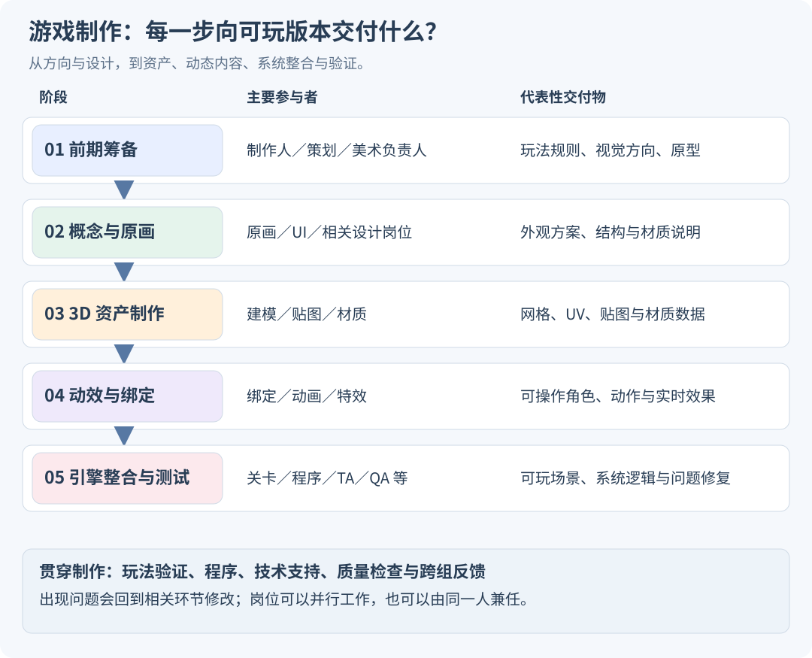
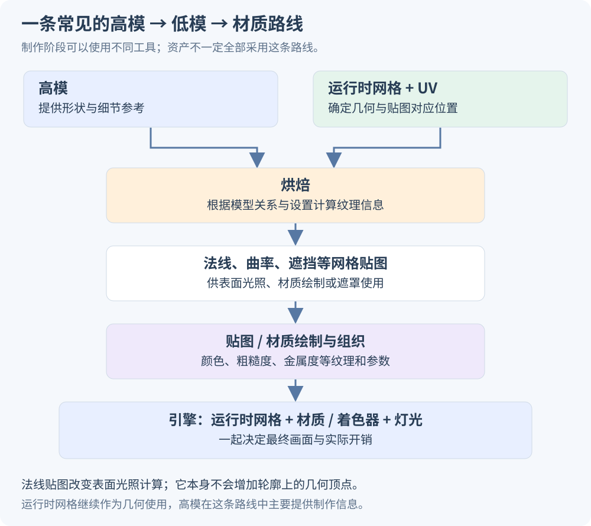
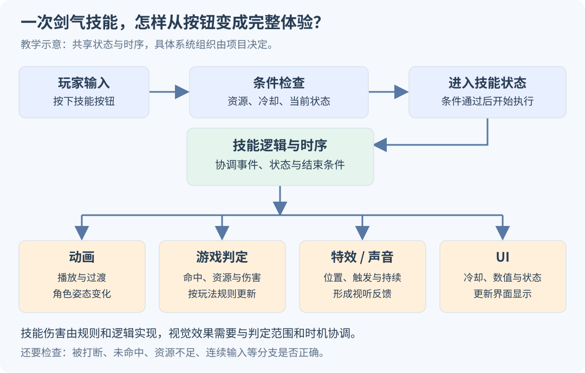

# 游戏制作流程与岗位介绍：从前期筹备到引擎整合与测试

制作一款 3D 游戏，需要同时完成三类工作：**设计玩家能做什么，制作玩家能看到和听到的内容，以及让这些内容按照规则运行。** 世界观、原画、模型、动画、程序和测试，围绕同一个可玩的结果协作。

本文按五个阶段展开：**前期筹备 → 概念与原画 → 3D 资产制作 → 动效与绑定 → 引擎整合与测试**。每个阶段都说明谁负责、输入是什么、具体做什么、交付什么，以及下一组怎样使用它。

这五段是便于理解的主线。实际制作会并行和返工：程序在前期制作原型，关卡设计先用简单几何测试路线，绑定师提前检查角色结构，QA 随可测试版本持续参与。小团队也可能由一人承担几个岗位；大型团队会继续细分。

下面贯穿使用一个**虚构教学例子**：制作一位轻甲剑士，让玩家在雨夜遗迹中操作他移动、攻击并施放剑气。例子用于解释交接关系，不是某款商业游戏的内部制作记录。

*图 1：本文整理的流程总览。箭头表示内容逐渐接入可玩版本，不表示前一个部门全部结束后，后一个部门才开始工作。岗位名称与管理边界因团队而异。*

## 一、前期筹备

### 1、游戏制作人、主策划与文案策划：确定世界观与核心玩法

**游戏制作人（Producer）** 关注项目整体怎样成立：面向哪些玩家、做什么类型、投向什么平台、预算与周期如何安排，以及团队如何在范围变化时作取舍。部分团队的制作人也深度负责创意方向，部分则更偏制作管理；具体权限取决于组织。

**主策划／游戏设计负责人，以及玩法策划**，把总体方向细化为可以验证的规则。例如剑士怎样移动，轻攻击与重攻击有什么区别，剑气需要什么资源，敌人如何反击，玩家怎样获得新能力。核心玩法由这些设计岗位与制作人、程序、美术等共同讨论推进，文案策划主要负责其中的叙事内容。

**文案策划／叙事设计／游戏编剧** 负责世界观、人物背景、任务叙事、对白和文字内容。不同团队会把这些职能合并或拆开。世界观中的设定还要与玩法协调：如果角色所在世界禁止使用魔法，剑气从哪里来，就需要给出一致的解释。

在教学例子里，可以先确定：玩家控制轻甲剑士探索遗迹，主要体验是近距离闪避和反击；剑气是一种有限资源技能。然后由叙事岗位解释遗迹、阵营与角色动机，由玩法岗位明确技能规则，由程序做一个能够移动和攻击的原型。

这里常见的交付物包括立项说明、玩法设计文档、世界观与角色设定、功能清单，以及**可玩原型**。原型可以只用简单模型，先验证攻击距离、操作响应和敌我互动。制作人在前期协调设计、美术与程序，玩法设计师细化机制规则，这也是行业岗位资料中明确区分的职责。[制作人岗位说明](https://www.screenskills.com/job-profiles/browse/games/production/games-producer-games/)、[玩法设计岗位说明](https://www.screenskills.com/job-profiles/browse/games/design/gameplay-designer/)

### 2、美术总监、主美：确定视觉基调

**美术总监（Art Director）与主美／美术负责人** 负责组织视觉方向与质量标准。两个称呼在有些团队接近，在另一些团队则分别偏整体方向和具体执行管理，不能仅靠中文职称判断上下级。

“定视觉基调”需要转化成具体约束：角色是写实比例还是夸张比例；建筑轮廓偏厚重还是轻巧；颜色怎样区分敌我；金属、布料、石头怎样表现；常用游戏镜头下，角色和场景怎样保持清晰。

例如，雨夜遗迹可以采用冷色环境与暖色关键目标，剑士的浅色肩部帮助玩家在暗处辨认位置。主美会检查这种方向能否在角色、场景、UI 和特效之间保持一致，还要与目标平台的渲染能力协调。

本阶段通常产出风格参考板、色彩与形状规则、材质参考、关键视觉样图，以及给各组使用的美术规范。规范的价值，是让后续多人制作的内容放进同一场景后能协调，而不只是各自单独展示时好看。

### 这一阶段怎样算有了可以继续制作的基础

团队至少要能回答：玩家在做什么，游戏从什么镜头观看，角色需要哪些动作，目标平台允许怎样的资源与性能规模。尚未解决的问题可以继续试验，但应明确它会影响哪些资产。

例如还没确定剑士是否会攀爬，就直接把肩甲做成完全不能抬手的结构，后面很可能返工。原型测试和视觉探索因此需要相互反馈。

## 二、概念与原画阶段

### 1、原画组：场景概念、大世界氛围图与核心角色剪影

**概念设计／原画组（Concept Art）** 接收玩法需求、世界观与视觉规范，先探索多种可能的外观。这个阶段的重点是比较方案，确定角色和场景应该呈现什么特征。

**场景概念与氛围图** 表达空间尺度、建筑语言、光照、天气、色彩和情绪。例如，遗迹是被水淹没的广场，还是沿山崖搭建的高塔；玩家远处看到什么地标；主路与危险区域怎样被辨认。

**核心角色剪影** 先用外轮廓比较比例与识别性：肩甲、武器、披风、发型怎样组合，是否能在游戏镜头与缩小尺寸下区分角色。此时可以暂时省略表面花纹，把注意力放在形状和职业特征上。

这些图会交给制作人、美术负责人、策划和后续资产团队讨论。概念岗位的图像帮助不同专业理解预期外观，是制作沟通材料的一部分。[概念设计岗位说明](https://www.screenskills.com/job-profiles/browse/games/art/concept-artist-games/)

需要注意，大世界氛围图表达视觉意图；道路是否能走、跳跃距离是否合适、战斗空间是否足够，还要由关卡设计与原型测试确认。

### 2、角色／场景／UI／图标：方案细化与色彩小样

方案确定后，角色和场景设计会补充足以支持制作的细节。UI 与图标也要遵守视觉规范，但在较完整的团队里，通常有专门的 UI／UX 与界面美术岗位参与，并不一定全部由同一支原画组完成。

**UI（User Interface，用户界面）** 负责血条、菜单、技能按钮等可见界面；**UX（User Experience，用户体验）** 更关注信息如何组织、玩家怎样理解和完成操作。两者需要配合：一个技能按钮既要符合风格，也要让玩家看懂是否可用、冷却多久。

色彩小样会比较主色、辅色、强调色与明暗分布。例如剑气是青色还是金色，既影响角色风格，也影响它在雨夜背景中的可见性；后续特效组会据此继续制作动态结果。

### 3、三视图、结构拆解图、材质说明与特效示意图

这些材料主要解决“下一位制作人员还缺什么信息”。不一定每件资产都需要完全相同的文档，但应把影响制作的关键结构讲清楚。

| 材料 | 重点说明什么 | 谁主要使用 |
| --- | --- | --- |
| 三视图／多视图 | 正面、侧面、背面的比例和结构对应 | 角色或道具建模师 |
| 结构拆解图 | 装甲、布料、武器怎样分件，关节和连接在哪里 | 建模、绑定、动画 |
| 材质说明 | 哪些区域是金属、皮革、布料，磨损与粗糙程度如何 | 贴图／材质美术 |
| 色彩小样 | 主要颜色、明暗层次、不同方案的比较 | 原画、材质、灯光、UI |
| 特效示意图／分镜 | 起手、蓄力、释放、命中的形状、颜色与时序 | 特效、动画、玩法设计 |
| 场景模块与尺寸说明 | 门、墙、台阶、装饰件怎样组合，尺度怎样对应 | 场景建模、关卡美术与 LD |

在剑士的交付中，应当说清肩甲是否可活动、披风从哪里固定、剑怎样握持、剑气从剑身还是角色身前出现。缺少这些信息，建模师与绑定师就需要反复猜测设计意图。

**本阶段的交接结果**，是经过确认的设计方案及必要说明，允许后续制作一边执行、一边反馈结构问题。原画也可能使用 3D 草模辅助构图，并不要求全部通过二维手绘完成。

## 三、3D 资产制作

### 1、3D 建模组：基础体块、ZBrush 雕刻与高模制作

**角色建模师、场景建模师、道具建模师** 根据设计图制作三维形状。他们把图中的轮廓与结构，变成从不同角度都可以观察的网格。

先确定比例、体块、尺度与分件，再逐步制作细节。角色上可能是肌肉、衣褶与装甲；场景上可能是石块破损、建筑构件和雕饰。ZBrush 常用于雕刻高密度细节；Maya、Blender、3ds Max 等也可用于多边形建模和结构制作，工具安排取决于资产类型与团队流程。

**高模（High Poly）** 的重点是表达所需形状与细节，可以具有较高几何密度。在这里，剑士的盔甲凹槽、皮革压痕和衣服褶皱会被具体制作出来。

这一阶段需要同时考虑后续使用。肩甲有没有足够的抬臂空间，裙摆能否分成方便绑定或模拟的部件，手掌能否正确握剑，都应尽早与绑定和动画协作确认。

高模路线适用于很多需要丰富表面细节的资产；模块化环境、低多边形风格、程序化资产等也可能从其他路线制作。高模、低模、贴图的工作分配并不是每个团队都完全一致。

### 2、3D 建模组：低模拓扑、UV 与烘焙

**低模／运行时网格** 要满足目标运行条件。拓扑决定顶点、边和面的连接方式；对于要弯曲的角色，还要让关节附近的网格能合理变形。低模不能只按“面数越少越好”判断，要兼顾轮廓、关节、细节与性能要求。

**重新拓扑（Retopology）** 是重新组织网格连接。剑士的肘部、肩部和面部，需要在动作中保持可接受的形状；静态石柱则更关注外轮廓与结构。LOD（Level of Detail，细节层级）允许根据距离等条件使用不同复杂度的表示，也是资源规划的一部分。

**UV 展开** 为表面建立二维贴图坐标，让三维表面的位置对应到图片中的位置。纹理分辨率、UV 接缝、区域面积和边缘留白，会影响后续绘制与采样质量。

**烘焙（Baking）** 则把网格相关信息计算进纹理。常见高模到低模路线，会把高模的表面朝向、遮挡或曲率等信息记录到低模可用的贴图中；烘焙工具需要正确的模型对应、投射范围与设置。Adobe 的定义也强调，烘焙是将网格信息转移到纹理，供着色器与相关处理使用。[Adobe 烘焙说明](https://experienceleague.adobe.com/en/docs/substance-3d-painter/using/baking/baking)、[高低模与烘焙设置](https://experienceleague.adobe.com/en/docs/substance-3d-painter/using/baking/mesh-map-settings)

其中，**法线贴图（Normal Map）** 影响表面如何计算光照，从而表现细小凹凸。单独使用法线贴图不会增加轮廓上的几何顶点，因此远看像凹进去的甲片花纹，在侧面轮廓上未必真的有凹槽。

*图 2：一种常见的高模到低模制作路线。高模提供细节参考；运行时网格保留实际使用的几何，贴图补充表面信息。不是所有资产都必须经过这条路线。*

本环节常交付拓扑与 UV 合格的网格、烘焙贴图，以及需要的 LOD、命名和尺寸信息。谁负责烘焙，可以在建模组、材质组或专门技术岗位之间分配。

### 3、3D 贴图／材质组：Substance 3D Painter 与表面外观

**贴图与材质美术（Texture / Material Artist）** 接收网格、UV、烘焙信息和材质设计，制作颜色、粗糙度、金属度、法线补充、发光与遮罩等数据。Substance 3D Painter 可以按图层、材质和遮罩在模型表面绘制与组织这些信息。

例如剑士的肩甲需要金属反射与磨损变化；皮带需要皮革的颜色和表面粗糙变化；布料需要自己的织物细节。视觉区别不仅来自颜色，还来自表面对光的响应。

| 常见数据 | 主要控制什么 | 教学例子 |
| --- | --- | --- |
| Base Color | 基础颜色信息；在常见金属度流程中也参与金属反射颜色 | 布料颜色、裸露金属颜色 |
| Roughness | 反射与高光的清晰或分散程度 | 抛光甲片与粗糙皮革的区别 |
| Metallic | 常见 PBR 工作流中的金属属性 | 裸金属区域与布料区域的区分 |
| Normal | 表面朝向的细节变化 | 细划痕、织物与浅凹凸 |
| Emissive | 表面的发光输出 | 剑身符文 |
| Mask | 供材质选择区域或控制效果的数值 | 雨水、染色或溶解的区域 |

**贴图是数据，材质与着色器定义怎样使用这些数据。** 同一张粗糙度贴图接错输入，或引擎的材质逻辑与导出约定不同，最终效果就可能不符合预期。PBR（Physically Based Rendering，基于物理的渲染）提供常用的表面光照描述方式，也可以服务于风格化美术。[Unreal 官方 PBR 材质说明](https://dev.epicgames.com/documentation/en-us/unreal-engine/physically-based-materials-in-unreal-engine)

最终交接通常包括贴图、材质参数与用途说明；制作中还会把资产放回引擎，在实际灯光和镜头下检查。Painter 里的预览环境与游戏现场不同，因此“软件里看起来好看”还需要经过引擎验证。

## 四、动效与绑定

### 1、技术美术 TA／绑定组：让角色能够被控制和变形

**TA 是 Technical Artist，技术美术。** “TM”不是可以在所有公司统一套用的技术美术缩写，实际可能有团队自己的命名。这里按职能区分：绑定师负责角色绑定；部分 TA 或技术动画岗位也会承担绑定、动画工具和引擎接入相关工作。

**绑定师（Rigger）** 接收角色网格、结构说明与动作需求，建立骨骼、控制器、约束、蒙皮权重与必要的形状键。动画师操作控制器，系统计算骨骼与网格怎样运动。

对剑士而言，需要处理肩肘膝等关节、双手握剑、脚与地面的接触、披风连接，以及表情与口型。IK（Inverse Kinematics，逆向运动学）可以根据末端目标求解关节姿态，例如把脚放到指定位置；FK（Forward Kinematics，正向运动学）则从各关节的旋转逐级得到末端位置。

交付给动画师的是可操作的绑定及使用说明；交付给引擎的往往是符合项目约定的骨架、蒙皮网格、动画或相关形状数据。DCC 制作软件中的所有控制器和约束，并不一定都原样进入运行时，导出时可能要烘焙或转换。

TA 的职责还可能包括工具、材质、流程与性能支持，绑定只是其中一种专业方向，实际分工取决于团队。[技术美术岗位说明](https://www.screenskills.com/job-profiles/browse/games/technical-art/technical-artist/)

关于面部绑定的各组成部分，可继续看 [《Facial Rig 是什么》](https://jinjianzhao.github.io/daily-papers/knowledge/article.html?slug=facial-rig-fundamentals)。

### 2、动画／动效组：动捕、手工动画、清理与修帧

**角色动画师** 制作待机、走跑、跳跃、攻击、受击、表情和演出等随时间变化的动作。**UI 动效设计师** 则可能制作菜单过渡、按钮反馈和界面信息出现的动态；二者共享时间设计，但资产和技术接入不同。

角色动作可以来自动作捕捉、手工关键帧，或多种方法结合。动捕适合取得真人运动与表演素材，但怪物结构、极度夸张的攻击和一些风格化表演，也可能主要靠动画师制作。

采用动捕时，可以把工作拆成：捕获表演 → 求解运动 → 重定向到角色骨架 → 清理数据 → 调整表演与游戏适配。**重定向（Retargeting）** 让来源骨架的动作适应目标角色的比例与骨骼关系。

清理可能处理抖动、滑步、错误接触和姿态异常；**修帧与夸张化** 则重新设计关键姿势、动作弧线、预备动作、发力节奏和收势。它们既解决数据问题，也塑造角色性格与操作感，并不是简单把动捕结果播放出来。

剑士的挥剑需要和玩法协商：抬手准备多长，攻击何时生效，受击能否打断，什么时候允许闪避。动画好看只是其中一项要求，还要在玩家输入下正确响应。根运动、原地动画、循环与动作之间的过渡，也需要动画与程序／技术动画共同确定。

本环节交付动画片段、动作命名和关键时序说明，并在引擎中验证。面部还可能包含形状键系数曲线，或经过约定的其他动画表示。

### 3、特效组：刀光剑影、魔法粒子、火焰与爆炸

**实时特效师（VFX Artist）** 设计和制作技能、命中、环境与状态效果。常用组成包括粒子、带状轨迹、网格、贴图序列、材质变化和必要的灯光；某些素材也可能由离线模拟制作后再转换为实时可用形式。

以剑气为例，起手时有符文积累，挥剑时出现短暂轨迹，释放后有向前运动的剑气，命中时再播放碎光和消散。这些部分有各自的空间位置、持续时间和参数，不能只用一张概念图表达最终动态。

特效还承担信息传达：玩家要看懂攻击范围、方向、危险程度与命中反馈。效果如果遮住敌人动作或与地面颜色混在一起，就会影响玩法。特效师因此需要与原画、动画、策划、程序以及 TA 协作。

技术上，Unreal 的 Niagara 是一种实时特效制作系统，可组织粒子与多个发射器等内容；它是实现工具之一，并不等于所有特效都由同一种模拟算法产生。[Niagara 官方教程](https://dev.epicgames.com/documentation/unreal-engine/tutorials-for-niagara-effects-in-unreal-engine?lang=en-US)

交付时除了效果本身，还要说明触发时机、挂接位置、可调参数和销毁条件，并关注同时播放多个效果时的性能。伤害判定由玩法系统按规则实现，视觉效果要与它协调。

## 五、引擎整合与测试

### 1、LD、关卡美术与 TA：把可玩的空间做成完整场景

这里先把几个经常混用的岗位区分清楚。

**LD（Level Designer，关卡设计师／关卡策划）** 主要设计玩家在空间里怎样行动：路线、战斗区域、探索节奏、交互点、敌人布置、任务事件与引导。LD 会用白盒／灰盒，也就是简单体块和可玩的临时内容，先测试尺度与流程。

**关卡美术（Level Artist）与环境美术（Environment Artist）** 主要负责场景的可见结果：建筑、地形、道路、植被、道具、地标、材质与画面组织。具体团队中，环境资产制作和场景组装还可能分为不同岗位；灯光美术也可能单独负责照明。

**TA** 支持资源规则、工具、技术方案和性能问题，帮助这些内容稳定进入引擎。团队成员可能跨职能工作，但 LD 这个缩写通常指关卡设计，而不是关卡美术的通用英文缩写。[关卡设计岗位说明](https://www.screenskills.com/job-profiles/browse/games/design/level-designer/)、[环境美术岗位说明](https://www.screenskills.com/job-profiles/browse/games/art/environment-artist-games/)

在遗迹例子中，LD 先确定入口、教学战斗、转角与高塔目标的位置，保证角色能走通、敌我互动成立。关卡美术再利用墙、柱、地形和植被等资产形成完整场景；灯光与地标帮助玩家辨认方向。

美术组装后还要继续试玩：新增装饰有没有挡住通路，树枝有没有遮住敌人的起手动作，漂亮的台阶是否让角色卡住。视觉和玩法会反复相互调整。

### 2、技术美术 TA：水面波纹、衣物摆动与金属反射

TA 常负责把美术目标转化成可以使用、可以调节且能满足性能要求的技术方案。不同 TA 会专精着色器、角色、特效、程序化制作、工具或性能分析，未必由一个人包办所有领域。

**水面的波纹** 可以涉及法线动画、几何位移、反射、折射、泡沫和交互扰动。简单视觉波纹与真的改变水面几何，是不同实现。环境／材质美术提出外观需求，TA 或渲染程序协助建立方案，玩法程序还可能负责角色踩水触发扰动。

**衣服在风中的摆动** 可以由预制骨骼动画、顶点动画、着色器位移或布料模拟实现。布料模拟还涉及固定区域、碰撞、稳定性与开销。角色美术提供适合的衣物网格，绑定／技术动画负责相关配置，程序与 TA 协助运行时接入和优化。

**金属这里更准确地说是反射、高光与粗糙度表现。** 游戏中的普通不透明金属表面主要按反射来表现；折射通常用于水、玻璃等透明介质的相关效果。金属视觉也由材质参数、环境和灯光共同决定，不能只归到一个“金属度”按钮上。[PBR 中的粗糙度与金属属性](https://dev.epicgames.com/documentation/en-us/unreal-engine/physically-based-materials-in-unreal-engine)

例如，雨夜肩甲需要表现湿润：材质美术设计区域差异，TA 协助把雨水参数接入材质，灯光与渲染提供环境响应。衣物和水面在大场景中同时运行后，还要查看目标设备上的实际开销，再决定效果质量与实现范围。

### 3、程序组：把资源、规则和玩家输入接起来

**程序组从前期原型就参与制作。** 到整合阶段，程序、技术设计、技术动画、TA 和内容制作人员共同把模型、动画、特效、UI、音频和关卡配置接到运行系统中，具体由谁操作编辑器取决于团队。

不同程序岗位关注不同问题：玩法程序处理移动、战斗、交互与任务逻辑；UI 程序实现界面与数据更新；渲染程序处理图形系统；工具与构建岗位支持资源处理和可运行版本；网络游戏还需要客户端、服务端与同步等工作。

“导入资源”和“具备游戏行为”需要分开理解。导入剑士网格后，只是有了可用内容；还需要角色控制、动画切换、攻击规则、资源消耗、敌人响应与 UI 更新。引擎的导入管线处理网格、骨架、动画、贴图等内容，但游戏行为要继续配置和实现。[Unreal 内容导入管线说明](https://dev.epicgames.com/documentation/unreal-engine/fbx-content-pipeline)

*图 3：教学用技能执行关系。具体项目可以采用不同系统与数据组织；图中重点是共享时序与状态。伤害生效、动画播放和视觉反馈应遵守同一套玩法规则。*

以一次剑气技能为例：玩家按下按钮，系统检查资源和当前状态；条件满足后进入技能状态；角色播放动作，在指定时间触发剑气；游戏逻辑更新命中和伤害；特效、声音与 UI 分别显示反馈，最后正确恢复或切换到其他状态。

动画时间线上可以放置事件标记，用于在特定位置触发声音、特效或其他逻辑。Unreal 的 Animation Notifies 就提供了这种同步机制；它只是可采用的实现方式之一。[动画事件官方说明](https://dev.epicgames.com/documentation/en-us/unreal-engine/animation-notifies-in-unreal-engine)

### 4、QA：发现问题、复现问题、跟进修复并回归

**QA（Quality Assurance，质量保证）与游戏测试岗位** 会对可测试版本执行用例，记录问题、协助定位并在修复后重新验证。穿模是测试内容之一，还包括功能、表现、稳定性、性能、存档、设备适配与输入方式等；网络游戏还要关注相应网络条件。

一条有效的问题记录，应说明版本、平台、进入条件、操作步骤、预期结果、实际结果、出现频率，以及截图、录像或日志。开发人员据此复现和定位，QA 再确认修复是否有效、是否影响其他功能。行业岗位说明也强调详细记录缺陷与修复后的复测。[游戏测试岗位说明](https://www.screenskills.com/job-profiles/browse/games/quality-assurance/games-tester/)

“看见穿模”还需要继续查原因。角色与墙的穿越可能涉及碰撞体和移动逻辑；手臂穿过盔甲可能涉及结构、权重或动作；披风穿进身体可能涉及模拟和碰撞配置。显示网格不一定就是实际用于碰撞的形状，引擎还会根据对象与碰撞响应决定是否阻挡、重叠或忽略。[Unreal 碰撞概览](https://dev.epicgames.com/documentation/en-us/unreal-engine/collision-in-unreal-engine---overview)

| 问题现象 | 可以先检查的方向 | 通常需要协作的岗位 |
| --- | --- | --- |
| 抬手时肩甲压进身体 | 装甲结构、动作幅度、蒙皮与修正 | 角色建模、绑定、动画 |
| 角色走进墙里 | 碰撞体、碰撞响应、移动逻辑 | 程序、关卡制作、TA |
| 披风高速移动时穿过背部 | 碰撞、模拟参数、瞬移或重置行为 | 技术动画、绑定、程序／TA |
| 剑已经挥完才出现刀光 | 动画事件、技能时序、效果触发 | 动画、特效、玩法程序 |
| 技能图标状态与可用状态不同 | 数据通知、冷却逻辑、界面更新 | 玩法程序、UI 程序与策划 |
| 大量火焰出现时帧率下降 | 透明覆盖、粒子与灯光等实际开销 | 特效、TA、渲染／性能程序 |

这张表是定位起点，不是仅凭现象就指定责任人的规则。QA 提供可复现证据，相关制作与技术岗位共同确认原因、修复，再进行回归。

## 六、把五个阶段串成一次完整交接

仍用轻甲剑士的例子：

1. **前期筹备**：确定探索、闪避与反击的体验；程序用临时模型做出原型，验证技能规则。
2. **概念与原画**：确定轻甲轮廓、雨夜配色、剑气形状，并补全结构和材质说明。
3. **3D 资产制作**：制作角色与遗迹模块，完成适用的网格、UV、烘焙、贴图和材质数据。
4. **动效与绑定**：建立角色控制，制作与修整动作，完成剑气、命中等实时效果。
5. **引擎整合与测试**：搭建可玩场景，把技能逻辑、角色动作、特效、音频和 UI 接到一起，在目标设备上测试并修复。

如果技能在原型里已经能玩，后续可以逐步替换临时资产，并持续检查操作感。对于重要风险，团队也可以先做一小段接近目标质量的可玩内容，验证视觉、玩法和技术方案能否一起成立，再扩大制作规模。

在这条主线之外，完整项目通常还会涉及音频与配音、本地化、项目管理、发行、平台提交与上线维护等。岗位介绍的重点应放在**负责解决什么问题、交付什么结果、与谁协作**，软件名称只是其中一部分。

## 七、岗位速查：名字相近，关注点不同

| 岗位 | 主要关注的问题 | 典型工作结果 |
| --- | --- | --- |
| 制作人 | 做什么规模的项目，怎样组织资源与取舍 | 制作方向、范围与计划 |
| 主策划／玩法策划 | 玩家做什么，规则怎样运行 | 玩法规则、功能需求与可验证设计 |
| 文案／叙事设计 | 世界、人物与任务怎样成立 | 设定、对白与叙事内容 |
| 美术总监／主美 | 全项目视觉怎样统一并达到质量要求 | 风格规范与美术审核 |
| 概念／原画 | 角色和环境应当长什么样，结构怎样表达 | 设计方案与制作说明 |
| UI／UX | 玩家怎样看到信息并完成操作 | 交互流程、界面设计与视觉资源 |
| 3D 建模 | 形状、拓扑与尺度怎样满足使用需求 | 网格、UV 和相关资产 |
| 贴图／材质美术 | 表面颜色与光照响应怎样表现 | 贴图、材质参数与外观 |
| 绑定／技术动画 | 角色怎样被控制、变形并接入动画系统 | 绑定、约束、权重与技术配置 |
| 动画师 | 角色怎样随时间运动并表达动作 | 动画片段、表演与时序 |
| 实时特效师 | 技能、命中与环境效果怎样动态呈现 | 特效资产与运行参数 |
| LD／关卡设计 | 玩家在空间里怎样行动、遭遇与推进 | 关卡布局、事件与玩法流程 |
| 关卡／环境美术、灯光 | 可玩空间怎样形成完整视觉 | 场景资产、组装与照明 |
| TA／技术美术 | 美术需求怎样稳定实现并满足技术条件 | 工具、材质方案、流程与优化 |
| 程序 | 输入、规则、数据和内容怎样运行 | 游戏系统、逻辑与构建 |
| QA／测试 | 哪些行为不符合预期，修复是否有效 | 测试记录、问题证据与回归结果 |

这些是理解协作的常见职能划分，不是所有工作室都必须照搬的组织图。了解一个具体岗位时，还应查看它实际负责的资产类型、引擎工作与交付要求。
