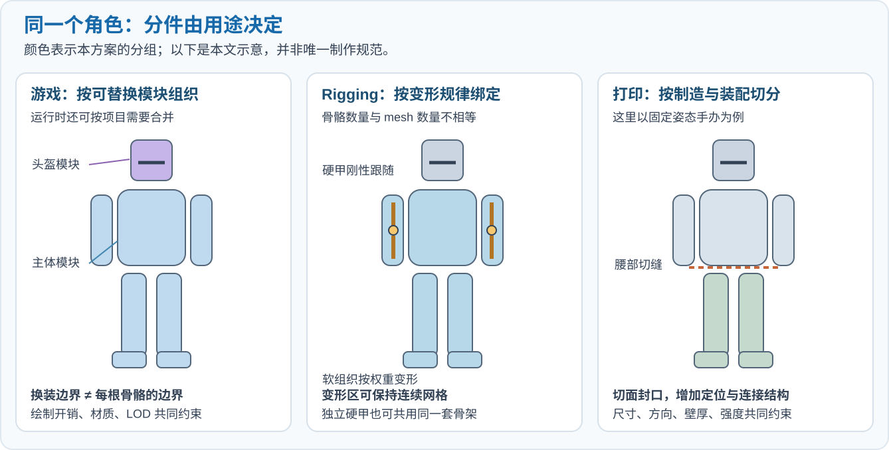
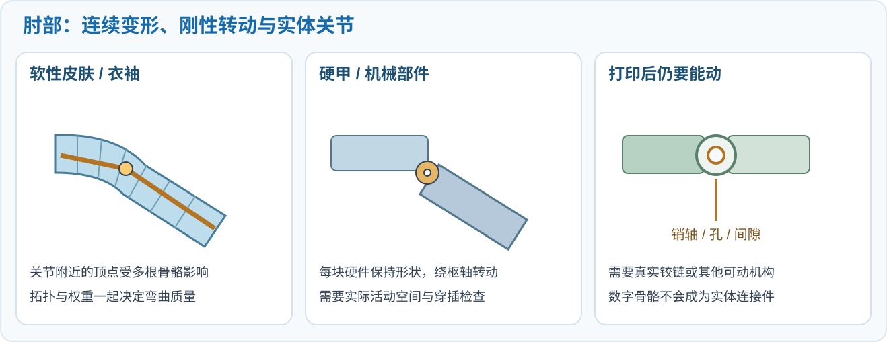
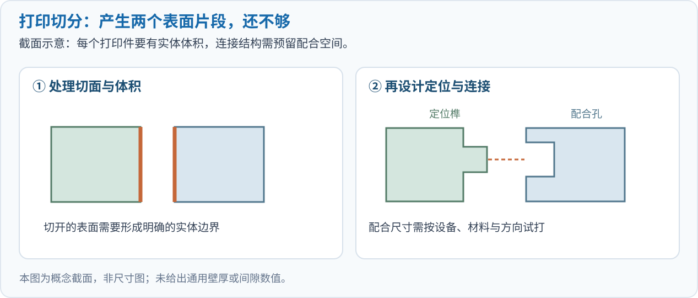

# 游戏、Rigging 与 3D 打印：同一个模型该怎样分件？

**通常不一样。同一个模型可以有多套合理的分件方式，取决于要替换什么、怎样运动、怎样制造。** 游戏关心运行和使用，Rigging 关心运动与变形，3D 打印关心实体能否成型、装配和承受使用。三者有重合，但边界很少完全一致。

还要先明确：**游戏是使用场景，Rigging（绑定骨架与控制系统）是制作步骤。** 游戏角色常常本来就需要 rigging；做打印手办时，也可以先用骨架摆好姿态，再转换为静态打印几何。因此，比较的是三种要求怎样影响分件，而不是三个互斥的模型类别。

本文用一个穿硬甲的角色贯穿说明。图中的方案是概念示意，实际项目还要结合引擎、动作、尺寸、打印工艺与材料决定。

## 先分清：你说的“拆分”发生在哪一层

在建模软件中，“把模型分开”可能是几件不同的事：

| 划分层次 | 实际改变什么 | 例子 |
| --- | --- | --- |
| 语义区域 | 给表面或几何标记名称 | 头、上臂、前臂、胸甲 |
| 对象 / mesh 组织 | 改变独立编辑、导出和管理的单位 | 头盔成为独立对象；一份 mesh 也可包含不连通的几何 |
| 运动与蒙皮分组 | 规定顶点受哪些骨骼影响、硬件跟谁运动 | 肘部同时受上臂和前臂骨骼影响 |
| 实体制造分件 | 生成能单独制造、再连接的有体积零件 | 腰部切开，封闭切面，加定位榫和配合孔 |

**材质分区、UV 接缝、骨骼边界、独立 mesh 和实体切缝，可以分别存在。** 给手臂涂上两个标签，并不会自动得到两件可打印的零件；把几个对象合并管理，也不等于已经焊接顶点或完成实体布尔合并。

## 同一个角色，三种方案可以长得很不一样

*图 1：本文绘制的概念图，可点击查看大图。每列颜色表示该方案的分组；分组不代表必须导出为同样数量的文件。打印列以固定姿态手办为例。*

对游戏角色，头盔可能单独保留以支持换装；对 rigging，皮肤要能连续弯曲、硬甲要保持刚性；对固定姿态打印，身体反而可能合并，或为了成型方向在腰部切开。

| 判断问题 | 游戏资产 | Rigging / 动画绑定 | 3D 打印 |
| --- | --- | --- | --- |
| 为什么拆 | 换装、装备、交互、损坏、运行管理 | 区分连续变形与刚性运动 | 成型尺寸、方向、支撑、强度、装配 |
| 什么可以合并 | 无需独立操作的部分，可按引擎预算合并 | 同一份 mesh 可受多根骨骼控制 | 固定不动且适合一起成型的几何 |
| 什么需要特别处理 | 模块接缝、材质、LOD、碰撞与渲染成本 | 关节附近拓扑、权重、枢轴、穿插 | 壁厚、实体边界、配合、排布和实际连接 |
| 验收看什么 | 引擎内显示、交互、动画和性能 | 大幅摆姿态时是否正确变形 | 切片、试打、装配与目标使用条件 |

下文解释这些差别怎样产生。

## 游戏：分件首先服务于功能与运行预算

### 该独立的是哪些操作

如果玩家能替换头盔、拔剑、卸下背包，这些东西需要可独立定位和操作的资产关系。角色身体即使包含胸部、腹部和四肢，也可以作为一个带蒙皮的主体导出。静态雕像则可能根本不需要与可玩角色相同的模块划分。

“独立操作”也可以通过骨骼、节点或其他引擎机制实现；**是否保留为独立 mesh，应与具体导入和运行流程一起决定。** Unreal Engine 官方的模块化角色文档就介绍了共享姿态、复制姿态和运行时合并等不同组织方式。[Unreal Engine：模块化角色](https://dev.epicgames.com/documentation/en-us/unreal-engine/working-with-modular-characters-in-unreal-engine)

### 拆得细，会改变运行成本

部件越细，越容易替换和复用，但引擎需要管理更多组件，可能产生更多绘制提交（draw call）。绘制次数还受材质区段、渲染通道和合批影响，不能只根据文件里有几个对象判断性能。

Unreal 文档明确指出：共享主角色姿态可以减少动画计算，但不会自动消除各组件的渲染开销；把多个 skeletal mesh 合并，则可能降低持续渲染成本，同时改变功能约束。**制作时保留细分模块，与运行时合并为较少网格，可以同时成立。**[官方方案对比与成本说明](https://dev.epicgames.com/documentation/en-us/unreal-engine/working-with-modular-characters-in-unreal-engine#skeletalmeshmerge)

游戏分件还要配合 **LOD（远处使用更简化的几何）**、碰撞表示和模块接缝。比如换一套上衣后，领口和身体是否露缝，应在动作中检查。碰撞体也可以采用简化形状，其划分未必要照搬渲染表面。

## Rigging：先区分“表面变形”与“整块转动”

### 软性身体不必沿每根骨骼切开

手臂弯曲时，皮肤和衣袖通常需要在肘部连续变形。可以保留一份连续网格，让关节附近的顶点同时受到上臂、前臂等骨骼的影响，影响比例就是**蒙皮权重**。

因此，“上臂”和“前臂”是两个运动相关区域，并不意味着它们必须成为两个断开的表面。切开肘部而没有设计接缝，动作中可能暴露裂口；保留连续表面，则要准备合适的关节拓扑和权重。

Blender 的 Armature Modifier 正是按顶点组及其权重决定骨骼如何作用于顶点。同一对象可以包含多个骨骼对应的顶点组；多个对象也能关联同一套骨架。[Armature Modifier](https://docs.blender.org/manual/en/latest/modeling/modifiers/deform/armature.html)、[Armature Deform Parent](https://docs.blender.org/manual/en/latest/animation/armatures/skinning/parenting.html)

### 硬甲通常需要保持形状

胸甲、护臂板等硬件适合刚性跟随相应骨骼或控制节点。它们可以是独立对象，也可以在一份 mesh 中保留不相连的几何，再给相应顶点分配单骨权重。具体组织方式由制作与导出流程决定。

如果把跨肘的一整块硬甲按软皮肤平滑混合，它可能随动作弯折。这里应解决硬甲的分段、覆盖关系、枢轴和活动空间，而不能只依靠调权重。软硬交界处也可能需要辅助骨、修正形变或其他控制。

*图 2：本文示意。左侧是连续表面的变形；中间是硬件绕枢轴转动；右侧还需要真实的关节结构。三种情况的“肘部边界”含义不同。*

**骨骼数量不等于 mesh 数量，mesh 数量也不等于运动单元数量。** 比较一套分件是否适合 rigging，要看预期动作和变形结果，而不仅是静态模型被分成了几块。

## 3D 打印：需要制造与装配意义上的零件

### 切缝可以穿过一个语义部件

固定姿态的角色手办，手臂可以与身体连接成一件；头盔也可能为了减少零件数量而并入头部。反过来，一个语义上完整的披风或底座，也可能因为超出成型尺寸、支撑难清理或成型方向不合适，而被切成几件。

Prusa 官方列出的切分理由包括成型尺寸、减少支撑和改变局部打印方向以改善强度。这些切分依据来自制造约束，未必出现在语义分割标签中。[Prusa：Cut tool](https://help.prusa3d.com/article/cut-tool_1779)

### 一片表面与一个实体零件不同

准备常规实体打印时，每个预期打印件应有明确的内外和可切片的体积。切开一个表面后，通常还需处理切面，使它形成合理的实体边界；薄片还要考虑实际厚度。

例如，杯子可以保留杯口，但杯壁仍需要有厚度。游戏中用来显示头发或披风的单层面片，需要按打印目标补充实体几何。法线贴图呈现出的细小凹槽，也不会自动变成打印表面的真实凹槽。

破面、异常内部表面和相交壳体可能造成切片歧义。切片器能自动修复其中一些问题，但应以修复后几何和切片预览为准。[Prusa：打印模型修复](https://help.prusa3d.com/article/corrupted-3d-models-for-printing_2205)

### 分件以后，还要能正确接回去

两个虚拟表面相互贴近，并不自动构成可靠的实体连接。要根据用途安排胶接面、定位榫、销轴、孔、卡扣或其他连接方式，并检查装配方向和操作空间。

*图 3：本文绘制的概念截面，非尺寸图。定位榫和配合孔仅表示一种连接方案，实际尺寸需按设备、工艺和材料验证。*

Prusa 的切割工具可以生成插接、定位销和卡扣等连接结构。其建模指南也指出，配合间隙受尺寸、成型方向、校准、设置和材料影响，没有通用数值；壁厚与细节尺寸同样需要结合工艺判断。[连接结构](https://help.prusa3d.com/article/cut-tool_1779)、[面向打印的建模指南](https://help.prusa3d.com/article/modeling-with-3d-printing-in-mind_164135)

## 固定手办与可动打印玩具，又是两种要求

**固定手办**只需要保存目标姿态。可以先用骨架摆姿态，把变形结果转换为静态几何，再根据成型和装配要求重新分件。骨架和蒙皮权重不需要随普通静态打印几何交付。

**可动玩具**则需要真实的转动或滑动机构。数字骨骼只规定虚拟变换；打印后能否转动，还依赖轴、孔、接触形状、间隙、强度和装配方式。使用柔性材料或柔性铰链时，又需按相应结构设计。

可动也未必意味着逐件打印后再装配：有的设计支持**原位打印（print-in-place）**，一次成型得到保留间隙的可动结构。Prusa 介绍过带两个原位打印铰链的夹子实例。但能否采用这种方式，取决于目标工艺能否保持间隙，以及支撑或残留材料能否清除。它与把两个三角网格简单分开仍有差别。[原位打印机构实例](https://blog.prusa3d.com/quick-prints-contest-winners_60523/)

## 三个常见误解

### 不同颜色，是否一定要拆成不同打印件？

不一定。可以分件后分别上色，也可以使用多材料/多颜色打印，或在切片软件中给同一物体的表面分配颜色。颜色边界与物理装配边界是两种信息。[Prusa：Multi material painting](https://help.prusa3d.com/article/multi-material-painting_262620)

### 在切片器里点 Split，是否就完成了打印分件？

不一定。PrusaSlicer 的 **Split to objects/parts** 主要识别文件中已有的分离壳体，再改变对象组织；**Cut** 则能切开模型并设置连接件。前者不会自动根据“头、手、脚”的语义创造合理制造切缝。[Split to objects/parts](https://help.prusa3d.com/article/split-to-objects-parts_1751)

### 分得越细，是不是通用性越好？

细分有利于选择和替换，但也可能增加游戏组件与渲染开销、动画接缝、打印装配工序和细小易损件。通用性更依赖于**保留可重新组合的结构和编辑信息**，而不是尽量增加最终零件数量。

## 做 3D 部件生成时，怎样利用这个区别

从上述要求可以得到一个建模建议：保留语义部件作为基础，同时记录可单独编辑的区域、运动关系和制造信息，再按目标生成不同交付版本。以下是制作与研究建议，并非已经验证的统一算法。

| 共享或分支信息 | 可以记录什么 |
| --- | --- |
| 基础语义与编辑信息 | 名称、左右、材质区域、部件对应关系 |
| 游戏版本 | 可替换模块、材质区段、LOD、碰撞、运行时合并方案 |
| 动画版本 | 软硬属性、骨架、权重、枢轴、变形与接缝要求 |
| 打印版本 | 目标尺寸、壁厚、切缝、连接件、间隙、方向与材料 |

因此，像 ShapeMind 等方法生成的语义部件，可以作为后续制作的起点；游戏、动画或打印是否可用，还需要各自的验收。评测也应分开：**语义与几何质量、动作变形、引擎运行、制造与装配质量**，分别对应不同指标。[前文：LLM 如何参与 3D 部件生成](https://jinjianzhao.github.io/daily-papers/knowledge/article.html?slug=llm-3d-part-generation)

如果已经拿到一个完整模型，可以按这个顺序判断：

1. 先确定交付目标：静态游戏物体、可换装角色、动画角色、固定手办，还是可动打印玩具。
2. 标出哪些区域需要单独替换，哪些要连续变形，哪些要保持刚性。
3. 为游戏或动画版本决定对象组织、骨架和权重，并在引擎和动作中验证。
4. 为打印版本确认尺寸与工艺，再决定合并、切分、实体修复和连接方式，并通过切片与试打验证。

## 官方资料与继续阅读

本文核对的是官方文档中的机制与约束，检索日期为 2026 年 10 月 29 日；具体软件界面可能随版本变化。

- [Unreal Engine：Working with Modular Characters](https://dev.epicgames.com/documentation/en-us/unreal-engine/working-with-modular-characters-in-unreal-engine)：模块化角色、共享姿态与网格合并的功能和成本。
- [Blender：Armature Modifier](https://docs.blender.org/manual/en/latest/modeling/modifiers/deform/armature.html)：骨骼如何通过顶点组和权重作用于网格。
- [Blender：Armature Deform Parent](https://docs.blender.org/manual/en/latest/animation/armatures/skinning/parenting.html)：多个对象的骨架关联与权重设置。
- [Prusa：Modeling with 3D printing in mind](https://help.prusa3d.com/article/modeling-with-3d-printing-in-mind_164135)：方向、支撑、壁厚、配合、实体与材料。
- [Prusa：Cut tool](https://help.prusa3d.com/article/cut-tool_1779)：制造切分与连接件。
- [Prusa：Split to objects/parts](https://help.prusa3d.com/article/split-to-objects-parts_1751)：已有壳体的分离与组织。
- [Prusa：Corrupted 3D models for printing](https://help.prusa3d.com/article/corrupted-3d-models-for-printing_2205)：自动修复的能力与边界。
- [Prusa：Multi material painting](https://help.prusa3d.com/article/multi-material-painting_262620)：颜色分区与物理分件的区别。
- [Prusa：Quick Prints Contest Winners](https://blog.prusa3d.com/quick-prints-contest-winners_60523/)：包含带两个原位打印铰链的夹子实例。
- 站内：[3D 绑骨入门](https://jinjianzhao.github.io/daily-papers/knowledge/article.html?slug=ai-3d-character-rigging)、[让盔甲骑士跳舞](https://jinjianzhao.github.io/daily-papers/knowledge/article.html?slug=blender-knight-rig-dance)。

## QA

暂无问答。
