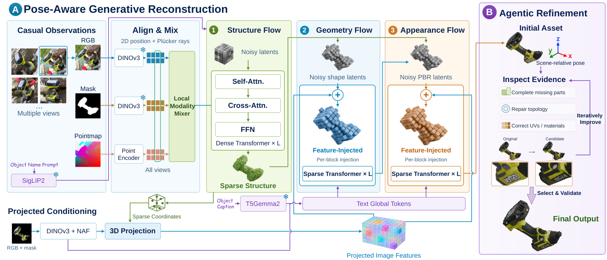
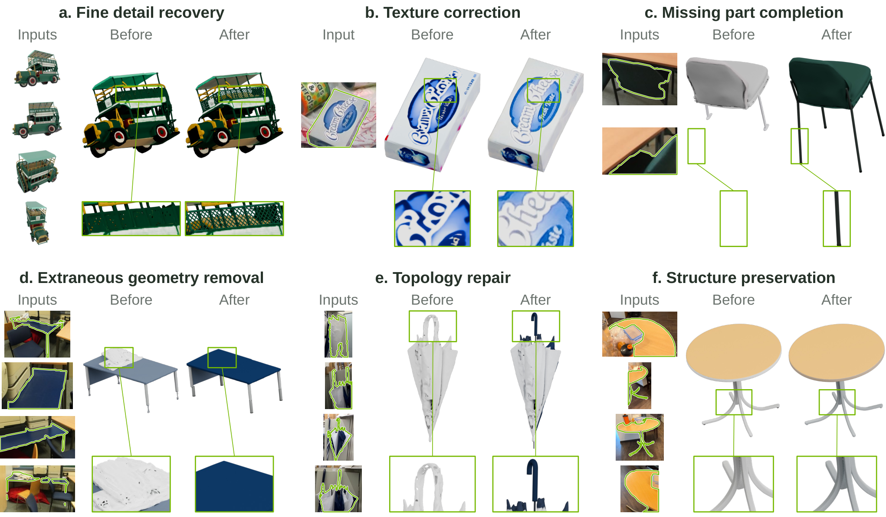
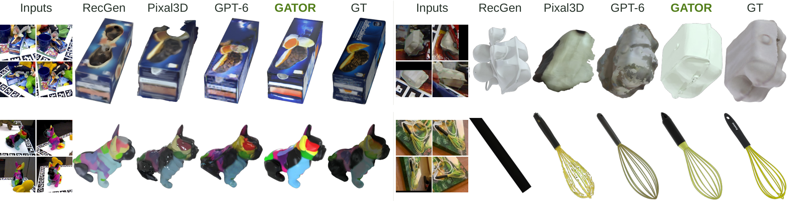

# GATOR：从随手拍的照片重建可放回场景的 3D 物体

论文：[GATOR: Generative and Agentic 3D Object Reconstruction From Casual Images](https://arxiv.org/html/2610.11215v1)。本文按论文 v1 解释方法与实验。先记住它的分工：**生成模型根据少量照片给出完整、带材质、带场景位置的 3D 初稿；多模态 Agent 再拿这个初稿与照片对照，局部修改网格和材质。**

## 1. 它到底要解决什么任务

输入是同一个目标物体的一张或多张 RGB 照片。物体可以被别的东西遮挡，也不必先单独抠出或沿预定相机轨迹拍摄。运行时还使用目标掩码、每张图的相机参数与深度，以及物体类别名或描述文本；掩码、相机和深度可以由图像估计，**不能把这些额外信息理解成模型仅凭 RGB 端到端自己算出**。若估计错误，它们也会成为误差来源（论文 §3.1、§4.1、附录 D.7）。

输出是一个完整的、带纹理和物理材质的 3D 网格资产，以及它相对于输入场景的朝向、尺度和位置。比如拍到一把椅子的一面，方法要补出背面和被遮挡的椅腿，并把椅子放回照片中它原本所在的坐标位置。这里的“完整”包含对未见表面的**合理生成**，并不意味着那些表面都能由照片唯一确定；“场景对齐”也依赖输入相机与深度提供的几何尺度。论文附录 A.1 明确指出，恢复真实物理尺寸需要有公制尺度的深度。

这和只生成一张新视角图片不同：下游若要编辑、摆放或模拟物体，需要一个可导出的 3D 资产。和只恢复可见深度也不同：物体背面、内部遮挡以及完整材质也要补全。

## 2. 先看端到端路线

图 1　原论文 **Figure 2**。左侧是按“稀疏结构 → 几何 → 外观”顺序生成 3D 资产，右侧是 Agent 对生成结果做编辑、渲染、复核。图片来源：[GATOR arXiv HTML v1](https://arxiv.org/html/2610.11215v1)。

可以把这条路线看成五步：

1. **统一观测坐标。**由目标掩码内的深度反投影出 3D 点，取中心和范围作为平移锚点与尺度；只平移、缩放，不旋转，因而生成结果保留观测坐标轴中的朝向。
2. **融合三种逐位置证据。**RGB 告诉模型颜色和上下文，pointmap 告诉它图像像素对应的估计 3D 位置，掩码指出当前要重建哪个物体。同一图像 patch 的三种 token 先交互，再让结构生成器综合各个视角。
3. **生成稀疏 3D 结构。**模型先决定哪些 3D 网格位置属于物体，再在这些位置生成细几何和材质。类别名和描述文本给未见部分提供语义先验。
4. **放回场景。**用可微渲染的轮廓、深度和观测点优化平移与统一缩放；这一步固定预测的朝向与局部形状。
5. **Agent 修补。**Agent 查看原照片和初稿，在 Blender 中写脚本改网格、UV 或材质；用相同相机与光照渲染修改前后结果，决定保留或撤回修改。

这里的 **pointmap** 是把深度像素通过相机模型反投影得到的逐像素 3D 坐标。它是从图像估计或传感器数据构造的观测证据，不是最终网格。**稀疏结构**是物体占据的活跃 3D 网格坐标；它决定后续在哪里生成细节。**几何 latent** 表示这些位置上的形状细节；**PBR 材质 latent** 表示可用于基于物理的渲染的表面属性。最后解码成可编辑的网格与材质，Agent 直接修改这个资产，而不是回头重训生成器（论文 §3、附录 A）。

## 3. 三种图像信息怎样进入结构生成器

对每个视角，模型把 RGB、目标掩码与 pointmap 编码到同一 patch 网格。RGB 和掩码用冻结的 DINOv3 特征，pointmap 用可训练编码器；pointmap 编码器为无有效深度的像素设置可学习 token。RGB 与 pointmap 保留目标周围的桌面、遮挡物等上下文，掩码则标明目标归属（论文 §3.2、附录 A.1）。

同一 patch 的三个 token 带着共同的 2D 位置和相机射线编码，进入一个只在该 patch 内部做注意力的 **local modality mixer**。例如一个 patch 既有杯子的轮廓又有桌面的深度，模型可同时看到颜色、深度与“这里是否属于杯子”的标识。mixer 输出仍是三个 token，只是每个 token 已交换了该位置的跨模态信息。随后，结构 latent 对所有视角的这些 token 做 cross-attention，在全局范围决定 3D 哪些位置应该被占据。这种顺序的意义是：先把同一像素区域的证据对应起来，再综合不同视角；遮挡区缺少观测时，全局注意力与生成先验负责补全（论文 §3.3）。

物体类别的短文本经冻结 SigLIP2 编码和适配器，调制结构生成器各层。比如“椅子”提供一个形状类别约束，但不会告诉模型这把椅子被遮住的腿究竟长什么样。作者认为这种语义先验能帮助稀疏视角下的补全；这一作用的实验依据要看后文消融，不能从模块命名直接推断。

## 4. 从稀疏结构到细几何和外观

结构生成器沿用 TRELLIS.2 的级联式表示：先生成完整物体的稀疏占据位置，再在活跃位置生成形状 latent，最后在同样位置生成 PBR 材质 latent，且材质生成受形状 latent 约束。三段都使用条件 rectified flow：训练时给目标 latent 加入不同噪声，网络学习从噪声状态回到目标状态所需的速度；推理时迭代采样。这个“生成”环节主要负责**缺失部分的可能形状和表面**，并把可见证据整合成一致的 3D 资产（论文 §3.3–3.4、附录 A.2）。

已知稀疏位置后，细节阶段可以利用更精确的局部对应。模型把每个活跃 3D 坐标投影到各张照片，读取该像素附近的 DINOv3 特征及 NAF 上采样特征，在有效视角间取平均，并注入几何、外观 flow 的每一层。没有可投影视角的坐标得到零局部特征，仍可通过全局图像 token 和 T5Gemma2 编码的描述文本获取条件。这里的文本覆盖从类别名到较详细的物体描述，与结构阶段的短类别提示不同（论文 §3.4、附录 A.3）。

两个容易混淆的细节：**结构阶段看含环境的原图**，因为周围物体有助于解释“哪里被挡住了”；**几何与外观阶段从目标遮罩图读取局部特征**，减少遮挡物颜色被贴到目标表面的机会。投影阶段没有显式遮挡测试，同一相机射线上的多个 3D 点可能读到同一个像素特征；因此局部投影是条件线索，不是已经验证的可见表面对应（论文 §3.4、附录 A.3）。

初始平移与尺度来自目标深度的中心和范围。生成后，可微渲染比较目标轮廓、深度与观测点，调整平移和统一尺度；朝向与局部形状保持固定。这解释了“pose-aware”的确切范围：模型在观测坐标轴中生成朝向，并单独精修放置参数，而非由后处理任意旋转网格（论文 §3.1、附录 A.3）。

## 5. Agent 在做什么，为什么还需要它

生成初稿有时会漏掉一条支架、把孔洞封住、把包装上的字生成乱码，或让别的物体的纹理混入目标。GPT-6-Astra Agent 拿到这个**已经有尺度、朝向和主体比例的网格**，以及照片、掩码、可用相机与深度，使用 Blender 脚本做有依据的局部修补。它检查原资产与修改候选在相同相机、光照下的渲染，退回看起来变差的修改，并在时间预算内选择检查过的资产（论文 §3.5、附录 A.4）。

因此，生成模型与 Agent 解决的是两种不同层次的问题。前者用训练得到的 3D 分布一次性补出整体结构；后者用可执行的网格和材质编辑修正具体实例中的局部错误。Agent 不直接看到参考网格、留出视角或基准分数；它对“是否更像真实背面”的判断仍受可见照片限制。论文主实验给修补和从零重建的 Agent 相同的每物体十分钟预算；从零重建基线不给初稿（附录 A.4）。

图 2　原论文 **Figure 10**：六组修改前后案例，涵盖补栏杆、修正文字、补椅腿、去掉融合杂物、修雨伞手柄，以及保持已较准确结果。各对比共享相机、漫反射着色与显示尺度；这是**定性案例**，不能代表所有物体都会改善。图片来源：[GATOR arXiv HTML v1](https://arxiv.org/html/2610.11215v1)。

## 6. 数据、监督和训练目标

论文的生成模型**只在合成场景训练**。作者构建 S3：从约 98 万个资产的素材池取物体，每个场景摆放多个物体，改变尺度、姿态、接触、遮挡、相机路径和光照；另加入若干室内合成场景数据。每个训练样本把目标物体的局部、多视角观测，配上场景放置后的**完整**形状与材质。训练时还混入相机、深度、掩码扰动以及图像估计结果，使输入接近随手拍条件。素材池资产数、训练样本数和评测目标数是不同统计口径，不能混用（论文 §4.1、附录 B.1/Table 6）。

监督的核心是三段 flow 的速度回归：结构段拟合完整物体的占据 latent，几何段拟合形状 latent，外观段拟合 PBR 材质 latent，均使用论文附录 A.2 的均方误差目标。几何与外观 flow **训练时使用真值稀疏结构**，推理时使用前一阶段预测的结构；因此前一阶段出错会传到后面。Agent 是推理期编辑步骤，论文没有把它描述成另一个可微的训练损失（论文 §3.4–3.5、附录 A.2–A.4）。

## 7. 实验究竟支持了哪些结论

评测覆盖 Toys4K 的 525 个对象、真实桌面场景 LM-O/HB/HANDAL，以及 ScanNet++ 的室内目标。Toys4K 和桌面主比较用四视角；ScanNet++ 每目标用一到十视角。论文对“放置加形状”用 **ADD-SB**（越低越好）和阈值召回；对经相似变换对齐后的形状用 **CD**（越低越好）、法线一致性、F1、轮廓 IoU；对外观用 PSNR、SSIM、LPIPS。要注意：经对齐的 CD 或 PSNR 已经排除了部分放置误差，不能单独证明物体在原场景中的位置正确（论文 §4.1、附录 C）。

图 3　原论文 **Figure 3**：HB、LM-O、HANDAL 桌面场景中，输入视角、若干基线和 GATOR 的可视化结果。图注说明大多方法用四视角，RecGen 用两视角，GPT-6-Astra 从零重建；图中盒身印刷、打蛋器细线等是可观察的局部案例。图片来源：[GATOR arXiv HTML v1](https://arxiv.org/html/2610.11215v1)。

| 原文位置与设置 | 直接报告的结果 | 能支持的判断 |
| --- | --- | --- |
| Table 1，Toys4K 四视角 | GATOR CD **0.009**、F1 **0.757**；Pixal3D-MV 为 **0.011**、**0.701** | 这组受控物体上，GATOR 的平均对齐形状指标更好。 |
| Table 2，三组真实桌面数据汇总 | GATOR ADD-SB **0.022**、CD **0.009**、PSNR **17.97 dB**；Pixal3D 的 CD **0.018**、PSNR **16.94 dB**，但没有场景放置指标 | 对可比的形状和外观指标，GATOR 占优；不能用 Pixal3D 空缺的 ADD-SB 做直接比较。 |
| Table 3，ScanNet++ 室内目标 | GATOR ADD-SB **0.041**、CD **0.031**、F1 **0.603**；RecGen 为 **0.067**、**0.041**、**0.540** | 在该室内评测协议下，GATOR 同时改善放置和对齐形状指标。 |

这些是论文报告的特定数据集、输入配置和评测协议下的结果。不同基线有输入视角上限；例如桌面比较中 RecGen 选两张、SimFoundry 选一张，所以“同一候选照片集合”不等于每个模型处理完全相同的视角数。论文同时把完全依赖专有 Agent 从零重建的 GPT-6-Astra 基线与其他方法分开标注（论文 Tables 1–3）。

**组件证据。**在 55 个 HANDAL 目标的四视角消融中，从基础模型加入 local mixer 后 ADD-SB 从 **0.057 降到 0.037**，但 CD 从 **0.010 升到 0.011**；再加入文本，ADD-SB 到 **0.032**、CD 到 **0.008**、F1 从 **0.872 升到 0.930**；最后加入 Agent，PSNR 从 **18.93 升到 19.60 dB**，但轮廓 IoU 从 **0.739 降到 0.717**。因此 mixer 的增益主要体现在此消融的放置指标，文本的增益更全面；Agent 的局部可见改进不能概括成所有几何指标都改善。论文还指出，在其主结果的 HANDAL 分组中，Agent 对 CD、F1 和 IoU 略有负面影响，消融模型分数也不应与主表直接并排比较（论文 Table 4、§4.4、附录 D.5/D.2）。

**效率与应用证据。**论文 Figure 5 的 Toys4K 子样本时间比较中，生成初稿约 **0.5 分钟**，其 CD 和 LPIPS 已优于从零工作 **20 分钟**的 GPT-6-Astra；该图只统计有效输出，时间包括估计的 **32 秒**生成时间而不包括网格导出。附录 D.6 的刚体仿真展示了三个椅子案例：原生成资产在落稳后倾斜或倒下 **40°–79°**，Agent 修补版在 **1.3°** 内保持直立。这说明局部结构修补可能改善仿真行为，但三个案例不足以证明所有资产都具备仿真稳定性。

## 8. 如何理解论文主张与适用边界

作者的总体主张是：局部 RGB/掩码/pointmap 融合、分阶段文本条件、生成初稿后的 Agent 修补，合在一起能从稀疏、杂乱的随手拍图像得到更完整、更适合场景使用的 3D 资产。Tables 1–4、Figure 5 和定性图支持的是**各自评测设置内**的重建指标、时间和局部修补表现；不能由这些结果推断任意日常照片都能恢复真实的不可见表面。

实际使用有三条主要边界。第一，目标掩码、相机和深度仍是必需证据，严重漏分割或错误深度会伤害结果。第二，Agent 使用专有 GPT-6-Astra，最多增加每物体十分钟工作时间，复现成本和开放性受其约束。第三，可见照片不能验证隐藏背面的真值；而投影条件缺少显式遮挡测试，错误对应与不可靠初稿仍可能传到最终资产。这些边界分别来自论文附录 D.7、A.3 与方法本身。

最值得带走的技术线索是：**先在照片坐标关系中生成一个完整、可放置的 3D 初稿，再把结构化编辑交给 Agent**。生成提供整体补全与实例锚点，Agent 提供局部可控修补；两者的作用和证据应分开判断。

## QA

暂无问答。
