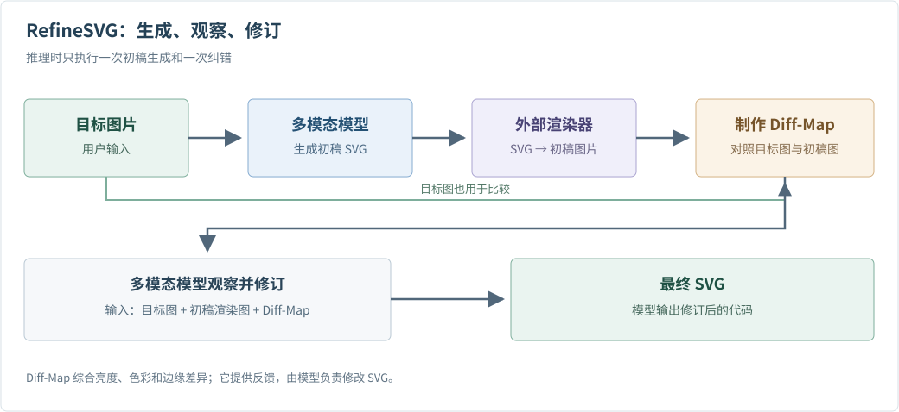

# 看图生成 SVG：LLM 真能把图片画成矢量图吗？

**有，而且已经不止一种方法。** 如果输入是一张 PNG/JPEG，输出是一段可以渲染、缩放和继续编辑的 SVG，任务叫图像矢量化（image-to-SVG）。[StarVector](https://arxiv.org/html/2312.11556) 把视觉编码器接到代码语言模型上；[OmniSVG](https://arxiv.org/html/2504.06263) 让视觉语言模型逐个预测 SVG 图形 token；[RefineSVG](https://arxiv.org/html/2607.27699) 则让多模态模型先写一版、看渲染结果，再修改。这些是**真的以图片为输入**的方法，不是让一个纯文字 LLM 凭描述画图。

但先明确目标：SVG 不是把 PNG 换个文件后缀。PNG 给出每个像素的颜色；SVG 要写出圆、矩形、曲线、填充色与图层顺序。一张 100×100 的橙色圆图片，可能对应一个 `<circle>`，也可能对应上百条拟合边界的短路径。二者渲染出来接近，结构和可编辑性却完全不同。因此问题不只是“像不像”，还包括路径是否简洁、元素是否合理、文件是否有效。

## 标准范式：让视觉条件指导程序生成

可以把这类方法理解成一个多模态版的代码补全器：

`输入图片 → 视觉编码器提取图像 token → LLM/VLM 逐步写出 SVG 表示 → 转成 SVG 文件 → 渲染检查`

这里 LLM 负责**生成有顺序的图形程序**，视觉模块负责提供参考图的信息。比如输入一张卡通猫图，模型要依次决定背景、身体轮廓、耳朵、眼睛等元素以及每条曲线的坐标。输出的 SVG 经过浏览器或其他渲染器，才重新变成我们看见的图片。这个过程通常要用大量 `(栅格图, 对应 SVG)` 配对样本训练：先把已有 SVG 渲染成栅格图，模型看图、预测原 SVG。训练中的 next-token loss 可以教它如何接着写代码，但**同一张图可能有多种合理 SVG**，所以预测某份原文件并不等于找到了唯一正确的矢量结构。[StarVector 的数据与方法](https://arxiv.org/html/2312.11556)、[OmniSVG 的数据与方法](https://arxiv.org/html/2504.06263)都明确采用了这种图像—SVG 配对思路。

下面是三种有代表性的具体实现。它们共享“图像条件 + 序列输出”的骨架，但训练与纠错并不相同。

## StarVector：看图，直接写 SVG 代码

[StarVector](https://arxiv.org/html/2312.11556) 的底座是 StarCoder 系列代码语言模型。输入图片先经过视觉编码器与 adapter，变成语言模型能使用的视觉 token；语言模型随后自回归生成 SVG **代码**。它还支持文字输入，但图生 SVG 是论文明确训练和评测的任务，不是我们从文生图能力推测出来的。训练样本包括图片与对应 SVG，目标是预测后面的 SVG token；这意味着 LLM 是实际参与训练的生成器，而不只是推理时被调用的外部 API。

这条路线好懂：既然 SVG 本身是一门文本化图形语言，就让擅长代码的模型写它。作者构建的 SVG-Stack 含约 210 万个 SVG，并将其渲染为配对图片。[论文的图像矢量化实验](https://arxiv.org/html/2312.11556)显示，它在 DINO 特征相似度等偏语义的指标上有优势；但经典图像处理方法在 SSIM/MSE 等像素指标上可能更强。换句话说，“看着是同一个图标”和“每个像素都贴近原图”不是同一个评价目标。StarVector 也有长代码可能截断、语法不完整、生成内容偏离输入的风险；论文专门讨论结束标记和采样设置。

## OmniSVG：不逐字写 XML，而是预测图形 token

[OmniSVG](https://arxiv.org/html/2504.06263) 以 Qwen2.5-VL 为视觉语言模型底座。它把 SVG 整理为有限种路径命令、坐标和填充色 token；图片和文字可以成为条件前缀，模型自回归预测 SVG token 后缀，最后再还原为 SVG。和 StarVector 相比，它希望模型学习的序列更贴近“画线、画曲线、填色”的图形结构，而不是直接处理冗长的 XML 字符串。

这一设计的意义是降低代码表示的负担：如果坐标和命令能被较稳定地 token 化，模型就不必把一条曲线拆成大量普通文字碎片。不过，它也受表示设计约束：论文使用经过简化的 SVG 命令集合，不能把结果理解为能够无损重建任何 SVG 特性。论文的 MMSVG-2M 覆盖图标、插画和角色，**Image-to-SVG** 是其正式评测任务；另外还有角色参考生成任务，后者侧重保留角色形象并生成新图，不能与“复刻输入图片”混为一谈。[论文第 3–4 节与评测定义](https://arxiv.org/html/2504.06263)对此作了区分。

## RefineSVG：画完回看，再做一次修改

前两种模型主要是“看一次图片，然后连续写完”。如果前面一条路径偏了，后续路径会跟着偏。[RefineSVG](https://arxiv.org/html/2607.27699) 改为闭环：多模态 LLM 先从目标图片生成初稿 SVG；外部渲染器把它变回图片，系统比较“目标图”和“初稿图”，制作突出亮度、颜色与边缘差异的 Diff-Map；模型收到目标图、初稿渲染图和差异图后，进行一次针对性的修订。[方法图与第 3 节](https://arxiv.org/html/2607.27699)给出了完整链路。

这里要区分**推理流程**和**模型训练**。渲染器本身不是 LLM，差异图也不是自动修改代码的魔法；修订仍由模型输出。论文先用图像—SVG 对做监督微调，再构造可修订初稿的冷启动样本，最后用包含视觉奖励的强化学习训练这个闭环行为。因此它不是“随手给一个现成 LLM 加个截图工具，就拥有了同样的修图能力”。代价是每张图至少多一次生成、渲染、比较和修订，延迟高于单次生成。

## 与传统描摹和其他矢量化方法的区别

| 路线 | 核心操作 | LLM 在哪里 | 更合适的情况 |
| --- | --- | --- | --- |
| 传统 tracing，例如 [Potrace](https://potrace.sourceforge.net/) | 从位图边界提取、拟合可缩放的曲线 | 不使用 LLM | 黑白标志、轮廓清晰、要求稳定快捷的描边 |
| 非 LLM 的学习／优化矢量化，例如 [Layer-wise Image Vectorization](https://arxiv.org/abs/2206.04655) | 预测或优化图形图层，使渲染图接近目标 | 不使用 LLM | 主要看视觉重建效果，不一定需要图形代码语言模型 |
| StarVector、OmniSVG | 从图像 token 逐步预测 SVG 代码或图形 token | 经任务训练的生成核心 | 希望用学过的图形先验得到较紧凑、可编辑的图形 |
| RefineSVG | 生成初稿，渲染回看，依据差异修订 | 经过闭环训练的生成与修订核心 | 复杂图案中一次输出容易偏离目标，且可以接受额外计算 |

传统 tracing 是按像素轮廓“描”；LLM/VLM 方法则用数据学到的图形先验，尝试把图解释成更有结构的元素。前者并不落后：当目标是忠实描边、低成本、可重复，传统工具仍可能更合适。后者的优势也不应夸大为“自动理解设计师原始图层”：从栅格图通常无法唯一反推出原作者的路径、遮挡关系和编辑意图。若输入是照片、细密纹理或渐变，想得到简洁、人工易编辑且像素又非常接近的 SVG，依然困难。

还有一类系统在**推理时**调用通用 LLM 帮忙规划或编写 SVG，再靠扩散模型、可微渲染器或其他优化器完成图形；例如 [Chat2SVG](https://arxiv.org/html/2411.16602) 主要研究文字驱动的 SVG 生成。它能说明 LLM 可以充当绘图工作流的一环，却不应被直接算作“训练过的图片→SVG 模型”，更不能据此推断该 LLM 做过 SVG 专项训练。是否算真正的图生 SVG，首先看用户侧输入是不是参考图片、最终输出是不是 SVG，再看论文如何训练和评测。

## 该怎么选，以及目前的真实边界

如果你想把清晰的黑白 logo 快速变成路径，先试传统 tracing。如果你要把图标、插画等参考图变成简洁 SVG，并愿意容忍模型对细节作解释，StarVector 和 OmniSVG 是直接相关的研究路线。若初稿常有漏画或错位，再看 RefineSVG 一类渲染反馈方法。比较它们时，最好同时看**渲染相似度、SVG 有效性、路径数量／长度、可编辑性和运行成本**；只看一张好看的结果图，无法判断是不是靠成百上千条冗余路径堆出来的。

一句话概括：**有基于图片生成 SVG 的 LLM/VLM 方法，而且其中一些确实专项训练了模型；它们将“看图”和“写图形程序”连接起来。** 这不是通用 LLM 天生拥有的能力，也不是 SVG 后缀转换。它适合需要语义化、可编辑矢量图的场景，但目前不能保证忠实恢复任意图片的原始设计结构。

### 原始资料

- [StarVector: Generating Scalable Vector Graphics Code from Images and Text](https://arxiv.org/html/2312.11556)：图片条件、代码模型、SVG-Stack 和图像矢量化评测。
- [OmniSVG: A Unified Scalable Vector Graphics Generation Model](https://arxiv.org/html/2504.06263)：Qwen2.5-VL、SVG token 表示、Image-to-SVG 任务。
- [RefineSVG: Visual Feedback-Driven Reinforcement Learning for Image-to-SVG Generation](https://arxiv.org/html/2607.27699)：图像输入、渲染差异反馈、闭环训练。
- [Potrace 官方说明](https://potrace.sourceforge.net/)与 [Towards Layer-wise Image Vectorization](https://arxiv.org/abs/2206.04655)：非 LLM 对照。

## QA

### RefineSVG 的完整流程是什么？核心创新在哪里？

先看**用户实际使用时**的一次生成：输入目标图片，模型写出初稿 SVG；外部渲染器把初稿变成图片；系统对照目标图生成差异图；模型再根据目标图、初稿渲染图和差异图，输出修订后的 SVG。论文把最后一步称为 ReAct 式纠错。这个流程只做**一轮修订**，不是无限循环直到完全一致。

*图：根据 [RefineSVG 论文 Figure 2 和第 3.1–3.3 节](https://arxiv.org/html/2607.27699)重画的推理流程示意。Diff-Map 对照目标图与初稿渲染图的亮度、色彩和边缘差异；它是给模型看的反馈，不是直接改写 SVG 的程序。*

论文的核心创新可分成四点：

1. **把一次性生成改成可观察的单步纠错。** 模型先写初稿，再看到实际渲染结果及错误区域，最后针对性修订；解决长 SVG 序列里坐标和图层错误不断累积的问题。
2. **设计多维 Diff-Map 作为具体反馈。** 将目标图和渲染图的亮度、色彩、边缘差异汇成空间残差图，告诉模型“哪里不像、主要是哪类差异”，比笼统说“再画好一点”更可定位。
3. **扩充 SVG 专用 token。** 为常见标签、路径命令、坐标和颜色建立更合适的表示。论文报告其数据上的平均 SVG token 数由 1977 降至 933（约减少 52.8%），为长代码和视觉反馈留出上下文空间；这是该论文设置下的结果，不是所有 SVG 的通用压缩率。
4. **训练模型学会利用反馈。** 先用图片–SVG 配对数据做初稿生成的监督微调，再通过拒绝采样构造“有错误但可修”的初稿做纠错冷启动，最后用 GRPO 和视觉、结构、代码效率等奖励训练完整的生成–观察–修订轨迹。

**容易混淆的一点：** 上图是推理流程；SFT、拒绝采样和 GRPO 是此前训练模型的方法。用户提交一张图片时，不会现场对模型做这三轮训练。
