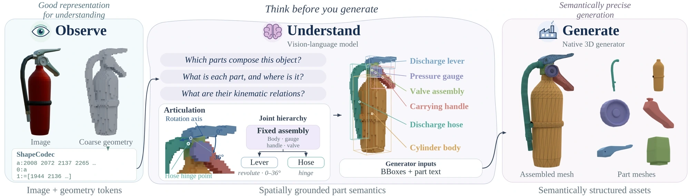
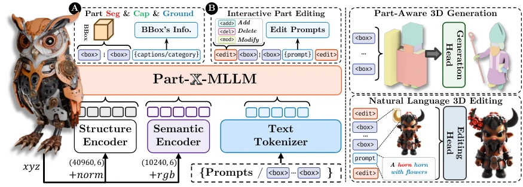
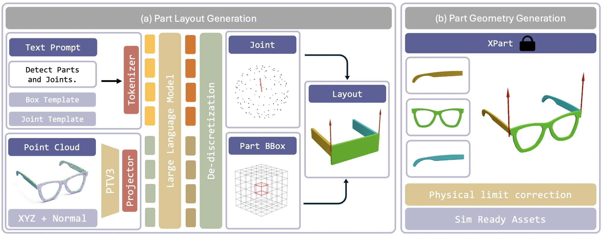
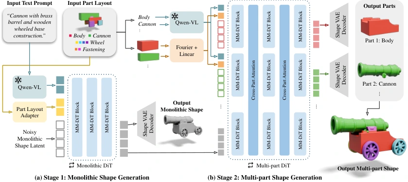
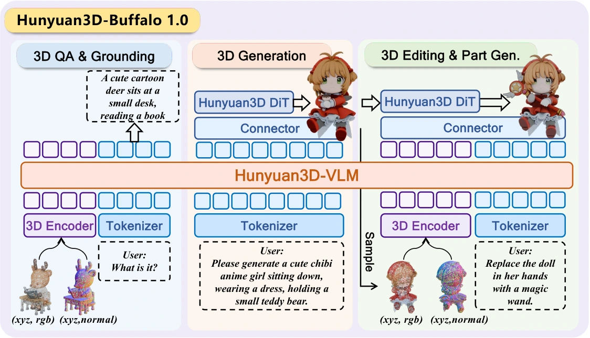
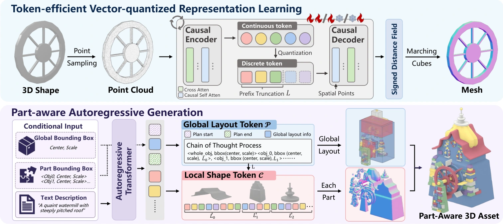
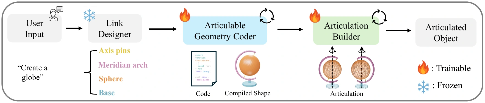
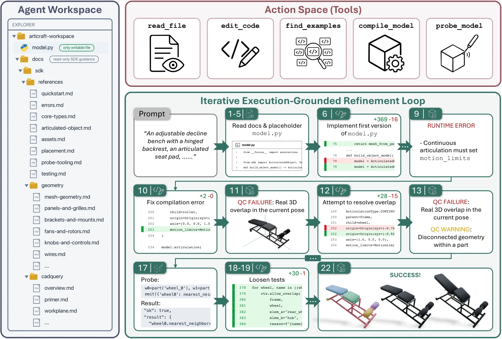
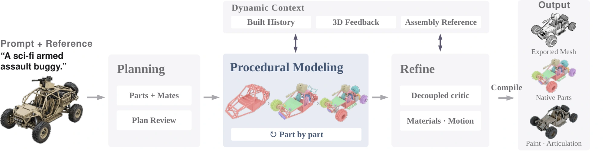
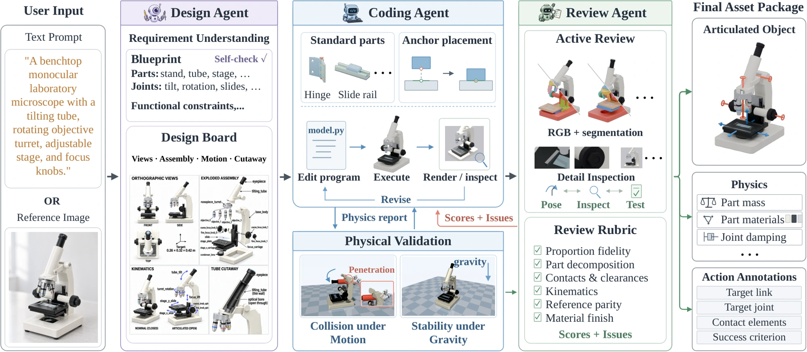

# 从 ShapeMind 出发：LLM 如何参与 3D 部件生成

生成一把椅子的完整外形，与生成能分别编辑的椅座、靠背和椅腿，是两个要求。再要求椅背可以转动，就需要知道哪些部件一起移动、旋转轴在哪里、允许转多少度。**引入大语言模型（LLM），主要是在补充部件语义、空间结构、程序和运动关系；具体几何可以由另一个生成器完成，也可以由 LLM 预测的形状编码解码得到。**

本文以 **ShapeMind** 为起点，整理截至 **2026 年 10 月 29 日**可核实的相关论文和项目。重点是弄清：**LLM 接收什么、输出什么、几何由谁生成、是否需要训练 LLM。** 文中的路线划分用于解释方法之间的联系；各论文的输入与评测不同，实验数字保留各自适用范围。

文中也会用到**视觉语言模型（VLM）**，即能结合图像与文字处理任务的语言模型；一些方法再接入点云编码器，使其能够利用三维形状信息。

## 先明确结果：部件、几何与关节分别是什么

**部件几何**是能单独处理的一份三维形状，例如一个门板 mesh。Mesh 记录顶点和连接成表面的面；有了顶点位置，还需要面之间的连接关系，才能得到完整表面。

**部件语义与布局**说明这是“门板”，以及它在物体的什么位置。常用中间表示是三维包围框（bounding box）：用一个长方体约束部件的大致范围。框坐标只给出范围，具体曲面仍需生成。

**运动结构**说明哪些几何组成一个刚性运动单元，以及运动单元之间怎样连接。一个运动单元通常称为 **link**，连接称为 **joint**。门板和固定在门板上的把手可以是两个语义部件，却属于同一个运动单元。生成了独立 mesh，接下来仍要确定关节类型、轴、位置和运动范围，才能控制它运动。

读这类论文时，可以先把中间输出分成三种：

| 中间输出 | 一个具体例子 | 后面还需要什么 |
| --- | --- | --- |
| 结构计划 | 柜体、左门、右门的名称和三维框 | 生成每个部件的真实表面 |
| 建模程序 | 创建门板、开孔、设置位置、定义转轴的代码 | 执行程序，检查几何与运动 |
| 形状编码 | 一串表示门板几何的离散 token | 用训练好的几何解码器还原表面 |

还有一类接口直接传递 **LLM 的隐藏特征向量**。这时中间信息保存在特征中，读者未必能看到一份文本部件清单。Buffalo 就体现了这种连接方式。

## 从 ShapeMind 看到整条工作链

[ShapeMind](https://yanxinhao.github.io/Projects/ShapeMind/) 的公开流程是：图像提供外观，**ShapeCodec** 把粗三维占据数据编码成紧凑的普通文本 token；**ShapeVLM** 据此预测部件框、标签、描述和运动分组；**Semantic PartGen** 在共享物体坐标系中联合生成各部件的顶点与面连接，得到可分别编辑的三角网格。

*图 1：理解模块输出空间中的部件语义，生成模块利用部件框与文字生成几何。来源：[ShapeMind 项目页方法图](https://yanxinhao.github.io/Projects/ShapeMind/assets/images/framework.webp)。*

这里的接口很关键：只要提供图像、部件描述和三维框，就能调用生成器。因此，项目还展示了由外部 Agent 规划部件与关节、直接调用 Semantic PartGen 的流程；这些案例跳过了 ShapeVLM。项目中的仿真演示也说明，几何以外的关节与物理参数设置可以由外部 LLM 补充。[项目说明](https://yanxinhao.github.io/Projects/ShapeMind/#agents)

截至本文核查日，作者个人主页仍把论文标为 **“Paper: Coming soon”**。现有材料支持解释其模块与演示接口；基础模型、训练损失、数据规模和统一定量比较需等待完整论文。项目中的运动学播放与物理模拟也应分别看待。[作者主页](https://yanxinhao.github.io/)

## 相关工作先看这张表

按与 ShapeMind 的机制关系，最值得先读的是 **Part-X-MLLM、ArtLLM、MultiCube**；随后看特征接口 **Buffalo** 和形状 token 路线 **MegaParts**。代码生成一支则以 ShapeCraft、LAM、Articraft、Procedura、Artisan 为代表。

| 工作 | 主要输入 | LLM/VLM 承担什么 | 几何怎样得到 |
| --- | --- | --- | --- |
| ShapeMind，公开项目 | 图像＋粗几何文本 | 部件语义、框与运动分组；也支持外部 Agent 规划 | Semantic PartGen 生成原生三角网格 |
| Part-X-MLLM，2025 | 彩色点云＋指令 | 输出部件框、描述、编辑命令 | OmniPart 等后端执行计划 |
| ArtLLM，2026 | 整体 mesh 采样的点云 | 预测部件框和完整关节结构 | XPart 生成部件，再校正运动范围 |
| MultiCube，2026 | 全局文字＋部件名＋框 | 可由外部 LLM 生成布局；VLM 编码文字条件 | 两阶段 diffusion/flow 生成整体及部件 |
| Buffalo 1.0，2026 | 指令；部件任务另需源物体 | 3D VLM 提供语义隐藏特征 | 3D DiT 在源物体条件下生成目标部件 |
| MegaParts，2026 | 文字，可加整体/部件框 | LLM 预测布局及部件形状 token | 几何解码器还原各部件 mesh |
| ShapeCraft / LAM | 文字 | 拆分结构、写几何或关节代码、检查结果 | Blender / Three.js 等执行代码 |
| Articraft / Procedura / Artisan | 文字，可配参考图 | 写部件程序，并根据执行或物理反馈修改 | SDK / 几何引擎构造部件与装配 |

下面逐项展开这些连接，而不只按名称罗列论文。

## 路线一：先输出部件结构，再交给几何生成器

### Part-X-MLLM：把三维理解变成可执行的部件计划

[Part-X-MLLM](https://arxiv.org/html/2511.13647v1) 最接近 ShapeMind 的“理解后生成”思路，但三维输入通过点云编码器进入语言模型：几何分支处理位置与法线，语义分支处理位置与 RGB，再把特征和用户文字送入基于 **Qwen2.5-VL** 的解码器。

它输出的是有固定语法的 token 序列：六个量化坐标组成一个部件框，另有部件描述及添加、删除、修改标记。系统解析这些结果，生成任务把框交给 **OmniPart**，编辑任务则把框转换为局部编辑区域。LLM 决定操作对象与空间范围，几何后端负责实现。

*图 2：点云特征与文字进入语言模型，输出的计划再接入生成或编辑模块。来源：[Part-X-MLLM，图 2](https://arxiv.org/html/2511.13647v1#S3.F2)。*

它需要专门训练：先做几何框预测预训练，再做指令微调，第二阶段训练语义编码器、LLM 解码层及新增 token 的 embedding，保留已训练的结构编码器。这说明“LLM 能谈论椅腿”与“LLM 能准确输出椅腿的三维位置”之间，还需要三维监督。[方法与训练，第 3 节](https://arxiv.org/html/2511.13647v1#S3)

### ArtLLM：把部件布局与关节放进同一串输出

[ArtLLM](https://arxiv.org/html/2603.01142v2) 进一步处理“这些部件怎样动”。它的核心输入是整体 mesh 采样得到的点云；文本或图像输入先经上游 3D 生成器得到整体形状。**Point Transformer v3＋MLP** 将点云映射为语言模型可接收的特征，**Qwen3-0.6B** 自回归输出部件框、父子关系、关节类型、轴、位置和范围。

随后由 **XPart** 生成部件几何。预测框遗漏输入点时，系统先扩大框；几何生成后，再检测运动中的碰撞，修正关节范围。三维监督、几何生成和物理后处理各自承担不同工作。

*图 3：左侧 LLM 输出结构，右侧生成几何并处理运动范围。来源：[ArtLLM，图 2](https://arxiv.org/html/2603.01142v2#S2.F2)。*

训练采用部件布局预训练，再联合学习布局、给定布局的关节预测、端到端结构预测。论文整理了 **20,673** 个关节物体。它适合研究由已有整体几何恢复可动结构；质量还受到上游几何和训练类别的影响，质量、材料等物理属性另有建模需求。[方法与局限，第 3、5 节](https://arxiv.org/html/2603.01142v2#S3)

### MultiCube：明确每个名字对应哪个空间范围

[MultiCube](https://arxiv.org/html/2608.20448v2) 接收全局描述、部件名称列表和对应的三维框。框可以手工填写，也可以由外部 LLM 根据要求生成。它重点解决生成器是否遵守这些条件。

其 **Part Layout Adapter** 对每个“名称＋框”分别编码，绑定语义与位置。第一阶段在这些条件下生成整体形状，第二阶段联合生成各部件的 latent，也就是尚未解码成网格的几何特征。推理从噪声出发，逐步更新几何特征；部件间的注意力使各部件参考共同结构，最终解码为每个名称对应的一份 mesh。

*图 4：左侧是整体生成，右侧是部件生成。来源：[MultiCube，图 4](https://arxiv.org/html/2608.20448v2#S2.F4)。*

这里要区分两次 VLM/LLM 使用：**生成布局**时输出框坐标；**编码文字**时输出条件特征。模型基于 CubePart 微调，先训练适配器、再联合训练。论文也报告框严重错误、部件相交等失败；修改条件后会重新生成整体结果，关节仍需下游指定。[方法与应用，第 3、4.5、5 节](https://arxiv.org/html/2608.20448v2#S3)

## 路线二：用 VLM 特征直接引导部件生成

### Buffalo：源物体＋“我要哪个部件”

[Hunyuan3D-Buffalo 1.0](https://arxiv.org/html/2608.02711v3) 将三维理解、生成与编辑接到同一套框架。它的一个关键区别是：生成条件可以直接来自 **Hunyuan3D-VLM 的隐藏特征**，经 MLP 连接器进入 3D diffusion transformer（DiT）的交叉注意力。

做部件任务时，系统还把**源物体表示**与待去噪的目标 latent 一起送入 DiT。输入“提取这个物体的轮子”，模型据指令与源几何生成目标部件；多次提取的部件可重组为物体。这里关注的是**给已有物体选择并生成语言指向的部件**。

*图 5：理解侧可以输出文本；生成侧利用特征和源物体生成几何。来源：[Buffalo，图 6](https://arxiv.org/html/2608.02711v3#S4.F6)。*

训练先适配并微调三维 VLM，之后冻结 VLM，训练连接器和生成模块；最终还有任务分支的继续训练。论文第 5.4 节主要展示定性部件结果，因此应按已展示的语言定位和生成能力理解，整体编辑指标的领先幅度应保留在编辑任务范围内。[架构、训练与部件结果](https://arxiv.org/html/2608.02711v3#S4)

### DreamPartGen：关系解析可以是可选前端

[DreamPartGen](https://arxiv.org/html/2603.19216v2) 把每个部件的几何、外观和“把手连接杯身”等关系表示成不同 latent，协同去噪。VLM 可以提取关系三元组，但论文也明确提供只用原始提示的推理模式。它适合补充阅读“语言关系怎样影响几何”，需区分可选语义解析器与必需的生成骨干。[推理说明与附录表 8](https://arxiv.org/html/2603.19216v2#S3.SS3)

## 路线三：让 LLM 预测部件形状 token

### MegaParts：输出从布局继续延伸到几何

[MegaParts](https://arxiv.org/html/2608.14783v1) 使用 **Qwen3-8B**，扩展词表并做 next-token 训练：先预测整体与各部件的框，再预测各部件的离散形状编码。因此 LLM 的职责延伸到了几何表示本身。

形状编码来自向量量化自编码器（VQ-VAE）：训练时把部件压缩为离散码；生成时，LLM 预测码的编号，几何解码器据此还原距离场，再提取 mesh。它的三角面来自后续解码与表面提取。

*图 6：上半部训练几何编码，下半部生成布局和各部件编码。来源：[MegaParts，图 2](https://arxiv.org/html/2608.14783v1#S3.F2)。*

为了容纳很多部件，简单部件使用较短的 token 前缀，复杂部件使用更多 token；训练上下文逐步扩展。作者报告最高 **300 部件、256K token** 的系统规模。[表示与训练，第 3 节及附录 A](https://arxiv.org/html/2608.14783v1#S3)

但这些部件的训练来源包含连通分量拆解，论文也明确当前主要建模几何，语义标签、纹理、关节和物理关系另待扩展。因此，“300 个部件”需要与 ShapeMind 的语义部件、ArtLLM 的运动单元分别理解。长序列训练和推理成本也仍然较高。[数据构建与局限](https://arxiv.org/html/2608.14783v1#S6)

## 路线四：让 LLM 写出构造部件的程序

这一路线的中间结果是可执行代码。程序创建几何、保存部件名称、设置坐标，还能定义关节。**LLM 生成代码 token，几何引擎执行代码得到 mesh。** 修改程序参数可以改变部件，执行错误、测量结果、渲染与仿真反馈则帮助下一轮修改。

### ShapeCraft：用部件图组织 Blender 建模

[ShapeCraft](https://arxiv.org/html/2510.17603v1) 把文字分解为 **Graph-based Procedural Shape（GPS）**：节点保存部件描述、空间范围和建模代码。Parser、Coder、Evaluator 分别解析、写代码、检查；Blender 执行各节点代码并组合几何。多条候选建模路径和图像反馈用于逐部件改进。它调用已有 LLM，几何训练数据需求较低；能构造的复杂形状仍受建模函数库和提示质量影响。纹理还有独立的优化过程。[方法与局限](https://arxiv.org/html/2510.17603v1#S3)

### LAM：同时生成 link 几何与关节程序

[LAM](https://openaccess.thecvf.com/content/CVPR2026/papers/Gao_LAM_Language_Articulated_Object_Modelers_CVPR_2026_paper.pdf) 从文字规划运动单元，再用 Three.js 等函数生成各 link 几何，并写出关节类型、父子关系和轴。渲染与运动可视化交给 VLM 检查，代码反复修正，最终导出关节资产。它还提供 **2K 样本的 LAMBench**，区分商业模型默认方案、Qwen3-VL-8B 零样本方案及微调方案。

*图 7：几何与关节都可通过代码修改，火焰标记表示可训练模块。来源：[LAM，图 2](https://gaoypeng.github.io/LAM/)。*

### Articraft：把部件、关节和检查统一到 SDK

[Articraft](https://arxiv.org/html/2605.15187v1) 让 LLM 修改一个 `model.py`，用专用 SDK 定义具名部件、几何与关节。运行环境执行程序，返回编译、几何检查、渲染和测量反馈；LLM 也能编写针对具体物体的检查，例如抽屉是否仍在滑轨内。SDK 同时提供基础形状、CAD 操作和高层构造函数。生成能力因此取决于模型和接口共同作用。

*图 8：代码是资产来源，工具反馈用于修正。来源：[Articraft，图 2](https://arxiv.org/html/2605.15187v1#S3.F2)。*

作者用这套系统整理了跨 **245 类、超过 10K** 个可动资产的数据集。这又产生第二种 LLM 用法：先生成有部件结构的训练数据，后续模型再学习快速生成或理解。[方法及 Articraft-10K](https://arxiv.org/html/2605.15187v1#S4)

### Procedura：把“部件怎么接”变成可检查的约束

[Procedura](https://arxiv.org/html/2608.26238v1) 让冻结的 LLM 按部件编写 OpenSCAD 程序。部件通过 **mate** 连接，即明确的装配关系；连接两侧共享尺寸参数，位置根据连接坐标系求解，再进行编译、接合和连通检查。独立视觉检查器给出修改意见，后续还可添加材料和关节。

*图 9：中间保留已生成的程序和当前渲染，逐个增加部件。来源：[Procedura，图 3](https://arxiv.org/html/2608.26238v1#S1.F3)。*

这使连接尺寸和部件位置有明确规则可验。其实现也保留了预算边界：质量重试耗尽可能带警告接收部件，始终无法编译的部件会跳过。因此检查机制应结合最终通过情况理解，制造可用性还需额外验证。[构建机制，第 3.3 节](https://arxiv.org/html/2608.26238v1#S3.SS3)

### Artisan：把物理模拟报告送回代码修改过程

[Artisan](https://arxiv.org/html/2610.13947v3) 在 Articraft 基础上加入设计、编码、审核分工，以及 **MuJoCo** 反馈。系统检查关节运动中的相交、重力下的稳定性，并建模质量与材料等属性；报告包含出问题的部件和状态，供审核与编码阶段修正。

*图 10：物理检查结果参与下一轮生成。来源：[Artisan，图 2](https://arxiv.org/html/2610.13947v3#S3.F2)。*

这篇 2026 年 10 月的工作适合接着阅读“可动部件如何用于仿真”。验证覆盖的是采样的运动状态与指定重力测试；对象在任意动作和接触下是否可靠，仍需面向目标应用测试。[物理验证，第 3.4 节](https://arxiv.org/html/2610.13947v3#S3.SS4)

## LLM 到底贡献了哪一种能力

可以把上述方法的贡献对应到具体数据与操作：

| 能力 | 具体输出或操作 | 代表工作 |
| --- | --- | --- |
| 命名和指令理解 | 区分“靠背”“把手”，解释局部修改要求 | ShapeMind、Part-X-MLLM |
| 空间结构预测 | 输出数量可变的部件框，绑定语义与位置 | Part-X-MLLM、ArtLLM；MultiCube 的可选布局前端 |
| 运动关系预测 | 输出父子 link、关节类型、轴和范围 | ArtLLM、LAM |
| 生成条件特征 | 将源物体与指令的信息传给几何生成模块 | Buffalo |
| 结构化几何建模 | 在上下文中预测部件的离散形状编码 | MegaParts |
| 建模与修改程序 | 写部件代码，依据执行、渲染或物理反馈修改 | ShapeCraft、Articraft、Procedura、Artisan |

这些连接发生在不同层面。一个项目可以同时使用几种，例如先用 LLM 规划、再调用生成器，最后写关节代码。是否共享模型文件、是否通过工具接口调用，与“LLM 是否直接预测几何编码”是需要分别回答的问题。

对需要训练的路线，还要区分**已有语言能力**和**新增三维能力**：Part-X-MLLM、ArtLLM、MegaParts 都使用三维数据适配或微调；代码 Agent 则主要复用已有模型的编程能力。Buffalo 先训练三维理解，再冻结理解模块训练生成侧。ShapeMind 公开训练细节仍待完整论文。

## 两种容易混入的相关工作

### 训练数据使用了 LLM，推理未必调用 LLM

[CubePart](https://arxiv.org/html/2605.28763v1) 用 VLM 为数据整理部件名称，也用 Qwen-VL 编码文字条件；真正生成部件的仍是两阶段 3D 生成模型。它是 MultiCube 的重要基础，需区分标注、条件编码与布局预测三种职责。

[KaiNinja](https://arxiv.org/html/2609.15659v2) 的一部分训练资产来自 Articraft-10K；其图像到部件的推理链主要是图像编码器和两阶段 flow。这里 LLM 通过资产与监督数据影响模型，推理阶段的几何生成并不依赖逐次调用 Agent。[训练数据说明](https://arxiv.org/html/2609.15659v2#S3)

### 研究三维部件，也可能是分割或装配任务

[PartLLM](https://arxiv.org/html/2609.25832v2) 以已有形状和提示为输入，预测部件查询并解码成 mask，核心输出是分割结果。[LLM2R](https://arxiv.org/html/2610.18604v1) 接收已有零件，预测各零件的旋转和平移，核心输出是装配位姿。两者对部件理解与组合有价值，与生成新部件几何的任务应分开评估。

另外，PartCrafter、PartPacker、OmniPart 等提供重要的几何生成基础。使用 Transformer 或自回归规划器本身，只能说明计算结构或生成顺序；是否利用预训练 LLM，还需要看初始化、训练与实际接口。可先读本站已有的[PartPacker、OmniPart 与 BANG 讲解](https://jinjianzhao.github.io/daily-papers/knowledge/article.html?slug=partpacker-omnipart-bang)。

## 实验证据能说明什么

先确定指标在测哪一层，再看数值。以下保留原论文各自的实验设置，**各行之间不构成性能排名**。

| 工作与设置 | 原文结果 | 对应的能力与范围 |
| --- | --- | --- |
| Part-X-MLLM，UniPart-Bench 400 个留出物体 | BBox IoU：42.55%；PartField 为 37.33%，OmniPart＋SAM mask 为 34.33% | 测部件框；不同基线输入链不同，结果主要支持计划质量 |
| ArtLLM，PartNet-Mobility 7 类、77 个留出物体，按类平均 | 关节类型准确率 90.84%；Articulate Anything 为 84.57% | 对应该数据和处理链下的关节预测，整体结果包含上游几何与后处理 |
| LAM，5 类 masked-URDF 重建 | 默认方案关节预测成功率 77.1%；Articulate Anything 为 40.3% | 给定重建任务的关节成功率，与自由文本生成完整资产的总成功率不同 |
| MegaParts，附录按部件数划分的给定布局生成 | 200–300 部件组有效 mesh 完成率 0.77 | 表明高部件数可运行，但仍有失败；其他几何指标只在成功输出上统计 |

*来源：[Part-X-MLLM 表 1](https://arxiv.org/html/2511.13647v1#S4.T1)、[ArtLLM 表 2](https://arxiv.org/html/2603.01142v2#S4.T2)、[LAM 表 1](https://openaccess.thecvf.com/content/CVPR2026/papers/Gao_LAM_Language_Articulated_Object_Modelers_CVPR_2026_paper.pdf)、[MegaParts 附录 C](https://arxiv.org/html/2608.14783v1#A3)。*

同样，框预测准确、生成表面完整、部件互不穿插、关节运动正确、真实物理参数准确，是不同要求。论文中的动画和仿真演示应结合它具体生成了哪些参数、验证了哪些状态来看。

## 怎样沿着 ShapeMind 继续阅读和做研究

**关注“语义理解＋部件生成”**，先读 Part-X-MLLM，追踪点云特征怎样变成结构化输出，再读 MultiCube，看框与部件文字怎样真正控制几何。关注可动资产，再接 ArtLLM，区分部件与 link，并检查关节范围校正。

**关注更紧密的模型连接**，对照 Buffalo 与 MegaParts：前者把语言模型特征送进生成器，后者让语言模型预测几何 token。可以明确比较中间表示是否可读、是否支持修改、需要哪些三维监督，以及错误会传到哪一步。

**关注可编辑程序和仿真数据**，从 LAM、Articraft 看几何与关节接口，再看 Procedura 的装配约束和 Artisan 的物理反馈。程序结构使部件可定位、参数可改；最终质量仍取决于函数库、检查覆盖和修改是否成功。

若要研究“LLM 带来的提升”而不仅是搭建流程，可以设计这样的对照：固定同一个几何后端，分别输入人工布局、通用 LLM 布局、三维微调 LLM 布局；独立测量部件遗漏、命名、框误差和最终几何。研究可动资产时，再加入关节、碰撞和稳定性指标。**这是本文提出的实验设计，尚未在此执行。**

## 参考资料

以下链接均为作者项目页、论文或正式会议版本；正文链接指向本次采用的具体版本。

1. **ShapeMind**，*Native 3D Understanding and Generation of Semantically Structured 3D Assets*：[项目页](https://yanxinhao.github.io/Projects/ShapeMind/)、[作者主页](https://yanxinhao.github.io/)。完整论文在核查时仍待发布。
2. **Part-X-MLLM**，*Part-aware 3D Multimodal Large Language Model*：[arXiv:2511.13647v1](https://arxiv.org/html/2511.13647v1)。
3. **ArtLLM**，*Generating Articulated Assets via 3D LLM*：[arXiv:2603.01142v2](https://arxiv.org/html/2603.01142v2)。
4. **MultiCube**，*Compositional 3D Generation With Part-Level Semantic and Spatial Control*：[arXiv:2608.20448v2](https://arxiv.org/html/2608.20448v2)。
5. **Hunyuan3D-Buffalo 1.0**，*A Unified Multimodal Model for Scalable 3D Generation, Understanding, and Editing*：[arXiv:2608.02711v3](https://arxiv.org/html/2608.02711v3)。
6. **MegaParts**，*Scaling Part-Aware 3D Object Generation to 300 Parts via Token-Efficient Autoregressive Modeling*：[arXiv:2608.14783v1](https://arxiv.org/html/2608.14783v1)。
7. **ShapeCraft**，*LLM Agents for Structured, Textured and Interactive 3D Modeling*：[arXiv:2510.17603v1](https://arxiv.org/html/2510.17603v1)、[NeurIPS 2025 正式版本](https://papers.neurips.cc/paper_files/paper/2025/hash/5e2217482fa75556f1970be809acd3f8-Abstract-Conference.html)。
8. **LAM**，*Language Articulated Object Modelers*：[CVPR 2026 正式论文](https://openaccess.thecvf.com/content/CVPR2026/papers/Gao_LAM_Language_Articulated_Object_Modelers_CVPR_2026_paper.pdf)、[项目页](https://gaoypeng.github.io/LAM/)。
9. **Articraft**，*An Agentic System for Scalable Articulated 3D Asset Generation*：[arXiv:2605.15187v1](https://arxiv.org/html/2605.15187v1)。
10. **Procedura**，*Agentic 3D Modeling with Procedural Control*：[arXiv:2608.26238v1](https://arxiv.org/html/2608.26238v1)。
11. **Artisan**，*Towards Physically Grounded Articulated 3D Assets: A Multi-Agent Pipeline and Benchmark*：[arXiv:2610.13947v3](https://arxiv.org/html/2610.13947v3)。
12. **DreamPartGen**，*Semantically Grounded Part-Level 3D Generation via Collaborative Latent Denoising*：[arXiv:2603.19216v2](https://arxiv.org/html/2603.19216v2)。
13. **CubePart**，*An Open-Vocabulary Part-Controllable 3D Generator*：[arXiv:2605.28763v1](https://arxiv.org/html/2605.28763v1)。
14. **KaiNinja**，*Extending Native 3D Generators to the Part Level*：[arXiv:2609.15659v2](https://arxiv.org/html/2609.15659v2)。
15. **PartLLM**，*A Unified Multimodal Foundation for 3D Part Segmentation*：[arXiv:2609.25832v2](https://arxiv.org/html/2609.25832v2)。
16. **LLM2R**，*From Large Language Models to 3D Reassemblers*：[arXiv:2610.18604v1](https://arxiv.org/html/2610.18604v1)。

## QA

暂无问答。
