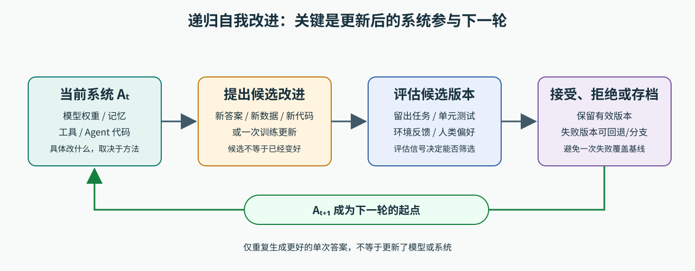

# LLM 的递归自我改进：从反思到自我改写的 Agent

LLM 会检查自己的回答、记住失败经验、用自己生成的数据训练下一版模型，甚至修改 Agent 的代码。这些做法常被放在“递归自我改进”（Recursive Self-Improvement，RSI）这个大话题下，但它们改进的对象并不相同。

先记住一个关键判断：**让模型把同一答案重写几遍，不等于模型本身学会了新能力。** 要判断一个系统是否在做递归式改进，需要看本轮得到的改动会不会成为下一轮系统的一部分，以及改进有没有经过可靠评估。

更严格地说，“递归”还关心**改进后的系统能否继续改进自己，包括提升它发现和实施下一次改进的能力**。因此，跨轮保留改动只是起点；自我修订答案、记忆积累和自训练是理解 RSI 的相关机制，各自的实验并不自动证明已经实现了这种更强的递归提升。下面先从这些容易理解的机制讲起，再走到修改 Agent 自身程序的例子。

*图：概念性闭环，用于比较不同方法；不是某一篇论文的网络结构。一个候选改动要经过任务评估，接受后的新版本才会参与下一轮。*

## 从普通 LLM 到改进闭环

普通的 LLM 推理可以写成：给定固定模型参数 `θ` 和输入 `x`，模型产生答案 `y`。下一道题仍用同一组参数。即使模型在思考过程中先写草稿、再检查并改写，参数 `θ` 也没有因此更新。

要形成跨轮次的改进闭环，还需要一些额外环节：系统先完成任务；再从正确答案、测试结果、人类偏好或其他反馈中判断表现；随后提出候选改动；最后决定保留还是丢弃。被保留的新系统进入下一轮。

这里的“系统”不一定只指模型权重。它也可能包含记忆、训练数据、工具配置和 Agent 程序。为避免把不同机制混在一起，下面按“什么东西被改了”来分类。这是本文用于理解论文的框架，不是领域统一的分类标准。

## 第一类：只改当前答案

### Self-Refine：生成、反馈、再生成

[Self-Refine](https://arxiv.org/abs/2303.17651) 让同一个 LLM 先生成答案，再根据专门的提示词评价自己的答案，并按反馈改写；反馈和改写可以重复多轮。比如代码模型先写出一个能运行但很慢的函数，然后指出重复计算的位置，再交回同一个模型优化。

论文强调，这一过程不需要额外训练数据、强化学习或参数更新。改善发生在**当前任务的输出**上：模型在当前对话里看到了自己的草稿和反馈，因此可能写出更好的最终答案；但完成这道题后，模型参数并未自动变成新版本。

这类做法有一个直接限制：模型既是作者也是评论者。如果它没发现原答案的问题，后续改写就缺少可靠方向。论文也发现，数学推理等任务中，模型可能无法准确判断推理链是否有错。因此，在代码任务中可以用测试或编译器结果补充自我反馈，在开放式写作中则需要合适的评价标准或外部评审。

## 第二类：把失败经验留给下一次尝试

### Reflexion：把环境反馈写进情景记忆

[Reflexion](https://arxiv.org/abs/2303.11366) 面向与环境交互的 Agent。一个 Actor 执行动作，Evaluator 根据环境结果、规则或测试给出评价；Self-Reflection 再把轨迹和评价总结成文字，存入情景记忆。Agent 下一次面对同一个或相关任务时，会把这段记忆作为额外上下文，调整行动。

例如，编程 Agent 的第一次实现没有通过测试。它把错误日志和尝试过程总结为“边界条件为空列表时没有处理”，存进记忆；下次作答时，Actor 就能优先检查这个情况。模型权重仍然可以保持不变，改变的是**Agent 可访问的记忆状态**。

所以 Reflexion 比单次答案修订多了一层：反馈会跨任务尝试保留；但它也不等同于训练出一组新权重。效果依赖评价信号是否正确、反思能否找准失败原因，以及检索到的记忆是否真的适用于新任务。错误的测试或总结也可能误导下一次行动。

## 第三类：用模型生成的数据训练下一版模型

### STaR：从正确答案中筛选推理轨迹

[STaR（Self-Taught Reasoner）](https://arxiv.org/abs/2203.14465) 把改进推进到训练阶段。它从带有问题和答案的数据开始，让模型为问题生成推理过程与最终答案；对于答对的样本，保留相应推理过程，作为后续微调数据。

只保留原本答对的题，模型学不到那些自己不会做的题。STaR 因而加入“合理化”（rationalization）：模型做错时，把正确答案作为提示交给它，让它尝试生成能导向该答案的推理过程；只有当生成过程最终确实复现了正确答案时，才把这条样本加入训练集。模型在筛选后的推理样本上微调，再用新模型重复采样和筛选。

这个闭环实际会更新模型参数。不过，它并不是“模型凭空教会自己任何知识”：STaR 使用带答案的数据和少量示范推理作为起点，最终答案也充当筛选依据。答对只说明结果符合标签，不保证中间推理忠实、每一步都正确。作者也指出，启动效果依赖模型已经有一定的少样本能力；如果初始模型与正确答案信号都无法提供有用轨迹，循环就没有可靠训练材料。

## 第四类：让模型给自己的回答打分，再训练下一版

### Self-Rewarding Language Models：模型既当选手，也当评审

[Self-Rewarding Language Models](https://arxiv.org/abs/2401.10020) 研究的是更完整的训练闭环。它先用人工编写的指令数据和评审示例训练模型，使模型既能回答问题，也能通过 LLM-as-a-Judge（让语言模型按标准充当评审）提示词评价回答。接着，模型为指令生成若干候选回答，再按评审分数构造“较好回答—较差回答”的偏好对；这些偏好对用于 DPO（Direct Preference Optimization，直接偏好优化），让下一轮模型更倾向生成胜过对照的回答。更新后的模型再生成候选回答并为它们打分。

与 STaR 主要通过答案正确与否筛选推理轨迹不同，这里模型会比较多个回答，并把比较结果变成偏好训练数据。自我评审能力因此也随模型版本一起进入循环。

但“自我奖励”不表示模型创造了客观的质量标准。论文的流程以人工准备的指令微调与评审数据为种子；为节省实验时间，主要实验还使用预先由 ChatLlama 70B 生成的一组指令。模型产生的评分仍是需要验证的代理信号，可能带有偏好偏差，或奖励表面上更符合打分规则的回答。论文报告了三轮实验，不足以推出迭代次数增加就会无限提升；作者也将更多轮次和不同模型上的缩放规律列为后续问题。

## 第五类：改写 Agent 程序，而不是基础模型权重

### Darwin Gödel Machine：搜索并保留不同 Agent 版本

[Darwin Gödel Machine（DGM）](https://arxiv.org/abs/2505.22954) 研究的是让编码 Agent 修改自己的代码，使自己成为更强的编码 Agent。它在一个候选 Agent 档案中选择已有版本，让 Agent 检查并编辑自己的 Python 代码，再在编码基准上运行新版本。能够编译并保留代码编辑能力的新变体会进入档案，不要求它每次都超过父版本；之后系统会按性能与探索情况选择改写起点。保留多个分支能避免只沿着当前单一路径搜索。

这里被改的是**Agent 的代码和工作流程**，例如文件编辑工具如何工作、是否多次尝试、如何比较候选解。论文实验里的底层基础模型保持冻结；论文没有展示训练出一个新的基础模型。作者提到让系统改写训练脚本、训练新基础模型是设想中的可能性，但明确说这不是本文所展示的实验。

SWE-bench 是要求 Agent 修改真实软件仓库、解决 Issue 的基准；DGM 论文使用经人工筛选为可解的 SWE-bench Verified 子集，并采用分阶段评估：先用 10 个任务检查代码编辑能力，再扩展到 60 个任务；表现突出的候选会进一步评估到 200 个任务。论文报告，经过 80 轮搜索，SWE-bench 上的编码 Agent 解决率从初始版本的 20.0% 提升到 50.0%。这是特定基线、Agent 和分阶段评测设置下的结果，不是所有模型都能获得的通用提升。DGM 的核心也不只是“让模型改代码”，还包括运行任务评测、保留可继续运行的候选版本，并继续从候选中产生后代。

## 几种机制放在一起

| 代表方法 | 被改进的对象 | 是否更新 LLM 权重 | 下一轮利用什么 |
|---|---|---|---|
| Self-Refine | 当前答案 | 否 | 当前答案与反馈上下文 |
| Reflexion | Agent 的情景记忆 | 否 | 之前尝试的反思记录 |
| STaR | 训练样本与模型参数 | 是 | 新筛选出的推理样本和微调模型 |
| Self-Rewarding | 偏好数据、模型参数及评审能力 | 是 | 新模型生成的回答和自评分数 |
| Darwin Gödel Machine | Agent 程序、工具与工作流程 | 论文实验未更新基础模型权重 | 通过基准评估的代码版本档案 |

表中“下一轮利用什么”是区分它们的好办法：同样叫自我改进，可能只是在当前提示上下文里改答案，也可能真的生成了新训练数据、更新参数，或替换了 Agent 的程序。

## 怎么判断一个 RSI 结果是否可信

看到“模型自我改进”时，可以按下面几个问题读论文：

1. **改的到底是什么？** 是答案、记忆、训练数据、模型参数，还是 Agent 代码？论文是否真的更新了它声称改进的对象？
2. **改进信号从哪里来？** 是可验证测试、人工偏好、模型自评，还是环境奖励？评审器是否可能和被评模型犯同一种错？
3. **新版本有没有进入下一轮？** 若每次只把同一模型的答案重写几遍，这证明的是推理阶段的迭代修订，不是训练出持续变强的新模型。
4. **提升是否经过独立检验？** 应查看留出的任务、外部测试或人工评估，而不只看模型自己生成的分数。还要检查是否复用了训练题、是否只在一个任务或一个指标上变好。
5. **系统是否能回退？** 自我生成的数据或修改后的代码可能引入错误。可靠实验应保留基线和候选版本，避免未经验证的改动直接覆盖原系统。

## 目前能说到哪里

这些论文说明了几种可操作的反馈闭环：在推理时改答案或记忆，在训练时筛选合成样本并更新参数，或依据基准评估修改 Agent 代码。它们的“自我”都不是脱离数据、目标和验证器的自主学习：STaR 需要答案标签，Self-Rewarding 有人工种子数据，Reflexion 依赖环境或测试反馈，DGM 需要编码基准来筛选代码改动。

因此，RSI 更适合作为一个研究方向的总称，而不是一个已经解决的统一算法。判断进展时，重点看**改进对象、反馈可信度、跨轮次是否复用改动，以及独立评估结果**。这些条件都成立，才有证据说系统在特定目标上形成了递归改进；它仍不意味着模型会无监督、无限制地持续变聪明。

## 参考资料

- Zelikman et al., [STaR: Bootstrapping Reasoning With Reasoning](https://arxiv.org/abs/2203.14465), 2022。
- Madaan et al., [Self-Refine: Iterative Refinement with Self-Feedback](https://arxiv.org/abs/2303.17651), 2023。
- Shinn et al., [Reflexion: Language Agents with Verbal Reinforcement Learning](https://arxiv.org/abs/2303.11366), 2023。
- Yuan et al., [Self-Rewarding Language Models](https://arxiv.org/abs/2401.10020), 2024。
- Zhang et al., [Darwin Gödel Machine: Open-Ended Evolution of Self-Improving Agents](https://arxiv.org/abs/2505.22954), 2025。

## QA

暂无问答。
