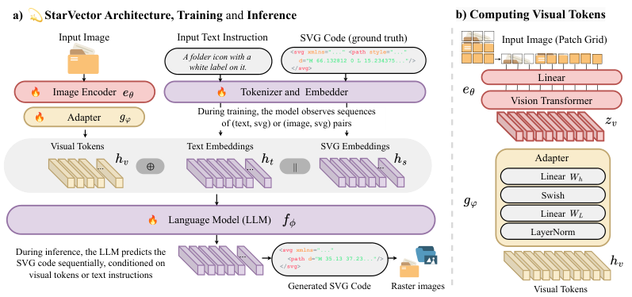

# LLM 如何学会画 SVG

让模型输出一段 `<svg>...</svg>`，看起来只是代码生成；但用户真正要的是一张符合文字或参考图的画。这里其实有两道关：**代码能被 SVG 渲染器读懂**，以及**渲染出来确实是想要的图**。两者不是同一个训练目标。

本文从普通语言模型的能力出发，沿着数据、表示、监督目标和视觉反馈四步，解释研究中具体怎样训练 SVG 生成能力。公开方法并不共享一份统一配方：有的直接生成 XML 代码，有的使用专门设计的图形 token，也有系统主要通过提示和推理时优化完成绘图。

## 先看一个最小 SVG

```svg
<svg xmlns="http://www.w3.org/2000/svg" viewBox="0 0 100 100">
  <circle cx="50" cy="50" r="30" fill="orange"/>
</svg>
```

浏览器会在 100 × 100 的画布上画出一个橙色圆。`circle` 是图元，`cx`、`cy` 指圆心，`r` 指半径，`fill` 指颜色。更复杂的图通常由多条路径、颜色、图层顺序和坐标共同决定：代码改动一个数字，就可能移动一只眼睛，甚至让整张画的结构失真。

一个在代码和网页文本上做过预训练的语言模型，**可能**已经见过 SVG 标签与 HTML/CSS 中的 SVG 片段。因此它可以像补全 Python 一样补全 `<path d="...">`。但“见过语法”不等于“学过大量准确的**要求 ↔ SVG**对应关系”。一般代码补全训练并不直接告诉模型“这段路径渲染后像一只猫”；语言损失也不会自动惩罚眼睛画在脸外。普通 LLM 的这部分训练数据、比例与效果要看具体模型；对于未公开训练语料的封闭模型，我们无法反推出它究竟学过多少 SVG。[IconShop 对 GPT-4 直接生成 SVG 的对照实验](https://arxiv.org/html/2304.14400)也说明：能写出一些基本形状，不代表能稳定画出复杂、可辨认的图标。

## 关键训练样本：把“需求”与“正确 SVG”配成一对

最直观的做法是准备三种内容：原始 SVG 文件、把它渲染成的图片、描述这张图的文字。这样同一份 SVG 就能构造两类训练题：

| 任务 | 给模型的条件 | 要模型续写的目标 |
| --- | --- | --- |
| 文生 SVG | “一个橙色圆，居中” | 对应的 SVG 代码或图形 token |
| 图生 SVG | 圆形的栅格图片 | 对应的 SVG 代码或图形 token |

真实数据不会天然带有完整、准确的自然语言说明。因此还要做清洗、去重、渲染，以及生成或整理文字描述。以 [StarVector](https://arxiv.org/html/2312.11556) 为例，作者从代码语料 The Stack 中抽取 SVG，按文件名、代码和元数据去重，用 CairoSVG 渲染并去掉空白图，去除 XML 头和注释，再用 BLIP-2、LLaVA 为渲染图生成描述。论文报告的 SVG-Stack 约有 210 万个训练 SVG，图像和文字是围绕这些 SVG 构建的。这里的文字描述是给训练提供条件，并不等同于人工逐一验证过的精确图形指令。

这一步回答了“模型本来不会画，怎么让它学会”的核心：**给它看足够多的条件与目标图形代码之间的对应关系，然后继续训练。**但“继续训练”仍有多种具体形式。

## 路线一：让代码模型直接续写 SVG

StarVector 是一个清楚的实例。它以代码语言模型 StarCoder / StarCoder2 为基础，训练时输入文字描述或图片，输出原始 SVG 代码。文字仍走语言模型的 tokenizer；图片先经过视觉编码器，再由 adapter 投影成语言模型能接收的一串视觉 embedding。[原文第 4 节](https://arxiv.org/html/2312.11556)将两种样本写作 `(文字, SVG)` 与 `(图片, SVG)`，只在目标 SVG 序列上计算 next-token 交叉熵：

`损失 = -Σ log P(下一个正确 SVG token | 条件、已经给出的正确 SVG 前缀)`。

训练时使用的是数据里的正确前缀；推理时只给文字或图片，模型必须自己一个 token 接一个 token 写到结束标记。反向传播会提高训练样本里 `<svg`、属性、数值、路径、结束标签等正确后继 token 的概率。它既在学习 SVG 常见语法，也在学习“某种文字或像素特征经常对应怎样的图形代码”。



*图：StarVector 的训练与推理结构，来自[原论文 Figure 3](https://arxiv.org/html/2312.11556)。左侧展示两种条件如何接入代码模型；右侧是图像 patch 到视觉 token 的转换。火焰表示参与训练的模块。*

假设一个简化的训练样本是“画一个橙色圆”及上面的 SVG。模型在看到 `<circle cx="50"` 之后需要预测接下来的 `cy`、半径、颜色等 token；如果把 `fill` 预测为 `blue`，交叉熵会惩罚这一偏离。大量类似样本让它逐渐学到描述与属性值的联系。不过，**交叉熵约束的是目标字符串**：它不会在每次训练时自动打开浏览器、检查生成图与要求的视觉距离。这也解释了为何代码表面合理、渲染结果却错位的情况仍会发生。

StarVector 的渲染器在这里主要用于**制作图片训练条件**和**查看／评估输出**。论文还讨论了结束标记、采样温度等推理设置，避免代码没写完。不要把这些步骤误说成“渲染图像误差直接给语言模型反传梯度”。

## 路线二：先把 SVG 变成更适合模型学习的图形语言

直接预测 XML 有个负担：同一幅图可以用不同的标签、坐标系、变换和路径写出；一个复杂图形还可能是一段很长的文本。这时研究者会先规定一种较统一的表示，再训练 Transformer 预测这串表示。它仍然是 token 预测，但 token 不一定是普通文字。

较早的 [IconShop](https://arxiv.org/html/2304.14400) 聚焦黑白图标：把 SVG 简化为 `M`（移动）、`L`（直线）、`C`（贝塞尔曲线）三类命令；各路径拼成一串，用开始路径和结束 SVG 的特殊标记保留边界；坐标离散化后映射为 token。它使用 FIGR-8-SVG 图标及关键词，并用 ChatGPT 把一部分关键词扩成短句。模型是专门训练的自回归 Transformer，论文给出的目标是文字 token 与图标 token 的加权交叉熵。**它不是“给现成聊天模型一个提示就会画”**：数据表示和模型训练是方法的主体，而且任务范围主要是单色图标。

较新的 [OmniSVG](https://arxiv.org/html/2504.06263) 则以预训练视觉语言模型 Qwen2.5-VL 为骨干，扩大到彩色图标、插画等。作者收集并清洗 SVG，渲染图片、生成文字描述；用 picosvg 简化 SVG，把 `M/L/C/A/Z` 命令、填充颜色和离散坐标转为专用 token，并学习对应 embedding。文字或图片作为前缀，SVG token 作为后缀，训练目标仍是后缀的 next-token prediction。[论文第 3、4 节](https://arxiv.org/html/2504.06263)给出了数据构造、tokenizer 和目标公式。OmniSVG 的数据集 MMSVG-2M 约 200 万个样本；这个规模是该论文的数据规模，不是所有 SVG 模型所需的数据门槛。

IconShop 与 OmniSVG 的共同点，是尽量让模型预测**一套稳定、可还原为 SVG 的图形序列**。代价是表示空间受到设计者选择的命令、颜色、坐标精度和长度限制。它们与 StarVector 的区别，也解释了为什么“SVG 模型”未必都在生成逐字的 `<svg>` XML。

## 路线三：看图写 SVG，新增的是“看”的训练链路

如果输入是一张参考图，仅靠语言模型中的 SVG 文本知识不够。模型还需要把图像中的位置、颜色与轮廓传给生成端。StarVector 使用视觉编码器和 adapter；OmniSVG 使用预训练视觉语言模型。两者的共同训练信号都来自“参考图 → 已知 SVG”的配对样本。参考图通常就是把原 SVG 栅格化得到的，因此可以自动获得一对严格对应的训练输入与目标代码。这就是**图像条件矢量化**和只给文字提示生成新图之间的重要数据差别。

“看图写 SVG”也不保证恢复原作者的路径写法：同一张栅格图可对应很多种 SVG。像素外观相近与路径少、可编辑、图层清晰是不同要求。文生 SVG 没有给定唯一的目标图片；图生 SVG 有视觉参照，却仍要解决如何用恰当路径表示它。[StarVector](https://arxiv.org/html/2312.11556)和[OmniSVG](https://arxiv.org/html/2504.06263)分别以多模态训练和评测说明了这些任务边界。

## 渲染反馈究竟在什么时候起作用？

这里最容易混淆三个位置：

1. **构造训练数据时渲染。**把已有 SVG 变成图片，给图生 SVG 模型当输入，也可供生成文字描述。StarVector 就采用这条路径。
2. **训练完成后评估。**把模型的 SVG 输出渲染成图，计算图文相似度、图像相似度，或请人判断。评价分数告诉研究者模型效果，**不意味着该分数参加了训练反向传播**。IconShop、StarVector、OmniSVG 都包含这样的视觉评估。
3. **生成时检查或优化。**[Chat2SVG](https://arxiv.org/html/2411.16602)先用 LLM 按提示写一个由简单图元组成的 SVG 模板，再渲染给有视觉能力的模型检查布局，随后用图像扩散模型生成细节目标、用可微渲染器调整 SVG 路径。论文描述的视觉回看与路径优化主要发生在**每次生成时**；它没有以此证明“原始 LLM 通过 RL 学会 SVG”。

因此，不存在“只要给 LLM 接一个渲染器，它的权重就自动学会视觉正确性”的捷径。若想把视觉评分变成训练信号，还得明确生成候选、定义可靠的视觉奖励或偏好数据、采用可传梯度的渲染路径或策略优化，并处理奖励与可编辑性之间的取舍。**上述代表论文不能支持“现代 SVG 生成通常靠 RL 训练”这个说法。**至少在这些可核对的方法里，监督的 token 预测是主要训练机制；渲染和视觉反馈的作用要按论文所处阶段分别判断。

## 回到最初的问题

模型获得 SVG 能力，不是给 Transformer 增加一个神秘的“绘图层”。公开案例展示的是三种可组合的能力来源：代码预训练提供部分语法和代码补全基础；成对的描述／图片与 SVG 数据，把用户需求接到目标图形；专门的图形表示、视觉编码和必要的渲染检查，提高复杂图形的稳定性。真正的训练更新通常仍是熟悉的 token 交叉熵，只是条件和目标换成了 SVG 任务数据。

要判断某个具体模型到底用了哪一条，必须看它公开的数据、表示、损失和推理流程。对未公开这些信息的通用聊天模型，最多能观察它**现在会不会画**，不能从一张成功的 SVG 倒推出它曾经历 SVG 专项微调、视觉奖励训练或 RL。

### 主要原始资料

- [StarVector: Generating Scalable Vector Graphics Code from Images and Text](https://arxiv.org/html/2312.11556)：SVG-Stack 的构建、文字／图片条件、SVG 代码的 token 预测。
- [IconShop: Text-Guided Vector Icon Synthesis with Autoregressive Transformers](https://arxiv.org/html/2304.14400)：专门的图标 token 表示、文字条件与训练损失。
- [OmniSVG: A Unified Scalable Vector Graphics Generation Model](https://arxiv.org/html/2504.06263)：多模态数据、SVG tokenizer 与视觉语言模型训练。
- [Chat2SVG: Vector Graphics Generation with Large Language Models and Image Diffusion Models](https://arxiv.org/html/2411.16602)：推理时的 LLM 模板、渲染回看与路径优化。

## QA

暂无问答。
