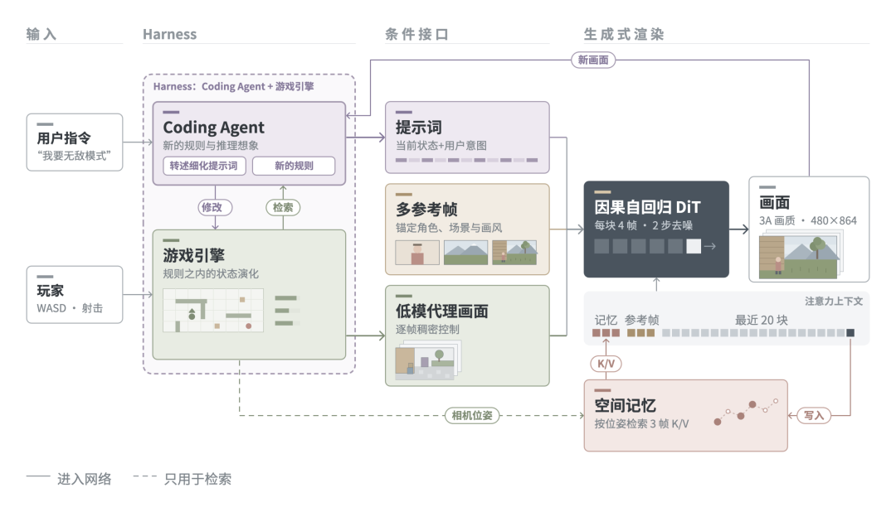
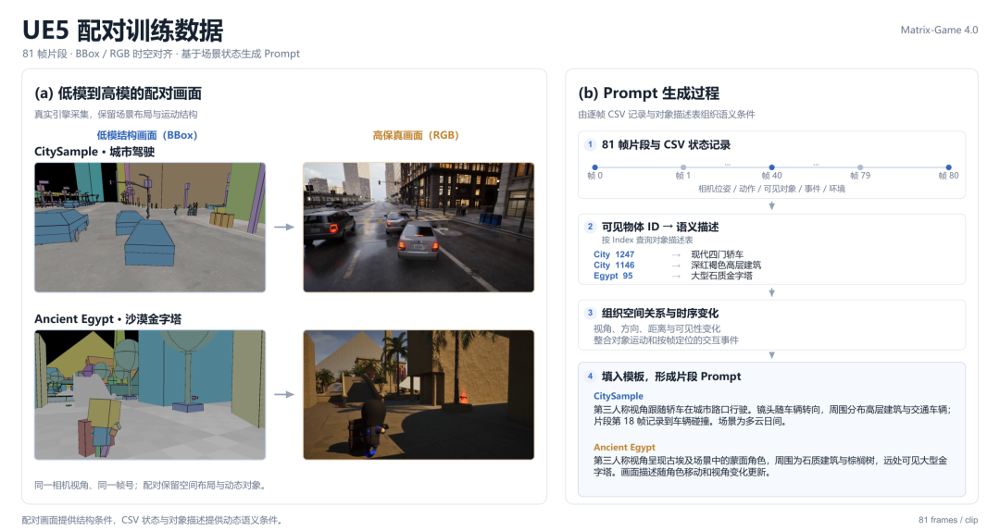
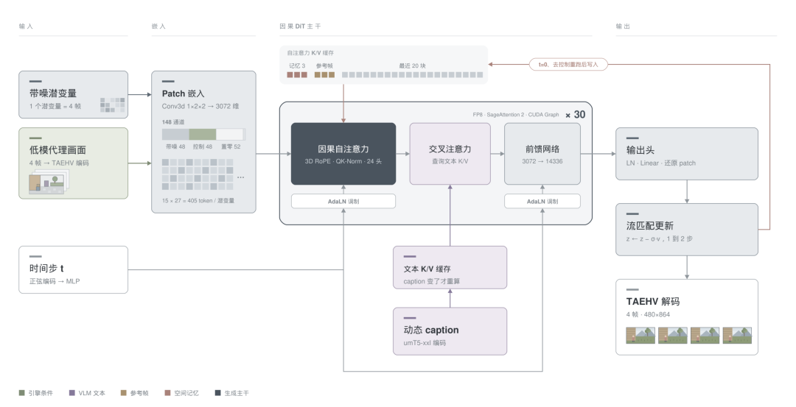

# 世界模型入门：让引擎管世界、模型管画面

> 本文面向刚入学、已经理解 Transformer 基本概念但还不了解世界模型的读者。本文以机器之心对 Matrix-Game 4.0 的介绍为主要材料，帮助读者建立概念和系统级直觉。公众号中的性能数字和比较属于原文表述，不能直接视为独立复现实验结论。

## 目录

- [1. 什么是世界模型](#1-什么是世界模型)
- [2. 为什么需要显式状态](#2-为什么需要显式状态)
- [3. Matrix-Game 4.0 的分工](#3-matrix-game-40-的分工)
- [4. 从数据到画面的链路](#4-从数据到画面的链路)
- [5. 与单模型路线的差异](#5-与单模型路线的差异)
- [6. 能力边界与待核验事项](#6-能力边界与待核验事项)
- [来源](#来源)
- [QA](#qa)

## 1. 什么是世界模型

在强化学习里，智能体看到观测 (o_t)，采取动作 (a_t)，环境转移到下一个状态并给出新观测。世界模型（world model）可以理解为一个可供智能体“想象”和预测的环境模型：给定当前状态与动作，它预测接下来会发生什么。这里的“状态”不只是当前画面，还可能包括物体位置、速度、碰撞、任务进度和规则等。

从 Transformer 的直觉出发，可以把视频模型看成根据上下文预测下一帧或未来帧的模型；但如果状态只隐含在像素上下文中，模型要同时记住规则、历史和外观，长时间滚动时误差容易累积。一个工程化的世界模型因此常常把“状态转移”和“画面渲染”拆开：先得到结构化、可检查的状态，再把状态渲染成逼真的图像。

## 2. 为什么需要显式状态

单看一帧画面，无法可靠回答“门后面有什么”“刚才的子弹是否击中目标”这类问题。若每次都直接从像素生成下一帧，模型可能在物体离开视野后忘记它，也可能在自回归生成中逐步漂移。显式状态的作用是给系统一个“账本”：引擎记录世界中客观发生的变化，渲染模型只负责把这个账本翻译成画面。

这并不意味着显式状态一定要是完整的三维重建。它可以是引擎内部的对象、坐标、碰撞和规则，也可以是结构草图或低模画面。关键是：状态更新应由明确的规则或程序完成，而不是完全寄托在像素生成模型的记忆上。

## 3. Matrix-Game 4.0 的分工

公众号把这套设计称作视频模型的 **Harness**（可理解为“外部控制框架”）。下图是原文整理的系统示意：

图中三方各自承担不同职责：

1. **游戏引擎维护世界状态。** 道路、建筑和角色由引擎中的对象表示；重力、碰撞、血量和任务进度等规则由程序计算。引擎每帧输出相机、物体位置以及事件等结构信息。
2. **Coding Agent 编写或修改规则。** 用户的意图先转成代码或规则，例如添加一个物体、改变玩法或修改环境。代码经过引擎执行后，状态变化是可重复、可检查的。
3. **视频模型负责画面。** 条件接口把当前状态、用户意图、多参考帧和低模代理画面交给视频生成模块，模块生成最终的高质量画面。它主要解决“怎么画得像”，不负责裁定世界规则。

这种分工是一个系统设计方案，而不是世界模型的唯一标准定义。公众号原文将它与“一个视频模型同时负责建模、记忆和渲染”的路线对比；这个对比用于说明设计取舍，不代表所有单模型方法都必然失败。

## 4. 从数据到画面的链路

Matrix-Game 4.0 介绍了 UE5 配对训练数据：同一相机、同一时间点同时保存低模/结构画面和高质量 RGB 画面，并记录提示词、对象和事件状态。下面的图展示了这种配对以及由轨迹生成 Prompt 的过程。

一次交互可以按下面的顺序理解：

1. 用户输入指令，或玩家执行动作。
2. Coding Agent 将指令编成规则变更；游戏引擎执行规则并更新状态。
3. 引擎导出结构画面、对象轨迹和事件。必要时从历史帧检索空间记忆。
4. 条件接口把结构画面、文字提示、参考帧和历史信息组织成模型条件。
5. 视频模型根据条件生成连续画面，并在下一时刻继续接受引擎状态。

在这个链路中，视频生成是“受条件控制的渲染器”，而不是唯一的环境模拟器。配对数据的目的，是让模型学会把结构约束翻译成视觉结果，同时保留外观和风格。

原文还展示了一个 DiT 主干及其输入输出关系。图中的缓存、条件注意力和流匹配采样属于实现细节；从概念上看，它们都服务于同一件事：利用当前状态和历史上下文，逐步生成下一段画面。

## 5. 与单模型路线的差异

两种路线可以用一个简化表格比较：

| 方面 | 单模型视频世界模型 | 引擎 + 视频模型的 Harness |
| --- | --- | --- |
| 状态来源 | 主要隐含在像素和上下文中 | 引擎显式维护对象、规则和事件 |
| 规则一致性 | 由模型从数据中近似学习 | 关键规则由程序直接计算 |
| 画面质量 | 模型同时承担状态和渲染 | 视频模型集中负责外观渲染 |
| 修改玩法 | 需要模型理解新的行为模式 | 可由 Coding Agent 修改游戏代码 |
| 主要代价 | 长程记忆和误差累积 | 工程复杂，需设计接口和配对数据 |

显式状态并非免费：需要游戏引擎、状态表示、条件编码、缓存和同步机制；状态与画面之间如果对不齐，也会出现“规则正确但画面不对”或“画面漂亮但不可玩”的问题。因此，Harness 更像是一种可控性和扩展性的工程折中。

## 6. 能力边界与待核验事项

- 公众号标题和摘要声称 Matrix-Game 4.0 可在单张 RTX 5090 上达到 480p、60 FPS，并与英伟达同期竞品比较。这些数字是公众号报道中的说法，本文不把它们当作已经独立复现的基准结论。
- 文章展示了 UE5 数据、Harness 结构和若干生成示例，但没有提供完整的训练代码、数据规模、评测协议和所有硬件配置。因此不能仅凭报道判断其在长时段稳定性、不同游戏类型或玩家规模上的泛化能力。
- “世界模型”在不同论文中可能指潜变量动力学模型、视频预测模型、具身环境模型或可交互模拟器。本文采用的是“能维护环境状态并预测/渲染后续观测”的宽泛工程定义，不能替代某一篇论文的正式定义。

## 来源

1. 机器之心公众号，`Matrix Game 4.0击败英伟达同期竞品，实现全球首个消费级显卡落地`，用户提供链接：[https://mp.weixin.qq.com/s/tA1FDOF2VVA2XslPd72eng](https://mp.weixin.qq.com/s/tA1FDOF2VVA2XslPd72eng)。图片和报道内容均来自该文章的抓取版本。
2. Matrix-Game 项目代码：[https://github.com/SkyworkAI/Matrix-Game](https://github.com/SkyworkAI/Matrix-Game)。
3. Matrix-Game-4.0 模型页：[https://huggingface.co/Skywork/Matrix-Game-4.0](https://huggingface.co/Skywork/Matrix-Game-4.0)。

## QA

### 什么是 autoregressive DiT？它和普通 DiT 有什么区别？

**Autoregressive DiT** 可以拆成两个概念理解：DiT 是用 Transformer 处理扩散模型去噪过程的主干；autoregressive（自回归）表示模型不是一次性生成完整序列，而是按时间或空间顺序，一块一块地生成后续内容，并把已经生成的内容作为下一步的条件。

普通 DiT 更像“给定整段带噪 latent，一次完成若干步去噪”：训练时把干净视频 latent 加噪，模型根据时间步和条件预测噪声、速度或干净 latent；采样时反复执行去噪更新，最后得到整段视频。它的优势是可以在整段时空范围内做全局注意力，缺点是长视频的显存和计算量会随上下文长度快速增长。

自回归 DiT 则在 DiT 的 Transformer 主干上再加一个生成顺序。例如把视频切成时间块，先生成第 1 个块，再根据第 1 个块生成第 2 个块，再继续生成第 3 个块。每个块内部仍然可以使用扩散/流匹配去噪，但块与块之间遵循“根据过去预测未来”的自回归关系。可以把它写成：

\[
p(z_{1:T}\mid c)=\prod_{t=1}^{T}p(z_t\mid z_{<t},c),
\]

其中 \(z_t\) 是第 \(t\) 个视频 latent 块，\(z_{<t}\) 是已经生成的历史块，\(c\) 是文字、图像、游戏状态等条件。这里的“自回归”描述的是块之间的生成顺序，不等于说块内部一定使用传统的 next-token 语言模型损失。

两者的主要区别是：

| 对比 | 普通 DiT | Autoregressive DiT |
| --- | --- | --- |
| 生成方式 | 对整段 latent 反复去噪 | 按块或按时间顺序生成，每块内部再去噪 |
| 条件来源 | 当前条件和整段带噪 latent | 当前条件、已生成历史块和整段上下文 |
| 长视频扩展 | 一次处理更长上下文，成本较高 | 可以缓存历史块，逐步延长视频 |
| 主要风险 | 全局计算和显存开销 | 误差会沿生成顺序累积，早期错误可能影响后续 |
| 适合的工程场景 | 短视频、全局一致性要求高的生成 | 长视频、在线交互、需要持续生成的环境 |

在世界模型或游戏视频生成中，自回归结构的价值是让系统可以“先维护或生成当前状态，再继续预测下一段”。如果外部引擎提供了新的状态，模型就可以把状态、历史画面和最近生成块一起作为下一块的条件。这样做仍然不能自动保证世界规则正确：自回归 DiT 只规定了生成顺序，规则一致性还要由显式状态、引擎或其他约束来提供。

因此，看到论文写“autoregressive DiT”时，最好分别确认三件事：它自回归的单位是帧、latent token 还是视频块；块内部使用的是扩散、流匹配还是普通 next-token 预测；历史信息是完整保留、压缩成 KV cache，还是由显式世界状态替代。仅凭“DiT”或“autoregressive”一个词，不能判断它是否就是完整的世界模型。
