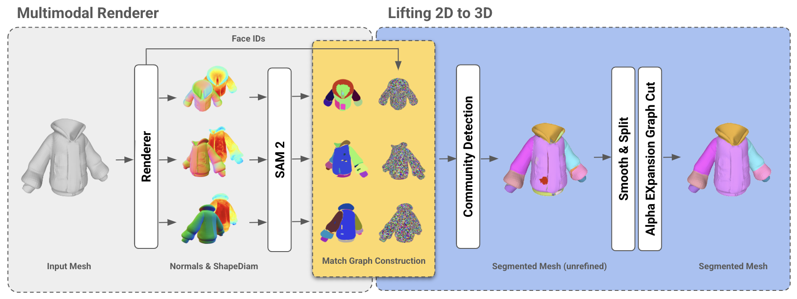
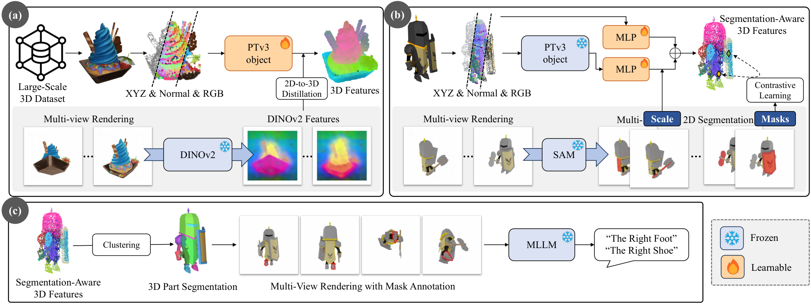
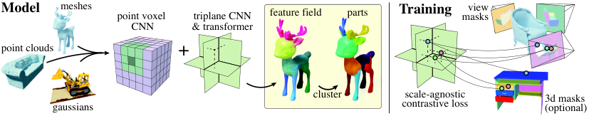
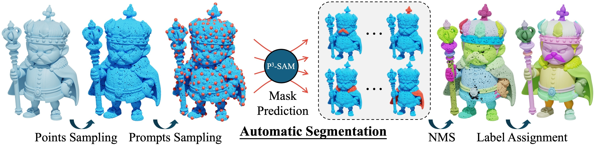
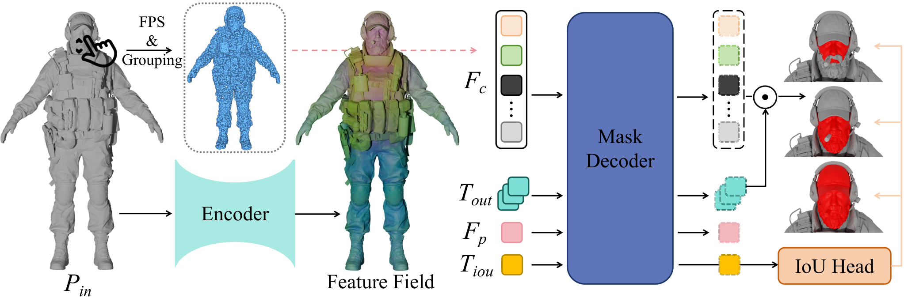
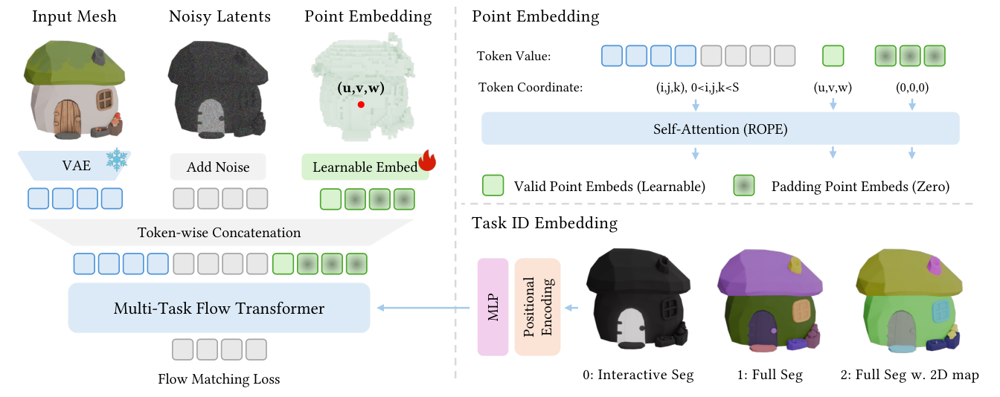

# 近三年开放类别 Mesh 部件分割：从 SAMesh、SAMPart3D 到原生 3D 与语义控制

给定一件已经建好的 3D 物体，怎样把它分成可以选择、命名、编辑的部件？这篇文章围绕 **单物体 mesh 的开放类别部件分割**，从 SAMesh、SAMPart3D 出发，解释不同方法实际接收什么、在哪一步决定部件、最后把标签落在哪里。

检索窗口为 **2023-10-29—2026-10-29**。有预印本时按首次公开日期归年，同一工作的会议版和预印本合并计算；仅查到出版记录或年份时保留该精度。正文覆盖 **20 项表面分割方法、5 项任务扩展、6 项完整部件或材质分解相关工作，共 31 项**。各组任务不同，阅读时应分别判断其能力。可下载[逐篇范围与来源清单](papers.json)。

## 1. 先把“分割 mesh”说清楚

一个三角 mesh 主要包含两类数据：顶点坐标，以及每个三角面连接哪些顶点。这里希望得到的典型输出，是**原物体每个面或顶点的部件标签**。例如，一把椅子的面被标为椅背、坐垫和四条椅腿。分割本身可以保留原有顶点、拓扑和材质，只增加标签。

**内部用点采样，不等于任务变成了点云分割。** SAMPart3D 会先从 mesh 表面采样点，预测点标签后用投票得到 mesh 分割；PartField 则能查询各个面上的特征，再按面邻接关系聚类。两者都提供了明确的 mesh 输出步骤，符合本文范围。[SAMPart3D §3.2](https://arxiv.org/html/2411.07184)、[PartField §3.4](https://arxiv.org/html/2504.11451)

需要分清四种结果：

| 输出 | 告诉你什么 | 对实际使用的意义 |
| --- | --- | --- |
| 无类别部件实例 | 哪些面属于同一个部件 | 可以选择某一条椅腿；通常还没有名称 |
| 语义标签 | 哪些区域叫“椅腿” | 同名部件可能合在一起，需要另行区分实例 |
| 层次分割 | 同一物体有哪些粗、细分法 | 可选整条手臂，也可进一步分上臂、前臂和手 |
| 完整部件几何 | 一个独立零件的完整形状 | 涉及原物体里不可见的接触面或内部区域，通常需要生成或补全 |

**开放类别**表示方法的设计不把输出限制为一套固定的物体类别和部件编号。它可以利用大规模带分块的 3D 数据训练，也可以在使用时接收点击、名称或少量示例。这里还要区分“预训练模型直接泛化”和“用户为新任务做少样本适配”：它们需要的输入成本不同。

文中 SAM、SAM2、SAM3 指图像或视频分割基础模型。**蒸馏**是在训练时让三维模型学习二维模型提供的特征或区域关系；**前馈预测**是用已经训练好的共享网络处理新物体，不为这个新物体重新优化网络参数。

## 2. 论文全表：先看自己需要哪种控制

下表列出原 mesh 表面分割主线。日期是首次公开月份，机制解释见后续各节。标为“逐物体处理”的方法，需要为当前物体渲染、融合或优化；“前馈”则表示共享模型可以直接提取特征或掩码，但仍可能需要聚类、投票和后处理。

| 首次公开 | 方法 | 用户控制或主要输入 |
| --- | --- | --- |
| 2023-11 | [Diff3F](https://arxiv.org/abs/2311.17024) | 表面特征聚类，也可转移源形状的聚类中心 |
| 2024-04 | [iSeg](https://arxiv.org/abs/2404.03219) | 三维正、负点击；先为当前物体蒸馏特征 |
| 2024-05 | [Reasoning3D](https://arxiv.org/abs/2405.19326) | 自然语言，包括需要理解功能的隐式描述 |
| 2024-07 | [MeshSegmenter](https://arxiv.org/abs/2407.13675) | 物体名称与目标部件名称 |
| 2024-08 | [SAMesh](https://arxiv.org/abs/2408.13679) | 自动多视图分块，无需部件名称 |
| 2024-11 | [SAMPart3D](https://arxiv.org/abs/2411.07184) | 控制分割尺度；分割后可查询名称 |
| 2025-03 | [Surface-Aware Features](https://arxiv.org/abs/2503.18254) | 表面特征聚类；可区分左右等不同部件实例 |
| 2025-04 | [PartField](https://arxiv.org/abs/2504.11451) | 层次聚类、分块层级或部件数 |
| 2025-08 | [GeoSAM2](https://arxiv.org/abs/2508.14036) | 某个渲染视图上的点击或框 |
| 2025-09 | [P3-SAM](https://arxiv.org/abs/2509.06784) | 三维单点；也可自动采样并筛选候选 |
| 2025-09 | [PartSAM](https://arxiv.org/abs/2509.21965) | 三维正、负点击；也支持自动分解 |
| 2025-09 | [ASIA](https://arxiv.org/abs/2509.24288) | 少量已经分好区域的二维参考图，需要适配 |
| 2025-12 | [ALIGN-Parts / Name That Part](https://arxiv.org/abs/2512.18003) | 语义描述匹配，联合预测分块与名称 |
| 2026-03 | [SegviGen](https://arxiv.org/abs/2603.16869) | 自动、三维点或二维部件颜色图 |
| 2026-07 | [MeshFM](https://arxiv.org/abs/2607.27592) | 先预测通用表面特征，再聚类或选取区域 |
| 2026-08 | [Hi-TOPS](https://arxiv.org/abs/2608.00767) | 多尺度几何结构先验与分解参数 |
| 2026-09 | [PartLLM](https://arxiv.org/abs/2609.25832) | 文字、三维点击、全形状分解指令 |
| 2026-09 | [Point2Part](https://arxiv.org/abs/2609.38180) | 每个目标部件一个三维点，联合划分全物体 |
| 2026-10 | [RePart](https://arxiv.org/abs/2610.04602) | 自动组织几何基元，学习合并与停止 |
| 2026-10 | [FlexPart](https://arxiv.org/abs/2610.23659) | 带名称、位置和形状描述的部件列表 |

这批工作可以沿着一个问题阅读：**“同一个部件”由谁定义？** SAMesh 让二维掩码及其跨视图关系决定；SAMPart3D、PartField 把定义存入三维特征；提示式模型让点击参与决定；文本控制方法进一步把用户想要的部件集合纳入预测。

## 3. 多视图路线：二维分割怎样变成 mesh 面标签

渲染时，除了 RGB、法线等图像，还可以输出一张 **face ID 图**：每个像素记录它看到了原 mesh 的哪个三角面。二维掩码选中一批像素后，就能找到对应三角面。不同视图上的证据需要融合，因为遮挡、透视和二维模型误差会使同一部件出现不同分法。

### 3.1 SAMesh：匹配二维掩码，再给面分组

SAMesh 的输入就是 mesh。它渲染多个视图的法线和局部厚度信号，再分别调用 SAM2 获得区域掩码。这样，几何上的朝向和厚度差异也能提供边界线索，而不必依赖物体已有的颜色纹理。

它接着用 face ID 判断：两个视图上的掩码是否覆盖了同一批三角面？把掩码及其匹配关系建成图，再通过社区检测把相互支持的掩码归为同一部件，最后平滑、细化面标签。**决定三维部件的是跨视图掩码关系，不需要先写“椅背、椅腿”等词。**

*SAMesh 原论文图 3。先得到各视图的区域，再利用原 mesh 的面编号建立跨视图对应。来源：[论文 §3](https://arxiv.org/html/2408.13679)。*

一个容易混淆的细节是：SAMesh 使用 SAM2 的图像分割能力，论文明确说明没有直接把大视角变化当视频跟踪。其输出首先是部件实例划分，名称需要其他步骤补充。[论文与说明](https://arxiv.org/html/2408.13679)、[官方代码](https://github.com/gtangg12/samesh)

### 3.2 MeshSegmenter：先增加可识别的外观，再按文字选部件

无纹理 mesh 的几何可能难以揭示语义区域，例如车门与车身可能处于同一连续表面。MeshSegmenter 先根据物体名称合成纹理，再对有纹理和无纹理的多视图，使用 GroundingDINO 定位文字描述的区域，并让 SAM 细分掩码。最后用面级置信度重投票融合结果。

**这里纹理生成是辅助识别的中间步骤，最终任务仍是给输入 mesh 的面选区。** 因而要注意，生成的纹理提供的是模型推测的外观证据；它可能帮助识别，也可能把不真实的外观边界引入判断。这一点是由方法结构得到的适用性分析。[原论文 §3](https://arxiv.org/html/2407.13675)

### 3.3 Reasoning3D：把隐式要求转换为可分割区域

Reasoning3D 针对“用于抓握的部位”之类需要理解功能的要求。它先渲染 mesh 及 face ID，再把图像与用户指令交给二维推理分割模型：语言模型生成回答和分割相关表示，掩码解码器据此预测二维区域；多视图结果再映射、融合到原 mesh。

它扩展的是**用户怎样表达目标部件**。三维区域仍依赖渲染可见性和跨视图融合，因此“语言回答合理”与“面标签准确”要分别检查。[原论文 §3](https://arxiv.org/html/2405.19326)

### 3.4 GeoSAM2：专门适配几何模态与跨视图传播

GeoSAM2 把物体周围的法线图和三维坐标图排成多视图序列，用户可在某一帧点击或画框。它通过低秩适配（LoRA）与残差融合，让 SAM2 同时利用表面朝向和每个像素对应的三维位置，并调整记忆机制来传播部件身份。预测掩码回投到三维后，继续做可见性投票和 mesh 标签细化。

它与 SAMesh 的区别在于：**GeoSAM2 学习适配几何输入及提示传播，SAMesh 主要组合现成二维分割与匹配图。** GeoSAM2 的训练阶段也构建了 mesh 分块监督；不能把“不需要当前物体的完整人工标签”写成“完全没有训练或三维监督”。[原论文 §5](https://arxiv.org/html/2508.14036)

## 4. 三维特征路线：先学每个位置的表示，再决定怎样分块

这条路线的中间结果通常是一个特征向量：同一部件内的位置具有更相近的特征。聚类或层次合并把这些向量变成离散的部件标签。它把“学会识别局部结构”和“选择当前分割粒度”部分分开。

### 4.1 Diff3F：把图像生成过程中的特征附到原表面

Diff3F 从无纹理 mesh 渲染深度和法线图，以这些几何图为条件生成外观图像，并提取二维扩散与视觉特征，再回投、聚合到原形状表面。它不为每个新物体训练一个三维分割网络，而是利用已经预训练的二维模型提供语义表示。

论文的部件分割应用直接对表面特征做 k-means 聚类，还把某个源形状的聚类中心用于另一形状。这里的类别开放性来自通用特征，部件集合仍由聚类数量与特征分布决定；相似语义也可能让左右肢体混淆。[原论文 Part Segmentation](https://arxiv.org/html/2311.17024)、[项目](https://diff3f.github.io/)

### 4.2 Surface-Aware Features：让相同语义的不同实例分开

Surface-Aware Distilled 3D Semantic Features 针对“左手、右手都像手，因此特征过于接近”的问题。它在保留蒸馏语义信息的同时，用物体表面距离构建对比约束，让表面上相距较远的区域更容易区分；学习后的编码器可以处理新形状。

其部件分割应用对源形状或多个形状的特征聚类，再把聚类中心转移到目标 mesh，在人体、动物、椅子和飞机上展示实例分块。它主要研究可对应的表面表示，分割是明确展示的下游应用；不能把这些定性分块等同于全物体语义命名或完整零件生成。[原论文 §6.1](https://arxiv.org/html/2503.18254)

### 4.3 SAMPart3D：共享三维骨干，加逐物体的尺度条件特征

SAMPart3D 的第一阶段在大量 Objaverse 物体上，将二维 DINOv2 视觉特征蒸馏给三维骨干。骨干接收从 mesh 表面采样的点，学习可在物体间复用的几何与视觉表示。

第二阶段针对当前物体，用 SAM 多视图掩码监督一个轻量的、带尺度条件的网络。相同掩码中的位置被拉近，不同区域的位置被分开；尺度用来表达“整条手臂”和“手掌”等不同粒度。随后聚类得到点标签，并通过投票得到 mesh 标签。最后才可以把各部件高亮渲染给多模态语言模型，询问其名称。

*SAMPart3D 原论文图 2。三维骨干预训练可以复用，当前物体的分组网络还需要优化；语义名称在区域形成后查询。来源：[论文 §3](https://arxiv.org/html/2411.07184)。*

因此，**SAMPart3D 的“开放类别”不代表拿来只做一次前向就结束，也不代表从未训练。** 它的重要贡献是取消预设部件词表，同时让三维分块可以随尺度变化。[论文](https://arxiv.org/abs/2411.07184)、[官方实现](https://github.com/Pointcept/SAMPart3D)

### 4.4 PartField：把特征提取变成可跨物体复用的前馈预测

PartField 用混合来源训练共享模型：既利用二维分割产生的部件提议，也利用已有的三维部件监督。训练时，不要求所有数据源把“部件”定义为同一尺度；三元组对比学习只要求，同一部件内的两个位置应比部件外的位置更相近。

推理时，模型从物体采样点预测三个正交平面的特征，也就是三平面表示。任意三维位置都可以投影到这些平面上查询特征。对于 mesh，方法在每个面上采样并平均特征，再基于面邻接图做层次聚类，得到可以粗分、细分的部件树。

*PartField 原论文图 3。模型输出连续特征场，离散部件来自后续聚类。来源：[论文 §3](https://arxiv.org/html/2504.11451)。*

**与 SAMPart3D 相比，主要变化是把昂贵的逐物体特征学习移到共享模型的训练阶段。** 但分割仍需要选择聚类策略、层级或数量，特征场本身不会替用户决定唯一正确的部件集合。[原论文 §3.4](https://arxiv.org/html/2504.11451)、[官方代码](https://github.com/nv-tlabs/PartField)

### 4.5 MeshFM：先建立老师特征场，再训练前馈学生

MeshFM 也预测输入 mesh 的表面特征，但它强调只使用二维视觉监督。第一阶段为训练物体拟合三维特征场；为减少图像编码器在部件边界处的特征混合，它利用 SAM 区域清理明显偏离区域代表特征的像素。第二阶段用这些老师特征训练共享前馈网络，并加入三维旋转增强。

推理时可以直接获得表面特征，继而用于分割、对应和变形。它说明**通用表面表示也能支持分割**，但最终区域仍依赖下游聚类或选择步骤，不能把特征预测与完整分割流程的耗时混为一谈。[论文 §3—4](https://arxiv.org/html/2607.27592)、[项目与代码](https://threedle.github.io/MeshFM/)

## 5. 提示与示例：让用户明确指出自己想要哪种区域

### 5.1 iSeg：为当前 mesh 蒸馏特征，再用正负点击控制

iSeg 先为当前 mesh 拟合一个连续特征场，用渲染后的顶点特征去匹配 SAM 图像特征。随后，交互注意力把所有 mesh 顶点作为查询，把用户选中的正、负顶点作为条件，预测每个顶点属于目标区域的概率。

这样，即使两个点击从来没有在同一张二维图里同时可见，也能共同影响同一个三维区域。**它的交互阶段在三维中进行，但准备特征仍有逐物体优化成本。**[原论文 §3](https://arxiv.org/html/2404.03219)、[官方代码](https://github.com/threedle/iSeg)

### 5.2 P3-SAM：单点产生多个候选，再把候选组织成完整分割

P3-SAM 从输入 mesh 采样坐标和法线，利用三维骨干提取共享特征。一个三维提示点会得到多个候选部件掩码，以应对同一个点可能属于“小区域”或“大部件”的歧义；质量预测器估计候选与真实区域的重叠程度。

自动模式会在物体上采样多个提示点，预测候选、抑制重复并合并，最后把点级掩码分配给原 mesh 的三角面。**自动分割包含一套候选筛选过程，不能只看单次点击的效果来判断全物体分解质量。**

*P3-SAM 原论文图 3。单点掩码预测与整物体自动分割是两个不同的使用层次。来源：[论文 §3](https://arxiv.org/html/2509.06784)。*

它的分块训练来自大规模 3D 资产整理，属于有共享训练的原生三维方法。[论文](https://arxiv.org/abs/2509.06784)、[官方实现](https://github.com/Tencent-Hunyuan/Hunyuan3D-Part/tree/main/P3-SAM)

### 5.3 PartSAM：保留二维先验，同时学习原生三维部件

PartSAM 用两个由 PartField 初始化的分支编码物体：一个冻结，以保留已有的二维蒸馏知识；另一个可训练，以适配原生三维部件监督。两者形成连续三平面特征场，再交给带提示的掩码解码器。

它支持正、负三维点击和多轮纠正，也能通过采样提示及候选筛选自动分解整个形状。与 P3-SAM 的单点候选设计相比，PartSAM 更强调多轮提示和三维特征场的共同作用。其训练使用大规模原生 3D 部件数据，包含对内部结构理解的评测。[原论文 §3](https://arxiv.org/html/2509.21965)

*PartSAM 原论文图 3。形状特征与用户提示共同决定区域，质量预测分支为候选选择提供依据。来源：[论文](https://arxiv.org/abs/2509.21965)、[官方代码](https://github.com/czvvd/PartSAM)。*

### 5.4 ASIA：用少量分好的图片定义自己的部件

有些区域难以用名称或单个点击表达。ASIA 让用户提供少量已标注的二维参考图，为各个区域学习 token，并适配图像扩散模型；再把这种分法转移到同类的新三维物体。

它对 mesh 多视图预测标签，在 UV 空间投票融合，并通过测试时噪声优化细化结果，最后映射回 mesh。UV 标签还可以表达细于原三角面尺度的表面区域。**它允许用户定义新的分块方式，但需要参考标注和任务适配，论文设定是向同类目标转移，不能写成无需示例的跨类别零样本分割。**[原论文 §3](https://arxiv.org/html/2509.24288)、[代码](https://github.com/sairajk/asia)

## 6. 条件生成与语义：从“分成几块”走向“按意图分”

### 6.1 SegviGen：利用三维生成模型预测部件颜色

SegviGen 把分割写成条件三维着色任务：交互选区用黑白颜色表示，全物体分块给不同部件赋不同颜色，还可以用某个视图的二维分割图作条件。它编码输入资产的几何，再训练三维生成网络预测与部件有关的颜色。

*SegviGen 原论文图 2。网络学习的是由输入几何、任务和提示共同约束的三维颜色表示。来源：[论文 §3](https://arxiv.org/html/2603.16869)。*

其关键在于复用已有三维生成模型中的形状先验。输出中的颜色代表区域编号，未必代表真实材质或语义名称。它包含体素化、编码和重建步骤，使用时应核实标签如何转回输入 mesh，以及几何或拓扑是否发生变化。[原论文](https://arxiv.org/abs/2603.16869)

### 6.2 ALIGN-Parts：同时产生分块与名称

Name That Part 提出的 ALIGN-Parts 把部件视为一组可以与文本匹配的隐式表示。它融合几何特征、多视图外观，以及由语言模型生成的功能描述，再通过集合匹配建立部件与名称的对应关系。

它解决的是无类别分块之后仍需人工命名的问题。论文讨论开放词汇匹配，同时也强调数据和语义对齐的限制，不能把“可以与任意描述比较”直接等同于“所有新名称都能可靠识别”。官方实现包含 mesh 评测和保存的面标签，因而纳入本表。[论文](https://arxiv.org/html/2512.18003)、[mesh 评测入口](https://github.com/mvp18/name-that-part#evaluation)

### 6.3 PartLLM：先生成“有哪些部件、在哪里”，再联合分配表面

PartLLM 先把物体采样点编码成三维 token，让多模态语言模型根据用户意图，依次生成部件名称、粗三维位置和部件 token。随后，解码器结合这些部件假设，为位置联合分配部件或背景标签。

这一设计把文本定位、点击交互、全物体分块和粒度控制放到同一模型中。**语言模型负责提出部件集合，稠密解码器负责确定几何区域**，输出质量需要同时检查这两步。原论文网络内部处理点，但官方推理入口明确支持 mesh 文件；纳入依据是实际的 mesh 流程。[论文 §3](https://arxiv.org/html/2609.25832)、[官方推理说明](https://github.com/czvvd/PartLLM)

### 6.4 FlexPart：让文字直接定义本次的标签集合

FlexPart 的输入包含部件名称、位置和形状描述。这样的列表会明确当前要分哪些部件，以及哪些区域应归入背景；同一个 mesh 可以因列表变化而采用粗、中、细不同分法。

模型以几何和文本为条件，生成三维部件身份场，在原 mesh 面中心查询离散部件 ID。训练时随机从描述中移除部分部件，并把它们标为背景，促使模型学会只返回用户要求的区域。推理时，独立的视觉语言规划器可以从多视图补齐位置、形状等描述。

这里要分别判断**规划器是否正确理解意图**以及**分割网络是否正确落实描述**。其自动提示和真实标注提示也是不同实验条件。[原论文 §3 与附录](https://arxiv.org/html/2610.23659)、[项目](https://zhao-yiqun.github.io/flexpart/)

## 7. 联合分区与几何组织：部件之间也需要约束

### 7.1 Point2Part：所有目标部件一起竞争整个形状

单独预测每个部件时，多个掩码可能重叠，也可能留出未分配区域。Point2Part 为每个目标部件接收一个三维提示点，将其编码为部件 token，再联合为物体空间中的位置分配部件。它把完整、互斥的分区作为建模目标。

对于已有 mesh，论文明确给出两种输出：**分割模式为输入的每个面赋标签；生成模式输出闭合的部件几何。** 这是同一论文中应区分的两个任务。数学上互斥、完整的目标也需要与离散采样、几何提取后的实际误差分别检查。检索时官方发布清单仍将权重及多个推理入口列为待发布，论文结果与可直接运行程度需要分别判断。[原论文 §3](https://arxiv.org/html/2609.38180)、[发布清单](https://github.com/henrytsui000/Point2Part)

### 7.2 Hi-TOPS：先找结构尺度，再组织几何近似

Hi-TOPS 认为，关节与细连接处的划分证据往往出现在中等尺度。它在多尺度体素上组合几何信号，区分允许扩张和应当保留边界的区域，随后拟合超二次曲面等几何基元，并把分组映射回原 mesh。超二次曲面是一类可用少量参数描述的基本曲面，用于近似局部几何。

它提供的是结构先验驱动的分解，尤其关注薄结构、接缝和边界。没有文字语义约束时，几何上合理的分块仍可能与用户想要的功能部件不同。这是从其输入和目标得到的适用性分析。[原论文](https://arxiv.org/html/2608.00767)

### 7.3 RePart：学习怎样合并几何基元

RePart 也先建立细粒度几何基元，但进一步把“合并哪些基元、何时停止”建模为连续决策。强化学习使用最终分区的效果来优化合并策略，而不只判断相邻两个区域是否相似；边界感知的标签传递再把结果映射回原 mesh。

它研究的是**局部几何近似怎样组合成有意义的部件**。主张的跨类别能力应依据独立数据和未微调测试判断，不能仅凭“没有固定语义编号”就认定所有新类别都可靠。[原论文](https://arxiv.org/html/2610.04602)

## 8. 五项任务扩展：运动部件、纹理区域与几何实体

这些工作都以 mesh 为目标，但划分依据与普通的全物体语义分块不同。

| 首次公开 | 工作 | 输入、操作与输出 |
| --- | --- | --- |
| 2025，会议版 2025-09 | [MeshSeg](https://doi.org/10.1109/SIBGRAPI67909.2025.11223390) | 在 mesh 的二维纹理图集上用传统图像处理或 SAM 分区，再按颜色特征聚类，允许交互调整。主要服务于局部纹理编辑；外观相似区域未必对应同一个功能部件。 |
| 2025-10 | [Articulation-Gen](https://doi.org/10.1109/IROS60139.2025.11246790) | 组合多视图部件分割、物理引导的关节优化与 URDF（机器人结构描述格式）生成。官方代码含 SAM2 提示、原顶点标签及子 mesh 导出，主要目标为可关节化资产。 |
| 2025-12 | [Particulate](https://arxiv.org/abs/2512.11798) | 输入静态物体 mesh，采样后用 Transformer 同时预测部件、运动树、关节类型和约束，再映射回 mesh。目标是可以运动的资产结构。 |
| 2026-06 | [Instruct-Particulate](https://arxiv.org/abs/2606.14699) | 在 mesh 之外增加部件描述、连通关系、关节类型和可选提示点，让模型按指定运动结构进行分割与关节估计。不同说明可以定义不同粒度。 |
| 2026-06 | [MV-GEL](https://arxiv.org/abs/2606.31533) | 自然语言指定面、边或曲面等几何实体；先选择能看清目标的视图，再做二维推理分割，以射线投射对应回 mesh 实体。 |

MeshSeg 与 Articulation-Gen 的解释分别依据作者摘要、作者出版记录及公开源码，本文未取得两篇完整论文，因此没有复述其详细消融或实验数字。[MeshSeg 作者出版页](https://www.inf.ufrgs.br/~oliveira/pubs_files/pubs.html)、[Articulation-Gen 官方代码](https://github.com/PRS-Organization/articulation-gen)

“把柜门与柜体分开”和“选中某个圆角面”都是表面选区任务，但目标标签不同。前者还需要运动结构，后者可能服务于 CAD 操作。阅读这些论文时，先检查输出是否与自己的下游操作一致。

## 9. 六项完整部件与材质分解相关工作

表面标签只描述原物体中已经存在的区域。如果要把一个零件独立取出后继续编辑，可能需要补出原本不可见的内部表面。下列工作与 mesh 分割紧密相关，**输出会包含重新生成或补全的几何，因此单列**。

| 首次公开 | 工作 | 对已有 mesh 做什么 |
| --- | --- | --- |
| 2024-12 | [PartGen](https://arxiv.org/abs/2412.18608) | 支持已有三维资产输入；先得到多视图部件分割，再补全每个部件的图像，最后重建为完整零件。 |
| 2025-04 | [HoloPart](https://arxiv.org/abs/2504.07943) | 先用 SAMPart3D 等上游方法得到表面区域，再条件生成完整部件。论文的主要创新位于补全阶段。 |
| 2025-07 | [BANG](https://arxiv.org/abs/2507.21493) | 从完整几何生成逐渐展开、分离的 mesh 序列，再追踪部件及其组装位置；输出含生成几何。 |
| 2025-09 | [X-Part](https://arxiv.org/abs/2509.08643) | 用 P3-SAM 提取已有物体的部件特征和框，条件化同步多部件生成，以兼顾局部细节与整体结构。 |
| 2026-08 | [PartMat](https://arxiv.org/abs/2608.01825) | 以材质组件定义部件，在全局潜表示中做部件重建与生成。材质分组可能与功能或可动部件不同。 |
| 2026-09 | [SAM3D-Part](https://arxiv.org/abs/2609.15639) | 输入源 mesh 和某个视图上的部件掩码，结合源几何、图像和坐标条件，直接生成完整、与源坐标对齐的目标部件。 |

分割论文的面标签指标，与这些工作中完整零件的重建质量、缺失区域合理性、部件间重叠和组装一致性，应分别评估。上游面标签准确，也不自动证明补出的几何正确；反过来，零件看起来完整，也不能说明它保留了原 mesh 的拓扑或尺寸。

## 10. 怎么读实验，避免把不同设置当成同一排名

### 10.1 先检查基准到底提供什么

**PartObjaverse-Tiny** 由 SAMPart3D 工作提出，提供较丰富的资产类别、语义与实例分块。后续工作还使用其水密化版本：重新构造水密表面，会改变原有连通块和几何线索。原版与水密版的结果需要分开标注。[原始基准](https://arxiv.org/html/2411.07184)、[P3-SAM](https://arxiv.org/html/2509.06784)、[FlexPart 的基准协议](https://arxiv.org/html/2610.23659)

**PartNetE** 常用于文本语义或实例分割比较，但许多原方法接收点云。mesh 论文可能先把其输出映射为面标签，或反过来把 mesh 基线采样为点再比较。评测时使用点，并不决定原方法是不是 mesh 方法；要回到原始输入输出协议核对。

**多粒度与交互基准**还会额外提供信息：真实部件数、真实部件名称、某个部件内的点击、真实二维分割图等。每多一种条件，任务就变化一次。PartSAM、SegviGen、Point2Part、FlexPart 对这些设置各有设计，应优先看自己会提供哪种提示的结果。

### 10.2 一个可核对的同论文比较

IoU 是预测与真实区域的交集除以并集，mIoU 是多个区域的平均值。交并集可以按面、点或表面积计算，比较时必须确认采用同一种定义。

PartField 原论文在 PartObjaverse-Tiny 的无类别实例分割协议下，报告以下面级平均 IoU。其评测为每个真实部件寻找预测中重叠最大的区域，再对真实部件平均；这是该论文特定的匹配协议。

| 方法 | 论文表 1 的 mIoU（%） |
| --- | ---: |
| SAMesh | 56.86 |
| SAMPart3D | 53.47 |
| PartField | 79.18 |

这些数值支持该实验设置下的比较，**不构成截至 2026 年所有方法的统一排行榜**。后续方法可能改变水密化、条件输入、标签匹配和连通约束；若要重新排名，需要统一数据、提示与评测代码。[PartField 表 1 与评测定义](https://arxiv.org/html/2504.11451)

### 10.3 对自己的 mesh，至少检查六件事

1. **标签完整性**：每个原始面是否得到合法标签？是否允许背景？
2. **实例与名称**：多条腿是否分成实例？同名部件是否合并？
3. **粒度控制**：给部件数、点或文字时，结果是否按意图变化？
4. **几何保留**：顶点、面索引、UV、材质是否还可对应回原资产？
5. **边界与覆盖**：薄结构、贴近表面、深凹槽和长期遮挡处是否出错？
6. **完整使用成本**：特征提取之外，是否还需要逐物体优化、渲染、语言规划、聚类或生成？

这些是依据方法机制整理的检查项，不是本文已经执行过的统一复现实验。

## 11. 哪些常见名字没有混入 mesh 主线

### 11.1 点云与场景方法

下列论文在相关工作或基准中经常出现，但它们原始协议的重点在点、场或场景。将点标签另行投票到 mesh 是可以做的工程改造，却需要明确说明改造和误差。

| 工作 | 本文的处理依据 |
| --- | --- |
| [ZeroPS](https://arxiv.org/abs/2311.14262)、[PartSLIP++](https://arxiv.org/abs/2312.03015)、[PartDistill](https://arxiv.org/abs/2312.04016) | 以点云部件标签或点特征为主要输出，保留为背景 |
| [PartSTAD](https://arxiv.org/abs/2401.05906)、[PARIS3D](https://arxiv.org/abs/2404.03836)、[COPS](https://arxiv.org/abs/2412.04247) | 分别研究点云上的任务适配、推理式选区或二维特征聚合 |
| [Find3D](https://arxiv.org/abs/2411.13550) | 论文定义为文本查询的点特征；官方野外推理示例输入 `.pcd` |
| [Point-SAM](https://arxiv.org/abs/2406.17741)、[S²AM3D](https://arxiv.org/abs/2512.00995)、[SegGraph](https://arxiv.org/abs/2512.16143) | 可提示、尺度控制或少样本点云分割；不能仅因训练资产来自 mesh 就归作 mesh 方法 |
| [PatchAlign3D](https://arxiv.org/abs/2601.02457)、[CoSMo3D](https://arxiv.org/abs/2603.01205)、[UniPart 的语言定位版本](https://arxiv.org/abs/2609.12898) | 以点云上的稠密语义表示或文本部件定位为任务 |
| [Ultrametric Feature Fields](https://arxiv.org/abs/2405.19678) | 从 NeRF 特征与深度生成点云后做层次分割；PartField 曾将其另行适配为 mesh 基线 |
| [3×2 / 3-By-2](https://arxiv.org/abs/2407.09648) | 有 mesh 渲染实验，但论文以查询点云及点级标签转移、评测为主要协议；渲染 mesh 本身不等于输出原面标签 |
| [DirectPart](https://doi.org/10.1016/j.array.2026.101159) | 官方流程虽然用 mesh 渲染，却将 SAM3 掩码回投到标注点云，并逐点投票；未混作原 mesh 面标签方法。见[作者代码](https://github.com/MM88/directpart) |
| [Easy3D](https://arxiv.org/abs/2504.11024)、[PinPoint3D](https://arxiv.org/abs/2509.25970) | 场景或扫描点云的交互分割，不纳入单物体 mesh 主线 |

### 11.2 时间、专用类别与任务不同的工作

[SATR](https://arxiv.org/abs/2304.04909) 是非常相关的文本 mesh 分割前驱，但首次公开于 2023-04，早于本文滚动三年窗口。它适合理解后来多视图、文本定位和标签融合路线的来源，未计入窗口内论文数。

[Open-Vocabulary Semantic Part Segmentation of 3D Human](https://arxiv.org/abs/2502.19782) 具有开放词汇，但专门针对人体；医学 mesh 与固定类别监督网络也不属于本文确定的通用跨类别范围。

[Reeb 图分割](https://arxiv.org/abs/2412.05335)、[法向总变分分割](https://arxiv.org/abs/2412.00445)、[Mumford–Shah 表面分割](https://arxiv.org/abs/2507.19284)与 [Empart 凸分解](https://arxiv.org/abs/2509.22847)可以处理不同类别的几何，但其目标分别偏向几何信号分段或碰撞近似；它们不直接定义开放语义部件，作为几何路线补充阅读。

[Seg3DParts](https://arxiv.org/abs/2609.36918) 的主任务是从单张图像生成部件几何。PartCrafter 等从图像直接生成多部件物体的论文也应放在部件生成主题中，不能把“输出了 mesh”当成“分割了输入 mesh”。

## 12. 建议的阅读顺序与方法选择

想先理解机制，可以依次读 **SAMesh → SAMPart3D → PartField → P3-SAM / PartSAM → SegviGen → PartLLM / FlexPart**。这个顺序分别回答：二维区域如何对应到三角面，为什么引入三维特征，怎样减少逐物体优化，如何交互，以及语义意图怎样参与划分。

| 你的目标 | 优先核对的路线 |
| --- | --- |
| 无部件词表，自动把资产分块 | SAMesh、SAMPart3D、PartField、P3-SAM、PartSAM |
| 通过点击反复纠正选区 | iSeg、GeoSAM2、PartSAM；单点候选也可看 P3-SAM |
| 用少量参考图定义自己的分法 | ASIA，先确认其适配成本和同类转移设定 |
| 得到有名称的完整分解，或按文字选择 | ALIGN-Parts、PartLLM、FlexPart |
| 每个部件点一下，要求联合覆盖全物体 | Point2Part 的 mesh 分割模式 |
| 关节、薄结构与几何组织 | Hi-TOPS、RePart；可动结构还应看 Particulate 系列 |
| 分出可独立使用的完整零件 | PartGen、HoloPart、BANG、X-Part、SAM3D-Part；先检查补全和几何保真 |

这里的“优先核对”基于论文定义和实现接口，不代表本文已经在同一组资产上比较过这些模型。真正选择方法时，应从目标输出和可提供的提示出发，再检查当前代码、权重、许可证和使用成本。

## 13. 检索与来源说明

本清单从 SAMPart3D、SAMesh 出发，追踪 PartField、PartSAM、PartLLM、FlexPart 等论文的相关工作与引用，并用 arXiv 日期检索、CVPR 2026 / ICCV 2025 官方目录及 Crossref 元数据补检。检索词包括 mesh segmentation、3D part segmentation、partitioning、decomposition、open-world 与 zero-shot 等组合。

每项纳入记录都保留了首次公开日期、原文链接和 mesh 输出依据；论文名称近似的不同工作、同一论文的不同版本分别核对。方法机制依据原文，代码入口只证明作者提供了相应接口，本文没有把接口存在写成复现实验成功。更新清单时应同时更新[范围与逐篇记录](papers.json)，而不只增加论文名字。

## QA

暂无问答。
