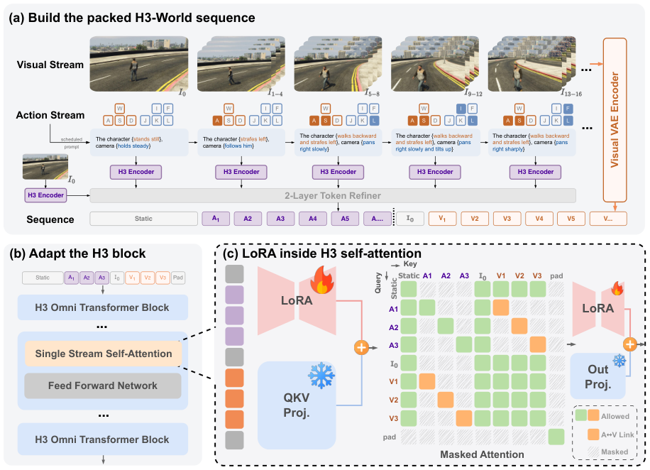

# MiniMax-H3：从视频生成器到可控世界模型的范式

> 面向读者：刚入学、已经理解基本 Transformer，但还不熟悉视频生成系统的博士生。

这篇文章先把“视频生成”放回一个统一的框架，再解释公开资料中能够确认的 MiniMax-H3 信息。需要先说明证据边界：截至本文写作时，能够直接核验 MiniMax-H3 结构的公开材料主要是 **H3-World: Turning Language Understanding into World Control**（arXiv:2609.01560v1）。它把一个名为 MiniMax-H3 的 33B 视频生成器作为冻结的基础模型，并在其上做轻量适配。本文因此把“论文明确写出的 H3 信息”和“为了帮助理解而作的通用视频生成解释”分开；没有把 MiniMax 其他产品型号、媒体报道或猜测写成 H3 的技术事实。

## 1. 先建立视频生成的共同范式

### 1.1 视频生成到底在生成什么

视频不是一张张互不相关的图片。可以把一个视频写成帧序列

\[
\mathbf{x}_{1:T}=(x_1,x_2,\ldots,x_T),
\]

其中每个 \(x_t\) 是一帧 RGB 图像。模型通常不会直接在原始像素上逐个像素地生成，而是先用视频 VAE（variational autoencoder，变分自编码器）把视频压缩到时空潜变量：

\[
\mathbf{z}_{1:L}=E_{\mathrm{VAE}}(\mathbf{x}_{1:T}),\qquad
\hat{\mathbf{x}}_{1:T}=D_{\mathrm{VAE}}(\mathbf{z}_{1:L}).
\]

这里的 \(L\) 小于帧数 \(T\)，每个潜变量同时对应一小段时间和一块空间区域。潜空间的好处是序列更短、局部像素噪声更少；代价是细节和精确运动已经被压缩，解码器也可能带来模糊或闪烁。

输入条件可以是文本、首帧图像、参考视频、音频、相机轨迹或动作。记作 \(c\)。视频生成器的目标是学习条件分布：

\[
p_\theta(\mathbf{z}_{1:L}\mid c).
\]

因此，“文本到视频”“图像到视频”和“可控世界模型”不是完全不同的底层任务；它们主要区别在于条件 \(c\) 的形式、时间范围以及生成后是否把结果反馈给环境。

### 1.2 扩散/流匹配路线的因果链

当前常见路线是先取真实潜变量 \(z_0\)，再构造噪声状态 \(z_\tau\)，训练网络预测去噪方向或速度。以一个抽象的 flow matching 写法为例：

\[
z_\tau=(1-\tau)z_0+\tau\epsilon,\qquad
v_\theta(z_\tau,\tau,c)\approx \epsilon-z_0,
\]

训练目标是

\[
\mathcal{L}(\theta)=
\mathbb{E}_{z_0,\epsilon,\tau}
\left[\|v_\theta(z_\tau,\tau,c)-(\epsilon-z_0)\|_2^2\right].
\]

推理时从噪声 \(z_1\) 开始，沿模型预测的速度反向积分到 \(z_0\)，再由 VAE 解码成视频。DDPM 的噪声预测和 rectified flow 的速度预测写法不同，但核心因果关系相同：**条件进入网络，网络逐步把随机潜变量变成时空上相互协调的视频潜变量，解码器再恢复帧。**

一个最小化的伪代码如下：

```text
z = random_noise(video_latent_shape)
for tau in reversed(time_grid):
    direction = video_model(z, tau, condition=c)
    z = solver_step(z, direction, tau)
video = VAE.decode(z)
```

这条路线需要同时解决三类问题：

1. **空间合理性**：物体的形状、纹理和遮挡关系不能在相邻帧中随意改变；
2. **时间一致性**：同一个人或物体的身份、位置和运动轨迹要连续；
3. **条件可控性**：文本或动作只应影响它指定的时间和区域，而不能污染整段视频。

单张图像生成短片段时，首帧提供外观锚点；文本提供语义和运动描述。若要做交互式世界模型，则还需要把“下一步动作”与视频潜变量的时间段对应起来，并在生成后再次接收动作，形成闭环。

## 2. MiniMax-H3 在公开材料中的定位

H3-World 论文把 MiniMax-H3 描述为一个 **33B（约 330 亿参数）视频生成器**。论文的重点不是重新发布 H3 的完整技术报告，而是观察到：H3 已经能够把自然语言中的角色行为和相机运动，粗略地映射为视频运动。因此作者冻结 H3，只学习少量参数，把这种粗粒度的语言控制改造成按时间精确的动作控制。

这给出了 H3 的可核实定位：

- 它是一个以视频潜空间为主要生成空间的大型视频生成基础模型；
- 公开论文称它使用**单流自注意力**，把文本、图像、音频和视频潜变量放到同一条序列中联合处理；
- H3-World 的摘要和方法描述称，H3 能接受自然语言、初始观测等条件，生成未来视频潜变量，再经视觉 VAE 解码成 RGB 视频；
- 这些信息足以说明“输入—生成—解码”的范式，但不足以恢复 H3 完整的层数、注意力头数、VAE 压缩率、训练数据规模、采样步数或官方基准成绩。

换句话说，**H3 是这里的基础视频生成器，H3-World 是在 H3 之上进行时序动作控制的研究框架**。不能把 H3-World 的 LoRA、动作路由和游戏数据，误写成 MiniMax-H3 原始训练配方。

## 3. H3 的输入、输出和一条可理解的推理路线

### 3.1 输入和输出

从 H3-World 对基模的调用方式，可以确认下列输入：

1. **文本条件**：描述场景、角色和运动的语言；
2. **视觉条件**：初始观测或首帧，通过视觉编码器和 VAE 形成条件表征；
3. **可选的其他模态**：论文明确把音频表征与文本、图像、视频潜变量放在统一序列中；
4. **视频生成状态**：在训练或推理的每一步，模型处理当前的带噪/待生成视频潜变量。

输出首先是完整的未来视频潜变量 \(\hat{\mathbf{z}}_{1:L}\)，然后由视觉 VAE 解码为 RGB 帧序列 \(\hat{\mathbf{x}}_{1:T}\)。因此“输出视频”并不意味着 H3 在每一步直接生成一张像素图；主要生成发生在潜空间，VAE 负责最后的像素重建。

### 3.2 输入如何变成视频

可把公开资料支持的推理过程画成以下五步：

```text
文本/首帧/音频条件
        │
        ▼
各模态编码器 + 视觉 VAE
        │  得到文本、图像、音频和视频潜变量 token
        ▼
统一序列中的单流自注意力（MiniMax-H3）
        │  迭代预测/更新视频潜变量
        ▼
未来视频潜变量
        │
        ▼
视觉 VAE 解码
        │
        ▼
RGB 视频帧
```

注意，这个流程图是对 H3-World 公开方法描述的概念整理，不是 MiniMax 官方发布的完整工程图。论文没有公开所有编码器的尺寸、所有条件的权重融合方式，因而不应从图中反推出未报告的实现细节。

## 4. 为什么 H3-World 能说明 H3 的“范式”，但不能代表 H3 本体

H3-World 的做法很适合作为理解 H3 控制接口的例子。它给定初始观测 \(I_0\)、静态场景条件 \(s\)，以及按时间排列的动作 \(a_1,\ldots,a_K\)。每个动作包含角色控制和相机控制，先被写成短文本：

\[
p_k=\mathcal{T}_{\text{char}}(u_k)\;\Vert\;
\mathcal{T}_{\text{cam}}(c_k).
\]

例如，动作可以被表达成“角色向后走并向左横移，相机缓慢向右平移”。每条动作文本单独编码，并与对应的视频潜变量区间配对。最终输入序列可以抽象写成：

\[
X=[S;A_1;\ldots;A_K;C_0;V_1;\ldots;V_K;P],
\]

其中 \(S\) 是静态语义条件，\(C_0\) 是首帧条件，\(A_k\) 是第 \(k\) 个动作表征，\(V_k\) 是对应时间区间的视频潜变量，\(P\) 是填充/掩码 token。

仅仅把动作文本放在序列里还不够，因为普通双向注意力可能让第一个动作影响所有视频区间。H3-World 因此增加路由掩码：动作表征主要读取自身、静态条件、首帧以及匹配的 \(V_k\)，并把直接影响出口限制到同一时间段；视频潜变量之间仍保留相互注意力，以保持运动连续性。训练时，H3 主干冻结，只在注意力投影和 token refiner 上加入 LoRA。论文报告使用约 8,000 个游戏样本、10,000 步优化，约 0.199% 参数可训练。

这些数字和模块属于 **H3-World 的适配实验**。它们支持这样一个结论：H3 的原生语言—视频能力可以被轻量地变成更精确的时序控制；但它们不等于 MiniMax-H3 的预训练数据量、预训练损失或官方推理速度。



*图 1：H3-World 论文的公开方法图。它展示的是“在 MiniMax-H3 上做时间绑定与路由适配”的框架，图中新增的动作编码器、路由和 LoRA 属于 H3-World，不是可以直接归给 H3 本体的组件。来源：[H3-World arXiv HTML](https://arxiv.org/html/2609.01560v1)。*

## 5. 长视频、一致性与条件控制：能说到什么程度

### 长视频

公开的 H3-World 资料只描述固定长度的未来视频片段和短时程控制，并明确指出尚未提供持久世界状态、实时交互、规划或策略学习。因而目前不能把 MiniMax-H3 断言为已经解决长视频生成。较长内容可以有两种一般路线：一次性在更大的时空潜变量上采样，或者生成一个片段、把末帧/隐藏状态作为下一段条件再滚动生成。后者容易累积身份漂移和物体状态错误；是否采用、如何缓解以及 H3 是否支持，公开资料没有给出足够证据。

### 时间一致性

视频 VAE 减少了序列长度，视频潜变量之间的注意力提供了跨帧信息交换；但这只是范式层面的解释，不是 H3 已达到某个一致性指标的证据。H3-World 保留视频潜变量之间的双向注意力，并把动作绑定到对应区间，目的是减少动作跨时间泄漏、维持场景和运动连续性。论文展示了短时控制与定性结果，但未公开一套足以证明“所有长时身份都稳定”的系统统计。

### 条件控制

H3-World 的证据支持：H3 可以从自然语言得到粗略的角色和相机运动先验；通过把动作拆成角色子句和相机子句，再做潜在级时间绑定，控制精度得到提升。它不支持以下更强的表述：H3 已支持任意连续动作、精确物理模拟、无限时长交互，或独立的强化学习策略控制。阅读这类模型时，应该把“能按提示生成一段看起来合理的运动”和“能维护一个可查询、可行动的持久世界状态”分开。

## 6. 公开证据边界与阅读结论

目前可以较有把握地记住三句话：

1. **范式**：MiniMax-H3 是大型视频生成基础模型，主要在视频潜空间中生成，再由 VAE 解码为帧；公开论文描述其以单流自注意力联合处理文本、图像、音频和视频潜变量。
2. **控制例子**：H3-World 证明可以把角色/相机动作翻译成语言，并将这些语言表征与对应时间区间的视频潜变量绑定，在冻结 H3 的情况下用 LoRA 学会更精确的控制。
3. **边界**：公开材料不足以确认 H3 的完整原始架构、预训练配方、数据规模、长视频能力和生产 API 细节；这些内容不能靠 H3-World 的适配论文补全。

因此，本文把 MiniMax-H3 当作“视频生成范式的一个公开案例”来理解，而不是把 H3-World 的每一项新增机制包装成 H3 的官方创新。后续若 MiniMax 发布独立的 H3 技术报告，应以该一手材料更新本节的架构、训练和评测信息。

## 参考资料

- [H3-World: Turning Language Understanding into World Control（arXiv:2609.01560）](https://arxiv.org/abs/2609.01560)
- [H3-World HTML 正文与方法图](https://arxiv.org/html/2609.01560v1)

## QA

暂无问答。
