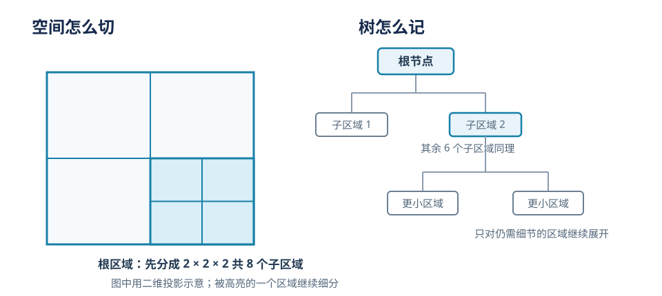

# 八叉树入门：从空间细分到 T3lescope 的场景重建

三维重建既要覆盖很大的空间，也要保留墙角、桌腿等局部细节。若把整个场景都表示成同样细的小格子，空旷区域也会消耗大量存储和计算；若只用大格子，细节又会消失。八叉树是处理这种“哪里需要细节，哪里可以粗一些”问题的一种空间组织方式。

本文先用一个房间的例子说明八叉树如何工作，再看论文 [T3lescope: Arbitrary-Resolution High-Fidelity Generative Surface Reconstruction from Images](https://arxiv.org/html/2610.03308v1) 如何用多尺度生成逐步重建大场景。读完后，希望你能分清：八叉树是怎样的数据结构，而论文又是怎样借助空间层级处理固定分辨率生成器难以覆盖大场景的问题。

## 1. 从房间理解八叉树

### 从一个包围盒开始

假设我们用一个立方体包住整间房。这个立方体是树的**根节点**，它代表当前考虑的全部空间。现在沿 x、y、z 三个方向各切一刀，立方体就成为 `2 × 2 × 2 = 8` 个更小的立方体。每个小立方体是根节点的一个**子节点**。

如果其中一个子区域恰好包含复杂的桌椅或墙角，可以继续把它分成 8 个更小区域；如果另一个区域只是空旷的墙面或房间中央，就可以不再切分。不断细分后不再继续分的节点叫作**叶节点**。从根节点走到某个叶节点的路径，描述了这个空间区域被细分了几次。

每一层中，立方体边长减半、体积变成原来的八分之一。若根立方体边长为 8 米，那么第一层子立方体边长是 4 米，第二层是 2 米。树因此同时记录了“一个区域在哪里”和“它处于什么空间尺度”。

### 节点存什么，何时继续细分

八叉树规定的是空间区域之间的父子关系，本身不限定节点里必须存什么。节点可以记录区域是否被占用、某个距离场数值、材质或语义标签，也可以存神经网络的特征或局部几何。

通常由表示任务决定何时细分。例如，空区域可以直接标为空，不再分；靠近物体表面的区域可以继续细分；也可以在达到最大深度后停止。关键思想是把表示预算集中在有信息的地方，而不是让全空间都使用最小格子。

这与**均匀体素网格**不同：均匀网格把包围盒全部切到同样大小，访问规则简单，但空区域也要占格子；八叉树允许区域停在不同层级，常能更经济地表示稀疏或细节不均匀的空间，代价是遍历、跨尺度邻接和边界处理更复杂。

### 一条直觉

可以把它想成地图缩放：先用全国地图定位，再放大到城市，最后只对街区或建筑内部继续放大。八叉树把这种从整体到局部的空间分辨率关系变成了可遍历的树结构。它不自动决定哪些地方重要，细分策略仍取决于应用中的几何、占用或误差信号。

## 2. T3lescope 要解决什么问题

T3lescope 的任务是：给定一组已知相机内参和位姿的多视角 RGB 图像，生成覆盖场景的高保真三角网格。它面向室内、室外乃至街区尺度的场景。这里“位姿”告诉系统每张图从哪里、朝哪个方向拍摄；“内参”描述相机焦距和成像中心等成像参数。

论文建立在 TRELLIS.2 的稀疏体素网格生成器上。生成过程分成两个阶段：

1. **稀疏结构（SS）阶段**：先预测哪些三维体素靠近物体表面，得到表面的稀疏空间支撑。
2. **mesh 阶段**：再在这个稀疏结构上生成具体网格几何。

两个阶段都使用固定分辨率的三维表示和生成模型。固定分辨率让单个局部区域容易生成，却带来一个尺度矛盾：一个 cell 覆盖范围越大，其中每个格子代表的实际空间就越大，细节越难表达；把 cell 缩小能更细，却不能单独覆盖很大的场景。

## 3. 论文的端到端流程

*图：论文 Figure 2。每层 cell 尺寸逐级减半；同一套 SS 与 mesh 生成器跨层复用。原图来自 [T3lescope 论文 HTML](https://arxiv.org/html/2610.03308v1)。*

### 第一步：用粗层建立全局布局

推理时先设置覆盖场景的大 cell。论文用 DA3 生成的点云辅助放置最粗层 cell，并选择每个 cell 可用的输入视角。这里的深度点云用于初始化布局和视角选择；论文说明它不会融合进最终几何。

每个 cell 接收关联的多视角图像特征，依次经过 SS 与 mesh 生成，形成粗层结构和网格。同一层若有多个 cell，它们会有一定重叠。生成器对每个 cell 做局部预测，再通过 MultiDiffusion 把重叠区域的预测合并到共享的场景 latent（供生成器处理的压缩表示）中。这让场景能够超出一个 cell 的原生空间范围。

但是，单个 cell 的生成器仍主要观察本地上下文。相距很远的房间或建筑部分只能通过一连串相邻重叠间接交换信息，难以直接保持整体结构关系。这就是论文继续加入层级细化的原因。

### 第二步：把空间尺度逐级缩小

设最粗 cell 的边长为 `s₀`，第 `l` 层的 cell 边长为：

\[
s_l = \frac{s_0}{2^l}
\]

例如，若粗层 cell 覆盖边长 4 米，则下一层覆盖 2 米，再下一层覆盖 1 米。模型的网格分辨率没有增加；改变的是固定大小的网格现在对应更小的实际空间，所以它能表示更细的局部结构。多个更小的 cell 合起来继续覆盖大场景。

这听起来像八叉树的层级细分，但论文组织的对象是**推理时布置的多尺度 cell**，而非一棵显式的标准八叉树。标准八叉树在树中递归建立八个子空间；T3lescope 则允许 cell 重叠，并用生成过程传递父层几何。二者共有“从粗尺度传递到细尺度”的直觉，具体的数据结构和生成算法不同。

### 第三步：让细层接着父层几何生成

若每个细层 cell 都从纯噪声开始，模型必须重新猜测物体的大致位置和形状，粗层已经建立的全局布局不容易保留下来。T3lescope 因而从父层网格构造细层的起点：先由 shape decoder 对父层几何逐级上采样，再取出对应于细层 cell 的局部结构。

这个上采样结构只是粗略初始化。它来自较粗的网格，表面位置可能不够准确，也未必与细层的体素格对齐。论文把它编码为 SS latent，扰动到中间噪声时刻 `t_s`，然后让细层 SS 生成器结合图像条件去噪、修正。这个“从已有样本出发、适度加噪后再生成”的过程采用 SDEdit 式初始化。

噪声强度控制继承与重画的平衡：噪声较小，细层更贴近父层但修改空间有限；噪声较大，模型能重新调整更多内容，也更可能偏离父层布局。论文报告所有 benchmark 使用固定的 `t_s = 0.8`。得到细层 SS 后，mesh 阶段再生成该层的局部网格。

### 第四步：给不同尺度匹配图像信息

大 cell 需要理解较大范围的图像，小 cell 则需要像素级细节。论文把每张输入图像预先编码为多尺度 tile 金字塔；每个 cell 按自己的体素间距选择相应尺度的图像 tile，并调整相机内参，使 tile 能以虚拟视角提供给生成器。

在 SS 生成中，体素位置会投影到输入图像，生成器据此读取投影附近的 DINOv3 图像特征。mesh 阶段还加入 ConvNeXt 局部特征以补充细节。图像特征可在 cell、层级和采样步骤之间复用，避免对每个 cell 反复编码整张图。

最终，粗层先给出场景布局，父层几何为细层提供空间起点，匹配尺度的图像特征帮助细层调整表面；重复这一过程后，最细层给出最终高分辨率网格。

## 4. 用八叉树的概念看它，也要看到边界

八叉树帮助我们理解“空间有层级，局部区域可以更细”的设计动机。T3lescope 的多尺度级联与这个动机相通：较粗的空间结果为较细结果提供上下文。但要理解论文实现，最好把两者区分开：

- 八叉树是一种明确的递归空间数据结构，细分一个节点时产生八个子区域。
- T3lescope 是推理时的生成流程，按层设置 cell 尺寸与位置，让同一个模型反复生成并细化；cell 可以重叠，父层几何会传给细层。

因此，论文没有声称实现了标准八叉树。借助八叉树可以获得“粗到细的空间层级”直觉，但论文的具体方法应称为**多尺度 cell cascade（级联）**。

## 5. 效果与代价

论文在 ScanNet++、Tanks and Temples，以及作者构建的城市街区数据上评估方法，使用不同视角数量和图像分辨率。作者报告 T3lescope 优于其对比的前馈和生成式基线，并在部分设置下与逐场景优化方法竞争；定性结果包括细结构以及有光泽、透明的表面。具体指标必须结合对应数据集、视角数和评价协议解读，不能直接外推到所有场景。

层级生成扩大了可处理的空间范围，也增加了推理成本。论文在单张 NVIDIA H200、ScanNet++ 五个大型场景、32 个输入视角上的统计中，平均重建到 L1 级约需 17 分钟，到 L2 级约需 89 分钟。层数增加意味着要处理更多、更小的 cell，计算和显存开销也随之增长。因此这是一种以多次生成换取大范围与细节的方案，不是靠八叉树跳过空区域而自动获得低成本。

## 小结

八叉树把三维空间递归划分成大小不同的立方体，适合把细节预算集中在需要的区域。T3lescope 面对的是另一层问题：固定分辨率的三维生成器如何从对象或局部尺度推广到大型场景。它在推理时先生成粗层，再把父层几何变成细层的带噪起点，结合对应尺度的图像特征逐级生成网格。理解这篇论文时，可以用八叉树建立层级空间的直觉，但其实现核心是可配置的多尺度 cell 级联。

## 参考资料

1. Noguchi, A. et al. “T3lescope: Arbitrary-Resolution High-Fidelity Generative Surface Reconstruction from Images.” [arXiv:2610.03308v1](https://arxiv.org/html/2610.03308v1), 2026.
2. 八叉树的根节点、八子区域和递归细分是计算机图形学与空间索引中的通行定义。本文用房间例子说明这些基本概念；与 T3lescope 的对照是依据其方法章节中 cell 布局、级联和父层初始化的描述作出的解释。

## QA

暂无问答。
