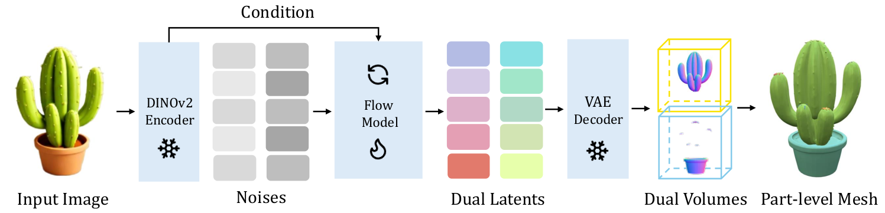
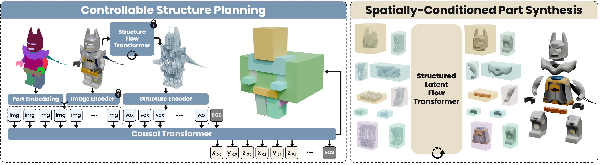

# 一件物体如何变成可编辑的零件：PartPacker、OmniPart 与 BANG

给一张椅子的照片，普通 image-to-3D 模型通常会产出一整张椅子网格。它看起来完整，却未必能单独移动椅腿、替换靠背。**部件级 3D** 要求结果中存在可分别处理、同时又能组合成整体的几何。三篇论文都在解决这件事，但入口很不一样：**PartPacker 从单张图直接生成部件；OmniPart 让二维部件 mask 控制先规划、后生成的过程；BANG 则从已有 3D 资产出发，生成它逐渐拆开的动态过程。**

## 先建立共同问题：分开，却还要装得回去

部件生成至少要处理两种互相牵制的信息。一方面，每个零件应有自己的完整表面和独立身份；另一方面，它们的尺度、位置、接触面必须与整件物体协调。如果只是把一个整体 mesh 的可见表面涂成不同颜色，隐藏的接触面仍未生成，零件拆下来时可能是空的。反过来，如果逐件孤立生成，单个零件可能很漂亮，却未必能拼回同一把椅子。

理解这三篇时，先问三个问题：**用户交给模型什么？模型中间生成什么？用户拿到的最终东西是什么？** 它们并无统一的输入接口，也没有同一个“标准网络”。但都利用了 3D 生成模型的几何先验，把“整体”与“部件”放进同一条推理链。

| 论文 | 用户侧主要输入 | 模型承担的关键工作 | 最终结果与边界 |
| --- | --- | --- | --- |
| [PartPacker](https://arxiv.org/abs/2506.09980) | 单张物体图像 | 联合生成两个容纳不同部件的 3D 体，再拆出各部件 | 多个可组装 mesh；不要求用户预先指定分割，但部件粒度控制有限 |
| [OmniPart](https://arxiv.org/abs/2507.06165) | 单张图像和用于控制拆分方式的二维部件 mask；mask 可由用户或分割模型提供 | 自回归预测各部件 3D 框，再用 rectified flow 同时生成部件 | 可编辑的部件几何与外观；mask 提供粒度控制，但不等于每个 mask 严格对应一个 3D 部件 |
| [BANG](https://arxiv.org/abs/2507.21493) | 已有 3D 几何；可附加区域框、表面区域等空间提示 | 条件扩散生成从装配到分离的网格序列，并跟踪零件轨迹 | 爆炸视图、分离部件及重新装配路径；核心任务是生成式分解已有资产，并非单图直接生成部件 |

## PartPacker：把不相接的零件装进同一个体

### 为什么要“装箱”

常见 3D 生成器会预测一个有符号距离场（SDF）：空间里每个位置记录到物体表面的有符号距离，再从零值表面提取 mesh。若把相互接触的椅面和椅腿写进同一个 SDF，它们的交界会融合，独立身份随之丢失。最直接的解法是“一部件一 SDF”，但零件数不固定，计算量随部件数增加。

PartPacker 的观察是：**没有接触的零件可以共享一个体**，提取网格后依靠连通分量重新分开。它把零件视作图上的节点，两个零件接触就在节点间连边。若接触图是二分图，就能分成两组，使同组零件互不接触：例如椅座和左腿可能被放入不同组，几条互不相接的腿则可共用一组。于是无论有多少部件，生成器只需固定输出**两个体、两组 latent**。

真实资产的接触图未必天然二分。论文会根据零件穿插深度，启发式合并部分零件，以消除奇环并得到可双组装箱的训练样本。这一步也是代价：三件彼此都接触的零件无法在两个体中始终保持原本的三重独立关系。[方法与算法见原文第 3.1 节](https://arxiv.org/html/2506.09980v1#S3.SS1)。

*图：图像编码后，flow 模型联合去噪两组 latent；各自解码成一个体，再把其中不相接的连通部件提取出来。来源：[PartPacker，图 3](https://arxiv.org/html/2506.09980v1#S3.F3)。*

### 训练、推理与结果怎么看

训练数据来自带场景图的 3D 资产：论文先从 GLB 的几何节点提取候选部件，对断面作修补，再筛掉双体体积过于不平衡的样本。实验部分报告最终约 **25.4 万**个双体训练样本。模型先在整体形状上预训练 VAE 和 flow 模型，再用部件数据微调；DINOv2 编码输入图像，rectified flow 在图像条件下**同时**生成两组 latent，VAE 解码成两个体。[数据与训练：第 3.2、3.3、4.1 节](https://arxiv.org/html/2506.09980v1)。

推理时只给单张图，不需要先跑二维分割，也不需要逐件调用生成器。作者报告单图到部件网格约 30 秒；这是论文自身设置下的运行时间，不能直接和采用不同硬件、输出精度的其他论文当作统一基准。局限是训练部件标签依赖来源资产的场景结构，部件边界和细分粒度会不稳定；双体装箱还无法忠实表示任意复杂接触图。[实验与局限：第 4 节](https://arxiv.org/html/2506.09980v1#S4)。

## OmniPart：先决定零件在哪里，再一起画出零件

PartPacker 尽量让模型自己决定如何分解；OmniPart 更在意用户能否控制“我要把它拆成哪些层次”。它把问题拆为两阶段。**规划阶段**从输入图像、二维 mask 和初步的整体稀疏体素出发，自回归地产生一串 3D 轴对齐包围框。**生成阶段**把这些框作为各部件的空间范围，联合生成真实的部件几何与外观。[方法总览：第 3 节](https://arxiv.org/html/2507.06165v1#S3)。

这里“自回归”只描述**部件框规划器**：像语言模型预测下一个 token 一样，逐项输出框坐标，直到结束标记。它不是说最终 mesh 的顶点、face 也逐个自回归生成。二维 mask 是控制部件粒度的提示，可以来自人或 SAM 等工具；论文明确不要求二维区域和三维框一对一匹配。规划器还加入 coverage loss，鼓励框覆盖完整部件。框可以稍大，后面的生成器会丢弃不属于该部件的体素；框过小则会直接截掉本应存在的几何。[规划器：第 3.2 节](https://arxiv.org/html/2507.06165v1#S3.SS2)。

*图：先根据图像和部件 mask 预测一组 3D 框，再在整体与各框的稀疏体素上联合生成部件 latent。来源：[OmniPart，图 2](https://arxiv.org/html/2507.06165v1#S3.F2)。*

第二阶段沿用 TRELLIS 的结构化 3D latent：活跃体素的位置给出粗形状，每个体素的特征编码局部几何与外观。OmniPart 将**整体 token**与**各部件 token**放在一起去噪，并给每组部件 token 加身份位置嵌入。这样单个零件可得到独立表征，而不同零件仍共享整体上下文。模型还给候选体素预测有效性：如果一个框里混入邻近零件的体素，可以在解码前剔除。真正生成细节用的是 **rectified flow**，即学习噪声与目标 3D latent 之间的速度场。[部件生成：第 3.3 节](https://arxiv.org/html/2507.06165v1#S3.SS3)。

训练时，论文用约 **18 万**个带部件标注资产训练框规划器，从中挑出约 **1.5 万**个高质量资产来微调部件 latent 生成器。推理结果可解码为独立 mesh，也可得到 3D Gaussian 等表示；文章展示了纹理编辑与不同粒度拆分。这里的局限也直接来自设计：轴对齐框可能包进大量无关体素，后续“丢弃”机制虽能清理，却无法补回规划框外遗漏的部件。[数据、实验和局限：第 3.4、4、5 节](https://arxiv.org/html/2507.06165v1)。

## BANG：让已有 3D 资产“慢慢炸开”

BANG 要回答的问题又变了：**已经有一个整体 3D mesh，能否让模型生成它从装配状态到零件分离的连续过程？** 它把这个过程称为 *Generative Exploded Dynamics*。输入是 3D 几何以及目标爆炸进度，输出是相应进度的网格状态；多个进度构成一段从 `t=0`（组装）到 `t=1`（完全分离）的序列。[任务定义：第 3.1 节](https://arxiv.org/html/2507.21493v1#S3.SS1)。

*图：先用带零件结构的资产合成爆炸动态训练数据，再生成拆解序列、追踪每个零件的运动，最后用空间提示控制拆解区域。来源：[BANG，图 2](https://arxiv.org/html/2507.21493v1#S2.F2)。*

它先预训练一个静态 3D VAE 加 latent diffusion/DiT：VAE 将 mesh 表面点压缩为 latent，解码器根据 latent 和查询点预测 SDF，进而提取网格。接下来冻结基础生成器，训练一个较轻的 **exploded-view adapter**：把原始几何的点云特征、目标爆炸进度以及预期部件数变成条件，送入 DiT，使模型生成目标进度的网格。再加跨帧 temporal attention，让不同进度的结果互相参考，减少序列跳动。[模型：第 3.1 节](https://arxiv.org/html/2507.21493v1#S3.SS1)。

注意两个“时间”：**爆炸进度 `t`** 说明零件分离到哪里；**扩散噪声步 `τ`** 说明生成器还在第几步去噪。一次推理是在给定 `t` 的条件下，沿 `τ` 去噪得到那个状态的 3D 网格。生成完整动态时，取多个 `t`，并利用跨帧注意力使它们协调。这不是让 mesh 顶点按 `t` 直接做机械平移。

论文用已有零件结构的资产计算各零件向外移动的向量、插值出爆炸序列，过滤后获得约 **2 万**个训练资产。推理后的全分离状态可以用连通分量得到零件；随后用 SDF 轨迹优化追踪这些零件如何回到原位，尽量让重组路径与生成序列吻合。它还支持用 3D 框或选定表面区域控制分离部位。[数据与追踪：第 3.2、3.3 节](https://arxiv.org/html/2507.21493v1#S3.SS2)。

所以，BANG 不是“单张图像输入，直接输出部件”的同类替代品。论文演示过与上游图像/文本到 3D 模型串联的创作流程，但 **BANG 核心模块仍接收已有 3D 几何**。其生成式拆解可能创造输入外表面没有显式表现的内部结构；这属于模型依据先验生成的合理构造，不等于测量并找回真实隐藏机械结构。作者也报告复杂细节可能漂移、局部几何损失，且当前流程更偏视觉设计，未保证物理可拆装。[应用与局限：第 5、7 节](https://arxiv.org/html/2507.21493v1)。

## 三篇连起来看：可控性放在不同位置

PartPacker 把难点放在**表示**：用两个共享体处理任意数量的部件，让单图生成保持固定输出长度。OmniPart 把难点放在**结构规划**：二维 mask 控制拆分粒度，自回归框负责数量与位置，flow 模型负责具体几何。BANG 把难点放在**过程建模**：给已有 3D 资产生成逐渐分离的状态，再把分离零件和原物体建立轨迹对应。

一个实用的选型直觉是：**只有一张图、想直接拿到部件**，先看 PartPacker；**想指定或调整部件粒度**，看 OmniPart；**已经有 3D 资产，想可视化拆解或做部件级编辑**，看 BANG。这是按各论文报告的输入/输出做的任务划分，不是三者的统一性能排名。三篇的评测数据、条件和指标不同，不能把各自表格中的数字简单横向比较。

## 参考论文

- Tang et al., [*Efficient Part-level 3D Object Generation via Dual Volume Packing*](https://arxiv.org/html/2506.09980v1), arXiv:2506.09980, 2025。
- Yang et al., [*OmniPart: Part-Aware 3D Generation with Semantic Decoupling and Structural Cohesion*](https://arxiv.org/html/2507.06165v1), arXiv:2507.06165, 2025。
- Zhang et al., [*BANG: Dividing 3D Assets via Generative Exploded Dynamics*](https://arxiv.org/html/2507.21493v1), arXiv:2507.21493, 2025。

## QA

### OmniPart 有自回归模块，为什么仍说它用了 diffusion / flow？

因为它把“决定部件布局”和“生成部件几何”分给两个模型。前者的输出是一串 3D 包围框坐标，确实用 next-token prediction 自回归完成；后者的输出是各部件的 3D latent，使用 rectified flow 联合去噪。看到“自回归”不能据此推断整篇论文是自回归 mesh 生成，看到“flow”也不能忽略它的自回归规划阶段。

### PartPacker 为什么两个体就能装下任意数量的零件？

这里的“两个”是**存储零件的组数**，不是零件总数。一组体里可以同时容纳很多互不相接的零件；提取 mesh 后，它们仍是不同连通分量。但“两组”成立要以接触关系可二分为前提。遇到奇环时论文会合并部分接触零件，所以“任意数量”不等于“任意接触拓扑都能无损拆分”。

### BANG 的爆炸动画只是把现有零件向外平移吗？

不是。**训练数据**里确实利用带零件结构的资产和优化出的平移向量合成序列；**推理模型**则在原始整体几何条件下生成各进度的网格状态。完全分离后还要从生成状态识别连通零件，并优化其回装轨迹。因此模型有生成式补充内部结构的空间，也有几何漂移与物理不准确的风险。
