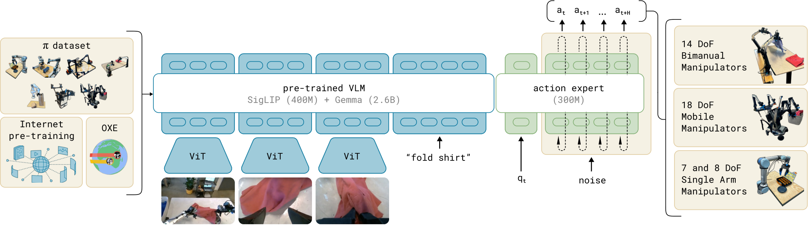
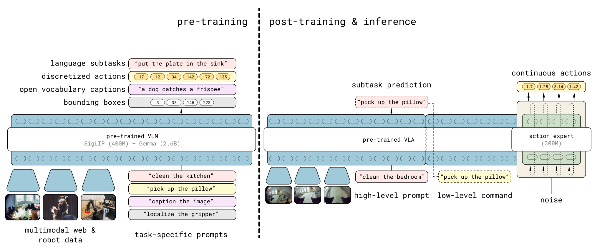

# 从 VLM 到机器人动作：以 π0、π0.5 理解 VLA

你可以让视觉语言模型看一张厨房照片并回答“盘子在哪里”，但让机器人真的把盘子放进水槽，还需要它在每个时刻根据相机和自身状态决定关节、夹爪与底盘怎样运动。**VLA（Vision-Language-Action，视觉—语言—动作模型）**就是把“看懂场景和指令”接到“产生可执行动作”上的机器人策略。Physical Intelligence 的 [π0](https://arxiv.org/abs/2410.24164) 与 [π0.5](https://arxiv.org/abs/2504.16054) 是理解这一范式的两个很好的例子：前者展示了 VLM 加连续动作生成器，后者进一步展示如何把高层语义决策、跨场景数据和实时动作执行接起来。

本文先讲整体工作方式，再用 π0 和 π0.5 对照具体实现。这里的“动作”通常是机器人控制器要追踪的关节/末端目标和底盘速度，并不是模型直接输出电机电流。

## 先建立一张总图

设当前时刻为 $t$。机器人收到自然语言任务 $\ell$（如“把盘子放到水槽”），相机拍到多张图像 $I_t^1,\ldots,I_t^n$，本体感觉状态 $q_t$ 告诉模型手臂关节、夹爪、底盘等当前在哪里。策略要产生未来一小段动作 $A_t=(a_t,\ldots,a_{t+H-1})$，而不是只回答一个句子。

```text
语言任务 + 多相机图像 + 本体状态
            ↓
   VLM 主干理解场景与任务
            ↓
     动作专家生成动作片段
            ↓
  底层控制器执行若干步动作
            ↓
   重新拍摄、读取状态、再规划
```

这里的 $H$ 是一次生成的动作片段长度，**动作片段（action chunk）**相当于“接下来一小段时间怎么动”。片段使模型不用为每一个控制周期都重新跑完整 VLM；但实际世界会变化，因此执行一部分动作后要再次观测。π0 论文称其片段长度为 50 个动作；在报告的部署设置里，50 Hz 机器人通常执行 25 个动作后再次推理，而不是无条件执行完整 50 步。[π0，§IV 与附录 A-D](https://arxiv.org/html/2410.24164)



*图 1：π0 的原论文框架图。蓝色是由图像和语言提供条件的 VLM，绿色是处理机器人状态、噪声动作并产生连续动作片段的动作专家；左侧是跨机器人训练数据。图来自 [π0 论文图 3](https://arxiv.org/html/2410.24164)。*

## 模型吃进去的是什么？

与“给模型一张图片”相比，机器人输入多了两层约束。

第一，图像往往来自多个相机：远景相机看任务环境，手腕相机看抓取位置。π0 的机器人一般使用两到三幅 RGB 图像；π0.5 在移动操作平台上还使用前后及两侧手腕相机，并根据高层或低层推理选择相机。图像经视觉编码器变成可供 Transformer 使用的表示，语言指令变成普通文本 token。[π0，§IV](https://arxiv.org/html/2410.24164)；[π0.5，§IV-E](https://arxiv.org/html/2504.16054)

第二，模型还需知道**本体状态（proprioception）**：关节角度、夹爪姿态、升降机构位置、底盘速度等。只看画面，机器人无法可靠知道自己当前的关节配置。π0 将这类连续状态经投影接入动作专家；π0.5 论文的具体实现则将本体状态离散化后作为文本 token 输入。两者属于同一 VLA 范式，但不要把这些具体编码细节混为一谈。[π0，§IV](https://arxiv.org/html/2410.24164)；[π0.5，§IV-A](https://arxiv.org/html/2504.16054)

VLM 主干的价值在于已有大规模图文预训练，可提供物体、场景、语言任务的语义表示；但它本身没有学会把这些表示变成高频、精细、连续的机器人控制量。这就是动作专家要补上的能力。

## π0：VLM 负责条件，动作专家负责连续控制

π0 从预训练的 PaliGemma VLM 初始化主干，再加入较小的**动作专家（action expert）**。这里“专家”指一组专门处理机器人状态和动作 token 的参数，形式上类似双专家 Transformer，而不是另一个会独立聊天的模型。主干提供图像与语言条件；动作专家读取当前状态和一组待生成的动作位置，输出对整段动作的修正方向。原论文的主干约 30 亿参数，动作专家约 3 亿参数。[π0，§IV](https://arxiv.org/html/2410.24164)

为什么不直接像 LLM 一样一个 token、一个 token 地输出动作？机械臂动作是连续数值，例如每个关节目标位置；要高频运行，还要在一段时间内保持协调。把连续数值量化为 token 再逐个自回归预测是可行路线，但 π0 选择用 **flow matching（流匹配）**来一次建模整段连续动作。它与扩散模型同属从噪声逐步形成样本的生成方法，但训练目标是学习从噪声向真实动作移动的速度场。[π0，§II、§IV](https://arxiv.org/html/2410.24164)

### 用一个 50 步动作片段理解流匹配

假设示范数据给出一段真实动作 $A$，其中有 50 个控制时刻，每步包括若干关节和夹爪数值。训练时先采样同形状的高斯噪声 $\epsilon$，再选一个插值位置 $\tau\in[0,1]$：

$$A^{\tau}=\tau A+(1-\tau)\epsilon.$$

当 $\tau=0$，输入是纯噪声；当 $\tau=1$，输入是真实动作。模型在图像、指令、当前状态条件下，学习把当前的 $A^{\tau}$ 往真实动作方向推动，π0 的目标速度可写为 $A-\epsilon$。训练损失是预测速度与目标速度之间的平方误差。它学到的不是“此动作对应哪个词”，而是“在这一环境和任务下，这团随机动作应往哪里移动”。[π0，§IV](https://arxiv.org/html/2410.24164)

推理时没有示范答案：先从随机噪声开始，沿学到的速度场积分若干次，最后得到整个连续动作片段。π0 的实验使用 10 次 Euler 积分步骤。每一步仍要运行动作专家，但图像和指令形成的前缀可缓存，减少重复计算。[π0，§IV、附录 A-D](https://arxiv.org/html/2410.24164)

生成 $H$ 个动作不等于一次性永久“开环”。机器人先执行一部分，随后重新取图像和本体状态，再生成下一段动作。这构成感知—控制的外部闭环。需要注意：**片段内部仍可能是开环执行**。π0 论文明确说在其部署设置里不做时间聚合，而是按片段执行，并在片段之间重新推理；若物体在片段中途突然被碰走，模型要等下一次观测才能纠正。[π0，附录 A-D](https://arxiv.org/html/2410.24164)

## 机器人数据怎样把 VLM 训练成 VLA？

训练样本的核心是同一时刻的“观察—任务—未来动作”配对：相机图像、语言标签、本体状态，与人类遥操作或其他示范产生的动作片段。学习过程主要是**模仿学习**：让模型在这些条件下产生接近示范的动作。它不要求每一个机器人动作都附带一个自然语言的“正确答案”，也不等同于强化学习的奖励优化。[π0，§III–V](https://arxiv.org/html/2410.24164)

π0 的训练思路分两段：

1. **大范围预训练**：混合多任务、多机器人配置的数据与公开机器人数据，让模型见到不同物体、场景和错误恢复轨迹。论文报告自有数据来自 7 种机器人配置、68 个较复杂的任务，并混入 Open X-Embodiment 等数据。不同机器人动作维数不一，论文统一到最大维数，并对缺失维度填零或掩码。[π0，§III、§V-A](https://arxiv.org/html/2410.24164)
2. **面向目标任务的后训练/微调**：用更精心筛选的高质量示范，让机器人执行某类具体工作时更顺畅，例如叠衣服或收拾桌面。基础模型提供广泛经验，后训练强化所需任务的熟练度。这是 π0 报告的训练配方，不应理解为所有 VLA 都必须严格采用这两个阶段。[π0，§V-A](https://arxiv.org/html/2410.24164)

## π0.5：同一个模型先决定“做什么”，再决定“怎么动”

π0.5 的目标更侧重在未见过的真实家庭中执行长程任务，例如整理厨房。只靠低层动作片段不够：机器人还要判断当前应先拿起盘子，还是先打开柜门。π0.5 把这种**高层子任务**写成语言，比如总目标是“整理厨房”，当前子任务是“把盘子放到水槽”。同一个模型先自回归地产生子任务文本，再条件于它用动作专家产生连续动作片段；它不是必然由两个独立模型组成的流水线。[π0.5，§III、§IV-A](https://arxiv.org/html/2504.16054)



*图 2：π0.5 原论文的整体示意。左边用机器人及网页多模态数据学习语言、定位框和离散动作 token；右边在后训练加入动作专家，部署时先输出语言子任务，再从噪声生成连续动作。图来自 [π0.5 论文图 3](https://arxiv.org/html/2504.16054)。*

π0.5 还有一个容易被忽略的训练细节：它**并不是完全不用自回归动作**。预训练阶段，论文把动作片段用 FAST 编码为离散 token，和文本、目标框等一起做 next-token prediction。这样可以使用成熟的 Transformer 训练方式，并利用网页图文、跨机器人、多环境机器人示范、高层子任务标注等不同来源。到了后训练阶段，再加入连续动作专家，同时保留文本预测能力；推理时语言子任务仍逐 token 生成，但低层动作由 flow matching 通过约 10 次去噪/积分步骤产生。这是 π0.5 的“离散训练与连续执行结合”，不是“整个模型从头到尾都是纯扩散”。[π0.5，§IV-B–D](https://arxiv.org/html/2504.16054)

论文给出一个具体的数据配方：移动操作数据、多环境非移动机械臂数据、实验室跨机器人数据、高层子任务标注及图文网页数据在预训练混合；后训练更聚焦于移动操作和高质量成功轨迹，并加入人类口头指挥子任务的示范。这里的高层文字既是模型要学的输出，也成为低层动作生成的条件。[π0.5，§IV-C–D](https://arxiv.org/html/2504.16054)

部署时可把它理解成两个不同频率的循环：慢一些地根据任务和新画面更新当前子任务，快一些地持续用该子任务和相机、本体状态生成动作片段。论文的移动平台以 50 Hz 跟踪关节、夹爪、升降和底盘目标，底层用简单 PD 控制器跟踪这些目标。[π0.5，§III、§IV-E](https://arxiv.org/html/2504.16054)

## 与普通 LLM、VLM 的关系

| 模型 | 主要输入 | 典型输出 | 如何学习输出 |
| --- | --- | --- | --- |
| LLM | 文本 token | 下一个文本 token | 文本序列的 next-token prediction |
| VLM | 图像与文本 | 文本回答或结构化语义结果 | 图文任务训练，常含 token 预测 |
| π0 式 VLA | 多相机、任务语言、本体状态 | 连续机器人动作片段 | 机器人示范上的条件流匹配 |
| π0.5 式 VLA | 多相机、任务语言、本体状态 | 语言子任务与连续动作片段 | 离散 token 预训练，再加入流匹配动作专家后训练 |

关键差别不是 VLA “有没有 Transformer”——它当然有；而是它必须把图像和语义最终落实为与机器人硬件、控制频率和实时反馈相匹配的动作。对于 π 系列，VLM 预训练提供语义底座，机器人示范提供物理操作经验，动作专家负责连续控制，高层语言子任务则帮助处理长时间的任务。

## 该怎样读论文，才不把能力说大？

π0 论文展示了多平台、多任务预训练及针对复杂任务微调；π0.5 报告了在未见过的家庭场景中完成厨房/卧室整理类任务的实验。这些是其论文设定下的结果，不意味着模型已经能在任意家居、任意机器人上零样本稳定工作。真实部署还受相机视角、示范覆盖范围、机器人硬件、推理延迟、接触和安全约束影响。论文中的“端到端”也不代表完全没有底层控制器：模型产生目标，物理机器仍需执行控制。[π0，§VI–VII](https://arxiv.org/html/2410.24164)；[π0.5，§IV-E、§V–VI](https://arxiv.org/html/2504.16054)

如果只记一条主线，可以记住：**VLM 理解“眼前是什么、任务是什么”，机器人示范让它知道“怎样动”，流匹配动作专家把这种知识变成一小段连续控制；执行后重新观察，再进入下一轮。**π0.5 在这条线上进一步把“下一步该做什么”作为模型自身产生的语言子任务。

## 资料

- Physical Intelligence, [π0: A Vision-Language-Action Flow Model for General Robot Control](https://arxiv.org/abs/2410.24164)，尤其 §III–V 与附录 A-D。
- Physical Intelligence, [π0.5: a Vision-Language-Action Model with Open-World Generalization](https://arxiv.org/abs/2504.16054)，尤其 §III–V。
- Physical Intelligence 官方介绍：[Our First Generalist Policy](https://www.pi.website/blog/pi0)、[π0.5: A Vision-Language-Action Model with Open-World Generalization](https://www.pi.website/blog/pi05)。

## QA

暂无问答。
