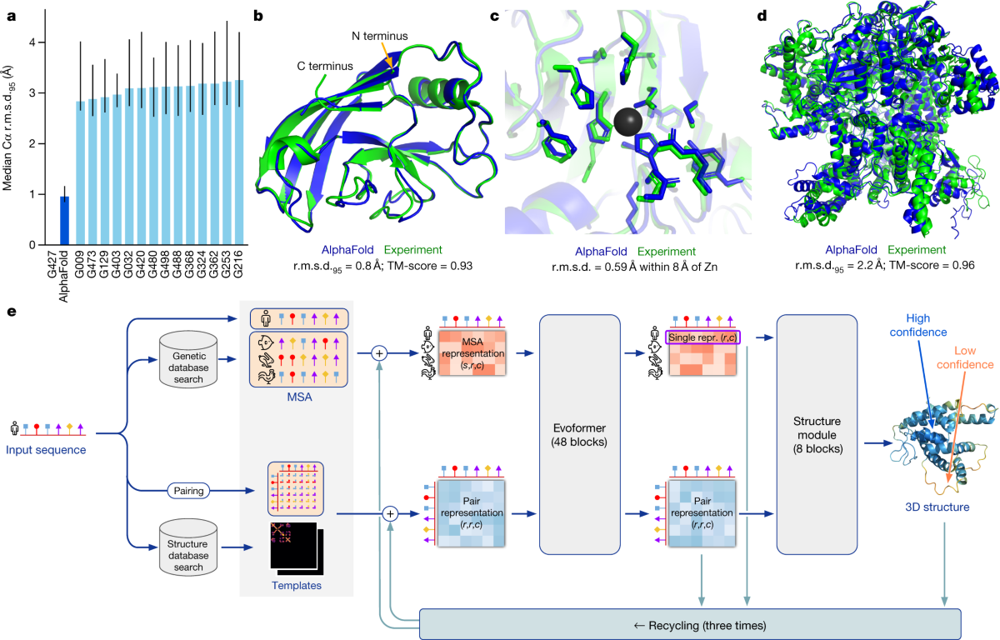
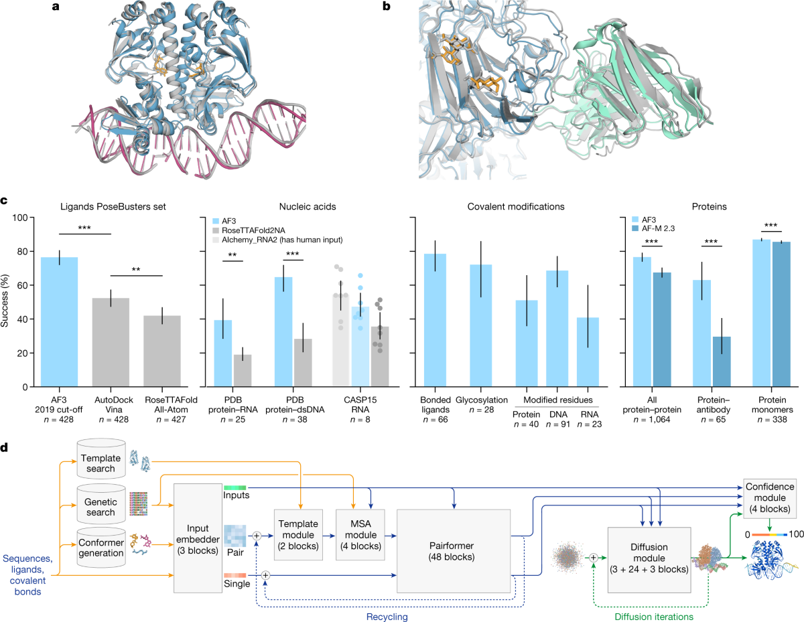
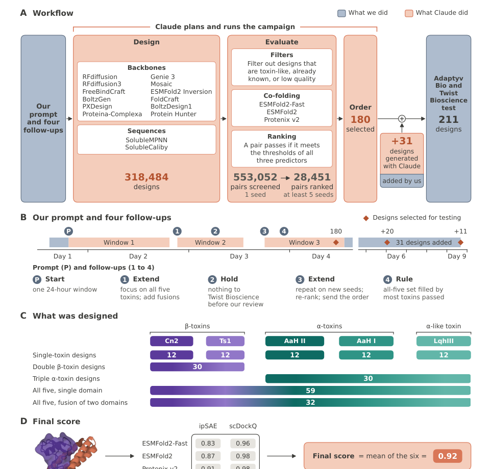

# 蛋白质结构预测入门：从氨基酸序列到三维形状

如果把蛋白质看成一条由氨基酸组成的链，**蛋白质结构预测**回答的是：给定这条链的序列，它在三维空间中大致会怎样折叠？这个问题重要，是因为蛋白质与别的分子如何接触，通常取决于它的三维形状，而不仅是序列里有哪些字母。

本文先讲单条蛋白质的结构预测，再讲复合物预测及可信度；最后用一项设计抗蝎毒结合蛋白的研究，说明结构预测如何成为蛋白设计工作流中的一个工具。最后那项研究的目标是**设计新的蛋白质序列**，与“预测已有序列的结构”是相关但不同的任务。

## 输入、输出究竟是什么？

蛋白质由氨基酸残基连成链。机器学习模型最基本的输入是一串残基符号，例如 `M-A-D-K-…`；输出可以是一组原子的三维坐标，或能进一步转成坐标的几何表示。常见的预测文件格式是 PDB 或 mmCIF。你可以把这理解为：输入类似文本中的 token 序列，输出却不是下一个 token，而是满足空间关系的一组三维点。

```text
氨基酸序列  ──→  残基/原子间的关系  ──→  三维坐标
  M-A-D-K-…        谁靠近谁、相对方向       一种可能的结构
```

所谓一级结构是序列；二级结构包括 α 螺旋、β 折叠；三级结构是整条链的三维排布。多条蛋白链或蛋白与其他分子组合起来，还涉及复合物结构。这里最容易误解的是：**预测一份静态坐标，不等于完整描述蛋白质在细胞中的全部构象和运动。**温度、溶液、结合伙伴和化学修饰都可能改变它的状态。

## 为什么序列不能直接“读出”形状？

序列中相距很远的两个残基，折叠后可能贴在一起；局部片段也会受整条链的上下文影响。模型必须同时处理“沿链相邻”和“空间相近”这两种不同关系。实验结构数据（例如 [Protein Data Bank](https://www.rcsb.org/) 中的结构）给了监督，但相对浩瀚的序列空间，已测得的三维结构仍然稀少。

一种经典信息来源是**多序列比对**（MSA）：找同一家族的相似序列，观察哪些位置在进化中共同变化。如果第 20 位与第 110 位总是协同变化，它们可能在空间上相互作用。这是线索，不是“共同变化必然接触”的定律。另一条路线使用大规模蛋白质序列预训练，把序列中的规律编码进模型表示，即使不给每条目标序列构造很深的 MSA，也能做结构预测。

## AlphaFold 2 怎样把线索变成三维结构？

[AlphaFold 2 原论文](https://www.nature.com/articles/s41586-021-03819-2)提供了一个清晰的代表范式。它使用目标序列、同源序列的 MSA，以及可用时的结构模板；核心网络维护两类信息：每个残基及其同源序列的表示，和每一对残基之间的关系表示。



*图 1：下半部分是 AlphaFold 2 的方法流程：从输入序列检索 MSA 与模板，经 Evoformer 更新序列和残基对表示，再由结构模块输出三维坐标并循环精修；上半部分对照预测结构与实验结构。原图来自 [AlphaFold 2 论文图 1](https://www.nature.com/articles/s41586-021-03819-2/figures/1)。*

这两类表示在 **Evoformer** 中反复交换信息：MSA 告诉模型哪些位置可能协同变化；残基对表示积累距离和几何关系线索。随后结构模块把这些表示转为三维坐标，模型还能把上一次预测送回网络继续精修，这叫 **recycling**。因此它不是“查询一个与序列最像的现成结构并复制”；模板可以提供帮助，但网络也能从序列和进化线索预测新结构。

从 Transformer 视角看，难点不只是让每个残基看见其他残基，还要让模型把“残基 A 与 B 的关系”和“B 与 C 的关系”组合成自洽的三维几何。最终每个残基的局部预测必须能拼成一条完整的链。

## 从单链走向复合物：AlphaFold 3 增加了什么？

许多实际问题问的不是一条链自己怎么折，而是**两个或更多分子如何结合**，例如蛋白与另一条蛋白、DNA、RNA 或小分子形成的复合物。[AlphaFold 3 原论文](https://www.nature.com/articles/s41586-024-07487-w)将范围扩展到这些分子组合，并用扩散式结构生成模块预测复合物的原子坐标。



*图 2：上方展示蛋白—核酸等复合物预测及论文所报告的比较结果，下方展示从分子输入到扩散式坐标生成的流程。读图时应区分示例结构、特定基准成绩和方法架构。原图来自 [AlphaFold 3 论文图 1](https://www.nature.com/articles/s41586-024-07487-w/figures/1)。*

这里“扩散”指从带噪的坐标逐步得到结构，并不是说输入也是噪声。模型仍然接收分子身份、序列、化学组分等条件。对于结合问题，它可以给出**可能的相对摆放方式**；但预测的复合物姿势再漂亮，也不能单独证明两个分子在真实实验条件下一定结合，更不能直接给出药效。结构预测是候选假说，结合实验和功能实验回答的是不同层级的问题。

## 预测结果怎么判断是否可信？

AlphaFold 系列常给出置信度指标。**pLDDT**主要提示某个局部区域的坐标是否可靠；**PAE**（预测对齐误差）帮助判断不同片段或结构域之间的相对位置是否可靠。举例说，两个结构域各自折叠得很可信，但连接它们的柔性区域让相对朝向不确定，这时局部 pLDDT 高，也不能把整个蛋白的朝向当成唯一答案。[EMBL-EBI 的指标说明](https://www.ebi.ac.uk/training/online/courses/alphafold/inputs-and-outputs/evaluating-alphafolds-predicted-structures-using-confidence-scores/)对此有直观解释。

读一份预测结构时，可以按顺序问：输入是哪条序列或哪些分子？有没有实验模板或同源序列？局部区域和不同链的相对位置分别有多大把握？目标问题是折叠、结合、催化还是药效？最后一个问题往往需要结构以外的证据。

## 回到你给的文章：Claude 设计抗蝎毒蛋白做了什么？

[机器之心文章](https://mp.weixin.qq.com/s/PJ4j8BqSDdJRv3V5WqMbWQ)介绍的是 Anthropic 的[抗蝎毒结合蛋白设计项目](https://www.anthropic.com/research/claude-scorpion-toxin-binder-design)。它不是让 Claude 单独充当一个结构预测模型，而是让 Claude 作为**科研 Agent**，组织多个蛋白设计和结构评估工具，提出并筛选新的氨基酸序列。



*图 3：Anthropic 技术报告图 2 的方法与筛选流程。橙色表示 Claude 组织的设计与计算评估，蓝色表示研究者提示和实验室测试；数字依次是 318,484 个生成设计、553,052 组计算筛选、180 个由 Claude 选出及最终 211 个实验候选。原图来自 [Anthropic 技术报告](https://www-cdn.anthropic.com/31ac578806cffd8b3d92d8affe6edc4c04d502e1.pdf)。*

任务是为 5 种蝎毒神经毒素设计 **minibinder**（小型结合蛋白）。理想情况下，这些新蛋白会贴住毒素表面，阻止毒素与神经细胞的钠离子通道相互作用。团队先确定目标毒素、可用工具和筛选规则；Claude 检索 PDB、AlphaFold 数据库中的目标结构，选择潜在结合位点，然后调用不同设计工具生成候选序列，再预测“候选蛋白 + 毒素”可能形成的复合物并按指标筛选。这个流程中，结构预测既用于理解目标，也用于对大量设计做**计算筛选**。

```text
毒素结构与目标位点
       ↓
Claude 组织设计工具生成候选序列
       ↓
预测候选蛋白—毒素复合物、计算筛选
       ↓
选出候选 → 实验室合成 → 测量是否结合
       ↓
后续仍需中和功能、动物保护与安全性验证
```

按 [Anthropic 原始报告](https://www-cdn.anthropic.com/31ac578806cffd8b3d92d8affe6edc4c04d502e1.pdf)，计算阶段约 64 小时，Claude 调用 12 种设计工具，生成 **318,484** 个设计，并对 **553,052** 组候选—毒素配对做了复合物预测或筛选。Claude 最终选出 180 个候选，团队与 Claude 合作补充 31 个，共 **211** 个交给两家实验室测试；其中 **17 个达到预设的结合标准**。这 17 个是“211 个进入实验的候选中的 17 个”，不能写成“31.8 万个设计里只有 17 个能结合”，因为绝大多数设计根本没有接受实验测试。64 小时也仅指计算设计阶段，不包含蛋白合成与实验；原报告给出的计算量约为 **一万 GPU 小时**。

从结构预测角度，最关键的认识是：**计算上预测能贴合 ≠ 实验中测到结合 ≠ 能中和毒素 ≠ 可作为药物。**实验室测到的是与目标毒素的结合；对于两个较强的 Cn2 候选，竞争结合实验提示它们可能占据与已知中和抗体相近的位置。但研究尚未证明这些候选能在细胞实验中阻断毒素，也没有在动物体内证明保护效果。5 种目标毒素中，有 4 种找到达到标准的单靶标结合蛋白，未找到达到预设多毒素结合标准的“通用”设计。这里的结论是一次特定目标和工具组合下的**早期候选发现**，不是抗蝎毒药物已经研发成功。

两家实验室的主筛选使用 **SPR（表面等离子共振）**测量结合；技术报告还记录了部分 **BLI（生物层干涉）**测量与反向结合测试。两者都是结合测量方法。对于理解文章主线，更重要的是把计算预测、实验结合和功能验证分开。

## 小结

蛋白质结构预测的基础问题是“给定序列，推测三维形状”；复合物预测再问“多个分子如何相对摆放”。Anthropic 的案例则往前走了一步：让 Agent 利用这些预测工具设计**新的序列**，并用实验筛选真正结合的候选。结构预测可以显著压缩搜索空间，却不能替代生化实验，更不能跳过中和效果与安全性验证。

## 主要资料

- Jumper 等，[AlphaFold 2：Highly accurate protein structure prediction with AlphaFold](https://www.nature.com/articles/s41586-021-03819-2)，*Nature*，2021。
- Abramson 等，[AlphaFold 3：Accurate structure prediction of biomolecular interactions with AlphaFold 3](https://www.nature.com/articles/s41586-024-07487-w)，*Nature*，2024。
- [EMBL-EBI：如何理解 AlphaFold 预测结构的置信度](https://www.ebi.ac.uk/training/online/courses/alphafold/inputs-and-outputs/evaluating-alphafolds-predicted-structures-using-confidence-scores/)。
- Anthropic，[项目说明](https://www.anthropic.com/research/claude-scorpion-toxin-binder-design)、[原始技术报告 PDF](https://www-cdn.anthropic.com/31ac578806cffd8b3d92d8affe6edc4c04d502e1.pdf)与[开放的候选设计数据](https://huggingface.co/datasets/Anthropic/scorpion-toxin-binder-design)。
- [机器之心：刚刚，Claude 64 小时设计 31 万种蛋白，17 种通过实验验证](https://mp.weixin.qq.com/s/PJ4j8BqSDdJRv3V5WqMbWQ)。

## QA

### 蛋白质结构为什么要编码成多个 token？这些 token 究竟表示什么？

先把生物学对象说清楚：蛋白质可以理解成由 20 种常见氨基酸串成的一条长链。氨基酸像一套重复使用的积木，每块积木都有相似的连接主干，但侧面化学基团不同，因此大小、电荷、亲水性和疏水性不同。它们通过肽键首尾连接；接到链上以后，通常称为一个**残基**（residue）。所以在入门讨论中，“第 37 个氨基酸”和“第 37 个残基”可以近似理解为同一个位置。

例如，下面只有 5 个残基：

```text
M - A - G - S - L
```

`M`、`A`、`G`、`S`、`L` 分别代表不同氨基酸。这个字符串告诉我们它们沿链的先后顺序，却没有直接告诉我们这 5 个残基最后如何折叠到三维空间。一级结构是残基顺序；二级结构是局部的 α-螺旋、β-折叠等规则形状；三级结构是整条链折叠后的总体三维形状；多条链装配成复合物时，还会有四级结构。[RCSB PDB-101 对结构层次和原子坐标的介绍](https://pdb101.rcsb.org/learn/guide-to-understanding-pdb-data/structure)

#### 为什么不能把整条蛋白质压成一个 token？

假设一条蛋白质有 1,000 个残基。模型至少需要区分第 37 个位置和第 800 个位置，还要表示它们是否在折叠后靠近、某一段是不是 α-螺旋、活性位点附近的原子怎样摆放。如果整条蛋白质只有一个向量，它可以保存一些全局摘要，却没有明确的“第 37 个位置”“第 800 个位置”这些槽位，难以逐位置地产生结构。

因此常见做法是保留多个局部单位：一个单位可以对应一个残基、一小段局部结构、一个空间邻域，或者一个学习到的结构块。Transformer 才能在这些单位之间计算关系：沿序列相邻的残基可以交流，序列上相距很远但折叠后可能接触的残基也可以交流。这个直觉类似把图片切成许多 patch：整图向量适合做分类，但要恢复每个物体的边界，通常要保留多个局部 patch。蛋白质的额外要求是还要满足键长、键角、手性和原子不能互相穿透等三维约束。

#### 方式一：一个残基对应一个结构 token

这是最容易理解的抽象。对 `M-A-G-S-L`，先得到 5 个序列 token：

```text
[M] [A] [G] [S] [L]
```

每个 token 可以携带三类信息：它是哪一种残基、它在链上的位置，以及模型目前推断出的局部结构状态。比如第 3 个 token `[G]` 可以与一个 Cα 原子位置或局部骨架坐标系关联，第 4 个 token `[S]` 关联另一个位置。示意地写成：

```text
[M] -> Cα1 = (0.0, 0.0, 0.0)
[A] -> Cα2 = (3.8, 0.2, 0.4)
[G] -> Cα3 = (6.9, 2.0, 0.8)
[S] -> Cα4 = (4.8, 4.5, 1.1)
[L] -> Cα5 = (1.5, 3.7, 0.6)
```

这些坐标只是帮助理解的示意，并不是实验测得的结构。真实系统还要预测主链原子、侧链构象或局部坐标系，并通过几何模块把它们组合成完整结构。一个残基 token 通常不能独自保存该残基所有原子的细节，所以还需要原子级模块或坐标解码器。AlphaFold 2 是这一思路的代表：它维护每个残基的表示和每一对残基之间的表示，再由 Structure Module 输出三维坐标；它不是只把整条序列压成一个向量。[AlphaFold 2 原论文](https://www.nature.com/articles/s41586-021-03819-2)

#### 方式二：一个空间局部或结构块对应一个 token

如果任务更像理解或生成三维点云，也可以按空间邻域分组，而不是严格按序列位置分组。假设一个小蛋白的原子点云被分成 3 个空间块：

```text
B1：靠近 N 端的一组主链和侧链原子
B2：中间螺旋附近的一组原子
B3：靠近结合口袋的一组原子
```

编码器把每个块内的点坐标、原子类型和局部方向汇总成 `[B1] [B2] [B3]`。`[B2]` 不一定对应连续的第 20～30 个残基；折叠后在空间上靠近的两个序列片段，也可能落在同一个空间邻域。解码器再把每个块还原为一组点或原子坐标。

还有一种相近做法：先把局部结构压缩成连续 latent，再用码表量化成“结构词”。某个结构 token 可能代表“短 α-螺旋末端加一个转角”，另一个代表“相邻的 β-折叠片段”。但具体块大小、码表和是否离散化取决于模型，不是所有蛋白质模型的统一标准。AlphaFold 3 的最终目标是生成蛋白质、核酸和小分子复合物的原子坐标；它的扩散式结构模块不等于先把每个原子查成 NLP 词表中的词。[AlphaFold 3 原论文](https://www.nature.com/articles/s41586-024-07487-w)

#### 一个具体的小例子：从序列 token 到坐标

假设输入是一条 4 残基肽链：`A-G-S-V`。

1. **序列编码**：得到 `[A] [G] [S] [V]`。此时 token 记录残基类型和链上位置，还没有三维坐标。
2. **关系建模**：模型为每个残基生成局部表示 `h₁...h₄`，并维护残基对表示 `pᵢⱼ`。例如 `p₂₃` 可以记录第 2、3 个残基之间的距离或方向线索，`p₁₄` 帮助处理序列上远、空间上可能接近的两个位置。
3. **结构推断**：注意力让 4 个残基互相交换信息。`G` 的侧链较小、构象更灵活，`V` 的疏水侧链可能更偏向埋在蛋白内部；这些只是模型从大量结构数据学习到的统计倾向，不能由这两个字母单独确定。
4. **坐标输出**：结构模块输出 4 个 Cα 坐标，或者进一步输出主链和侧链原子坐标：

   ```text
   Cα(A) = (x1, y1, z1)
   Cα(G) = (x2, y2, z2)
   Cα(S) = (x3, y3, z3)
   Cα(V) = (x4, y4, z4)
   ```

   后续模块可以根据局部坐标和残基模板补齐原子，或直接生成完整原子结构。若使用空间块 token，则流程变为“原子点云 → 空间块 token → 预测每个块中的点 → 合并结构”。

#### 不要混淆三种 token

1. **NLP tokenizer**：把文本切成词、子词或字符，并映射到整数词表，例如把一个字符串映射为词表编号。
2. **蛋白质序列 token**：通常对应一个残基字母（如 `A`、`G`、`S`）或一个短序列片段，表达的是序列信息。
3. **蛋白质结构 token**：表达残基的局部几何、原子点云、空间邻域或结构 latent；它可以是连续向量，也可以是离散码，不必拥有像自然语言那样固定且公开的词表。

所以，“一个残基一个 token”不等于“一个原子一个 token”。一个残基通常含有多个原子；残基级 token 是一种压缩表示，原子级模型则可能显式处理每个原子或每个原子坐标。二者可以串联：先用残基 token 建立全局和局部语义，再用原子或坐标模块恢复细节。

#### token 数量的折中

token 越少，计算越便宜，但每个 token 必须承载更多信息，容易丢失短肽段、侧链方向或界面细节；token 越多，结构保真度更有机会提高，但显存和注意力计算都会增加。

| 表示方式 | token 数量 | 保留的信息 | 主要代价 |
| --- | ---: | --- | --- |
| 整条蛋白一个 token（极端假设） | 1 | 全局摘要 | 几乎无法逐位置恢复结构 |
| 每个残基一个 token | 约等于残基数 | 序列位置与局部骨架 | 侧链和原子细节需要额外模块 |
| 每个原子或小空间块一个 token | 约等于原子数或空间块数 | 更细粒度的几何 | token 多、计算和数据要求高 |

实际系统经常采用层次化表示：先用较少的残基级或块级 token 建立全局布局，再在关键区域展开为原子级坐标。理解这件事时，最值得追问的不是某个 tokenizer 的网络结构，而是：**一个 token 覆盖什么范围？它保留哪些几何信息？解码时还需要补回哪些细节？**

相关资料：[RCSB PDB-101](https://pdb101.rcsb.org/learn/guide-to-understanding-pdb-data/structure)、[AlphaFold 2](https://www.nature.com/articles/s41586-021-03819-2)、[AlphaFold 3](https://www.nature.com/articles/s41586-024-07487-w)。
