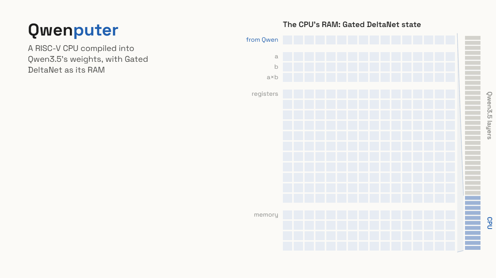
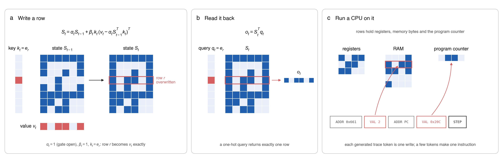
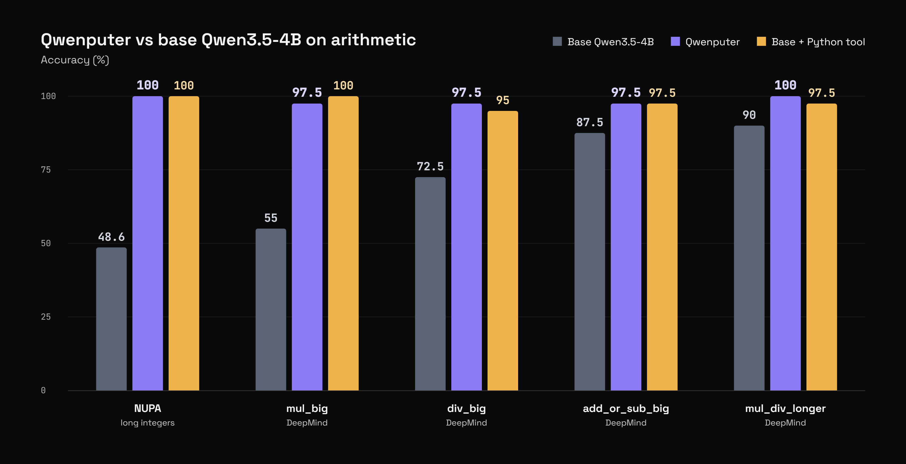

# Qwenputer：怎样把一台计算机编进语言模型

问语言模型“123456789 × 987654321 等于多少”，它通常沿着 token 序列生成答案；接上 Python 工具后，它可以让解释器执行计算。Qwenputer 提供了第三种实现：把一台计算机的运算逻辑写成新增的模型权重，让计算过程发生在模型的前向传播中。

这项实验由 Divyansh Agrawal 开发，基于 Qwen3.5-4B。它保留原模型权重，增加编译得到的计算层，并把 Gated DeltaNet 的运行状态用作内存。模型仍负责理解问题、组织请求和解释结果，新增电路负责按指令执行计算。[作者博客](https://divagr.com/blog/qwenputer)、[项目代码](https://github.com/divagr18/qwenputer)

理解它时，先分清两个位置：**权重保存计算机的规则，状态保存这次计算的数据。** CPU 加载程序、更新寄存器和写入文件，都发生在运行状态中；每执行一道指令，无需重新训练或修改权重。

*图 1：作者的交互演示。Qwen 发出计算请求，内置 CPU 执行，再将结果交回语言模型。来源：[原博客](https://divagr.com/blog/qwenputer)。*

## 1. 先把“计算机”拆成三部分

CPU，也就是中央处理器，可以理解为一套反复执行小指令的机器。一次乘法在用户眼里只有一个表达式，在程序里可能需要多次读取数字、进行运算、更新中间结果。

这里有三个相互配合的部分：

| 部分 | 保存或执行什么 | 一个简单例子 |
| --- | --- | --- |
| 指令与运算逻辑 | 规定每一步允许做什么 | 读取数据、相加、比较、根据条件跳转 |
| 寄存器与程序计数器 | 保存当前操作数和下一条指令的位置 | 寄存器保存 12、34；程序计数器指向下一条指令 |
| RAM，即随机存取内存 | 按地址保存程序和数据，支持反复读写 | 将中间结果写入地址 100，再按地址取回 |

RISC-V 是一套指令规则。Qwenputer 实现的是 32 位的 RV32IM 核心：I 包括基础整数指令，M 补充整数乘除法；项目还加入 Zba 扩展和大整数运算单元。32 位描述了核心机器的基本数据宽度。更长的数字可以拆成多段，由程序或大整数单元处理，因此示例里的长整数乘法也能执行。[项目 README](https://github.com/divagr18/qwenputer)

如果只有加法电路，却没有保存中间结果的位置，计算很难持续推进。Qwenputer 的关键起点，正是为这台机器找到了一块可以准确寻址和覆盖的内存。

## 2. Gated DeltaNet 怎样变成 RAM

普通 Transformer 的注意力会读取历史 token 的 key 和 value，KV cache 随上下文增长。Qwen3.5 使用混合架构，其中一些层采用 Gated DeltaNet，下面简称 GDN。每个 GDN 头维护一个固定大小的矩阵状态，新 token 到来时更新它，再从中读出信息。

矩阵大小固定，意味着保存的状态不会随对话无限增长，但也意味着容量有限。默认的 GDN 会混合、更新和遗忘信息；要把它当计算机内存，还得保证“写地址 2”确实只修改地址 2。

### 先忘多少，再改哪一行

用一种便于解释的行向量约定，设状态为 $S$：每一行对应一个地址，每行放一组数。GDN 的门控先得到 $\bar S=\alpha S$，再按 delta rule 更新：

$$
S'=\bar S+\beta k\left(v^\top-k^\top\bar S\right).
$$

这里 $k$ 是选择写入方向的 key，$v$ 是目标值，$\alpha$ 控制旧状态保留多少，$\beta$ 控制本次修改多少。括号内表示“想写入的值”与“当前位置的旧值”之间的差。这个差加回去，就能覆盖原来的内容。

Qwenputer 在计算机所使用的头中设置三个条件：

- $\alpha=1$：旧内容不因门控而衰减。
- $\beta=1$：完整写入目标值。
- $k=e_r$：使用只有第 $r$ 个元素为 1 的 one-hot 向量，精确选择第 $r$ 行。

代入后得到 $S'=S+e_r(v^\top-e_r^\top S)$。矩阵只有第 $r$ 行发生变化：先减去旧值，再加上新值；其余行保持原样。

### 一个可以手算的例子

假设状态有三个地址，每个地址保存两个数：

$$
S=\begin{bmatrix}1&0\cr 0&1\cr 1&1\end{bmatrix}.
$$

现在要把地址 2 覆盖为 $[1,0]$。取 $k=[0,1,0]^\top$，它读到的旧行是 $[0,1]$；差值就是 $[1,-1]$。只给第二行加上这个差，结果为：

$$
S'=\begin{bmatrix}1&0\cr 1&0\cr 1&1\end{bmatrix}.
$$

读也很直接：用同样的 one-hot 地址作为 query，取 $q^\top S'$，就返回指定行。至此，“按地址覆盖”和“按地址读回”都有了。

*图 2：左图展示单行覆盖，中图展示单行读取，右图把这些行分配给寄存器、RAM 和程序计数器。作者图采用与正文等价的转置记号。来源：[原博客](https://divagr.com/blog/qwenputer)。*

实际机器要把地址分配到多个头和多行，并把字节编码成位来保存。上面的二列矩阵只展示寻址原理。“精确”依赖这种受控的编码和运算条件，不能据此推断任意浮点数、任意门值下的 GDN 都是一块无误差内存。它也不会让普通 Qwen 自动获得逐字记住所有对话的能力。[GDN 内存布局说明](https://github.com/divagr18/qwenputer#gated-deltanet-as-ram)

## 3. 有了内存，CPU 的逻辑放在哪里

内存能存值，下一步要实现“读操作数、相加、写回、更新程序计数器”等逻辑。作者先把 CPU 描述成电路，再由编译器将电路转换为模型中的运算：注意力头承担查找，前馈单元承担算术和逻辑变换，GDN 头保存机器状态。

这一阶段的“编译”是根据规则直接计算权重。它不需要收集大量 CPU 执行样本，再训练模型模仿指令行为。依据作者介绍，RISC-V 核心对应 11 个新增层，放在 Qwen 原有 32 层之前，并扩展部分隐藏维度；原 Qwen 权重保持不变。[作者博客](https://divagr.com/blog/qwenputer)

这里还存在两种不同的编译。第一种把 **CPU 电路编成模型权重**，决定这台机器怎样执行指令；第二种把 **C 等程序编成 RISC-V 机器码**，决定这次要执行什么。前者相当于造处理器，后者相当于给处理器装软件。MicroPython 本身也可以作为机器上的程序运行，再解释 Python 代码。

所以“能运行 C 和 MicroPython”意味着内置核心具备执行这些程序所需的指令和状态；具体应用仍需相应固件或程序入口。博客发布时，作者把让 Qwen 直接通过 `python()` 使用内部 MicroPython 列为后续工作，不能把这个设想写成聊天接口已经完整支持的功能。

## 4. 一次乘法怎样完整走完

以“用 calc 计算 123456789 × 987654321”为例，把初始化和运行分开，流程就容易看清楚。

1. **驱动初始化机器。** 宿主推理程序加载模型，RvChat 驱动将计算固件写入 GDN 状态，准备好 CPU 运行环境。固件是负责接收表达式、组织运算和输出结果的小程序。
2. **Qwen 将问题组织成内部请求。** 模型生成熟悉的工具调用格式，例如调用 `calc`。它已有的工具使用能力让这一步无需额外后训练。
3. **新增计算层读取请求。** 计算层识别输入并执行固件指令。表达式里的长数字被读入，程序利用寄存器、RAM 和大整数运算完成计算。
4. **生成执行轨迹，推进状态。** 轨迹中的 `ADDR` 指定写入位置，随后的 `VAL` 携带值，`STEP` 标记一道指令结束。一道指令需要若干这样的 token；生成它们的同时，计算层完成相应读写和状态更新。
5. **把结果交回语言模型。** 机器产生的结果数字组成内部响应，Qwen 再据此写自然语言答案。RvChat 在解码过程中将 CPU 的轨迹 token 隔离于 Qwen 原有层之外，避免原模型处理整段机器执行日志。

这个例子的精确乘积是 `121932631112635269`。CPU 的职责是从明确的操作数和程序得到该结果，Qwen 的职责还包括正确理解题意、发出请求和引用返回值。两者中任一环节出问题，最终回答都可能出错。

所谓“没有外部计算工具”，指的是乘法没有被交给宿主机上的 Python 解释器或工具服务器。宿主 GPU 仍在执行张量计算，驱动仍负责引导和控制解码，固件仍需加载。作者也明确说明，当前版本尚不能用一条普通的 `generate()` 调用直接完成全部流程。[代码与驱动说明](https://github.com/divagr18/qwenputer)

## 5. 实验到底证明了什么

应当分开看机器执行和端到端问答。作者报告，CPU 通过官方 `riscv-tests`，与 QEMU 参考执行器的程序结果匹配，并在自行连续运行约 1800 万条指令时未发生错误。另外，对约 23 万个机器输出位置做参考回放，观察到零处不匹配。这些结果支持所测试条件下执行逻辑的可靠性；它们并不等同于所有语言问题都能正确转化成程序。[作者博客](https://divagr.com/blog/qwenputer)、[README](https://github.com/divagr18/qwenputer)

RISC-V 版本的公开 README 列出了以下问答评测，采用贪心解码，每组 40 道题。第三列的 Python 工具确实在宿主机运行，用来比较另一种执行确定性计算的办法：

| 算术任务 | 原模型 | Qwenputer | 原模型 + Python |
| --- | ---: | ---: | ---: |
| 大整数乘法 | 55.0% | 97.5% | 100.0% |
| 大整数除法 | 72.5% | 97.5% | 95.0% |
| 长乘除组合 | 90.0% | 100.0% | 97.5% |
| 大整数加减 | 87.5% | 97.5% | 97.5% |

四项任务的原始名称依次为 `mul_big`、`div_big`、`mul_div_multiple_longer`、`add_or_sub_big`。

*数据来源：[项目 README 的 Benchmarks](https://github.com/divagr18/qwenputer#benchmarks)。40 题中一道题就对应 2.5 个百分点，因此小幅差异需要连同样本数一起理解。*

*图 3：作者博客汇总图。NUPA 与 DeepMind 的结果需要结合下面的版本说明阅读。来源：[原博客](https://divagr.com/blog/qwenputer)。*

传播最广的“48.6% → 100%”来自 NUPA 长整数算术。博客将它写在 Qwenputer 的整体介绍中，但截至本文核对时，项目 README 把对应的 **576 题、3–20 位整数加减乘**列在早期 **Version 1（CHIP-8）** 部分。CHIP-8 是项目此前采用的另一套小型机器实现。因此，这个数字可以说明作者早期方案的效果，不能与上表的 RISC-V 版本、每组 40 题合成同一实验结论。[早期版本结果](https://github.com/divagr18/qwenputer#version-1-chip-8)

目前材料显示，加入可执行计算机制能显著改善所测算术任务，效果接近外部 Python 工具。它的研究价值还在于展示“确定性电路可以怎样嵌入模型”；要比较实用性，仍须同时衡量速度、内存、接入成本和更广泛任务表现。本文没有独立复现实验。

## 6. 同一块状态还能保存“文件”

如果 GDN 能按地址保存字节，也可以用它保存文件名和文本。实验性文件系统提供 `put`、`append`、`get`、`list` 和 `delete` 操作，分别对应写入、追加、读取、列出和删除。

作者在 GDN 状态中安排一个有 1024 个槽位的目录。写文件时，先对文件名求哈希，把名字映射到一个槽位；若槽位已被别的文件占用，就检查后续槽位。找到目录项后，再定位文本。文本存放在其他头中，每行保存八个 token，较长内容通过多行串接。作者报告可容纳最多 512 个文件，约 5.3 万 token 文本。[文件系统说明](https://github.com/divagr18/qwenputer#in-weight-filesystem-experimental)

这样查文件不必从头重读聊天记录。不过，“跨会话持久”需要宿主程序在会话结束时保存相关状态，在下一次开始时恢复。权重本身不会记住刚写入的文件，也没有凭空出现一块断电后自动保留数据的硬盘。

README 报告，在 90 道跨会话回忆题中，文件系统版为 83.3%，原模型为 7.8%，宿主 Python 记忆工具为 78.9%。这是特定测试下的结果。博客另有“后来改变的事实”测试，并与粘贴旧聊天记录比较；其基线与 README 的原模型基线不同，阅读时需要分别看待。文件系统仍在独立的 `rv-store` 分支上实验。[文件系统评测](https://github.com/divagr18/qwenputer#in-weight-filesystem-experimental)

## 7. 这项实验的代价与启发

作者博客报告，新增层和扩大隐藏维度后，检查点约为 18.8 GB，其中相当一部分是零填充；模型可在单张 24 GB GPU 上运行。一次 CPU 指令需要解码多个轨迹 token，大计算可能耗时数秒。作者的批量执行器在 L4 上约可生成每秒 3200 个 CPU 轨迹 token，不能把这个数直接理解为每秒 3200 条 RISC-V 指令，更不能当作普通聊天的输出速度。[作者博客](https://divagr.com/blog/qwenputer)

它也尚未达到完整 Linux 级计算机的能力范围。相对调用现成解释器，当前实现需要额外权重、专用驱动以及更多前向计算。因此，单看算术正确率不足以判断它是否适合生产使用。

Qwenputer 最值得理解的连接是：GDN 把持续状态带进模型，受控读写把状态变成可寻址内存，编译得到的层把内存组织成一台可执行程序的机器，语言模型再通过已有的调用格式使用它。**语言理解与确定性执行在同一套模型计算中协作，各自承担不同环节。** 这为在混合架构中嵌入可检查、可重复的计算模块提供了一个具体实验。

## 来源与继续阅读

- [作者博客：Qwenputer: a fully functioning, deterministic RISC-V CPU inside Qwen3.5](https://divagr.com/blog/qwenputer)，2026 年 10 月 22 日，主要机制、演示、图表与运行限制。
- [Qwenputer GitHub](https://github.com/divagr18/qwenputer)，实现说明、版本区分、基准表格和运行入口；本文于 2026 年 10 月 29 日核对。
- [RISC-V 核心设计与测量文档](https://github.com/divagr18/qwenputer/blob/main/experimental/riscv/docs/rv32.md)，进一步了解编译后的核心实现。
- [Hugging Face 模型](https://huggingface.co/divagr1925/Qwen3.5-4B-Qwenputer)与[实验性文件系统模型](https://huggingface.co/divagr1925/Qwen3.5-4B-Qwenputer-Filesystem)。

## QA

暂无问答。
