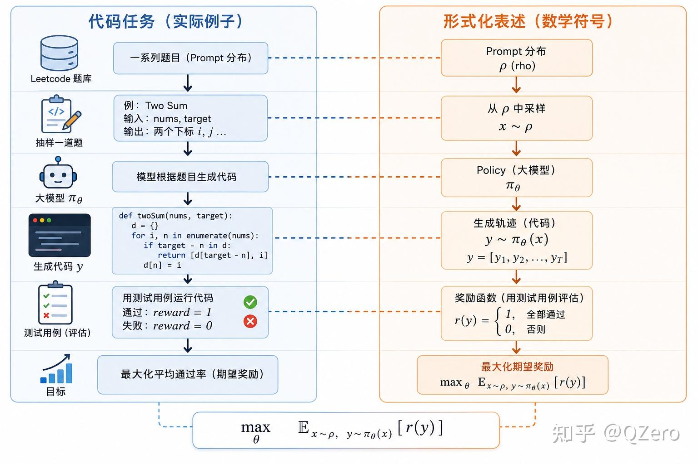
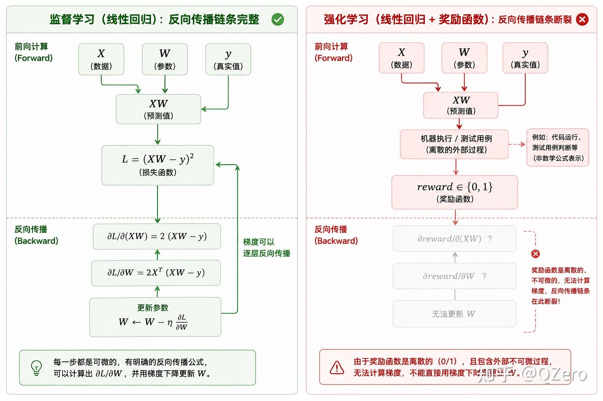
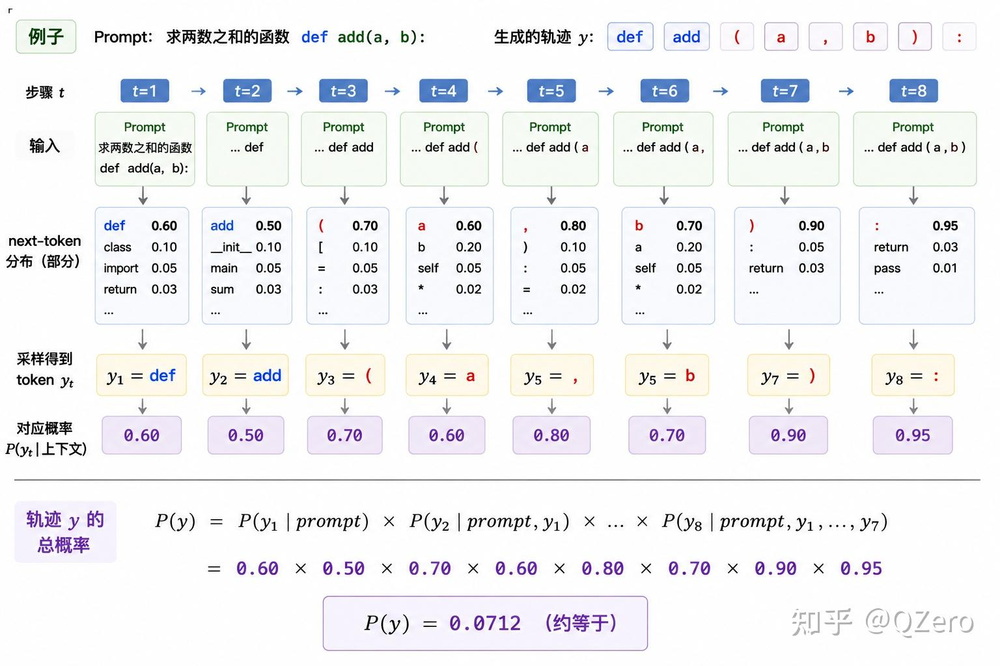
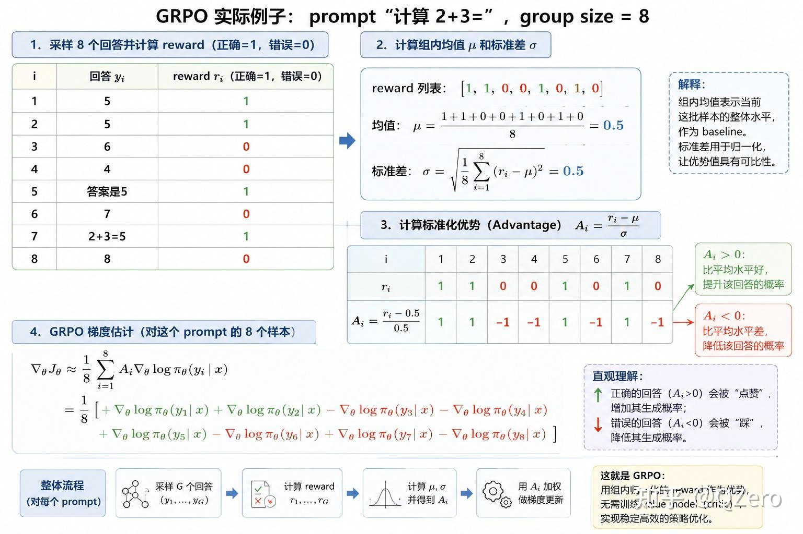
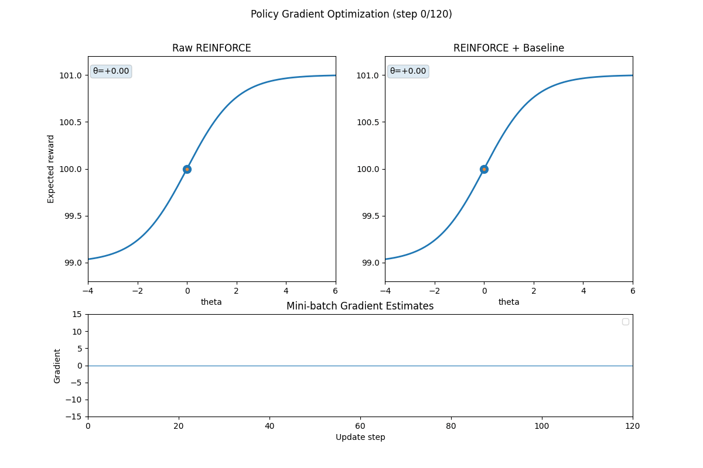

# 从 REINFORCE 到 GRPO：把大模型强化学习的训练链路讲清楚

> 本文是对 QZero 的知乎专栏文章《从零开始手搓大模型强化学习（一）：从 REINFORCE 到 GRPO》的中文整理。原文中的数学公式已移除，保留了原文提供的五张图片，并用文字补足阅读公式时通常承担的直觉解释。

## 先说这篇文章要解决什么问题

我们已经知道，语言模型可以通过监督学习学习“题目和答案”的对应关系：给定一段输入，训练数据告诉模型接下来应该输出什么 token，模型再根据预测和标准答案之间的差异更新参数。

强化学习换了一种训练方式。它不一定给模型一条逐 token 的标准答案，而是让模型自己生成一段完整回答，再由外部环境或奖励函数评价这段回答。模型要逐渐提高得到高奖励回答的概率。

这在代码生成任务中很直观：输入可以是一道编程题，模型生成代码，测试程序运行这段代码并返回通过或失败。模型不需要被告知每个位置应该填哪个 token，但需要从测试结果中学会以后更倾向于生成能通过测试的代码。

本文沿着一条由浅入深的路线介绍这件事：先理解大模型强化学习的任务形态，再看 REINFORCE 如何绕过不可微的奖励函数，最后看 GRPO 如何用同一个 Prompt 的多次回答构造更稳定的相对反馈。

## 一次大模型强化学习任务长什么样

一次训练样本通常包含四个角色：

1. **Prompt 数据**：例如一组 LeetCode 题目，或者一批需要模型完成的指令。
2. **策略模型**：当前的大模型根据 Prompt 逐 token 生成回答。
3. **环境或奖励函数**：执行代码、检查格式、调用规则评估器，或者由另一个模型给出评价。
4. **参数更新过程**：把奖励转成“哪些回答应该更常出现、哪些回答应该少出现”的学习信号。

一条模型回答不是一个单独的动作，而是一串按顺序生成的 token。训练时我们关心两件事：回答最终拿到了多少奖励，以及当前模型在生成这条回答时给每个 token 的概率。前者告诉我们结果好不好，后者让我们能够把结果反馈到模型参数。



图 1：原文把一个代码任务从左侧的实际流程映射到右侧的形式化对象。这里保留图片中的公式作为原图内容；正文不再重复公式推导。

## 监督学习和强化学习，差别在哪里

### 监督学习的反向传播链条

在线性回归或语言模型的监督训练中，数据、模型计算、损失函数和参数更新组成了一条连续的可微计算链。模型先做前向计算，损失函数比较预测和目标，自动微分系统沿着这条链反向计算每个参数应该如何改变。

语言模型的交叉熵训练也是同一类思路。训练集给出目标 token，模型的预测分布与目标分布之间的差异可以直接作为损失，反向传播能够穿过模型内部的线性层、注意力、归一化等操作。

### 奖励函数会把链条截断

强化学习中的奖励经常来自模型之外。例如，生成的代码需要交给编译器和测试用例运行；测试程序只返回通过或失败，执行过程本身并不是一个可以对模型参数求导的神经网络运算。

因此，不能把“代码执行结果”当作普通层，直接把梯度从奖励一路传回生成模型。难点不是模型内部不可微，而是模型生成的离散 token 和外部评测之间隔着一个不可微的决策过程。



图 2：原文用线性回归对比代码测试奖励。左边每一步都能继续反向传播，右边在离散的外部评测处断开。图内公式是原图的一部分，本文不在正文中展开数学推导。

## REINFORCE：用采样估计训练方向

REINFORCE 的核心想法是：既然不能把奖励函数本身反向传播，就让模型先采样出回答，再观察这些回答得到的奖励，用“奖励乘以生成这条回答的倾向”来估计参数更新方向。

具体过程可以拆成以下步骤：

1. 从 Prompt 数据中取出一条输入。
2. 用当前策略模型生成完整回答。
3. 把回答交给环境或奖励函数评估。
4. 重新计算模型在这条已生成回答上对每个 token 的对数概率。
5. 奖励高的回答提高其生成倾向，奖励低的回答降低其生成倾向。
6. 把一个批次的样本合并后，使用普通的自动微分和优化器更新模型。

这里的“重新计算”不等于重新采样。回答已经固定下来，模型只需要在 teacher-forcing 形式下读取 Prompt 和这条回答，得到每个位置对实际 token 的概率。这样，模型内部那部分仍然是可微的；不可微的奖励只负责提供一个外部权重。

实践中通常会把这些带权的对数概率拼成一个损失，再调用框架的反向传播。因为常用优化器默认做损失下降，而我们的目标是让高奖励回答更容易出现，所以实现时会使用与目标方向一致的符号约定。这里重要的是训练逻辑，不是记住某一个公式的正负号。

## 一条回答的概率如何理解

语言模型是逐 token 生成回答的。第一步根据 Prompt 选择一个 token；第二步把这个 token 拼回上下文，再预测下一个 token；后续步骤不断重复。

因此，一条完整回答的概率可以直观地理解为：每一步实际选中 token 的条件概率依次相乘。实现时不需要真的把很多小概率相乘，因为数值会很小；通常在每一步取对数，然后把这些对数概率相加。这样的“整条回答分数”能被自动微分系统高效计算。



图 3：原文展示了从 Prompt 到每个 token 的采样，以及整条轨迹概率的组成。图中数字和公式仅作为原始图片保留；正文只保留“逐步生成、再汇总每一步概率”的概念。

## 为什么直接使用 REINFORCE 会不稳定

REINFORCE 的批次估计有一个重要特点：它是随机的。即使长期平均方向是对的，一个小批次里采到的回答也可能刚好偏向失败样本，导致这一次更新方向很不可靠。

在大模型中，高方差主要来自两点：

- **回答很长**：一条回答包含很多 token，每个位置的概率都会参与整条回答的学习信号。
- **奖励很稀疏**：对于困难任务，一个批次可能只有极少数回答通过，其余回答全部失败。少量成功样本会被赋予很大的相对影响。

高方差的结果是训练曲线来回震荡：有时参数被推向一个方向，下一批数据又把它推回来。模型并非没有学习信号，而是每一步看到的信号太吵。

## Baseline：先减去一个共同参照

降低方差的一个经典办法是引入 baseline。它不改变一条回答相对于其他回答的好坏关系，而是先减去一个与当前动作无关的参照值。

直觉上，奖励高于参照值的回答得到正反馈，低于参照值的回答得到负反馈。对于只有通过和失败两种结果的代码任务，这一点尤其重要：失败回答不再只是“没有贡献”，而是会明确告诉模型“这种生成方式比当前平均水平差”。

baseline 可以是最近一段时间奖励的平均水平，也可以由一个价值模型预测。选择什么形式会影响方差和额外计算成本，但基本目标相同：把绝对奖励换成更稳定的相对信号。

## GRPO：让同一个 Prompt 自己提供参照

GRPO（Group Relative Policy Optimization）的直觉更直接：对同一个 Prompt 采样多个回答，把这些回答放在一个组里比较，而不是单独看某一条回答的绝对奖励。

一次 GRPO 更新大致包含以下步骤：

1. 选取一个 Prompt。
2. 用当前策略生成一组回答。
3. 对组内每个回答运行同一个奖励函数。
4. 计算组内的平均水平和波动程度，并据此判断每个回答相对组内水平是好还是差。
5. 提高相对表现好的回答的生成倾向，压低相对表现差的回答的生成倾向。
6. 在多个 Prompt 的组上汇总更新。

这样，一个失败回答也可能产生负反馈；它不需要达到某个全局阈值，只要比同组其他回答差，就能帮助模型减少这类行为。对每个 Prompt 采样多个回答，还能在不额外训练一个价值模型的情况下构造参照，因此 GRPO 在工程上具有较清晰的训练链路。



图 4：原文用一个简单示例说明组内奖励、相对优势和策略更新的关系。正文不复述图中的数学表达，只保留“同一 Prompt 的多个回答互相比较”这一核心直觉。

需要注意，GRPO 的完整实现通常还会结合旧策略与新策略的约束、更新幅度限制、KL 惩罚等稳定化机制。本文整理的是从 REINFORCE 走到“组内相对反馈”的教学主线，不把示意版本当成某个具体系统的全部工程细节。

## 用图理解更新为什么会抖动

前面的组内比较解决的是如何构造更有用的反馈，但更新仍然会受到采样噪声影响。原文最后用一个可视化例子对比了不同噪声水平下的策略更新：高方差时，参数每一步可能大幅摆动；低方差时，更新更容易沿着平均有利方向前进。



图 5：原文的更新可视化对比了不同梯度估计噪声下的参数变化。这里保留原图；它表达的重点是“平均方向相近时，较低方差通常带来更平稳的更新”。

## GRPO 的一个重要前提

如果同一个 Prompt 采样出的所有回答都失败，那么它们彼此之间没有可用的正负差异，组内相对信号可能接近于零。此时，即使训练流程正常运行，也很难从这一组样本中获得有方向性的改进。

这说明强化学习并不是凭空创造能力。基础模型至少要在一部分任务上偶尔产生可行回答，奖励函数才有机会区分“更好”和“更差”。如果基础模型完全不会做某类任务，单靠稀疏奖励通常很难从零学会复杂能力。

因此，一个实际的 RL 训练项目往往先检查：

- 基础模型是否能在少量样本上产生成功轨迹；
- 奖励函数是否真的能区分不同质量的回答；
- 一组采样是否经常出现全相同奖励；
- 生成长度、截断和格式错误是否吞掉了有效信号。

这些检查比直接把训练步数调大更重要。

## 从算法概念到最小工程闭环

把上述内容落到代码层面，可以把一次训练迭代理解成一个循环：

```python
for prompts in prompt_loader:
    responses = policy.generate(prompts, samples_per_prompt=group_size)
    rewards = reward_fn(prompts, responses)
    advantages = normalize_within_group(rewards)
    token_logprobs = policy.score(prompts, responses)
    loss = policy_gradient_loss(token_logprobs, advantages)

    optimizer.zero_grad()
    loss.backward()
    optimizer.step()
```

这段代码是概念示例，不是可直接运行的完整训练器。关键接口分别对应：生成回答、调用奖励、在组内形成相对信号、重新计算回答概率、通过自动微分更新策略。

如果使用现成框架，还需要额外处理批量组织、padding、截断、混合精度、显存、日志、检查点，以及奖励函数的安全执行。尤其是代码执行型奖励，必须隔离运行环境，不能把模型生成的任意代码直接放在训练主进程中执行。

## 这篇整理与原文的关系

- **原文主线**：从大模型强化学习任务出发，解释监督学习与强化学习的差异，介绍 REINFORCE、轨迹概率、高方差、baseline 和 GRPO，并强调基础模型能力的重要性。
- **本文整理**：去掉原文的数学公式和推导，把公式承担的含义改写成流程、直觉和实现步骤；补充了读者从 Transformer 训练过渡到 RL 时需要的接口视角。
- **没有改变的边界**：本文没有把 GRPO 简化成“只计算奖励平均值”，也没有把示意版本说成 DeepSeek-R1 的完整实现；原文图片按用户要求全部保留。

原始资料：QZero，《从零开始手搓大模型强化学习（一）：从 REINFORCE 到 GRPO》，知乎专栏“手搓大模型”，原文链接：<https://zhuanlan.zhihu.com/p/2051683116595548899>。

## QA

暂无问答。
