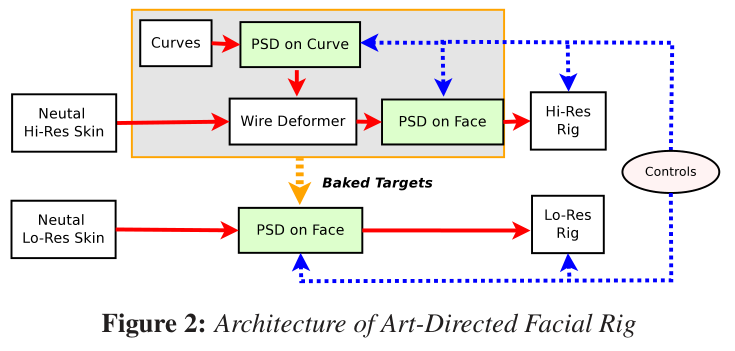
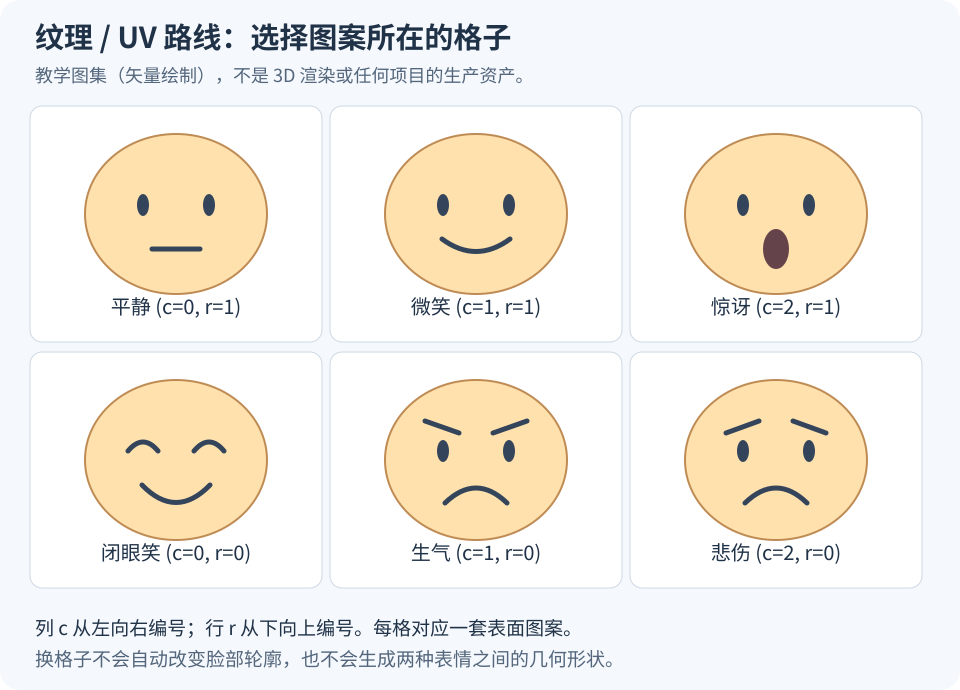

# 风格化 3D 角色怎样做表情：五类经典技术与混合制作

风格化 3D 角色做表情，常见思路可以整理为五类：**骨骼蒙皮、Blendshape、曲线或格笼等变形器、几何部件替换、纹理／UV 动画。** 前三类主要连续改变脸部的几何形状；第四类选择不同的几何部件；第五类主要改变脸上显示的图案。

这是为了理解实现原理而做的教学分组，不是行业统一、互相排斥的五种标准。一套实际的 Facial Rig 可以同时使用其中几类；骨骼本身也是一种变形机制，曲线或格笼也可以由骨骼驱动。

要理解它们的区别，先问一个具体问题：**这一帧要让角色微笑，程序究竟修改了什么数据？** 是骨骼变换、顶点位移、变形器控制点、当前显示的嘴部模型，还是贴图采样位置？


*图 1：本文绘制的实现路线图。渲染器最终根据当前几何、材质、灯光和相机生成图像。表情控制器不直接等于最终图像。*

## 一、先分清三个问题：表情长什么样、怎样实现、怎样随时间变化

“做一个好看的微笑”至少涉及三个层次。

**第一，设计目标表情。** 确定嘴角的位置、嘴唇的厚度、眼睛的开合、脸颊的体积，以及这些部位共同形成的轮廓。风格化允许夸张，但仍要让设计在需要的镜头角度成立。

**第二，建立实现机制。** 把控制量变成几何或材质的变化。这是本文比较的五条路线。例如，一个 `smile=0.8` 的数值，可以驱动嘴角骨骼，也可以驱动微笑形状键，还可以选择一张微笑贴图。这个数值的名字并不能告诉你底层实现。

**第三，制作表演。** 决定什么时候开始笑、眼睛是否先动、左右是否同时到位、停留多久、怎样恢复。动画曲线解决时间变化；它可以驱动上面的任何路线。

所以，同一套技术既能做出机械的表情，也能做出生动的表情。技术决定可控制的范围和制作方式，表情设计与动画决定观众实际看到的表演。

## 二、路线一：骨骼 + 蒙皮——移动控制骨骼，让顶点跟随

### 输入、操作、输出

一张脸的网格有许多顶点。绑定师布置下颌、嘴角、嘴唇、眉毛、眼睑等位置的骨骼，并为顶点设置它们受各根骨骼影响的程度，也就是蒙皮权重。

每一帧输入骨骼的平移、旋转或缩放；蒙皮计算根据骨骼变换和顶点权重，输出新的顶点坐标。下颌骨骼旋转可以张嘴，嘴角骨骼向外、向上移动可以形成微笑。

这里的“骨骼”是计算机里的变换节点，不要求对应真实面部骨骼。嘴唇、脸颊上也可以放很多控制骨骼。眼球、牙齿等独立部件还可以直接跟随对应节点。

### 怎样做一个微笑

可以先移动左右嘴角，再调整上唇与下唇的骨骼，接着抬起脸颊、收紧下眼睑。一个给动画师使用的“微笑”控制器，可以同时驱动这些变换；动画师仍可单独修改一边嘴角。

它的一个特点是，动画师能在绑定允许的范围内直接改变局部位置，而不必为每个新位置都预先制作完整目标脸型。因此，嘴巴偏到一侧、脸部拉长等夸张动作，可以通过专门设计的控制结构实现。

### 难点在哪里

**骨骼能移动，并不保证移动后的脸好看。** 权重不合适时，嘴角会折出尖角，嘴唇会变薄，眼睑可能穿进眼球。增加骨骼可以增加自由度，也会增加权重、控制关系和极端姿态的调试量。

骨骼蒙皮也不自动保证体积保持。尤其在大幅旋转、压缩或拉伸时，往往还要加体积补偿、辅助骨骼或修正形状。

在 Blender Studio 的《Sprite Fright》蜗牛案例中，作者明确介绍了嘴和眼睑的链式控制，并为了让嘴能明显移向脸侧做过多轮调整。这说明风格化的“嘴能移到哪里”，是绑定设计出来的能力。[制作团队的案例说明](https://studio.blender.org/blog/rigging-sprite-frights-snail/)

## 三、路线二：Blendshape / Shape Keys——预先做好形状，再按权重组合

### 输入、操作、输出

先保存一张基础脸，再制作一些目标形状，例如微笑、抿嘴、左眼闭合、右眉抬起。每个目标形状记录相对于基础脸的顶点位移。

输入是每个目标形状的权重，输出仍是一张变形后的网格。最基础的相对形状组合可以写成：

\[
\mathbf V(t)=\mathbf V_0+\sum_{k=1}^{K}c_k(t)\,\Delta\mathbf V_k.
\]

这里，$\mathbf V_0$ 是基础脸的顶点坐标，$\Delta\mathbf V_k$ 是第 $k$ 个形状的位移，$c_k(t)$ 是它在时刻 $t$ 的权重。实际绑定可以在此基础上加入非线性映射和修正。

在这个模型中，基础脸与各个目标必须具有一致的顶点对应关系：编号相同的顶点代表同一个表面位置。只保证顶点数量相同仍然不够，不能把一套顺序完全不同的网格直接相加。Unreal 的 Morph Target 流程也是先制作变形后的网格形状，再把这些形状用于动画。[官方 Morph Target 文档](https://dev.epicgames.com/documentation/en-us/unreal-engine/fbx-morph-target-pipeline-in-unreal-engine)

### 有两种常见的资产组织方式

**整套表情姿态。** 美术直接雕出一张满意的微笑脸，把嘴、脸颊、眼睛之间的配合都做好。它能明确保存这张脸的美术结果，但如果需要“嘴微笑、眼睛担忧”，整张脸一起变化就不够灵活。

**局部动作形状。** 分别制作左嘴角抬起、右嘴角抬起、下眼睑抬起、眉毛内侧抬起等形状，再组合出表情。组合自由度更大，但也更容易出现两个局部形状叠加后不协调的情况。

二者可以混用：局部形状负责常规组合，完整表情姿态用于快速摆姿势或校准最终外观。

### 怎样做一个微笑

如果只做了一个完整微笑形状，把权重从 0 调到 1，就得到从基础脸到目标微笑的变化。但中间权重得到的形状，不一定是美术想要的中等强度微笑。

例如，嘴唇顶点按直线移动时，中间状态可能变薄或互相穿插。解决方式可以是增加中间形状，或在特定组合下自动加入修正形状。**目标端点好看，不等于变化过程中的每一张脸都好看。**

### 优势与代价

这条路线适合精确保存美术做出的嘴唇轮廓、脸颊体积和眼部形状。主要制作量来自目标形状、中间形状与组合修正；数据开销则取决于顶点数、形状数量、稀疏存储和压缩方式。

它也不要求每帧只能选一个表情：多个相对形状可以同时有非零权重，权重通常不需要总和等于 1。不要把它和下一节的“选一个部件显示”混淆。

## 四、路线三：曲线、格笼与其他变形器——先改变控制结构，再计算整片表面

### 曲线控制脸部轮廓

可以沿嘴唇或眉毛布置一条曲线，让附近的脸部表面根据曲线的变化而变形。动画师移动曲线控制点，变形器计算周围顶点应当移动多少。

输入是曲线的形状、位置等控制参数；输出是受影响区域的新顶点坐标。它特别便于把“整条嘴唇的弧度”作为可调整对象，而不是逐个修改高分辨率网格顶点。

但曲线不是最终可见的嘴唇。还需要明确曲线如何影响网格、影响到多远，以及怎样和其他变形叠加。曲线控制粗轮廓，也未必足以形成嘴唇细节。

### 格笼与自由形变

Lattice 是三维控制点网格；Cage 则可以是包围目标的较低分辨率控制网格。改变这些控制点以后，内部或邻近的角色顶点按绑定的插值规则移动。

它们可以用于压扁整张脸、拉长头部、推起一片脸颊。不同软件和变形器的绑定方式、作用范围、插值算法不同，Lattice 与 Cage 不是完全相同的工具。共同点是：**以较少的控制点影响较多的表面顶点。** [Blender Lattice 的基本定义](https://docs.blender.org/manual/en/4.0/animation/lattice.html)

### 为什么风格化制作会需要它

风格化表情有时要求头部整体变窄、嘴部大幅偏移、脸颊明显鼓出。这些变化不仅是某个局部动作变强，而是较大区域的形状一起变化。专门设计的变形器可以为这些需求提供直接控制。

不过，一张脸变形时，眼球、牙齿、舌头、眉毛是否一起变形，必须分别决定。只拉长脸皮，却让牙齿和眼球保持原来的位置，会造成穿插或分离。

《Sprite Fright》的公开案例中，蜗牛在链式控制之外又加入了覆盖整体的格笼；团队还为一个特殊拉伸镜头增加了额外格笼。这个例子说明，基础绑定和镜头需要的补充控制可以同时存在。[蜗牛绑定说明](https://studio.blender.org/blog/rigging-sprite-frights-snail/)

### 一个电影制作中的实际组合

Disney 在 SIGGRAPH 2013 介绍的方案组合了 Skin Clusters、Wire Deformers 和 Pose Space Deformation（PSD，姿态空间形变）。曲线相关变形负责形状控制，PSD 进一步修正曲线和脸部细节；该方案用于《无敌破坏王》和《冰雪奇缘》。它说明高质量面部系统可以同时依赖几种机制。[作者原文 PDF](https://media.disneyanimation.com/uploads/production/publication_asset/97/asset/facial.pdf)



*图 2：作者原文 Figure 2，© Disney。红色实线表示几何数据流，蓝色虚线表示控制输入，图中的黄色虚线表示烘焙目标。上方高分辨率系统组合 Wire 与 PSD；下方低分辨率系统使用烘焙后的目标。这里的结构服务于该项目，不是所有角色都必须采用的模板。*

PSD 可以根据当前姿态决定怎样组合修正形变；它不是“自动模拟真实肌肉”的同义词。变形器也可以由骨骼驱动，因此“动画师看见骨骼控制器”和“底层只有骨骼蒙皮”不是同一回事。

## 五、路线四：几何／部件替换——直接选择另一套嘴或眼睛

### 输入、操作、输出

预先制作几个独立嘴部模型：闭嘴、小张嘴、大张嘴、夸张笑嘴等。动画输入是部件编号或离散状态，程序在某一帧选择显示哪个模型，并隐藏其他备选部件。

这是一种直接的数字实现：可以替换整个头，也可以只替换嘴、眼睛、眉毛等局部。下面的编号仅为教学例子：

```text
mouth_id = 0 → 显示闭嘴部件
mouth_id = 1 → 显示微笑部件
mouth_id = 2 → 显示夸张大笑部件
```

这时输出的是“当前使用哪套几何”，而不是把三套嘴的顶点坐标加起来。各个部件可以有不同的拓扑和顶点数；相应地，也就不能直接进行普通的逐顶点连续插值。

### 为什么不总是用连续形变

某些风格化表情需要突然出现完全不同的图形结构，例如眼睛变成星形，嘴变成非常夸张的轮廓。让一套原始网格通过连续变形完成所有变化，可能既难绑定，又难保持中间状态好看。

替换允许美术直接制作这些特殊结果。代价是表情之间的切换要由动画师安排：什么时候换，需不需要预备动作，需不需要多做几个过渡部件。

如果两个部件没有顶点对应关系，把它们各显示一半透明，只会产生两套几何重叠的图像，并不等于得到一张结构正确的中间脸。

### 制作上需要处理什么

要处理替换边界、材质一致性、阴影、口腔遮挡和部件对齐。替换眼睛时，原来的眼球与眼睑是否隐藏；替换嘴时，牙齿和舌头是否使用同一套，也都需要明确。

对于固定机位镜头，可以专门制作从该角度最好看的替换部件；如果角色需要任意转头，每个部件就都要经得起多个角度的检查。这个区别来自观看条件，不来自角色是不是“卡通”。

历史上，实体定格动画也有替换面孔的制作方式。LAIKA 的合作案例展示了数字制作表情后再 3D 打印实体面孔的流程。**那是实体拍摄案例**；这里讨论的数字几何替换，是在渲染场景中选择网格，两者不能当作同一种运行系统。[Stratasys 与 LAIKA 的案例](https://www.stratasys.com/en/resources/case-studies/laika/)

## 六、路线五：纹理／UV／Flipbook——不一定改脸型，也能改表情

### 输入、操作、输出

在头部表面、贴花层或单独的面片上显示眼睛和嘴的图案。表情变化时，可以替换整张贴图，也可以在一张纹理图集里选择不同格子。

输入是图片编号、格子编号或 UV 采样参数；输出是表面颜色、透明度等材质结果。基础实现中，头部网格和外轮廓可以完全不变。

UV 是二维纹理坐标，决定表面上的一个位置去贴图哪里取颜色。它不是三维顶点的位置。



*图 3：本文绘制的 3 列 × 2 行教学图集。选择不同格子就能显示不同的眼嘴图案。实际制作常把眼睛、眉毛和嘴分别组织，以增加组合自由度。图中的图案用于说明采样，不是 3D 渲染结果。*

### 怎样选中微笑那一格

假设每个格子大小相同，图片有 $N_x$ 列、$N_y$ 行；局部 UV 坐标为 $(u,v)$。如果列编号 $c$ 从左向右，行编号 $r$ 从下向上，那么不考虑边缘留白时：

\[
u'=\frac{u+c}{N_x},\qquad v'=\frac{v+r}{N_y}.
\]

例如本图 $N_x=3$、$N_y=2$，上排中间微笑格子是 $c=1,r=1$。局部中心 $(0.5,0.5)$ 会采样整张图集的 $(0.5,0.75)$，正好落在该格中心。

Unity Shader Graph 的 Flipbook 节点就提供 UV、横纵格子数与当前格子索引等输入，用来实现这类纹理图集采样。**把它用于角色面部，是本文对该通用机制的应用说明**，不是说官方页面专门演示了面部绑定。不同系统的图片行号可能从上向下，必须先统一方向。[官方 Flipbook 节点文档](https://docs.unity3d.com/Packages/com.unity.shadergraph@17.0/manual/Flipbook-Node.html)

实际采样还要考虑格子之间的留白和纹理过滤，避免读到邻格颜色；如果使用带透明度的独立面片，也要处理透明边缘和深度关系。

### 它能做到什么，不能自动做到什么

它能直接保留美术绘制的眼嘴图形，并且适合明确的图案切换。微笑可以是一条画出来的曲线，闭眼可以是一条弧线。

但是，单纯换颜色贴图不会让下颌张开，不会让脸颊鼓起，也不会创造有厚度的嘴唇和真实口腔。从侧面观察时，图案仍然依附在承载它的几何表面上。

这不是说纹理方案只能得到粗糙结果，而是说：如果目标需要三维体积变化，还要增加几何变形、独立部件或其他材质机制。两张表情贴图之间的透明度混合，也可能出现双重眼睛或双重嘴巴，不能默认等价于正确的表情过渡。

## 七、同一个微笑，五种方法究竟差在哪里

假设目标是“嘴角上扬、眼睛略微眯起”。下面固定目标，只比较实现。

<div style="overflow-x:auto">

| 路线 | 美术／绑定预先准备什么 | 这一帧改变什么 | 需要重点检查什么 |
| --- | --- | --- | --- |
| 骨骼蒙皮 | 骨骼布局、顶点权重、驱动关系 | 嘴角与眼睑骨骼的变换 | 嘴角折叠、唇厚、眼球穿插 |
| Blendshape | 微笑与眯眼的顶点位移，必要的修正 | 各形状的连续权重 | 中间强度、组合叠加后的形状 |
| 曲线／格笼 | 控制结构、绑定关系与作用范围 | 嘴唇曲线、脸颊或头部控制点 | 大范围形变、部件同步、细节保持 |
| 几何替换 | 可直接使用的微笑嘴与眯眼部件 | 可见部件编号 | 切换时机、边界、不同角度的一致性 |
| 纹理／UV | 微笑嘴与眯眼的图案／图集 | 贴图或采样区域 | 图案透视、边缘、是否需要额外三维体积 |

</div>

**同一个控制器名字，完全可以对应不同的数据变化。** 看到一个角色有“笑”“怒”“惊讶”三个按钮，不能据此判断它是骨骼、形状键，还是纹理替换。

也不要仅凭最终渲染图推断底层实现：一张看起来很平面的眼睛，可能是贴图，也可能是单独的几何；一张自然的笑脸，可能由形状键、骨骼或变形器共同完成。

## 八、实际制作怎样混合：给一个具体方案

下面是一套**教学设计方案**，不是对某个电影项目内部实现的还原。目标是一个能转头、能说话，偶尔出现夸张表情的风格化角色。

1. **头部与下颌用骨骼。** 处理转头和基本张嘴；眼球通过节点旋转控制视线。
2. **嘴唇与脸颊用局部 Blendshape。** 保存美术需要的唇形、微笑和鼓腮外观；眼睑可以使用形状键，也可以使用专门的骨骼或曲线系统。
3. **头部整体增加格笼。** 允许惊讶时拉长、受挤压时压扁；把需要共同变化的部件纳入协调的控制关系。
4. **极端图形使用替换部件。** 例如特殊镜头里的星形眼睛；进入这个状态时，隐藏原本不再需要的眼部几何。
5. **腮红、符号等使用材质或贴图层。** 不必为一个颜色变化专门改变大量顶点。
6. **组合问题使用 Corrective Shapes。** 例如张大嘴同时微笑时，自动补回嘴角体积或修正穿插。

这套系统对动画师可以只暴露少量统一控制器。一个“惊讶”控制器背后，可以同时张开下颌、改变眼睑、拉长头部，再切换一个特殊眼部状态。

### 混合不是简单把效果相加

顺序和坐标空间会影响结果。先把脸拉长再做局部形变，与先做局部形变再拉长，通常不同；如果骨骼与形状键都包含同一份下颌运动，还可能让它重复执行。

因此，绑定师需要确定哪些通道负责基础动作，哪些负责补充形状，修正在哪个阶段加入。动画师看到一个统一控制器，不代表内部只有一次简单加法。

Disney 的曲线／PSD 结构，以及《Sprite Fright》公开介绍的面部压缩控制、格笼与部件跟随，提供了两种不同的实际组合案例。它们支持“根据角色设计组合机制”这一判断，但不能据此断言所有工作室都使用同一套绑定。[Disney 方案](https://www.disneyanimation.com/publications/a-deformer-based-approach-to-facial-rigging/)、[Blender Studio 介绍](https://studio.blender.org/blog/rigging-sprite-fright-video-introduction/)

## 九、ARKit、FACS、动捕、音频和 AI 属于哪一层

这些名词通常回答的是“控制信号怎样描述、从哪里来”，不是前面五种几何或材质实现方式。

- **ARKit 52** 提供一组命名的面部动作系数。系数接入角色之后，仍要映射到该角色的骨骼、形状键、变形器或离散状态。
- **FACS** 用动作单元描述可观察的面部动作，本身不是一套可以直接装到所有角色上的网格绑定。
- **动捕与音频驱动** 根据视频、传感器或声音得到控制序列。它们还需要目标角色的实现系统，才能产生可渲染的表情。
- **AI 动画模型** 可以预测骨骼姿态、形状权重、顶点或其他表示。它的输出表示决定怎样接入角色；“使用 AI”本身不说明底层是哪种面部技术。

例如，音频系统输出一串嘴形编号，可以驱动几何替换或纹理替换；输出连续形状系数，则可以驱动 Blendshape。两者都属于音频驱动，但实际表情机制不同。

连续通道需要设计随时间变化的曲线。离散编号则需要明确切换时刻，不能把“嘴部编号 1 到 3”做数值插值，就默认获得有意义的中间嘴形。风格化表演还可以有意使用保持、突然切换或夸张过渡，这些都是需要设计的时间行为。

ARKit 与 FACS 的具体含义可接着看 [《3D 角色面部表情：ARKit 52、FACS 与动画曲线》](article.html?slug=facial-expression-arkit-facs)。

## 十、如果自己开始做，怎样选择第一套方案

先确定角色要出现哪些表情、从哪些角度观看、是否说话，以及是否需要很大的形状变化，再选择实现机制。下面是起点建议，不是必须遵循的行业配方。

<div style="overflow-x:auto">

| 目标条件 | 可以先尝试的方案 | 尽早验证的风险 |
| --- | --- | --- |
| 表情主要依赖画出来的眼嘴图案 | 纹理图集，必要时配合少量骨骼 | 侧面观感、图案过滤、切换节奏 |
| 需要多角度立体唇形和细腻表情 | 骨骼与局部 Blendshape 组合 | 嘴唇厚度、闭合、形状组合与口腔穿插 |
| 头脸经常大幅压扁、拉长或偏移 | 基础绑定加曲线／格笼等变形器 | 眼球、牙齿等部件是否协调跟随 |
| 特殊表情具有完全不同的结构 | 给少数状态增加替换部件 | 替换边界、阴影、镜头角度和过渡 |
| 要在游戏引擎或其他播放器运行 | 先验证目标端实际支持的骨骼、形状与材质功能 | DCC 中的复杂变形器是否需要烘焙、转换或重写 |

</div>

一个有效的试制流程是：先做平静、微笑、张嘴、闭眼和一个极端表情，分别检查正面、四分之三侧面和侧面；再测试“微笑 + 张嘴”“闭眼 + 微笑”等组合；最后制作一小段从平静到极端表情再恢复的动画。

这样可以同时检查目标形状、过渡过程和组合关系。只有端点截图，无法说明整套系统是否适合动画。也不应仅凭“骨骼多还是形状键多”判断运行开销：实际成本取决于顶点规模、活跃形状、变形器计算、材质与透明层，以及最终部署方式。

如果需要补齐 Mesh、蒙皮权重、控制器和修正形状的具体定义，可以接着看 [《Facial Rig 是什么》](article.html?slug=facial-rig-fundamentals)。本文的五条路线描述的是表情如何被实现；那篇讲的是一套绑定系统由哪些部分构成。
