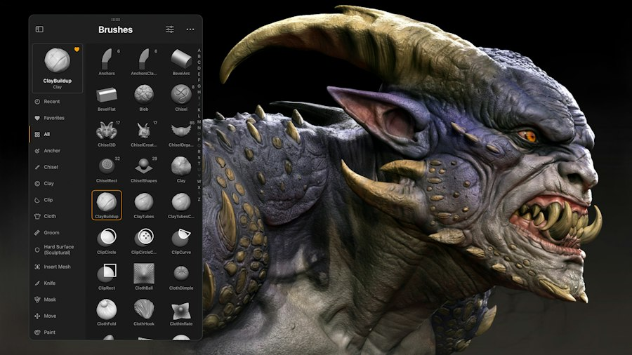
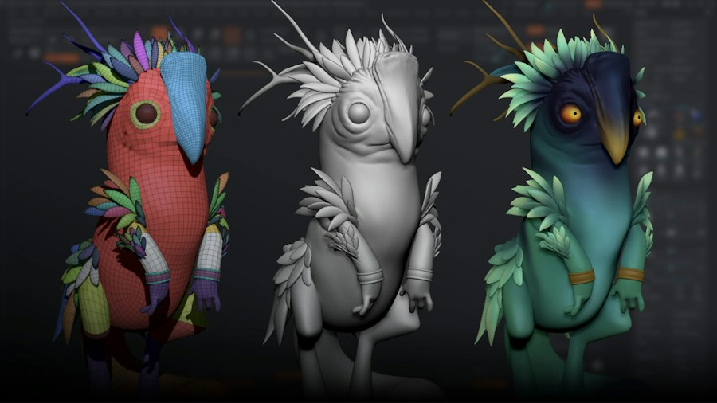

# ZBrush 入门：像捏泥一样制作 3D 高模

ZBrush 是 Maxon 旗下的数字雕刻工具。理解它最简单的方法，是把普通多边形建模和雕刻放在一起比较：前者常常先规划点、边、面的连接关系，再逐步搭出物体；后者更像在一块数字黏土上推、拉、刻、抹，先把**体积与表面形态**做对。角色的脸部、衣服褶皱、怪物皮肤、岩石雕饰等细节，都是这种工作方式的典型对象。ZBrush 也有硬表面建模、绘色和渲染能力，但“高密度雕刻”仍是理解它的最佳入口。[Maxon 官方产品介绍](https://www.maxon.net/en/zbrush)



*图 1：左侧可见雕刻画笔列表，右侧是多层次形体和表面细节的角色作品。图片来自 [Maxon ZBrush 官方介绍](https://www.maxon.net/en/zbrush)。*

## 它处理的对象是什么？

ZBrush 最终仍在处理三维表面：物体由顶点、边和面组成，屏幕上显示的是这些几何及其材质。雕刻笔刷会改变表面的位置或局部形态，例如 Move 推动一块体积，ClayBuildup 堆起材料，DamStandard 刻出缝隙，Smooth 抹平不需要的起伏。和用鼠标逐个移动顶点相比，笔刷更直接地表达“这里要鼓起来、那里要凹下去”的设计意图。

一个模型可以由多个 **SubTool** 组成，例如头、身体、眼睛、衣服分别编辑；这相当于把复杂物体拆成可管理的部件。雕刻时还常用 **Mask** 临时保护某片区域、用 **PolyGroup** 标记和选择不同表面区域。它们服务于编辑，不等同于游戏引擎中的骨架或语义部件定义。

如果你熟悉 3D 生成模型，这里有个有用的区分：AI 模型的“生成”是从条件中预测形状；ZBrush 通常由艺术家主动编辑形状。两者都可能得到高分辨率物体表面，但工作方式、控制粒度和交付要求不同。

## 从粗形到细节：先雕什么，后雕什么？

一个常见角色流程是先搭比例和大体块，再进入局部结构，最后加皱纹、毛孔、划痕等微细节。可以把它记成三层：

| 层级 | 先问什么 | 例子 |
| --- | --- | --- |
| 大形 | 剪影和比例对吗？ | 头身比、肩宽、四肢长度 |
| 中形 | 主要结构清楚吗？ | 眉骨、肌肉群、衣服的主褶皱 |
| 小形 | 表面质感可信吗？ | 皮肤毛孔、布纹、磨损 |

这个顺序不是软件强制的按钮流程，而是避免“脸上毛孔很精细，但整个人比例不对”的工作原则。低分辨率阶段先看整体轮廓，逐级增加几何密度后再做细节。ZBrush 的 **Subdivision** 可以让一个网格拥有从粗到细的多个细分级别：低级别改大体块，高级别刻细节，来回切换比永远在最高面数上编辑更可控。

**DynaMesh** 则适合另一种阶段：刚开始拼大形、拉出新突起或把多个体块合成一个连续表面时，它重新组织表面分布，让艺术家暂时不受原有边线布局限制。代价是原本精心设计的拓扑可能被改写。因此“先用 DynaMesh 自由塑形，再考虑适合下游的拓扑”是比“DynaMesh 直接产出最终动画网格”更准确的理解。[Maxon 官方介绍中的 DynaMesh 说明](https://www.maxon.net/en/zbrush)

## 高模为什么往往还要重拓扑？

雕刻高模追求视觉形态，面数可以很高，边线也未必顺着关节和肌肉方向流动。动画、实时游戏和很多交付管线则需要更易变形、更易贴图和更省计算的网格。**重拓扑（retopology）**就是在高模形状上重新构建一个更有计划的网格：哪些地方需要足够的面来保持轮廓，眼口、肘膝附近的边线怎样安排以利于变形，都是它关心的问题。

ZBrush 提供自动重拓扑工具 **ZRemesher**，可快速得到较整齐的网格；但自动结果不一定满足具体项目的面数预算和动画 edge flow。需要严格绑定与表情变形的角色，通常还要进一步人工检查或手工调整。这个区别也解释了为什么“高模”不等于“好的动画低模”。[Maxon ZRemesher 官方说明](https://help.maxon.net/zbr/en-us/Content/html/user-guide/3d-modeling/topology/zremesher/zremesher.html)

常见的下游链路如下：

```text
概念/参考图 → ZBrush 雕刻高模 → 重拓扑得到低模
                           ↓              ↓
                        细节来源       UV 展开
                           └──── 烘焙 ────┘
                                  ↓
                     材质贴图 → 绑定/动画/渲染
```

**UV** 是把三维表面展开到二维图片坐标；**烘焙**是把高模的细节投射成法线贴图、位移贴图等，再交给更轻的模型和材质使用。法线贴图主要改变光照呈现的细节，不会自动改变物体真实轮廓；位移则可以在支持的渲染或细分流程中改变几何。假如最终目标只是静态高清渲染或 3D 打印，未必每次都需要按游戏角色标准做低模；最终用途决定是否需要这条完整链路。

## 颜色、材质和其他软件怎么接？

**PolyPaint** 允许直接在模型表面绘色，开始时不必先制作 UV 和二维纹理。它让雕刻者在同一个界面里试色和表达设计，但如果要进入以纹理贴图为交付格式的工作流，仍需把颜色转换或烘焙到合适的 UV 贴图上。Maxon 的产品页也介绍了 UV Master、SpotLight 等辅助贴图工具。[Maxon 官方介绍](https://www.maxon.net/en/zbrush)



*图 2：同一角色从网格/分组检查、灰模雕刻到着色展示的不同阶段。图来自 [Maxon ZBrush 官方介绍](https://www.maxon.net/en/zbrush)；它说明雕刻与颜色处理可以在同一工作环境里衔接。*

ZBrush 与 Blender、Maya 等 DCC（数字内容创作）软件并不是“只能选一个”。项目可能在 Blender/Maya 中做基础模型和最终动画，在 ZBrush 中做高模细节，再返回其他软件完成 UV、材质、绑定、灯光和渲染。也可以在 ZBrush 内完成更多环节。关键是明确**交接物**：是高模几何、低模几何、贴图，还是可继续编辑的项目文件；不同交接物解决的问题不同。Maxon 提供 GoZ 与常见格式支持，以便在工具之间往返。[Maxon 官方介绍](https://www.maxon.net/en/zbrush)

## 新手从哪一个小项目开始？

建议先做一件不需要绑定的简单物体，例如一块风化岩石或一个夸张的人物头像。目标不是记住所有笔刷，而是走完一条可检查的最短链路：

1. 收集两三张参考图，确认形体的主要方向和轮廓。
2. 用基础体块做大形，从多个视角检查比例。
3. 需要自由改变形体时用 DynaMesh；大形确定后，按需要整理网格并逐级细分。
4. 只在中形成立后刻小细节；用纯灰材质检查，不让颜色掩盖形体问题。
5. 根据交付目标决定是否做重拓扑、UV 和烘焙；静态展示可先渲染高模，游戏资产则要检查低模与贴图。

做到这一步，你已经能回答 ZBrush 工作流最重要的问题：我手上的模型处于“概念高模”“可动画低模”还是“最终展示资产”的哪个阶段？这比熟悉某个特定按钮更有用。

## 资料

- [Maxon ZBrush 官方产品介绍](https://www.maxon.net/en/zbrush)：数字雕刻、硬表面建模、PolyPaint、DynaMesh、与其他软件的交接。
- [Maxon ZRemesher 官方说明](https://help.maxon.net/zbr/en-us/Content/html/user-guide/3d-modeling/topology/zremesher/zremesher.html)：自动重拓扑与网格流向。
- [Maxon ZBrush 官方帮助入口](https://help.maxon.net/zbr/en-us/)：具体版本的功能与操作说明。

## QA

暂无问答。
