# 多视角 diffusion-like 3D 生成与重建：逐篇解析

> 当前页面逐篇介绍论文；分类关系请看快速理解版。 [快速理解版](../) · [BibTeX 与 DBLP 查询结果](../bibliography/index.html) · [返回综述目录](../../)

## 逐篇解析

以下论文先按研究角色分为主体、相邻和背景，再在主体内部显示任务标签；统一模型不会被压缩成单一任务。这里的“统一模型内的三维生成能力”只表示主体模型中的一个任务分支，不等于把独立的 text-to-3D、image-to-3D 或单任务 3D 生成器纳入主体。分类内按首稿时间从早到晚排列。文字为摘要级快速介绍，配图来自论文原文。

### 主体论文（统一多模态模型）

#### 任务标签：生成任务（generation）

##### 2025

##### ReconViaGen: Towards Accurate Multi-view 3D Object Reconstruction via Generation

作者：Jia-Hao Chang, Chongjie Ye, Yushuang Wu, Yuantao Chen, Yidan Zhang, Zhong-Jin Luo, Chenghong Li, Yihao Zhi, Xiao-Guang Han

研究角色：主体论文（统一多模态模型）
任务标签：reconstruction、generation

方法标签：multi_view_conditioned_generation、joint_reconstruction_and_generation

中文简介：

ReconViaGen针对稀疏视角和遮挡导致的重建不完整问题，提出将重建先验整合进生成框架。输入为多视角图像，输出为准确且完整的3D模型。核心方法分析了扩散生成不一致的原因，并通过增强跨视图特征连接及优化去噪可控性来解决。与传统重建不同，它利用生成先验“幻觉”不可见部分，同时克服随机性带来的误差，属于结合生成式先验的重建任务，兼顾全局结构与局部细节的一致性。

*原文图 2：论文方法流程图（图 2）；原始图注与完整说明见图片来源。 [查看图片来源](https://arxiv.org/html/2510.23306v1/images/method_overview.png)*

引用来源：arxiv_2610.15357

链接：[arXiv](https://arxiv.org/abs/2510.23306)

##### 2026

##### T3lescope: Arbitrary-Resolution High-Fidelity Generative Surface Reconstruction from Images

作者：Noguchi, Atsuhiro, Xu, Tianhan, Liang, Yiming, Kikuchi, Yuta, Ishiyama, Masahiro, Takagi, Shintaro, Murai, Hitoshi, Matsumoto, Eiichi

研究角色：主体论文（统一多模态模型）
任务标签：generation、reconstruction

方法标签：multi_view_conditioned_generation、hierarchical_cascade_generation、view_synthesis_aggregation

架构标签：latent_diffusion_transformer

中文简介：

T3lescope解决从多视角图像重建高保真3D网格的任务，覆盖从单物体到城市场景的任意尺度。其核心采用推理时层级级联策略，利用单一固定分辨率生成器，由粗层确立布局，细层在空间单元内逐步细化几何细节。该方法属于层级级联生成类别，区别于传统分块处理导致的全局不一致问题，通过权重共享和动态推断层级，有效平衡了大场景的空间覆盖与局部细节恢复。

*原文图 2：论文方法流程图（图 2）；原始图注与完整说明见图片来源。 [查看图片来源](https://arxiv.org/html/2610.03308v1/imgs/teaser/input3.jpg)*

引用来源：user_seed

链接：[arXiv](https://arxiv.org/abs/2610.03308)

##### UniForge3D: Joint 3D Reconstruction and Generation in a Shared Anchor-Guided Space

作者：Chen, Wenjue, Chen, Wenyue, Zheng, Heliang, Jia, Rongfei, Liu, Yuan, Li, Meng

研究角色：主体论文（统一多模态模型）
任务标签：generation、reconstruction

方法标签：multi_view_conditioned_generation、joint_reconstruction_and_generation

架构标签：latent_diffusion_transformer

中文简介：

UniForge3D旨在从稀疏未标定图像中生成完整3D资产，兼顾观测几何恢复与缺失区域补全。核心方法是在共享锚点引导空间中联合建模重建与生成分支，通过双向特征交换解决坐标不匹配，并基于生成结构选择最具信息量的视图指导细节生成。该模型属于联合重建与生成类别，克服了直接融合相机相对重建与规范空间生成的困难，显著提升了局部几何细节的忠实度。

*原文图 3：论文方法流程图（图 3）；原始图注与完整说明见图片来源。 [查看图片来源](https://arxiv.org/html/2610.15357v1/fig/pipeline_uni.png)*

引用来源：user_seed

链接：[arXiv](https://arxiv.org/abs/2610.15357)

#### 任务标签：重建任务（reconstruction）

##### 2025

##### ReconViaGen: Towards Accurate Multi-view 3D Object Reconstruction via Generation

作者：Jia-Hao Chang, Chongjie Ye, Yushuang Wu, Yuantao Chen, Yidan Zhang, Zhong-Jin Luo, Chenghong Li, Yihao Zhi, Xiao-Guang Han

研究角色：主体论文（统一多模态模型）
任务标签：reconstruction、generation

方法标签：multi_view_conditioned_generation、joint_reconstruction_and_generation

中文简介：

ReconViaGen针对稀疏视角和遮挡导致的重建不完整问题，提出将重建先验整合进生成框架。输入为多视角图像，输出为准确且完整的3D模型。核心方法分析了扩散生成不一致的原因，并通过增强跨视图特征连接及优化去噪可控性来解决。与传统重建不同，它利用生成先验“幻觉”不可见部分，同时克服随机性带来的误差，属于结合生成式先验的重建任务，兼顾全局结构与局部细节的一致性。

*原文图 2：论文方法流程图（图 2）；原始图注与完整说明见图片来源。 [查看图片来源](https://arxiv.org/html/2510.23306v1/images/method_overview.png)*

引用来源：arxiv_2610.15357

链接：[arXiv](https://arxiv.org/abs/2510.23306)

##### 2026

##### T3lescope: Arbitrary-Resolution High-Fidelity Generative Surface Reconstruction from Images

作者：Noguchi, Atsuhiro, Xu, Tianhan, Liang, Yiming, Kikuchi, Yuta, Ishiyama, Masahiro, Takagi, Shintaro, Murai, Hitoshi, Matsumoto, Eiichi

研究角色：主体论文（统一多模态模型）
任务标签：generation、reconstruction

方法标签：multi_view_conditioned_generation、hierarchical_cascade_generation、view_synthesis_aggregation

架构标签：latent_diffusion_transformer

中文简介：

T3lescope解决从多视角图像重建高保真3D网格的任务，覆盖从单物体到城市场景的任意尺度。其核心采用推理时层级级联策略，利用单一固定分辨率生成器，由粗层确立布局，细层在空间单元内逐步细化几何细节。该方法属于层级级联生成类别，区别于传统分块处理导致的全局不一致问题，通过权重共享和动态推断层级，有效平衡了大场景的空间覆盖与局部细节恢复。

*原文图 2：论文方法流程图（图 2）；原始图注与完整说明见图片来源。 [查看图片来源](https://arxiv.org/html/2610.03308v1/imgs/teaser/input3.jpg)*

引用来源：user_seed

链接：[arXiv](https://arxiv.org/abs/2610.03308)

##### UniForge3D: Joint 3D Reconstruction and Generation in a Shared Anchor-Guided Space

作者：Chen, Wenjue, Chen, Wenyue, Zheng, Heliang, Jia, Rongfei, Liu, Yuan, Li, Meng

研究角色：主体论文（统一多模态模型）
任务标签：generation、reconstruction

方法标签：multi_view_conditioned_generation、joint_reconstruction_and_generation

架构标签：latent_diffusion_transformer

中文简介：

UniForge3D旨在从稀疏未标定图像中生成完整3D资产，兼顾观测几何恢复与缺失区域补全。核心方法是在共享锚点引导空间中联合建模重建与生成分支，通过双向特征交换解决坐标不匹配，并基于生成结构选择最具信息量的视图指导细节生成。该模型属于联合重建与生成类别，克服了直接融合相机相对重建与规范空间生成的困难，显著提升了局部几何细节的忠实度。

*原文图 3：论文方法流程图（图 3）；原始图注与完整说明见图片来源。 [查看图片来源](https://arxiv.org/html/2610.15357v1/fig/pipeline_uni.png)*

引用来源：user_seed

链接：[arXiv](https://arxiv.org/abs/2610.15357)

### 背景与上下文工作

#### 背景类别：背景与上下文（context）

##### 2016

##### A Point Set Generation Network for 3D Object Reconstruction from a Single Image

作者：Hao-Qiang Fan, Hao Su, L. Guibas

研究角色：背景与上下文工作
任务标签：context

中文简介：

该论文解决单张图像重建3D物体的任务，输入为单张RGB图像，输出为3D点云坐标。核心方法是一种条件形状采样器，直接生成点云以规避体素网格的计算冗余，并能预测多种 plausible 结果以应对单视图歧义性。作为早期深度3D重建的代表，它展示了从2D到3D直接映射的可行性，其处理几何歧义的思路启发了后续生成式方法，即通过概率分布建模来补全缺失视角的几何细节。

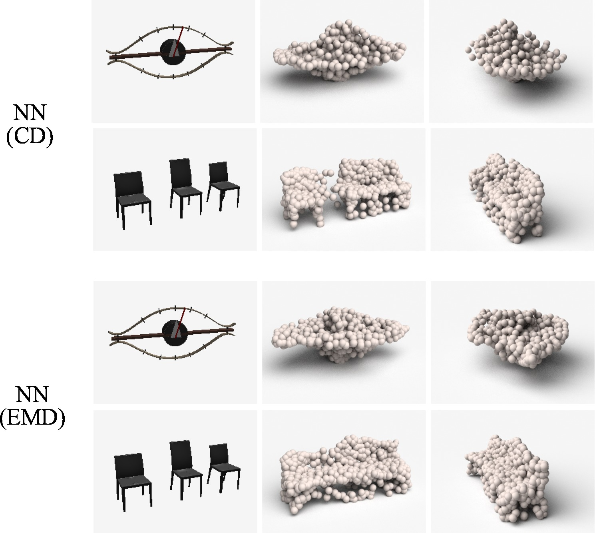

*原文图 18：论文方法流程图（图 18）；原始图注与完整说明见图片来源。 [查看图片来源](https://arxiv.org/html/1612.00603v2/fig/show_failure.jpg)*

引用来源：arxiv_2610.15357

链接：[arXiv](https://arxiv.org/abs/1612.00603)

##### 2018

##### The Unreasonable Effectiveness of Deep Features as a Perceptual Metric

作者：Richard Zhang, Phillip Isola, Alexei A. Efros, Eli Shechtman, Oliver Wang

研究角色：背景与上下文工作
任务标签：context

中文简介：

该论文探讨图像合成中的感知相似性度量问题，输入为图像对，输出为感知距离评分。核心方法是验证深层神经网络特征（如VGG）作为感知损失的有效性，发现其优于传统PSNR/SSIM指标。在3D生成领域，该工作提供的LPIPS等感知度量标准被广泛用于评估生成3D资产渲染视图的质量，确保生成结果在视觉感知上与真实数据一致，而非仅像素级匹配，是优化扩散模型损失函数的关键组件。

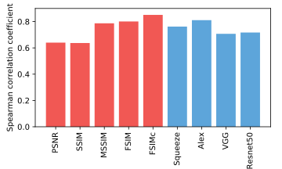

*原文图 15：论文方法流程图（图 15）；原始图注与完整说明见图片来源。 [查看图片来源](https://arxiv.org/html/1801.03924v2/resultsTID.svg)*

引用来源：arxiv_2610.15357

链接：[arXiv](https://arxiv.org/abs/1801.03924)

##### MVSNet: Depth Inference for Unstructured Multi-view Stereo

作者：Yao Yao, Zi-Xin Luo, Shiwei Li, Tian Fang, Long Quan

研究角色：背景与上下文工作
任务标签：context

中文简介：

该论文解决从非结构化多视角图像推断深度图的任务，输入为任意N视图图像，输出为参考视图的深度图。核心方法是MVSNet，通过可微单应性变换构建3D代价体，并利用3D卷积进行正则化和回归。作为端到端深度学习MVS的开创性工作，它摒弃了传统离散优化，证明了基于方差代价度量的连续体积回归的有效性，为后续结合扩散先验的神经重建方法奠定了几何编码基础。

*原文图 1：论文方法流程图（图 1）；原始图注与完整说明见图片来源。 [查看图片来源](https://arxiv.org/html/1804.02505v2/network.png)*

引用来源：arxiv_2610.15357

链接：[arXiv](https://arxiv.org/abs/1804.02505)

##### 2019

##### Cascade Cost Volume for High-Resolution Multi-View Stereo and Stereo Matching

作者：Xiao-Dong Gu, Zhi-Wen Fan, Siyu Zhu, Zuo-Zhuo Dai, Feitong Tan, Ping Tan

研究角色：背景与上下文工作
任务标签：context

中文简介：

该论文解决传统MVS方法在处理高分辨率输出时内存和时间成本立方级增长的问题，输入为多视角图像，输出为高精度深度或视差图。核心方法是级联代价体（Cascade Cost Volume），基于特征金字塔由粗到细构建，并利用前一阶段结果缩小后续阶段的深度搜索范围。相比早期MVSNet，该方法显著降低了资源消耗并提升了精度，确立了由粗到细策略在高效几何重建中的重要地位。

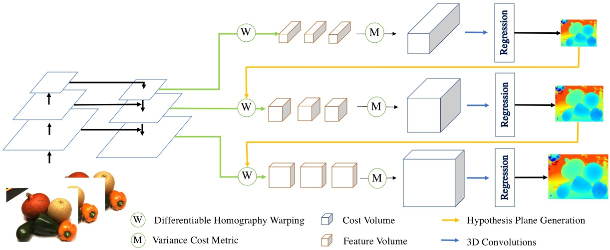

*原文图 1：论文方法流程图（图 1）；原始图注与完整说明见图片来源。 [查看图片来源](https://arxiv.org/html/1912.06378v3/imgs/network/arch.jpg)*

引用来源：arxiv_2610.15357

链接：[arXiv](https://arxiv.org/abs/1912.06378)

##### 2020

##### 3D-FRONT: 3D Furnished Rooms with layOuts and semaNTics

作者：Huan Fu, Bo-Wen Cai, Lin Gao, Ling-Xiao Zhang, Cao Li, Zengqi Xun, Chengyue Sun, Y. Fei, Yu Zheng, Ying Li, Yi Liu, Peng Liu, Lin Ma, Le Weng, Xiaohang Hu, Xin Ma, Qian Qian, Rong-Fei Jia, Binqiang Zhao, H. Zhang

研究角色：背景与上下文工作
任务标签：context

中文简介：

该工作发布3D-FRONT数据集，旨在支持室内场景合成与纹理生成任务。输入为专业设计的布局语义，输出为包含高质量纹理和风格兼容家具的3D室内场景。核心贡献在于构建了大规模、综合性的合成室内场景库，并通过推荐系统确保设计风格一致性。作为数据基础设施，它填补了高质量3D室内数据的空白，为训练数据驱动的3D生成模型提供了丰富的先验知识来源，区别于以往稀疏或低质量的场景数据集。

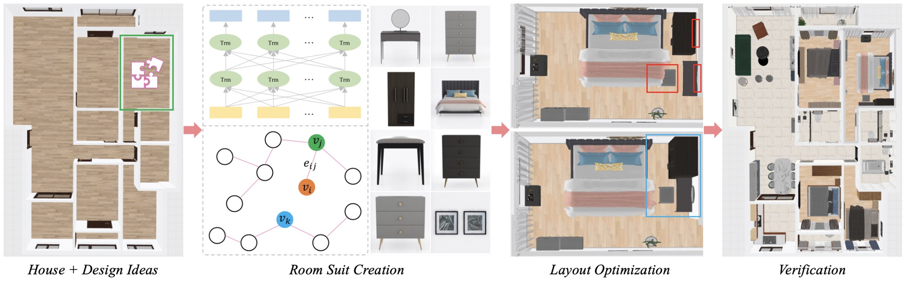

*原文图 1：论文方法流程图（图 1）；原始图注与完整说明见图片来源。 [查看图片来源](https://arxiv.org/html/2011.09127v2/figure/pipeline.png)*

引用来源：arxiv_2610.03308

链接：[arXiv](https://arxiv.org/abs/2011.09127)

##### PatchmatchNet: Learned Multi-View Patchmatch Stereo

作者：Fangjinhua Wang, Silvano Galliani, Christoph Vogel, Pablo Speciale, M. Pollefeys

研究角色：背景与上下文工作
任务标签：context

中文简介：

该论文解决高分辨率多视图立体匹配（MVS）中的计算效率问题，输入为多视角图像，输出为深度图。核心方法是PatchmatchNet，一种可学习的级联Patchmatch架构，通过迭代的多尺度自适应传播和评估机制优化深度估计。与传统基于3D代价体正则化的方法不同，它以更低内存和更快速度处理高分辨率图像，为后续结合生成先验的稀疏视图重建提供了高效的几何初始化基础。

*原文图 5：论文方法流程图（图 5）；原始图注与完整说明见图片来源。 [查看图片来源](https://arxiv.org/html/2012.01411v1/figures/evaluation_4.jpg)*

引用来源：arxiv_2610.15357

链接：[arXiv](https://arxiv.org/abs/2012.01411)

##### 2021

##### Using Shape to Categorize: Low-Shot Learning with an Explicit Shape Bias

作者：S. Stojanov, A. Thai, James M. Rehg

研究角色：背景与上下文工作
任务标签：context

中文简介：

该论文旨在提升低样本学习中的物体识别泛化性能，输入为2D图像，输出为分类结果。核心方法是通过学习判别性嵌入空间，显式利用3D物体形状信息来增强2D图像的特征表示。在所属类别中，它强调了形状偏置对视觉理解的重要性，为后续3D重建与生成任务提供了理论支撑，即明确的几何结构先验能有效弥补纹理缺失或视角受限带来的信息不足，促进多模态特征融合。

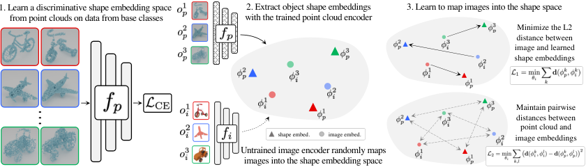

*原文图 1：论文方法流程图（图 1）；原始图注与完整说明见图片来源。 [查看图片来源](https://arxiv.org/html/2101.07296v2/approach_overview.png)*

引用来源：arxiv_2610.15357

链接：[arXiv](https://arxiv.org/abs/2101.07296)

##### RoFormer: Enhanced Transformer with Rotary Position Embedding

作者：Jian-Lin Su, Murtadha H. M. Ahmed, Yu Lu, Shengfeng Pan, Wen Bo, Yunfeng Liu

研究角色：背景与上下文工作
任务标签：context

中文简介：

该论文旨在增强Transformer架构的位置编码能力，输入为文本序列，输出为融入位置信息的表示。核心方法提出旋转位置嵌入（RoPE），通过旋转矩阵编码绝对位置，并在自注意力中显式引入相对位置依赖。相比传统绝对位置编码，RoPE具备序列长度灵活性和远距离依赖衰减特性。作为基础架构组件，它优化了Transformer对序列结构的建模能力，常被后续采用Transformer骨干的3D生成模型借鉴，以提升长序列或空间位置的编码效率。

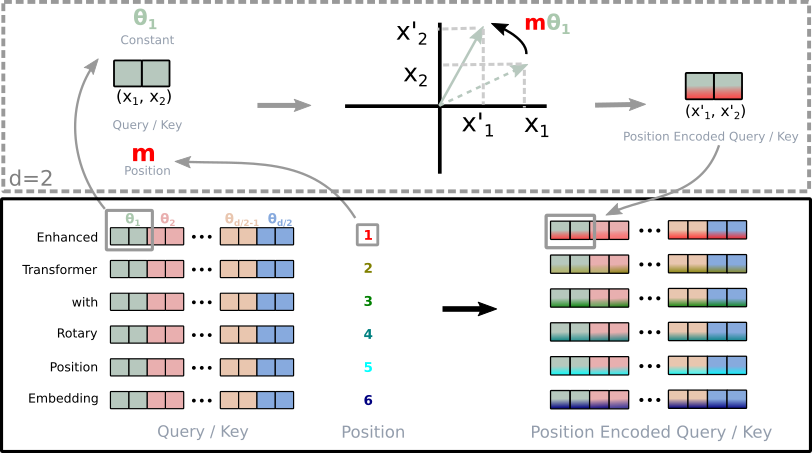

*原文图 1：论文方法流程图（图 1）；原始图注与完整说明见图片来源。 [查看图片来源](https://arxiv.org/html/2104.09864v5/roformer_RoPE_v2.svg)*

引用来源：arxiv_2610.03308

链接：[arXiv](https://arxiv.org/abs/2104.09864)

##### Cascaded Diffusion Models for High Fidelity Image Generation

作者：Jonathan Ho, Chitwan Saharia, William Chan, David J. Fleet, Mohammad Norouzi, T. Salimans

研究角色：背景与上下文工作
任务标签：context

中文简介：

该论文解决高保真图像生成任务，输入为类别标签或低分辨率图像，输出为高分辨率合成图像。核心方法提出级联扩散模型（Cascaded Diffusion Models），通过管道串联多个扩散模型，从低分辨率开始逐步上采样并添加细节。其关键创新在于“条件增强”技术，防止超分阶段的误差累积。作为上下文文献，它确立了由粗到细的生成范式，为后续3D层级级联生成提供了重要的方法论基础，区别于单阶段生成模型。

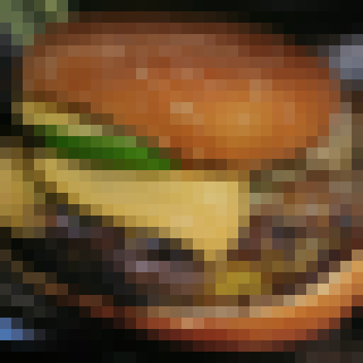

*原文图 3：论文方法流程图（图 3）；原始图注与完整说明见图片来源。 [查看图片来源](https://arxiv.org/html/2106.15282v3/images/cascade/32x_0.png)*

引用来源：arxiv_2610.03308

链接：[arXiv](https://arxiv.org/abs/2106.15282)

##### Light Field Networks: Neural Scene Representations with Single-Evaluation Rendering

作者：Vincent Sitzmann, Semon Rezchikov, W. Freeman, J. Tenenbaum, F. Durand

研究角色：背景与上下文工作
任务标签：context

中文简介：

Light Field Networks (LFNs) 解决从极少视角（甚至单图）重建3D场景的任务，输出4D光场表示。核心方法是通过神经网络直接参数化光场，实现单次评估即可渲染射线，大幅降低计算复杂度。属于早期神经场景表示探索，区别于需密集采样的体渲染方法。虽然其在几何细节上不如后续SDF方法精确，但其高效渲染特性及对少视图泛化能力的探索，为后续基于潜在空间的高效3D生成与重建架构提供了关于计算效率与表示能力权衡的重要启示。

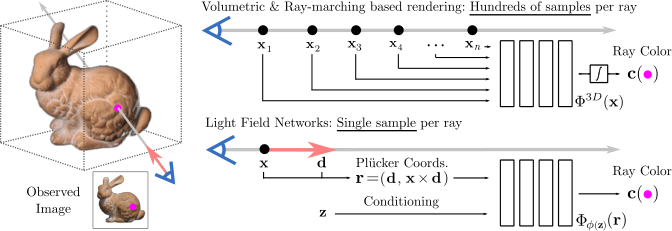

*原文图 1：论文方法流程图（图 1）；原始图注与完整说明见图片来源。 [查看图片来源](https://arxiv.org/html/2106.02634v2/overview_figure.png)*

引用来源：arxiv_2610.03308

链接：[arXiv](https://arxiv.org/abs/2106.02634)

##### LoRA: Low-Rank Adaptation of Large Language Models

作者：J. Hu, Ye-Long Shen, Phillip Wallis, Zeyuan Allen-Zhu, Yuanzhi Li, She-An Wang, Lu Wang, Wei-Zhu Chen

研究角色：背景与上下文工作
任务标签：context

中文简介：

该论文解决大型预训练语言模型在下游任务适配时全量微调成本高昂的问题。核心方法是LoRA，它冻结预训练权重，仅在Transformer层注入可训练的低秩分解矩阵，从而大幅减少参数量。作为本综述的背景技术，LoRA虽非直接处理3D生成，但其高效参数微调范式被广泛引入3D扩散模型中，用于实现个性化3D资产生成或领域适应，显著降低了高维3D生成的计算门槛。

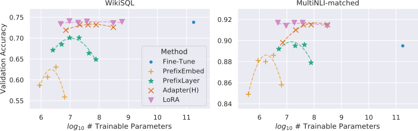

*原文图 2：论文方法流程图（图 2）；原始图注与完整说明见图片来源。 [查看图片来源](https://arxiv.org/html/2106.09685v2/LoRA_wikisql.svg)*

引用来源：arxiv_2610.15357

链接：[arXiv](https://arxiv.org/abs/2106.09685)

##### NeuS: Learning Neural Implicit Surfaces by Volume Rendering for Multi-view Reconstruction

作者：Peng Wang, Ling-Jie Liu, Yuan Liu, Christian Theobalt, T. Komura, Wen-Ping Wang

研究角色：背景与上下文工作
任务标签：context

中文简介：

NeuS面向多视角高保真表面重建任务，输入2D图像，输出神经隐式表面。核心方法是将表面表示为SDF的零水平集，并提出无偏的体积渲染公式进行训练，无需前景掩码监督。属于神经隐式重建的经典路线，区别于易陷入局部极小值的IDR或几何提取困难的NeRF。NeuS通过解决体积渲染的几何偏差问题，显著提升了复杂结构及自遮挡物体的重建质量，为后续结合生成先验的重建方法提供了可靠的几何表示基础。

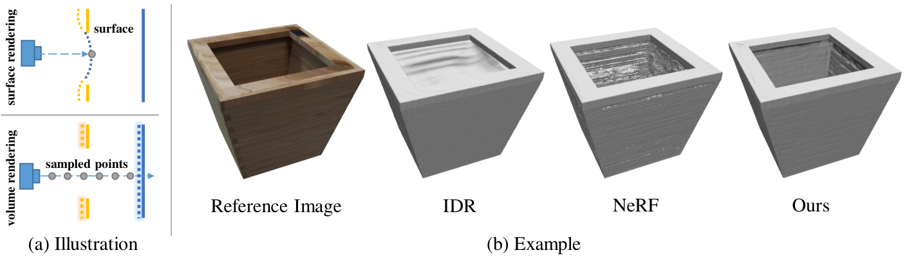

*原文图 1：论文方法流程图（图 1）；原始图注与完整说明见图片来源。 [查看图片来源](https://arxiv.org/html/2106.10689v3/toy_example.png)*

引用来源：arxiv_2610.03308

链接：[arXiv](https://arxiv.org/abs/2106.10689)

##### SDEdit: Guided Image Synthesis and Editing with Stochastic Differential Equations

作者：Chenlin Meng, Yutong He, Yang Song, Jiaming Song, Jiajun Wu, Jun-Yan Zhu, Stefano Ermon

研究角色：背景与上下文工作
任务标签：context

中文简介：

SDEdit解决guided image synthesis任务，即根据用户粗略输入（如涂鸦）生成逼真图像。核心范式是利用预训练扩散模型，先对输入添加噪声再经SDE去噪，平衡忠实度与真实感。该方法无需特定任务训练或GAN反转，确立了扩散模型在编辑领域的优势。在3D生成语境下，其“加噪-去噪”流程启发了Score Distillation Sampling (SDS) 等关键技术，使得利用2D扩散先验优化3D表示成为可能，是连接2D先验与3D生成的桥梁。

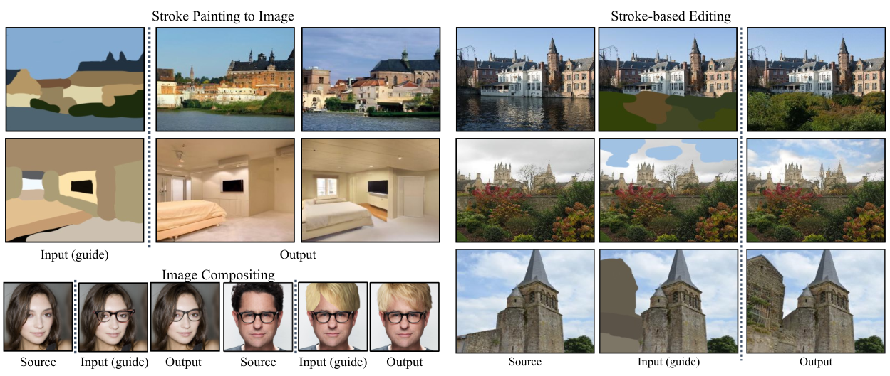

*原文图 1：论文方法流程图（图 1）；原始图注与完整说明见图片来源。 [查看图片来源](https://arxiv.org/html/2108.01073v2/figure1.png)*

引用来源：arxiv_2610.03308

链接：[arXiv](https://arxiv.org/abs/2108.01073)

##### Mip-NeRF 360: Unbounded Anti-Aliased Neural Radiance Fields

作者：J. Barron, B. Mildenhall, Dor Verbin, P. Srinivasan, Peter Hedman

研究角色：背景与上下文工作
任务标签：context

中文简介：

Mip-NeRF 360解决无界场景下的新视图合成任务，输入环绕拍摄图像，输出抗混叠的高保真渲染结果。核心方法包括非线性场景参数化、在线蒸馏及基于畸变的正则化项，以处理远近物体尺度不平衡问题。作为NeRF家族的重要演进，它突破了原有方法仅限有界物体的限制，成为处理室外大场景的标准基线。相较于前序mip-NeRF，它通过改进采样策略有效消除了远处背景的模糊与伪影，为后续3DGS等技术处理大场景提供了理论参照。

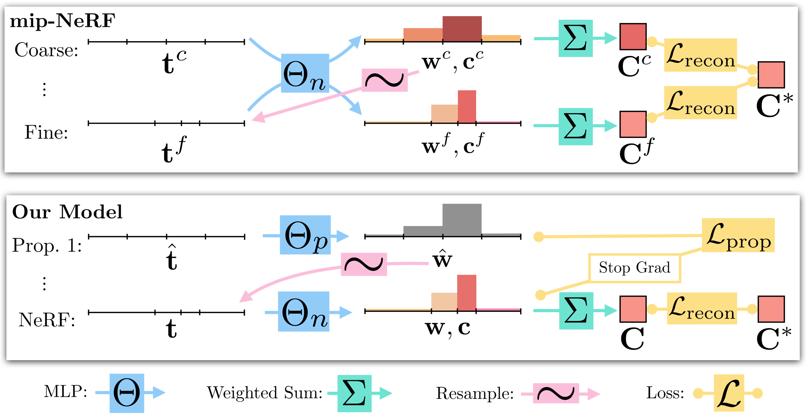

*原文图 3：论文方法流程图（图 3）；原始图注与完整说明见图片来源。 [查看图片来源](https://arxiv.org/html/2111.12077v3/figures/bmipnerf_sketch.png)*

引用来源：arxiv_2610.03308

链接：[arXiv](https://arxiv.org/abs/2111.12077)

##### RegNeRF: Regularizing Neural Radiance Fields for View Synthesis from Sparse Inputs

作者：Michael Niemeyer, J. Barron, B. Mildenhall, Mehdi S. M. Sajjadi, Andreas Geiger, Noha Radwan

研究角色：背景与上下文工作
任务标签：context

中文简介：

RegNeRF解决稀疏输入条件下的新视角合成任务，输入为少量视图，输出为优化的NeRF场景表示。针对稀疏视角导致的几何错误和训练发散，核心方法通过对未观测视点的几何和外观进行正则化，并 annealing 射线采样空间，同时利用归一化流模型正则化颜色。虽然不属于生成式扩散方法，但它是重建任务中的重要前序工作，通过正则化手段显著提升了稀疏视图下的重建鲁棒性，为后续结合生成先验解决稀疏重建问题奠定了基础。

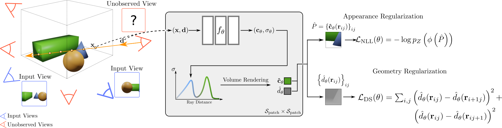

*原文图 4：论文方法流程图（图 4）；原始图注与完整说明见图片来源。 [查看图片来源](https://arxiv.org/html/2112.00724v1/teaser3.png)*

引用来源：arxiv_2610.15357

链接：[arXiv](https://arxiv.org/abs/2112.00724)

##### 2022

##### A ConvNet for the 2020s

作者：Zhuang Liu, Hanzi Mao, Chaozheng Wu, Christoph Feichtenhofer, Trevor Darrell, Saining Xie

研究角色：背景与上下文工作
任务标签：context

中文简介：

该论文提出ConvNeXt，旨在探索纯卷积网络在视觉识别任务中的性能极限，输入图像并输出分类或检测特征。核心方法是通过“现代化”改造标准ResNet，引入Transformer的设计元素如大核卷积、LayerNorm等，而非直接采用注意力机制。虽属2D视觉骨干网络研究，但其证明了卷积归纳偏置的有效性，影响了后续3D生成模型中骨干网络的选择策略。与早期认为Transformer全面优于CNN的观点不同，它展示了高效卷积架构在扩展性与精度上的竞争力。

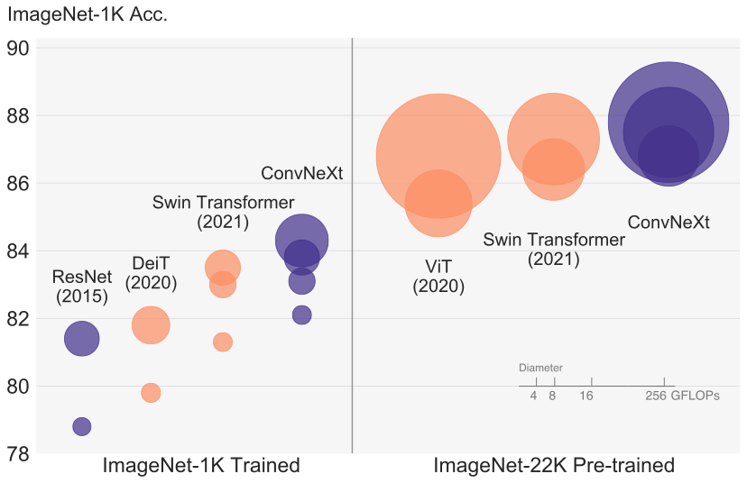

*原文图 1：论文方法流程图（图 1）；原始图注与完整说明见图片来源。 [查看图片来源](https://arxiv.org/html/2201.03545v2/teaser.svg)*

引用来源：arxiv_2610.03308

链接：[arXiv](https://arxiv.org/abs/2201.03545)

##### Google Scanned Objects: A High-Quality Dataset of 3D Scanned Household Items

作者：Laura Downs, Anthony Francis, Nathan P. Koenig, Brandon Kinman, R. Hickman, Krista Reymann, T. B. McHugh, Vincent Vanhoucke

研究角色：背景与上下文工作
任务标签：context

中文简介：

Google Scanned Objects并非算法论文，而是提供了一个包含上千个高质量3D扫描家居物品的大型开源数据集。输入为物理对象，输出为经预处理适配主流仿真平台的3D模型。它在领域中处于数据基础设施位置，旨在解决交互式3D仿真和深度学习对大规模逼真3D语料库的需求。该数据集的高多样性和灵活性为机器人学习、合成感知以及后续3D生成模型的训练与评估提供了宝贵的基准资源，填补了高质量真实世界3D数据的空白。

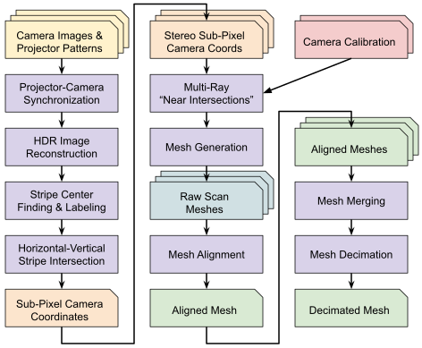

*原文图 2：论文方法流程图（图 2）；原始图注与完整说明见图片来源。 [查看图片来源](https://arxiv.org/html/2204.11918v1/gso-scanning-pipeline.svg)*

引用来源：arxiv_2610.15357

链接：[arXiv](https://arxiv.org/abs/2204.11918)

##### MonoSDF: Exploring Monocular Geometric Cues for Neural Implicit Surface Reconstruction

作者：Zehao Yu, Songyou Peng, Michael Niemeyer, Torsten Sattler, Andreas Geiger

研究角色：背景与上下文工作
任务标签：context

中文简介：

MonoSDF针对稀疏视角或复杂场景下的神经隐式表面重建任务，输入多视角图像，输出高质量3D几何表面。核心方法是引入单目深度和法线预测作为几何先验，约束神经SDF的优化过程。属于结合几何先验的重建路线，区别于仅依赖RGB光度一致性的传统NeRF类方法。它有效解决了纹理缺失区域的几何歧义问题，显著提升了在少视图条件下的重建完整性与收敛速度，是后续生成式重建的重要基线参考。

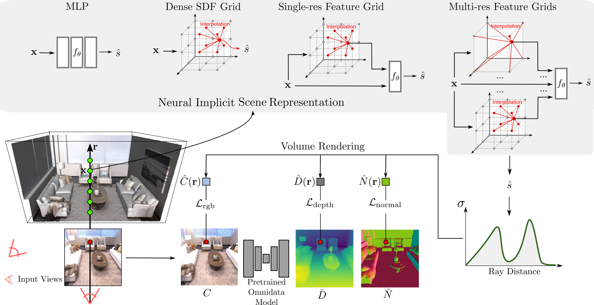

*原文图 2：论文方法流程图（图 2）；原始图注与完整说明见图片来源。 [查看图片来源](https://arxiv.org/html/2206.00665v2/gfx/method_overview/combined2.png)*

引用来源：arxiv_2610.03308

链接：[arXiv](https://arxiv.org/abs/2206.00665)

##### Classifier-Free Diffusion Guidance

作者：Jonathan Ho, Tim Salimans

研究角色：背景与上下文工作
任务标签：context

中文简介：

本文提出Classifier-Free Guidance，解决条件扩散模型中样本质量与多样性权衡的任务。核心方法是在训练阶段联合训练条件与无条件扩散模型，推理时通过线性组合两者的分数估计来实现引导，无需额外训练分类器。这一范式革新了扩散模型的引导机制，成为当前3D生成领域（如DreamFusion等）的标准配置。与前序依赖独立分类器的方法相比，它简化了训练流程并避免了模态错位问题，极大提升了生成内容的文本对齐度。

*原文图 1：论文方法流程图（图 1）；原始图注与完整说明见图片来源。 [查看图片来源](https://arxiv.org/html/2207.12598v1/images/guided_gaussian_mixture.png)*

引用来源：arxiv_2610.03308

链接：[arXiv](https://arxiv.org/abs/2207.12598)

##### DreamFusion: Text-to-3D using 2D Diffusion

作者：B. Poole, Ajay Jain, J. Barron, B. Mildenhall

研究角色：背景与上下文工作
任务标签：context

中文简介：

DreamFusion开创了无需3D训练数据的文本到3D合成任务，输入为文本提示，输出为神经辐射场（NeRF）。核心范式引入基于概率密度蒸馏的损失函数（SDS），将预训练的2D文本到图像扩散模型作为先验，通过梯度下降优化随机初始化的3D模型，使其各角度渲染图符合扩散分布。这是视图合成聚合类别的奠基性工作，巧妙规避了3D数据稀缺问题，证明了2D扩散模型作为3D生成先验的有效性，允许任意视角查看和光照重打。

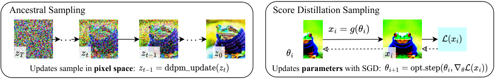

*原文图 22：论文方法流程图（图 22）；原始图注与完整说明见图片来源。 [查看图片来源](https://arxiv.org/html/2209.14988v1/sampling_schematic_barronfont.png)*

引用来源：arxiv_2610.15357

链接：[arXiv](https://arxiv.org/abs/2209.14988)

##### Flow Straight and Fast: Learning to Generate and Transfer Data with Rectified Flow

作者：Xing-Chao Liu, Chengyue Gong, Qiang Liu

研究角色：背景与上下文工作
任务标签：context

中文简介：

该论文提出Rectified Flow，旨在解决分布传输任务，即学习连接两个经验分布的神经ODE模型。其核心范式是通过非线性最小二乘优化，迫使传输路径尽可能笔直，从而避免时间离散化误差并提高计算效率。作为生成建模的基础理论工具，它不同于传统扩散模型复杂的随机微分方程求解，通过递归整流获得更直的流路径，为后续高效3D生成模型提供了更优的概率流匹配基础，显著提升了图像生成与域适应的质量。

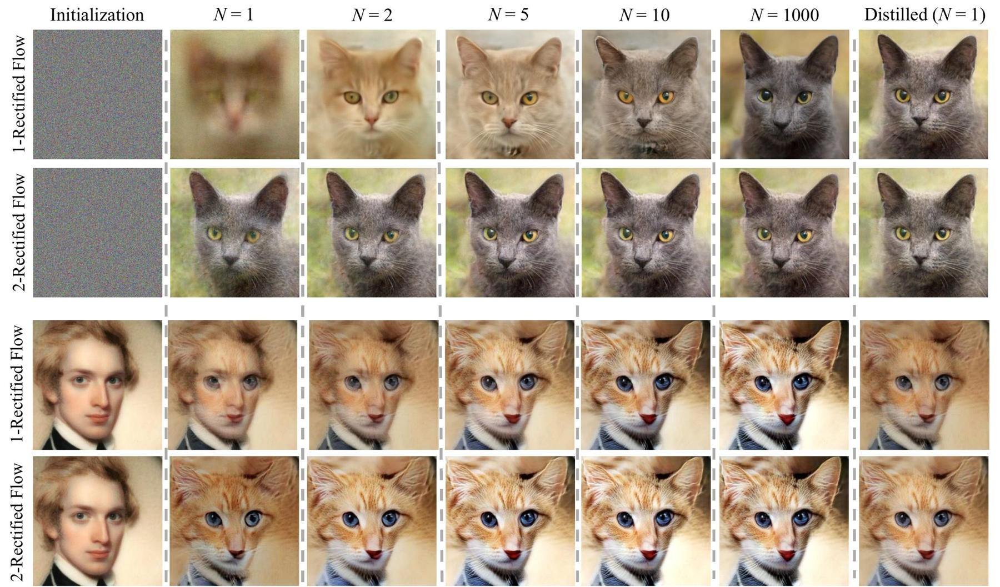

*原文图 1：论文方法流程图（图 1）；原始图注与完整说明见图片来源。 [查看图片来源](https://arxiv.org/html/2209.03003v1/arxiv_figures/cat_triangle_new_2_cy.pptx.jpeg)*

引用来源：arxiv_2610.03308

链接：[arXiv](https://arxiv.org/abs/2209.03003)

##### Flow Matching for Generative Modeling

作者：Y. Lipman, Ricky T. Q. Chen, Heli Ben-Hamu, Maximilian Nickel, Matt Le

研究角色：背景与上下文工作
任务标签：context

中文简介：

Flow Matching提出了一种基于连续归一化流的生成建模新范式，通过回归固定条件概率路径的向量场来训练模型。核心优势在于无需模拟即可训练，且兼容最优传输路径，比传统扩散路径更高效稳定。虽然主要贡献在理论层面，但它为扩散模型提供了更优的训练目标与采样策略，影响了后续高效3D生成模型的设计，属于提升生成模型基础训练效率与泛化能力的关键方法论创新。

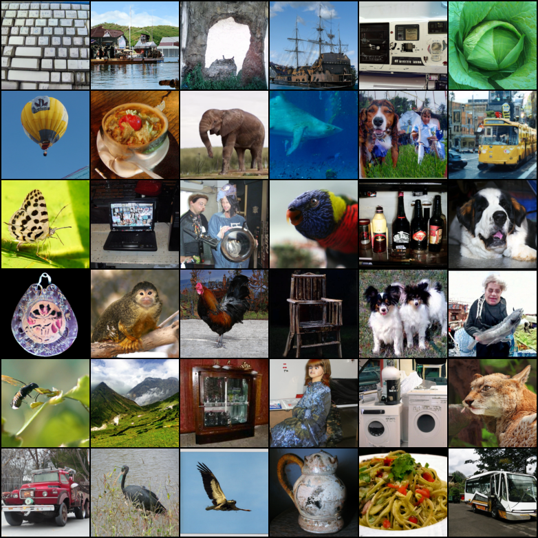

*原文图 1：论文方法流程图（图 1）；原始图注与完整说明见图片来源。 [查看图片来源](https://arxiv.org/html/2210.02747v2/figures/imagenet128/imagenet128_curated_.png)*

引用来源：arxiv_2610.03308

链接：[arXiv](https://arxiv.org/abs/2210.02747)

##### Magic3D: High-Resolution Text-to-3D Content Creation

作者：Chen-Hsuan Lin, Jun Gao, Luming Tang, Towaki Takikawa, Xiaohui Zeng, Xun Huang, Karsten Kreis, S. Fidler, Ming-Yu Liu, Tsung-Yi Lin

研究角色：背景与上下文工作
任务标签：context

中文简介：

Magic3D致力于解决高分辨率文本到3D内容生成的效率与质量问题，输入为文本提示，输出为高分辨率纹理3D Mesh。核心方法采用两阶段优化：首先利用低分辨率扩散先验和稀疏哈希网格快速获得粗模型，随后初始化并优化 textured 3D Mesh，结合高分辨率潜在扩散模型进行细化。作为层级级联生成的代表，它克服了DreamFusion优化慢且分辨率低的局限，在保证质量的同时将生成速度提升两倍，实现了更高效的高保真3D资产创建。

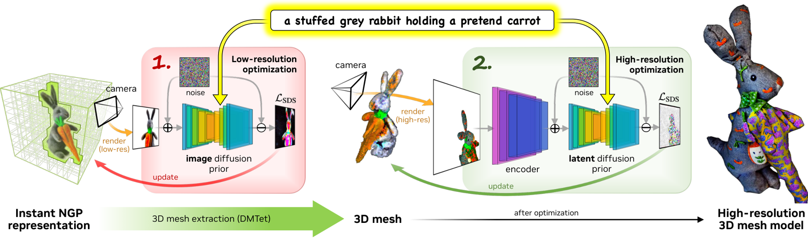

*原文图 2：论文方法流程图（图 2）；原始图注与完整说明见图片来源。 [查看图片来源](https://arxiv.org/html/2211.10440v2/x1.png)*

引用来源：arxiv_2610.15357

链接：[arXiv](https://arxiv.org/abs/2211.10440)

##### Scalable Diffusion Models with Transformers

作者：William S. Peebles, Saining Xie

研究角色：背景与上下文工作
任务标签：context

中文简介：

Scalable Diffusion Models with Transformers (DiT) 探索了基于Transformer骨干网络的扩散模型，替代传统的U-Net。核心方法是在潜在空间对图像补丁进行扩散去噪，证明了模型复杂度与生成质量间的可扩展性关系。该工作确立了潜在扩散Transformer架构的主流地位，为后续3D生成模型（如BlockFusion、XCube）提供了高效的骨干网络选择，显著提升了高保真内容生成的性能上限与计算效率。

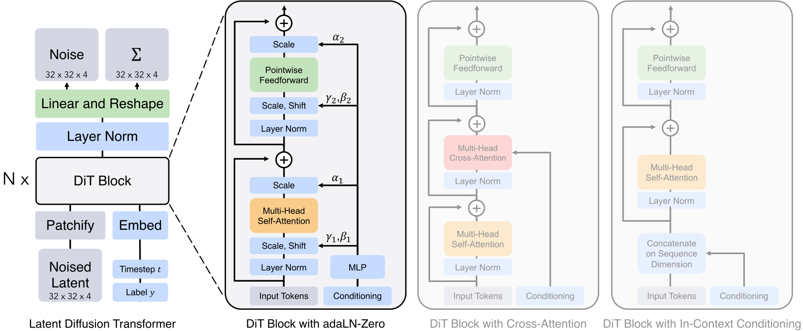

*原文图 2：论文方法流程图（图 2）；原始图注与完整说明见图片来源。 [查看图片来源](https://arxiv.org/html/2212.09748v2/block.svg)*

引用来源：arxiv_2610.03308

链接：[arXiv](https://arxiv.org/abs/2212.09748)

##### 2023

##### 3DShape2VecSet: A 3D Shape Representation for Neural Fields and Generative Diffusion Models

作者：Biao Zhang, Jia-Peng Tang, Matthias Niessner, Peter Wonka

研究角色：背景与上下文工作
任务标签：context

中文简介：

3DShape2VecSet提出了一种专为生成式扩散模型设计的3D形状表示方法，输入为表面模型或点云，输出为基于向量集的神经场表示。核心创新在于结合径向基函数与注意力机制，构建适合Transformer处理的潜在空间表示。它位于潜在扩散Transformer架构的基础设施层，不同于传统的网格或体素表示，该表示法在3D形状编码和生成建模（如无条件、文本或图像条件生成）中表现更优，为高效3D生成提供了新的底层表征范式。

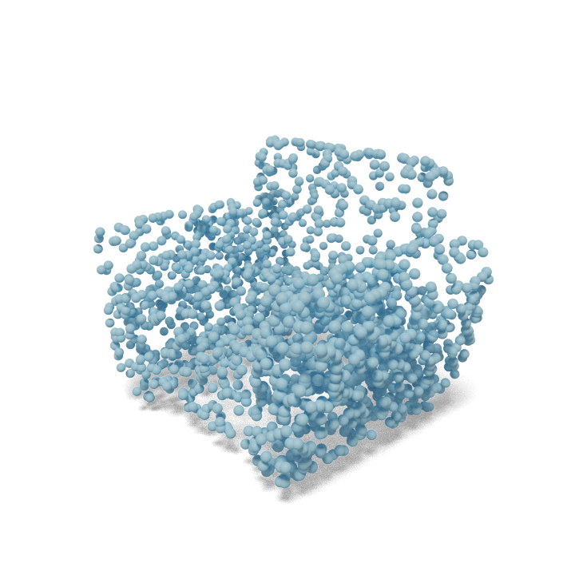

*原文图 2：论文方法流程图（图 2）；原始图注与完整说明见图片来源。 [查看图片来源](https://arxiv.org/html/2301.11445v3/images/pipeline/pipeline-input.png)*

引用来源：arxiv_2610.15357

链接：[arXiv](https://arxiv.org/abs/2301.11445)

##### MultiDiffusion: Fusing Diffusion Paths for Controlled Image Generation

作者：Omer Bar-Tal, Lior Yariv, Y. Lipman, Tali Dekel

研究角色：背景与上下文工作
任务标签：context

中文简介：

MultiDiffusion解决可控图像生成任务，通过绑定多个扩散路径实现全景生成或空间引导。核心范式是基于优化的生成过程，无需额外训练即可将预训练模型适应于新任务，如分割掩码或边界框控制。该方法属于视图合成聚合的前驱技术，其多路径融合思想启发了后续3D生成中多视角一致性约束的设计，展示了如何通过共享参数约束不同扩散过程，以实现复杂结构的高质量可控生成。

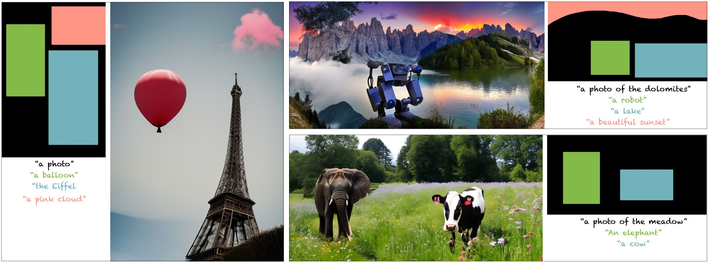

*原文图 8：论文方法流程图（图 8）；原始图注与完整说明见图片来源。 [查看图片来源](https://arxiv.org/html/2302.08113v1/figures/rough_nice_fonts-01.jpg)*

引用来源：arxiv_2610.03308

链接：[arXiv](https://arxiv.org/abs/2302.08113)

##### RealFusion 360° Reconstruction of Any Object from a Single Image

作者：Luke Melas-Kyriazi, Iro Laina, C. Rupprecht, A. Vedaldi

研究角色：背景与上下文工作
任务标签：context

中文简介：

RealFusion处理从单张图像重建完整360度对象模型的任务，输入为单视图，输出为神经辐射场（NeRF）。鉴于问题的病态性，核心方法利用现成的条件图像生成器，通过工程化提示词引导其“构想”不可见视角，并结合DreamFusion框架融合输入视图与条件先验。这属于典型的视图合成聚合路线，通过扩散先验正则化NeRF优化，解决了单目重建中的几何歧义，在基准测试中取得了优于先前单目重建方法的结果。

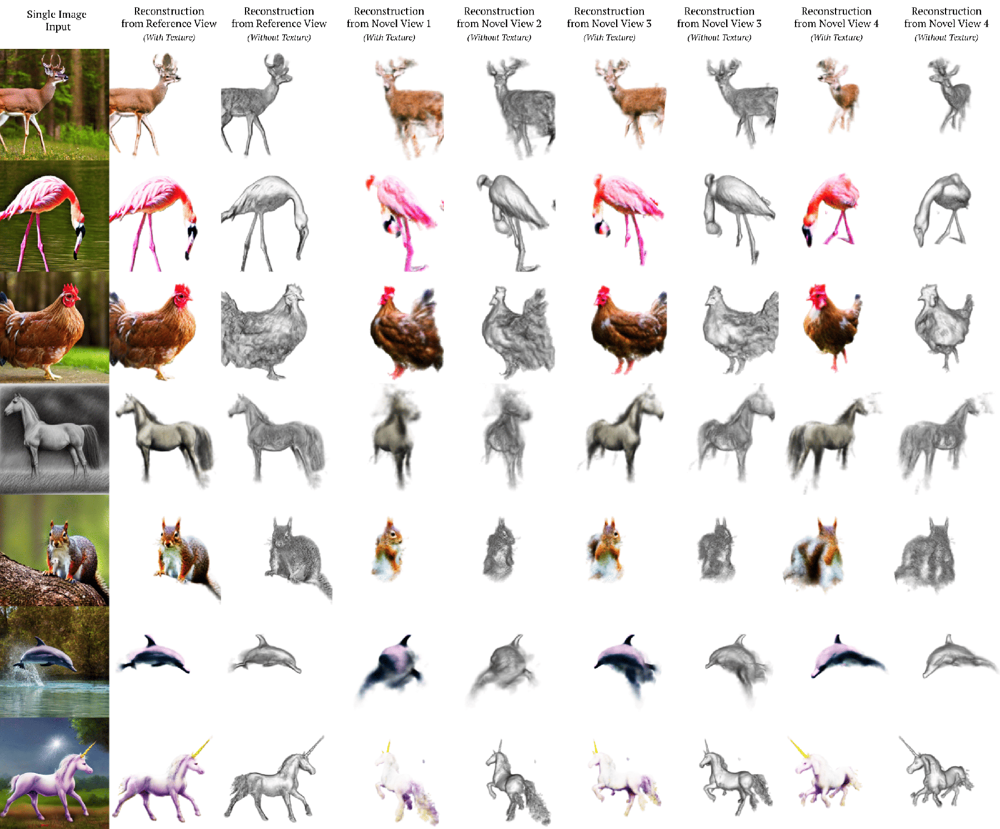

*原文图 12：论文方法流程图（图 12）；原始图注与完整说明见图片来源。 [查看图片来源](https://arxiv.org/html/2302.10663v2/images/supplementary-results-figure-2-text2image-v1.png)*

引用来源：arxiv_2610.15357

链接：[arXiv](https://arxiv.org/abs/2302.10663)

##### Make-It-3D: High-Fidelity 3D Creation from A Single Image with Diffusion Prior

作者：Junshu Tang, Tengfei Wang, Bo Zhang, Ting Zhang, Ran Yi, Li-Zhuang Ma, Dong Chen

研究角色：背景与上下文工作
任务标签：context

中文简介：

该论文解决从单张图像生成高保真3D内容的任务，输入为单视图RGB图像，输出为神经辐射场及纹理点云。核心方法采用两阶段优化：首先结合参考图约束与扩散先验优化NeRF，随后将粗模型转化为纹理点云并进一步提升真实感。作为视图合成聚合类工作，它利用2D扩散模型提供3D感知监督，通过“幻觉” unseen 纹理来补全几何，区别于单纯的重建方法，实现了从单图到通用物体的高质量3D创建。

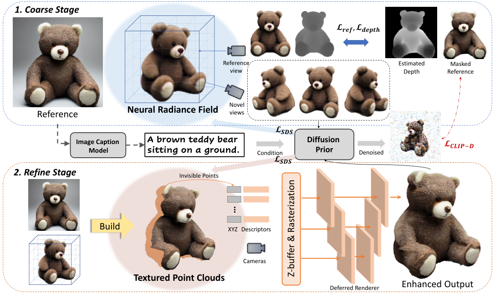

*原文图 1：论文方法流程图（图 1）；原始图注与完整说明见图片来源。 [查看图片来源](https://arxiv.org/html/2303.14184v2/pipeline.png)*

引用来源：arxiv_2610.15357

链接：[arXiv](https://arxiv.org/abs/2303.14184)

##### Zero-1-to-3: Zero-shot One Image to 3D Object

作者：Ruo-Shi Liu, Rundi Wu, Basile Van Hoorick, P. Tokmakov, Sergey Zakharov, Carl Vondrick

研究角色：背景与上下文工作
任务标签：context

中文简介：

Zero-1-to-3旨在解决单图像条件下的新视角合成及3D重建任务，输入为单张RGB图像和相对相机位姿，输出为新视角图像或3D对象。核心范式是训练一个条件扩散模型，利用合成数据学习相机位姿控制，从而生成指定变换下的对象视图。该方法属于多视角条件生成的基础组件，通过大规模预训练获得几何先验，具备强大的零样本泛化能力，显著优于传统单视图重建模型，为后续3D重建提供了高质量的多视角一致性图像源。

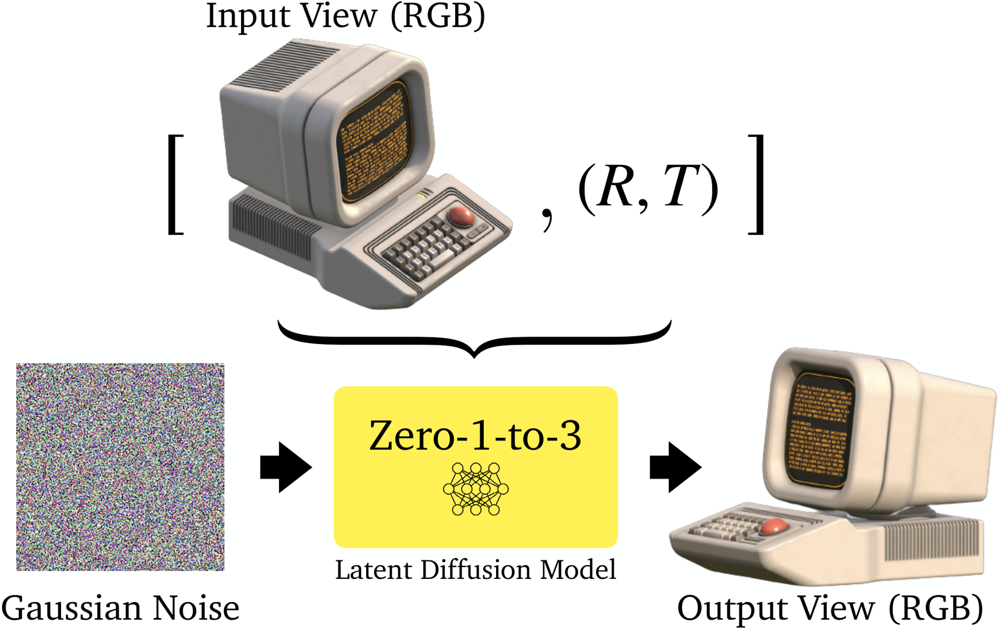

*原文图 2：论文方法流程图（图 2）；原始图注与完整说明见图片来源。 [查看图片来源](https://arxiv.org/html/2303.11328v1/nvs.png)*

引用来源：arxiv_2610.15357

链接：[arXiv](https://arxiv.org/abs/2303.11328)

##### ProlificDreamer: High-Fidelity and Diverse Text-to-3D Generation with Variational Score Distillation

作者：Zheng-Yi Wang, Cheng Lu, Yi-Kai Wang, Fan Bao, Chong-Xuan Li, Hang Su, Jun Zhu

研究角色：背景与上下文工作
任务标签：context

中文简介：

ProlificDreamer解决文本到3D生成中过饱和、过平滑和低多样性问题，输出高保真NeRF或网格。核心方法是变分分数蒸馏（VSD），将3D参数建模为随机变量而非SDS中的常数，通过基于粒子的变分框架解释并解决SDS缺陷。VSD兼容多种CFG权重，提升样本多样性和质量。区别于标准SDS，它属于生成任务中的高级优化路线，能生成具有复杂结构和逼真细节的高分辨率3D资产。

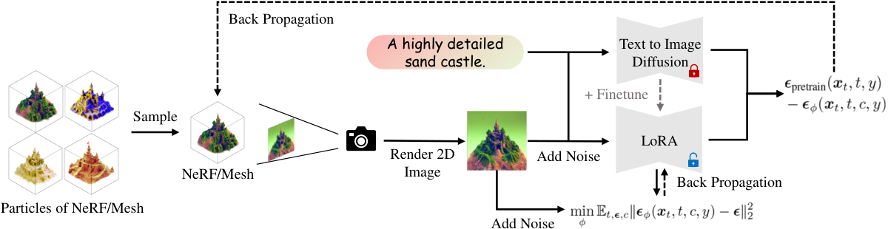

*原文图 4：论文方法流程图（图 4）；原始图注与完整说明见图片来源。 [查看图片来源](https://arxiv.org/html/2305.16213v2/diagram.png)*

引用来源：arxiv_2610.15357

链接：[arXiv](https://arxiv.org/abs/2305.16213)

##### Magic123: One Image to High-Quality 3D Object Generation Using Both 2D and 3D Diffusion Priors

作者：Guocheng Qian, Jinjie Mai, Abdullah Hamdi, Jian Ren, Aliaksandr Siarohin, Bing Li, Hsin-Ying Lee, Ivan Skorokhodov, Peter Wonka, S. Tulyakov, Bernard Ghanem

研究角色：背景与上下文工作
任务标签：context

中文简介：

Magic123解决从单张无姿态图像生成高质量纹理3D网格的任务。核心范式是两阶段由粗到细策略：首阶段优化NeRF获得粗略几何，次阶段利用可微分网格表示生成高分辨率纹理。关键在于结合2D和3D扩散先验，并通过单一权衡参数控制几何的探索与利用。区别于纯2D或纯3D先验方法，它属于联合重建与生成路线，有效平衡了外观一致性与几何精确性，避免退化解。

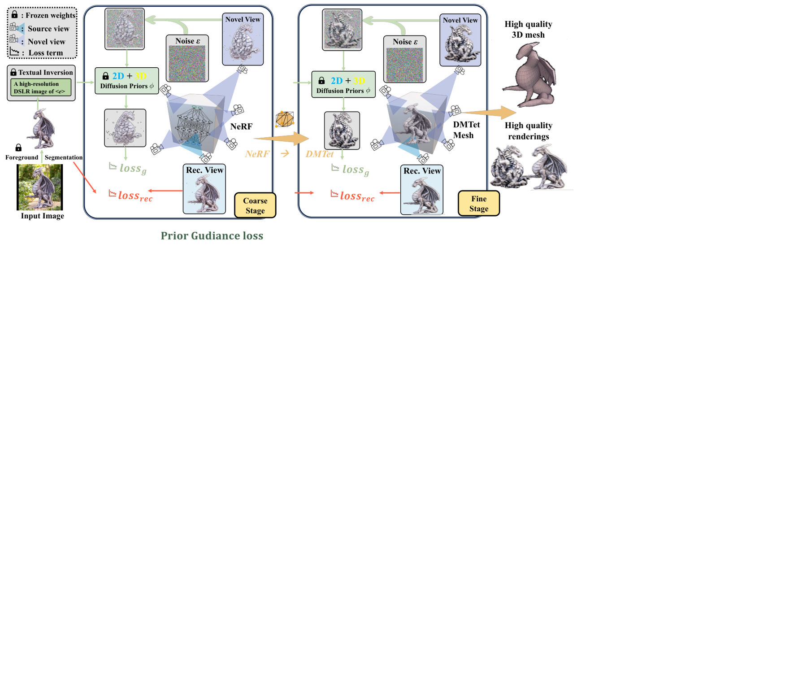

*原文图 3：论文方法流程图（图 3）；原始图注与完整说明见图片来源。 [查看图片来源](https://arxiv.org/html/2306.17843v2/x1.png)*

引用来源：arxiv_2610.15357

链接：[arXiv](https://arxiv.org/abs/2306.17843)

##### One-2-3-45: Any Single Image to 3D Mesh in 45 Seconds without Per-Shape Optimization

作者：Minghua Liu, Chao Xu, Haian Jin, Ling Chen, T. MukundVarma, Ze-Xiang Xu, Hao Su

研究角色：背景与上下文工作
任务标签：context

中文简介：

One-2-3-45解决从任意单张图像快速重建360度3D纹理网格的任务，无需每形状优化。核心方法是前馈架构：首先利用Zero123生成多视角图像，然后基于SDF的通用神经表面重建方法将其提升为3D空间。针对多视角不一致问题，提出特定训练策略。区别于耗时的SDS优化路线，它属于视图合成聚合后的快速重建路径，在显著减少运行时间的同时，提升了网格质量和3D一致性。

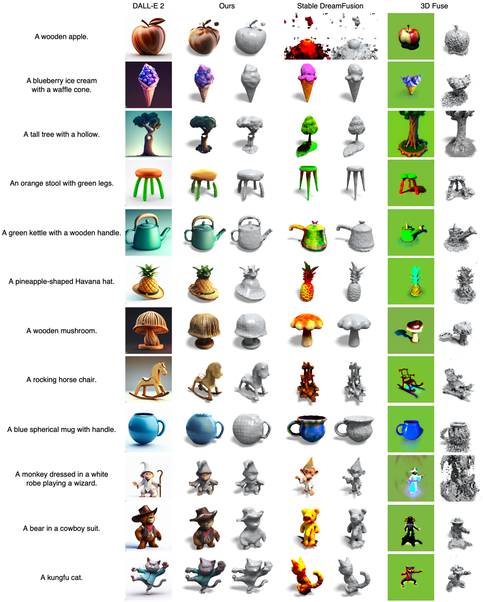

*原文图 14：论文方法流程图（图 14）；原始图注与完整说明见图片来源。 [查看图片来源](https://arxiv.org/html/2306.16928v1/figures/supp_text_new.png)*

引用来源：arxiv_2610.15357

链接：[arXiv](https://arxiv.org/abs/2306.16928)

##### ScanNet++: A High-Fidelity Dataset of 3D Indoor Scenes

作者：Chandan Yeshwanth, Yueh-Cheng Liu, Matthias Niessner, Angela Dai

研究角色：背景与上下文工作
任务标签：context

中文简介：

ScanNet++是一个大规模高保真室内3D场景数据集，提供亚毫米级激光扫描几何、DSLR高分辨率图像及iPhone RGB-D流。它并非生成模型，而是为新颖视图合成和语义理解提供基准。该数据集通过耦合高质量与消费级采集数据，解决了现有数据在几何精度与语义标注上的不足，为训练和评估上述生成与重建模型提供了不可或缺的高标准真实世界数据基础，推动了领域向更高保真度发展。

*原文图 7：论文方法流程图（图 7）；原始图注与完整说明见图片来源。 [查看图片来源](https://arxiv.org/html/2308.11417v1/img/semantic/sem/2022-12-04_12-25_pointnetpp_camera_full.jpg)*

引用来源：arxiv_2610.03308

链接：[arXiv](https://arxiv.org/abs/2308.11417)

##### DreamGaussian: Generative Gaussian Splatting for Efficient 3D Content Creation

作者：Jiaxiang Tang, Jiawei Ren, Hang Zhou, Ziwei Liu, Gang Zeng

研究角色：背景与上下文工作
任务标签：context

中文简介：

DreamGaussian解决从单视图图像高效创建3D内容的问题，输出带纹理的网格。核心范式是生成式3D高斯泼溅，利用高斯原语的渐进式致密化替代NeRF的占据剪枝，显著加快收敛速度，并辅以UV空间纹理细化。区别于慢速的SDS优化方法，它属于生成任务中的高效路线，通过结合快速几何表示与生成先验，在保持竞争力的生成质量同时，将生成时间大幅缩短至分钟级。

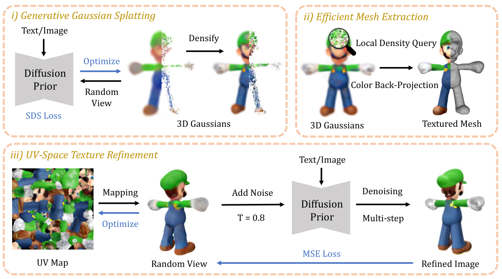

*原文图 1：论文方法流程图（图 1）；原始图注与完整说明见图片来源。 [查看图片来源](https://arxiv.org/html/2309.16653v2/framework.png)*

引用来源：arxiv_2610.15357

链接：[arXiv](https://arxiv.org/abs/2309.16653)

##### SyncDreamer: Generating Multiview-consistent Images from a Single-view Image

作者：Yuan Liu, Chu-Hsing Lin, Zi-Jiao Zeng, Xiaoxiao Long, Ling-Jie Liu, Taku Komura, Wen-Ping Wang

研究角色：背景与上下文工作
任务标签：context

中文简介：

SyncDreamer解决从单视图图像生成多视角一致图像的任务。核心方法是同步多视角扩散模型，通过3D感知特征注意力机制，在反向过程的每一步关联不同视图的特征，从而对多视角图像的联合概率分布进行建模。区别于Zero123等逐视图生成导致的不一致，它在单次反向过程中实现全局同步。属于视图合成聚合类别，为后续3D重建提供高度一致的2D视图输入，改善几何一致性。

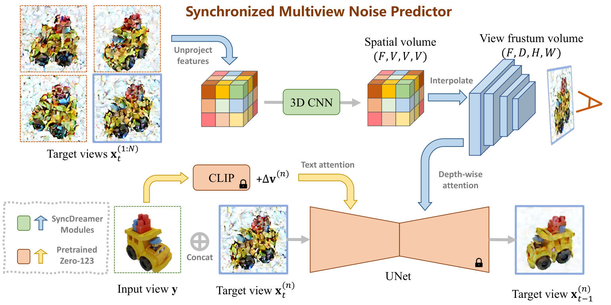

*原文图 2：论文方法流程图（图 2）；原始图注与完整说明见图片来源。 [查看图片来源](https://arxiv.org/html/2309.03453v2/pipeline.png)*

引用来源：arxiv_2610.15357

链接：[arXiv](https://arxiv.org/abs/2309.03453)

##### Wonder3D: Single Image to 3D Using Cross-Domain Diffusion

作者：Xiaoxiao Long, Yuanchen Guo, Cheng Lin, Yuan Liu, Zhiyang Dou, Ling-Jie Liu, Yue-Xin Ma, Song-Hai Zhang, Marc Habermann, C. Theobalt, Wenping Wang

研究角色：背景与上下文工作
任务标签：context

中文简介：

Wonder3D旨在从单张图像高效生成高保真纹理网格。核心范式是跨域扩散模型，同步生成多视角法线图与颜色图，并通过多视角交叉注意力机制确保视图间及模态间的一致性。随后利用几何感知法线融合算法提取表面。区别于耗时且几何不一致的SDS优化方法，该方法将多视角一致性建模在2D生成阶段，属于视图合成聚合类别，实现了质量、一致性与效率的整体提升。

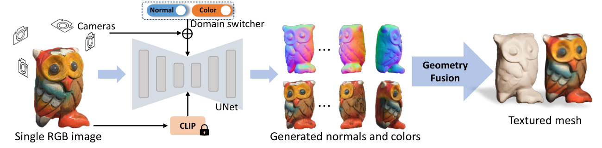

*原文图 1：论文方法流程图（图 1）；原始图注与完整说明见图片来源。 [查看图片来源](https://arxiv.org/html/2310.15008v3/fig_pipeline.png)*

引用来源：arxiv_2610.15357

链接：[arXiv](https://arxiv.org/abs/2310.15008)

##### Zero123++: a Single Image to Consistent Multi-view Diffusion Base Model

作者：Ruo-Xi Shi, Han-Sheng Chen, Zhuoyang Zhang, Minghua Liu, Chao Xu, Xin-Yue Wei, Ling-Hao Chen, Chong Zeng, Hao Su

研究角色：背景与上下文工作
任务标签：context

中文简介：

Zero123++解决从单视图图像生成3D一致多视角图像的任务。核心方法是作为基础模型的图像条件扩散模型，通过优化的调节和训练方案，最小化从预训练2D扩散模型微调的努力。它克服了纹理退化和几何错位问题，支持ControlNet增强控制。作为上下文基础模型，它不直接输出3D资产，而是为下游重建或生成提供高质量、一致的中间多视角表示，属于视图合成聚合的前置关键组件。

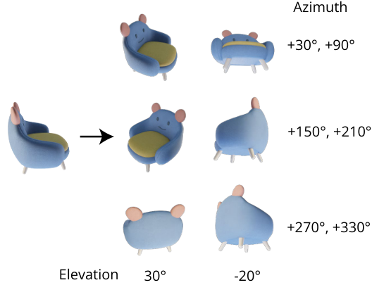

*原文图 1：论文方法流程图（图 1）；原始图注与完整说明见图片来源。 [查看图片来源](https://arxiv.org/html/2310.15110v1/layout.png)*

引用来源：arxiv_2610.15357

链接：[arXiv](https://arxiv.org/abs/2310.15110)

##### DemoFusion: Democratising High-Resolution Image Generation With No $$$

作者：Ruoyi Du, Dongliang Chang, Timothy M. Hospedales, Yi-Zhe Song, Zhanyu Ma

研究角色：背景与上下文工作
任务标签：context

中文简介：

DemoFusion旨在低成本实现高分辨率图像生成，输入为低分辨率潜变量或提示词，输出高清图像。核心方法包括渐进式上采样、跳跃残差连接和扩张采样机制，挖掘现有潜在扩散模型的未利用潜力。虽然主要面向2D图像，但其渐进式生成范式为3D层级生成提供了重要参考，属于通过算法优化而非增加训练成本来提升分辨率的典型路线，强调了开源模型在高分辨率生成中的可扩展性与民主化价值。

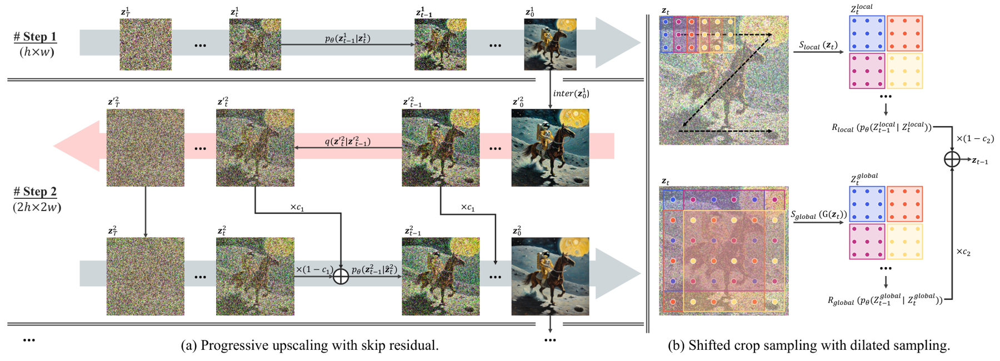

*原文图 2：论文方法流程图（图 2）；原始图注与完整说明见图片来源。 [查看图片来源](https://arxiv.org/html/2311.16973v2/c_framework.png)*

引用来源：arxiv_2610.03308

链接：[arXiv](https://arxiv.org/abs/2311.16973)

##### DUSt3R: Geometric 3D Vision Made Easy

作者：Shuzhe Wang, Vincent Leroy, Yohann Cabon, Boris Chidlovskii, Jérôme Revaud

研究角色：背景与上下文工作
任务标签：context

中文简介：

DUSt3R解决任意图像集合的稠密无约束立体重建任务，无需相机参数即可输出场景点图、深度及位姿。核心方法是将成对重建转化为点图回归问题，利用Transformer架构统一单目与双目情况，并通过全局对齐策略融合多视角信息。虽非典型扩散生成，但其基于生成式先验的重建范式突破了传统MVS对校准的依赖，在稀疏或困难视角下提供鲁棒的几何恢复，属于结合生成思想的重建任务前沿。

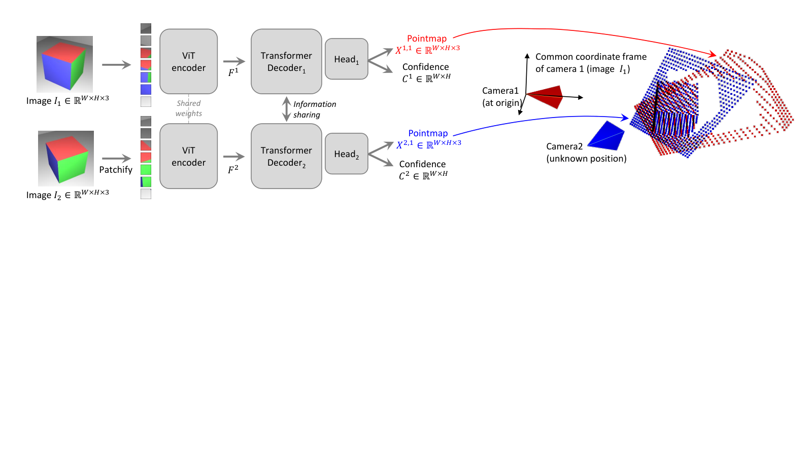

*原文图 1：论文方法流程图（图 1）；原始图注与完整说明见图片来源。 [查看图片来源](https://arxiv.org/html/2312.14132v3/dust3r.png)*

引用来源：arxiv_2610.03308, arxiv_2610.15357

链接：[arXiv](https://arxiv.org/abs/2312.14132)

##### PixelSplat: 3D Gaussian Splats from Image Pairs for Scalable Generalizable 3D Reconstruction

作者：David Charatan, S. Li, Andrea Tagliasacchi, Vincent Sitzmann

研究角色：背景与上下文工作
任务标签：context

中文简介：

该论文解决从稀疏图像对重建可泛化3D辐射场的任务，输出参数化为3D高斯原语的场。核心方法采用前馈架构，通过预测密集3D概率分布并采样高斯均值，利用重参数化技巧实现可微分渲染以克服局部极小值。区别于传统MVS或NeRF，它属于高效重建路线，虽未直接使用生成式扩散先验，但为后续结合生成模型提供快速、可编辑的几何基础，显著加速推理并提升大规模训练的可扩展性。

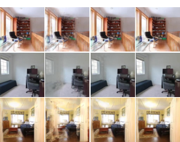

*原文图 7：论文方法流程图（图 7）；原始图注与完整说明见图片来源。 [查看图片来源](https://arxiv.org/html/2312.12337v4/x2.png)*

引用来源：arxiv_2610.15357

链接：[arXiv](https://arxiv.org/abs/2312.12337)

##### XCube: Large-Scale 3D Generative Modeling using Sparse Voxel Hierarchies

作者：Xuan-Chi Ren, Jia-Hui Huang, Xiaohui Zeng, Ken Museth, S. Fidler, Francis Williams

研究角色：背景与上下文工作
任务标签：context

中文简介：

XCube面向高分辨率稀疏体素网格的3D生成任务，支持从文本或单扫描输入生成百万级体素。核心采用基于VDB数据结构的层级体素潜在扩散模型，以由粗到细的方式逐步生成高分辨率网格。该方法属于层级级联生成类别，区别于前序单一分辨率生成，它通过分层策略有效处理大规模室外场景与精细物体，在保持高效前馈推理的同时，显著提升了生成内容的几何细节与尺度适应性。

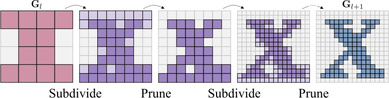

*原文图 2：论文方法流程图（图 2）；原始图注与完整说明见图片来源。 [查看图片来源](https://arxiv.org/html/2312.03806v2/decoder_mac_crop.svg)*

引用来源：arxiv_2610.03308, arxiv_2610.15357

链接：[arXiv](https://arxiv.org/abs/2312.03806)

##### 2024

##### BlockFusion: Expandable 3D Scene Generation using Latent Tri-plane Extrapolation

作者：Zhennan Wu, Yang Li, Han Yan, Taizhang Shang, Weixuan Sun, Senbo Wang, Ruikai Cui, Weizhe Liu, Hiroyuki Sato, Hongdong Li, Pan Ji

研究角色：背景与上下文工作
任务标签：context

中文简介：

BlockFusion旨在生成无限扩展的3D场景，输入为2D布局条件，输出为由多个单元块组成的混合神经场。其核心范式是在压缩的三平面潜在空间中执行扩散去噪，并通过重叠区域的特征外推来无缝拼接新块。该方法属于层级级联生成与潜在扩散Transformer架构的结合，区别于传统全局生成，它通过分块外推策略解决了大场景生成的内存限制与一致性问题，实现了室内外场景的高质量延展。

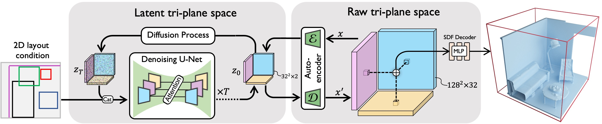

*原文图 2：论文方法流程图（图 2）；原始图注与完整说明见图片来源。 [查看图片来源](https://arxiv.org/html/2401.17053v4/figures/pipeline.jpg)*

引用来源：arxiv_2610.03308

链接：[arXiv](https://arxiv.org/abs/2401.17053)

##### Cameras as Rays: Pose Estimation via Ray Diffusion

作者：Jason Y. Zhang, Amy Lin, Moneish Kumar, Tzu-Hsuan Yang, D. Ramanan, Shubham Tulsiani

研究角色：背景与上下文工作
任务标签：context

中文简介：

该论文解决稀疏视角下的相机位姿估计任务，输入稀疏图像，输出相机姿态。核心方法是将相机表示为射线束，利用集合级Transformer将图像补丁映射为对应射线，并进一步适配为去噪扩散模型以捕捉推断中的不确定性。虽属位姿估计，但其分布式射线表示紧密耦合空间图像特征，为3D重建提供了更精确的初始条件，区别于传统预测全局外参的自上而下方法。

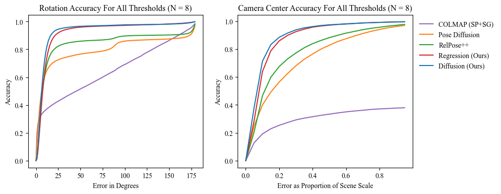

*原文图 11：论文方法流程图（图 11）；原始图注与完整说明见图片来源。 [查看图片来源](https://arxiv.org/html/2402.14817v3/figures_updated/auc_curves.png)*

引用来源：arxiv_2610.03308

链接：[arXiv](https://arxiv.org/abs/2402.14817)

##### LGM: Large Multi-View Gaussian Model for High-Resolution 3D Content Creation

作者：Jiaxiang Tang, Zhao-Xi Chen, Xiaokang Chen, Tengfei Wang, Gang Zeng, Ziwei Liu

研究角色：背景与上下文工作
任务标签：context

中文简介：

LGM解决从文本或单图生成高分辨率3D内容的任务。核心范式提出多视角高斯特征表示，利用非对称U-Net骨干网处理多视角图像并进行可微渲染融合。属于视图合成聚合类别，区别于受限于计算资源而低分辨率的前馈模型，它通过高效 backbone 设计将训练分辨率提升至512，在保持5秒内快速生成的同时，显著提高了3D内容的清晰度和几何细节 fidelity。

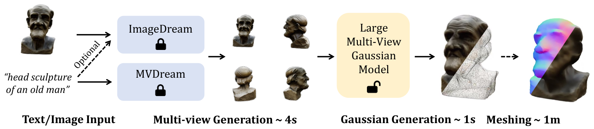

*原文图 1：论文方法流程图（图 1）；原始图注与完整说明见图片来源。 [查看图片来源](https://arxiv.org/html/2402.05054v1/pipe.png)*

引用来源：arxiv_2610.15357

链接：[arXiv](https://arxiv.org/abs/2402.05054)

##### 2D Gaussian Splatting for Geometrically Accurate Radiance Fields

作者：Binbin Huang, Zehao Yu, An-Pei Chen, Andreas Geiger, Shenghua Gao

研究角色：背景与上下文工作
任务标签：context

中文简介：

该论文旨在从多视角图像重建几何精确的辐射场，解决3D高斯溅射表面表示不一致的问题。核心方法是将3D体积坍缩为一组2D定向平面高斯盘，利用射线-高斯交集进行透视准确的 splatting，并引入深度畸变和法线一致性项。属于重建任务类别，与前序3DGS方法不同，2DGS内在地建模表面并提供视图一致几何，实现了无噪声的详细几何重建，同时保持了实时渲染速度。

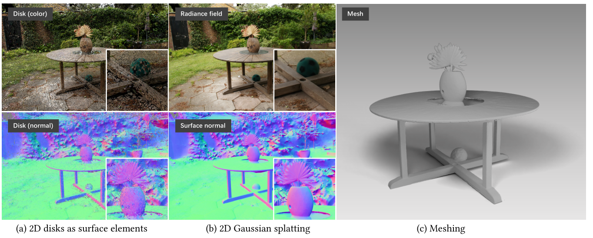

*原文图 1：论文方法流程图（图 1）；原始图注与完整说明见图片来源。 [查看图片来源](https://arxiv.org/html/2403.17888v3/teaser.png)*

引用来源：arxiv_2610.03308

链接：[arXiv](https://arxiv.org/abs/2403.17888)

##### GRM: Large Gaussian Reconstruction Model for Efficient 3D Reconstruction and Generation

作者：Yinghao Xu, Zifan Shi, Wang Yifan, Han-Sheng Chen, Ce-Yuan Yang, Si-Da Peng, Yujun Shen, Gordon Wetzstein

研究角色：背景与上下文工作
任务标签：context

中文简介：

GRM解决稀疏视角图像到3D高斯泼溅的高效重建任务。核心方法是基于Transformer的前馈网络，将输入像素直接映射为像素对齐的高斯分布并反投影为3D场景。属于重建任务类别，特指结合生成式先验的快速重建，区别于传统迭代优化方法，它在0.1秒内完成重建，并可作为生成模块与多视角扩散模型结合，实现了速度与质量的双重突破，适用于实时应用。

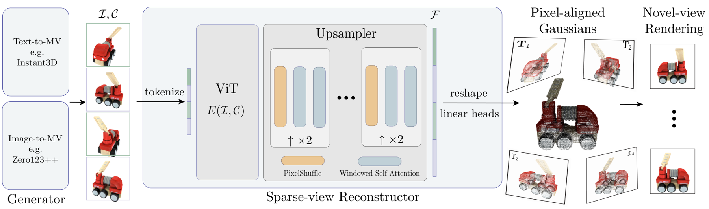

*原文图 2：论文方法流程图（图 2）；原始图注与完整说明见图片来源。 [查看图片来源](https://arxiv.org/html/2403.14621v1/pipeline.png)*

引用来源：arxiv_2610.15357

链接：[arXiv](https://arxiv.org/abs/2403.14621)

##### InstantMesh: Efficient 3D Mesh Generation from a Single Image with Sparse-view Large Reconstruction Models

作者：Jia-Le Xu, Weihao Cheng, Yiming Gao, Xin-Tao Wang, Shenghua Gao, Shan Ying

研究角色：背景与上下文工作
任务标签：context

中文简介：

InstantMesh解决单图到3D Mesh的快速生成任务。核心范式协同现成多视角扩散模型与基于LRM架构的稀疏视角重建模型，集成可微分等值面提取模块直接优化Mesh表示。属于联合重建与生成类别，区别于纯生成或纯重建方法，它利用前馈网络在秒级内完成从稀疏视图到完整Mesh的转换，兼顾了生成多样性与几何准确性，显著提升了训练可扩展性与推理效率。

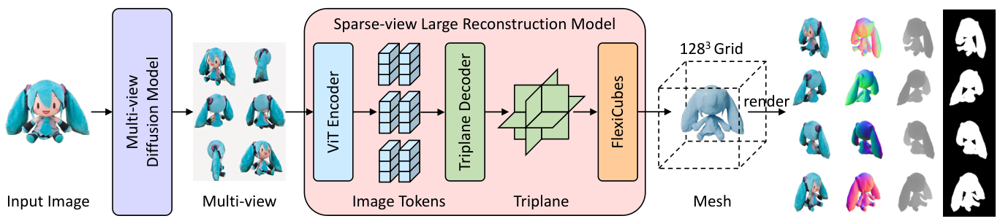

*原文图 1：论文方法流程图（图 1）；原始图注与完整说明见图片来源。 [查看图片来源](https://arxiv.org/html/2404.07191v2/pipeline.png)*

引用来源：arxiv_2610.15357

链接：[arXiv](https://arxiv.org/abs/2404.07191)

##### CraftsMan3D: High-fidelity Mesh Generation with 3D Native Generation and Interactive Geometry Refiner

作者：Wei-Yu Li, Jia-Rui Liu, Hong-Yu Yan, Rui Chen, Yixun Liang, Xue-Lin Chen, Ping Tan, Xiao-Xiao Long

研究角色：背景与上下文工作
任务标签：context

中文简介：

CraftsMan3D解决高保真3D Mesh生成及交互式几何细化任务。核心范式采用由粗到细策略：先利用多视角条件扩散模型在潜在空间生成拓扑规则的粗略几何，再通过基于法线的几何细化器增强表面细节。属于层级级联生成类别，区别于端到端生成中常见的噪声表面和不规则拓扑，该方法模拟工匠流程，不仅生成质量高，还首次支持用户交互式编辑细化，提升了实用性。

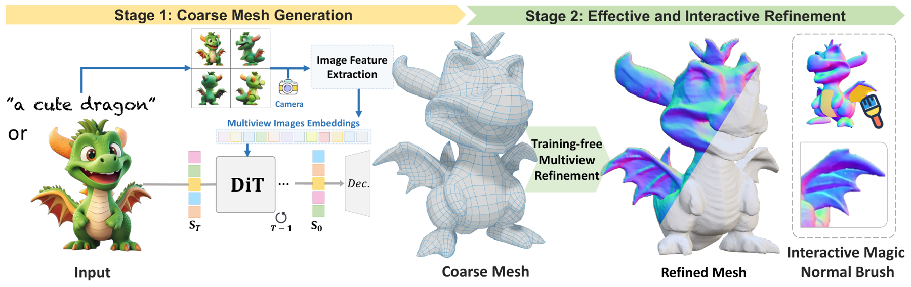

*原文图 3：论文方法流程图（图 3）；原始图注与完整说明见图片来源。 [查看图片来源](https://arxiv.org/html/2405.14979v4/overview.png)*

引用来源：arxiv_2610.15357

链接：[arXiv](https://arxiv.org/abs/2405.14979)

##### Era3D: High-Resolution Multiview Diffusion using Efficient Row-wise Attention

作者：Peng Li, Yuan Liu, Xiaoxiao Long, Fei-Hu Zhang, Cheng Lin, Meng-Fei Li, Xing-Qun Qi, Shang-Hang Zhang, Wei Xue, Wen-Han Luo, Ping Tan, Wen-Ping Wang, Qi-Fei Liu, Yi-Ke Guo

研究角色：背景与上下文工作
任务标签：context

中文简介：

Era3D解决单图生成高分辨率多视角图像的任务，旨在克服相机先验不匹配和计算复杂度高的问题。核心方法引入扩散相机预测模块估计焦距，并设计行注意力机制融合跨视角信息。属于多视角条件生成类别，区别于固定相机假设导致形变的方法，它通过动态相机估计消除畸变，并利用高效注意力机制大幅降低计算成本，实现了高分辨率且几何一致的多视角合成。

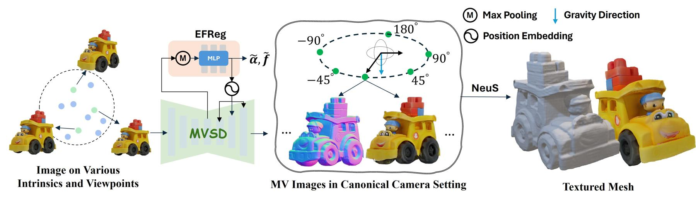

*原文图 4：论文方法流程图（图 4）；原始图注与完整说明见图片来源。 [查看图片来源](https://arxiv.org/html/2405.11616v3/figures/pipeline.jpg)*

引用来源：arxiv_2610.15357

链接：[arXiv](https://arxiv.org/abs/2405.11616)

##### Unique3D: High-Quality and Efficient 3D Mesh Generation from a Single Image

作者：Kai-Lu Wu, Fang-Fu Liu, Zhihan Cai, Runjie Yan, Han-Yang Wang, Yating Hu, Yue-Qi Duan, Kaisheng Ma

研究角色：背景与上下文工作
任务标签：context

中文简介：

Unique3D解决单图到3D Mesh的高效高保真生成任务。核心方法结合多视角扩散模型生成正交视图及法线图，经多级上采样提升分辨率，最后通过ISOMER算法即时重建Mesh。属于视图合成聚合类别，区别于SDS方法的低效和不一致，以及普通前馈模型的细节缺失，它通过显式的法线引导和层级细化，在保证几何一致性的同时显著提升了纹理与几何的细节表现。

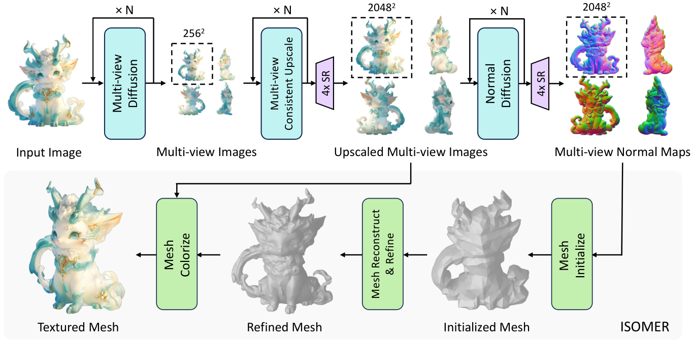

*原文图 2：论文方法流程图（图 2）；原始图注与完整说明见图片来源。 [查看图片来源](https://arxiv.org/html/2405.20343v3/method.png)*

引用来源：arxiv_2610.15357

链接：[arXiv](https://arxiv.org/abs/2405.20343)

##### CLAY: A Controllable Large-scale Generative Model for Creating High-quality 3D Assets

作者：Long-Wen Zhang, Ziyu Wang, Qi-Xuan Zhang, Qi-Wei Qiu, Anqi Pang, Haoran Jiang, Wei Yang, Lan Xu, Jing-Yi Yu

研究角色：背景与上下文工作
任务标签：context

中文简介：

CLAY解决从文本、图像或多视角等条件生成高质量3D资产的任务。核心范式采用多分辨率VAE压缩几何，并在潜在空间利用最小化DiT架构进行扩散生成，支持PBR纹理合成。属于潜在扩散Transformer架构类别，区别于以往小规模或单一模态模型，它通过15亿参数大规模训练和渐进式策略，实现了从概念草图到生产级资产的通用可控生成，确立了3D原生生成的新基准。

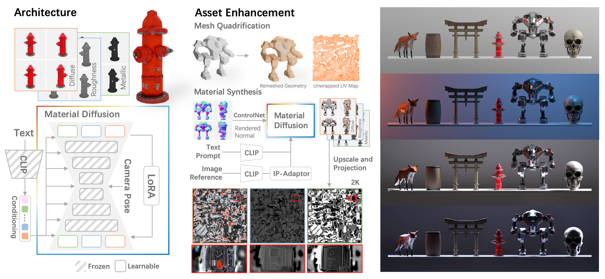

*原文图 5：论文方法流程图（图 5）；原始图注与完整说明见图片来源。 [查看图片来源](https://arxiv.org/html/2406.13897v1/fig/PBR.png)*

引用来源：arxiv_2610.15357

链接：[arXiv](https://arxiv.org/abs/2406.13897)

##### Depth Anything V2

作者：Lihe Yang, Bing-Yi Kang, Zi-Long Huang, Zhen Zhao, Xiao-Gang Xu, Jia-Shi Feng, Hengshuang Zhao

研究角色：背景与上下文工作
任务标签：context

中文简介：

该论文致力于提升单目深度估计的精度与鲁棒性，输入为单张图像，输出为精细的深度图。核心方法摒弃复杂技巧，转而使用合成图像替代真实标签、扩大教师模型容量，并通过大规模伪标签真实图像蒸馏学生模型。虽非直接生成3D，但作为关键几何先验工具，其提供的深度信息优于基于Stable Diffusion的方法且效率更高，为后续3D重建任务提供了更可靠的基础几何约束。

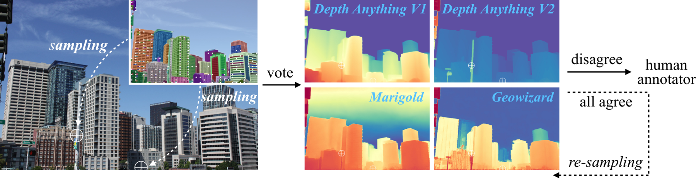

*原文图 14：论文方法流程图（图 14）；原始图注与完整说明见图片来源。 [查看图片来源](https://arxiv.org/html/2406.09414v2/da2k_demo.png)*

引用来源：arxiv_2610.03308

链接：[arXiv](https://arxiv.org/abs/2406.09414)

##### PGSR: Planar-Based Gaussian Splatting for Efficient and High-Fidelity Surface Reconstruction

作者：Danpeng Chen, Hai Li, Weicai Ye, Yifan Wang, Weijian Xie, Shangjin Zhai, Nan Wang, Hao-Min Liu, Hujun Bao, Guofeng Zhang

研究角色：背景与上下文工作
任务标签：context

中文简介：

该论文解决基于3D高斯溅射的表面重建几何不准问题，输入多视角图像，输出高保真表面网格。核心方法是提出PGSR表示，引入无偏深度渲染直接计算相机到高斯平面的距离，并结合单视图几何、多视图光度及几何正则化损失，还包含曝光补偿模型。属于重建任务类别，它克服了传统3DGS因非结构化特性导致的几何不一致，在保持快速渲染的同时显著提升了表面重建的几何精度。

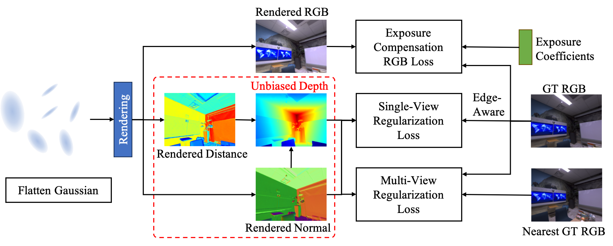

*原文图 3：论文方法流程图（图 3）；原始图注与完整说明见图片来源。 [查看图片来源](https://arxiv.org/html/2406.06521v2/figs/system.png)*

引用来源：arxiv_2610.03308

链接：[arXiv](https://arxiv.org/abs/2406.06521)

##### TranSplat: Generalizable 3D Gaussian Splatting from Sparse Multi-View Images with Transformers

作者：Chuanrui Zhang, Ying-Shuang Zou, Zhuoling Li, Min-Min Yi, Hao-Qian Wang

研究角色：背景与上下文工作
任务标签：context

中文简介：

TranSplat解决稀疏多视角图像下的广义3D高斯泼溅（G-3DGS）重建任务。针对现有方法在非重叠区域和相似纹理区域特征匹配不佳的问题，核心提出利用预测的深度置信度图引导局部特征匹配，并融合单目深度估计先验以提升非重叠区域的深度精度。该方法属于重建任务中的广义重建路线，通过增强特征匹配的鲁棒性，在RealEstate10K等基准上取得了最佳性能，同时保持了高效的推理速度和跨数据集泛化能力。

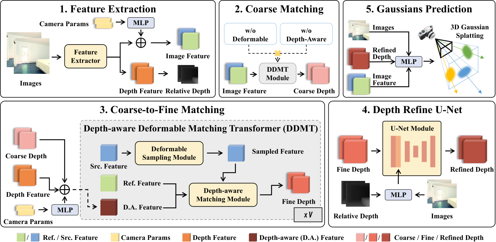

*原文图 1：论文方法流程图（图 1）；原始图注与完整说明见图片来源。 [查看图片来源](https://arxiv.org/html/2408.13770v1/pipeline.png)*

引用来源：arxiv_2610.15357

链接：[arXiv](https://arxiv.org/abs/2408.13770)

##### LT3SD: Latent Trees for 3D Scene Diffusion

作者：Quan Meng, Lei Li, Matthias Niessner, Angela Dai

研究角色：背景与上下文工作
任务标签：context

中文简介：

该论文针对大规模3D场景生成任务，输入为部分场景观测或无条件生成，输出为复杂多样的3D场景结构。核心方法是引入潜在树表示，以粗到细的层级结构编码几何和细节，并在潜在空间学习扩散生成过程，通过场景块共享扩散实现任意尺寸输出。属于层级级联生成类别，它克服了现有扩散模型在空间范围和质量上的局限，有效解决了大尺度场景生成的结构性难题。

*原文图 2：论文方法流程图（图 2）；原始图注与完整说明见图片来源。 [查看图片来源](https://arxiv.org/html/2409.08215v2/pipeline_img.png)*

引用来源：arxiv_2610.03308

链接：[arXiv](https://arxiv.org/abs/2409.08215)

##### SCube: Instant Large-Scale Scene Reconstruction using VoxSplats

作者：Xuan-Chi Ren, Yifan Lu, Hanxue Liang, Jay Zhangjie Wu, Huan Ling, Mike Chen, S. Fidler, Francis Williams, Jia-Hui Huang

研究角色：背景与上下文工作
任务标签：context

中文简介：

该论文解决从稀疏位姿图像快速重建大规模3D场景的任务，输出包含几何、外观和语义的VoxSplat表示。核心方法是采用分层体素潜在扩散模型，以粗到细方式生成高分辨率稀疏体素网格，并结合前馈外观预测模型生成高斯点。属于联合重建与生成类别，区别于依赖逐场景优化或低分辨率先验的前序工作，它能从极少视角快速生成 sharp 的大规模场景，平衡了速度与细节。

*原文图 2：论文方法流程图（图 2）；原始图注与完整说明见图片来源。 [查看图片来源](https://arxiv.org/html/2410.20030v1/pipeline-yifan.png)*

引用来源：arxiv_2610.03308

链接：[arXiv](https://arxiv.org/abs/2410.20030)

##### CityGaussianV2: Efficient and Geometrically Accurate Reconstruction for Large-Scale Scenes

作者：Yang Liu, Chuanchen Luo, Zhong-Kai Mao, Jun-Ran Peng, Zhaoxiang Zhang

研究角色：背景与上下文工作
任务标签：context

中文简介：

该论文旨在解决大规模场景重建中几何准确性不足和效率低下的问题，输入为多视角图像，输出为几何精确的3D高斯场景。核心方法基于2D Gaussian Splatting，引入分解梯度致密化和深度回归技术消除模糊，并利用 elongation filter 防止高斯数量爆炸，同时优化并行训练流程。属于重建任务类别，它改进了前序2DGS方法的收敛性和可扩展性，在保持视觉质量的同时显著降低了存储和训练成本。

*原文图 1：论文方法流程图（图 1）；原始图注与完整说明见图片来源。 [查看图片来源](https://arxiv.org/html/2411.00771v2/teaser.png)*

引用来源：arxiv_2610.03308

链接：[arXiv](https://arxiv.org/abs/2411.00771)

##### InfiniCube: Unbounded and Controllable Dynamic 3D Driving Scene Generation with World-Guided Video Models

作者：Yifan Lu, Xuan-Chi Ren, Jia-Wei Yang, Tianchang Shen, Zhang-Jie Wu, Jun Gao, Yue Wang, Si-Heng Chen, Mike Chen, S. Fidler, Jia-Hui Huang

研究角色：背景与上下文工作
任务标签：context

中文简介：

InfiniCube解决无界动态3D驾驶场景的高保真生成任务，支持HD地图、车辆边界框及文本等多模态控制。核心方法采用分层架构：首先构建地图条件的3D体素生成模型以生成无界世界结构，再利用视频模型通过像素对齐引导缓冲区在体素世界上合成一致外观，最后通过前馈方法将视频提升为动态3D高斯。区别于室内场景或不可控方法，它结合了3D结构与视频生成优势，实现了大规模、可控且真实的动态驾驶环境生成。

*原文图 1：论文方法流程图（图 1）；原始图注与完整说明见图片来源。 [查看图片来源](https://arxiv.org/html/2412.03934v2/method.png)*

引用来源：arxiv_2610.03308

链接：[arXiv](https://arxiv.org/abs/2412.03934)

##### Structured 3D Latents for Scalable and Versatile 3D Generation

作者：Jianfeng Xiang, Ze-Long Lv, Si-Cheng Xu, Yu Deng, Ruicheng Wang, Bowen Zhang, Dong Chen, Xin Tong, Jiao-Long Yang

研究角色：背景与上下文工作
任务标签：context

中文简介：

该论文解决从文本或图像条件生成高质量3D资产的任务，支持输出Radiance Fields、3D Gaussians和Mesh等多种格式。核心方法是提出统一的结构化潜在表示SLat，结合稀疏3D网格与密集多视角视觉特征，并采用矫正流Transformer在潜在空间进行去噪生成。作为潜在扩散Transformer架构的代表，它通过统一表示实现了灵活的解码和本地编辑，区别于以往仅支持单一输出格式且缺乏编辑能力的模型。

*原文图 1：论文方法流程图（图 1）；原始图注与完整说明见图片来源。 [查看图片来源](https://arxiv.org/html/2412.01506v3/pipeline_v3.png)*

引用来源：arxiv_2610.03308, arxiv_2610.15357

链接：[arXiv](https://arxiv.org/abs/2412.01506)

##### 2025

##### Continuous 3D Perception Model with Persistent State

作者：Qian-Qian Wang, Yi-Fei Zhang, Aleksander Holynski, Alexei A. Efros, Angjoo Kanazawa

研究角色：背景与上下文工作
任务标签：context

中文简介：

CUT3R解决连续视频流或无序照片集的在线3D重建任务。核心引入具有持久状态的循环Transformer模型，随着新观测图像的输入不断更新状态表示，从而在统一坐标系下生成度量尺度的逐像素3D点图并累积为稠密场景。区别于静态批次处理方法，该模型能自然处理可变长度输入及动态内容，并能通过探测虚拟未观测视图推断场景 unseen 区域，实现了灵活且连贯的持续感知与重建。

*原文图 3：论文方法流程图（图 3）；原始图注与完整说明见图片来源。 [查看图片来源](https://arxiv.org/html/2501.12387v1/state_overview.png)*

引用来源：arxiv_2610.15357

链接：[arXiv](https://arxiv.org/abs/2501.12387)

##### Fast3R: Towards 3D Reconstruction of 1000+ Images in One Forward Pass

作者：Jianing Yang, Alexander Sax, Kevin J. Liang, Mikael Henaff, Hao Tang, Ang Cao, Joyce Chai, Franziska Meier, Matt Feiszli

研究角色：背景与上下文工作
任务标签：context

中文简介：

Fast3R解决大规模多视角图像的高效3D重建任务，特别是针对需要处理1000+图像的场景。核心是对DUSt3R的多视角泛化，采用基于Transformer的架构，在单次前向传播中并行处理N张图像，避免了成对处理所需的昂贵全局对齐过程。区别于传统SfM或 pairwise 方法，Fast3R显著减少了误差累积并提升了推理速度，为多视角应用提供了一种兼具可扩展性与高精度的重建替代方案。

*原文图 1：论文方法流程图（图 1）；原始图注与完整说明见图片来源。 [查看图片来源](https://arxiv.org/html/2501.13928v2/model.png)*

引用来源：arxiv_2610.15357

链接：[arXiv](https://arxiv.org/abs/2501.13928)

##### TripoSG: High-Fidelity 3D Shape Synthesis using Large-Scale Rectified Flow Models

作者：Yangguang Li, Zi-Xin Zou, Zexiang Liu, De-Hui Wang, Yuan-Zhi Liang, Zhipeng Yu, Xing-Chao Liu, Yuan-Chen Guo, Ding Liang, Wan-Li Ouyang, Yan-Pei Cao

研究角色：背景与上下文工作
任务标签：context

中文简介：

TripoSG解决从输入图像生成高保真3D网格的任务，旨在克服现有方法在质量和泛化性上的局限。核心采用大规模整流流Transformer（Rectified Flow Transformer）作为形状生成主干，并结合SDF、法线和eikonal损失的混合监督策略训练3D VAE。该方法属于潜在扩散Transformer架构类别，通过在大规模高质量数据集上的训练，实现了与输入图像精确对应的高分辨率3D形状合成，确立了新的数据规模与生成质量标准。

*原文图 1：论文方法流程图（图 1）；原始图注与完整说明见图片来源。 [查看图片来源](https://arxiv.org/html/2502.06608v3/pipeline.png)*

引用来源：arxiv_2610.15357

链接：[arXiv](https://arxiv.org/abs/2502.06608)

##### Hi3dgen: High-Fidelity 3D Geometry Generation From Images Via Normal Bridging

作者：Chongjie Ye, Yushuang Wu, Ziteng Lu, Jia-Hao Chang, Xiaoyang Guo, Jiaqing Zhou, Hao Zhao, Xiao-Guang Han

研究角色：背景与上下文工作
任务标签：context

中文简介：

Hi3DGen旨在从单张2D图像生成高保真3D几何结构，解决RGB图像固有的歧义性及细节丢失问题。核心方法引入法线桥接机制：首先通过双流训练和噪声注入实现泛化稳定的图像到法线估计，再利用法线正则化的潜在扩散学习增强几何生成 fidelity。作为重建与生成的结合，它利用法线图作为中间表示解耦高低频模式，区别于直接回归几何的方法，显著提升了细粒度几何细节的还原能力。

*原文图 1：论文方法流程图（图 1）；原始图注与完整说明见图片来源。 [查看图片来源](https://arxiv.org/html/2503.22236v2/images/method_overview.png)*

引用来源：arxiv_2610.15357

链接：[arXiv](https://arxiv.org/abs/2503.22236)

##### Multi-view Reconstruction via SfM-guided Monocular Depth Estimation

作者：Haoyu Guo, He Zhu, Si-Da Peng, Hao-Tong Lin, Yunzhi Yan, Tao Xie, Wen-Guan Wang, Xiao-Wei Zhou, Hu-Jun Bao

研究角色：背景与上下文工作
任务标签：context

中文简介：

Murre旨在从多视角图像中鲁棒地重建3D场景几何，解决传统MVS方法在稀疏视角下失效及显存消耗高的问题。核心方法结合SfM引导的单目深度估计：首先恢复捕获全局结构的SfM点云，以此作为稀疏深度指导条件扩散模型生成多视角度量深度图，最后进行TSDF融合。区别于依赖密集匹配的前序路线，该方法绕过匹配步骤，利用2D基础模型的强大先验与SfM的结构引导，实现了跨真实场景的良好泛化与高质量重建。

*原文图 1：论文方法流程图（图 1）；原始图注与完整说明见图片来源。 [查看图片来源](https://arxiv.org/html/2503.14483v1/pipeline.png)*

引用来源：arxiv_2610.03308

链接：[arXiv](https://arxiv.org/abs/2503.14483)

##### SparseFlex: High-Resolution and Arbitrary-Topology 3D Shape Modeling

作者：Xianglong He, Zi-Xin Zou, Chia-Hao Chen, Yuan-Chen Guo, Ding Liang, Chun Yuan, Wan-Li Ouyang, Yan-Pei Cao, Yangguang Li

研究角色：背景与上下文工作
任务标签：context

中文简介：

SparseFlex解决高分辨率、任意拓扑（含开放表面及复杂内部）3D网格的重建与生成任务。核心提出稀疏结构化等值面表示，结合Flexicubes精度与稀疏体素结构，仅对表面邻近区域计算，并引入视锥感知截面体素训练策略以降低内存消耗。在此基础上构建VAE和整流流Transformer进行生成。区别于传统隐式场需耗时的水密转换，该方法支持直接从渲染损失进行可微分网格重建，首次实现了仅凭渲染监督重建网格内部。

*原文图 1：论文方法流程图（图 1）；原始图注与完整说明见图片来源。 [查看图片来源](https://arxiv.org/html/2503.21732v1/figs/pipeline.png)*

引用来源：arxiv_2610.15357

链接：[arXiv](https://arxiv.org/abs/2503.21732)

##### VGGT: Visual Geometry Grounded Transformer

作者：Jian-Yuan Wang, Ming-Hao Chen, Nikita Karaev, Andrea Vedaldi, Christian Rupprecht, David Novotný

研究角色：背景与上下文工作
任务标签：context

中文简介：

VGGT是一个前馈神经网络，解决从单张或多张视图直接推断场景关键3D属性（相机参数、点图、深度图及3D点追踪）的任务。核心采用Transformer架构，在单次前向传播中并行处理任意数量视图，无需后处理优化。区别于传统针对单一任务的特化模型，VGGT作为统一的视觉几何基础模型，不仅推理速度快且精度高，还能作为特征骨干显著提升下游非刚性点追踪和新视图合成等任务的性能。

*原文图 1：论文方法流程图（图 1）；原始图注与完整说明见图片来源。 [查看图片来源](https://arxiv.org/html/2503.11651v1/architecture_v4.png)*

引用来源：arxiv_2610.15357

链接：[arXiv](https://arxiv.org/abs/2503.11651)

##### Direct3D-S2: Gigascale 3D Generation Made Easy with Spatial Sparse Attention

作者：Shuang Wu, You-Tian Lin, Fei-Hu Zhang, Yi-Fei Zeng, Yikang Yang, Yajie Bao, Jia-Chen Qian, Si-Yu Zhu, Xun Cao, P. Torr, Yao Yao

研究角色：背景与上下文工作
任务标签：context

中文简介：

SyncHuman解决单张图像下的高保真穿衣人体3D重建任务。针对SMPL先验不准和姿态困难问题，它同步联合微调2D多视角生成模型与3D原生生成模型。通过像素对齐的2D-3D同步注意力机制产生几何对齐的形状与图像，并利用特征注入将2D细节提升至3D网格。该方法结合了2D的细节优势与3D的结构一致性，属于联合重建与生成范式，有效解决了自遮挡下的细节恢复难题。

*原文图 1：论文方法流程图（图 1）；原始图注与完整说明见图片来源。 [查看图片来源](https://arxiv.org/html/2505.17412v2/pipeline-arm.png)*

引用来源：arxiv_2610.15357

链接：[arXiv](https://arxiv.org/abs/2505.17412)

##### Sparc3D: Sparse Representation and Construction for High-Resolution 3D Shapes Modeling

作者：Zhi-Hao Li, Yu-Fei Wang, Heliang Zheng, Yi-Hao Luo, Bi-Han Wen

研究角色：背景与上下文工作
任务标签：context

中文简介：

Sparc3D针对高保真3D合成中网格非结构化和体素立方复杂度的挑战。任务是从潜在空间生成高分辨率3D形状。核心方法是引入SparseCubes稀疏可变形 marching cubes 表示和SparConv-VAE，前者将网格转化为稀疏立方体上的符号距离场，后者实现模态一致的近无损压缩。区别于传统两阶段流水线的细节丢失问题，该框架保留了精细几何细节并降低了成本，属于潜在扩散Transformer架构，专为高分辨率生成优化。

*原文图 1：论文方法流程图（图 1）；原始图注与完整说明见图片来源。 [查看图片来源](https://arxiv.org/html/2505.14521v3/teaser.png)*

引用来源：arxiv_2610.15357

链接：[arXiv](https://arxiv.org/abs/2505.14521)

##### Step1X-3D: Towards High-Fidelity and Controllable Generation of Textured 3D Assets

作者：Wei-Yu Li, Xuan-Yang Zhang, Zhengwentai Sun, Di Qi, Hao Li, Wei Cheng, Weiwei Cai, Shihao Wu, Jia-Rui Liu, Zi-Hao Wang, Xiao Chen, Fei-Peng Tian, Jianxiong Pan, Zeming Li, Gang Yu, Xiang-Yu Zhang, Da-Xin Jiang, Ping Tan

研究角色：背景与上下文工作
任务标签：context

中文简介：

Step1X-3D解决从文本或图像条件生成高质量纹理3D资产的任务。其核心采用两阶段架构：首先利用混合VAE-DiT几何生成器，通过Perceiver潜在编码和锐利边缘采样产出TSDF表示；随后结合扩散纹理合成模块，借助几何条件和潜在空间同步确保跨视图一致性。该方法属于生成任务，独特之处在于 bridging 2D与3D范式，支持将LoRA等2D控制技术直接迁移至3D合成，并在开源框架中实现了数据质量与算法保真度的平衡。

*原文图 2：论文方法流程图（图 2）；原始图注与完整说明见图片来源。 [查看图片来源](https://arxiv.org/html/2505.07747v1/step1x-3d-framework-overall.png)*

引用来源：arxiv_2610.15357

链接：[arXiv](https://arxiv.org/abs/2505.07747)

##### Hunyuan3D 2.1: From Images to High-Fidelity 3D Assets with Production-Ready PBR Material

作者：Team Hunyuan3D, Shu-Hui Yang, Ming-Xin Yang, Yi-Fei Feng, Xin Huang, Sheng Zhang, Ze-Bin He, Di Luo, Haolin Liu, Yun-Fei Zhao, Qin Lin, Ze-Qiang Lai, Xiang-Hui Yang, Huiwen Shi, Zi-Bo Zhao, Bowen Zhang, Hongyu Yan, Li-Fu Wang, Si-Ya Liu, Ji-Hong Zhang, Meng-Ya Chen, Liang Dong, Y. Jia, Yu-Xin Cai, Jia-Ao Yu, Y. Tang, Dong-Lin Guo, Jun-Lin Yu, Hao Zhang, Zhengfeng Ye, Peng He, Runzhou Wu, Shida Wei, Chao Zhang, Yonghao Tan, Yi-Fu Sun, Lin Niu, Shirui Huang, Bo Zheng, Shu Liu, Shi-Lin Chen, Xiang Yuan, Xiaofeng Yang, Kai Liu, Jian-Chen Zhu, Peng Chen, Tian-Yu Liu, Di Wang, Yu-Hong Liu, Linus, Jie Jiang, Jing-Wei Huang, Chun-Chao Guo

研究角色：背景与上下文工作
任务标签：context

中文简介：

Hunyuan3D 2.1是一个从图像生成高分辨率、带PBR材质3D资产的系统级教程案例。任务输入为单张或多张图像，输出包含几何形状和纹理的3D模型。系统由负责形状生成的Hunyuan3D-DiT和负责纹理合成的Hunyuan3D-Paint组成。作为潜在扩散Transformer架构的代表，它展示了从数据处理到模型部署的全流程，强调了生产就绪的高质量生成能力，适合初学者理解工业级3D AIGC的完整技术栈。

*原文图 3：论文方法流程图（图 3）；原始图注与完整说明见图片来源。 [查看图片来源](https://arxiv.org/html/2506.15442v1/blocks.svg)*

引用来源：arxiv_2610.15357

链接：[arXiv](https://arxiv.org/abs/2506.15442)

##### MILo: Mesh-In-the-Loop Gaussian Splatting for Detailed and Efficient Surface Reconstruction

作者：Antoine Guédon, Diego Gomez, N. Maruani, Bingchen Gong, G. Drettakis, M. Ovsjanikov

研究角色：背景与上下文工作
任务标签：context

中文简介：

MILo解决从高斯泼溅（Gaussian Splatting）中高效提取精确表面网格的挑战，避免传统后处理导致的细节丢失或计算高昂。核心方法是在训练循环中引入可微分的网格提取机制，每步迭代直接从高斯参数构建顶点与连通性，并通过双向一致性框架确保体积与表面表示捕捉相同几何。区别于事后转换，MILo利用高斯作为Delaunay三角剖分的可微枢轴，并计算符号距离值以防止几何侵蚀，实现了细节丰富且高效的表面重建。

*原文图 1：论文方法流程图（图 1）；原始图注与完整说明见图片来源。 [查看图片来源](https://arxiv.org/html/2506.24096v2/teaser.png)*

引用来源：arxiv_2610.03308

链接：[arXiv](https://arxiv.org/abs/2506.24096)

##### $\pi^3$: Permutation-Equivariant Visual Geometry Learning

作者：Yifan Wang, Jian-Jun Zhou, Haoyi Zhu, Wen-Zheng Chang, Yang Zhou, Zi-Zun Li, Junyi Chen, Jiangmiao Pang, Chun-Hua Shen, Tong He

研究角色：背景与上下文工作
任务标签：context

中文简介：

$\pi^3$提出一种无前馈参考视图的视觉几何重建方法，输入图像序列，输出仿射不变相机位姿和尺度不变局部点图。核心在于采用完全置换等变架构，打破传统方法对固定参考视图的依赖，从而避免因参考次优导致的不稳定。该方法在无偏设置下实现了SOTA性能，适用于深度估计和稠密点图重建。虽侧重几何恢复，但其无前馈特性使其在广义重建任务中具有独特地位，强调架构的鲁棒性。

*原文图 3：论文方法流程图（图 3）；原始图注与完整说明见图片来源。 [查看图片来源](https://arxiv.org/html/2507.13347v3/pipeline.png)*

引用来源：arxiv_2610.15357

链接：[arXiv](https://arxiv.org/abs/2507.13347)

##### Cameras as Relative Positional Encoding

作者：Ruilong Li, Brent Yi, Junchen Liu, Hang Gao, Yi Ma, Angjoo Kanazawa

研究角色：背景与上下文工作
任务标签：context

中文简介：

该研究探讨如何在多视角Transformer中有效编码相机几何关系，以提升3D感知能力。核心方法是提出投影位置编码（PRoPE），将完整的相机视锥（内外参）作为相对位置编码，区别于传统的令牌级射线图或注意力级相对位姿编码。实验表明，PRoPE在前馈新视图合成、立体深度估计等任务中均能带来性能提升，尤其在处理分布外序列长度和内参时表现出更强的泛化性。它强调了相对相机条件化对于 grounding 视觉令牌在3D空间中的关键作用。

*原文图 1：论文方法流程图（图 1）；原始图注与完整说明见图片来源。 [查看图片来源](https://arxiv.org/html/2507.10496v2/llm_3dgeometry.svg)*

引用来源：arxiv_2610.03308

链接：[arXiv](https://arxiv.org/abs/2507.10496)

##### TexVerse: A Universe of 3D Objects with High-Resolution Textures

作者：Yi-Bo Zhang, Li Zhang, Rui Ma, Nan Cao

研究角色：背景与上下文工作
任务标签：context

中文简介：

TexVerse并非算法论文，而是一个大规模高分辨率纹理3D数据集，旨在填补端到端高分辨率纹理生成研究中的数据空白。它包含超过85万个独特的高分辨率3D模型，其中15.8万个具备PBR材质，总计160万个3D实例，并提供骨架与动画子集。该资源为纹理合成、PBR材料开发及动画任务提供了高质量数据基础。区别于以往侧重几何的数据集，TexVerse专注于纹理细节与物理渲染属性，推动了3D视觉与图形学在高保真外观建模领域的发展。

*原文图 3：论文方法流程图（图 3）；原始图注与完整说明见图片来源。 [查看图片来源](https://arxiv.org/html/2508.10868v2/compare.png)*

引用来源：arxiv_2610.03308

链接：[arXiv](https://arxiv.org/abs/2508.10868)

##### MapAnything: Universal Feed-Forward Metric 3D Reconstruction

作者：Nikhil Keetha, Norman Müller, Johannes L. Schönberger, L. Porzi, Yu-Chen Zhang, Tobias Fischer, A. Knapitsch, Duncan Zauss, Ethan Weber, Nelson Antunes, Jonathon Luiten, Manuel López-Antequera, S. R. Buló, Christian Richardt, D. Ramanan, Sebastian A. Scherer, P. Kontschieder

研究角色：背景与上下文工作
任务标签：context

中文简介：

MapAnything是一个统一的前馈Transformer模型，输入单张或多张图像及可选几何信息，直接回归度量3D场景几何与相机参数。核心方法利用分解表示（深度图、局部射线图、位姿及尺度因子），将局部重建升级为全局一致的度量框架。通过标准化监督与灵活输入增强，它在单次前馈中处理SfM、MVS、单目深度估计等多种任务。区别于专用模型，它作为通用3D重建骨干，在保持高效联合训练的同时，性能媲美或超越各类专家模型。

*原文图 1：论文方法流程图（图 1）；原始图注与完整说明见图片来源。 [查看图片来源](https://arxiv.org/html/2509.13414v3/MapAnything_Method.png)*

引用来源：arxiv_2610.03308, arxiv_2610.15357

链接：[arXiv](https://arxiv.org/abs/2509.13414)

##### SyncHuman: Synchronizing 2D and 3D Generative Models for Single-view Human Reconstruction

作者：Wen-Yue Chen, Peng Li, Wangguandong Zheng, Cheng-Feng Zhao, Meng-Fei Li, Yao-Long Zhu, Zhiyang Dou, Rong Wang, Yuan Liu

研究角色：背景与上下文工作
任务标签：context

中文简介：

该论文解决从单张图像重建高保真穿衣人体Mesh的任务。核心方法提出SyncHuman框架，联合微调多视角2D生成模型与原生3D生成模型，利用像素对齐的2D-3D同步注意力机制确保几何与纹理的一致性，并通过特征注入将2D细节迁移至3D形状。区别于仅依赖SMPL先验导致结构偏差的前序工作，该方法通过互补优势平衡了2D细节丰富性与3D结构一致性，有效处理复杂姿态下的遮挡问题，属于结合生成式先验的重建任务。

*原文图 2：论文方法流程图（图 2）；原始图注与完整说明见图片来源。 [查看图片来源](https://arxiv.org/html/2510.07723v2/pipeline.png)*

引用来源：arxiv_2610.15357

链接：[arXiv](https://arxiv.org/abs/2510.07723)

##### WorldGrow: Generating Infinite 3D World

作者：Sikuang Li, Chen Yang, Jie-Min Fang, Taoran Yi, Jia Lu, Jiazhong Cen, Ling-Xi Xie, Wei Shen, Qi Tian

研究角色：背景与上下文工作
任务标签：context

中文简介：

WorldGrow旨在生成无限扩展、几何连贯且外观逼真的3D世界，解决现有方法在场景级生成中的不一致性与扩展性难题。核心方法采用层级级联生成策略，包含高质量场景块数据清洗、上下文感知的3D块修复机制以及由粗到细的生成流程。该方法利用预训练3D模型的强生成先验，区别于对象中心模型或易产生伪影的2D提升方法，能够在保证全局布局合理性的同时实现局部高保真细节，支持大规模虚拟环境的无限构建。

*原文图 1：论文方法流程图（图 1）；原始图注与完整说明见图片来源。 [查看图片来源](https://arxiv.org/html/2510.21682v1/pipeline_v2-resized.png)*

引用来源：arxiv_2610.03308

链接：[arXiv](https://arxiv.org/abs/2510.21682)

##### Depth Anything 3: Recovering the Visual Space from Any Views

作者：Haotong Lin, Si-Lei Chen, J. Liew, Donny Y. Chen, Zhenyu Li, Guang Shi, Jia-Shi Feng, Bing-Yi Kang

研究角色：背景与上下文工作
任务标签：context

中文简介：

该论文解决从任意数量视觉输入（无论是否已知相机位姿）中恢复空间一致几何的任务，输出为深度与射线预测。核心方法范式极简，仅采用普通Transformer（如DINO编码器）作为骨干，通过教师-学生训练范式直接预测单一深度-射线目标，摒弃复杂的多任务学习架构。区别于前序路线，它证明了无需专用架构即可实现SOTA性能，在相机位姿和几何精度上显著超越VGGT及Depth Anything 2，确立了通用视觉几何基准的新标准。

*原文图 3：论文方法流程图（图 3）；原始图注与完整说明见图片来源。 [查看图片来源](https://arxiv.org/html/2511.10647v1/figs/pdfs/pipeline.png)*

引用来源：arxiv_2610.03308, arxiv_2610.15357

链接：[arXiv](https://arxiv.org/abs/2511.10647)

##### GENA3D: Generative Amodal 3D Modeling by Bridging 2D Priors and 3D Coherence

作者：Jun-Wei Zhou, Yu-Mi Tai

研究角色：背景与上下文工作
任务标签：context

中文简介：

GENA3D旨在解决部分遮挡下的非模态3D建模任务，即从有限观测中恢复完整几何。该方法桥接2D生成先验与3D几何一致性，通过视图间交叉注意力和立体条件交叉注意力模块，将2D外观推断能力与3D空间约束结合。不同于纯3D或纯2D方法，它在保证多视角结构有效性的同时，利用2D先验合理补全不可见区域，实现了生成合理性与几何连贯性的平衡。

*原文图 2：论文方法流程图（图 2）；原始图注与完整说明见图片来源。 [查看图片来源](https://arxiv.org/html/2511.21945v3/pipeline_overall.png)*

引用来源：arxiv_2610.15357

链接：[arXiv](https://arxiv.org/abs/2511.21945)

##### Native and Compact Structured Latents for 3D Generation

作者：Jianfeng Xiang, Xiaoxue Chen, Si-Cheng Xu, Ruicheng Wang, Ze-Long Lv, Yu Deng, Hong Zhu, Yue Dong, Hao Zhao, Nicholas Jing Yuan, Jiao-Long Yang

研究角色：背景与上下文工作
任务标签：context

中文简介：

Native and Compact Structured Latents (O-Voxel) 解决复杂拓扑3D资产的高保真生成任务。核心提出O-Voxel稀疏体素表示，编码几何与PBR材质属性，并设计稀疏压缩VAE构建紧凑潜在空间，在此基础上训练40亿参数流匹配模型。该方法属于潜在扩散Transformer架构的变体（基于流匹配），区别于传统难以处理非流形表面的表示，实现了对任意拓扑的高效压缩与高质量生成，显著提升了材质与几何细节。

*原文图 1：论文方法流程图（图 1）；原始图注与完整说明见图片来源。 [查看图片来源](https://arxiv.org/html/2512.14692v1/overview_v5.png)*

引用来源：arxiv_2610.03308, arxiv_2610.15357

链接：[arXiv](https://arxiv.org/abs/2512.14692)

##### 2026

##### ShapeR: Robust Conditional 3D Shape Generation from Casual Captures

作者：Yawar Siddiqui, Duncan P. Frost, Samir Aroudj, A. Avetisyan, Henry Howard-Jenkins, Daniel DeTone, Pierre Moulon, Qi-Rui Wu, Zhengqin Li, Julian Straub, Richard A. Newcombe, Jakob J. Engel

研究角色：背景与上下文工作
任务标签：context

中文简介：

ShapeR解决从随意拍摄的非理想图像序列中生成高保真度量3D形状的任务。其核心范式是利用SLAM点、多视角图像及文本 caption 作为条件，训练整流流 Transformer（Rectified Flow Transformer）进行生成。区别于依赖干净输入的传统方法，该模型通过组合增强和课程学习策略，专门处理背景杂乱和遮挡问题，显著提升了在真实野外场景下的鲁棒性，属于利用强条件引导的生成任务。

*原文图 2：论文方法流程图（图 2）；原始图注与完整说明见图片来源。 [查看图片来源](https://arxiv.org/html/2601.11514v1/assets/method.jpg)*

引用来源：arxiv_2610.15357

链接：[arXiv](https://arxiv.org/abs/2601.11514)

##### SAGE: Scalable Agentic 3D Scene Generation for Embodied AI

作者：Hongchi Xia, Xuan Li, Zhao-Shuo Li, Qian-Li Ma, Jia-Shu Xu, Ming-Yu Liu, Yin Cui, Tsung-Yi Lin, Wei-Chiu Ma, Shen-Long Wang, Shuran Song, Fangyin Wei

研究角色：背景与上下文工作
任务标签：context

中文简介：

SAGE解决面向具身AI的可扩展、物理有效3D场景生成任务，输入为用户指定的任务意图。核心采用智能体框架，耦合布局与对象生成器及语义、物理批评家，通过迭代推理和自适应工具选择自我优化场景，直至满足物理稳定性和用户意图。该方法属于生成任务中的高级语义控制路线，区别于规则基或特定任务管道，能自动生成多样化且可直接部署于模拟器的环境，支持具身策略的大规模训练。

*原文图 1：论文方法流程图（图 1）；原始图注与完整说明见图片来源。 [查看图片来源](https://arxiv.org/html/2602.10116v2/method.png)*

引用来源：arxiv_2610.03308

链接：[arXiv](https://arxiv.org/abs/2602.10116)

##### Know3D: Prompting 3D Generation with Knowledge from Vision-Language Models

作者：Wen-Yue Chen, Wen-Jue Chen, Peng Li, Qing-He Wang, Xu Jia, Heliang Zheng, Rong-Fei Jia, Yuan Liu, Rong-Gang Wang

研究角色：背景与上下文工作
任务标签：context

中文简介：

Know3D解决单视角3D生成中背面区域随机且不可控的问题，输入为单图及文本提示，输出语义一致的3D资产。核心范式是通过潜在隐藏状态注入，将视觉语言模型（VLM）的知识融入扩散生成过程。VLM负责语义理解，扩散模型作为桥梁传递知识。区别于传统仅依赖视觉先验导致背面幻觉的方法，它引入了高层语义约束，将不可见区域的生成转化为语义可控过程，显著提升了生成结果与用户意图的对齐程度。

*原文图 1：论文方法流程图（图 1）；原始图注与完整说明见图片来源。 [查看图片来源](https://arxiv.org/html/2603.22782v3/figure/teaser.jpg)*

引用来源：arxiv_2610.15357

链接：[arXiv](https://arxiv.org/abs/2603.22782)

##### MV-SAM3D: Adaptive Multi-View Fusion for Layout-Aware 3D Generation

作者：Baicheng Li, Dong-Li Wu, Jun Li, Shun-Kai Zhou, Ze-Cui Zeng, Lu-Song Li, Hongbin Zha

研究角色：背景与上下文工作
任务标签：context

中文简介：

MV-SAM3D面向布局感知的多对象3D生成任务，输入多视角图像，输出物理合理的场景级3D资产。核心范式是免训练的多扩散过程，在3D潜在空间中通过注意力熵和可见性加权进行置信度感知融合。针对多对象组合，引入物理感知优化以注入碰撞和接触约束。区别于单图方法无法利用互补视角且易产生物理伪影，该方法确保了多视角一致性与布局物理合理性，显著提升了复杂场景重建的 fidelity 和 plausibility。

*原文图 2：论文方法流程图（图 2）；原始图注与完整说明见图片来源。 [查看图片来源](https://arxiv.org/html/2603.11633v2/pics/pipeline.png)*

引用来源：arxiv_2610.15357

链接：[arXiv](https://arxiv.org/abs/2603.11633)

##### Seen2Scene: Completing Realistic 3D Scenes with Visibility-Guided Flow

作者：Quan Meng, Yujin Chen, Lei Li, M. Nießner, Angela Dai

研究角色：背景与上下文工作
任务标签：context

中文简介：

Seen2Scene解决真实世界不完整3D扫描的场景补全与生成任务。核心采用可见性引导的流匹配（Visibility-Guided Flow Matching），直接在稀疏网格表示的TSDF体积上训练，显式掩码未知区域以利用真实部分观测数据。该方法属于生成任务，区别于依赖合成完整数据的 prior 工作，通过稀疏Transformer高效建模复杂场景，支持布局框等多种条件输入，实现了针对真实杂乱环境的逼真场景补全。

*原文图 2：论文方法流程图（图 2）；原始图注与完整说明见图片来源。 [查看图片来源](https://arxiv.org/html/2603.28548v1/pipeline_img.png)*

引用来源：arxiv_2610.03308

链接：[arXiv](https://arxiv.org/abs/2603.28548)

##### WorldFlow3D: Flowing Through 3D Distributions for Unbounded World Generation

作者：Amogh Joshi, Julian Ost, Felix Heide

研究角色：背景与上下文工作
任务标签：context

中文简介：

WorldFlow3D解决无边界3D世界生成的任务，支持通过矢量布局控制几何结构与纹理。核心基于流匹配（Flow Matching）理论，将3D生成建模为数据分布间的传输路径问题，采用无潜在空间（latent-free）方法直接流动生成因果准确的3D结构。该方法属于生成任务，区别于传统条件去噪扩散模型，能够更快速地收敛并利用中间分布引导复杂结构生成，在真实驾驶场景等无界环境中表现出优越的泛化性。

*原文图 5：论文方法流程图（图 5）；原始图注与完整说明见图片来源。 [查看图片来源](https://arxiv.org/html/2603.29089v1/waymo_ablations.png)*

引用来源：arxiv_2610.03308

链接：[arXiv](https://arxiv.org/abs/2603.29089)

##### From Blobs to Spokes: High-Fidelity Surface Reconstruction via Oriented Gaussians

作者：Diego Gomez, Antoine Gu'edon, N. Maruani, Bingchen Gong, M. Ovsjanikov

研究角色：背景与上下文工作
任务标签：context

中文简介：

From Blobs to Spokes (Gaussian Wrapping) 解决从3D Gaussian Splatting中提取高精度水密网格的任务。核心通过引入可学习的高斯方向法线和自适应衰减公式，推导 principled 占据场和法线场，并结合一致性损失确保高斯元包裹完整表面。该方法属于重建任务中的几何优化路线，区别于依赖启发式深度融合的现有方法，能直接从连续模型提取任意分辨率网格，有效恢复自行车辐条等细微结构。

*原文图 24：论文方法流程图（图 24）；原始图注与完整说明见图片来源。 [查看图片来源](https://arxiv.org/html/2604.07337v1/images/sup_mat_images/refinement/refinement_figure_evee.jpg)*

引用来源：arxiv_2610.03308

链接：[arXiv](https://arxiv.org/abs/2604.07337)

##### RecGen3D: Reconstruction-Guided 3D Generation in a Shared Canonical Space

作者：Zhisheng Huang, Jiahao Chen, Cheng Lin, Chen Hu, Hanzhuo Huang, Zhengming Yu, Meng-Fei Li, Yuheng Liu, Ze-Kai Gu, Zi-Bo Zhao, Yuan Liu, Xin Li, Wen-Ping Wang

研究角色：背景与上下文工作
任务标签：context

中文简介：

RecGen3D面向稀疏视角下的3D建模任务，旨在平衡重建保真度与生成合理性。核心方法是在共享规范空间内结合前馈重建与扩散生成，采用解耦协同学习策略。重建模块提供规范几何锚点，扩散生成器利用潜在增强条件 refine 几何结构。区别于以往因坐标空间和目标冲突导致的不兼容，该框架通过空间对齐实现两者无缝协作，既克服了前馈方法的结构缺失，又解决了扩散方法的多视角不一致问题，提升了稀疏观测下的建模质量。

*原文图 2：论文方法流程图（图 2）；原始图注与完整说明见图片来源。 [查看图片来源](https://arxiv.org/html/2604.01479v3/pipeline.png)*

引用来源：arxiv_2610.15357

链接：[arXiv](https://arxiv.org/abs/2604.01479)

##### Mix3R: Mixing Feed-forward Reconstruction and Generative 3D Priors for Joint Multi-view Aligned 3D Reconstruction and Pose Estimation

作者：Siyou Lin, Zhou Xue, Hongwen Zhang, Liang An, Dongping Li, Shao-Hui Jiao, Ye-Bin Liu

研究角色：背景与上下文工作
任务标签：context

中文简介：

Mix3R执行联合多视角对齐3D重建与姿态估计任务，输入稀疏视图，输出对齐的点图、相机参数及 textured 几何。核心范式是混合前馈重建与生成先验，采用混合Transformer架构，首阶段联合生成稀疏体素与对齐点图，次阶段利用重叠注意力偏差指导纹理生成。区别于纯生成方法缺乏对齐或纯重建方法缺乏完整性，该方法通过相互增强机制，既保留了预训练先验，又实现了高精度的2D-3D对齐与完整几何恢复。

*原文图 1：论文方法流程图（图 1）；原始图注与完整说明见图片来源。 [查看图片来源](https://arxiv.org/html/2605.03359v1/figs/fig_architecture_img.png)*

引用来源：arxiv_2610.15357

链接：[arXiv](https://arxiv.org/abs/2605.03359)

##### Pixal3D: Pixel-Aligned 3D Generation from Images

作者：Dong-Yang Li, Wang Zhao, Yu-Xin Chen, Wen-Bo Hu, Meng-Hao Guo, Fang-Lue Zhang, Shan Ying, Shi-Min Hu

研究角色：背景与上下文工作
任务标签：context

中文简介：

Pixal3D解决从单张或多张图像生成高保真3D资产的任务，重点突破像素级忠实度瓶颈。核心引入像素反投影条件机制，将多尺度图像特征显式提升为3D特征体，建立无歧义的像素到3D对应关系，直接在输入视图对齐的空间中生成3D内容。该方法属于生成任务范畴，区别于传统规范空间生成中模糊的2D-3D关联，实现了接近重建质量的生成 fidelity，并自然扩展至多视图聚合场景合成。

*原文图 2：论文方法流程图（图 2）；原始图注与完整说明见图片来源。 [查看图片来源](https://arxiv.org/html/2605.10922v1/pixal3d_pipeline.png)*

引用来源：arxiv_2610.03308, arxiv_2610.15357

链接：[arXiv](https://arxiv.org/abs/2605.10922)

##### ROAR-3D: Routing Arbitrary Views for High-Fidelity 3D Generation

作者：Hanxiao Sun, Ming-Xin Yang, Shu-Hui Yang, Ze-Bin He, Xin-Tong Han, Hong-Bo Fu, Chun-Chao Guo, Wenhan Luo

研究角色：背景与上下文工作
任务标签：context

中文简介：

ROAR-3D解决任意未定位多视角图像的高保真3D生成任务。核心方法是轻量级升级预训练单图模型，引入令牌级视图路由器将3D潜在令牌分配给最相关视图，隐式建立2D-3D对应关系。采用双流注意力设计，分离主视图行为与辅助视图的几何增强路径，并辅以方向扰动策略。区别于需固定视角或昂贵外部重建模块的方法，它以极少参数开销实现任意数量视角的条件融合，有效解耦了方向控制与几何迁移。

*原文图 2：论文方法流程图（图 2）；原始图注与完整说明见图片来源。 [查看图片来源](https://arxiv.org/html/2605.21121v1/pipeline_v8.png)*

引用来源：arxiv_2610.15357

链接：[arXiv](https://arxiv.org/abs/2605.21121)

##### Stream3D: Sequential Multi-View 3D Generation via Evidential Memory

作者：Kai-Chen Zhou, Zeyang Bai, Xin-Hai Chang, Meng-Yu Wang, P. Liang, Fang-Neng Zhan

研究角色：背景与上下文工作
任务标签：context

中文简介：

Stream3D针对长单目视频流的序列3D生成任务，解决逐帧独立生成导致的时序不一致问题。核心范式是基于证据记忆的免训练流式机制，通过证据评分选择性缓存历史信息，维持固定大小的记忆库以引导后续生成。区别于需要重训练或修改架构的方法，它直接复用冻结的视图条件生成器，通过动态更新记忆防止长序列性能退化，在保证恒定内存占用的同时，显著提升了流式输入下的几何与光度一致性。

*原文图 1：论文方法流程图（图 1）；原始图注与完整说明见图片来源。 [查看图片来源](https://arxiv.org/html/2605.21472v5/fig2.png)*

引用来源：arxiv_2610.15357

链接：[arXiv](https://arxiv.org/abs/2605.21472)

##### Axolotl3D: a Unified Framework for Faithful 3D Shape Completion

作者：A. Hu, Maria Shugrina

研究角色：背景与上下文工作
任务标签：context

中文简介：

Axolotl3D面向忠实3D形状补全任务，输入包括图像、可见性掩码、相机参数及部分点云，输出完整3D几何。核心方法是构建统一的多模态框架，利用点云作为几何锚点促进保真补全，并结合相机参数确保多视角对齐。与前序仅依赖单图或独立处理遮挡的方法不同，它通过统一训练策略合成多样化条件，实现了在遮挡、编辑及真实重建场景下的跨模态推理，显著提升了复杂条件下的生成一致性。

*原文图 2：论文方法流程图（图 2）；原始图注与完整说明见图片来源。 [查看图片来源](https://arxiv.org/html/2607.20660v1/method_small.png)*

引用来源：arxiv_2610.15357

链接：[arXiv](https://arxiv.org/abs/2607.20660)

##### UMI3D: Robust 3D Generation on Unconstrained Multi-Image Inputs via Simultaneous Focus Cross-Attention Routing

作者：Ze-Fan Qu, Zhen-Wei Wang, G. P. Hancke, Rynson W. H. Lau

研究角色：背景与上下文工作
任务标签：context

中文简介：

UMI3D解决非约束多图像输入下的3D生成任务，旨在消除几何扭曲和纹理混乱。其核心范式是无需训练的即插即用框架，引入同时聚焦交叉注意力（SFC-Attn）机制。通过推导体素参考分数，让每个3D体素在去噪步骤中动态路由至最相关的单张条件图像。区别于传统多视角方法，它不依赖外部匹配模型，而是重构现有单图模型的交叉注意力，有效解决了多视角条件冲突问题，提升了生成鲁棒性。

*原文图 2：论文方法流程图（图 2）；原始图注与完整说明见图片来源。 [查看图片来源](https://arxiv.org/html/2607.24298v1/pipeline_v4_cropped.png)*

引用来源：arxiv_2610.15357

链接：[arXiv](https://arxiv.org/abs/2607.24298)

##### ReconPlusGen: Injecting Reconstruction Prior into Multi-view 3D Generation through Noise Inversion and Modulation

作者：Jia-Rui Liu, Heng Li, Wei-Yu Li, Ken Deng, Jun-Yuan Deng, Zhong-Xing Zheng, Jun-Yu Huang, Jia-Hao Chang, Xiao-Guang Han, Ping Tan

研究角色：背景与上下文工作
任务标签：context

中文简介：

ReconPlusGen解决多视角3D生成任务，输入为多张参考图像，输出为完整的3D资产。核心方法通过噪声反转将预测的点云几何确定性注入扩散过程，并调制噪声以保留未观测区域的生成灵活性。该方法属于联合重建与生成类别，区别于纯生成模型，它显式利用重建先验引导去噪；也区别于传统重建，它利用生成能力补全缺失几何。这种混合范式旨在平衡观测拟合度与内容完整性。

*原文图 7：论文方法流程图（图 7）；原始图注与完整说明见图片来源。 [查看图片来源](https://arxiv.org/html/2609.11129v1/coordinate.png)*

引用来源：arxiv_2610.15357

链接：[arXiv](https://arxiv.org/abs/2609.11129)
