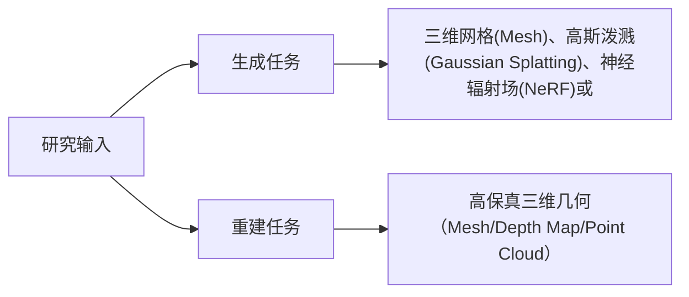
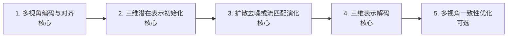
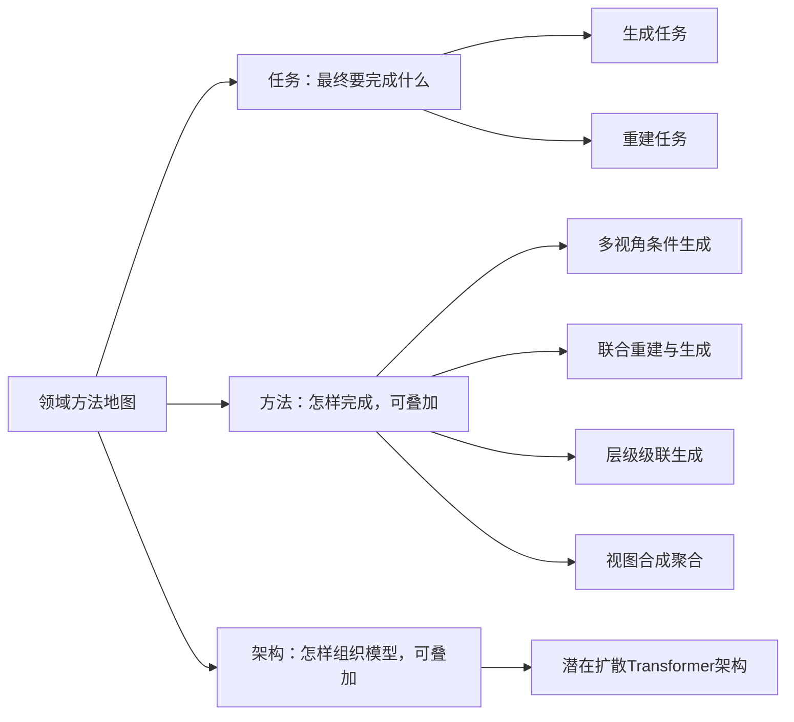
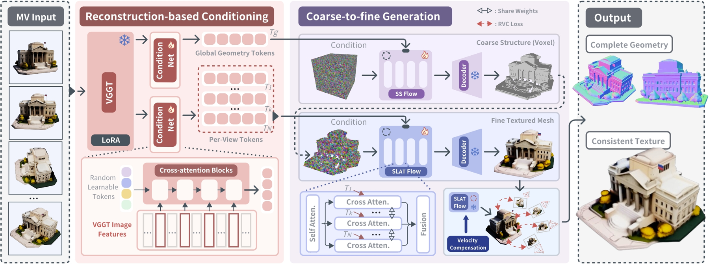
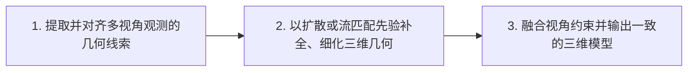
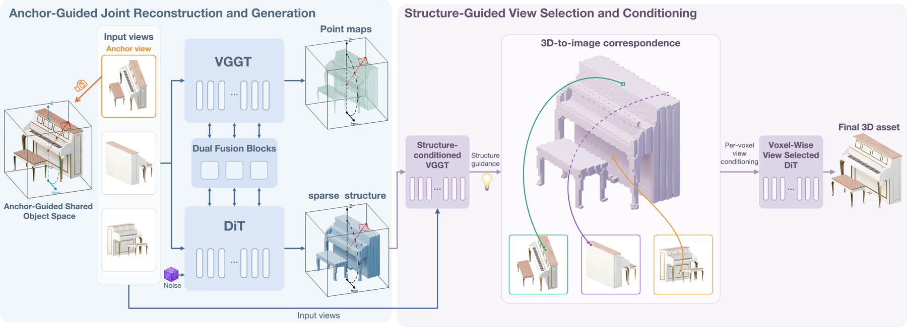
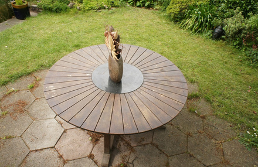
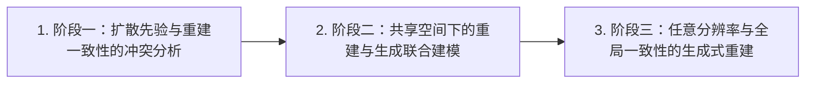
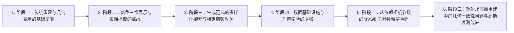

# 多视角 diffusion-like 3D 生成与重建：快速理解

> 当前页面用于快速建立领域地图。 [逐篇解析（98 篇）](full/) · [BibTeX 与 DBLP 查询结果](bibliography/index.html) · [返回综述目录](../)

## 总述

### 一句话定义

本综述聚焦于结合多视角几何约束与扩散类生成范式的三维资产创建与重建。核心任务是利用多张不同视角的图像或相机观测，通过去噪扩散、流匹配等随机过程，生成具有多视角一致性的三维表示（如网格、高斯泼溅或神经辐射场）。该方法旨在解决传统重建在稀疏视角下的歧义性，同时克服单视图生成缺乏几何准确性的缺陷，实现高保真、结构完整的三维内容产出。

### 任务边界

### 快速要点

- **任务：** 从多视角二维观测中恢复或创造三维几何与外观。核心在于利用扩散模型的生成先验补全缺失信息，并强制多视角间的几何与纹理一致性，输出可直接渲染或编辑的三维资产。
- **输入：** 多张不同视角的RGB图像及其对应的相机位姿参数；或部分未校准的多视角图像序列。输入需包含足够的视角覆盖以约束三维结构，可能伴随掩码或深度图作为辅助条件。
- **输出：** 显式三维表示（如三角网格Mesh、点云）或隐式/混合表示（如3D高斯泼溅Gaussian Splatting、神经辐射场NeRF）。输出需具备多视角一致性，支持新视角合成及下游三维应用。
- **核心关注：** 多视角几何一致性与生成多样性的平衡难以兼顾；稀疏或非结构化视角输入导致的严重形状歧义；高分辨率三维扩散生成的计算复杂度与内存瓶颈；从隐式潜在空间到显式几何表面的无损解码难题；真实世界噪声与遮挡条件下的鲁棒性不足。

*面向读者：刚刚入学、了解 Transformer 和扩散模型基本概念但不熟悉多视角 3D 生成的博士生；综述截止日期：2026-10-28。*

### 领域标准流程

下图是整个领域的共同骨架，概括从多视角观测到三维资产的主要环节；它不是某篇论文的原图。下面“生成任务”和“重建任务”的小图分别展开各自的侧重点：前者从生成条件和噪声出发，后者以已有观测和初始几何为约束。两类任务会共用模型，因此图中有重合，但不是两套必须先后执行的流程。标为可选的环节并非所有方法都包含。

## 分类

先按研究角色区分主体论文、相邻工作和背景工作；主体论文内部的任务标签可以多选。方法标签和架构标签可以叠加。

### 任务维度

#### 生成任务（generation）

指从多视角条件（如图像、相机位姿）或联合多视角表示中，通过扩散类生成过程产出新的三维资产（如Mesh、Gaussian Splatting、NeRF等）。核心在于利用生成先验补全几何细节或创造新内容，而非单纯恢复观测数据。

**核心范式：** Input: Multi-view images/cameras -> Process: Diffusion-like denoising in 3D latent/structure space -> Output: 3D Asset (Mesh/GS/NeRF)

**典型输入：** 多视角图像、相机参数、可选文本提示

**典型输出：** 三维网格(Mesh)、高斯泼溅(Gaussian Splatting)、神经辐射场(NeRF)或体素网格

**生成任务典型流程（侧重从条件生成三维资产）：**

*T3lescope 方法图（论文 Figure 2：Method overview）。展示多尺度 cell、tile pyramid，以及共享的 SS/mesh 生成器；[查看原图](https://arxiv.org/html/2610.03308v1/imgs/teaser/input3.jpg)*

*UniForge3D 方法图（论文 Figure 3：Overview of UniForge3D）。展示重建分支与生成分支在 shared anchor-guided space 中双向交互；[查看原图](https://arxiv.org/html/2610.15357v1/fig/pipeline_uni.png)*

*ReconViaGen 方法图（论文 Figure 2：Overview illustration of the proposed ReconViaGen framework）。展示重建先验与 3D diffusion 生成先验的结合；[查看原图](https://arxiv.org/html/2510.23306v1/images/method_overview.png)*

#### 重建任务（reconstruction）

指从多视角观测中恢复或补全三维几何/表面/场景。在此语境下，特指结合生成式先验（diffusion-like）的重建方法，旨在解决传统MVS/SfM在困难表面（反光、透明）或稀疏视角下的失效问题。

**核心范式：** Input: Multi-view observations -> Process: Generative refinement guided by observation constraints -> Output: Geometrically accurate 3D Scene/Object

**典型输入：** 多视角图像、相机位姿、可选深度图

**典型输出：** 高保真三维几何（Mesh/Depth Map/Point Cloud）

**重建任务典型流程（侧重让结果符合输入观测）：**

*T3lescope 方法图（论文 Figure 2：Method overview）。展示多尺度 cell、tile pyramid，以及共享的 SS/mesh 生成器；[查看原图](https://arxiv.org/html/2610.03308v1/imgs/teaser/input3.jpg)*

*UniForge3D 方法图（论文 Figure 3：Overview of UniForge3D）。展示重建分支与生成分支在 shared anchor-guided space 中双向交互；[查看原图](https://arxiv.org/html/2610.15357v1/fig/pipeline_uni.png)*

*ReconViaGen 方法图（论文 Figure 2：Overview illustration of the proposed ReconViaGen framework）。展示重建先验与 3D diffusion 生成先验的结合；[查看原图](https://arxiv.org/html/2510.23306v1/images/method_overview.png)*

### 方法维度

#### 多视角条件生成（multi_view_conditioned_generation）

将多视角图像编码为条件嵌入（Conditioning Embeddings），直接引导3D扩散模型进行去噪生成。多视角信息在输入端融合，模型内部隐式学习视角间的一致性。

**核心范式：** Encode Multi-view Images -> Concatenate/Cross-Attention with 3D Latents -> Denoise

**典型输入：** 多视角图像特征

**典型输出：** 3D潜在变量或几何

*T3lescope 方法图（论文 Figure 2：Method overview）。展示多尺度 cell、tile pyramid，以及共享的 SS/mesh 生成器；[查看原图](https://arxiv.org/html/2610.03308v1/imgs/teaser/input3.jpg)*

*UniForge3D 方法图（论文 Figure 3：Overview of UniForge3D）。展示重建分支与生成分支在 shared anchor-guided space 中双向交互；[查看原图](https://arxiv.org/html/2610.15357v1/fig/pipeline_uni.png)*

*ReconViaGen 方法图（论文 Figure 2：Overview illustration of the proposed ReconViaGen framework）。展示重建先验与 3D diffusion 生成先验的结合；[查看原图](https://arxiv.org/html/2510.23306v1/images/method_overview.png)*

#### 联合重建与生成（joint_reconstruction_and_generation）

模型同时包含重建分支（拟合观测）和生成分支（补全先验），两者在共享空间或通过交互模块共同优化。旨在平衡几何准确性与完整性。

**核心范式：** Parallel/Series Reconstruction Branch + Generation Branch <-> Interaction/Alignment

**典型输入：** 多视角图像

**典型输出：** 一致且完整的3D几何

*UniForge3D 方法图（论文 Figure 3：Overview of UniForge3D）。展示重建分支与生成分支在 shared anchor-guided space 中双向交互；[查看原图](https://arxiv.org/html/2610.15357v1/fig/pipeline_uni.png)*

*ReconViaGen 方法图（论文 Figure 2：Overview illustration of the proposed ReconViaGen framework）。展示重建先验与 3D diffusion 生成先验的结合；[查看原图](https://arxiv.org/html/2510.23306v1/images/method_overview.png)*

#### 层级级联生成（hierarchical_cascade_generation）

采用由粗到细（Coarse-to-Fine）的策略，通过多个阶段的扩散模型或同一模型的多次迭代，逐步提高3D生成的分辨率和细节。常结合局部块（Cell/Tiling）处理大场景。

**核心范式：** Coarse Global Generation -> Local/High-res Refinement (Cascaded)

**典型输入：** 多视角图像

**典型输出：** 高分辨率/大规模3D场景

*T3lescope 方法图（论文 Figure 2：Method overview）。展示多尺度 cell、tile pyramid，以及共享的 SS/mesh 生成器；[查看原图](https://arxiv.org/html/2610.03308v1/imgs/teaser/input3.jpg)*

#### 视图合成聚合（view_synthesis_aggregation）

首先利用2D扩散模型生成多视角一致的2D图像（或通过Score Distillation采样多视角），然后将这些2D图像聚合（Lift/Fuse）为3D表示。多视角一致性主要在2D空间或通过SDS损失保证。

**核心范式：** 2D Diffusion (Multi-view) -> Lifting/Fusion -> 3D Representation

**典型输入：** 单视图或少量视图

**典型输出：** 3D表示（通常通过NeRF/GS优化得到）

*T3lescope 方法图（论文 Figure 2：Method overview）。展示多尺度 cell、tile pyramid，以及共享的 SS/mesh 生成器；[查看原图](https://arxiv.org/html/2610.03308v1/imgs/teaser/input3.jpg)*

### 架构维度

#### 潜在扩散Transformer架构（latent_diffusion_transformer）

采用Transformer作为骨干网络，在压缩的3D潜在空间（Latent Space）中执行扩散去噪过程。这是当前高效生成高保真3D内容的主流架构选择。

**核心范式：** 3D VAE Encoder -> Latent Diffusion Transformer -> 3D VAE Decoder

**典型输入：** 3D潜在向量

**典型输出：** 去噪后的3D潜在向量

*T3lescope 方法图（论文 Figure 2：Method overview）。展示多尺度 cell、tile pyramid，以及共享的 SS/mesh 生成器；[查看原图](https://arxiv.org/html/2610.03308v1/imgs/teaser/input3.jpg)*

*UniForge3D 方法图（论文 Figure 3：Overview of UniForge3D）。展示重建分支与生成分支在 shared anchor-guided space 中双向交互；[查看原图](https://arxiv.org/html/2610.15357v1/fig/pipeline_uni.png)*

## 相关工作

本章不重复逐篇摘要，而是按照领域类别串起方法演化：先说明问题和范式，再说明代表工作如何改变方法，最后指出仍未解决的缺口。

### 生成任务（generation）

*相关工作代表论文方法图。论文方法流程图（图 1）；原始图注与完整说明见图片来源。 [查看图片来源](https://arxiv.org/html/2510.23306v1/images/method_overview.png)*

*相关工作代表论文方法图。论文方法流程图（图 1）；原始图注与完整说明见图片来源。 [查看图片来源](https://arxiv.org/html/2610.15357v1/fig/pipeline_uni.png)*

- **阶段一：扩散先验与重建一致性的冲突分析**：综合来看，现有基于扩散的3D生成方法虽然能利用学习到的生成先验（generative priors）“幻觉”出不可见部分以补全几何，但其推理过程的随机性限制了结果的准确性与可靠性，导致难以直接集成到要求高一致性的重建框架中。；方法变化：这些摘要共同显示，该阶段工作并未提出新的生成架构，而是深入分析了扩散生成过程在3D对象重建中失败的原因，特别是随机性与多视角一致性之间的内在矛盾，为后续结合重建与生成的方法提供了理论依据。；代表论文：arxiv_2510.23306。
- **阶段二：共享空间下的重建与生成联合建模**：综合来看，将相机相对坐标系下的重建与规范空间（canonical space）下的生成直接结合会导致坐标失配，且不加区分地融合所有视角信息会引入无关内容，阻碍局部细节恢复。；方法变化：这些摘要共同显示，UniForge3D 提出了在共享锚点引导空间（shared anchor-guided space）中联合建模重建与生成，以解决坐标失配问题，并通过考虑视角相关性来优化几何证据的融合。；代表论文：arxiv_2610.15357。
- **阶段三：任意分辨率与全局一致性的生成式重建**：综合来看，现有生成方法通常在固定分辨率和有限空间范围内操作，难以兼顾大场景的空间覆盖与细节 fidelity，分块处理又破坏了全局几何一致性。；方法变化：这些摘要共同显示，T3lescope 应用单一固定分辨率生成器，实现了从单物体到大型户外场景的任意分辨率高保真表面重建，且无需逐场景优化，从而在保持全局一致性的同时突破了尺度限制。；代表论文：arxiv_2610.03308。

**读者应记住：** 多视角扩散生成领域正从解决基本的几何补全问题，转向处理更复杂的坐标对齐、视角融合效率以及大规模场景的全局一致性挑战。

### 重建任务（reconstruction）

*相关工作代表论文方法图。论文方法流程图（图 1）；原始图注与完整说明见图片来源。 [查看图片来源](https://arxiv.org/html/2510.23306v1/images/method_overview.png)*

*相关工作代表论文方法图。论文方法流程图（图 1）；原始图注与完整说明见图片来源。 [查看图片来源](https://arxiv.org/html/2610.15357v1/fig/pipeline_uni.png)*

- **阶段一：生成先验引入与一致性瓶颈分析**：综合来看，传统多视图立体（MVS, Multi-View Stereo）方法严重依赖输入视图间的充分重叠，在实际场景中因遮挡和稀疏覆盖导致重建不完整。虽然基于扩散的3D生成技术能利用先验“幻觉”出不可见部分，但其推理过程的随机性限制了结果的准确性和可靠性，使得现有重建框架难以有效整合这些生成先验以实现高一致性重建。；方法变化：这些摘要共同显示，研究重心从单纯应用生成模型转向深入分析扩散方法在重建任务中失败的原因，特别是针对推理随机性与重建准确性之间的矛盾进行剖析，旨在建立能够整合3D生成先验且保持高一致性的重建框架。；代表论文：arxiv_2510.23306。
- **阶段二：共享空间下的重建与生成联合建模**：综合来看，从稀疏、无位姿图像生成完整3D资产时，直接结合相机相对坐标系下的重建与规范空间（canonical space）下的生成会导致坐标失配，阻碍直接的几何交互。此外，不加区分地将所有视图信息条件化到每个3D位置，会混合有用几何证据与无关图像内容，损害局部细节恢复。；方法变化：这些摘要共同显示，方法演进至在共享的锚点引导空间（shared anchor-guided space）中联合建模重建与生成过程，以解决坐标失配问题，并通过考虑视图相关性来优化局部细节的几何证据融合。；代表论文：arxiv_2610.15357。
- **阶段三：任意分辨率下的高保真全局一致重建**：综合来看，现有的生成式重建方法通常在固定分辨率和有限空间范围内操作，难以兼顾空间覆盖范围与细节。重建大场景时需分割为独立处理的局部区域，导致难以维持全局几何一致性。此外，每场景优化方法在观测稀疏或表面反光/透明时缺乏必要的学习到的3D先验。；方法变化：这些摘要共同显示，最新方法致力于在不进行每场景优化的情况下，从带位姿的多视角图像中重建高保真3D场景网格，支持从单物体到大尺度室外场景的任意分辨率，并试图解决全局一致性与细节之间的权衡问题。；代表论文：arxiv_2610.03308。

**读者应记住：** 多视角扩散重建的核心挑战已从单纯的几何补全，转向如何在保持生成先验强大表达能力的同时，解决坐标系统一、视图信息有效融合以及全局几何一致性维持的问题。

### 背景与上下文工作（非任务背景）

*相关工作代表论文方法图。论文方法流程图（图 1）；原始图注与完整说明见图片来源。 [查看图片来源](https://arxiv.org/html/2509.13414v3/MapAnything_Method.png)*

*相关工作代表论文方法图。论文方法流程图（图 1）；原始图注与完整说明见图片来源。 [查看图片来源](https://arxiv.org/html/2506.24096v2/teaser.png)*

- **阶段一：传统重建与几何表示的基础局限**：综合来看，早期或并行的确定性重建方法（如MVS，多视图立体视觉）和前馈回归模型在处理多视角几何一致性时，往往依赖显式的相机参数或复杂的后处理步骤，且难以直接生成具有复杂拓扑的三维资产。MapAnything展示了通过前馈Transformer直接回归度量3D几何的能力，但其本质是确定性回归而非生成式去噪过程；Cameras as Relative Positional Encoding则指出了在Transformer中有效编码相机几何关系对于多视角任务的重要性，这构成了后续生成模型处理视角间约束的基础痛点。；方法变化：这些摘要共同显示，研究重心从传统的迭代优化或纯几何计算，转向利用Transformer架构统一处理多视角输入。MapAnything通过因子化表示（深度图、射线图、位姿）实现单次前馈的度量重建；PRoPE（Projective Positional Encoding）提出了一种新的相对位置编码方式，将相机视锥体信息嵌入Transformer，以增强多视角感知能力。这些变化旨在提高几何推理的效率与准确性，但未引入随机生成范式。；代表论文：arxiv_2509.13414、arxiv_2506.24096。
- **阶段二：新型三维表示与表面提取的挑战**：综合来看，随着3D Gaussian Splatting (3DGS) 等新表示的流行，如何从非隐式场（如高斯点云）中提取高质量、水密（watertight）的网格表面成为主要瓶颈。3DGS缺乏全局几何场，导致表面提取依赖启发式方法，损失细节或产生伪影。同时，现有的潜空间表示难以捕捉复杂拓扑和详细外观，限制了生成模型的表达能力。；方法变化：这些摘要共同显示，研究者致力于改进三维表示以支持更好的几何重建和生成。From Blobs to Spokes引入了可学习的定向法线和衰减公式，为3DGS导出了 principled occupancy field（原则性占用场），从而能够提取高精度水密网格。Native and Compact Structured Latents提出了O-Voxel（Omni-voxel），一种稀疏体素结构，能稳健建模任意拓扑并编码物理渲染参数，配合稀疏压缩VAE提供紧凑潜空间。MILo则通过在循环中可微分地从3D高斯提取网格，桥接体积与表面表示。；代表论文：arxiv_2604.07337、arxiv_2512.14692、arxiv_2506.24096。
- **阶段三：生成范式的多样化探索与特定瓶颈攻关**：综合来看，尽管生成式3D方法发展迅速，但仍面临保真度低、几何不一致、数据依赖合成数据以及场景规模受限等问题。Pixal3D指出隐式2D-3D对应关系模糊导致像素级保真度瓶颈；WorldFlow3D和Seen2Scene探讨了无界世界生成和真实场景补全中数据分布匹配的问题；SAGE和WorldGrow则针对大规模场景生成中的语义合理性和无限扩展性挑战。；方法变化：这些摘要共同显示，生成范式正在向更精细的对齐和更灵活的流匹配（flow matching）方向演进。Pixal3D提出像素对齐的3D生成范式，直接在像素对齐的方式下生成3D，而非在规范空间生成后注入图像线索。WorldFlow3D利用流匹配（flow matching）的基本属性，将3D生成建模为穿过3D数据分布的流动过程，无需潜空间且收敛更快。Seen2Scene引入可见性引导的流匹配，直接在不完美的真实3D扫描上训练，掩蔽未知区域。SAGE采用代理（agentic）框架，结合多个生成器和批评者进行迭代推理。WorldGrow利用预训练3D模型的生成先验，通过分层框架生成无限3D世界。；代表论文：arxiv_2605.10922、arxiv_2603.29089、arxiv_2603.28548、arxiv_2602.10116、arxiv_2510.21682。
- **阶段四：数据基础设施与几何先验的增强**：综合来看，高质量3D生成受限于大规模高分辨率纹理数据的缺乏，以及从任意视图恢复一致几何能力的不足。Depth Anything 3指出即使在没有已知相机位姿的情况下，也需要从任意数量的视觉输入中预测空间一致的几何。TexVerse则填补了高分辨率纹理3D数据集的空白。；方法变化：这些摘要共同显示，基础模型的泛化能力和数据集规模正在成为推动3D生成的关键因素。Depth Anything 3采用教师-学生训练范式，使用单一普通Transformer骨干网和单一的深度-射线预测目标，实现了从任意视图恢复几何的SOTA性能，无需复杂的多任务学习。TexVerse提供了超过858K个独特的高分辨率纹理3D模型，包括PBR材质、骨骼和动画数据，为端到端高分辨率纹理生成提供了数据基础。；代表论文：arxiv_2511.10647、arxiv_2508.10868。
- **阶段一：从依赖相机参数的MVS到无参数稠密重建**：综合来看，传统多视图立体（Multi-View Stereo, MVS）方法严重依赖精确的相机内参和外参进行像素三角测量，这在非受控场景下难以获取且容易出错，限制了重建的鲁棒性。；方法变化：这些摘要共同显示，DUSt3R提出了一种无需相机校准或姿态先验的稠密无约束立体3D重建范式，通过将成对重建问题转化为点图（pointmaps）回归，松弛了投影相机模型的硬约束，统一了单目和双目重建案例。；代表论文：arxiv_2312.14132。
- **阶段二：辐射场表面重建中的几何一致性问题与高斯泼溅改进**：综合来看，3D高斯泼溅（3D Gaussian Splatting, 3DGS）虽实现了高质量新视图合成，但其非结构化特性导致多视图几何不一致，难以保证表面重建精度，尤其在大规模场景中表现不佳。；方法变化：这些摘要共同显示，研究者通过引入2D高斯泼溅（2DGS）将体积坍缩为面向平面的2D高斯盘以提供视图一致的几何；PGSR进一步提出基于平面的高斯泼溅重建表示，结合无偏深度渲染以提高保真度；CityGaussianV2则针对大规模场景，利用分解梯度致密化和深度回归技术消除模糊伪影并加速收敛。；代表论文：arxiv_2403.17888、arxiv_2406.06521、arxiv_2411.00771。

**读者应记住：** 应结合各阶段的证据记录继续核对论文正文。
