# 基于 Trellis 思路的室内场景生成式重建：逐篇解析

> 当前页面逐篇介绍论文；分类关系请看快速理解版。 [快速理解版](../) · [BibTeX 与 DBLP 查询结果](../bibliography/index.html) · [返回综述目录](../../)

## 逐篇解析

以下论文先按研究角色分为主体、相邻和背景，再在主体内部显示任务标签；统一模型不会被压缩成单一任务。这里的“统一模型内的三维生成能力”只表示主体模型中的一个任务分支，不等于把独立的 text-to-3D、image-to-3D 或单任务 3D 生成器纳入主体。分类内按首稿时间从早到晚排列。文字为摘要级快速介绍，配图来自论文原文。

### 主体论文（统一多模态模型）

#### 任务标签：几何补全（Geometry Completion）

##### 2026

##### WorldRecon: Generative Multi-View Mesh Reconstruction for Large-Scale 3D World

作者：Zhang, Mengchen, Li, Yang, Wang, Chunshi, Wu, Tong, Guo, Chunchao

研究角色：主体论文（统一多模态模型）
任务标签：Scene-level Generative Reconstruction、Geometry Completion、World Generation

方法标签：Native 3D Latent Generation、Spatial Block-wise Generation、Pose-free Multiview Generation

架构标签：Blockwise Native 3D Reconstruction

中文简介：

WorldRecon解决从无位姿多视角RGB图像恢复大尺度完整室内场景Mesh的任务，输入还包括由重建模型估计的粗糙相机位姿和全局点云，输出统一的几何与PBR材质。方法以粗点云作全局骨架，将场景划分为重叠区块，并用带重建条件的TRELLIS.2生成局部结构、细节和材质，再通过邻域感知潜变量修补与因果传播保持跨区块一致。它位于场景级生成式重建、空间分块和无位姿生成的交汇处，区别于仅恢复可见表面或逐视图融合的路线。

*原文图 1：论文方法流程图（图 1）；原始图注与完整说明见图片来源。 [查看图片来源](https://arxiv.org/html/2610.18846v1/pipeline_pdf.png)*

引用来源：user_seed

链接：[arXiv](https://arxiv.org/abs/2610.18846)

#### 任务标签：场景级生成式重建（Scene-level Generative Reconstruction）

##### 2026

##### WorldRecon: Generative Multi-View Mesh Reconstruction for Large-Scale 3D World

作者：Zhang, Mengchen, Li, Yang, Wang, Chunshi, Wu, Tong, Guo, Chunchao

研究角色：主体论文（统一多模态模型）
任务标签：Scene-level Generative Reconstruction、Geometry Completion、World Generation

方法标签：Native 3D Latent Generation、Spatial Block-wise Generation、Pose-free Multiview Generation

架构标签：Blockwise Native 3D Reconstruction

中文简介：

WorldRecon解决从无位姿多视角RGB图像恢复大尺度完整室内场景Mesh的任务，输入还包括由重建模型估计的粗糙相机位姿和全局点云，输出统一的几何与PBR材质。方法以粗点云作全局骨架，将场景划分为重叠区块，并用带重建条件的TRELLIS.2生成局部结构、细节和材质，再通过邻域感知潜变量修补与因果传播保持跨区块一致。它位于场景级生成式重建、空间分块和无位姿生成的交汇处，区别于仅恢复可见表面或逐视图融合的路线。

*原文图 1：论文方法流程图（图 1）；原始图注与完整说明见图片来源。 [查看图片来源](https://arxiv.org/html/2610.18846v1/pipeline_pdf.png)*

引用来源：user_seed

链接：[arXiv](https://arxiv.org/abs/2610.18846)

#### 任务标签：空间一致的完整场景生成（World Generation）

##### 2026

##### WorldRecon: Generative Multi-View Mesh Reconstruction for Large-Scale 3D World

作者：Zhang, Mengchen, Li, Yang, Wang, Chunshi, Wu, Tong, Guo, Chunchao

研究角色：主体论文（统一多模态模型）
任务标签：Scene-level Generative Reconstruction、Geometry Completion、World Generation

方法标签：Native 3D Latent Generation、Spatial Block-wise Generation、Pose-free Multiview Generation

架构标签：Blockwise Native 3D Reconstruction

中文简介：

WorldRecon解决从无位姿多视角RGB图像恢复大尺度完整室内场景Mesh的任务，输入还包括由重建模型估计的粗糙相机位姿和全局点云，输出统一的几何与PBR材质。方法以粗点云作全局骨架，将场景划分为重叠区块，并用带重建条件的TRELLIS.2生成局部结构、细节和材质，再通过邻域感知潜变量修补与因果传播保持跨区块一致。它位于场景级生成式重建、空间分块和无位姿生成的交汇处，区别于仅恢复可见表面或逐视图融合的路线。

*原文图 1：论文方法流程图（图 1）；原始图注与完整说明见图片来源。 [查看图片来源](https://arxiv.org/html/2610.18846v1/pipeline_pdf.png)*

引用来源：user_seed

链接：[arXiv](https://arxiv.org/abs/2610.18846)

### 相邻工作

#### 相邻工作：adjacent

##### 2023

##### DiffuScene: Denoising Diffusion Models for Generative Indoor Scene Synthesis

作者：Jiapeng Tang, Yinyu Nie, Lev Markhasin, Angela Dai, Justus Thies, Matthias Niessner

研究角色：相邻工作
任务标签：adjacent

中文简介：

该论文研究室内三维场景合成，输入通常是场景先验或文本等条件，输出为包含多个物体及其空间属性的完整室内场景配置。方法采用无序物体集合表示，将位置、尺寸、朝向、语义和几何特征联合编码，并通过扩散模型逐步去噪生成物体集合，再检索匹配的具体几何。它属于场景级生成的相邻路线，重点是物体级布局与形状先验，而非从真实多视角 RGB 直接重建连续场景表面。

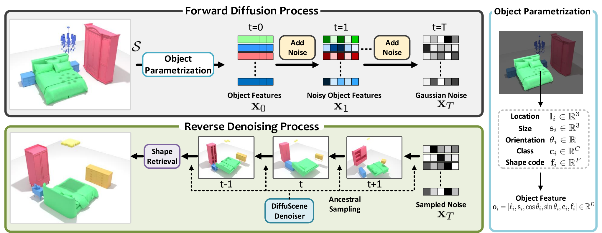

*原文图 1：论文方法流程图（图 1）；原始图注与完整说明见图片来源。 [查看图片来源](https://arxiv.org/html/2303.14207v2/overview_new.png)*

引用来源：arxiv_2610.18846

链接：[arXiv](https://arxiv.org/abs/2303.14207)

##### ControlRoom3D: Room Generation Using Semantic Proxy Rooms

作者：Jonas Schult, Sam S. Tsai, Lukas Höllein, Bi-Chen Wu, Jialiang Wang, Chih-Yao Ma, Kunpeng Li, Xiaofang Wang, Felix Wimbauer, Zijian He, Pei-Zhao Zhang, Bastian Leibe, Peter Vajda, Ji Hou

研究角色：相邻工作
任务标签：adjacent

中文简介：

ControlRoom3D解决受控室内房间生成任务：输入用户指定的三维语义代理房间和整体风格文本，输出布局合理、具备纹理与几何的三维房间网格。方法将语义边界框构成的粗布局渲染为二维条件，控制强大的二维生成模型，再将多视图结果整合为三维一致的表面。它属于空间一致的完整场景生成的相邻路线，区别于无约束文本生成，强调代理布局对房间结构和语义合理性的控制。

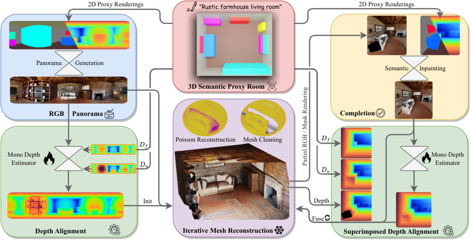

*原文图 1：论文方法流程图（图 1）；原始图注与完整说明见图片来源。 [查看图片来源](https://arxiv.org/html/2312.05208v1/method.png)*

引用来源：arxiv_2610.18846

链接：[arXiv](https://arxiv.org/abs/2312.05208)

##### ReconFusion: 3D Reconstruction with Diffusion Priors

作者：Rundi Wu, B. Mildenhall, Philipp Henzler, Keunhong Park, Ruiqi Gao, Daniel Watson, P. Srinivasan, Dor Verbin, J. Barron, Ben Poole, Aleksander Holynski

研究角色：相邻工作
任务标签：adjacent

中文简介：

ReconFusion解决少量照片下的真实场景三维重建任务：输入少数场景图像，输出可渲染的NeRF表示及其几何和纹理。方法在NeRF重建过程中引入由扩散模型提供的新视角合成先验，在未观测相机位姿处生成约束，从而补足欠观测区域并保持已见区域外观。它属于生成先验驱动的几何与材质恢复路线，区别于仅依靠输入视图进行优化的少视图NeRF方法。

*原文图 2：论文方法流程图（图 2）；原始图注与完整说明见图片来源。 [查看图片来源](https://arxiv.org/html/2312.02981v1/figures/all_results/re10k_00beb03ef95dc637_3_0022_zipnerf.png)*

引用来源：arxiv_2610.18846

链接：[arXiv](https://arxiv.org/abs/2312.02981)

##### 2024

##### BlockFusion: Expandable 3D Scene Generation using Latent Tri-plane Extrapolation

作者：Zhennan Wu, Yang Li, Han Yan, Taizhang Shang, Weixuan Sun, Senbo Wang, Ruikai Cui, Weizhe Liu, Hiroyuki Sato, Hongdong Li, Pan Ji

研究角色：相邻工作
任务标签：adjacent

中文简介：

BlockFusion面向可扩展三维场景生成，输入随机初始块、已有场景块及可选二维布局，输出可持续向空间外延的三维场景。它把网格裁成重叠区块，以 tri-plane 神经场表示几何，经 VAE 压缩后在 latent tri-plane 上扩散，并用重叠特征约束相邻块外推。该工作是空间分块与原生3D latent生成的代表，但重点是场景合成而非真实多视角条件重建。

*原文图 2：论文方法流程图（图 2）；原始图注与完整说明见图片来源。 [查看图片来源](https://arxiv.org/html/2401.17053v4/figures/pipeline.jpg)*

引用来源：arxiv_2610.18846

链接：[arXiv](https://arxiv.org/abs/2401.17053)

##### LGM: Large Multi-View Gaussian Model for High-Resolution 3D Content Creation

作者：Jiaxiang Tang, Zhao-Xi Chen, Xiaokang Chen, Tengfei Wang, Gang Zeng, Ziwei Liu

研究角色：相邻工作
任务标签：adjacent

中文简介：

LGM面向高分辨率三维内容创建，输入文本或单幅图像，经多视角扩散得到若干视图，输出融合后的三维高斯表示。它以多视角高斯特征作为中间表示，并用非对称 U-Net 从多视图前馈预测可微渲染所需的高斯参数。该方法属于对象级、图像生成驱动的快速三维创建，与直接在结构化3D latent中生成场景几何的路线不同。

*原文图 1：论文方法流程图（图 1）；原始图注与完整说明见图片来源。 [查看图片来源](https://arxiv.org/html/2402.05054v1/pipe.png)*

引用来源：arxiv_2610.18846

链接：[arXiv](https://arxiv.org/abs/2402.05054)

##### CAT3D: Create Anything in 3D with Multi-View Diffusion Models

作者：Ruiqi Gao, Aleksander Holynski, Philipp Henzler, Arthur Brussee, Ricardo Martin-Brualla, P. Srinivasan, Jonathan T. Barron, Ben Poole

研究角色：相邻工作
任务标签：adjacent

中文简介：

CAT3D解决单图或少视图条件下的三维创建，输入任意数量的图像与目标相机视点，输出彼此一致的新视角图像，并将其交给常规重建流程得到可实时渲染的三维表示。核心范式是多视角图像扩散，用生成视图模拟密集拍摄，而非直接在三维空间生成几何。它属于以二维生成增强观测覆盖的路线，与原生3D场景补全方法形成对照。

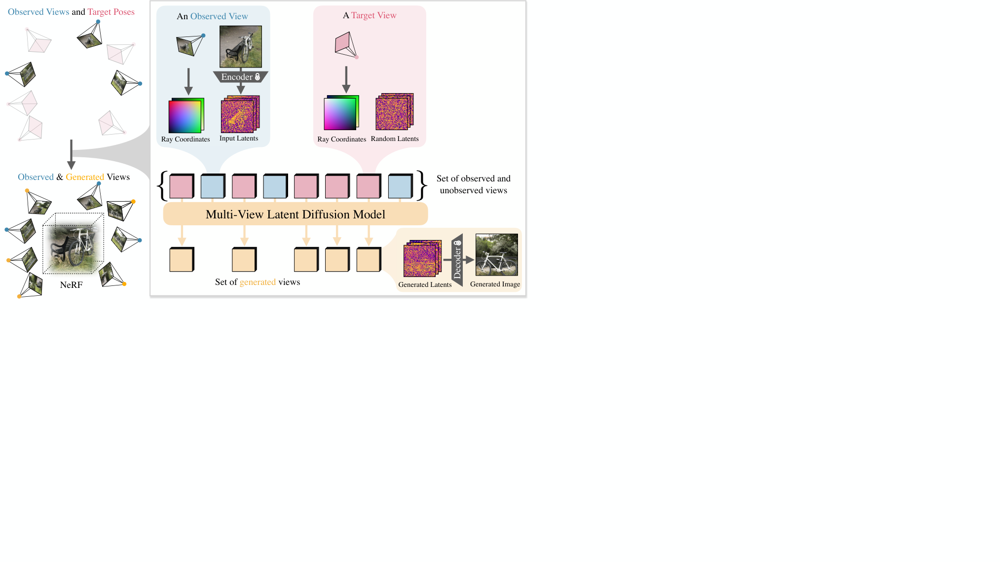

*原文图 3：论文方法流程图（图 3）；原始图注与完整说明见图片来源。 [查看图片来源](https://arxiv.org/html/2405.10314v1/muni_overview3.png)*

引用来源：arxiv_2610.18846

链接：[arXiv](https://arxiv.org/abs/2405.10314)

##### CLAY: A Controllable Large-scale Generative Model for Creating High-quality 3D Assets

作者：Long-Wen Zhang, Ziyu Wang, Qi-Xuan Zhang, Qi-Wei Qiu, Anqi Pang, Haoran Jiang, Wei Yang, Lan Xu, Jing-Yi Yu

研究角色：相邻工作
任务标签：adjacent

中文简介：

CLAY面向可控三维资产创建，输入文本、图像或体素、包围盒、点云等三维条件，输出完整表面及包含漫反射、粗糙度和金属度的 PBR 材质。其核心是多分辨率 VAE 与 latent DiT，在原生三维潜空间生成神经场几何，再以多视角材质扩散模型合成外观。它代表对象级原生3D latent和材质生成路线，并非由真实多视角观测恢复室内场景。

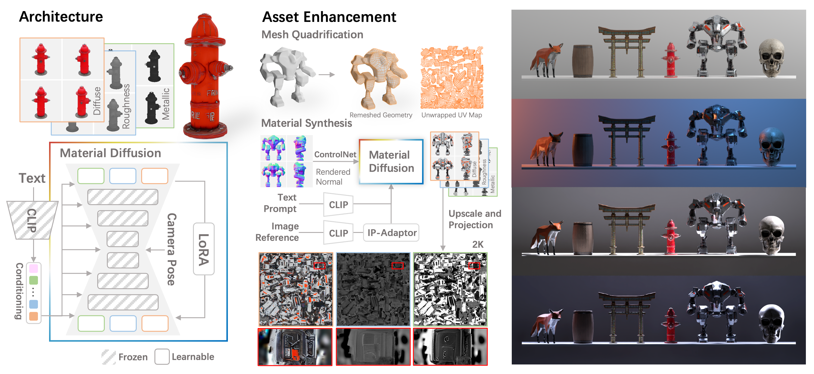

*原文图 5：论文方法流程图（图 5）；原始图注与完整说明见图片来源。 [查看图片来源](https://arxiv.org/html/2406.13897v1/fig/PBR.png)*

引用来源：arxiv_2610.18846

链接：[arXiv](https://arxiv.org/abs/2406.13897)

##### LT3SD: Latent Trees for 3D Scene Diffusion

作者：Quan Meng, Lei Li, Matthias Niessner, Angela Dai

研究角色：相邻工作
任务标签：adjacent

中文简介：

LT3SD面向大尺度三维场景生成与局部观测补全，输入可为随机噪声或不完整场景，输出完整的三维场景几何。它以 latent tree 分层编码低频结构和高频细节，并在各层潜变量上执行扩散；推理时联合生成相邻场景块以适配不同范围。该方法属于原生3D latent与空间分块生成路线，但主要研究无条件生成，和真实多视角重建仅间接相关。

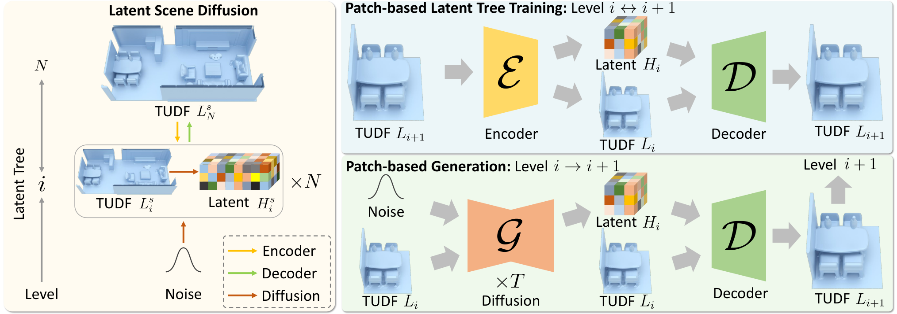

*原文图 2：论文方法流程图（图 2）；原始图注与完整说明见图片来源。 [查看图片来源](https://arxiv.org/html/2409.08215v2/pipeline_img.png)*

引用来源：arxiv_2610.18846

链接：[arXiv](https://arxiv.org/abs/2409.08215)

##### Long-LRM: Long-Sequence Large Reconstruction Model for Wide-Coverage Gaussian Splats

作者：Ziwen Chen, Hao Tan, Kai Zhang, Sai Bi, Fujun Luan, Yi-Cong Hong, Fuxin Li, Zexiang Xu

研究角色：相邻工作
任务标签：adjacent

中文简介：

Long-LRM从长序列多视角图像输入，直接输出覆盖广、具备高分辨率的三维高斯场景表示。为处理超长视觉token，方法结合Mamba2与Transformer模块，并配合轻量token合并和高斯剪枝，在前馈推理中完成大范围重建。它位于场景级生成式重建和空间扩展路线，区别于逐场景优化方法的高成本，也突破了早期前馈模型受限于短输入序列的问题；但其原生输出是Gaussian Splats而非Mesh。

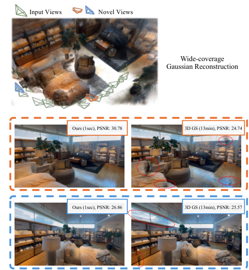

*原文图 1：论文方法流程图（图 1）；原始图注与完整说明见图片来源。 [查看图片来源](https://arxiv.org/html/2410.12781v2/fig1_vert_crop.png)*

引用来源：arxiv_2610.18846

链接：[arXiv](https://arxiv.org/abs/2410.12781)

##### SCube: Instant Large-Scale Scene Reconstruction using VoxSplats

作者：Xuan-Chi Ren, Yifan Lu, Hanxue Liang, Jay Zhangjie Wu, Huan Ling, Mike Chen, S. Fidler, Francis Williams, Jia-Hui Huang

研究角色：相邻工作
任务标签：adjacent

中文简介：

SCube从少量已知位姿图像输入，输出包含几何、外观和语义的大尺度三维场景，具体表示为带高分辨率稀疏体素支架的VoxSplats。方法采用分层体素潜扩散模型，以粗到细方式生成空间网格，再由前馈网络预测各体素内的高斯属性。它属于分块或层次化场景级生成重建路线，区别于依赖逐场景优化的高斯重建和低分辨率几何先验，能够向输入视图之外扩展，但输出不是Mesh。

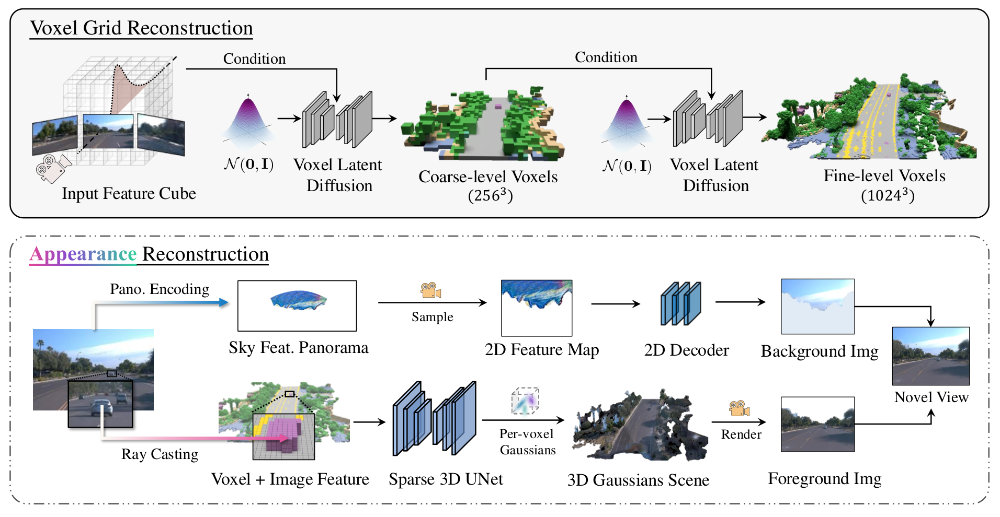

*原文图 2：论文方法流程图（图 2）；原始图注与完整说明见图片来源。 [查看图片来源](https://arxiv.org/html/2410.20030v1/pipeline-yifan.png)*

引用来源：arxiv_2610.18846

链接：[arXiv](https://arxiv.org/abs/2410.20030)

##### 2025

##### ReconViaGen: Towards Accurate Multi-view 3D Object Reconstruction via Generation

作者：Jia-Hao Chang, Chongjie Ye, Yushuang Wu, Yuantao Chen, Yidan Zhang, Zhong-Jin Luo, Chenghong Li, Yihao Zhi, Xiao-Guang Han

研究角色：相邻工作
任务标签：adjacent

中文简介：

ReconViaGen解决遮挡或视角稀疏条件下的多视图3D物体重建，输入多张物体图像，输出与输入视图一致且补全不可见区域的完整三维模型。方法将重建先验嵌入生成框架，强化跨视图连接，并控制迭代去噪中的局部细节，以避免生成结果在结构、几何和纹理上偏离观测。它属于生成式几何补全路线，重点是单物体的准确性与一致性，区别于面向大尺度室内场景的分块级Mesh生成。

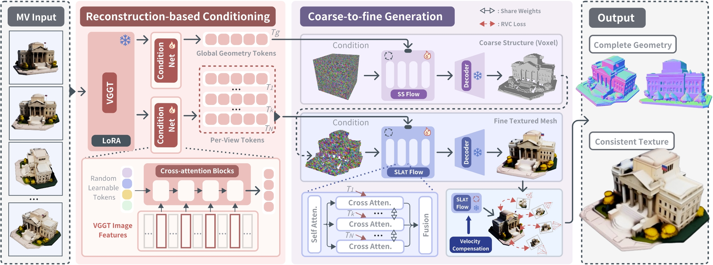

*原文图 2：论文方法流程图（图 2）；原始图注与完整说明见图片来源。 [查看图片来源](https://arxiv.org/html/2510.23306v1/images/method_overview.png)*

引用来源：arxiv_2610.18846

链接：[arXiv](https://arxiv.org/abs/2510.23306)

##### TRELLISWorld: Training-Free World Generation from Object Generators

作者：Han-Ke Chen, Yuan Liu, Min-Chen Li

研究角色：相邻工作
任务标签：adjacent

中文简介：

TRELLISWorld解决从文本生成可扩展、可编辑且具完整视角的三维场景任务，输入语言描述，输出由多个三维区域组成的连贯场景。方法无需场景级训练，而是将通用文本到3D物体扩散模型改造成模块化区块生成器，把场景合成为多区块去噪过程，并在重叠区域加权融合。它属于空间分块式世界生成，突出训练免费和物体先验复用；与真实多视角RGB重建相比，缺少观测驱动的几何恢复约束。

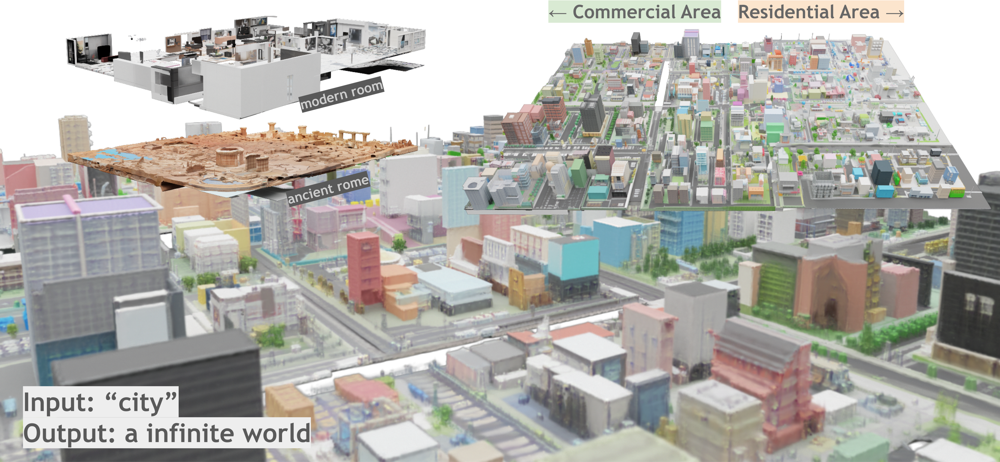

*原文图 1：论文方法流程图（图 1）；原始图注与完整说明见图片来源。 [查看图片来源](https://arxiv.org/html/2510.23880v2/fig/teaser.png)*

引用来源：arxiv_2610.18846

链接：[arXiv](https://arxiv.org/abs/2510.23880)

##### Native and Compact Structured Latents for 3D Generation

作者：Jianfeng Xiang, Xiaoxue Chen, Si-Cheng Xu, Ruicheng Wang, Ze-Long Lv, Yu Deng, Hong Zhu, Yue Dong, Hao Zhao, Nicholas Jing Yuan, Jiao-Long Yang

研究角色：相邻工作
任务标签：adjacent

中文简介：

Native and Compact Structured Latents for 3D Generation关注从原生三维数据生成带复杂拓扑和外观的三维资产，输入为训练阶段的3D几何与材质表示，输出可渲染的几何及PBR属性。方法提出O-Voxel统一编码结构和外观，再以稀疏压缩VAE获得紧凑、具有空间结构的latent，并训练大规模流匹配模型进行生成。它代表原生3D latent生成范式，为场景重建提供底层表示和先验，但本身主要面向独立资产，不处理多视角观测约束下的完整室内场景。

*原文图 1：论文方法流程图（图 1）；原始图注与完整说明见图片来源。 [查看图片来源](https://arxiv.org/html/2512.14692v1/overview_v5.png)*

引用来源：arxiv_2610.18846

链接：[arXiv](https://arxiv.org/abs/2512.14692)

### 背景与上下文工作

#### 背景类别：背景与上下文（context）

##### 2018

##### MVSNet: Depth Inference for Unstructured Multi-view Stereo

作者：Yao Yao, Zi-Xin Luo, Shiwei Li, Tian Fang, Long Quan

研究角色：背景与上下文工作
任务标签：context

中文简介：

该论文解决无序多视角图像的深度推断任务：输入任意数量、具有相机关系的图像，输出参考视图深度图，进而支持三维重建。MVSNet先提取图像特征，再通过可微单应性变换将其映射到参考相机视锥，构造方差代价体，并用三维卷积正则化和回归深度。它是位姿条件多视角立体学习的重要基础路线，相比传统匹配方法实现端到端训练，但目标仍是观测表面深度而非生成遮挡区域。

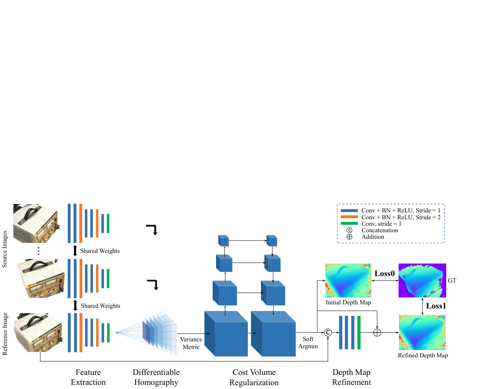

*原文图 1：论文方法流程图（图 1）；原始图注与完整说明见图片来源。 [查看图片来源](https://arxiv.org/html/1804.02505v2/network.png)*

引用来源：arxiv_2610.18846

链接：[arXiv](https://arxiv.org/abs/1804.02505)

##### 2019

##### Recurrent MVSNet for High-Resolution Multi-View Stereo Depth Inference

作者：Yao Yao, Zi-Xin Luo, Shiwei Li, Tianwei Shen, Tian Fang, Long Quan

研究角色：背景与上下文工作
任务标签：context

中文简介：

该论文解决大规模、高分辨率多视角深度推断任务：输入带相机关系的多视角图像，输出参考视图深度并据此形成稠密几何。R-MVSNet以循环神经网络沿深度方向逐步正则化二维代价图，用GRU替代一次性处理完整三维代价体，从而降低显存需求。它属于位姿条件的多视角几何恢复路线，重点是可扩展性，区别于早期三维代价体整体正则化方法，但仍主要恢复可见表面。

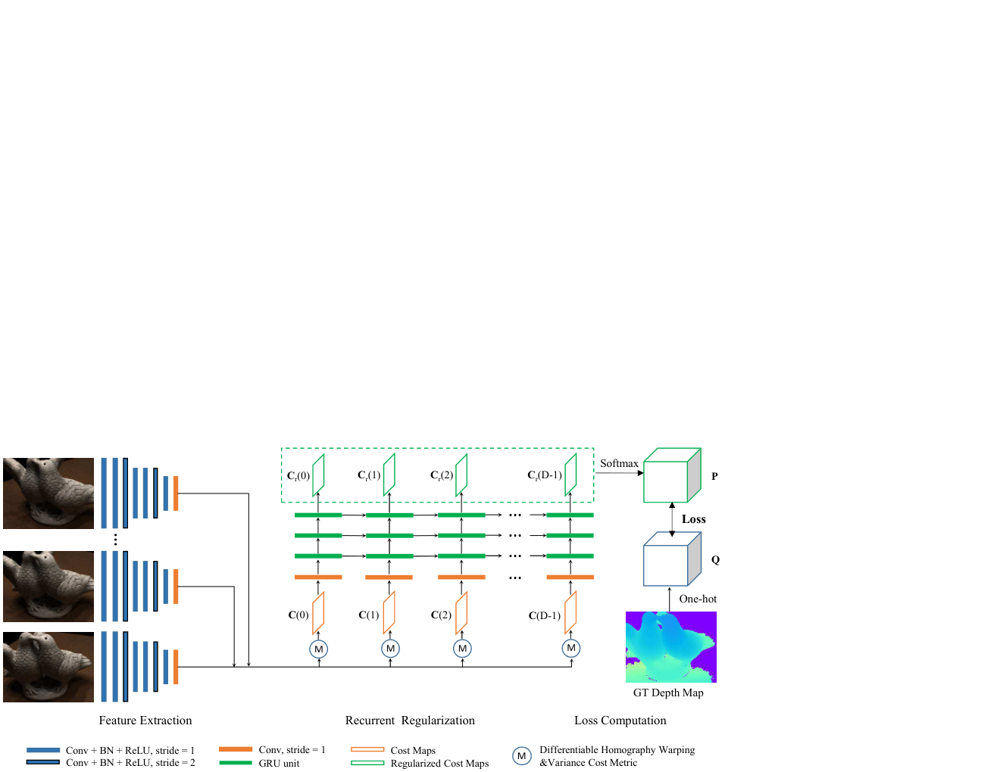

*原文图 2：论文方法流程图（图 2）；原始图注与完整说明见图片来源。 [查看图片来源](https://arxiv.org/html/1902.10556v1/r-network.png)*

引用来源：arxiv_2610.18846

链接：[arXiv](https://arxiv.org/abs/1902.10556)

##### 2020

##### 3D-FRONT: 3D Furnished Rooms with layOuts and semaNTics

作者：Huan Fu, Bo-Wen Cai, Lin Gao, Ling-Xiao Zhang, Cao Li, Zengqi Xun, Chengyue Sun, Y. Fei, Yu Zheng, Ying Li, Yi Liu, Peng Liu, Lin Ma, Le Weng, Xiaohang Hu, Xin Ma, Qian Qian, Rong-Fei Jia, Binqiang Zhao, H. Zhang

研究角色：背景与上下文工作
任务标签：context

中文简介：

该论文构建3D-FRONT数据集：输入可理解为专业室内布局及家具资源，输出是带语义、纹理和风格一致性的合成三维房间数据，并提供渲染工具生成图像与标注。其核心贡献不是单一生成网络，而是组织大规模CAD房屋、房间、家具和材质，并以推荐机制筛选协调的室内风格。它在本领域承担数据与基准基础，支持室内场景及纹理生成，区别于直接提出重建或补全模型的工作。

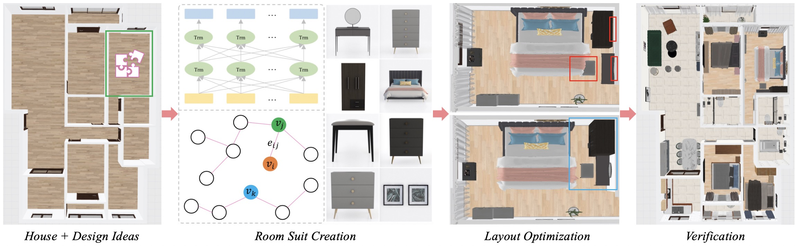

*原文图 1：论文方法流程图（图 1）；原始图注与完整说明见图片来源。 [查看图片来源](https://arxiv.org/html/2011.09127v2/figure/pipeline.png)*

引用来源：arxiv_2610.18846

链接：[arXiv](https://arxiv.org/abs/2011.09127)

##### PatchmatchNet: Learned Multi-View Patchmatch Stereo

作者：Fangjinhua Wang, Silvano Galliani, Christoph Vogel, Pablo Speciale, M. Pollefeys

研究角色：背景与上下文工作
任务标签：context

中文简介：

该论文解决高分辨率多视角立体匹配任务：输入多张具有相机信息的图像，输出场景的深度或稠密几何。PatchmatchNet将传统Patchmatch改造成端到端可学习的级联流程，在多个尺度上迭代采样深度候选，并学习自适应传播与评价。它属于位姿条件的深度估计前端，以较低显存和较高速度区别于依赖大规模三维代价体正则化的方法，本身不负责生成完整场景Mesh。

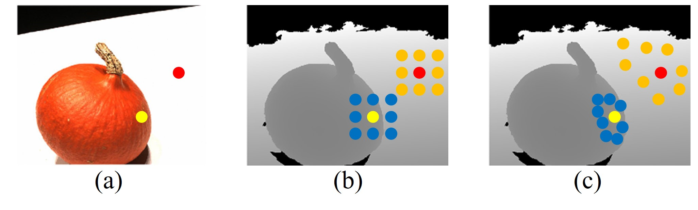

*原文图 5：论文方法流程图（图 5）；原始图注与完整说明见图片来源。 [查看图片来源](https://arxiv.org/html/2012.01411v1/figures/evaluation_4.jpg)*

引用来源：arxiv_2610.18846

链接：[arXiv](https://arxiv.org/abs/2012.01411)

##### SceneFormer: Indoor Scene Generation with Transformers

作者：Xinpeng Wang, Chandan Yeshwanth, Matthias Niessner

研究角色：背景与上下文工作
任务标签：context

中文简介：

该论文解决室内场景生成任务：输入房间布局或文本描述，输出包含物体类别、位置与朝向的完整场景序列。方法采用Transformer，以自注意力隐式学习物体间关系，以交叉注意力接收布局或文本条件，不依赖图像外观信息。它属于场景级生成路线，区别于依赖显式关系建模或外观特征的既有方法，但生成对象级场景而非由多视角RGB恢复几何表面。

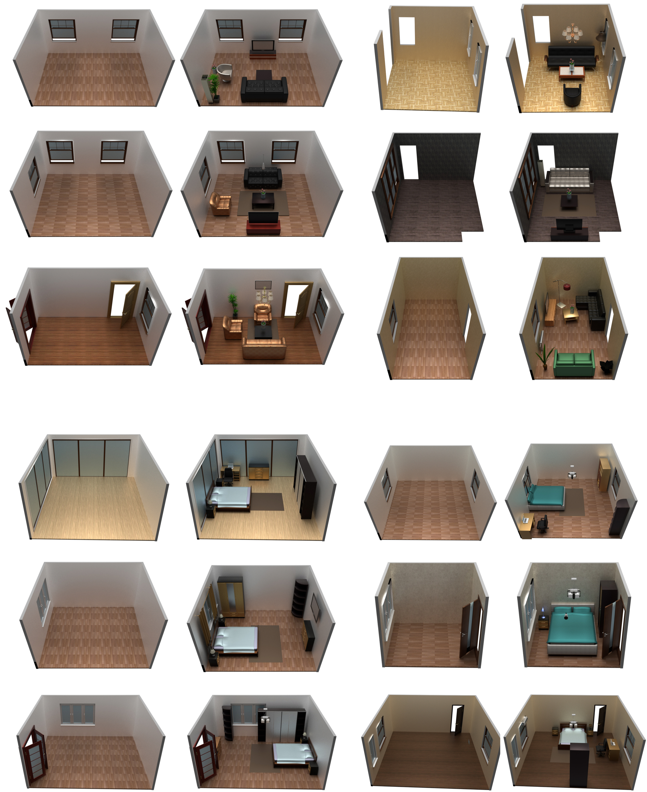

*原文图 16：论文方法流程图（图 16）；原始图注与完整说明见图片来源。 [查看图片来源](https://arxiv.org/html/2012.09793v2/suppl/shape/shape_cond_6x2.jpg)*

引用来源：arxiv_2610.18846

链接：[arXiv](https://arxiv.org/abs/2012.09793)

##### 2021

##### IBRNet: Learning Multi-View Image-Based Rendering

作者：Qian-Qian Wang, Zhicheng Wang, Kyle Genova, P. Srinivasan, Howard Zhou, J. Barron, Ricardo Martin-Brualla, Noah Snavely, T. Funkhouser

研究角色：背景与上下文工作
任务标签：context

中文简介：

该论文研究稀疏多视角图像的新视角合成，输入是带准确相机位姿的源视图，输出是目标相机位置下的 RGB 图像。IBRNet 通过射线变换器从多个源视图动态提取外观信息，并结合多层感知机预测连续空间位置和视线方向上的辐射与密度，再使用体渲染生成图像。它属于基于图像的神经渲染基础路线，区别于逐场景优化的 NeRF，学习的是可泛化到新场景的视图插值函数，重点仍是可见外观而非完整几何恢复。

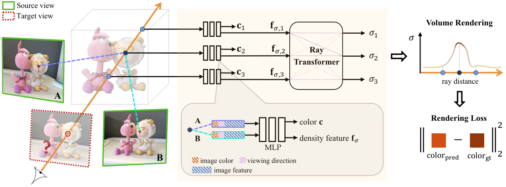

*原文图 1：论文方法流程图（图 1）；原始图注与完整说明见图片来源。 [查看图片来源](https://arxiv.org/html/2102.13090v2/overview.png)*

引用来源：arxiv_2610.18846

链接：[arXiv](https://arxiv.org/abs/2102.13090)

##### LoRA: Low-Rank Adaptation of Large Language Models

作者：J. Hu, Ye-Long Shen, Phillip Wallis, Zeyuan Allen-Zhu, Yuanzhi Li, She-An Wang, Lu Wang, Wei-Zhu Chen

研究角色：背景与上下文工作
任务标签：context

中文简介：

该论文解决大规模预训练语言模型的参数高效适配任务，输入是预训练 Transformer 及下游任务数据，输出是适应特定任务或领域的模型。LoRA 冻结原模型权重，仅在各层加入可训练的低秩矩阵分解，以低维更新近似完整微调带来的参数变化。它属于通用模型适配方法而非三维重建路线，但可作为后续视觉或三维生成模型进行低成本领域迁移的技术基础，区别在于不改变主干参数且推理时无需额外适配器延迟。

*原文图 2：论文方法流程图（图 2）；原始图注与完整说明见图片来源。 [查看图片来源](https://arxiv.org/html/2106.09685v2/LoRA_wikisql.svg)*

引用来源：arxiv_2610.18846

链接：[arXiv](https://arxiv.org/abs/2106.09685)

##### NeuS: Learning Neural Implicit Surfaces by Volume Rendering for Multi-view Reconstruction

作者：Peng Wang, Ling-Jie Liu, Yuan Liu, C. Theobalt, T. Komura, Wen-Ping Wang

研究角色：背景与上下文工作
任务标签：context

中文简介：

该论文研究从二维多视角图像重建精细三维表面，输入为多视角 RGB 图像，输出为由神经隐式函数表示的物体或场景表面。NeuS 使用有符号距离函数定义零水平集，并设计无一阶几何偏差的体渲染公式来训练该表面表示，从而避免传统体渲染密度与真实表面之间的系统误差。它位于神经表面重建基础路线，区别于依赖前景掩码的早期方法，也不同于面向缺失区域生成的几何补全模型。

*原文图 1：论文方法流程图（图 1）；原始图注与完整说明见图片来源。 [查看图片来源](https://arxiv.org/html/2106.10689v3/toy_example.png)*

引用来源：arxiv_2610.18846

链接：[arXiv](https://arxiv.org/abs/2106.10689)

##### Volume Rendering of Neural Implicit Surfaces

作者：Lior Yariv, Jiatao Gu, Yoni Kasten, Y. Lipman

研究角色：背景与上下文工作
任务标签：context

中文简介：

该论文研究从多视角图像恢复高质量表面，输入为带相机信息的 RGB 观测，输出为神经隐式表面、几何及可分离的外观表示。方法以有符号距离函数表示几何，再将其通过 Laplace 累积分布函数转换为体密度进行体渲染，从而改善射线采样、表面约束和形状外观解耦。它是神经隐式几何重建的重要基础路线，相比直接学习密度场，更明确地以表面结构为中心，但仍不属于生成式场景补全。

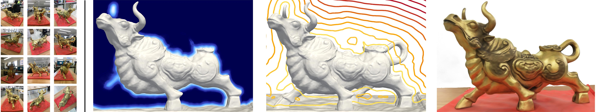

*原文图 1：论文方法流程图（图 1）；原始图注与完整说明见图片来源。 [查看图片来源](https://arxiv.org/html/2106.12052v2/figures/teaser.jpg)*

引用来源：arxiv_2610.18846

链接：[arXiv](https://arxiv.org/abs/2106.12052)

##### Mip-NeRF 360: Unbounded Anti-Aliased Neural Radiance Fields

作者：J. Barron, B. Mildenhall, Dor Verbin, P. Srinivasan, Peter Hedman

研究角色：背景与上下文工作
任务标签：context

中文简介：

该论文研究无界真实场景的新视角合成与深度估计，输入是覆盖大范围空间的多视角 RGB 图像，输出为任意视角的渲染图像及场景深度。Mip-NeRF 360 在抗混叠神经辐射场基础上，引入非线性空间参数化、在线蒸馏和基于畸变的正则化，以平衡近远距离内容并减少大范围场景中的伪影。它属于神经渲染的上下文基础工作，重点是可渲染外观与深度，而不是生成完整 Mesh 或补全不可见几何。

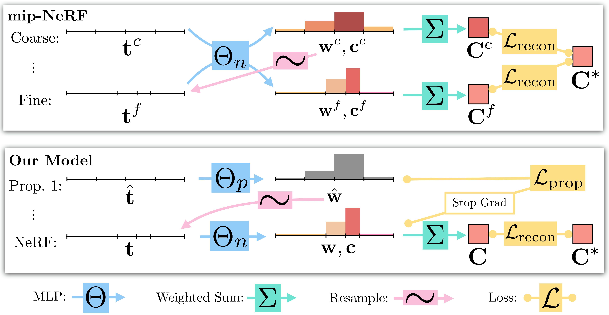

*原文图 3：论文方法流程图（图 3）；原始图注与完整说明见图片来源。 [查看图片来源](https://arxiv.org/html/2111.12077v3/figures/bmipnerf_sketch.png)*

引用来源：arxiv_2610.18846

链接：[arXiv](https://arxiv.org/abs/2111.12077)

##### 2022

##### MonoSDF: Exploring Monocular Geometric Cues for Neural Implicit Surface Reconstruction

作者：Zehao Yu, Songyou Peng, Michael Niemeyer, Torsten Sattler, Andreas Geiger

研究角色：背景与上下文工作
任务标签：context

中文简介：

该论文研究从多视角图像重建场景几何，输入为不同视角的 RGB 图像，输出为神经隐式表面及其可提取的三维几何。方法在隐式表面学习中引入通用单目深度与法线预测作为几何先验，并比较多层感知机、单网格和多分辨率网格等表示。它属于非生成式的几何重建基础路线，区别于依赖扩散先验的补全方法，核心是用单目几何线索缓解稀疏视角、纹理缺失区域中的重建歧义。

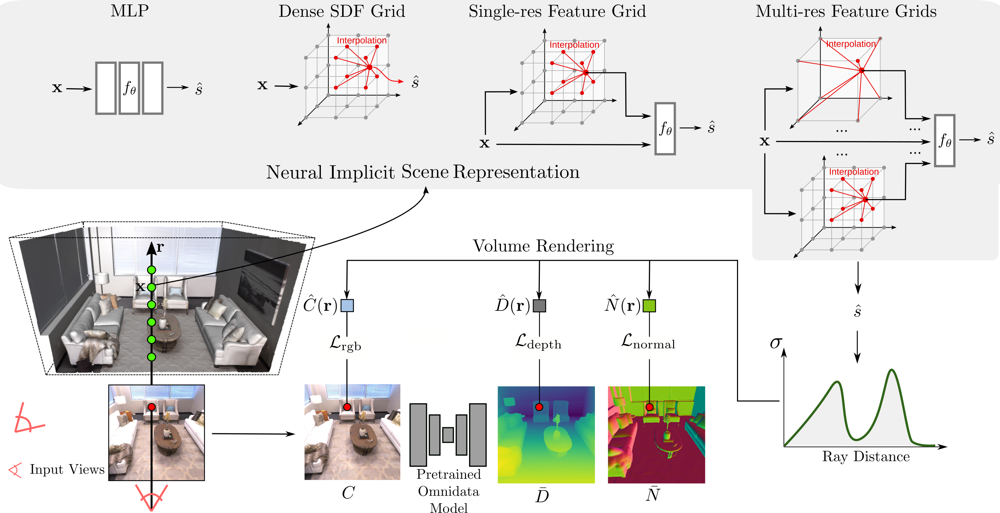

*原文图 2：论文方法流程图（图 2）；原始图注与完整说明见图片来源。 [查看图片来源](https://arxiv.org/html/2206.00665v2/gfx/method_overview/combined2.png)*

引用来源：arxiv_2610.18846

链接：[arXiv](https://arxiv.org/abs/2206.00665)

##### 2023

##### FineRecon: Depth-aware Feed-forward Network for Detailed 3D Reconstruction

作者：Noah Stier, Anurag Ranjan, Alex Colburn, Ya-Jie Yan, Liang Yang, Fangchang Ma, Baptiste Angles

研究角色：背景与上下文工作
任务标签：context

中文简介：

FineRecon解决已知相机位姿多视图图像的细节化场景几何重建任务：输入多视图图像及其深度线索，输出更精细的场景TSDF几何。方法采用与分辨率无关的TSDF监督避免插值误差，引入多视图深度估计增强空间表示，并在末端融合高分辨率图像特征以预测细节表面。它属于相机位姿条件的三维特征生成路线，针对前馈式TSDF重建通常过于粗糙的问题，区别于只依赖低分辨率体素特征的方案。

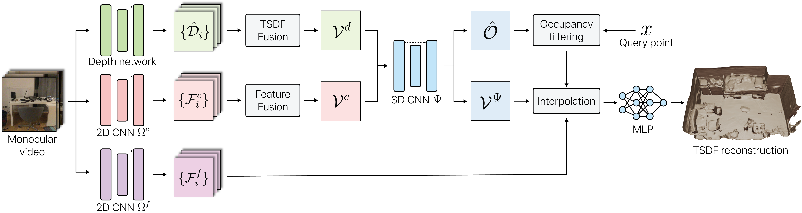

*原文图 2：论文方法流程图（图 2）；原始图注与完整说明见图片来源。 [查看图片来源](https://arxiv.org/html/2304.01480v2/fig/architecture/item.png)*

引用来源：arxiv_2610.18846

链接：[arXiv](https://arxiv.org/abs/2304.01480)

##### 3D Gaussian Splatting for Real-Time Radiance Field Rendering

作者：Bernhard Kerbl, Georgios Kopanas, Thomas Leimkuehler, G. Drettakis

研究角色：背景与上下文工作
任务标签：context

中文简介：

3D Gaussian Splatting解决多视图图像或视频下的高质量实时新视角合成任务：输入带稀疏点初始化的场景观测，输出可实时渲染的三维高斯辐射场。方法以各向异性三维高斯显式表示场景，交替进行参数优化和密度控制，并设计具备可见性意识的快速投影渲染。它属于显式三维辐射场路线，区别于依赖神经网络逐射线查询的隐式NeRF，在完整场景和实时渲染方面更强调效率。

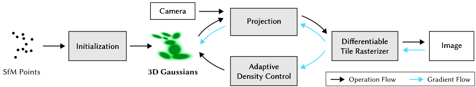

*原文图 2：论文方法流程图（图 2）；原始图注与完整说明见图片来源。 [查看图片来源](https://arxiv.org/html/2308.04079v1/overview_01.png)*

引用来源：arxiv_2610.18846

链接：[arXiv](https://arxiv.org/abs/2308.04079)

##### ScanNet++: A High-Fidelity Dataset of 3D Indoor Scenes

作者：Chandan Yeshwanth, Yueh-Cheng Liu, Matthias Niessner, Angela Dai

研究角色：背景与上下文工作
任务标签：context

中文简介：

ScanNet++不是重建模型，而是面向室内场景理解与新视角合成的数据基准：输入高质量激光扫描、单反图像及手机RGB-D采集，输出配准的几何、颜色和开放词汇语义标注。其核心贡献是联合提供高精度与消费级传感器数据，并显式记录语义歧义场景，支持真实条件下的三维评测。它位于本领域的数据基础设施位置，为场景级重建、材质恢复和语义理解路线提供更细致的训练与测试条件。

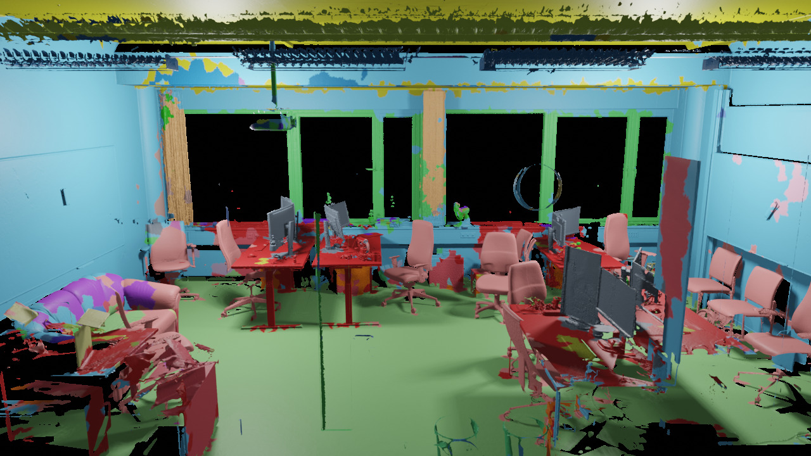

*原文图 7：论文方法流程图（图 7）；原始图注与完整说明见图片来源。 [查看图片来源](https://arxiv.org/html/2308.11417v1/img/semantic/sem/2022-12-04_12-25_pointnetpp_camera_full.jpg)*

引用来源：arxiv_2610.18846

链接：[arXiv](https://arxiv.org/abs/2308.11417)

##### SyncDreamer: Generating Multiview-consistent Images from a Single-view Image

作者：Yuan Liu, Chu-Hsing Lin, Zi-Jiao Zeng, Xiaoxiao Long, Ling-Jie Liu, Taku Komura, Wen-Ping Wang

研究角色：背景与上下文工作
任务标签：context

中文简介：

SyncDreamer解决单张图像到多视图一致图像的生成任务：输入一个物体的单视图图像，输出多个视角下具有一致几何和颜色的图像。方法建立联合多视图扩散模型，在同一反向过程中生成各视图，并通过三维感知特征注意力同步不同视角的中间状态。它属于多视图生成的前置基础路线，区别于逐视角生成的新视图方法，重点在于为后续图像到三维或文本到三维提供一致观测。

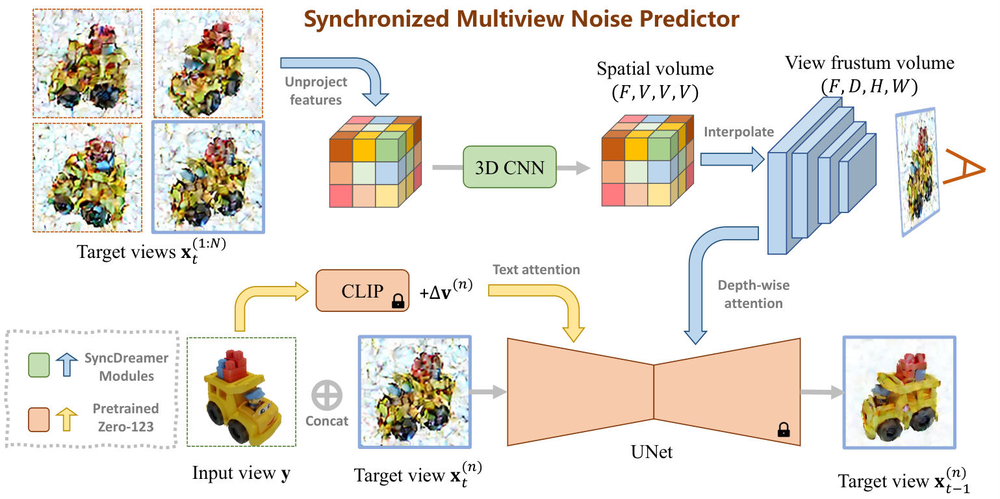

*原文图 2：论文方法流程图（图 2）；原始图注与完整说明见图片来源。 [查看图片来源](https://arxiv.org/html/2309.03453v2/pipeline.png)*

引用来源：arxiv_2610.18846

链接：[arXiv](https://arxiv.org/abs/2309.03453)

##### DUSt3R: Geometric 3D Vision Made Easy

作者：Shuzhe Wang, Vincent Leroy, Yohann Cabon, Boris Chidlovskii, Jérôme Revaud

研究角色：背景与上下文工作
任务标签：context

中文简介：

DUSt3R解决无相机标定和位姿条件下的多视图三维重建任务：输入任意图像集合，输出场景点图、深度及可进一步恢复的相机信息。方法以图像对为单位回归稠密点图，用全局对齐将不同图像对置于统一坐标系，并借助Transformer编码器和解码器完成预测。它属于无位姿多视角生成式重建的基础路线，区别于依赖显式投影模型和已知位姿的传统多视图立体。

*原文图 1：论文方法流程图（图 1）；原始图注与完整说明见图片来源。 [查看图片来源](https://arxiv.org/html/2312.14132v3/dust3r.png)*

引用来源：arxiv_2610.18846

链接：[arXiv](https://arxiv.org/abs/2312.14132)

##### PixelSplat: 3D Gaussian Splats from Image Pairs for Scalable Generalizable 3D Reconstruction

作者：David Charatan, S. Li, Andrea Tagliasacchi, Vincent Sitzmann

研究角色：背景与上下文工作
任务标签：context

中文简介：

PixelSplat从一对图像重建可渲染的三维场景表示，输入双视图图像，输出由三维高斯基元组成的辐射场。其核心是预测三维位置的稠密概率分布，并通过可微重参数化采样高斯中心，再联合优化高斯属性以支持快速渲染。该方法位于前馈式三维重建与显式辐射场路线，区别于依赖逐场景优化的NeRF，也不同于直接生成网格的几何重建方法。

*原文图 7：论文方法流程图（图 7）；原始图注与完整说明见图片来源。 [查看图片来源](https://arxiv.org/html/2312.12337v4/x2.png)*

引用来源：arxiv_2610.18846

链接：[arXiv](https://arxiv.org/abs/2312.12337)

##### 2024

##### 2D Gaussian Splatting for Geometrically Accurate Radiance Fields

作者：Binbin Huang, Zehao Yu, Anpei Chen, Andreas Geiger, Shenghua Gao

研究角色：背景与上下文工作
任务标签：context

中文简介：

2DGS面向多视角辐射场重建，输入带相机信息的多视角图像，输出由定向二维高斯圆盘构成、可实时渲染且具有明确表面的三维表示。它通过射线与圆盘求交实现透视准确的 splatting，并加入深度畸变和法线一致性约束。该方法侧重可见表面的几何精度，是场景生成与补全可借用的表示或重建基线，但不生成未观测区域。

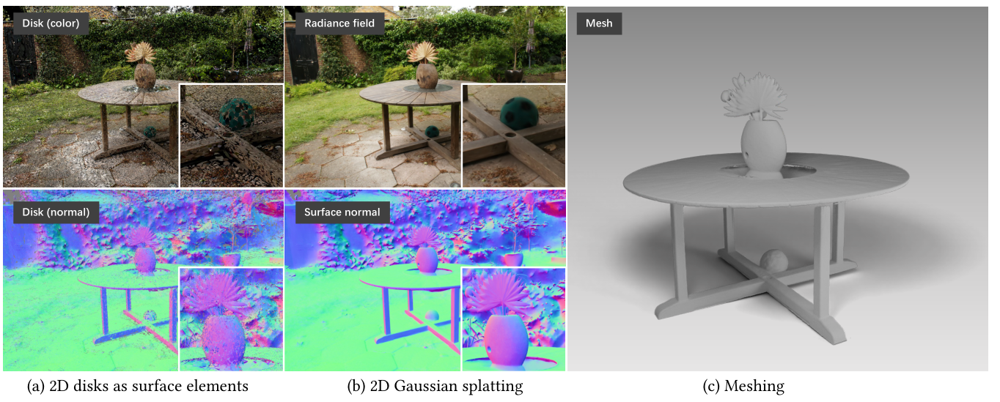

*原文图 1：论文方法流程图（图 1）；原始图注与完整说明见图片来源。 [查看图片来源](https://arxiv.org/html/2403.17888v3/teaser.png)*

引用来源：arxiv_2610.18846

链接：[arXiv](https://arxiv.org/abs/2403.17888)

##### Global Structure-from-Motion Revisited

作者：Linfei Pan, Dániel Baráth, M. Pollefeys, Johannes L. Schönberger

研究角色：背景与上下文工作
任务标签：context

中文简介：

GLOMAP解决全局运动恢复问题，输入多幅存在重叠的图像及其匹配关系，输出相机位姿和稀疏三维结构。它采用全局 SfM 范式，统一利用跨图像约束估计场景与相机运动，而非逐张注册和扩展模型。该工作是生成式重建的上游基础设施，可提供相机条件，但本身不生成完整表面，也不负责遮挡区域的几何补全。

*原文图 3：论文方法流程图（图 3）；原始图注与完整说明见图片来源。 [查看图片来源](https://arxiv.org/html/2407.20219v2/figure/glomap_pipeline_calib.png)*

引用来源：arxiv_2610.18846

链接：[arXiv](https://arxiv.org/abs/2407.20219)

##### LVSM: A Large View Synthesis Model with Minimal 3D Inductive Bias

作者：Haian Jin, Hanwen Jiang, Hao Tan, Kai Zhang, Sai Bi, Tianyuan Zhang, Fujun Luan, Noah Snavely, Zexiang Xu

研究角色：背景与上下文工作
任务标签：context

中文简介：

LVSM从稀疏多视角图像输入，输出指定新视角的图像，任务是新视角合成而非完整三维几何恢复。其核心是Transformer架构：编码器—解码器版本把图像压缩为固定数量的一维潜变量，解码器版本则直接由输入图像预测目标视图，均弱化甚至取消显式三维表示与几何归纳偏置。它代表纯数据驱动的视图生成路线，与需要场景几何、位姿投影或体渲染的重建方法不同，因此不属于本综述的场景级几何生成类别。

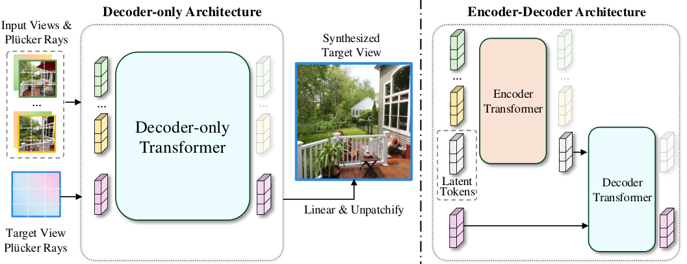

*原文图 2：论文方法流程图（图 2）；原始图注与完整说明见图片来源。 [查看图片来源](https://arxiv.org/html/2410.17242v2/model_3.png)*

引用来源：arxiv_2610.18846

链接：[arXiv](https://arxiv.org/abs/2410.17242)

##### Structured 3D Latents for Scalable and Versatile 3D Generation

作者：Jianfeng Xiang, Ze-Long Lv, Si-Cheng Xu, Yu Deng, Ruicheng Wang, Bowen Zhang, Dong Chen, Xin Tong, Jiao-Long Yang

研究角色：背景与上下文工作
任务标签：context

中文简介：

该方法以文本或图像条件为输入，生成可解码为辐射场、三维高斯或Mesh的三维资产，并支持局部编辑。核心是Structured LATent（SLat）：将稀疏三维网格与视觉基础模型提取的密集多视角特征结合，在结构化三维潜空间中使用rectified flow Transformer进行生成。它代表原生3D latent生成路线，相比二维图像潜变量或单一输出表示，保留空间结构并提供多种三维解码形式；对象资产生成是其重点，而非多视角室内重建。

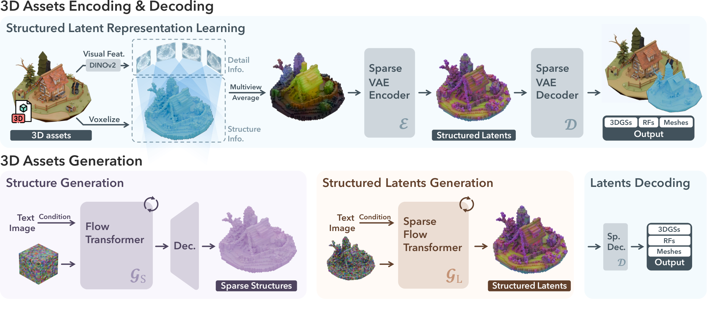

*原文图 1：论文方法流程图（图 1）；原始图注与完整说明见图片来源。 [查看图片来源](https://arxiv.org/html/2412.01506v3/pipeline_v3.png)*

引用来源：arxiv_2610.18846

链接：[arXiv](https://arxiv.org/abs/2412.01506)

##### 2025

##### Multi-view Reconstruction via SfM-guided Monocular Depth Estimation

作者：Haoyu Guo, He Zhu, Si-Da Peng, Hao-Tong Lin, Yunzhi Yan, Tao Xie, Wen-Guan Wang, Xiao-Wei Zhou, Hu-Jun Bao

研究角色：背景与上下文工作
任务标签：context

中文简介：

Murre以多视角图像为输入，输出多视角度量深度并融合为场景几何。方法先通过SfM提取稀疏点云和全局结构，再以其转化的稀疏深度条件引导扩散模型进行逐图深度预测，最后执行TSDF融合。它避开传统多视图立体对密集跨图匹配的依赖，属于位姿或粗几何辅助的生成式重建路线，但重点是深度估计，不是直接生成完整场景Mesh。

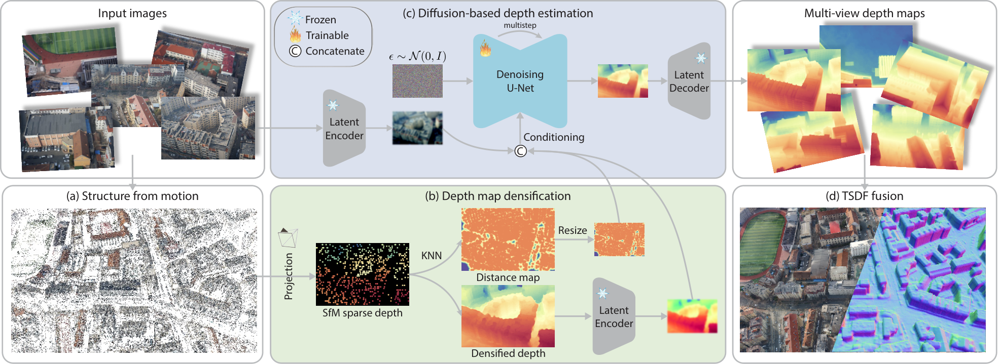

*原文图 1：论文方法流程图（图 1）；原始图注与完整说明见图片来源。 [查看图片来源](https://arxiv.org/html/2503.14483v1/pipeline.png)*

引用来源：arxiv_2610.18846

链接：[arXiv](https://arxiv.org/abs/2503.14483)

##### Syncity: Training-Free Generation of 3D Worlds

作者：Paul Engstler, Aleksandar Shtedritski, Iro Laina, Christian Rupprecht, Andrea Vedaldi

研究角色：背景与上下文工作
任务标签：context

中文简介：

SynCity从文本描述出发，输出可探索、可持续扩展的三维世界。其核心范式是无需微调或测试时优化，组合预训练文本、图像与三维生成器，并按空间tile逐块生成，在上下文条件下与已有区域衔接。该工作属于空间一致的完整场景生成方向，更侧重文本驱动的大尺度世界扩展，而非由真实多视角RGB进行几何重建。

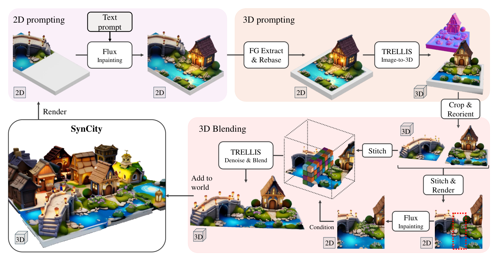

*原文图 1：论文方法流程图（图 1）；原始图注与完整说明见图片来源。 [查看图片来源](https://arxiv.org/html/2503.16420v1/main-method.png)*

引用来源：arxiv_2610.18846

链接：[arXiv](https://arxiv.org/abs/2503.16420)

##### VGGT: Visual Geometry Grounded Transformer

作者：Jianyuan Wang, Minghao Chen, Nikita Karaev, Andrea Vedaldi, Christian Rupprecht, David Novotný

研究角色：背景与上下文工作
任务标签：context

中文简介：

VGGT从单张、少量或大量图像输入，直接输出相机参数、点图、深度图和三维点轨迹等多种几何属性。其核心是端到端前馈Transformer，将多视角视觉信息统一编码并联合推断，避免依赖逐场景优化及复杂后处理。相较于专门解决单一任务的深度、位姿或点云模型，它提供统一的视觉几何基础，但本身并非面向完整室内场景生成或几何补全。

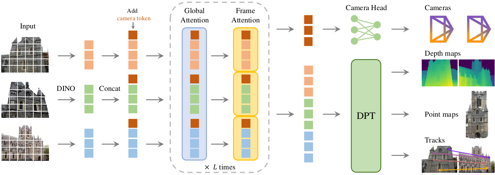

*原文图 1：论文方法流程图（图 1）；原始图注与完整说明见图片来源。 [查看图片来源](https://arxiv.org/html/2503.11651v1/architecture_v4.png)*

引用来源：arxiv_2610.18846

链接：[arXiv](https://arxiv.org/abs/2503.11651)

##### Geometrycrafter: Consistent Geometry Estimation for Open-World Videos With Diffusion Priors

作者：Tianhan Xu, Xiangjun Gao, Wen-Bo Hu, Xiaoyu Li, Songiie Zhang, Shan Ying

研究角色：背景与上下文工作
任务标签：context

中文简介：

该方法从开放世界视频输入，输出具有尺度信息且时间一致的点图序列，并可进一步用于三维或四维重建。核心是构建面向无界点图的变分自编码器，将视频扩散模型的生成先验迁移到点图序列建模中，以恢复高保真几何和相机信息。它区别于仅预测仿射不变深度的路线，强调度量准确性与跨帧一致性，但不直接生成完整室内Mesh。

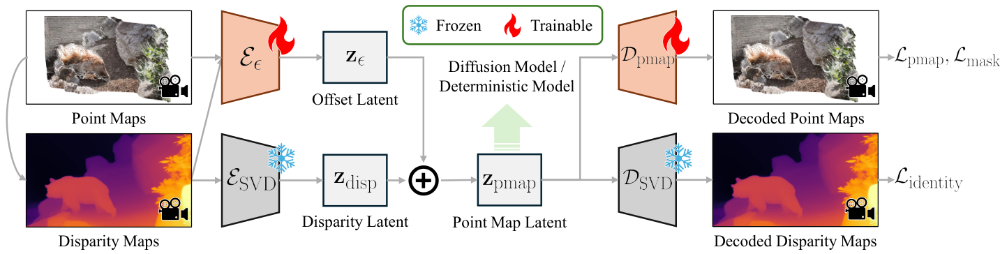

*原文图 2：论文方法流程图（图 2）；原始图注与完整说明见图片来源。 [查看图片来源](https://arxiv.org/html/2504.01016v1/method.png)*

引用来源：arxiv_2610.18846

链接：[arXiv](https://arxiv.org/abs/2504.01016)

##### WorldGrow: Generating Infinite 3D World

作者：Sikuang Li, Chen Yang, Jie-Min Fang, Taoran Yi, Jia Lu, Jiazhong Cen, Ling-Xi Xie, Wei Shen, Qi Tian

研究角色：背景与上下文工作
任务标签：context

中文简介：

WorldGrow解决生成可无限延展、几何连续且外观一致的三维世界任务，输入粗略场景条件或已有区域，输出可持续扩展的结构化场景区块及其几何纹理。方法先整理高质量场景区块训练原生3D latent，再用三维区块修补结合上下文进行延展，并以由粗到细的层次生成兼顾布局和局部细节。它代表空间分块式、原生3D生成驱动的世界生成路线，区别于仅生成单物体或依赖二维图像提升的方法；但摘要未明确其以真实多视角RGB重建为输入。

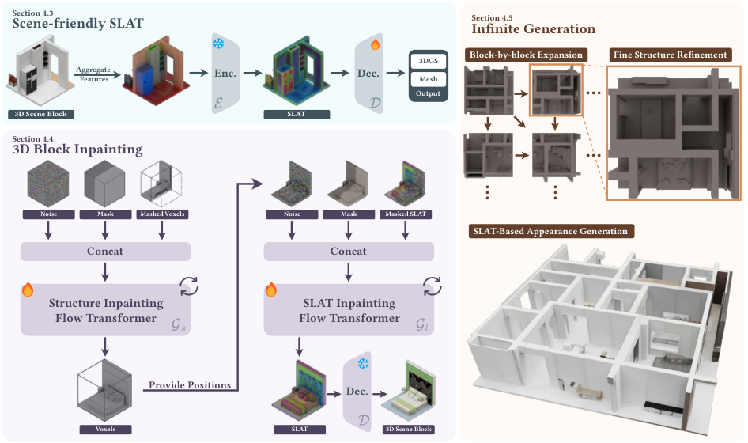

*原文图 1：论文方法流程图（图 1）；原始图注与完整说明见图片来源。 [查看图片来源](https://arxiv.org/html/2510.21682v1/pipeline_v2-resized.png)*

引用来源：arxiv_2610.18846

链接：[arXiv](https://arxiv.org/abs/2510.21682)

##### 2026

##### SAGE: Scalable Agentic 3D Scene Generation for Embodied AI

作者：Hongchi Xia, Xuan Li, Zhao-Shuo Li, Qian-Li Ma, Jiashu Xu, Ming-Yu Liu, Yin Cui, Tsung-Yi Lin, Wei-Chiu Ma, Shen-Long Wang, Shuran Song, Fangyin Wei

研究角色：背景与上下文工作
任务标签：context

中文简介：

SAGE解决面向具身智能的可仿真三维环境生成任务，输入用户指定的交互任务，输出包含布局、物体组成并满足视觉与物理要求的完整场景。方法采用智能体协调多个布局和物体生成器，并由语义、真实感及物理稳定性评估器反复检查，通过推理和工具选择进行自我修正。它属于任务驱动的空间世界生成，区别于以真实多视角RGB为条件、强调观测一致性和几何重建的场景级生成式路线。

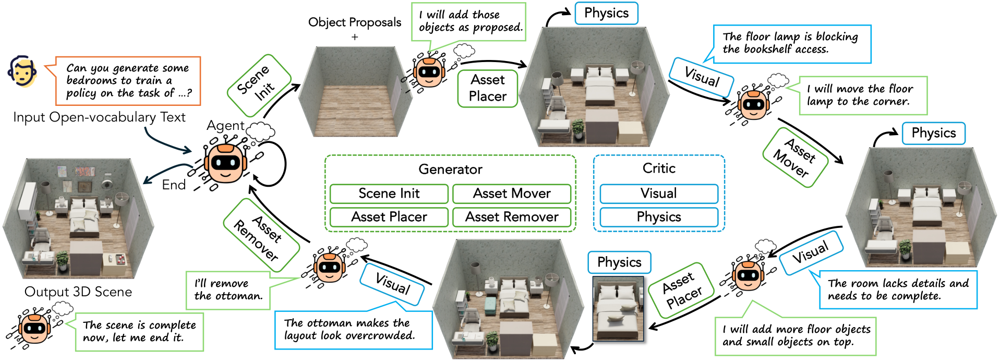

*原文图 1：论文方法流程图（图 1）；原始图注与完整说明见图片来源。 [查看图片来源](https://arxiv.org/html/2602.10116v2/method.png)*

引用来源：arxiv_2610.18846

链接：[arXiv](https://arxiv.org/abs/2602.10116)

##### VGGT-$\Omega$

作者：Jianyuan Wang, Minghao Chen, Shang-Zhan Zhang, Nikita Karaev, Johannes L. Schonberger, Patrick Labatut, Piotr Bojanowski, David Novotný, Andrea Vedaldi, Christian Rupprecht

研究角色：背景与上下文工作
任务标签：context

中文简介：

VGGT-Ω面向静态与动态场景的前馈式多视图重建，输入多帧图像，输出相机、深度等几何预测及可迁移的场景特征。方法通过单一稠密预测头、多任务监督、场景信息寄存器和受限的寄存器注意力提高训练与推理效率，并利用大规模标注及无标注视频学习。它属于重建基础模型和位姿相关的几何预测路线，重点是准确估计与通用特征，而非利用生成先验补全完整室内Mesh。

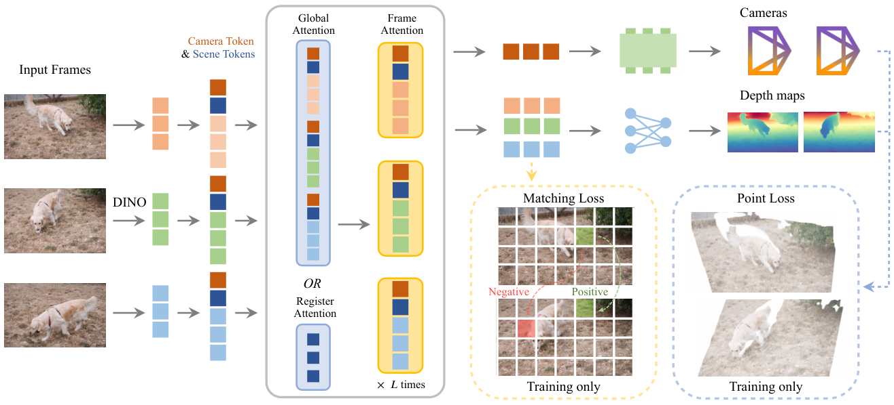

*原文图 2：论文方法流程图（图 2）；原始图注与完整说明见图片来源。 [查看图片来源](https://arxiv.org/html/2605.15195v1/architecture_v8.png)*

引用来源：arxiv_2610.18846

链接：[arXiv](https://arxiv.org/abs/2605.15195)

##### BVB: Benchmarking Agentic Video Understanding via Programmatic Reconstruction in Blender

作者：Y. Y. Tang, D. Shimada, Jia-Yue Meng, Jing Bi, Pin-Xin Liu, Yi-Cheng Wang, Yunzhong Xiao, Zhang-Yun Tan, Ze-Liang Zhang, Chao Huang, Susan Liang, Qianxiang Shen, Luchuan Song, A. Vosoughi, Ming-Qian Feng, Melika Filvantorkaman, Chen-Liang Xu

研究角色：背景与上下文工作
任务标签：context

中文简介：

BVB并非室内三维重建方法，而是评测多模态智能体视频理解的任务：输入真实视频，输出可在Blender中渲染的带动画场景及相机程序。其核心范式是让智能体通过编写代码重建视频，再从渲染结果评估时空事实保留和感知相似度，并结合综合指标比较模型能力。该工作属于视频理解与程序化重建评测，关注语义理解和代理成本，不涉及本综述所定义的多视角室内几何生成类别。

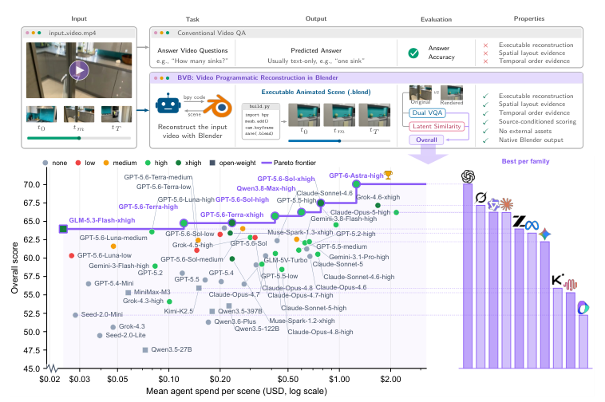

*原文图 1：论文方法流程图（图 1）；原始图注与完整说明见图片来源。 [查看图片来源](https://arxiv.org/html/2609.15478v3/teaser_frontier_combined.png)*

引用来源：arxiv_2610.18846

链接：[arXiv](https://arxiv.org/abs/2609.15478)
