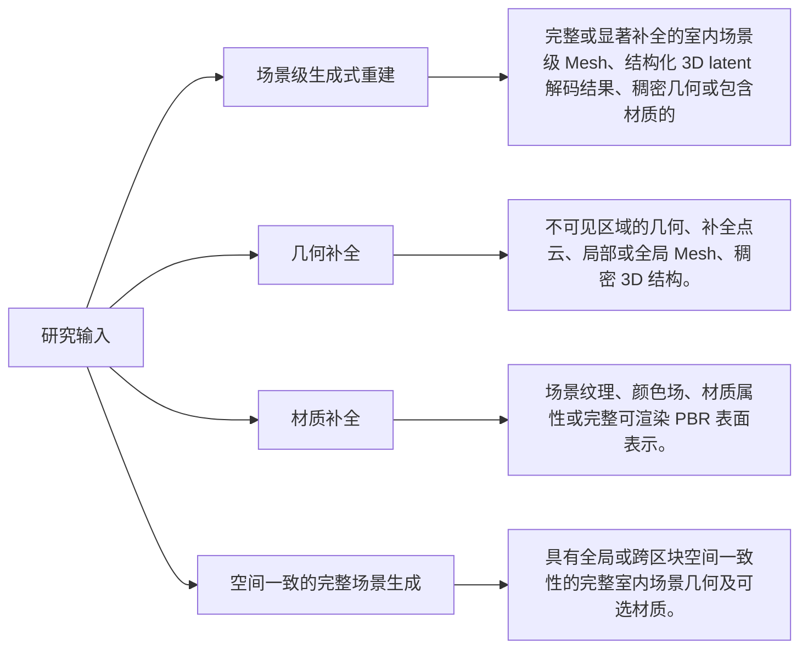
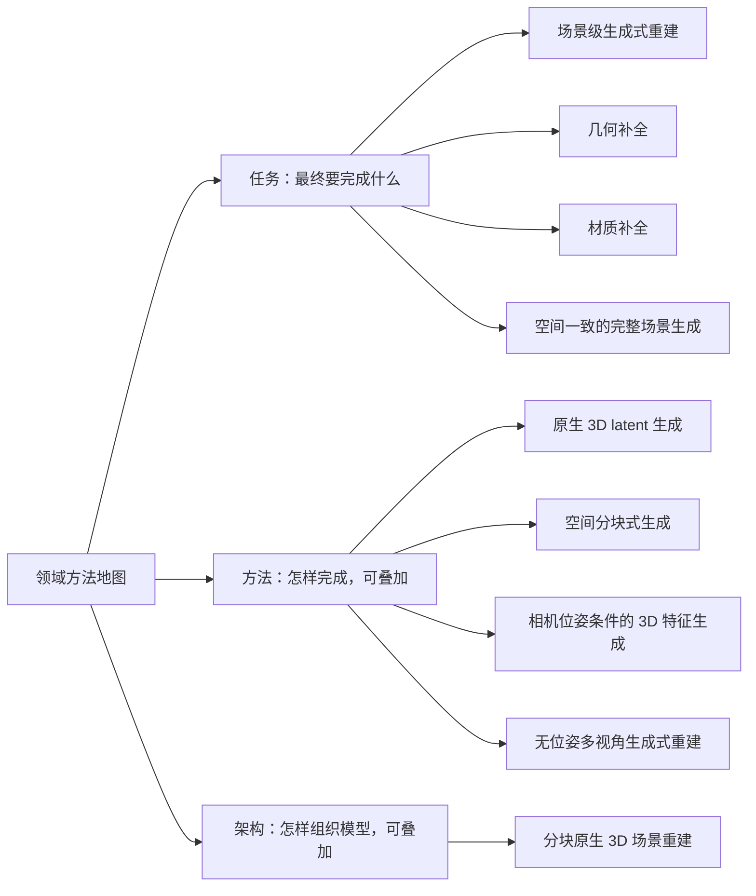
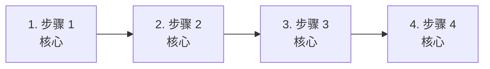
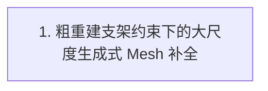
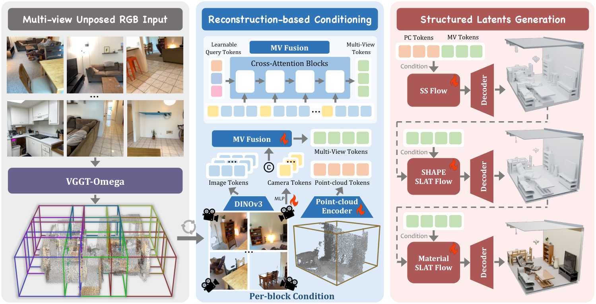
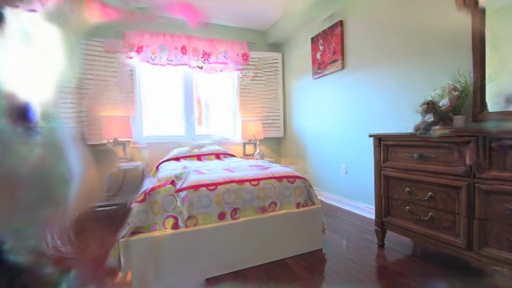
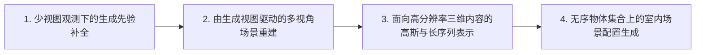
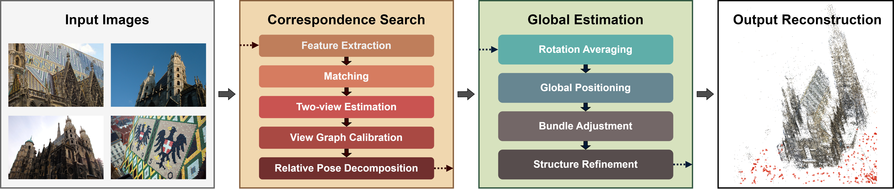
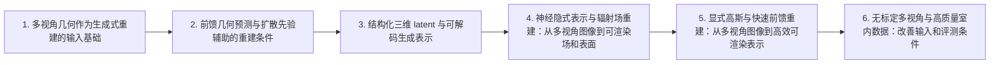

# 基于 Trellis 思路的室内场景生成式重建：快速理解

> 当前页面用于快速建立领域地图。 [逐篇解析（43 篇）](full/) · [BibTeX 与 DBLP 查询结果](bibliography/index.html) · [返回综述目录](../)

## 总述

### 一句话定义

本领域研究从多视角 RGB 图像及可选的粗相机、点云或深度出发，重建具有完整空间结构的室内三维场景。核心不只是恢复相机可见表面或合成新视角，而是借助 Trellis/TRELLIS.2 一类原生三维生成表示、结构化三维 latent（保留空间位置与邻接关系的压缩变量）、扩散或 flow matching（学习噪声状态到目标分布的连续生成过程），对遮挡和未观测区域进行几何、细节或材质补全，并输出可渲染的 Mesh（由顶点、边和面组成的表面）或其他场景级三维表示。研究脉络由单区块生成逐步走向多区块协同、全局空间约束和大范围世界扩展。

### 任务边界

### 快速要点

- **任务：** 给定真实室内环境的多视角 RGB 观测及可选粗几何或相机信息，利用生成式三维先验恢复观测之外的合理结构与外观，形成空间一致、可渲染的完整场景级几何，而非仅生成图像或可见表面。
- **输入：** 核心输入是同一室内场景的多视角 RGB 图像；可附带粗相机位姿、稀疏点云、深度、点图或传统重建结果，输入可以有噪声或不完整。
- **输出：** 输出为完整或补全后的室内场景级 Mesh、结构化三维 latent 解码结果或其他可渲染三维表示，并可包含颜色、纹理及 PBR 材质属性。
- **核心关注：** 有限视角和遮挡造成的不可见几何具有多解性，既要补全又要避免违背真实观测；原生三维表示需同时承载稀疏大场景、复杂拓扑和高频外观，计算与存储成本高；多视角、区块边界和生成先验之间容易产生几何、纹理与尺度不一致；粗相机或点云存在误差时，生成模型必须在空间落地约束与先验合理性之间取得平衡；场景级完整性、几何准确性、材质真实性和可渲染性缺乏统一且能区分幻觉的评价方式。

*面向读者：刚刚入学、了解 Transformer 基础但不熟悉场景生成式重建的博士生；综述截止日期：2026-10-15。*

### 领域标准流程

下图只表达跨任务、跨论文的共同范式；标为可选的环节并非所有方法都包含。

## 分类

先按研究角色区分主体论文、相邻工作和背景工作；主体论文内部的任务标签可以多选。方法标签和架构标签可以叠加。

### 任务维度

#### 场景级生成式重建（Scene-level Generative Reconstruction）

该类别覆盖从多视角 RGB 及可选粗相机、点云或深度出发，生成完整室内场景级几何的研究。它区别于只恢复可见表面或只产生新视角图像的方法，核心输出是具有场景空间结构的 Mesh（由顶点、边和面构成的多边形表面）或其他可渲染 3D 表示。

**核心范式：** 输入多视角 RGB 图像，可附带粗相机、点云或深度；模型先建立跨视角和空间对应关系，再在原生 3D 表示或结构化 latent 空间中进行生成式推断，最后输出完整场景 Mesh、稠密几何或可渲染 3D 表示。

**典型输入：** 多视角 RGB 图像；可选粗相机位姿、稀疏点云、深度图、点图或其他传统重建中间结果。

**典型输出：** 完整或显著补全的室内场景级 Mesh、结构化 3D latent 解码结果、稠密几何或包含材质的可渲染 3D 表示。

**类别典型流程（非领域标准）：**

*代表论文方法图。论文方法流程图（图 1）；原始图注与完整说明见图片来源。 [查看图片来源](https://arxiv.org/html/2610.18846v1/pipeline_pdf.png)*

#### 几何补全（Geometry Completion）

该类别关注利用生成式 3D 先验补全多视角观测中因遮挡、视野有限或重建失败而缺失的室内几何。它可以作为完整场景重建流程中的核心阶段，也可以针对局部区块或表面进行生成式恢复。

**核心范式：** 输入多视角 RGB 及可选粗点云、深度或不完整几何；模型编码可见结构和空间上下文，在 3D latent、稀疏结构或其他生成空间中预测缺失区域，输出补全后的几何或场景级 Mesh。

**典型输入：** 多视角 RGB；可选不完整点云、深度、粗 Mesh、相机位姿或空间区块。

**典型输出：** 不可见区域的几何、补全点云、局部或全局 Mesh、稠密 3D 结构。

**类别典型流程（非领域标准）：**

*代表论文方法图。论文方法流程图（图 1）；原始图注与完整说明见图片来源。 [查看图片来源](https://arxiv.org/html/2610.18846v1/pipeline_pdf.png)*

#### 材质补全（Material Completion）

该类别关注在场景几何已获得或同步生成的基础上，为不可见表面或缺失区域生成一致的颜色、纹理和 PBR 材质。PBR 材质是适用于物理近似渲染的表面属性集合，通常包括基础颜色、粗糙度、金属度和法线等。

**核心范式：** 输入多视角 RGB、场景几何及可选可见材质；模型将图像外观映射到场景表面或 3D latent，并对未观测表面进行生成式补全，输出纹理、颜色场或 PBR 材质。

**典型输入：** 多视角 RGB；已有或同步生成的室内场景几何；可选可见纹理、法线、深度和相机信息。

**典型输出：** 场景纹理、颜色场、材质属性或完整可渲染 PBR 表面表示。

**类别典型流程（非领域标准）：**

#### 空间一致的完整场景生成（World Generation）

该类别关注在多视角视觉观测或粗空间条件下生成具有全局结构、邻域连续性和场景级一致性的完整室内世界。它覆盖单房间到更大范围场景的生成式扩展，但在本综述边界内必须与真实多视角 RGB 重建条件相联系。

**核心范式：** 输入多视角 RGB 及可选粗点云、相机或布局约束；系统建立全局坐标或邻域关系，按区块联合或渐进生成 3D 内容，并通过重叠区域、邻域条件或全局 latent 保持连续性，输出完整可渲染室内场景。

**典型输入：** 多视角 RGB；可选粗点云、相机、深度、布局或已生成邻域区块。

**典型输出：** 具有全局或跨区块空间一致性的完整室内场景几何及可选材质。

**类别典型流程（非领域标准）：**

*代表论文方法图。论文方法流程图（图 1）；原始图注与完整说明见图片来源。 [查看图片来源](https://arxiv.org/html/2610.18846v1/pipeline_pdf.png)*

### 方法维度

#### 原生 3D latent 生成（Native 3D Latent Generation）

该类别按生成发生的表示空间划分：模型在原生 3D 表示或结构化 3D latent 中进行生成，并直接解码为场景几何。结构化 3D latent 是保留空间位置、邻接或层级关系的压缩潜变量，不等同于独立的二维图像 latent。

**核心范式：** 多视角 RGB 和可选粗几何先被编码为结构化 3D 条件；diffusion 或 flow matching 在该 3D latent、稀疏体素、3D token 或其他原生 3D 空间中生成目标表示；解码器输出 Mesh、占据场、点云或可渲染场景。

**典型输入：** 多视角 RGB；可选粗点云、深度、相机或 3D 特征条件。

**典型输出：** 结构化 3D latent、稀疏 3D 表示、Mesh、占据结构或可渲染 3D 场景。

*代表论文方法图。论文方法流程图（图 1）；原始图注与完整说明见图片来源。 [查看图片来源](https://arxiv.org/html/2610.18846v1/pipeline_pdf.png)*

#### 空间分块式生成（Spatial Block-wise Generation）

该类别按推理时的空间组织策略划分：将室内场景拆分为具有明确空间邻接关系的区块，在区块内生成并通过联合建模、邻域条件或渐进外推扩展场景。

**核心范式：** 输入多视角 RGB 及粗场景条件；系统建立空间区块和邻域；每个区块通过联合去噪或顺序生成获得 3D 内容；最后融合重叠区域并组装为统一场景。

**典型输入：** 多视角 RGB；可选粗点云、深度、相机、全局坐标或已生成邻域区块。

**典型输出：** 连续的多区块室内场景几何或可渲染 3D 表示。

*代表论文方法图。论文方法流程图（图 1）；原始图注与完整说明见图片来源。 [查看图片来源](https://arxiv.org/html/2610.18846v1/pipeline_pdf.png)*

#### 相机位姿条件的 3D 特征生成（Pose-conditioned 3D Feature Generation）

该类别按多视角信息进入 3D 空间的方式划分：依赖准确或已知相机位姿，将不同视角图像特征投影、融合到 3D 特征体或空间网格，再由生成模型恢复场景几何。

**核心范式：** 输入多视角 RGB 和准确相机位姿；图像编码器提取特征并投影到 3D 特征体；生成器基于融合特征预测完整几何或 Mesh；后处理阶段进行空间融合和渲染。

**典型输入：** 多视角 RGB 与准确或高质量估计的相机位姿；可选粗深度、点云或空间边界。

**典型输出：** 3D 特征体、补全几何、场景 Mesh 或可渲染 3D 表示。

#### 无位姿多视角生成式重建（Pose-free Multiview Generation）

该类别按位姿依赖性划分：模型不要求准确输入相机位姿，而是从多视角 RGB 及可选粗点云、深度或点图中共同推断视角关系和场景几何，并进行生成式重建。

**核心范式：** 输入多视角 RGB，可附带粗几何但不要求精确相机；模型通过联合特征交互、点图或隐式空间关系推断视角对应，再在 3D 生成空间中输出场景几何并进行一致性融合。

**典型输入：** 多视角 RGB；可选粗点云、深度、点图或低精度相机信息。

**典型输出：** 跨视角一致的场景级几何、Mesh 或可渲染 3D 表示。

*代表论文方法图。论文方法流程图（图 1）；原始图注与完整说明见图片来源。 [查看图片来源](https://arxiv.org/html/2610.18846v1/pipeline_pdf.png)*

### 架构维度

#### 分块原生 3D 场景重建（Blockwise Native 3D Reconstruction）

该架构类别描述一种系统级组织方式：以空间区块作为推理单元，每个区块由原生 3D 生成器进行重建或补全，并通过相邻区块信息、重叠区域或全局粗几何维持场景一致性。

**核心范式：** 输入多视角 RGB 及粗点云或其他空间条件；系统划分空间区块并为每个区块收集观测；区块级原生 3D 生成器预测局部几何；邻域协调模块进行边界融合；最终组装为完整室内场景。

**典型输入：** 多视角 RGB；粗点云、点图、深度或粗相机；空间区块和邻域关系。

**典型输出：** 跨区块一致的室内场景级 Mesh 或可渲染 3D 表示。

*代表论文方法图。论文方法流程图（图 1）；原始图注与完整说明见图片来源。 [查看图片来源](https://arxiv.org/html/2610.18846v1/pipeline_pdf.png)*

## 相关工作

本章不重复逐篇摘要，而是按照领域类别串起方法演化：先说明问题和范式，再说明代表工作如何改变方法，最后指出仍未解决的缺口。

> 相关工作当前未通过正式内容校验；以下内容仅作为可审计的临时领域地图。

### 场景级生成式重建（Scene-level Generative Reconstruction）

*相关工作代表论文方法图。论文方法流程图（图 1）；原始图注与完整说明见图片来源。 [查看图片来源](https://arxiv.org/html/2610.18846v1/pipeline_pdf.png)*

- **粗空间先验驱动的原生三维生成式场景重建**：当前材料显示，多视角图像对大尺度场景的观测可能无位姿、稀疏或不完整，因此完整表面恢复同时面临几何落地和不可见区域补全问题。；方法变化：当前材料显示，WorldRecon 将由输入图像重建得到的粗糙全局点云和相机位姿作为整体场景生成的空间支架，并将场景划分为空间块，再将原生三维生成模型 TRELLIS.2 用于多视角场景 Mesh 重建。；代表论文：arxiv_2610.18846。

**读者应记住：** 综合来看，WorldRecon 代表了当前材料中最直接符合研究范围的场景级生成式重建方向：真实多视角 RGB 图像提供观测条件，粗点云和相机提供空间锚点，TRELLIS.2 提供生成式三维表示，并以完整场景 Mesh 为目标输出。但其训练机制、块间一致性和室内场景表现仍需正文核验。

### 几何补全（Geometry Completion）

*相关工作代表论文方法图。论文方法流程图（图 1）；原始图注与完整说明见图片来源。 [查看图片来源](https://arxiv.org/html/2610.18846v1/pipeline_pdf.png)*

- **粗重建支架约束下的大尺度生成式 Mesh 补全**：当前材料显示，非位姿多视角图像难以直接支持大尺度场景的完整、高质量 Mesh 重建，因为部分表面可能不可见或只被稀疏观测，生成结果同时需要保持几何依据并合理补全未观测区域。；方法变化：当前材料显示，WorldRecon 将输入图像重建模型估计的粗糙、有噪声全局点云与相机位姿作为整场景生成的空间支架，并将场景划分为相互重叠的空间区块，再把 TRELLIS.2 的原生三维生成能力用于区块级生成；摘要明确称其为面向非位姿 RGB 图像的大尺度完整场景 Mesh 生成式多视角重建框架。；代表论文：arxiv_2610.18846。

**读者应记住：** 综合来看，给定论文材料支持的核心方向是：以粗几何和相机估计提供空间定位，以原生三维生成模型补全多视角观测缺失的大尺度场景 Mesh。由于只有一篇摘要级论文，当前不能进一步声称其训练机制、细节生成质量或室内场景性能。

### 空间一致的完整场景生成（World Generation）

*相关工作代表论文方法图。论文方法流程图（图 1）；原始图注与完整说明见图片来源。 [查看图片来源](https://arxiv.org/html/2610.18846v1/pipeline_pdf.png)*

- **以粗全局几何为支架的分块式大尺度生成重建**：综合来看，大尺度场景的多视角重建需要同时处理观测稀疏、不可见表面缺失以及完整场景的空间组织；给定摘要明确指出，输入图像可能无位姿，且由图像重建得到的全局点云和相机信息可能粗糙并带有噪声。；方法变化：当前材料显示，WorldRecon 将生成式多视角重建与粗略全局点云、相机位姿和重叠空间区块结合起来，并以 TRELLIS.2 这一原生三维生成模型作为场景生成基础；摘要明确将其定位为从无位姿 RGB 图像恢复完整大尺度三维场景网格的生成式框架。；代表论文：arxiv_2610.18846。

**读者应记住：** 现有证据表明，WorldRecon 代表了一条将粗全局几何作为空间锚点、再借助 TRELLIS.2 生成式三维表示补全大尺度场景网格的路线。其核心价值在于把生成式补全从局部缺失面推进到具有重叠空间区块的完整场景重建；但关于训练机制、跨区块一致性和最终可渲染场景组装的结论仍需正文核验。

### adjacent

*相关工作代表论文方法图。论文方法流程图（图 1）；原始图注与完整说明见图片来源。 [查看图片来源](https://arxiv.org/html/2312.02981v1/figures/all_results/re10k_00beb03ef95dc637_3_0022_zipnerf.png)*

*相关工作代表论文方法图。论文方法流程图（图 1）；原始图注与完整说明见图片来源。 [查看图片来源](https://arxiv.org/html/2405.10314v1/muni_overview3.png)*

- **少视图观测下的生成先验补全**：综合来看，少量照片造成观测不足，传统重建难以恢复未观测区域的几何与纹理。；方法变化：综合来看，ReconFusion 将扩散模型生成的新视角作为先验，并接入基于 NeRF 的场景重建流程。；代表论文：arxiv_2312.02981。
- **由生成视图驱动的多视角场景重建**：综合来看，高质量三维捕获通常需要大量图像，少视图输入难以覆盖完整场景。；方法变化：综合来看，CAT3D 以多视角扩散模型模拟拍摄过程，先生成目标视点图像，再交给三维重建方法获得三维表示。；代表论文：arxiv_2405.10314。
- **面向高分辨率三维内容的高斯与长序列表示**：综合来看，前馈三维生成和场景重建受到高分辨率输入、长序列计算量和三维表示效率的限制。；方法变化：综合来看，LGM 使用多视图 Gaussian 特征和可微渲染进行融合；Long-LRM 面向长序列场景输入，结合 Mamba2、Transformer、token merging 与 Gaussian pruning 处理宽覆盖重建。；代表论文：arxiv_2402.05054、arxiv_2410.12781。
- **无序物体集合上的室内场景配置生成**：综合来看，室内生成需要联合建模多个物体的空间关系，并减弱固定物体顺序对分布建模的影响。；方法变化：这些摘要共同显示，DiffuScene 将场景表示为无序物体集合，用去噪扩散模型联合生成位置、尺寸、朝向、语义和几何特征，并为物体配置检索相似几何。；代表论文：arxiv_2303.14207。

**读者应记住：** 这些摘要共同显示，相邻工作为 Trellis/TRELLIS.2 式室内场景生成式重建提供了生成先验、长范围表示和结构化场景配置等技术参照；但其核心输出通常是新视图、NeRF、Gaussian、物体级几何或文本驱动场景，不能直接归入本综述的主体方法。

### 背景与上下文工作（非任务背景）

*相关工作代表论文方法图。论文方法流程图（图 1）；原始图注与完整说明见图片来源。 [查看图片来源](https://arxiv.org/html/2407.20219v2/figure/glomap_pipeline_calib.png)*

*相关工作代表论文方法图。论文方法流程图（图 1）；原始图注与完整说明见图片来源。 [查看图片来源](https://arxiv.org/html/2503.11651v1/architecture_v4.png)*

- **多视角几何作为生成式重建的输入基础**：综合来看，传统多视角系统需要从图像中获得相机和几何线索，而极端视角变化、稀疏视图和全局尺度会影响匹配与重建稳定性。；方法变化：这些摘要共同显示，相关方法从传统二维匹配和增量式流程转向利用三维点图、全局 SfM 或前馈几何预测来获得更稳定的场景级条件。；代表论文：arxiv_2407.20219、arxiv_2406.09756、arxiv_2406.09756。
- **前馈几何预测与扩散先验辅助的重建条件**：综合来看，稀疏视图、视频尺度变化以及传统匹配对显存和对应关系的依赖，使得直接获得稳定、具有度量意义的几何条件仍然困难。；方法变化：这些摘要共同显示，后续工作使用前馈 Transformer、SfM 引导的条件扩散模型或点图潜变量来改善深度、点图和时序几何预测，但它们仍主要位于生成式场景重建之前的几何估计阶段。；代表论文：arxiv_2503.11651、arxiv_2503.14483、arxiv_2504.01016。
- **结构化三维 latent 与可解码生成表示**：综合来看，单一三维输出格式难以同时表达几何结构和外观，也限制了生成结果向 Mesh、辐射场或三维 Gaussian 等不同渲染形式转换。；方法变化：这些摘要共同显示，Structured 3D Latents 使用统一的 SLat 表示，将稀疏三维网格与稠密多视角视觉特征结合，并采用 rectified flow transformer 进行三维生成，从而把结构和纹理信息放在可解码的三维潜变量中。这里 rectified flow 是一种通过学习连续流把噪声分布运输到数据分布的生成建模方式。；代表论文：arxiv_2412.01506。
- **神经隐式表示与辐射场重建：从多视角图像到可渲染场和表面**：综合来看，早期神经隐式重建能够从二维图像学习场景表示，但大场景、稀疏视角、遮挡和无纹理区域会带来几何约束不足、表面提取不稳定或渲染质量下降的问题。；方法变化：综合来看，这一阶段的主要变化是从通用密度场转向显式建模几何表面或更适合无界场景的参数化，并利用单目几何线索和几何正则化增强重建约束。；代表论文：arxiv_2106.10689、arxiv_2106.12052、arxiv_2206.00665、arxiv_2111.12077。
- **显式高斯与快速前馈重建：从多视角图像到高效可渲染表示**：这些摘要共同显示，传统神经辐射场和隐式表示在训练、渲染速度或几何细节方面存在代价，而显式局部表示还可能受到多视角不一致、局部极小值和粗糙几何的影响。；方法变化：综合来看，这一阶段将表示转向三维高斯或显式体素/TSDF相关结构，并结合前馈预测、概率采样、深度引导和更直接的几何监督，以提高速度、几何一致性或细节质量。；代表论文：arxiv_2308.04079、arxiv_2312.12337、arxiv_2403.17888、arxiv_2304.01480。
- **无标定多视角与高质量室内数据：改善输入和评测条件**：这些摘要共同显示，多视角重建通常依赖相机内外参数，而真实室内数据还需要同时具备高质量几何、颜色、相机登记和语义标注，才能支持可靠评测。；方法变化：综合来看，这一阶段的变化是将相机参数估计和数据采集条件纳入重建流程：DUSt3R以点图回归放松传统投影相机约束，ScanNet++则提供高质量、多来源且带登记关系的室内场景数据。；代表论文：arxiv_2312.14132、arxiv_2308.11417。

**读者应记住：** 应结合各阶段的证据记录继续核对论文正文。
